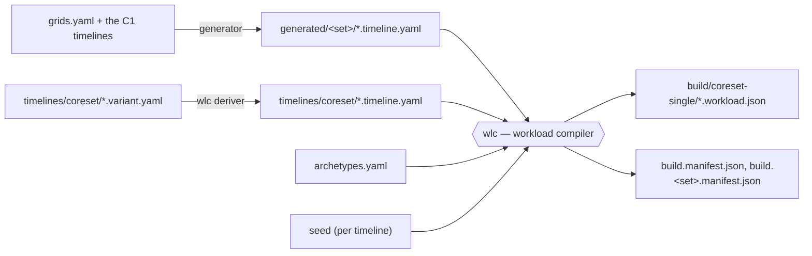

# dataset/

The **workload dataset**: everything that produces the canonical workload files the simulator and harness consume. Authored as human-readable **timelines**, compiled to machine-readable **canonical JSON** by **wlc** (the workload compiler, `tools/wlc/`) — wlc resolves all randomness at compile time, so the simulator replays concrete values and two conditions always face byte-identical workloads.

## Layout

```
archetypes.yaml        # behavior library — one entry per process kind, each with its declared scheduling class (fully measured, v0.2)
sources.yaml           # machine registry of citation sources (subset of docs/references.md)
grids.yaml             # the generated layer's grid definition: the sets, their forms, lengths, intervals (with sources), splits, the distractor programs and the ladder's name tables
schema/
  workload.schema.json # canonical format, machine form — the simulator's loader contract
timelines/
  coreset/             # authored core set: *.timeline.yaml (novel) + *.variant.yaml (derivation recipes)
generated/             # the generated layer's timelines, one per cell — NOT committed; written by tools/generate.py from grids.yaml + the C1 timelines
  transition-grid/     #   480: the 2-segment transition grid over the 240 ordered mode pairs, two forms
  return-grid/         #   720: the 3-segment return grid A -> B -> A, the middle 60 s / 10 s / 2 s
  flap-stress/         #   24: the flap-stress set, the hold-time tuning material
  distractor-grid/     #   272: the C4 distractor grid — the user stays in A while another mode's task set (240) or a program outside every mode (32) arrives
  familiarity-ladder/  #   66: the C5 familiarity ladder — each mode's task set with its names substituted at tiers 3-5
build/                 # compiled artifacts — NOT committed; verified via the manifests
  coreset-single/      # 51 workloads, lane-scaled to a single lane — the core set (the RQ0 experiments run on these)
  transition-grid-single/, return-grid-single/, flap-stress-single/, distractor-grid-single/, familiarity-ladder-single/   # the generated sets, compiled the same way
build.manifest.json    # lockfile: hashes of the last blessed build — its inputs (library, schema, compiler sources, streams), its artifacts and their compile reports — + per-file static demand (utilization, demand_class)
build.<set>.manifest.json   # one per generated set: the same sections, its inputs also the definition, the generator and the C1 timelines, plus `grid` — each file's coordinates and split, its placements and its segments' labels
coverage-grid.json     # driver-table cell (mode × background_wanted) × tier coverage grid over all core segments, all 32 cells instanced (CI-enforced); plus one table per generated set, from its manifest's segment labels
meas/                  # meas-ci campaign outputs: analysis summary + verified name tables (names/: run 1; names/run-2/: the Phase 7 dkms run)
tools/                 # all executable tooling (see below)
Makefile               # entry point for everything in this tree
```

## Pipeline



Same timeline + same library + same seed ⇒ byte-identical output. That determinism is load-bearing (experiment hygiene), which is why `build/` isn't committed: CI recompiles and diffs hashes against the manifests instead. The generated layer's timelines aren't committed either — the generator is pure in its committed inputs, and each set's manifest pins them by content.

## Workload Dataset

### Canonical format

One `*.workload.json` per workload, validated by `schema/workload.schema.json`, four top-level keys — `meta`, `ground_truth`, `focus`, `events`. All times are integer **microseconds**.

```jsonc
{
  "meta": {                     // provenance: what produced this file
    "id": "c2-p1a",
    "derived_from": "dataset/timelines/coreset/c2-p1a.timeline.yaml@2aa49c7…",
    "sampled": { "archetypes": "archetypes.yaml@99495a3…", "seed": 201 }
  },
  "ground_truth": [             // labeled segments — oracle + Layer-1 grader ONLY
    { "t_start": 0,        "t_end": 60000000,  "mode": "dev",      "attributes": { "wanted": true } },
    { "t_start": 60000000, "t_end": 180000000, "mode": "ml-train", "attributes": { "wanted": true } }
  ],
  "focus": [                    // the window-focus track — shown to the recognizer by name; the simulator ignores it
    { "t_start": 0, "t_end": 180000000, "task": "editor" }
  ],
  "events": [                   // the workload itself — closed op set {arrive, wake}
    { "op": "arrive", "t": 0, "id": "editor", "name": "code", "declared_class": "normal", "depart": 180000000,
      "program": [ { "op": "WAIT", "channel": "input:editor" },
                   { "op": "RUN", "us": 23439 }, /* … */ ] },
    { "op": "wake", "t": 2098333, "channel": "input:editor", "target": "editor" }
  ]
}
```

- **`arrive`** brings a task into existence: its `name` (what the recognizer will see), its pre-sampled `program` over the six grammar primitives (RUN/SLEEP/TIMER/WAIT/WAKE/FORK+EXIT — every RUN duration already a concrete number), and its lifetime (`depart` for segment-bound tasks; finite tasks end when their program exits).
- **`declared_class`** on every task record — each `arrive` event and each spawn-table entry — is the scheduling class the real program declares for itself, `normal` or `idle`, copied from the archetype entry the task binds (a spawned child's from its child entry), never read from the task's name. The simulator runs an `idle` task only when no task of another class is runnable and preempts it at once when one wakes, under every algorithm; the visible projection shows the class per task (`docs/data-contracts.md` §4).
- **`wake`** delivers an exogenous stimulus on a channel (keystrokes, network replies…); a task blocked in `WAIT` on that channel becomes runnable. This is how "interactive" behavior exists without modeling a human.
- **`ground_truth`** never reaches the simulator's scheduler or any recognizer — information asymmetry is enforced by who gets handed which key.
- **`focus`** — the timeline's window-focus track carried through compilation: which top-level task holds the focus over which pinned intervals, `[{t_start, t_end, task}]`, empty when no window does (data-contracts §4, 2026-10-11). The recognizer is shown it by name (§5, rule 6); the simulator reads `events` alone. The timeline's `input` track, the keystroke windows, is consumed at compile time and lies inside the task's focus intervals.

Field semantics are normative in `docs/simulator/interpretation-contract.md`; the schema is the machine check, not the definition.

### Coresets

One compiled set, 51 workloads (66 labeled segments):

| Set | What it is | Use |
|---|---|---|
| `build/coreset-single/` | lane-scaled so total demand targets one CPU lane (~100–150%) | **all experiments run on these** |

The files come in seven groups (design rationale: `docs/workload/building-plan.md`):

| Group | Files | The question it answers |
|---|---|---|
| **C1** calibration | 16 | Can a recognizer handle the *easy* case — one unmistakable situation per file, one file per mode of the menu (pure gaming, pure office, pure compile…)? This is the floor everything should pass, and the ground where a name whitelist looks perfect. |
| **C2** intent pairs | 6 (3 pairs) + 1 | When two workloads **behave identically** and differ only in intent — an ML training run vs. an indexer nobody asked for, a game download vs. a virus scan — can anything separate them? The two files in a pair differ in exactly one segment, so any difference in outcome is attributable to that one change. |
| **C3** transition arcs | 3 | Three authored arcs — a workday (browsing → office → compile → mail), an evening, a creation chain — kept as existence cases: transitions of these shapes occur. The rate question — how quickly and correctly recognition follows a change, over every ordered pair of modes — is the generated transition grid's (below). |
| **C4** distractor injection | 3 | If an irrelevant process appears mid-situation (Discord pops up during a game, chrome opens during a compile), does the reading wrongly flip? Three authored files, each a C1 file plus one injected process at 30 s, kept as existence cases. The rate question — over every ordered pair of modes and every measured program outside the modes, the user staying put — is the generated distractor grid's (below). |
| **C5** familiarity ladder | 2 | Does recognition survive as process names get less recognizable — `firefox` → `soffice.bin` → `cc1` → invented names no software carries? Behavior is held identical across tiers; only the names change. A whitelist scores zero on the invented tiers by construction. Two authored files (`c1-media` at tiers 4 and 5), kept as existence cases; the ladder over the sixteen modes at tiers 3–5 is generated (below). Tier 3 is a program's *own* real name that carries no meaning; another program's name on it is a name collision, C6's. |
| **C6** resolution limits | 4 | Where does name-based recognition break *by design*? A miner named `chrome`, two media players under two indexers' real names (`c6-alias`), a change happening inside one process (browser tab → video call), two equally-active foregrounds. These are known, pre-committed misses — shipped so the limits are measured, not just claimed. |
| **C7** attribute counterparts | 16 | Does the reading flip when the background work is *unwanted*? One counterpart per mode, derived from its C1 base: interactive modes gain an unwanted scan, batch modes have their job re-cast as one nobody asked for. Every driver-table cell has a one-diff pair; the five cells that differ by intent alone ship as pre-committed misses. |

The 51st file, `c2-p2a-idle`, is `c2-p2a` with its download bound to `game-download-idle` — the same tables under the declared class `idle` — and differs from `c2-p2a` in that task's class alone. It is outside the judging set; the RQ0 gate spec's bounding check reads the pair to bracket a stock desktop's treatment of the download's nice-10 work.

### Generated layer

Beside the core set, five sets a generator composes or renames from the sixteen C1 task sets (`grids.yaml`, `tools/generate.py`). Every file is **design**: it enumerates a factor in full and claims nothing about how often or in what order desktops see the modes. Each segment is 60 s, the C1 interactive files' length; a task set lands in a segment by the dataset's one re-timing rule (9.10 D44: the C1 arrive offsets kept, the input window with the C1's 2 s margins, each operation at its fraction of the window), and a batch job's `total_work` or `spawn_count` is the C1 value scaled to the span the job must be alive in, labelled `design` in its `source` map. A 2 s segment shows its task set with no keystroke.

| Set | Files | What it enumerates |
|---|---|---|
| `transition-grid` | 480 | the 240 ordered mode pairs (A, B) in two forms: **departs** — at 60 s A's tasks depart, B's arrive, the focus moves to B; **focus** — B's tasks arrive and the focus moves to B, A's tasks stay to the end of the file (so this form and the 9.20 cross-mode distractor cell, "B arrives, the focus stays on A", differ in the focus alone). Recognition at a transition, with direction (RQ1). |
| `return-grid` | 720 | A → B → A over the same pairs, A departing at each boundary, the middle segment 60 s, 10 s or 2 s (RQ4's phase-shift family: the stale configuration's cost). Split by pair into a tuning half and a measurement half, 120 pairs each, a pair's three variants on one side. |
| `flap-stress` | 24 | three ordered pairs drawn by keyed hash; a 60 s lead-in on A, then eight segments of one interval each, B and A in turn, at 2 s, 5 s, 10 s and 30 s — 5, 10 and 30 s the debounce intervals of GameMode's reaper, tuned's dynamic tuning and systemd-oomd (`feral-gamemode`, `tuned`, `systemd-oomd` in `sources.yaml`), 2 s a point below them (design). Each file under two seeds, tuning and measurement. The hold-time plan's material (`_dev/docs/plan/jioh/hold-time-and-hysteresis.md`). |
| `distractor-grid` | 272 | the C4 grid: the user keeps working in A — A's focus and input run to the file's end, both 60 s segments labelled A — while at 60 s another process set arrives and stays. **cross-mode** (240): B's whole task set, over the ordered pairs — the transition grid's *focus* form with the focus kept on A, the same open programs, the focus alone differing. **out-of-vocabulary** (32): one measured program of the library that belongs to no mode and leaves the label unchanged, `element-desktop` (to the file's end) or `7z` (its work bound to the 60 s span, design), over the sixteen modes. The 26 cells whose two focus holders share a name (`code`, `kdenlive`, `chrome`) show the same telemetry as their *focus*-form twins, so their second segment is a pre-committed miss and the record says `focus_name_shared`. No split. |
| `familiarity-ladder` | 66 | the C5 ladder: each mode's task set in one 60 s segment with its names substituted — tier 4 (a nonexistent name whose words say what the program does, from the table in `grids.yaml`) and tier 5 (four lowercase letters drawn by keyed hash, never a known name), in three carrier forms: the focus holder's name alone, the other names alone, every name; forms renaming the same set collapse into one cell (a single-program mode has one cell per tier). One real name maps to one substitute within a file, so counts are preserved; the chain's `wineserver`, named by the compiler, keeps its name. Tier 3 — the program's own real name that carries no meaning — where the campaign record shows the job running under one: render's export as `melt-7`, backup as `duplicity`. Every name within the kernel's 15-character `comm` limit (`linux-sched-h`). The segment carries `familiarity`. No split. |

Every seed, every split and every tier-5 name is a keyed SHA-256 draw from the cell's or the pair's id; nothing is chosen by hand but the tier-4 table. Each set's manifest records under `grid`, per file, its coordinates — `a`, `b`, and `form`, `middle` or `interval`; the distractor grid's `relation` and `focus_name_shared`; the ladder's `mode`, `tier`, `carrier` with the `carriers` it stands for, `renamed` and, at tier 3, `sources` — and its `split` where the set is split. Since 9.21 the record also carries the file's **placements** — per C1 task set placed: its mode, its id suffix (`-s0`, `-s1`, …), the segments it is labelled in, and whether it has an input window — and its **segments' labels** — mode, `background_wanted`, tier, `pre_committed_miss`. The harness derives a generated file's scoring terms from the placements (`harness/scoring/scoring-spec.yaml`, the generated-layer rule) and the coverage tool its tables from the labels, both from the committed manifest alone. The authored C3 arcs, C4 files and C5 files stay in the core set as existence cases.

The generated timelines pass the same lints as the authored ones — the bound values' source lint, the loader's structural checks and the canonical lints inside the compile — at generation (`tools/generate.py`); `make lint` does not read them because they are not committed. `coverage-grid.json` carries one table per generated set beside the core set's grid (`generated.<set>`): the 32 cells with their tier, segment and pre-committed-miss counts over the set's files, derived from the manifest's segment labels and drift-checked by `check`. No empty-cell rule applies to these tables — each set's enumeration is asserted by the generator's tests (`tools/tests/test_generated.py`), and every C1 task set is the `true` side of its mode, so the generated layer fills the sixteen `true` cells alone; the ladder's tier-4 and tier-5 columns are where the C5 question's cells live, the core set holding only `c5-t4` and `c5-t5`.

### Generalsets

*Not built yet.* The second timeline set, `generalset-single`: naturalistic workloads emitted by a generator rather than hand-authored, sharing the same compile path, linter, and provenance as the coresets. Lands with the naturalistic generator in a later phase (build-order step 7, `docs/workload/building-plan.md`).

## Commands

Needs Python 3.12+ with `pip install -r tools/requirements.txt` (PyYAML, jsonschema, pytest).

```
make dataset    # derive variants + grid, compile everything (each artifact with its compile report beside it), refresh the manifest
make variants   # the RQ0 gate spec's sensitivity variants -> build/ + build.variants.manifest.json (needs `dataset`)
make generated  # the generated layer: grids.yaml + the C1 timelines -> generated/<set>/ (not committed) -> build/<set>-single/ + build.<set>.manifest.json, one per set
make lint       # the checks before a compile: repo + timeline lints, the bound values' sources among them (no writes; seconds)
make test       # invariant test suite (pytest, tools/tests/); the tests that read the set take the blessed build when the hashes match
make check      # the gate, after `dataset variants generated`: derive --check, every manifest equal to its committed bytes, build/ equal to their union
```

The compile, the variants and the generated sets run one timeline (one set-and-file) per worker process, as many as the CPU has (`--jobs N` to change); the canonical lints run inside the compile on every artifact, validated by `jsonschema-rs`. CI (`.github/workflows/dataset.yml`) runs `lint` / `dataset` / `variants` / `generated` / `test` / `check` on every PR and push to `main`, and by hand (`workflow_dispatch`) on any branch — one Linux run that compiles every set once and compares what it wrote with the committed manifests. **The generated layer is built in every run** (9.21 decision 8), in the dataset workflow and in both harness workflows: on the standard Linux runner (4 vCPU; `gh-hosted-runners` in `docs/references.md`) the five sets take 5 min 13 s of a 12 min 04 s run (CI run 38243554308, 2026-10-12), 1,562 artifacts, `build/` 6.8 GB of the runner's 14 GB of storage with the core set's 0.7 GB beside it. The strategy is revisited when a set is added — the naturalistic set on the backlog would be the occasion — or when the generated step's time or the build's size against the runner's storage moves the whole run past what a push can wait for; an on-demand build or a pinned subset would then be weighed, each at the cost of an exception to `check`'s rule that `build/` equals the union of every manifest. If you edit any timeline, variant file, `archetypes.yaml`, a stream or the compiler, run `make dataset variants generated` and commit every manifest with it; if you edit `grids.yaml`, the generator or a C1 timeline, `make generated` and the generated manifests, one per set — otherwise `check` fails. `compile.py --check`, `variants.py --check` and `generate.py --check` remain for an independent in-memory verification; they are not in the gate.

## Tools map

```
tools/compile.py       # CLI: timelines -> canonical + compile reports + manifest (+ --check verify mode)
tools/derive.py        # CLI: variant recipes -> derived timelines + coverage grid (+ --check; --require-coverage fails on an empty cell)
tools/variants.py      # CLI: the sensitivity variants + their manifest (+ --check)
tools/generate.py      # CLI: grids.yaml + the C1 timelines -> the generated sets' timelines, artifacts, reports and manifests (+ --check)
tools/gen/             # the generator: cells.py (the definition, the 240 pairs, keyed seeds and splits), compose.py (a C1 task set into a segment, D44)
tools/check_build.py   # CLI: every manifest equals its committed bytes; build/ equals their union — every file pinned, every pin present
tools/lint.py          # CLI: all lints (+ --freeze for freeze-readiness)
tools/wlc/             # wlc, the workload compiler — the library behind those CLIs:
                       #   timeline.py / compiler.py  parse + compile
                       #   deriver.py                 variants: / inherit() / inject: sugar
                       #   sampling.py / units.py     seeded draws, integer-µs times
                       #   estimate.py                static per-file CPU-demand estimate
                       #   linter.py / grid.py        lint rules, coverage grid
tools/meas/            # meas-ci campaign tooling (samplers, analyzer, name verification)
tools/tests/           # invariant suite + fixtures
```

## Rules of the tree

- **Canonical semantics live in the docs, not here.** The compiler implements `docs/simulator/interpretation-contract.md`; the build order and set design follow `docs/workload/building-plan.md`; archetype authoring follows `docs/workload/archetype-plan.md`. When code and doc disagree, the doc wins — fix the code.
- **Behavior parameters live in `archetypes.yaml`, never inline in a timeline.** Timelines bind `(name, archetype)` and supply only the knobs listed in the archetype's `binding_params`.
- **Every parameter value is sourced.** Numbers carry a `source` tag resolving through `sources.yaml` → `docs/references.md`. Measured values are tagged `meas-ci:<workflow>:<run>`; raw data lives on the GitHub release named in the tag's registry entry. A timeline's bound values too (9.10 D32): a task's `source` map mirrors its `bind` keys and its `count`, each entry a tag, a list of tags, or one of the labels `design` / `convention` / `arithmetic`; the linter checks the key sets and the tags.
- **The generated layer is design.** A generated file composes or renames the C1 task sets by `grids.yaml`'s rules and claims nothing about real desktops; its only authored numbers and names are the definition's, each number with a source or a label, the tier-4 name table design and the tier-3 names sourced. The values the generator scales (a batch job's work over its span) are `design` in the file's `source` map; the ones it carries unchanged keep the C1's tags.
- **A derived file's keystrokes are its base's.** A derived input window lying inside a base window of its task is written as that window's slice (`slice_of: {from, to, index}`, the deriver's doing), and the compiler draws the stimulus offset for the base window, so a counterpart's keystrokes are byte-identical to its base's over the slice.
- **Demand window.** Every compiled `-single` file of demand class `oversubscribed` must land in the ~100–150% window by the static estimate (`compile.py` prints per-file demand and records it under `demand` in the manifest); `calibration` files are exempt. Files outside it get redesigned, not waved through.
- **Zero `meas-pending`.** The library is fully measured; the linter keeps it that way.
- **Declared class on every entry and every task.** The repo lint requires `declared_class` on every archetype entry, from the closed set `normal` and `idle`, with no default; the schema requires it on every `arrive` event and spawn-table entry; the tests check that each compiled task carries its bound entry's class.
- **TIMER first.** A compiled program that contains a TIMER anywhere has a TIMER as its first executed instruction — a LOOP head's body counting — so TIMER's t₀, its first execution, is the task's arrival (canonical lint; `docs/harness/metrics.md` §11).

## Where to go deeper

| Question | Doc |
|---|---|
| What do the canonical ops/fields *mean*? | `docs/simulator/interpretation-contract.md` |
| Why this set design, what are C1–C7? | `docs/workload/building-plan.md` |
| How is an archetype authored/measured? | `docs/workload/archetype-plan.md` |
| Where does a number come from? | `docs/references.md` + `sources.yaml` |
