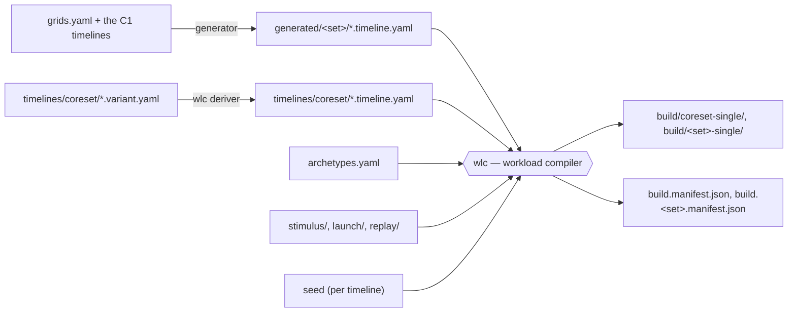

# dataset/

The **workload dataset**: everything that produces the canonical workload files the simulator and harness consume. Authored as human-readable **timelines**, compiled to machine-readable **canonical JSON** by **wlc** (the workload compiler, `tools/wlc/`) — wlc resolves all randomness at compile time, so the simulator replays concrete values and two conditions always face byte-identical workloads.

## Layout

```
archetypes.yaml        # behavior library (v0.2) — 29 entries, one per program kind, each with its declared scheduling class: 28 measured in our CI campaigns (category_source: meas), game-task-chain from the LAVD talk's figures (lavd-ossna24); no meas-pending value
sources.yaml           # machine registry of citation sources (subset of docs/references.md)
meas-releases.yaml     # the release map: every meas-ci campaign the data cites -> the GitHub release(s) holding its raw records, each asset's sha256 (make lint checks it)
grids.yaml             # the generated layer's grid definition: the sets, their forms, lengths, intervals (with sources), splits, the distractor programs and the ladder's name tables
variants.yaml          # the RQ0 gate spec's sensitivity variants: each set's transform, its parameters and the files it rebuilds
schema/
  workload.schema.json # canonical format, machine form — the simulator's loader contract
timelines/
  coreset/             # the core set: 23 authored *.timeline.yaml, 28 derived *.timeline.yaml written by tools/derive.py from the *.variant.yaml recipes (committed; check holds them to their bytes)
stimulus/              # the SWELL-KW input streams whose keystrokes the compiler replays into the input windows of office-writer, code-editor, mail-client and web-browser: swell-word-c1, swell-outlook-c23, swell-ie-c1 (.jsonl), indexed by streams.json
launch/                # ten launch-<entry>.json.gz: an entry's observed launch phase per pooled repeat, which the compiler replays for a task arriving after 0 s (9.10 D136)
replay/                # six replay-*.json.gz, one per entry: one pooled repeat's observed stream — wakes (`code-editor`, `web-browser`, `renderer-hidden`), runs and the block after each (`package-upgrade`, `cpu-batch`'s `python3`) or cycles (`video-call`) — which the `replay` variants compile from (written by tools/meas/replay_fold_in.py)
generated/             # the generated layer's timelines, one per cell — NOT committed; written by tools/generate.py from grids.yaml + the C1 timelines
  transition-grid/     #   480: the 2-segment transition grid over the 240 ordered mode pairs, two forms
  return-grid/         #   720: the 3-segment return grid A -> B -> A, the middle 60 s / 10 s / 2 s
  flap-stress/         #   24: the flap-stress set, the hold-time tuning material
  distractor-grid/     #   272: the C4 distractor grid — the user stays in A while another mode's task set (240) or a program outside every mode (32) arrives
  familiarity-ladder/  #   66: the C5 familiarity ladder — each mode's task set with its names substituted at tiers 3-5
build/                 # compiled artifacts — NOT committed; verified via the manifests
  coreset-single/      # the core set's 51 workloads, compiled single-lane (the RQ0 experiments run on these), the 78 sensitivity variants (<base>@<set>) beside them, each core artifact's compile report
  transition-grid-single/, return-grid-single/, flap-stress-single/, distractor-grid-single/, familiarity-ladder-single/   # the generated sets, compiled the same way
build.manifest.json    # lockfile: hashes of the last blessed build — its inputs (library, schema, compiler sources, streams), its artifacts and their compile reports — + the static demand per file and per ground-truth segment (utilization, demand_class): offered demand, not the lane's load (Rules of the tree)
build.variants.manifest.json   # the variants' lockfile: each variant's hash, its base's hash, its transform and its utilization (the RQ0 gate spec pins it)
build.<set>.manifest.json   # one per generated set: the same sections, its inputs also the definition, the generator and the C1 timelines, plus `grid` — each file's coordinates and split, its placements and its segments' labels
coverage-grid.json     # driver-table cell (mode × background_wanted) × tier coverage grid over all core segments, all 32 cells instanced (CI-enforced); plus one table per generated set, from its manifest's segment labels
meas/                  # measurement-campaign records; the compile and the lint read none of them:
  names/               #   the Phase 2 and Phase 7 name-verification runs over the pre-rebuild names (names/: run 1; names/run-2/: the dkms run), kept as history; no tool reads them
  streams/             #   the per-repeat input windows the campaigns replayed — SWELL-KW's word, ie and outlook, 136M Keystrokes' aalto — and their indexes; cut by tools/meas/loop/cut_windows.sh, read by tools/meas/campaign/run.sh and tools/meas/loop/pool_runs.py
tools/                 # all executable tooling (see below)
LICENSE                # CC-BY-NC-SA-4.0 for the dataset's data and release assets (Licence and data availability)
Makefile               # entry point for everything in this tree
```

## Pipeline



Same timeline + same library + same streams + same seed ⇒ byte-identical output. That determinism is load-bearing (experiment hygiene), which is why `build/` isn't committed: CI recompiles and diffs hashes against the manifests instead. The generated layer's timelines aren't committed either — the generator is pure in its committed inputs, and each set's manifest pins them by content.

## Workload Dataset

### Canonical format

One `*.workload.json` per workload, validated by `schema/workload.schema.json`, four top-level keys — `meta`, `ground_truth`, `focus`, `events`. All times are integer **microseconds**. An abridged excerpt of the compiled `c2-p1a`:

```jsonc
{
  "meta": {                     // provenance: what produced this file
    "id": "c2-p1a",
    "derived_from": "dataset/timelines/coreset/c2-p1a.timeline.yaml@<git blob>",
    "sampled": { "archetypes": "archetypes.yaml@<git blob>", "seed": 201 }
  },
  "ground_truth": [             // labeled segments — oracle + Layer-1 grader ONLY
    { "t_start": 0,        "t_end": 60000000, "mode": "dev",      "attributes": { "background_wanted": true } },
    { "t_start": 60000000, "t_end": 99435000, "mode": "ml-train", "attributes": { "background_wanted": true } }
  ],
  "focus": [                    // the window-focus track — shown to the recognizer by name; the simulator ignores it
    { "t_start": 0, "t_end": 99435000, "task": "editor" }
  ],
  "events": [                   // the workload itself — closed op set {arrive, wake}
    { "op": "arrive", "t": 0, "id": "editor", "name": "code", "declared_class": "normal", "depart": 99435000,
      "program": [ { "op": "WAIT", "channel": "timer:editor" },
                   { "op": "RUN", "us": 22 }, /* … 22,689 instructions, the last a WAIT */ ] },
    { "op": "wake", "t": 2469, "channel": "timer:editor", "target": "editor" },      // a timer component's wake
    /* … */
    { "op": "wake", "t": 2090485, "channel": "input:editor", "target": "editor" },   // the first keystroke
    /* … */
    { "op": "arrive", "t": 60000000, "id": "hog", "name": "python", "declared_class": "normal",
      "program": [ { "op": "RUN", "us": 192 }, { "op": "SLEEP", "us": 378 }, /* … */ { "op": "EXIT" } ] }
  ]
}
```

- **`arrive`** brings a task into existence: its `name` (what the recognizer will see), its pre-sampled `program` over the six grammar primitives (RUN/SLEEP/TIMER/WAIT/WAKE/FORK+EXIT — every RUN duration already a concrete number; an unbounded LOOP repeats a body until the depart), and its lifetime. A segment-bound task has a pinned `depart`, and its program never runs out: it ends blocked — on a trailing WAIT on its last wake's channel (for the measured interactive entries, usually their timer channel), a trailing TIMER, or an unbounded LOOP — until the depart removes it; a task without a `depart` is finite and ends with EXIT (canonical lint, 9.23 D16). An orchestrator's record also carries its `spawn_table` and `fork_cap`.
- **`declared_class`** on every task record — each `arrive` event and each spawn-table entry — is the scheduling class the real program declares for itself, `normal` or `idle`, copied from the archetype entry the task binds (a spawned child's from its child entry), never read from the task's name. The simulator runs an `idle` task only when no task of another class is runnable and preempts it at once when one wakes, under every algorithm; the visible projection shows the class per task (`docs/data-contracts.md` §4).
- **`wake`** delivers an exogenous wake at a pinned time on a channel — a keystroke on `input:<id>`, or the wake of one of the task's timer components on `timer:<id>` (a measured entry carries its threads' own wakes as components, each at its sampled absolute time, 9.5 D16, D74); a task blocked in `WAIT` on that channel becomes runnable. This is how "interactive" behavior exists without modeling a human. A measured interactive program waits mostly on its timer channel: in the compiled `c2-p1a` the editor receives 10,819 timer wakes and 525 keystrokes. The playback and call entries receive no wake events — their programs are TIMER/RUN cycles.
- **Keystrokes** are replayed from SWELL-KW streams (`stimulus/streams.json`) for four applications: LibreOffice Writer and VS Code from the Word stream, Thunderbird from the Outlook stream, Chrome from the Internet Explorer stream. The editors of Kdenlive and GIMP receive none: their measured driven phases are pointer-driven, carried as the applications' own timer components inside the focus windows (`focus_components`), so their interaction terms read the timer wakes (`channel: timer` in `harness/scoring/scoring-spec.yaml`).
- **`ground_truth`** never reaches the simulator's scheduler or any recognizer — information asymmetry is enforced by who gets handed which key.
- **`focus`** — the timeline's window-focus track carried through compilation: which top-level task holds the focus over which pinned intervals, `[{t_start, t_end, task}]`, empty when no window does (data-contracts §4, 2026-10-11). The recognizer is shown it by name (§5, rule 6); the simulator reads `events` alone. The timeline's `input` track, the keystroke windows, is consumed at compile time and lies inside the task's focus intervals.

Field semantics are normative in `docs/simulator/interpretation-contract.md`; the schema is the machine check, not the definition.

### Coresets

One compiled set, 51 workloads (67 labeled segments):

| Set | What it is | Use |
|---|---|---|
| `build/coreset-single/` | compiled single-lane: the game chain's RUNs scaled to its `lane_share` of the one lane, every measured value as measured on one CPU; each file's demand recorded in the manifest | **the RQ0 experiments run on these** |

The files come in seven groups (design rationale: `docs/workload/building-plan.md`):

| Group | Files | The question it answers |
|---|---|---|
| **C1** calibration | 16 | Can a recognizer handle the *easy* case — one unmistakable situation per file, one file per mode of the menu (pure gaming, pure office, pure compile…)? This is the floor everything should pass, and where the strongest name table (`strongest_name_table`, a rule list covering the software the dataset presents as known) is expected to score perfectly; the shipped catalogue (`shipped_catalogue`, CachyOS's ananicy-cpp rules) matches none of its rules to several names the files bind — `kdenlive`, `make`, `python`, `HandBrakeCLI`, `deja-dup` among them (9.12 D109). `c1-indexing`, the user-started index, is a pre-committed miss: its label differs from the unwanted case by intent alone. |
| **C2** intent pairs | 6 (3 pairs) + 1 | Can anything separate a background job the user wants from one nobody asked for, beside the same foreground? The unwanted side is a measured job of its own, differing in name and in behaviour: P1 the training run (`python`, `cpu-batch`'s `python3` program) against Tracker's first index of a home (`tracker-miner-f`, `file-indexer`, `initiated: session`); P2 the user-started game download (`steam`, `game-download`, SteamCMD's numbers by stated approximation, 9.7 D4) against Ubuntu's stock unattended upgrade (`unattended-upgr`, `package-upgrade`) — 163 µs against 1.8 ms between voluntary blocks, one process of 83–84 threads against 916 processes, about 700 s of CPU against 26 s, and the download running three quarters of its CPU at nice 10, which the task model does not carry (below); P3 the video editor's export (`kdenlive_render`) against Déjà Dup's scheduled backup (`deja-dup`, `incremental-backup`). The job's segment label changes in P1 the mode (`ml-train` to `indexing`) and `background_wanted`, and gains `initiated: session`; in P2 `background` (`download` to `package-upgrade`) and `background_wanted`, and loses `initiated: user`, the mode `gaming` on both sides; in P3 the mode (`render` to `backup`) and `initiated` (`user` to `scheduled`), not `background_wanted`. The two files in a pair differ in exactly one segment — the job and that segment's label — so any difference in outcome is attributable to that one change. The + 1 is `c2-p2a-idle` (below). |
| **C3** transition arcs | 3 | Three authored arcs — a workday (browsing → office → compile → mail), an evening, a creation chain — kept as existence cases: transitions of these shapes occur. The rate question — how quickly and correctly recognition follows a change, over every ordered pair of modes — is the generated transition grid's (below). |
| **C4** distractor injection | 3 | If an irrelevant process appears mid-situation (a chat client, Element, during a game; chrome during a compile; a `7z` archive burst during office work), does the reading wrongly flip? Three authored files, each a C1 file plus one injected process at 30 s, kept as existence cases. The rate question — over every ordered pair of modes and every measured program outside the modes, the user staying put — is the generated distractor grid's (below). |
| **C5** familiarity ladder | 2 | Does recognition survive as process names get less recognizable — `chrome` → `soffice.bin` → `cc1` → invented names no software carries? Behavior is held identical across tiers; only the names change. Neither name table has a rule for the invented names of tiers 4–5, so both score zero there by construction. Two authored files (`c1-media` at tiers 4 and 5), kept as existence cases; the ladder over the sixteen modes at tiers 3–5 is generated (below). Tier 3 is a program's *own* real name that carries no meaning; another program's name on it is a name collision, C6's. |
| **C6** resolution limits | 4 | Where does name-based recognition break *by design*? Another program's real name on the whole foreground: two media players under two indexers' real names (`c6-alias`). A miner named `chrome`, a `cpu-batch` job arriving at 20 s beside the browser (`c6-spoof`: browsing with `background_wanted: true` to 20 s, then browsing with `background_wanted: false` and `spoof: true`). A call inside the browser (`c6-fold`): the call runs under the browser's own name as a sixth `chrome` task arriving at 30 s, a count change, so a query fires at 30 s (data-contracts §5, rule 1), but nothing in the snapshot says call — a sixth `chrome` is also what a new tab shows. Two equally-active foregrounds, a game and an awaited compile (`c6-dual`, mode `ambiguous`). Three are known, pre-committed misses — `c6-alias` whole, `c6-fold` from the call's arrival at 30 s, `c6-spoof` from the spoof's at 20 s — shipped so the limits are measured, not just claimed; `c6-dual`'s segment lies outside the 32 driver-table cells. |
| **C7** attribute counterparts | 16 | Does the reading flip when the background work is *unwanted*? One counterpart per mode, derived from its C1 base. The ten interactive modes gain Ubuntu 24.04's stock unattended upgrade's install stage (`package-upgrade`, shown as `unattended-upgr`), arriving at 0 s bound whole at its measured CPU total, 26.385 s; `compile`'s build is replaced by an observed DKMS autoinstall (`dkms`, `module-build-orchestrator`); `indexing` keeps its job at a first login (`initiated: session`); the batch modes (`ml-train`, `render`, `transcode`, `backup`) keep theirs, re-cast as one nobody asked for. Every driver-table cell has a pair, and a pair differs in more than the job and the label: the counterpart is its base's first C seconds, C the job's CPU total (measured: 26.385 s for the interactive counterparts' upgrade; 39.435 s indexing, 1,389.885 s ml-train, 16.545 s render, 2,970.871 s transcode, 165.668 s backup; the DKMS build's 225.458 s as compiled under the file's seed), so it differs also in length, input window where it has one (2 s to C − 2 s) and operation times (at the base's fractions of the window), and its keystrokes are its base's over the slice, less those inside its own operations. `c7-mail` is `c1-mail`'s first 26.385 s and holds no keystroke — `c1-mail`'s 35 fall between 45.9 s and 53.1 s — so it reports only, its term reading the mailer's own timer wakes, and the mail mode's attribute is unmeasured. The five cells that differ by intent alone — `c1-indexing` and the four batch counterparts — ship as pre-committed misses. |

The 51st file, `c2-p2a-idle`, is `c2-p2a` with its download bound to `game-download-idle` — the same tables under the declared class `idle` — and differs from `c2-p2a` in that task's class alone. It is outside the judging set; the RQ0 gate spec's bounding check reads the pair to bracket a stock desktop's treatment of the download's nice-10 work. The task model carries no nice (9.11 D6), so the simulated download competes at full standing, although on `game-download`'s 30 pooled repeats SteamCMD's thread group does 75.33 % of its CPU at nice 10 (73.56–77.57 % per repeat; nice 0 the other 24.67 %): its interference with the game in `c2-p2a` is overstated and the headroom there inflated, in the hypothesis's favour. `package-upgrade`'s nice-19 work, 2.67 % of its pooled CPU (2.30–3.36 % per repeat, `apt-check` nearly all of it), is likewise carried at full standing (9.11 D20).

What the core files leave out. The desktop's session processes — GNOME Shell, the PipeWire stack, systemd, the D-Bus daemon — are bound in `c1-idle` and `c7-idle` alone, measured in their terminal idle state; every other file omits them, their active state unobservable on the runner (9.10 D28). A gaming file carries the game's frame chain and `wineserver` alone: the game's other threads are omitted, since the source puts 95 % of scheduling in its top 30–40 tasks and describes none outside them (`lavd-ossna24` s12; 9.10 D19). The Steam client (`steam`, `game-client`) is in its measured state: logged out, no account, no library, no game behind it, no `gameoverlayui` (9.10 D22; 9.8 D6).

### Sensitivity variants

`make variants` builds the RQ0 gate spec's sensitivity variants from the blessed artifacts and the pinned library (`variants.yaml`, `tools/variants.py`; 9.14 decisions 10 and 12): 78 files, each `<base>@<set>.workload.json` in `build/coreset-single/`, recorded with its base's hash, its transform and its utilization in `build.variants.manifest.json`, which the RQ0 gate spec pins. A variant's `meta.id` is `<base>@<set>`; it keeps its base's `meta.derived_from` and `meta.sampled` (the workload contract has no slot for a transform), so the manifest is the provenance.

| Sets | Transform | Files |
|---|---|---|
| `venue-x0.8`, `venue-x1.25` | every RUN but the frame chain's multiplied by 0.8 or 1.25 | the RQ0 gate spec's 19 judging files |
| `chain-x1.2`, `chain-x1.4` | every RUN of the frame chain's members multiplied by 1.2 or 1.4 (the per-schedule runtime read as the per-wake RUN understates a wake; `lavd-ossna24` s14) | `c2-p2a`, `c2-p2b`, `c7-gaming` |
| `seg1-30s`, `seg1-120s` | the C2 pairs' first segment, 60 s by design, halved or doubled, the file recompiled | `c2-p1a`, `c2-p2a`, `c2-p2b`, `c2-p3a` |
| `corner-low`, `corner-high` | every value the library carries under a stability exception on an entry the judging files hold (`carried_values`), at the lower or upper bound of its stated 95 % interval; the session daemons' and the Tracker indexer's are not swept | 11 judging files |
| `replay` | one pooled repeat's observed stream (`replay/`) — wakes, runs and the block after each, or cycles, as the entry compiles — in place of the sampled one, for six entries | `c7-dev`, `c7-browsing`, `c7-meeting`, `c2-p1a` |

The venue bracket, ×1/1.25 to ×1.25 (9.6 D32), holds the huge-page ratio ×1.144 (9.10 D88) and the tracing overhead ×1.02–1.16; it does not represent another CPU model, which changes each program's speed by its own factor (an Intel Xeon Platinum 8573C ran `cc1` at 0.72× and `fixdep` at 0.50× the EPYC 7763's time, 9.6) — no common factor reproduces that.

### Generated layer

Beside the core set, five sets a generator composes or renames from the sixteen C1 task sets (`grids.yaml`, `tools/generate.py`). Every file is **design**: it enumerates a factor in full and claims nothing about how often or in what order desktops see the modes. Each segment is 60 s, the C1 interactive files' length; a task set lands in a segment by the dataset's one re-timing rule (9.10 D44: the C1 arrive offsets kept, the input window with the C1's 2 s margins, each operation at its fraction of the window), and a batch job's `total_work` or `spawn_count` is the C1 value scaled to the span the job must be alive in, labelled `design` in its `source` map. A 2 s segment shows its task set with no keystroke.

An arrival is a program start. As in every compiled file, a task arriving after 0 s whose entry carries a launch phase — the ten entries with a file under `launch/` — replays one measured launch repeat from its arrival (9.10 D136), its steady stream beginning when the launch phase ends; any other task starts its steady program at its arrival. Most launch phases outlast a 60 s segment — mail 409 s, browser 421 s, video editor 241 s, call 210 s, game client 906–917 s, hidden renderer 1,051 s; office writer, chat client and the two players 31–54 s — so the segments where tasks arrive depict applications launching, and the C1 files stay the steady-state material. Recognition (Layer 1) is untouched — telemetry is a function of the pinned events alone; the replay reaches the scheduling scores (Layer 2).

| Set | Files | What it enumerates |
|---|---|---|
| `transition-grid` | 480 | the 240 ordered mode pairs (A, B) in two forms: **departs** — at 60 s A's tasks depart, B's arrive, the focus moves to B; **focus** — B's tasks arrive and the focus moves to B, A's tasks stay to the end of the file. A focus-form file and the distractor grid's cross-mode cell for the same pair ("B arrives, the focus stays on A") share the task set and the name sequence and differ in the focus, the input, the labels and the random draws — different keyed seeds, so over the 240 twin pairs per-task programs differ in 1,528 of 1,590 tasks and file demand by a median 17 % (9.23 D6): a recognition pair, which no experiment spec or scoring rule pairs for scheduling. Recognition at a transition, with direction (RQ1). |
| `return-grid` | 720 | A → B → A over the same pairs, the middle segment 60 s, 10 s or 2 s (RQ4's phase-shift family: the stale configuration's cost). Every task set departs at its boundary, so each boundary closes one mode's programs and launches the other's, the arriving set replaying the launch phases its entries carry: every boundary is a set change under both telemetry shapes, and the launch load is the same under every condition. Split by pair into a tuning half and a measurement half, 120 pairs each, a pair's three variants on one side. |
| `flap-stress` | 24 | three ordered pairs drawn by keyed hash; a 60 s lead-in on A, then eight segments of one interval each, B and A in turn, at 2 s, 5 s, 10 s and 30 s — 5, 10 and 30 s the debounce intervals of GameMode's reaper, tuned's dynamic tuning and systemd-oomd (`feral-gamemode`, `tuned`, `systemd-oomd` in `sources.yaml`), 2 s a point below them (design). As in the return grid, every task set departs at its boundary, each boundary closing one mode's programs and launching the other's. Each file under two seeds, tuning and measurement. The hold-time plan's material (`_dev/docs/plan/jioh/hold-time-and-hysteresis.md`). |
| `distractor-grid` | 272 | the C4 grid: the user keeps working in A — A's focus and input run to the file's end, both 60 s segments labelled A — while at 60 s another process set arrives and stays. **cross-mode** (240): B's whole task set, over the ordered pairs — the same open programs as the transition grid's *focus* form, the focus kept on A (its recognition twin, above). **out-of-vocabulary** (32): one measured program of the library that belongs to no mode and leaves the label unchanged, `element-desktop` (to the file's end) or `7z` (its work bound to the 60 s span, design), over the sixteen modes. The 26 cells whose two focus holders share a name (`code`, `kdenlive`, `chrome`) show the same telemetry as their *focus*-form twins, so their second segment is a pre-committed miss and the record says `focus_name_shared`. No split. |
| `familiarity-ladder` | 66 | the C5 ladder: each mode's task set in one 60 s segment with its names substituted — tier 4 (a nonexistent name whose words say what the program does, from the table in `grids.yaml`; six of them equal archetype ids — `web-browser`, `image-editor`, `video-editor`, `audio-server`, `message-bus`, `file-indexer` — and an archetype id is not in the visible projection, data-contracts §4, so it never reaches the recognizer) and tier 5 (four lowercase letters drawn by keyed hash, never a known name), in three carrier forms: the focus holder's name alone, the other names alone, every name; forms renaming the same set collapse into one cell (a single-program mode has one cell per tier). One real name maps to one substitute within a file, so counts are preserved; the chain's `wineserver`, named by the compiler, keeps its name. Tier 3 — the program's own real name that carries no meaning — where the campaign record shows the job running under one: render's export as `melt-7`, backup as `duplicity`. Every name within the kernel's 15-character `comm` limit (`linux-sched-h`). The segment carries `familiarity`. No split. |

Every seed, every split and every tier-5 name is a keyed SHA-256 draw from the cell's or the pair's id; nothing is chosen by hand but the tier-4 table. Each set's manifest records under `grid`, per file, its coordinates — `a`, `b`, and `form`, `middle` or `interval`; the distractor grid's `relation` and `focus_name_shared`; the ladder's `mode`, `tier`, `carrier` with the `carriers` it stands for, `renamed` and, at tier 3, `sources` — and its `split` where the set is split. Since 9.21 the record also carries the file's **placements** — per C1 task set placed: its mode, its id suffix (`-s0`, `-s1`, …), the segments it is labelled in, and whether it has an input window — and its **segments' labels** — mode, `background_wanted`, tier, `pre_committed_miss`. The harness derives a generated file's scoring terms from the placements (`harness/scoring/scoring-spec.yaml`, the generated-layer rule) and the coverage tool its tables from the labels, both from the committed manifest alone. The authored C3 arcs, C4 files and C5 files stay in the core set as existence cases.

The generated timelines pass the same lints as the authored ones — the bound values' source lint, the loader's structural checks and the canonical lints inside the compile — at generation (`tools/generate.py`); `make lint` does not read them because they are not committed. `coverage-grid.json` carries one table per generated set beside the core set's grid (`generated.<set>`): the 32 cells with their tier, segment and pre-committed-miss counts over the set's files, derived from the manifest's segment labels and drift-checked by `check`. No empty-cell rule applies to these tables — each set's enumeration is asserted by the generator's tests (`tools/tests/test_generated.py`), and every C1 task set is the `true` side of its mode, so the generated layer fills the sixteen `true` cells alone; the ladder's tier-4 and tier-5 columns are where the C5 question's cells live, the core set holding only `c5-t4` and `c5-t5`.

### Generalsets

*Not built, and not scheduled.* The second timeline set, `generalset-single`: naturalistic workloads emitted by a generator rather than hand-authored, sharing the same compile path, linter, and provenance as the coresets. The naturalistic generator, the generalset and the full condition matrix wait for a source of Linux-desktop co-occurrence and transition frequency, which 9.10's search did not find; the generated layer (above) stands beside the core set meanwhile.

## Commands

Needs Python 3.12 — the version every CI run and every blessed build uses — with `pip install -r tools/requirements.txt` (PyYAML, jsonschema-rs, pytest, numpy, each at the exact version it names). `make` runs `python3` unless given `PY=python3.12`.

```
make dataset    # derive variants + grid, compile every timeline under timelines/ (each artifact with its compile report beside it), refresh the manifest
make variants   # the RQ0 gate spec's sensitivity variants -> build/ + build.variants.manifest.json (needs `dataset`)
make generated  # the generated layer: grids.yaml + the C1 timelines -> generated/<set>/ (not committed) -> build/<set>-single/ + build.<set>.manifest.json, one per set
make lint       # the checks before a compile: repo + timeline lints, the bound values' sources, the grid definition, the release map, and zero `meas-pending` among them (no writes; seconds)
make test       # invariant test suite (pytest, tools/tests/); the tests that read the set take the blessed build when the hashes match
make check      # the gate, after `dataset variants generated`: derive --check, every manifest, derived timeline and the coverage grid equal to its committed bytes, build/ equal to the manifests' union
```

The compile, the variants and the generated sets run one timeline (one set-and-file) per worker process, as many as the CPU has (`--jobs N` to change); the canonical lints run inside the compile on every artifact, validated by `jsonschema-rs`. CI (`.github/workflows/dataset.yml`) runs `lint` / `dataset` / `variants` / `generated` / `test` / `check` on every PR and push to `main`, and by hand (`workflow_dispatch`) on any branch — one Linux run that compiles every set once and compares what it wrote with the committed manifests. **The generated layer is built in every run** (9.21 decision 8), in the dataset workflow and in both harness workflows. On the standard Linux runner (4 vCPU; `gh-hosted-runners` in `docs/references.md`) the latest measured run, dataset run 38722675475 (2026-10-15), took 17 min 04 s, the generated step 7 min 23 s of it for 1,562 artifacts; `build/` holds 6.8 GB, `coreset-single/`'s 1.6 GB among it — the core set's 51 artifacts (678 MB) with their compile reports, and the 78 sensitivity variants. The two ceilings are the runner's 14 GB of storage (`gh-hosted-runners`) and the 6 h a job may run before it is terminated (`gh-actions-limits`). The strategy is revisited when a set is added — the naturalistic set on the backlog would be the occasion — or when the generated step's time or the build's size against the runner's storage moves the whole run past what a push can wait for; an on-demand build or a pinned subset would then be weighed, each at the cost of an exception to `check`'s rule that `build/` equals the union of every manifest. If you edit any timeline, variant file, `archetypes.yaml`, a stream or the compiler, run `make dataset variants generated` and commit every manifest, derived timeline and the coverage grid with it; if you edit `grids.yaml`, the generator or a C1 timeline, `make generated` and the generated manifests, one per set — otherwise `check` fails. `compile.py --check`, `variants.py --check` and `generate.py --check` remain for an independent in-memory verification; they are not in the gate.

## Tools map

```
tools/compile.py       # CLI: timelines -> canonical + compile reports + manifest (+ --check verify mode)
tools/derive.py        # CLI: variant recipes -> derived timelines + coverage grid (+ --check; --require-coverage fails on an empty cell)
tools/variants.py      # CLI: the sensitivity variants + their manifest (+ --check)
tools/generate.py      # CLI: grids.yaml + the C1 timelines -> the generated sets' timelines, artifacts, reports and manifests (+ --check)
tools/gen/             # the generator: cells.py (the definition, the 240 pairs, keyed seeds and splits), compose.py (a C1 task set into a segment, D44), coverage.py (the generated sets' coverage tables, from their manifests)
tools/check_build.py   # CLI: every manifest, derived timeline and the coverage grid equals its committed bytes; build/ equals the manifests' union — every file pinned, every pin present
tools/lint.py          # CLI: all lints before a compile — repo, timelines, bound values' sources, grid definition, release map (+ --freeze rejects `meas-pending`; `make lint` passes it)
tools/beyond_hash.py   # report: which artifacts change beyond the library's hash, and which demands move, against HEAD
tools/end_bound.py     # report: by when a file's batch job ends on one lane under every work-conserving policy (9.10 D78's arithmetic)
tools/stimulus/        # build_streams.py: the stimulus/ streams from the extracted SWELL-KW uLog files
tools/wlc/             # wlc, the workload compiler — the library behind those CLIs:
                       #   timeline.py / compiler.py  parse + compile
                       #   library.py                 the archetype library's loader
                       #   deriver.py                 variants: / inherit() / inject: sugar
                       #   variants.py                the sensitivity variants' transforms
                       #   sampling.py / units.py     seeded draws, integer-µs times
                       #   estimate.py                the static demand record, per file and per segment
                       #   linter.py / grid.py        lint rules, coverage grid
tools/meas/            # the measurement campaigns' tooling, one folder per campaign family — map: tools/meas/README.md
tools/tests/           # invariant suite + fixtures
```

## Rules of the tree

- **Canonical semantics live in the docs, not here.** The compiler implements `docs/simulator/interpretation-contract.md`; the build order and set design follow `docs/workload/building-plan.md`; archetype authoring follows `docs/workload/archetype-plan.md`. The docs define meaning. When code and a doc disagree, the latest recorded decision on the matter decides: a doc that missed a decision is corrected to it, and code that departs from the doc without one is fixed. A frozen contract changes only under the freeze rule (`docs/data-contracts.md` §13: all three owners and a §14 entry).
- **Behavior parameters live in `archetypes.yaml`, never inline in a timeline.** Timelines bind `(name, archetype)` and supply only the knobs listed in the archetype's `binding_params`.
- **Every parameter value is sourced.** Numbers carry a `source` tag resolving through `sources.yaml` → `docs/references.md`. A measured value is tagged `meas-ci:<workflow>:<campaign>`, the campaign the launch date of its first batch (`YYYY-MM-DD`, a letter added for a second campaign of that workflow launched that date; a run number in its place names a one-run campaign from before that form); `meas-releases.yaml` maps each campaign tag the data carries to the release or releases holding its raw records, and the lint fails a tag it does not map. A timeline's bound values too (9.10 D32): a task's `source` map mirrors its `bind` keys and its `count`, each entry a tag, a list of tags, or one of the labels `design` / `convention` / `arithmetic`; the linter checks the key sets and the tags.
- **A task's name is its kernel `comm`** (9.10 D25): for a program a campaign ran, the `comm` it observed; otherwise derived by the kernel's rule and confirmed where a campaign or the names workflow (`meas-ci:names:2`) shows it. The 44 names the compiled core files carry are of four kinds: the `comm`s the campaigns traced (most of them; `python` the training run's observed `comm`, 9.10 D84); the game chain's thread names from `lavd-ossna24` s16, with `wineserver` named by the compiler; the tier-4 and tier-5 names (design); and the deliberate spoofs (`c6-spoof`'s `chrome`, `c6-alias`'s `baloo_file` and `tracker-miner-f` on its two players; design). The name tables under `meas/names/` verified the pre-rebuild names and are kept as history.
- **The generated layer is design.** A generated file composes or renames the C1 task sets by `grids.yaml`'s rules and claims nothing about real desktops; its only authored numbers and names are the definition's, each number with a source or a label, the tier-4 name table design and the tier-3 names sourced. The values the generator scales (a batch job's work over its span) are `design` in the file's `source` map; the ones it carries unchanged keep the C1's tags.
- **A derived file's keystrokes are its base's.** A derived input window lying inside a base window of its task is written as that window's slice (`slice_of: {from, to, index}`, the deriver's doing), and the compiler draws the stimulus offset for the base window, so a counterpart's keystrokes are its base's over the slice, less those that fall inside the counterpart's own operations (the compiler emits no keystroke inside an operation).
- **Demand is reported, not held.** The compiler records each `-single` file's static utilization per file and per ground-truth segment under `demand` in the manifest (`tools/wlc/estimate.py`); no file fails on it and none is redesigned for it (9.14 decision 4). Since 9.10 D17 binds every job whole as measured, a file's demand follows from the measurement; holding it to a window would have meant bending measured lengths, so it is reported, and the pair review (`docs/daemon/prior-table-pair-review.md`) reads the contended segments. The estimate spreads each task's demand uniformly from its arrival to its pinned depart or the file's end, so a batch job that outlives its file reads as offered demand above one lane, not as the lane's load: `c2-p1a` 14.505 over the file and 35.7721 in its second segment, `c2-p2a` and `c2-p2a-idle` 9.3829 and 28.5251. A file's `demand_class` names its design: `oversubscribed` a file designed to hold contention, `calibration` one that is not.
- **No `meas-pending`.** A value awaiting a measurement campaign is tagged `meas-pending`; `make lint`'s freeze rejects the tag in the library's parameters and in the timelines' bound values. The library holds none: 28 of its 29 entries are measured (`category_source: meas`) and `game-task-chain` is grounded in the LAVD talk's figures (`lavd-ossna24`).
- **Declared class on every entry and every task.** The repo lint requires `declared_class` on every archetype entry, from the closed set `normal` and `idle`, with no default; the schema requires it on every `arrive` event and spawn-table entry; the tests check that each compiled task carries its bound entry's class.
- **TIMER first.** A compiled program that contains a TIMER anywhere has a TIMER as its first executed instruction — a LOOP head's body counting — so TIMER's t₀, its first execution, is the task's arrival (canonical lint; `docs/harness/metrics.md` §11).

## Licence and data availability

- **Licences.** The code — the repository's, `dataset/tools/` and `dataset/Makefile` included — is under the MIT licence (the root `LICENSE`). The dataset's data — the other files under `dataset/`, the build compiled from them, and the assets of the measurement releases — is under CC-BY-NC-SA-4.0 (`dataset/LICENSE`). The copyright holders are Jioh In, Kyungmin Inn and Ian Park.
- **Third-party data.** The input streams under `stimulus/` and the SWELL-KW input windows under `meas/streams/` are adapted from SWELL-KW (Koldijk et al., 2014; DANS, doi:10.17026/dans-x55-69zp; `swell-icmi14`), itself CC-BY-NC-SA-4.0. The `aalto-*` windows under `meas/streams/` are adapted from the 136M Keystrokes dataset (Dhakal et al., 2018; `dhakal-chi18`), and are not under the dataset's licence: they are distributed under their source's terms, free for non-commercial use in research or projects with attribution to its authors (`dataset/LICENSE`). Each keeps the input events' timing and kind — the SWELL-KW windows also the pointer's position and button — and no key value.
- **Raw measurement records.** Each `meas-ci` campaign the data cites has its raw records on one or more GitHub releases of this repository; `meas-releases.yaml` lists each with its tag, its URL and every asset's sha256, and `make lint` fails a campaign tag it does not map. The releases are made by hand from the campaign workflows' artifacts (every `meas-*` workflow ends at `actions/upload-artifact`), when a campaign is pooled and before GitHub deletes a workflow's artifacts at 90 days (`gh-artifact-retention` in `docs/references.md`).
- **The compiled dataset.** `build/` is not published: it is reproduced from the repository and checked against the committed manifests (`make dataset variants generated`, then `make check`). At submission a snapshot — the repository's tag and the compiled build — goes to a DOI-minting data repository, the data under CC-BY-NC-SA-4.0.

## Where to go deeper

| Question | Doc |
|---|---|
| What do the canonical ops/fields *mean*? | `docs/simulator/interpretation-contract.md` |
| Why this set design, what are C1–C7? | `docs/workload/building-plan.md` |
| How is an archetype authored/measured? | `docs/workload/archetype-plan.md` |
| What did each campaign measure, on what machine? | `docs/workload/measurement-overview.md` |
| Which measurement tool does what? | `tools/meas/README.md` |
| Where does a number come from? | `docs/references.md` + `sources.yaml` |
| Where are a campaign's raw records? | `meas-releases.yaml` |
| Who may use the data, and on what terms? | `LICENSE` (the data), the repository root's `LICENSE` (the code) |
