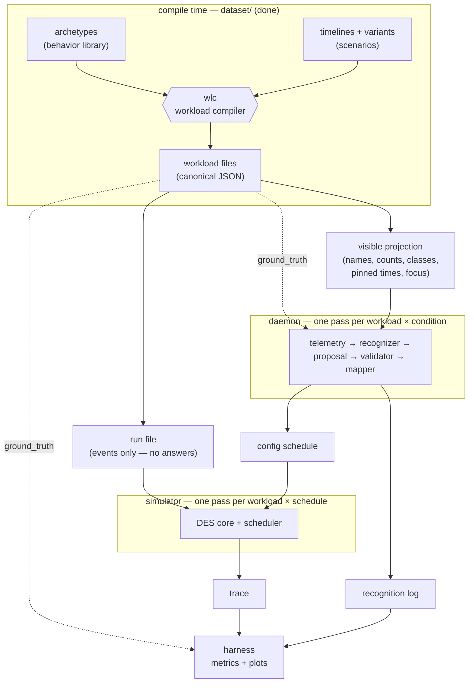

# Data Contracts — every format in the project, with examples
> Status: normative · Created 2026-08-28 · Updated 2026-10-17

Everything the three of us build talks to everything else through data — a file one side writes and another side reads. Each such format is a **contract**: as long as both sides honor it, we can work independently and integration stays boring. This document lists every contract in the project, shows what each one looks like with examples — real where the dataset's files hold them (§2–§4), illustrative elsewhere — and explains every example in plain sentences. Same audience as `background-guide.md`: general CS knowledge is enough, no OS background needed.

Some contracts are **frozen** — by the dataset tree and the code that enforces it (archetype, timeline, workload: the library, the core set's timelines and the grid definition `dataset/grids.yaml` are committed files; `make` writes the generated layer's timelines from them and builds every canonical workload file, which `make check` holds to the committed manifests, §4), or by ratified decision (the `cpu_scheduler` config schema in `recognition-vocabulary.md`, and the trace). The protocol contracts froze on 2026-09-06 (§14). The proposal and the driver table's format froze on 2026-09-07. Every contract in this document is now frozen. Frozen is not untouchable: changing a frozen contract is always possible, it just takes everyone's sign-off plus a changelog entry — so propose edits rather than deviating quietly.

---

## 1. How everything connects

The single most important framing fact: **the simulator and the daemon never talk to each other at run time.** Both are offline programs that read files and write files. The daemon does all of its recognition work *before* any simulation happens, and hands the simulator a finished schedule of configurations. The whole experiment is a pipeline of files:



Read it as one piece of data's life story:

1. **Compile time** (already done, lives in `dataset/`): the **archetype** library says how each kind of program behaves, **timelines** say which processes are on stage when and what each moment truly means, and **wlc** — the workload compiler — combines them, rolls all the dice once, and writes **canonical workload files**. This half is finished and frozen; nobody re-runs it during experiments.
2. Each consumer's **own loader** extracts its permitted **view** of the workload file — the dataset tree produces no views and knows nothing about its consumers: it provides the library, the timelines, the compiler and the manifests, from which the raw canonical files are built. The simulator's loader keeps the **run file** view (the events, stripped of the answer key) and discards everything else at the parse boundary; the daemon's loader keeps the **visible projection** view (just the process names, counts, pinned lifetimes, each task's declared scheduling class and its focus intervals). The information asymmetry is enforced by each loader discarding what its program may not see — structurally, at the boundary, so nothing downstream could branch on it even by accident.
3. The **daemon** takes the visible projection and runs the whole recognition pipeline offline: it renders the projection into **telemetry** snapshots, feeds each one to a **recognizer** (the LLM, or one of the two name tables — `shipped_catalogue`, the CachyOS catalogue as ananicy-cpp applies it, and `strongest_name_table`, the strongest name table in that catalogue's design — or random; one per experimental condition; the oracle condition reads `ground_truth` instead of the projection), validates and clamps what comes back, maps it to scheduler settings, and writes two outputs: a **config schedule** (for the simulator) and a **recognition log** (for the grader).
4. The **simulator** takes the run file plus a config schedule and plays the workload out under it, writing a **trace** of everything that happened.
5. The **harness** reads traces and recognition logs after the fact and computes every metric and plot in the paper — comparing conditions, and comparing recognition logs against `ground_truth`.

The dotted lines are the deliberate cheat paths, and they are the experiment's core design: `ground_truth` reaches only the oracle recognizer and the grader. The simulator never sees it (the run file doesn't contain it); the LLM never sees it (the projection doesn't contain it).

| # | Contract | Shape | Producer → Consumer | Status |
|---|---|---|---|---|
| 1 | Archetype | YAML, `dataset/archetypes.yaml` | measurements/literature → wlc | **frozen** (v0.2) |
| 2 | Timeline (+ variant) | YAML, `dataset/timelines/`, `dataset/generated/` | human authors, the generator → wlc | **frozen** |
| 3 | Workload (canonical) | JSON, `dataset/build/`, schema `dataset/schema/workload.schema.json` | wlc → the two views, oracle, grader | **frozen** |
| 3a | Run file (view of 3) | extracted by the simulator's loader | workload file → simulator | **frozen** |
| 3b | Visible projection (view of 3) | extracted by the daemon's loader | workload file → daemon | **frozen** |
| 4 | Telemetry | JSON, internal to the daemon | daemon-internal (recorded in 7) | **frozen** |
| 5 | Proposal | JSON, internal to the daemon | daemon-internal (recorded in 7) | **frozen** |
| 6 | Config schedule | JSON | daemon → simulator | **frozen** |
| 7 | Recognition log | JSON | daemon → harness | **frozen** (envelope; the `proposal` slot follows contract 5) |
| 8 | Trace | JSONL, `*.trace.jsonl(.gz)` | simulator → harness | **frozen** |
| 9 | Driver table | YAML, `daemon/driver-table/{prior,calibrated}.yaml`, schema `daemon/driver-table/schema/driver-table.schema.json` | 인지오 → daemon (config mapper) | **frozen** (format; the prior table written, the calibrated table not yet tuned) |
| 10 | Invocation | a command line — named flags, absolute paths, an exit code | runner → daemon, runner → simulator | **frozen** (2026-09-11) |

---

## 2. Archetype — how one kind of program behaves

**Frozen (v0.2, 2026-10-09 — §14). File: `dataset/archetypes.yaml`. Read only by wlc, at compile time — the simulator never sees archetypes.**

Every entry carries `declared_class`, the scheduling class the program declares for itself: `normal`, or `idle` where the program sets SCHED_IDLE on itself (`file-indexer`, `incremental-backup`); a batch or real-time value is added only when an entry carries work in that class. The field is required on every entry, with no default; the compiler copies it onto every task that binds the entry and onto every spawned child from the child entry, so a task's class is its entry's and never read from its name (the spoofed indexer names on the media players in `c6-alias` stay `normal`). `game-download-idle` shares `game-download`'s tables by reference and declares `idle`; it exists for the `c2-p2a` bounding check alone.

An archetype is a reusable behavior template: "things of this kind use the CPU in this pattern." There are 29 (`dataset/archetypes.yaml`): the interactive applications (`office-writer`, `code-editor`, `mail-client`, `web-browser`, `image-editor`, `video-editor`, `video-player`, `audio-player`, `video-call`); the browser's hidden-tab renderers and two clients idling beside the foreground (`renderer-hidden`; `chat-client`, Element Desktop; `game-client`, the Steam client); the batch and build jobs (`cpu-batch`, `compiler-child`, `build-orchestrator`, `module-build-orchestrator`, `module-compiler-child`, `file-archiver`, `game-download`, `game-download-idle`, `package-upgrade`, `file-indexer`, `video-transcoder`, `incremental-backup`); the game's frame chain (`game-task-chain`); and the desktop's session processes (`compositor-shell`, `audio-server`, `service-manager`, `message-bus`). Every value in the library records its source: the 28 entries other than the chain are measured by us in CI (`category_source: meas`, each measured value tagged with its campaign, `meas-ci:<workflow>:<campaign>`; the four entries that replay keystrokes name their stream's source, SWELL-KW, `swell-icmi14`), and `game-task-chain` takes its run times and its length from the figures reported in the LAVD talk (`lavd-ossna24`) and its frame period from SteamOS's 60 Hz default (`steamos-refresh`).

### Example A — a batch job, `cpu-batch` (abridged)

```yaml
cpu-batch:
  category_source: meas
  declared_class: normal
  pattern:
    constructor: batch-loop
    program:
      - loop:                    # until total_work of CPU is spent
          - RUN: <program>_run
          - SLEEP: <program>_block
      - EXIT: {}
  params:                        # one table pair per bound program
    python3_run:
      {dist: quantiles, p: [14, 112, 132, 188, 228276, 43515311, 238567291, 348129382, 876756180, 997987710],
       min: 12, max: 1006372964, means: […], sampling: per-iteration, source: "meas-ci:background:2026-10-03"}
    python3_block:
      {dist: quantiles, p: [32, 46, 99, 216, 350, 404, 478, 516, 548, 560],
       min: 12, max: 561, means: […], sampling: per-iteration, source: "meas-ci:background:2026-10-03"}
    kdenlive_render_run:   {dist: quantiles, …, source: "meas-ci:background:2026-10-03c"}
    kdenlive_render_block: {dist: quantiles, …, source: "meas-ci:background:2026-10-03c"}
  lifetime: finite
  binding_params: [total_work, program]
```

In sentences: this archetype describes a process that computes until its job is done, measured on the programs the dataset binds to it: PyTorch's basic MNIST training example (`program: python3`, its process shown as `python`) and Kdenlive's export of a project (`kdenlive_render`, the tree in which `melt-7` does the work); the `chrome` spoof of `c6-spoof` binds it too, as one uninterrupted RUN by construction (`program: spoof`). Its behavior `program` is a loop: a run drawn from the bound program's measured runs between voluntary blocks, then the block that followed such a run, until `total_work` of CPU is spent, then exit; a zero block means the program ran on, so the runs either side of it are one RUN. The `program` binding chooses which tables are drawn, never the task's display name. The entry carries no job size of its own, because how *big* the job is depends on the scenario, not on the kind of program — so `total_work` and `program` are listed under `binding_params`, meaning "the timeline that uses me must supply these values"; a file binding a measured program binds its measured CPU total, the whole job. Its `lifetime: finite` says the process ends by finishing its work (whenever the scheduler lets that happen), rather than by the user closing it. `category_source: meas` records that the behavior class is what our CI measurements show: programs runnable for the whole of their job on one dominant thread. (The real entry carries three more fields this excerpt trims: `scalable`, the fields the lane-scaling compile pass may transform — none here; `validation_stats`, the campaign runs and what each observation covered; and `modeling_notes`, prose recording every modeling judgment.)

### Example B — a measured application, `code-editor` (abridged)

Before reading it, one convention that governs every number in the library: a parameter is never a bare value but a **distribution object** — `{dist, …parameters…, sampling, source}`. The `dist` field names the distribution family — `quantiles`, a measured table of ten quantiles (p1, p5, p10, p25, p50, p75, p90, p95, p99, p99.9 in integer microseconds) with its `min`, `max` and `means`, sampled by interpolation, which carries almost every value in the library; `constant` for point values; `lognormal` (the game chain's run times) — the family's parameters follow, `sampling` says how often wlc draws from it (`per-instance`: once per task; `per-task`: one draw reused across iterations; `per-iteration`: a fresh draw every loop turn), and `source` names the citation or measurement the value stands on. Nothing in the library is an unsourced number.

```yaml
code-editor:
  category_source: meas
  declared_class: normal
  pattern:
    program:
      - loop:                  # one merged event stream, made explicit at compile time
          - WAIT: input
          - RUN: event
  params:
    input_run:                 # the CPU one keystroke costs
      {dist: quantiles, p: [12581, 13479, 15293, 55826, 79706, 108730, 179444, 230709, 550568, 1179716],
       min: 4494, max: 3040360, means: […], sampling: per-iteration, source: "meas-ci:interactive:2026-09-25"}
    stimulus:                  # the keystrokes replayed inside the timeline's input windows
      {stream: swell-word-c1, kinds: [key], sampling: per-task, source: "swell-icmi14:word-c1"}
    components:                # the program's own timer wakes, per thread comm
      - comm: "gpu/VizCompositorTh"
        threads: 1
        wakes_per_s: 23.119
        gap: {dist: quantiles, p: [72, 111, 139, 790, 8116, 17123, 174260, 317949, 424873, 458204],
              min: 21, max: 464126, means: […], sampling: per-iteration, source: "meas-ci:interactive:2026-09-25"}
        run: {dist: quantiles, p: [19, 22, 23, 29, 42, 64, 101, 2311, 2412, 2589],
              min: 14, max: 6062, means: […], sampling: per-iteration, source: "meas-ci:interactive:2026-09-25"}
      # …seven more comms, and `residual` pooling the comms below the coverage cut
  lifetime: segment-bound
  binding_params: []
```

In sentences: this archetype describes one application a human is actively using — Visual Studio Code, measured in our CI campaign with a TypeScript project open (`meas-ci:interactive:2026-09-25`). Its program is a loop of "wait, then do a short burst of work", and the waits come from two sources the compiler merges into one explicit event stream per task: the **stimulus**, a recorded keystroke stream (`swell-word-c1`, from the SWELL-KW dataset, `swell-icmi14`) of which a contiguous slice is replayed inside each of the timeline's input windows, each keystroke a wake on the task's input channel and a run drawn from `input_run`; and the **components**, the program's own threads waking on their timers — per thread comm, a measured rate (`wakes_per_s`), the gap between wakes and the run after each — each wake a WAIT on the task's timer channel with no deadline. Like `cpu-batch`'s tables, these `params` are **distributions, not constants**, and `sampling: per-iteration` means wlc draws a *fresh* value for every wake (that's why a compiled editor program is thousands of concrete numbers, one run per wake, §4). `lifetime: segment-bound` means this process ends when the "user" closes it — at a time pinned in the timeline — rather than by finishing. And note what an archetype *never* fixes: the task's process name. Its components name the program's threads; the timeline names the process — `code` in the core set, `text-editor` in the familiarity ladder's tier-4 files that rename the editor — and both bind this same behavior; that separation of name from behavior is what several experiments are built on.

---

## 3. Timeline — who is on stage, when, and what it truly means

**Frozen. Files: `dataset/timelines/coreset/*.timeline.yaml` (the core set's 51 scenarios — 23 written by hand, 28 derived from them by a recipe and committed beside them) and `*.variant.yaml` (the five derivation recipes); the generated layer's timelines, which `dataset/tools/generate.py` writes from `dataset/grids.yaml` into `dataset/generated/<set>/` (not committed; §14, 2026-10-11). Read only by wlc.**

A timeline is a scenario script — written by hand for the core set, by the generator for the generated layer. Where an archetype says how one kind of program *behaves*, a timeline says which processes *exist*, over what time span, and — crucially — what the machine is *really* being used for at each moment, which becomes the workload's hidden ground truth.

### Example A — a complete timeline, `c2-p1a` (the real file, its header comment left out)

```yaml
meta:
  id: c2-p1a
  seed: 201

segments:
  - {from: 0s, to: 60s, mode: dev, attributes: {background_wanted: true},
     scenario: [S11]}
  - {from: 60s, to: 99.435s, mode: ml-train, attributes: {background_wanted: true},
     scenario: [S11, S12]}

tasks:
  - {id: editor, name: code, archetype: code-editor,
     arrive: 0s, depart: 99.435s}
  - {id: hog, name: python, archetype: cpu-batch, arrive: 60s,
     bind: {total_work: 1389.885s, program: python3},
     source: {total_work: "meas-ci:background:2026-10-03", program: [pytorch-examples, "meas-ci:background:2026-10-03"]}}

input:
  - {from: 2s, to: 97.435s, task: editor}

focus:
  - {from: 0s, to: 99.435s, task: editor}
```

In sentences: this scenario of 99.435 s is "a developer writing code, and at the one-minute mark they kick off an ML training run." The `segments` block is the ground-truth labeling: for the first 60 seconds the machine's situation is `dev` (development work); from 60 s to 99.435 s it is `ml-train`, and in both segments `background_wanted` is true — the user asked for the background work. (The `scenario` tags key each segment to rows of the scenario catalogue, `workload/scenario-catalog.md`, each an existence claim that holds: the names the file binds, and each name's existence ground — its package on Ubuntu 24.04, the observation that showed its comm, or a benchmark's definition where one defines the scenario. The composition itself is design, not a documented co-occurrence pattern.) The `tasks` block puts two processes on stage: a task with internal id `editor`, wearing the process name `code`, behaving per the `code-editor` archetype, present from 0 s until the user closes it at 99.435 s; and a task with id `hog`, named `python`, behaving per `cpu-batch`, arriving at 60 s. Because `cpu-batch` demands two bindings, the timeline supplies them here: `program: python3` chooses the measured tables of PyTorch's basic MNIST example (the process shows `python`, the name its venv executes), and `total_work: 1389.885s` is that run's whole measured CPU total — far more CPU than the 39.435 s left in the file, so the job runs on past the file's end and is alive at every instant of the second segment under every policy. That segment is as long as the measured CPU total of the indexer that takes the job's place in `c2-p1b` (Example B), so both files keep their job alive throughout it. The `source` map beside `bind` names where each bound value comes from (below). Two tracks describe the simulated user (since 2026-10-11, §14): `input` is where the keystrokes land — the replayed stimulus is placed inside these windows, so a window names a task whose archetype has an input channel — and `focus` is which top-level task holds the **window focus** over which intervals, the real-desktop signal the recognizer is shown (§4, §5). The focus stays on the window the user last brought to the front, does not leave when typing stops, and is none only when no window exists; every `input` window lies inside a `focus` interval of its own task, and no two focus intervals overlap — one user, one attention track. Every timeline states its `focus` track, an empty list when no window holds it. And `seed: 201` is the dice-roll recorded for reproducibility: compiling this file with this seed always yields the byte-identical workload.

One more timeline field worth knowing: **`count:`**. A task entry like `{id: renderers, name: chrome, archetype: renderer-hidden, arrive: 0s, depart: 60s, count: 4, source: {count: [glam, "meas-ci:desktop:2026-10-04"]}}` (from the real `c1-browsing`) is multiplicity sugar — wlc expands it into four separate tasks (`renderers.1` … `renderers.4`), each with its own independently-sampled program, all wearing the name `chrome`. They are the page renderers of the four other tabs of one five-tab window: five tabs from Firefox's Linux telemetry (`glam`), one renderer per tab as observed in Chrome (`meas-ci:desktop:2026-10-04`), beside the browser's own `chrome` task — five `chrome` processes in all. The count is a floor: a real page's cross-site iframes take renderers this count leaves out.

Two more fields, both from sub-task 9.18. **`source:`** on a task mirrors its bound values — the `bind` keys and `count` when stated — each entry a registry tag (`meas-ci:background:2026-10-03`), a list of tags, or one of the labels `design`, `convention`, `arithmetic`; the linter checks that the key sets agree and that every tag resolves through `dataset/sources.yaml`, as the library's numbers do, and that every `meas-ci:<workflow>:<campaign>` tag resolves to a release in `dataset/meas-releases.yaml`, the map of each campaign's GitHub releases and their assets' SHA-256 (§14, 2026-10-16). A value awaiting measurement is tagged `meas-pending`, which `make lint`'s freeze check rejects, in the timelines' bound values as in the library. **`slice_of: {from, to, index}`** on an input window names the stream window this one is a slice of — the base's window, when a variant recipe cuts a base's keystroke window short. The deriver writes it; the compiler draws the stimulus offset for the named window, by its length and its index among the task's windows, and places inside the slice the keystrokes that fall in it, so a derived file's keystrokes are byte-identical to its base's over the slice. Neither field reaches the canonical workload.

An optional fifth track, **`operations: [{at, task, name}]`**, places one of a measured entry's operations — `web-browser`'s `page-load`, `mail-client`'s `send`, `image-editor`'s `unsharp-mask`, `video-editor`'s `preview-render` — at a point in a task's lifetime; the compiler draws its length from the operation's measured duration, so only its start is authored (`c1-browsing` loads a page at 30 s). And `meta` may carry `demand` — `oversubscribed`, the default, or `calibration` — a label the build manifest records beside each file's computed demand.

### Example B — a variant recipe (an excerpt of the real `c2-pairs.variant.yaml`)

```yaml
variants:
  - id: c2-p1b
    from: c2-p1a.timeline.yaml
    ops:
      - patch-task: {id: hog, name: tracker-miner-f, archetype: file-indexer,
                     arrive: 60s, bind: {total_work: 39.435s}, source: {total_work: "meas-ci:background:2026-10-02b"}}
      - patch-segment: {index: 1, mode: indexing,
                        attributes: {background_wanted: false, initiated: session},
                        scenario: [S11, S14]}
```

In sentences: many core files are deliberate near-copies of each other, and rather than maintaining two hand-written files that must stay identical except in one spot, we write the difference itself. This recipe says: take `c2-p1a` from Example A and put in the training run's place Tracker's first index of a home — the measured `file-indexer` job (`meas-ci:background:2026-10-02b`), shown as `tracker-miner-f`, the kernel's 15-character `comm` of Tracker Miners 3.7's `tracker-miner-fs-3`, bound whole at its measured CPU total of 39.435 s — and re-label the second segment `indexing`, with `background_wanted: false` and `initiated: session` (the desktop session starts it, unasked, at a first login). Everything else is the base's: the editor, the seed, the timings, the input and focus tracks. The result is the P1 pair: the same editor beside a job the user asked for in one file and a job nobody asked for in the other, where the *right* treatment differs. The indexer is its own measured job, not the training run's tables under a new name, so the two files differ in the job's name, in its behavior and in its declared class (`file-indexer` declares `idle`, §2). The derivation ops — `patch-task`, `patch-segment`, `add-task`, `set-segments`, `set-input`, `set-focus`, `set-operations`, `patch-meta`, and `rename`, which no recipe uses today — are executed by wlc's deriver; a recipe cannot change the seed, the derived timelines are committed, and `make check` re-derives them and fails on any drift, so the "identical except for exactly this" property is enforced by machinery rather than by care.

---

## 4. Workload (canonical) — the compiled master file, and its two views

**Frozen. Files: `dataset/build/coreset-single/*.workload.json` — the core set's 51 files and, beside them as `<base>@<set>.workload.json`, the RQ0 gate spec's 78 sensitivity variants (`dataset/variants.yaml`; a variant's `meta.id` is `<base>@<set>`, its `derived_from` and `sampled` its base's, and its transform and base are recorded in `dataset/build.variants.manifest.json`); the generated layer's files under `dataset/build/<set>-single/`. One compile mode, single-lane, since 2026-10-09 (§14). `build/` is not committed: `make -C dataset dataset variants generated` builds it and `make -C dataset check` holds it to the manifests' hashes. Schema: `dataset/schema/workload.schema.json`. Produced by wlc.**

This is the file at the center of everything — everything soft in the two contracts above (distributions, archetype references, sugar) resolved to hard numbers. One file has four top-level keys — `meta`, `ground_truth`, `focus` and `events` — and *no experiment component reads the whole file*: each consumer gets a derived view containing only its slice.

### Example A — `meta` and `ground_truth` (real, from the compiled `c2-p1a`)

```jsonc
"meta": {
  "id": "c2-p1a",
  "derived_from": "dataset/timelines/coreset/c2-p1a.timeline.yaml@a0effee…",
  "sampled": { "seed": 201, "archetypes": "archetypes.yaml@818b41b…" }
},
"ground_truth": [
  { "t_start": 0,        "t_end": 60000000, "mode": "dev",      "attributes": { "background_wanted": true } },
  { "t_start": 60000000, "t_end": 99435000, "mode": "ml-train", "attributes": { "background_wanted": true } }
]
```

In sentences: `meta` is pure provenance — which timeline produced this file, sampled from which library with which seed, each file named by the git blob hash of its content (`git hash-object`; the two above as built at this writing — each moves whenever its file's bytes do) — so any number anywhere in the file can be traced to its origin. `ground_truth` is the timeline's `segments` block carried through compilation: the same two labeled intervals, now in integer **microseconds** (60000000 µs = 60 s — all times in this format are integer microseconds, everywhere). A segment's `attributes` carry the graded `background_wanted` — absent only on an `ambiguous` segment — and, where the timeline states them, the ground-truth annotations of `recognition-vocabulary.md` §1 (`background`, `initiated`, `dual_active`, `spoof`, `pre_committed_miss`), read for grading splits only. This is the answer key: only the oracle recognizer and the accuracy grader may read it. `focus` (2026-10-11, §14) is the timeline's focus track carried through compilation — `[{"t_start": 0, "t_end": 99435000, "task": "editor"}]` for this file — the pinned intervals over which one top-level task holds the window focus, in time order, never overlapping, empty when no window holds it; for a constructor task the record named is the member carrying the task's display name (the chain's head). It is not part of the answer key: the recognizer is shown it, through the projection below. A segment may also carry `familiarity` (integer 1–5, the tier of its process names as defined in `workload/building-plan.md` C5), present exactly when the timeline states it — the two authored C5 files and the generated familiarity ladder's files (2026-10-12, §14) — and never inferred; it is the grader's split key for reporting recognition accuracy by familiarity tier, and no recognizer ever sees it.

### Example B — three `arrive` events showing the three kinds of task

```jsonc
// (1) An interactive, segment-bound task — the editor (from c2-p1a). Its program is a
//     long flat list of concrete numbers; every value was drawn at compile time.
{ "op": "arrive", "t": 0, "id": "editor", "name": "code", "declared_class": "normal", "depart": 99435000,
  "program": [
    { "op": "WAIT", "channel": "timer:editor" },
    { "op": "RUN",  "us": 22 },
    { "op": "WAIT", "channel": "timer:editor" },
    { "op": "RUN",  "us": 250 },
    // …11,342 more WAIT/RUN pairs — 10,817 more on timer:editor, 525 on input:editor —
    //   each RUN a fresh draw
    { "op": "WAIT", "channel": "timer:editor" }
  ] }

// (2) A periodic task — a game's frame producer, the chain's head (from c1-gaming).
{ "op": "arrive", "t": 0, "id": "game.chain.1", "name": "Troy.exe", "declared_class": "normal", "depart": 60000000,
  "program": [
    { "op": "LOOP", "count": "unbounded", "body": [
        { "op": "TIMER", "period_us": 16667 },
        { "op": "RUN",   "us": 631 },
        { "op": "WAKE",  "target": "game.wineserver" }
    ] }
  ] }

// (3) An orchestrator — `make` driving 2,908 object jobs of six processes each (from c1-compile).
{ "op": "arrive", "t": 2000000, "id": "build", "name": "make", "declared_class": "normal", "fork_cap": 48,
  "program": [ { "op": "RUN", "us": 229 },  { "op": "FORK" } /* ×6 */,
               { "op": "RUN", "us": 1564 }, { "op": "FORK" } /* ×6 */,
               /* …2,906 more jobs… */
               { "op": "WAIT", "channel": "children:build" }, { "op": "EXIT" } ],
  "spawn_table": [
    { "id": "build.j1.sh", "name": "sh", "declared_class": "normal",
      "program": [ { "op": "RUN", "us": 848 }, { "op": "WAKE", "target": "build.j1.gcc" },
                   { "op": "WAIT", "channel": "job:build.j1.sh" } /* …three more runs, the last followed
                   by a WAKE to each member… */, { "op": "EXIT" } ] },
    { "id": "build.j1.gcc", "name": "gcc", /* … */ },
    { "id": "build.j1.cc1", "name": "cc1", "declared_class": "normal",
      "program": [ { "op": "WAIT", "channel": "job:build.j1.cc1" }, { "op": "RUN", "us": 476877 },
                   { "op": "WAKE", "target": "build.j1.gcc" }, { "op": "WAIT", "channel": "job:build.j1.cc1" },
                   { "op": "EXIT" } ] }
    // …then build.j1.as, build.j1.fixdep, build.j1.rm, and the same six for every further job:
    //   17,448 fully-written entries in all
  ] }
```

Every task record — each `arrive` event and each spawn-table entry — carries `declared_class`, required, from the closed set `normal` and `idle` (2026-10-09, §14): the class of the archetype entry the task binds, a spawned child's that of its child entry. An `idle` task runs only when no task of another class is runnable and is preempted at once when one wakes, under every algorithm; the executor applies this below whatever the configured algorithm decides. Nice is not carried. In the core set the `idle` tasks are the indexer (`file-indexer`) and the backup (`incremental-backup`), and the download of `c2-p2a-idle`.

In sentences, one per task: **(1)** the editor arrives at time zero and will be forcibly removed at exactly t = 99.435 s (`depart` present = segment-bound — the "user" closes it). Its program alternates "wait for a wake on one of my channels" with "compute for exactly this many microseconds" — 22 µs, then 250 µs, and so on; the variety that was a distribution in the archetype is now literal numbers. Most of its wakes are its measured timer components' (§2, Example B), 10,819 on `timer:editor`; 525 are keystrokes on `input:editor`. The program ends with one WAIT more than it has wakes: after its last wake it waits again on that wake's channel — for the measured interactive entries usually their timer channel, in the core set and its sensitivity variants always — and it is the depart that removes it, not the program's end. Every segment-bound program ends so, blocked — on a trailing WAIT, a trailing TIMER whose tick falls at or past the depart, or an unbounded LOOP — and every task without a pinned depart, top-level or spawned, ends with `EXIT`; the canonical lint holds both (2026-10-15, §14). **(2)** the frame producer — the chain's head, named `Troy.exe` — runs a compact endless loop: wait for the next tick of a 16,667 µs metronome (that's 60 frames per second), do 631 µs of frame work, then wake the next stage of the frame pipeline, `wineserver`, which the chain constructor inserts after the head. Seventeen tasks pass each frame down a bucket brigade this way: the head, `wineserver`, and fifteen further members named in the timeline (`member_names`, the thread names of Min's talk, `lavd-ossna24`). The compiled `c1-gaming` holds 18 tasks — the 17 chain members (`Troy.exe` ×7, `Task worker thr` ×4, `wineserver`, `dxvk-cs`, `dxvk-submit`, `winepulse_mainl`, `winepulse_timer`, `FAudio_AudioCli`) and the Steam client, `steam`; the game's threads beyond the chain are omitted. The metronome ticks on a fixed grid, so a late frame doesn't push the schedule later; missed ticks pile up as backlog. **(3)** `make` arrives at t = 2 s carrying a `spawn_table` of 17,448 entries, each a complete program already sampled: 2,908 object jobs — the Linux kernel's defconfig built whole — of six member processes each (`sh`, `gcc`, `cc1`, `as`, `fixdep`, `rm`, ids `build.j<n>.<member>`). Within a job the members wake one another in the job's parent-child order — `sh` runs first, every other member waits on its own `job:` channel until woken, and a member that has done its work waits until `sh` ends the job — and each member's CPU is drawn from its (role, step) table measured on that build (`meas-ci:build:2026-09-18`). For each job make runs one dispatch step and FORKs the job's six members from the table, but never more than `fork_cap` — 48, the build's parallelism cap of 8 times six — are alive at once: eight object jobs in flight, `make -j8`. Which children exist is fixed in the file; *when* each one gets to start depends on how the scheduler treats the family. After its last FORK make waits on `children:build`, and then EXITs. Proposed (2026-10-16, §14), in force once 인경민 agrees: the executor completes that WAIT when the last child make spawned ends — and without blocking, with a zero-wait `ready` line, if none is live when make reaches it. Note also (3) has no `depart` and its children end in `EXIT`: those are the other two lifetime classes, finite and spawned.

### Example C — a `wake` event (the other, and only other, event kind)

```jsonc
{ "op": "wake", "t": 2090485, "channel": "input:editor", "target": "editor" }
```

In sentences: at exactly t = 2.090485 s, a keystroke arrives for the editor — its first in `c2-p1a`. If the editor is currently blocked in a `WAIT` on channel `input:editor`, it becomes runnable and its next `RUN` burst begins competing for CPU. Every wake is pinned to an absolute time: `c2-p1a` holds 11,344 — 525 keystrokes on `input:editor`, the pre-sampled trace of the simulated human's hands replayed from a SWELL-KW recording, and 10,819 wakes on `timer:editor`, the editor's own measured timer components — so that every experimental condition faces the identical user and the identical program. Across the core set a file holds from none (seven files) to 1,371,292 (`c6-dual`).

### The two derived views

**Frozen 2026-09-06. These views are not files the dataset builds — each consumer's own loader extracts its view from `*.workload.json` and discards the rest at the parse boundary. The dataset tree stays consumer-agnostic: it builds the raw canonical files and no view.**

**Run file** (`simulator` input): the workload minus everything the simulator must not see — `ground_truth` gone, `focus` gone (the scheduler does nothing with it), `meta` reduced to the id. Structurally it is just the `events` list, so every task record's `declared_class` reaches the simulator, which honours it by the rule above:

```jsonc
{ "workload_id": "c2-p1a",
  "events": [ /* exactly the arrive and wake events of Example B and C */ ] }
```

**Visible projection** (`daemon` input): what a recognizer is entitled to know — names, counts, *pinned* lifetime times, each task's `declared_class`, a fact as public on a real machine as the process name (`/proc`, `sched_getattr`), and each task's pinned focus intervals (2026-10-11, §14), as public as the focused window. No programs, no burst durations, no labels, and no archetype — the canonical file carries no archetype id at all. From `c1-compile`:

```jsonc
{ "workload_id": "c1-compile",
  "tasks": [
    { "name": "code", "declared_class": "normal", "t_arrive": 0, "t_depart": 1594000000,
      "focus": [ { "t_start": 0, "t_end": 1594000000 } ] },
    { "name": "make", "declared_class": "normal", "t_arrive": 2000000,
      "children": [ { "name": "as",     "declared_class": "normal", "count": 2908 },
                    { "name": "cc1",    "declared_class": "normal", "count": 2908 },
                    { "name": "fixdep", "declared_class": "normal", "count": 2908 },
                    { "name": "gcc",    "declared_class": "normal", "count": 2908 },
                    { "name": "rm",     "declared_class": "normal", "count": 2908 },
                    { "name": "sh",     "declared_class": "normal", "count": 2908 } ] }
  ] }
```

In sentences: the projection says a process named `code` exists from 0 to 1,594 s (its depart is pinned, so the projection may know it) and holds the window focus throughout, and a process named `make` appears at 2 s with no known end (it's finite — when it ends is a scheduling outcome, so the projection *cannot* contain it). The `children` entry handles spawn tables: *which* children `make` will create is compile-time knowledge — six names, 2,908 processes each, 17,448 in all — so they are visible, grouped by name and class with their counts and attributed to their parent's lifetime; *when* each individually starts and stops is emergent and therefore absent. This is what lets a recognizer see the `{code, make, sh×2908, gcc×2908, cc1×2908, as×2908, fixdep×2908, rm×2908}` swarm that reads as "compile," without leaking any behavioral ground truth. Top-level tasks are **one entry per canonical task instance, never folded**: `c1-browsing`'s five `chrome` tasks — the browser and its four hidden-tab renderers — are five entries with their own pinned times, and it is the telemetry builder that aggregates them into `chrome × 5`. Only `children` carry a `count`, because a spawn table's children have no pinned times of their own.

---

## 5. Telemetry — what the recognizer is shown

**Frozen 2026-09-06. Telemetry never crosses a tree boundary as a file of its own — it is built inside the daemon from the visible projection, and each snapshot is preserved verbatim inside the recognition log. It still gets its own section, because it is the shape the daemon's internals — and the LLM prompt — are built around.**

```jsonc
// t = 0: the editor arrives and takes the focus — the first set change, and the first snapshot
{ "t_us": 0, "processes": [ { "name": "code", "count": 1 } ], "focus": "code" }

// at the 60-second mark the training run arrives — the set changed; the editor keeps the focus
{ "t_us": 60000000, "processes": [ { "name": "code",   "count": 1 },
                                   { "name": "python", "count": 1 } ],
                    "focus": "code" }
```

In sentences: the daemon walks the visible projection's pinned events (arrivals, pinned departs, and the focus intervals' edges) in time order and maintains the set of live process names with counts together with the name of the process holding the window focus; each change of that set is one telemetry snapshot, and each snapshot is one query point. The transition between the two snapshots above is the moment the whole system turns on: the set changed, so the recognizer is consulted. During the 60 stable seconds between them, *nothing* is queried — an unchanged set means an unchanged answer, and re-asking would produce identical responses for nothing. Six rules fix what "the set changed" means, so two builders emit the same snapshots: **(1)** the set is the name→count multiset, so a count-only change (a sixth `chrome`) is a change and emits a snapshot — `c6-spoof` depends on this, since its spoofing `chrome` arrives at 20 s among five existing ones; **(2)** all pinned events at one timestamp are applied first and produce exactly one snapshot; **(3)** `processes` is sorted by name, so reruns are byte-identical; **(4)** the snapshot at the workload's final instant — every coreset file has one, because segment-bound tasks depart at the end — is emitted and logged like any other, because the projection carries no duration and the daemon cannot know it is the end; the schedule entry it produces lands at or after the end, where the simulator has nothing left to apply it to and the grader no segment to grade it against; **(5)** nothing else emits a snapshot — no timers, no periodic re-asks; **(6)** (2026-10-11, §14) the set also holds the **focus holder** — `focus`, the name of the process holding the window focus, `null` when no window does — so a focus change is a set change and emits a snapshot, while a move between two instances of one name changes nothing; the resolution is that of `/proc/<pid>/comm` on a real machine: the recognizer learns that one of the processes with that name holds the focus, not which. The daemon shows the set in one of two **telemetry shapes**, a flag of its invocation (§11) recorded in the log (§8): `focus`, the snapshot above, or `names`, the same snapshot without the `focus` field. The query points are the same under both — they are defined on the full set — so under `names` a focus-only change repeats the previous snapshot byte for byte, and the recognizer's repeated answer is graded like any other; every condition runs under both shapes on the same files, and the difference is the field's measured worth. Names arrive with counts (`chrome × 5`, `Troy.exe × 7`, `cc1 × 2908`) because the count is itself signal: five chromes read as a browser with tabs; thousands of `sh`, `gcc`, `cc1` and `as` beside `make` read as a parallel build. What telemetry deliberately **excludes** defines the experiment: no PIDs, no CPU or burst statistics (that is the hidden behavioral ground truth being tested against), no mode labels (that is the answer), and no command lines (canonical files carry names only — a frozen dataset decision). Two consequences of the pinned-events-only rule, stated honestly: the recognizer reacts to *launches* and *user-closes*, never to background jobs finishing (a finite task that exits never disappears from telemetry), and spawn children appear when their parent does. When results look ambiguous there will be a temptation to "just give the model a bit more context"; the frozen telemetry shape is what makes that a visible protocol change rather than a quiet experiment-invalidating tweak.

## 6. Proposal — what the recognizer answers

**Frozen 2026-09-07, together with the driver table (§10). Like telemetry, the proposal is internal to the daemon — the recognizer's raw answer before validation, preserved verbatim inside the recognition log.**

```jsonc
{
  "reasoning": "code is a programmer's editor and holds the focus. python arriving
                beside it is most plausibly a training or data job the developer
                started deliberately, so it is wanted background work —
                it should be throttled below the editor, not deferred outright.",

  "situation": "Development with a user-initiated training run",

  "system": {
    "mode": "ml-train",
    "background_wanted": true
  },

  "subsystems": {
    "cpu_scheduler": {
      "algorithm": "MLFQ",
      "params": { "num_queues": 3, "timeslice_us": 10000, "timeslice_growth": 2, "boost_interval_us": 100000 },
      "batch_bandwidth_cap": 0.15
    }
  }
}
```

In sentences: the proposal has four parts with sharply different fates. `reasoning` is mandatory prose — the model must explain its reading *before* concluding; it flows to the recognition log only. `situation` is a one-line human summary, same destination. `system` is the heart of the contract: the machine-readable claim about the world, in the closed shared vocabulary fixed by `recognition-vocabulary.md` — exactly one `mode` from the 16-entry menu plus the boolean `background_wanted`. It is subsystem-neutral: a power-management driver could act on this very same block. `subsystems` is a namespace of per-consumer suggestions — this project only ever fills `cpu_scheduler` — and it is the *least* trusted part: depending on the condition it is ignored entirely (`llm_vocab` and every non-LLM condition: only `system` is used, and the driver table picks the configuration), consulted for the algorithm choice only (`llm_algo`), or taken in full (`llm_full`). **The read scope is applied before validation, and the validator's five rules run on the composed configuration — the thing the simulator will receive — not on the raw block.** Under `llm_algo` the block is `{ "algorithm": … }`; any other field in it is unread and stays in the log. Only under `llm_full` is the raw block itself what gets validated. Without this rule an `llm_algo` answer carrying only `algorithm` would fail rule 2 (exact `params`) whenever it disagreed with the row — the one case in which the condition differs from `llm_vocab` at all. The model may never invent vocabulary: an unknown mode, attribute, or subsystem key is rejected by the validator, full stop.

---

## 7. Config schedule — what the daemon hands the simulator

**Frozen 2026-09-06 — the first of the protocol contracts to freeze, since both sides build against it. Flows daemon → simulator, one file per workload × condition.**

```jsonc
{
  "workload_id": "c2-p1a",
  "condition": "llm_vocab",                     // who produced this schedule
  "schedule": [
    { "t_us": 0,                                // every schedule starts at t=0
      "config": { "algorithm": "MLFQ",
                  "params": { "num_queues": 3, "timeslice_us": 10000,
                              "timeslice_growth": 2, "boost_interval_us": 100000 },
                  "batch_bandwidth_cap": null },
      "provenance": "fallback" },               // boot default — no recognition yet

    { "t_us": 60450000,                         // set changed at 60 s + 450 ms latency
      "config": { "algorithm": "MLFQ",
                  "params": { "num_queues": 3, "timeslice_us": 10000,
                              "timeslice_growth": 2, "boost_interval_us": 100000 },
                  "batch_bandwidth_cap": 0.15 },
      "provenance": "unmodified" }
  ]
}
```

In sentences: a config schedule is a small, finished list of "at virtual time T, the scheduler's settings become C." The simulator applies each entry as just another event, at its time or, for a switch that drains, the next time the lane is free (the **Order** and **Drain** rules below) — it neither knows nor cares whether the schedule came from an LLM, a name table, a random draw, or the oracle; that ignorance is what makes conditions comparable. The first entry is always at t = 0 and is the boot default (plain MLFQ), because recognition hasn't seen anything yet. The second entry is the daemon's reaction to the training run appearing at 60 s — note its timestamp is 60 s *plus 450 ms*: the daemon stamps configs late by its measured recognition latency, which is how LLM slowness remains an honest, measured part of the experiment even though inference ran offline. (The oracle daemon stamps exactly 60000000 — perfect recognition has zero delay; the `fixed` condition emits a one-entry schedule and never changes.) The `config` payload is algorithm-dependent — an EDF entry would carry `{ "algorithm": "EDF", "params": { "residual_timeslice_us": 10000 }, "batch_bandwidth_cap": 0.12 }`, a lottery entry its `batch_share`. The full field lists, ranges, and defaults for all four algorithms are frozen in `recognition-vocabulary.md` (the config schema section) — and each entry carries its `provenance`: `unmodified` (proposal applied as-is), `clamped` (pulled into legal bounds), `held` (proposal rejected; previous config carried forward), or `fallback` (the default, from boot or after repeated failures). Every performance figure in the paper is reported next to the provenance breakdown of the schedule that produced it, because a condition that scored well while mostly running fallback demonstrated nothing about recognition. For that breakdown to be computable from the schedule alone, **every query point yields exactly one schedule entry**: a rejected proposal still produces an entry, repeating the configuration in force with provenance `held`, stamped at the query point plus that recognition's latency. Entries are never elided because the config did not change (the `fixed` condition consults no recognizer, so its schedule stays one entry). Five more rules fix the mechanics so both builders read one file the same way. **Order:** the boot entry is always first; the rest are sorted by `t_us`, ties broken by emission order; the simulator applies the entries in index order — list order, the `index` its `config_applied` lines carry (§9) — and the last one applied is in force. Same-time entries apply in list order — this matters at t = 0, where zero-latency conditions (`oracle`, `random`) stamp their first answer at the same instant as the boot entry — and an entry stamped while a switch is draining (**Drain**), a same-algorithm one included, waits behind it and applies at the same instant, after it. Sorting also means a slow answer to an older snapshot can land after, and overwrite, the answer to a newer one; the schedule records exactly that, and any policy for stale answers (skipping a query whose snapshot has since been superseded) is the daemon's, visible in the recognition log, not something this format expresses. **Drain:** a switch out of MLFQ, EDF or LOTTERY — an entry whose algorithm differs from the one in force — stamped while a task holds the lane applies the next time the lane is free: when that task's slice or current RUN ends, or it is preempted or departs. A switch on a free lane applies at its time, and so does a switch out of FIFO, which has no slice: the running task is then treated as freshly dispatched by the incoming algorithm. An entry with the same algorithm is not a switch and applies at its time, unless it waits behind a drain (**Order**). The `config_applied` line is stamped with the instant the entry takes effect (§9), and that instant is the one the harness reads (`harness/metrics.md` §11 items 7–9). **Payload:** `config` is the post-validation configuration actually in force after the entry — clamped values for `clamped`, the carried-forward config for `held`; the raw proposal lives only in the recognition log. **Validity:** every `config` is valid under the frozen schema in `recognition-vocabulary.md`; the simulator rejects the whole file on a violation rather than repairing or skipping an entry, because a malformed entry is a daemon bug and silent repair would hide it from every provenance count. **End:** entries at or after the workload's end (the terminal snapshot's, telemetry rule 4) are ignored by the simulator.

---

## 8. Recognition log — what the daemon hands the grader

**Frozen 2026-09-06 — the envelope. The `proposal` object inside each entry is contract 5 and follows its freeze. Flows daemon → harness, one file per workload × condition. The config schedule is what recognition *decided*; this is the record of what it *thought*.**

```jsonc
{
  "workload_id": "c2-p1a",
  "condition": "llm_vocab",
  "seed": null,                                 // the PRNG seed for `random`; null otherwise
  "telemetry": "focus",                         // the shape shown (§5, rule 6): `focus` or `names`
  "queries": [
    { "t_set_change": 60000000,                 // = the snapshot's t_us
      "telemetry": { "t_us": 60000000,
                     "processes": [ { "name": "code",   "count": 1 },
                                    { "name": "python", "count": 1 } ],
                     "focus": "code" },
      "proposal": {
        "reasoning": "code is an editor in active use. python arriving beside an editor
                      most plausibly reads as a training or data job the developer
                      just started; work the user initiated should keep
                      progressing in the background.",
        "situation": "Development with a user-initiated training run",
        "system": { "mode": "ml-train", "background_wanted": true }
      },
      "validation": "unmodified",
      "latency_us": 450000
      // optional: "raw": "<verbatim model text>" when the answer could not be parsed
      //           (then "proposal" is null and "validation" is "held");
      //           "source": { … } — per-condition audit detail, ignored by the grader
      //           (oracle: the ground-truth segment it read; random: its draw;
      //            shipped_catalogue, strongest_name_table: the rule that matched)
    }
  ]
}
```

In sentences: one entry per **query point** — each pinned set change that made the daemon consult its recognizer. The entry records the exact telemetry snapshot the recognizer was shown (so grading is self-contained and auditable), the full proposal that came back, what the validator did with it, and how long recognition took. Layer-1 metrics — mode accuracy, per-attribute accuracy, the confusion matrix, consistency across repeated runs, accuracy split by software familiarity — are all computed by comparing these entries against `ground_truth`, with no simulator involved at all. The `reasoning` field is never scored automatically; it is read by humans during failure analysis, because it distinguishes "the model didn't know what the software was" (a knowledge limit) from "it knew and drew the wrong conclusion" (a fixable prompt or mapping problem). For non-LLM conditions the log still exists but is thinner — each of the two name tables, `shipped_catalogue` and `strongest_name_table`, logs which rule matched; the oracle logs the ground-truth row it read; `random` logs its draw — so every condition's decisions are auditable in the same place. The shape of that thinner entry is fixed, not left to each builder: **every condition fills `proposal.system` the same way** (it is what the validator consumes); `reasoning` and `situation` may be absent for non-LLM conditions; the per-condition detail goes in the optional `source` object, which the grader ignores; `random`'s seed is the top-level `seed`; the telemetry shape shown is the top-level `telemetry` (2026-10-11, §14), so the grader splits by it without reading the snapshots. When the model's answer cannot be parsed, `proposal` is `null`, `validation` is `held`, and the optional `raw` string keeps the verbatim text — the log never loses what was said. **`validation` mirrors the schedule:** one query produces one schedule entry (§7), so the log's `validation` sequence equals the schedule's `provenance` sequence minus the boot entry, over the same four values — a consistency check the harness guards run for free. **Grading scope:** an entry is graded only if a non-`ambiguous` ground-truth segment covers its `t_set_change`; the terminal snapshot (telemetry rule 4) has no covering segment and is skipped, and `ambiguous` segments are excluded by `recognition-vocabulary.md` §1. **Latency:** non-LLM conditions record 0; LLM conditions in replay mode record the latency measured at record time (daemon-guide §7), never the replay's. `t_set_change` is the embedded snapshot's `t_us`.

---

## 9. Trace — what happened, written down

**Frozen 2026-08-28. Flows simulator → harness — the simulator's only real product: an append-only log of everything that happened, from which the harness computes every metric after the fact; the simulator itself computes no statistics.** (As with every frozen contract: not untouchable — if implementing it surfaces something awkward, propose the change rather than deviating quietly.)

The format is **JSONL** — one JSON object per line, lines ordered by `t`, ties resolved by the simulator's deterministic tie-break rule. All times integer microseconds. Traces may be gzipped on disk (`*.trace.jsonl.gz`); the harness streams either. Same workload events + same config schedule ⇒ byte-identical trace — this doubles as the reproducibility test and the golden-trace regression net.

The first line is a header identifying the run:

```jsonc
{"event":"meta", "workload_id":"c1-office", "condition":"fixed",
 "sim":"simulator@<version-or-commit>", "schedule_entries":1}
```

Then **seven runtime event types**, and nothing else the harness reads (the lines below are illustrative, drawn from several runs):

```jsonc
// task lifecycle — arrivals included even though file tasks' arrivals are in the
// input, because spawned children's start times are EMERGENT and belong here:
{"event":"task_arrive", "t":2000000, "task":"build",       "source":"file"}
{"event":"task_arrive", "t":2000229, "task":"build.j1.sh", "source":"spawn", "parent":"build"}
{"event":"task_end",    "t":2489483, "task":"build.j1.sh", "reason":"exit"}      // or "depart"
//   (c1-compile, §4: make's first FORK follows its 229 µs RUN; job 1's six members run one
//    after another, 489,254 µs of CPU, so its sh ends no earlier than 2,489,483)

// readiness — the moment a task becomes runnable, with why:
{"event":"ready", "t":10000, "task":"editor", "cause":"wake"}
//   cause ∈ arrive | wake | sleep_end | timer_tick | fork_slot

// lane occupancy — who held the CPU, from when to when, and why it ended:
{"event":"run_start", "t":20000, "task":"editor"}
{"event":"run_end",   "t":23000, "task":"editor", "reason":"block", "blocked_on":"wait"}
//   reason ∈ block | preempt | exit | depart;  blocked_on ∈ wait | sleep | timer | fork_slot

// one line per periodic job:
{"event":"deadline", "t":15625, "task":"game.chain.1", "due":16667, "met":true, "slack_us":1042}

// each config-schedule entry taking effect:
{"event":"config_applied", "t":60450000, "index":1, "algorithm":"MLFQ", "provenance":"unmodified"}
```

Why `ready` is its own event — the one non-obvious call: for interactive work, the number that matters is *per-stimulus* scheduling delay, keystroke → service, which is `run_start − ready`. The harness cannot reconstruct readiness from the input file, because it is emergent: a keystroke queued while the task is mid-burst makes the task runnable at a different moment than the wake event's timestamp, and `sleep_end`/`timer_tick`/`fork_slot` readiness times all depend on scheduling. Emitting readiness explicitly means the harness never re-implements simulator semantics — the class of bug that produces silently wrong papers. The same logic puts spawned children's `task_arrive` in the trace: fork times are emergent, and "how fast did the build fan out" reads straight off it.

How every metric maps:

| Metric | Computed from |
|---|---|
| Response time (per task) | first `run_start` − `task_arrive` |
| Interaction latency (per stimulus) | `run_start` − matching `ready(cause=wake)` |
| Turnaround | `task_end` − `task_arrive` |
| Throughput | Σ run intervals of batch tasks / elapsed |
| Starvation | longest gap where a task has `ready` but no `run_start` |
| Deadline miss rate / P99 frame latency | `deadline` lines (`met`, `slack_us`) |
| Context-switch count | `run_end(reason=preempt)` count |
| Provenance breakdown / config age | `config_applied` lines joined with occupancy |
| Utilization / idle | complement of run intervals |

Two rules complete the contract. **The harness set is closed**: the eight event types above are what the harness reads — but anything the simulator wants to emit for its own debugging is welcome under an `x_`-prefixed event name (`{"event":"x_mlfq_boost", …}`); the harness ignores the prefix wholesale, so diagnostics need no schema negotiation. And **two definitions live with the metric definitions**, not with this format — fixed 2026-09-08 in `harness/metrics.md`: what "a periodic job completes" means (§6.2 there: job k starts when tick k is consumed and is due at tick k + period; a single-stage task's job completes when the task next reaches its TIMER; for a WAKE chain the frame completes when the tail stage ends the iteration that tick's consumption started, which the harness reconstructs from the run file, so a chain head's `deadline` line measures the head stage alone; the harness reads a TIMER reached after ticks have passed as consuming the latest and skipping the others, each a job that missed — the skip rule, while the reference simulator still runs the backlog rule of §4), and that starvation is measured from `ready`, never from arrival (§6.1 there: a task sleeping voluntarily is not starving). The `deadline` line is emitted per TIMER task — in the game chain that is the head, `game.chain.1`, as the example above shows.

---

## 10. Driver table — what the mapper looks up

**Frozen 2026-09-07 (the format). Files: `daemon/driver-table/prior.yaml` (written in Phase 6) and, once tuned, `calibrated.yaml`; schema `daemon/driver-table/schema/driver-table.schema.json`; lint `daemon/tools/lint.py` (CI: `daemon` workflow). Authored by 인지오; read by the daemon's config mapper.**

The table turns an accepted situation reading into a scheduler configuration. It is keyed by `(mode, background_wanted)` — 32 rows, every combination present. One row, from a prior table (values illustrative):

```yaml
role: prior                       # prior | calibrated
rows:
  - mode: ml-train
    background_wanted: true
    batch_bandwidth_cap: 0.30     # per row — the attribute's decision, shared by every entry
    default: MLFQ                 # what every system-only condition receives
    justification: "A training run the user started should progress but never take the editor's slice."
    sources: [ostep]              # references.md ids the row's judgement rests on
    entries:                      # one to four, one per algorithm
      MLFQ:
        params: { num_queues: 3, timeslice_us: 10000, timeslice_growth: 2, boost_interval_us: 100000 }
        basis: theory             # theory | schema-default | tuned
        justification: "Interactive editor plus one CPU-bound job is MLFQ's home case."
        sources: [ostep]
```

In sentences: a row says what the situation *wants* (the cap) and what the driver *does on its own* (the default), and then lists what each algorithm would be configured as in that situation. Which entry a condition receives depends only on how much of the recognizer's answer the condition reads: `random`, `shipped_catalogue`, `strongest_name_table`, `llm_vocab`, and `oracle` read `system` only and receive the row's **default** entry — the invariant that makes the executor byte-identical across those conditions at the table as well as in the simulator. `llm_algo` additionally reads the algorithm the model named and receives **that algorithm's entry** from the same row; if the row has no such entry, the mapper composes one from the config schema's defaults for that algorithm with the row's cap, bounding as it composes — LOTTERY's `batch_share` becomes `min(schema default, cap)` — so the composed configuration is legal as built and the schedule entry is `unmodified` (the model proposed nothing about the share, so `clamped` would misattribute mapper arithmetic to the recognizer). Nothing is rejected on this path, and on the calibrated table, which the lint requires to be full, it is never taken; it exists for the deferred vocabulary-gap arm. The composed configuration — `{algorithm, params, batch_bandwidth_cap}` — is what the validator checks and the simulator receives.

The two tables are instances of one schema and differ by `role`. The **prior table** is written from theory before any measurement: exactly one entry per row, `basis: theory`, one sentence of justification on the row and on the entry. It runs the RQ0 gate and serves as the baseline of RQ5's fragility check; `llm_algo` does not run on it. The **calibrated table** is tuned per row on the disjoint driver table tuning set (workload building plan §4): all four entries present (lint-required), `basis: tuned` where the search moved a value, and its `default` is the algorithm whose tuned entry scored best. Every reported result runs on it. Because the calibrated default is by construction the best-scoring algorithm on the driver table tuning set, `llm_algo` cannot beat `llm_vocab` there when the situation reading is correct; the delegation rung is therefore scored as algorithm-choice accuracy against the default plus the cost of delegation (research-proposal §4.6).

What the lint enforces, beyond the schema's shape: all 32 rows present, none duplicated; the default names a present entry; each entry's `params` are exactly its algorithm's fields, in range (the machine-readable field lists live in `daemon/tools/drivertable/config_schema.py`, the first importable copy of `recognition-vocabulary.md` §2 — the daemon's validator should import it, not re-type it); the cap is `null` or within 0.05–0.95; LOTTERY `batch_share ≤ cap`; a justification on every row and on every entry whose `basis` is not `schema-default`; the prior table carries exactly one entry per row and the calibrated table four; every id in a `sources` list is a heading in `docs/references.md`, and on the prior table every row and every `basis: theory` entry carries a non-empty `sources` list (added 2026-09-09: a judgement in the table rests on a reference, as the dataset's `source` tags do); and, per mode, the `wanted=true` and `wanted=false` rows must not compose to byte-identical default configurations — identical is a bug, and it is the case that would make a C2 pair's gap zero for reasons unrelated to recognition. How far apart is far enough is a research judgement and stays with the pair review.

---

## 11. Invocation — how the runner calls the daemon and the simulator (contract 10)

**Frozen 2026-09-11 (jioh 8.5). Not a file: the command line each program is started with. Flows runner → daemon and runner → simulator, once per run. The mock daemon and the mock simulator under `harness/tools/tests/mocks/` are its first two implementations; 인경민's simulator and 박이안's daemon meet it when they deliver.**

```sh
# the daemon — one run: one workload × one condition, × one seed where the condition draws
<daemon command> --workload   /abs/dataset/build/coreset-single/c2-p1a.workload.json \
                 --condition  random  --seed 5 \
                 --telemetry  focus \
                 --driver-table /abs/daemon/driver-table/prior.yaml \
                 --boot-default /abs/harness/boot-defaults/ostep.json \
                 --out-schedule /abs/runs/c2-p1a/random-5~focus/schedule.json \
                 --out-log      /abs/runs/c2-p1a/random-5~focus/log.json

# the simulator — the same run
<simulator command> --workload  /abs/dataset/build/coreset-single/c2-p1a.workload.json \
                    --schedule  /abs/runs/c2-p1a/random-5~focus/schedule.json \
                    --out-trace /abs/runs/c2-p1a/random-5~focus/trace.jsonl.gz
```

In sentences: the runner (harness, sub-task 8.6) drives every experiment by starting the daemon and then the simulator once per **run** — one workload file, one condition, and one seed where the condition draws — and nothing crosses between the runner and a program except what is on that command line, the files it names, and the exit code. **Inputs and outputs are named flags**, every one required, none with a default, no positional arguments: a missing input is a failure, never a silent default. The daemon takes the canonical workload file, the condition (one of the daemon guide's names, §4 there), the telemetry shape (`--telemetry`, `focus` or `names`, §5 rule 6; 2026-10-11, §14), the driver table (contract 9), the boot default, and the seed; it writes the config schedule (§7) and the recognition log (§8). A **run** is one workload × one condition × one telemetry shape, × one seed where the condition draws. The simulator takes the canonical workload file and the config schedule and writes the trace (§9); it receives no condition and copies the schedule's `condition` into the trace header. Both programs receive the **canonical workload file** (§4) and extract their own view at the parse boundary, exactly as their guides already require. **The seed** (`--seed`, an integer) is present exactly when the condition draws — `random` today, any LLM condition that samples later — and absent otherwise; the daemon refuses the wrong pairing. The recognition log's top-level `seed` is then the value given or `null`, as §8 says. `--driver-table` is required on every daemon invocation, including `fixed`, which consults no table: one shape serves every condition, and the runner passes the experiment's table. **The boot default** (`--boot-default`) is a small JSON file of the frozen configuration shape — `{algorithm, params, batch_bandwidth_cap}` — which the daemon copies verbatim into the schedule's first entry (§7, provenance `fallback`) and retreats to on `fallback` thereafter; the runner owns that data and the daemon carries no copy of its own, so the sensitivity runs under an alternative default are the same invocation with another file. The files live in `harness/boot-defaults/` under `harness/boot-defaults/schema/boot-default.schema.json`, named by content, never by role (`ostep.json` is the OSTEP example the vocabulary adopted on 2026-09-11); the records' `boot_default` column, empty for the primary, carries the file's stem for the alternatives.

Six rules fix the mechanics. **Paths:** the runner passes absolute paths and creates the output directory beforehand; the program writes exactly the declared output files and nothing else, so its working directory never matters and the output directory's contents are wholly the runner's to hash; scratch space, if any, is the system temporary directory, about which this contract says nothing; a trace is written gzipped exactly when its output path ends in `.gz`. **Exit code:** 0 means every declared output was written; any other code is failure and the runner treats the run's outputs as absent whatever is on disk — contract-invalid input (a schedule without an entry at t = 0, a condition the program does not implement) is a non-zero exit like any other failure; the runner validates the outputs itself through its readers, so the exit code is the only claim of success a program makes. **Streams:** standard output is ignored; standard error is captured to a log file beside the outputs, for humans, and never parsed. **Determinism** — the one behavioural clause: the same argument line, seed included, produces byte-identical declared outputs, and the seed is the only permitted source of randomness; the harness's determinism guard and the runner's execution cache stand on this. **Identity:** the contract carries no version channel — a program's identity is not the program's to report. The runner's own configuration names each command together with a version string and hashes that into its cache key; the trace's existing `sim` header (§9) is cross-checked against it. **Command prefix:** the runner appends the flags above to a configured command, and whatever that prefix carries is the program's own business — a simulator's threading option, the mock simulator's `--replay` — never part of this contract.

---

## 12. Terms used in this document

| Term | Meaning here |
|---|---|
| **contract** | a data format two components agree on, so each side can be built and tested alone |
| **frozen** | the format is fixed by ratified decision and changing it is a team decision with a changelog entry; where a consumer exists, real files conform and a schema or CI enforces it — enforcement follows the first consumer, it is not a precondition of the freeze |
| **draft** | the intended shape is agreed at the level shown here, but the exact schema awaits a named decision (no contract is in this state today) |
| **schema** | a machine-checkable description of a format (like `workload.schema.json`) — validation, not documentation |
| **view** | the slice of the workload one consumer may see, which its own loader extracts from the canonical file (run file, visible projection) |
| **binding** | a timeline attaching a concrete process name and scenario-specific values (like `total_work`) to an archetype |
| **segment** | one labeled interval of a workload: a stretch of time with a constant mode and attributes |
| **query point** | a pinned set change in the visible projection — the moments the daemon consults its recognizer; the set is the name→count multiset with the focus holder (§5, rule 6) |
| **snapshot** | one telemetry message: the set of live process names (with counts) at one moment, with the focus holder's name under the `focus` shape |
| **focus holder** | the process holding the window focus, by name; `null` when no window does. From the timeline's `focus` track, through the canonical file's `focus` list and the projection's per-task intervals (§3–§5) |
| **telemetry shape** | what the daemon shows of the set: `focus` (the multiset with the holder) or `names` (the multiset alone); a flag of the invocation (§11), a field of the log (§8), an axis of every experiment |
| **pinned / emergent** | times fixed in the workload file (arrivals, wakes, user-closes) vs. times that depend on scheduling (finite-task exits, spawn starts) |
| **closed vocabulary** | a fixed menu of allowed values (modes, attributes, ops); anything outside the menu is rejected, never improvised |
| **provenance** | the recorded origin story of a piece of data — a config entry's `unmodified/clamped/held/fallback` stamp, or a workload's `meta` block |
| **condition** | one rung of the experiment ladder (`fixed`, `random`, `shipped_catalogue`, `strongest_name_table`, `llm_*`, `oracle`) — realized as one daemon recognizer |
| **JSONL** | "JSON Lines": a log where each line is one standalone JSON object; trivially appendable and streamable |
| **prior table / calibrated table** | the driver table written from theory before measurement (one entry per row; runs the RQ0 gate) / the one tuned on the driver table tuning set (four entries per row; runs every reported result) — one schema, two `role`s |
| **protocol freeze** | the deliberate moment the draft contracts harden; afterwards, changes require all three of us plus a changelog entry |
| **run** | one workload file × one condition × one telemetry shape, × one seed where the condition draws — the unit of one invocation of the daemon and of the simulator (§11), and of every identity column downstream |
| **boot default** | the configuration in force at t = 0 before any recognition, and the one `fallback` retreats to; a committed file the runner hands the daemon (§11, `harness/boot-defaults/`) |

## 13. The freeze rule

The dataset contracts (archetype, timeline, workload) are frozen and enforced by schema and CI today; the `cpu_scheduler` config schema and the trace are frozen by ratified decision (2026-08-28). The protocol contracts — the two views, telemetry, the config schedule, and the recognition log's envelope — froze on 2026-09-06, the **protocol freeze**, because they are exactly the seams where the three of us could silently build against three slightly different assumptions and discover it at integration time. The proposal (contract 5) and the driver table's format (contract 9) followed on 2026-09-07, once the table's row structure settled what the proposal's `subsystems` slot means under `llm_algo`. Frozen or draft, the operating rule is the same: any change to a frozen contract needs all three of us and a changelog entry, and until a draft freezes it is the shared starting point — build to it, and bring friction to the freeze discussion rather than working around it quietly.

---

## 14. Changelog

Every change to a frozen contract lands here, dated, with the sub-task that made it.

- **2026-10-17 — a switch's drain and the entries' index order (jioh 9.15).** Decided by 인지오 on the 9.15 work list (`_dev/research/jioh/task-9.15-docs-memos-and-guidebook-corrections/work-list.md`, W-0949); the phase's final memo carries the change to 인경민 and 박이안. The config schedule (contract 6) is unchanged in shape; "the simulator applies each entry at its time" gains two rules (§7). The drain: a switch out of MLFQ, EDF or LOTTERY stamped while a task holds the lane applies the next time the lane is free; a switch on a free lane or out of FIFO, and an entry with the same algorithm, apply at their time. The index order: the entries apply in list order, so an entry stamped while a switch is draining, a same-algorithm one included, waits behind it and applies at the same instant, after it — amending the 2026-09-09 rule that a same-algorithm entry applies at its stamped time (the algorithm-switch memo's §7, `memos/2026-09-08-algorithm-switch-semantics-for-the-simulator.md`). In force as written: the reference simulator applies both since 2026-10-10 (`simulator/src/sim.cpp`, `on_config_apply` and `dispatch`; its owner's rule U3, `simulator/memo/memo_261010.md` Part B). No artifact changes.
- **2026-10-16 — an orchestrator's wait for its children; the freeze over bound values; the release map (jioh 9.15).** Decided by 인지오 on the 9.15 work list (`_dev/research/jioh/task-9.15-docs-memos-and-guidebook-corrections/work-list.md`, W-0743, W-0750, W-0732); the phase's final memo carries the change to 인경민 and 박이안. The workload contract is unchanged in shape. Proposed, in force once 인경민 agrees in answer to the final memo (§13): its run semantics gain one rule — the executor completes an orchestrator's `WAIT children:<id>` — the step `build-orchestrator` and `module-build-orchestrator` take after their last FORK (`dataset/tools/wlc/compiler.py`) — when the last child it spawned ends, and without blocking, with a zero-wait `ready` line, when none is live at the WAIT (§4, Example B); no data changes, the WAIT being in the compiler's output since its first commit. The RQ0 gate spec's `simulator-conformance` statement lists the rule as item (g), and the final memo asks 인경민 to agree to it and implement it in the simulator. In force now, binding the dataset's side alone — the timeline and archetype contracts: under `make lint`'s freeze a timeline's bound value tagged `meas-pending` fails as a library param does (`lint_bound_sources`), and every `meas-ci:<workflow>:<campaign>` tag the library, the timelines, the recipes and the grid definition carry resolves to a release in `dataset/meas-releases.yaml`, which lists each campaign's GitHub releases and their assets' SHA-256 (`lint_releases`; §3). No artifact changes through these rules; the rebuild that brought the two lints re-blessed the seven manifests (`harness/CHANGELOG.md`, 2026-10-16).
- **2026-10-15 — no program runs out; three canonical lints (jioh 9.23).** Decided by 인지오 (`_dev/research/jioh/task-9.23-guidebook-findings/changelog.md`, D14, D16); the phase's final memo carries the rule to 인경민 and 박이안. The workload contract is unchanged in shape (the schema unchanged): a segment-bound program ends with the blocking step its loop takes next — a wake-driven program a WAIT on its last wake's channel, so N wakes meet N + 1 WAITs; a timer-driven program the next TIMER, whose tick falls at or past the depart — or an unbounded LOOP, and its pinned depart removes it; a task without a pinned depart, top-level or spawned, ends with EXIT (§4, Example B). The canonical lint (`dataset/tools/wlc/linter.py`, `lint_canonical`) holds that rule, that a spawned child's WAKE targets resolve as a top-level task's, and that every name, top-level and spawned, is within the kernel's 15-character `comm` limit (`linux-sched-h`). Nothing new executes; every artifact's bytes change through the trailing steps, and the seven manifests are re-blessed.
- **2026-10-12 — the distractor grid, the familiarity ladder, and `c5-t3` to `c6-alias` (jioh 9.20).** Decided by 인지오 alone in the 2026-10-12 grill (spec `_dev/docs/spec/jioh/task-9.20-c4-and-c5-grids.md`; the audit record's C4 and C5 directions). Contracts 3 and 4 are unchanged in shape. Two generated sets join the layer, each with its manifest (`dataset/build.distractor-grid.manifest.json`, `dataset/build.familiarity-ladder.manifest.json`): the distractor grid (272) — the user stays in A, both segments labelled A, another mode's task set or one program outside the modes arriving at 60 s; its `grid` records carry `relation`, `a`, `b` and `focus_name_shared`, and the 26 files whose two focus holders share a name carry `pre_committed_miss: true` on their second segment — and the familiarity ladder (66) — each mode's task set in a 60 s segment with its names substituted at tiers 3–5; its records carry `mode`, `tier`, `carrier`, `carriers`, `renamed` and, at tier 3, `sources`; each file's segment carries `familiarity`, so the annotation is no longer the three authored C5 files' alone (§4). The core set: `c5-t3` is `c6-alias` — the same tasks, archetypes and seed, its segment carrying `spoof` and `pre_committed_miss` and no `familiarity` (another program's real name is a name collision, not the player's own opaque name); the build manifest and the variants manifest are re-blessed, and the RQ0 gate spec's reporting list and pins follow (`harness/CHANGELOG.md`). Every process name the generated layer sets is checked against the kernel's 15-character `comm` limit (`linux-sched-h`; `comm_limit` in `dataset/grids.yaml`).
- **2026-10-11 — the generated layer beside the core set (jioh 9.19).** Decided by 인지오 alone in the 2026-10-11 grill (spec `_dev/docs/spec/jioh/task-9.19-generator-and-the-c3-grids.md`; Phase 9 spec decision 9). Contract 3 (timeline) is unchanged in shape: a generated timeline is an ordinary timeline, written by `dataset/tools/generate.py` from `dataset/grids.yaml` and the sixteen C1 timelines into `dataset/generated/<set>/` (not committed) and compiled by the same compiler under the same schema and lints. New beside the build manifest: one manifest per generated set, `dataset/build.<set>.manifest.json`, with the build manifest's sections (`inputs`, `artifacts`, `reports`, `demand`) — its `inputs` also the definition, the generator and the C1 timelines — and a `grid` section, per artifact its coordinates (`a`, `b`, and `form`, `middle` or `interval` with `interval_source`) and, where the set is split, `split: tuning | measurement`. The canonical workload (contract 4) is unchanged. `make check` verifies `build/` against every manifest the definition names. The three sets: the transition grid (480), the return grid (720), the flap-stress set (24); every file design, no realism claim.
- **2026-10-11 — the bound values' sources and the slice rule (jioh 9.18).** Decided by 인지오 alone in the 2026-10-11 grill, on the 2026-10-10 audit's findings A1 and A2 (`_dev/docs/audit/jioh/2026-10-10-dataset-audit-before-9.15.md`; spec `_dev/docs/spec/jioh/task-9.18-compiler-schema-and-build-gate.md`). Contract 3 (timeline): a task carrying `bind` or `count` carries a `source` map with the same keys — a registry tag, a list of tags, or a label (`design`, `convention`, `arithmetic`), checked by the linter (`dataset/tools/wlc/linter.py`, `lint_bound_sources`); an input window may carry `slice_of: {from, to, index}`, the stream window it is a slice of, which the deriver writes for a window inside a base window of its task and the compiler draws the stimulus offset for, so a derived file's keystrokes are its base's over the slice. The canonical workload (contract 4) is unchanged in shape; every artifact's bytes change through `meta.derived_from`, and the ten interactive counterparts' input wakes become subsets of their bases'. The build manifest pins its inputs by content (the library, the schema, the compiler's sources, the stimulus and replay streams) and each artifact's compile report beside it; `make check` verifies `build/` against both manifests.
- **2026-10-11 — the focus in the telemetry (jioh 9.17).** Decided by 인지오 alone, on the 2026-10-11 review recorded in `_dev/docs/audit/jioh/2026-10-10-dataset-audit-before-9.15.md` and the sub-task's spec; the phase's final memo carries the change to 인경민 and 박이안. Contract 3 (timeline): the keystroke-window track is renamed `input`; a `focus` track, required on every timeline, states which top-level task of count one holds the window focus over which intervals — within its lifetime, never overlapping, every `input` window inside a `focus` interval of its own task (`dataset/tools/wlc/timeline.py`; the deriver's `set-input` and `set-focus`). Contract 4 (workload): a fourth top-level key, `focus`, the track carried through compilation as `[{t_start, t_end, task}]`, the task a top-level `arrive` id — for a constructor task the member carrying its display name (`dataset/schema/workload.schema.json`; compiler, canonical lints, tests); every artifact's hash changes, the set re-blessed and re-pinned. Contract 4a (run file): unchanged — the events alone. Contract 4b (visible projection): each task the track names carries its intervals, `focus: [{t_start, t_end}]`. Contract 5 (telemetry): rule 6 — the set is the multiset with the focus holder's name, `null` when none; a focus change emits a snapshot, a move between two instances of one name does not; the two shapes, `focus` and `names`, with the query points defined on the full set under both. Contract 8 (recognition log): a top-level `telemetry` field naming the shape shown. Contract 10 (invocation): the daemon's required flag `--telemetry focus|names`; a run is one workload × one condition × one shape, × one seed where the condition draws. The harness: the shape is an identity column, `telemetry`, of records, aggregates, scores, guards and grades (and `partner_telemetry` on a paired grades row), an axis `telemetry` of the per-experiment spec — every condition under every shape listed, the criterion judged on the first — and of the runner's matrix and cache key; the mock daemon implements the rule and the flag. The core set's focus tracks follow one rule — the mode's foreground program holds the focus over its lifetime, the C3 arcs move it at the segment boundaries, the C4 injections leave it, `c6-dual` alternates it between the editor and the game every 688 s (`gonzalez-chi04`'s mean continuous working-sphere segment, 11 min 28 s; 9.10 C-gonzalez-1) with the typing following the editor's turns; `c1-idle` and `c7-idle` have none. Grounds: spec `_dev/docs/spec/jioh/task-9.17-focus-in-the-telemetry.md`; changelog `_dev/research/jioh/task-9.17-focus-in-the-telemetry/changelog.md`.

- **2026-10-09 — the declared scheduling class; the single-lane set alone (jioh 9.13).** Contract 2 (archetype, now v0.2): every entry carries `declared_class`, required, from the closed set `normal` and `idle` — `idle` on `file-indexer` and `incremental-backup`, and on the new `game-download-idle`, which shares `game-download`'s tables by reference for the `c2-p2a` bounding check (its file `c2-p2a-idle` is outside the judging set). Contract 3 (workload): every `arrive` event and every spawn-table entry carries `declared_class`, required, the bound entry's (`dataset/schema/workload.schema.json`; compiler, lints, tests); the native compile mode is gone and `dataset/build/coreset-single/` is the only set. Contract 3a (run file): the field reaches the simulator with the events; the executor runs an `idle` task only when no task of another class is runnable and preempts it at once when one wakes, under every algorithm. Contract 3b (visible projection): the class is shown per task. Decided by 인지오 on the 2026-10-08 declared-scheduling-class memo, which 인경민 and 박이안 agreed; the phase's final memo carries the actual change. Grounds: 9.11 D4–D6, D16, D18, D21; spec `_dev/docs/spec/jioh/task-9.13-rebuild.md`.
- **2026-09-11 — invocation contract (jioh 8.5).** New §11: the command line the runner starts the daemon and the simulator with becomes contract 10, frozen — one run per invocation; named required flags (the daemon: workload, condition, driver table, boot default, seed exactly when the condition draws; the simulator: workload, schedule); absolute paths, declared outputs only, gzip by `.gz`; exit 0 or failure, stdout ignored, stderr captured; byte-identical outputs from the same argument line as the one behavioural clause; no version channel; a configured command prefix. The boot default becomes a committed file under `harness/boot-defaults/` with its schema. The mock daemon and mock simulator (`harness/tools/tests/mocks/`) are the first implementations. No frozen contract changed; Terms, the freeze rule, and this changelog renumber to §12–§14; the glossary gains *run* and *boot default*.
- **2026-09-11 — boot default example values (jioh 8.1).** No contract changed. The example schedules in §6 and §7 and the EDF example sentence carry the re-sourced boot default (`recognition-vocabulary.md` §2, changelog): MLFQ `timeslice_us` 10000, EDF `residual_timeslice_us` 10000. Field lists, ranges, and provenance rules are as frozen.
- **2026-09-09 — `sources` on driver-table rows and entries (jioh 6.3).** Contract 9 gains an optional `sources` list of `docs/references.md` ids on the row and on each entry (schema), checked by the lint; the prior table requires it on every row and every `basis: theory` entry. Nothing else in the format changes; the calibrated table's `tuned` entries carry no sources.
- **2026-09-06 — protocol freeze (jioh 3.3).** Run file (3a), visible projection (3b), telemetry (4), config schedule (6), and the recognition log's envelope (7) move from draft to frozen by ratified decision; the proposal (5) stays draft until the driver-table contract lands (Phase 4). Fixed in the same step, so that two builders read one file the same way: 3b — one entry per canonical task instance, never folded; 4 — the five snapshot rules (name→count multiset; one snapshot per timestamp; `processes` sorted by name; the terminal snapshot is emitted; nothing else emits) and the example's first snapshot corrected from 59 s to t = 0; 6 — one entry per query point including `held` (from 3.2), ordering with tie-break, post-validation payload, validity on load, entries at or after the end ignored, stale-answer policy deferred to the daemon; 7 — non-LLM entry shape (`proposal.system` for every condition, optional `source`, top-level `seed`), `proposal: null` + `raw` for unparseable answers, `validation` mirrors schedule `provenance`, grading scope, latency for non-LLM and replay. Glossary: `frozen` no longer requires enforcing code as a precondition. Recorded choice for 3a: the run file keeps only `workload_id` of `meta`; a trace is tied to a build through the manifest and the simulator version in its header, not through the run file.
- **2026-09-08 — familiarity tier in `ground_truth` (jioh 5.2).** Contract 3's `ground_truth` segments may carry an optional `familiarity` integer (1–5), carried through compilation from the timeline's authored annotation only (`dataset/schema/workload.schema.json`; compiler + test). The three C5 artifacts' hashes change in `dataset/build.manifest.json`; every other artifact is byte-identical. Consumer: the harness's grader, which reports recognition accuracy split by tier (metrics doc, `harness/metrics.md`). Same date, §9: the two definitions deferred to the metric-definitions freeze now point at `harness/metrics.md` §6.1–6.2, and the `deadline` example names the chain head (`game.chain.1`), which is the task the rule emits for; the format is unchanged.
- **2026-09-07 — driver table and proposal (jioh 4.2).** New §10: the driver table becomes contract 9, format frozen — rows keyed by `(mode, background_wanted)`, per-row cap and default, one to four per-algorithm entries with `basis` and justification; two `role`s, prior and calibrated, one schema; the missing-entry rule for `llm_algo`; schema and lint in `daemon/driver-table/` and `daemon/tools/`. §6 proposal frozen: the read scope is applied before validation and the validator checks the composed configuration; under `llm_algo` the block is `{algorithm}`. Every protocol contract is now frozen.

