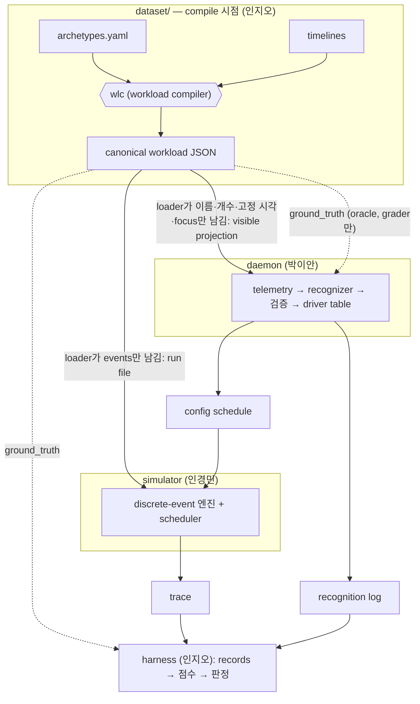
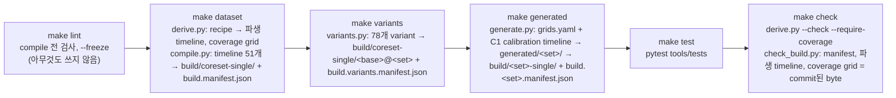

# 1권 · 데이터셋의 큰 그림

> Status: draft · Created 2026-10-14 · Updated 2026-10-17

**이 데이터셋은 무엇이고, 연구에서 어떤 일을 맡으며, 왜 이런 모양인가.**

---

이 시리즈는 저장소의 `dataset/` 디렉터리에 있는 workload dataset 하나를 여덟 권에 걸쳐 설명합니다. workload dataset은 이 연구의 실험이 먹는 재료입니다. 실험에 들어가는 모든 condition(recognizer를 바꿔 끼운 실험의 한 갈래)은 이 데이터셋의 파일을 똑같이 읽고, 그 위에서 점수를 받습니다. 그러니 데이터셋이 무엇을 담고 무엇을 빼는지가 곧 실험이 무엇을 측정할 수 있는지를 정합니다. 2026-10-14의 tree를 기준으로 데이터셋은 손으로 설계한 core set 51개 파일, 그 파일들을 조금씩 흔든 sensitivity variant 78개, 그리고 generator가 규칙으로 찍어 낸 generated layer 1,562개 파일로 이루어져 있습니다. 세 숫자 모두 이 권을 쓰면서 tree에서 직접 세었습니다.

이 1권은 데이터셋을 바깥에서 봅니다. 연구가 무엇이고 데이터셋이 그 안에서 어떤 일을 맡는지, "workload"라는 말이 여기서 무엇을 뜻하는지, 왜 데이터가 archetype → timeline → canonical workload라는 세 층을 거쳐 만들어지는지, `dataset/` 디렉터리가 어떻게 생겼고 `make` 명령 하나하나가 무엇을 하는지, 어떤 파일 집합들이 있고 각 집합이 어떤 질문에 답하는지, 숫자들이 어디서 오는지, 그리고 완성된 파일이 simulator·daemon·harness에게 어떻게 건네지는지를 차례로 다룹니다. 필드 하나하나, 숫자 하나하나의 세부는 2권부터 8권까지가 맡습니다. 이 권의 목표는 나머지 일곱 권을 읽을 때 "지금 읽는 이 조각이 전체의 어디에 붙어 있는가"를 늘 알 수 있게 하는 것입니다.

이 권은 운영체제와 scheduling을 처음 접하는 독자를 가정합니다. React와 TypeScript로 서비스를 만들고 CI를 돌려 본 경험은 있지만, `preemption`이나 `run queue` 같은 말은 낯선 독자입니다. 그래서 OS 용어는 처음 나올 때 한 줄로 풀고, 이 저장소가 만들어 쓰는 용어(`segment`, `focus`, `manifest`, `pre-committed miss` 같은 것)도 처음 나올 때 풀어 둡니다. 풀어 둔 용어는 모두 마지막 장인 용어 정리에 다시 모입니다.

한 가지 미리 말해 둘 것이 있습니다. 저장소의 문서 가운데 몇몇은 2026-09-13부터 2026-10-13까지 이어진 데이터셋 재구축(Phase 9, workload dataset rebuild phase) 이전의 데이터셋을 설명합니다. 예를 들어 어떤 문서는 core set이 50개 파일이라고 하고, 어떤 문서는 archetype이 열두 개라고 합니다. 이 책은 언제나 tree에 있는 데이터 파일과 코드, 그리고 재구축 이후에 갱신된 문서를 기준으로 씁니다. 문서와 tree가 어긋나는 곳에서는 어긋남을 그대로 밝히고, 지금의 사실과 그 출처를 함께 적습니다.

---

## 목차

1. [1장 · 연구를 한 장으로](#1장--연구를-한-장으로)
2. [2장 · workload란 무엇인가](#2장--workload란-무엇인가)
3. [3장 · 세 층: archetype, timeline, canonical workload](#3장--세-층-archetype-timeline-canonical-workload)
4. [4장 · dataset/ 지도와 pipeline](#4장--dataset-지도와-pipeline)
5. [5장 · 집합들 한눈에](#5장--집합들-한눈에)
6. [6장 · 숫자는 어디서 오나](#6장--숫자는-어디서-오나)
7. [7장 · 소비자에게 가는 길](#7장--소비자에게-가는-길)
8. [8장 · 2권부터 8권까지 읽기 안내](#8장--2권부터-8권까지-읽기-안내)
9. [9장 · 용어 정리](#9장--용어-정리)

---

# 1장 · 연구를 한 장으로

이 장은 "이 데이터셋은 어떤 연구를 위해 존재하는가"라는 질문에 답합니다. 이 질문이 맨 앞에 오는 이유는 간단합니다. 데이터셋의 거의 모든 모양 — 왜 파일마다 정답 label이 붙어 있는지, 왜 그 label이 숨겨져 있는지, 왜 같은 파일이 언제 compile해도 byte 단위로 같아야 하는지, 왜 어떤 파일은 일부러 틀리도록 만들어졌는지 — 은 연구가 데이터셋에 요구하는 것에서 나옵니다. 연구 전체를 설명하려는 장은 아닙니다. 데이터셋을 읽는 데 필요한 만큼만 설명합니다.

## 1.1 문제: 운영체제는 software가 무엇을 위한 것인지 모릅니다

두 대의 컴퓨터가 나란히 게임을 돌리고 있다고 생각해 봅시다. 첫 번째 컴퓨터에서는 사용자가 Steam으로 다른 게임을 내려받고 있습니다. 사용자가 원해서 시작했고, 끝나기를 기다리는 작업입니다. 두 번째 컴퓨터에서는 Ubuntu의 자동 업데이트(unattended upgrade)가 제멋대로 시작되어 패키지를 설치하고 있습니다. 아무도 지금 그것을 원하지 않았습니다.

운영체제가 볼 수 있는 숫자 — CPU를 얼마나 쓰는지, 얼마나 자주 잠들고 깨는지 — 만 보면 두 컴퓨터는 거의 같아 보입니다. 앞쪽에 게임이 있고, 뒤에서 무거운 작업 하나가 CPU를 나눠 쓰고 있습니다. 그런데 옳은 대응은 반대입니다. 원하는 download는 게임을 방해하지 않을 만큼 속도를 줄이되 계속 진행시켜야 하고, 원치 않는 업데이트는 게임이 끝날 때까지 뒤로 미뤄도 됩니다. 두 상황의 차이는 숫자에 있지 않고 **의미**에 있습니다. 그리고 그 의미가 드러나는 거의 유일한 곳이 process 이름입니다. 사람은 process 목록에서 `steam`과 `unattended-upgr`를 보는 순간 차이를 압니다. 운영체제는 모릅니다. 운영체제는 software가 무엇을 위한 것인지 알지 못하기 때문입니다.

> **용어.** `process`는 실행 중인 program 하나의 인스턴스입니다. 자기 메모리 공간을 가지고, 안에 thread를 하나 이상 품습니다. process 이름은 Linux kernel이 process마다 붙여 두는 짧은 이름 문자열로, kernel 안에서는 `comm`이라는 필드에 들어 있습니다. `comm`은 끝의 NUL 문자를 포함해 16 byte이므로 이름은 최대 15글자입니다. 그래서 `unattended-upgrade`라는 program은 process 목록에서 `unattended-upgr`로 잘려 보입니다.

이 예는 저장소의 연구 소개 문서(`docs/background-guide.md` §1)가 드는 이야기와 같은 모양입니다. 다만 그 문서는 원치 않는 작업의 예로 백신 검사를 듭니다. 데이터셋은 2026-10-01에 그 자리를 Ubuntu 24.04의 기본 unattended upgrade로 바꾸었습니다(9.10 D3, scenario와 timeline을 다시 정한 sub-task 9.10의 세 번째 결정). 기록된 이유는 이렇습니다. ClamAV 문서는 스스로를 "mail gateway에서 e-mail을 검사하도록 설계된" 도구라고 소개하고 정기 검사를 기본으로 설치하지 않으며, Debian의 사용 통계에서 ClamAV GUI를 정기적으로 쓰는 비율은 0.11 %였습니다. 반면 `unattended-upgrades`는 Ubuntu 24.04 desktop의 기본 구성에 들어 있고 기본으로 켜져 있어서 매일 06:00에서 최대 60분 사이에 실행됩니다. 이 책에서 "원치 않는 배경 작업"의 대표 예가 백신이 아니라 자동 업데이트인 것은 그 때문입니다.

운영체제는 이 빈틈을 지금 손으로 쓴 목록으로 메웁니다. Windows와 macOS의 Game Mode는 알려진 게임 실행 파일의 목록을 가지고 다닙니다. Linux의 scheduling class는 application이 스스로 "나는 배경 작업이다"라고 선언해 주기를 기다립니다. 모든 목록은 누군가가 어느 시점에 software의 의미를 손으로 적어 둔 것이고, 모든 목록은 영원히 불완전합니다. 목록에 오르지 않은 software는 아무 대접도 받지 못합니다.

이 연구의 제안서(`docs/research-proposal.md`, 제목 "A Semantic Recognition Layer for Operating Systems")는 그 목록을 추론으로 바꾸자고 제안합니다. 대형 언어 모델(LLM)은 인터넷을 읽으면서 Steam이 무엇인지, `cc1`이 compiler의 일부라는 것, `tracker-miner-f`가 GNOME의 파일 indexer라는 것을 이미 배웠습니다. 그러니 실행 중인 process 이름의 목록을 LLM에게 보여 주고 "이 기계는 지금 게임에 쓰이고 있고, 뒤에서 도는 작업은 사용자가 원한 것이다" 같은 판단을 받아, 그 판단을 scheduler 설정으로 바꾸자는 것입니다. 제안서는 이 판단을 **recognition layer**(인식 계층)라고 부르고, 연구가 위험에 걸어 두는 주장을 이렇게 적습니다(`docs/research-claims.md`, "The claim"): "옳은 정책이 다르고, 행동도 선언된 scheduling class(2.9)도 그 차이를 정하지 못하는 workload에서, process 이름을 읽는 언어 모델은 그 차이를 되찾고, 가장 강한 이름 표(strongest name table)는 되찾지 못한다." 가장 강한 이름 표가 무엇인지는 1.3에서 봅니다.

## 1.2 두 개의 loop: 느린 인식과 빠른 scheduling

여기서 곧바로 부딪히는 제약이 하나 있습니다. scheduler는 "다음에 누가 CPU를 쓸 것인가"를 microsecond 단위로, 초당 수십만 번 결정합니다. LLM은 무엇이든 답하는 데 수백 millisecond가 걸립니다. 다섯에서 여섯 자릿수의 차이이고, 이 차이는 줄어들지 않습니다. 그래서 이 연구에서 LLM은 scheduling 결정을 **절대** 내리지 않습니다(`docs/background-guide.md` §2).

설계는 두 개의 loop입니다.

```text
   느린 loop (process 구성이 바뀔 때만, 가끔)
     process 이름들 ──▶  recognizer(LLM 등) ──▶  "gaming, 배경 작업은 원한 것"
                                                    │
                                                    ▼  (설정으로 변환)
   빠른 loop (끊임없이, 결정 하나에 microsecond)
     평범한 scheduler가 마지막으로 받은 설정대로 계속 돈다
```

웹 서비스에 익숙한 독자에게는 feature flag 서비스가 좋은 비유입니다. request handler들은 요청 하나하나를 전속력으로 처리하고, 그 처리 방식은 현재 flag 설정을 읽어서 정해집니다. flag 설정은 가끔, 따로 떨어진 곳에서 바뀝니다. flag 서비스가 느리거나 죽어도 handler는 마지막 설정으로 계속 돌아갑니다. 이 연구의 recognizer는 flag 서비스이고, scheduler는 request handler입니다. 최악의 경우는 조금 어긋나게 튜닝된 평범한 scheduler일 뿐, 망가진 시스템이 아닙니다.

실험에서는 이 두 loop가 동시에 돌지도 않습니다. workload가 처음부터 끝까지 미리 대본으로 짜여 있으므로, 느린 loop를 **미리** 전부 돌려 둘 수 있습니다. recognizer 쪽 program(daemon)은 workload에서 recognizer가 보았을 정보를 읽어 인식을 모두 끝낸 뒤 "t = 0부터는 이 설정, t = 60.45 s부터는 저 설정" 같은 설정 일정표(config schedule)를 파일로 써 둡니다. 그다음 simulator가 빠른 loop만 돌리면서 그 일정표를 입력으로 읽습니다. LLM이 느리다는 사실은 각 설정이 측정된 인식 지연만큼 **늦게** 적용되도록 시각을 찍어서 보존합니다(`docs/background-guide.md` §2). 이 "파일만 주고받는다"는 구조가 데이터셋의 모양을 크게 정합니다. 7장에서 다시 다룹니다.

## 1.3 recognizer와 executor, 그리고 condition의 사다리

똑똑한 scheduler는 두 부분으로 나눌 수 있습니다(`docs/background-guide.md` §3).

- **recognizer** — 기계가 지금 어떤 상황에 있는지 알아내는 부분입니다("gaming, 배경 download는 원한 것").
- **executor** — 상황이 주어졌을 때 설정을 적용하고 그 설정대로 scheduling하는 부분입니다.

실험은 executor를 모든 조건에서 **완전히 똑같이** 두고 recognizer만 바꿔 끼웁니다. 그러면 결과의 차이는 오직 인식의 질에서 온 것이 됩니다. 바꿔 끼우는 recognizer들은 사다리를 이루고, 사다리의 한 칸을 **condition**이라고 부릅니다.

| condition | 하는 일 | 사다리에 있는 이유 |
|---|---|---|
| `fixed` | 인식 없음. 늘 기본 설정 | 바닥: 상황 인식이 없을 때의 점수 |
| `random` | 상황을 무작위로 고름 | 대조군: 쓸모없는 recognizer의 점수 |
| `shipped_catalogue` | 배포판이 실제로 켜 두는 이름 목록을 재현: CachyOS가 ananicy-cpp로 설치해 켜는 catalogue(`ananicy-rules`의 commit `03ef03fb`)를 각 process의 `argv[0]` basename과, 자르지 않은 채로 대조 | 오늘의 배포된 시스템이 하는 일. 이것을 이기면 RQ2(오늘의 시스템을 이기는가, 1.5)에 답함 |
| `strongest_name_table` | 같은 catalogue의 설계를 따르되, 데이터셋이 "알려진" software로 내놓는 program 모두에 규칙을 둔 이름 목록. 등록되지 않은 software와 만들어 낸 이름(familiarity tier 4–5, 5.2)에는 규칙이 없음 | 이름 표가 할 수 있는 최선. 연구의 주장은 이것을 이기는 것 |
| `llm_vocab`, `llm_algo`, `llm_full` | LLM에게 묻되, 단계적으로 더 많은 권한을 줌 | 시험 대상 |
| `oracle` | workload 파일에 숨겨진 정답을 그대로 읽음 | 천장: 완벽한 인식의 점수 |

(condition 이름은 harness 코드의 것입니다: `harness/tools/harness/evaluator.py`의 `CONDITIONS`.)

`oracle`이 반칙처럼 들리지만, 이것이 데이터셋이 존재하는 이유 중 하나입니다. 데이터셋의 모든 workload 파일에는 **ground truth**가 숨어 있습니다. 매 순간 그 파일이 어떤 상황을 나타내는지 파일을 쓴 사람이 붙여 둔 정답 label입니다. `oracle`은 그 label을 읽기만 하므로 틀릴 수 없고, 그래서 이 executor 위에서 어떤 recognizer도 넘을 수 없는 천장이 됩니다. 실험의 질문은 언제나 "LLM이 `random`과 `oracle` 사이 어디에 떨어지는가, 그리고 두 이름 표를 넘는가"입니다. `docs/research-claims.md`의 RQ2 절은 shipped catalogue를 넘으면 RQ2에 답하고, 가장 강한 이름 표를 넘는 것이 주장이라고 적습니다.

> **용어.** `ground truth`는 workload 파일 안의 정답 label 목록입니다. 시간 구간마다 그 구간의 상황(mode와 attribute)을 적습니다. `oracle` condition과 인식 정확도를 채점하는 grader만 읽습니다.

이 연구는 측정을 두 층으로 나눕니다. **Layer 1**은 인식 정확도입니다. recognizer의 답을 ground truth label과 바로 비교하므로 simulator가 끼어들지 않습니다. **Layer 2**는 소비자 성능입니다. 각 condition의 설정으로 simulator를 돌린 뒤 trace(simulator가 남기는 시간표, 1.6)에서 응답 시간, frame 놓침 비율 같은 지표를 계산합니다(`docs/terminology.md`, "Layer 1", "Layer 2"). 둘을 나눈 이유는 "제대로 읽었지만 scheduling은 나아지지 않았다"를 다른 결과와 구별할 수 있게 하려는 것입니다.

> **용어 — "Layer 1", "Layer 2"와 C1–C7.** 이 저장소에서 "Layer 1"과 "Layer 2"는 위의 두 측정 층만을 뜻합니다. 예전에는 데이터셋 설계 문서(`docs/workload/building-plan.md` §1)가 archetype library라는 데이터 층도 "Layer 1"이라고 불렀고, `docs/research-claims.md`가 연구 주장을 이루는 고리들을 C1–C7로 불러 core set의 일곱 파일 group(C1–C7)과 이름이 겹쳤습니다. 2026-10-16에 인지오가 두 충돌을 정리했습니다(9.15 작업 목록 `_dev/research/jioh/task-9.15-docs-memos-and-guidebook-corrections/work-list.md`에서 이름 충돌을 물은 항목 W-0742의 답). 데이터셋의 층은 번호가 아니라 이름으로 부르고(archetype library, scenario 목록, timeline; 3.8), 연구 주장의 고리는 "link 1"부터 "link 7"까지로 부르며("link 1: 옳은 설정이 다른 현실적 상황이 존재하고 그 차이는 측정 가능하다" 등), C1–C7은 core set의 파일 group만을 뜻합니다. 이 책도 C1–C7을 쓸 때 매번 group 이름을 함께 적습니다.

## 1.4 recognizer의 답은 어떤 모양인가: mode 하나와 attribute 하나

recognizer의 답에서 데이터셋이 직접 관여하는 부분은 `system` block이라고 불리는 부분입니다. 그 어휘는 `docs/recognition-vocabulary.md` §1이 정하고, 데이터셋의 ground truth label과 **같은 어휘**를 씁니다. 그래서 recognizer의 답과 정답을 중간 변환 없이 바로 비교할 수 있습니다.

**mode**는 그 구간에 기계가 주로 무엇에 쓰이는지를 나타내는 label입니다. recognizer는 질문마다 닫힌 메뉴의 열여섯 개 가운데 정확히 하나를 답합니다.

| mode | 기계가 쓰이는 일 |
|---|---|
| `browsing` | 웹 browsing이 주된 활동 |
| `office` | 문서, spreadsheet, 발표 자료 |
| `mail` | e-mail 읽고 쓰기 |
| `dev` | editor나 IDE에서 code 쓰기 |
| `photo` | 사진 편집 |
| `meeting` | 실시간 영상 통화 |
| `gaming` | 앞에서 게임하기 |
| `media` | 영상·음악 재생 |
| `video-edit` | 대화형 영상 편집 |
| `compile` | software build |
| `ml-train` | 기계학습 training 실행 |
| `render` | offline render |
| `transcode` | batch media 변환 |
| `indexing` | 파일 indexing·crawling |
| `backup` | backup 작업 |
| `idle` | 사람 없음, 유지보수 작업만 |

ground truth에는 메뉴에 없는 label 하나가 더 나올 수 있습니다. `ambiguous`는 똑같이 활발한 전경 작업 두 개가 동시에 있어서 정답을 하나로 정할 수 없는 구간에만 붙습니다. recognizer는 언제나 열여섯 중 하나를 골라야 하므로 `ambiguous` 구간은 정확도 채점에서 빠지고 따로 보고됩니다.

**attribute**는 mode label이 담을 수 없는 독립된 사실 하나입니다. 지금 채점되는 attribute는 `background_wanted` 하나뿐입니다. "지속되는 배경 작업이 사용자가 원한 것인가?"를 묻는 boolean입니다. 사용자가 일부러 시작했거나 끝나기를 기다리는 작업이면 `true`, 지금 아무도 원하지 않은 작업이면 `false`입니다. 두 가지 관례가 붙어 있습니다. 첫째, 지속되는 배경 작업이 아예 없는 구간은 `true`로 둡니다. 원치 않는 일이 돌고 있지 않으니까요. 둘째, 여섯 개의 batch mode(`compile`, `ml-train`, `render`, `transcode`, `indexing`, `backup`)에서는 그 batch 작업 자체가 attribute가 판정하는 배경 작업입니다. 예를 들어 `compile`이면서 `false`라는 것은 "사용자의 build 대신 kernel 업데이트 뒤에 배포판이 알아서 도는 module rebuild"처럼 그 작업 자체를 아무도 원하지 않았다는 뜻입니다.

mode가 열여섯이고 attribute가 참·거짓 둘이므로 상황의 칸은 16 × 2 = 32개입니다. 이 32칸이 **driver table**의 행입니다. driver table은 daemon 쪽에 있는 고정된 표로, (mode, `background_wanted`) 한 쌍을 scheduler 설정 하나로 바꿉니다. 설정은 scheduling algorithm 하나(MLFQ, EDF, LOTTERY, FIFO 가운데 하나. 각각은 2.2에서 풉니다)와 그 parameter, 그리고 batch 작업이 쓸 수 있는 CPU 몫의 상한(`batch_bandwidth_cap`)으로 이루어집니다(`docs/recognition-vocabulary.md` §2). recognizer가 할 일은 맞는 행에 도착하는 것입니다. 데이터셋 쪽에서 이 32칸은 중요한 의미를 갖습니다. 데이터셋은 32칸 모두에 적어도 하나의 정답 구간이 있도록 만들어져 있고, CI가 그것을 검사합니다. 5장에서 다시 봅니다.

ground truth의 구간에는 recognizer에게 보이지 않는 설명용 key가 더 붙을 수 있습니다. `background`(배경 작업이 무엇인지, 예: `download`), `initiated`(누가 시작했는지: `user`, `scheduled`, `session`), `dual_active`, `spoof`, `pre_committed_miss`(어떤 recognizer도 이름과 행동으로 닿을 수 없는 구간이라는 표시, 5.3)입니다. `session`은 desktop session 자체가 login 때 아무도 시키지 않고 시작하는 일로, `c2-p1b`와 `c7-indexing`(둘 다 첫 login 때 도는 Tracker의 첫 indexing)이 씁니다(9.10 D79, 이 indexing을 첫 login 때의 것으로 정한 결정). 이것들은 채점 결과를 나누어 보고하거나 실패를 분석할 때만 씁니다(`docs/recognition-vocabulary.md` §1).

## 1.5 RQ0: 아무 모델도 없이 먼저 여는 문지기 실험

연구 질문은 RQ0부터 RQ5까지 여섯 개입니다(`docs/research-claims.md`). 데이터셋 독자에게 가장 중요한 것은 첫 번째, **RQ0**입니다. RQ0는 "이 workload들에서 설정이 애초에 중요한가?"를 묻습니다. LLM 없이 `fixed`, `random`, `oracle` 세 condition만 돌려 봅니다(RQ0 gate spec의 `conditions`, 아래). 완벽한 인식이 무작위 추측보다 별로 낫지 않다면, 이 workload들에서는 인식의 질이 중요하지 않다는 뜻이고, 어떤 prompt engineering도 실험을 살릴 수 없습니다. 그래서 RQ0는 milestone이 아니라 문(gate)으로 설계되었습니다. 문서가 이름 붙인 실패 방식은 이것입니다. scheduler의 행동 기반 heuristic이 너무 좋아서 잘못된 분류를 스스로 고쳐 버리는 경우입니다. compiler를 interactive class에 넣어도 MLFQ가 몇 번의 time slice(한 번에 주는 최대 실행 시간, 2.2) 만에 알아서 끌어내린다면, 인식이 맞든 틀리든 결과가 같아집니다.

나머지 질문은 짧게만 적습니다. RQ1은 모델이 process 이름에서 상황을 읽을 수 있는가(Layer 1 인식 정확도), RQ2는 그 읽기가 오늘의 시스템(`fixed`, 그리고 배포판의 이름 목록을 재현한 `shipped_catalogue`)을 이기는가, RQ3는 모델에게 권한을 얼마나 줘야 하는가(`llm_vocab`·`llm_algo`·`llm_full`의 사다리), RQ4는 인식 지연을 갚으려면 한 상황이 얼마나 오래 지속되어야 하는가, RQ5는 측정 도구인 driver table 자체가 건전한가입니다. 데이터셋의 일부 파일 집합은 이 질문들을 위해 따로 만들어졌습니다. 예를 들어 generated layer의 return grid는 RQ4의 "낡은 설정의 비용"을 재기 위한 것입니다(5장).

RQ0 문지기 실험의 실행은 사전 등록 파일 하나로 고정되어 있습니다. `harness/experiments/rq0-gate.yaml`, 저장소가 **RQ0 gate spec**이라고 부르는 파일입니다. 이 파일은 harness가 실행 matrix로 읽는 데이터이고, 데이터셋과 직접 맞물리는 부분은 이렇습니다.

- **condition**은 `fixed`, `random`, `oracle` 셋입니다. 세 condition 모두 telemetry(recognizer에게 보여 주는 process 이름·개수·focus의 snapshot, 7장)를 읽지 않으므로 telemetry 모양은 `focus` 하나만 돌립니다.
- **seed 수** N = 100입니다. `random`은 seed마다 다르게 뽑습니다.
- **judging file**은 19개입니다. "label이 다른 짝의 한쪽이고, 채점 항목이 driver table 행들의 차이를 설계상 드러내는" 파일만 판정에 들어갑니다(statement `judging-set`). C2 intent pair group의 normal-class 쪽 넷(`c2-p1a`, `c2-p2a`, `c2-p2b`, `c2-p3a`), C1 calibration group 가운데 batch 작업이 행의 몫 차이에 닿는 넷(`c1-compile`, `c1-ml-train`, `c1-render`, `c1-transcode`), C7 attribute counterpart group의 열한 개입니다.
- **reporting file**은 32개입니다. 나머지 core set 파일 전부로, 돌리고 보고하지만 판정에는 들어가지 않습니다. 19 + 32 = 51로 core set 전체입니다.
- **판정 기준**은 `k_of_n_gap`입니다. 한 파일의 점수는 그 파일의 채점 항목들을 (fixed − condition) / (fixed − oracle)로 정규화한 몫의 가중합입니다. 즉 `oracle`이 `fixed`보다 얼마나 나아지는지를 1로 놓고, 비교 대상 condition이 그중 얼마를 차지하는지를 봅니다. g = 0.5는 "인식이 얻을 수 있는 개선의 적어도 절반을 설명한다", 다시 말해 `random`이 `oracle`의 여유분 가운데 절반 이하만 차지한다는 뜻입니다(statement `g-grounding`; 기록은 "어떤 출처도 이 값을 뒷받침하지 않는, 실행 전에 고정한 최소 효과"라고 적습니다). K = 10은 judging file 19개의 과반입니다(statement `k-grounding`). 판정은 이 조건을 만족하는 judging file의 개수를 세고, 그 개수가 K 이상이면 문을 통과한 것으로 읽습니다(spec의 표현으로 "보고서는 K가 무엇이든 개수를 출력하고, K는 통과선을 긋는다").
- **pin**: spec은 데이터셋을 SHA-256으로 못 박습니다. `pins.dataset`은 `dataset/build.manifest.json`의 hash `0f0af422…`이고, `pins.variants.all`은 `dataset/build.variants.manifest.json`의 hash `cdc14319…`입니다(2026-10-17의 두 번째 re-pin, `harness/CHANGELOG.md`의 2026-10-17 항목 가운데 dataset을 마지막으로 다시 pin한 것). 2026-10-17에 두 파일의 hash를 계산해 보았고, 둘 다 pin과 같았습니다.

> **왜 이렇게 정했나.** judging file 수와 K는 2026-10-09에 다시 정해졌습니다(9.14 decision 2, 재구축된 데이터 위에서 소비자 쪽 결정을 다시 한 sub-task의 두 번째 결정). 그 전 spec은 25개 judging file과 K = 13이었습니다. `harness/experiments/rq0-gate.yaml`의 statement `k-grounding`은 "K = 10은 19개 judging file의 과반으로 읽는다(2026-10-09까지는 같은 읽기로 25개 중 13개)"라고 적습니다. 바뀐 이유는 judging 규칙 자체가 아니라 재구축된 파일들에 그 규칙을 다시 적용한 결과입니다. 예를 들어 idle class 작업을 품은 여섯 파일은 executor 규칙상 어떤 행도 배경 작업에 닿지 못해서 reporting으로 옮겨졌습니다(statement `idle-class-files`). `docs/terminology.md`의 "RQ0 gate spec" 항목도 19개 judging file과 K = 10을 적습니다.

연구의 무게가 실리는 실험 하나도 알아 둘 만합니다. `docs/research-claims.md`는 "논문은 matrix가 아니라 한 쌍 위에 선다"고 쓰고, 그 쌍으로 "ML training 실행 + editor"(`ml-train`, 원한 배경 작업)와 "파일 indexer + editor"(`indexing`, 원치 않는 배경 작업)를 듭니다. 데이터셋에서 이 쌍은 `c2-p1a`와 `c2-p1b`, C2 intent pair group의 첫 번째 쌍(P1)입니다. 두 파일은 첫 60초 동안 editor만 있는 `dev` 구간을 공유하고, 두 번째 구간에서만 다릅니다.

> **왜 이렇게 정했나 — 재구축된 P1 쌍.** 재구축 전의 `docs/research-claims.md`는 이 쌍을 "둘 다 editor 옆에서 CPU를 계속 쓰는 process 하나이고, 어떤 행동 heuristic도 원리적으로 둘을 구별하지 못한다"고 설명했습니다. 재구축된 두 파일에서 unwanted 쪽은 자기 자신의 측정된 작업이고, 이름과 행동이 모두 다릅니다. `c2-p1a`의 training은 `cpu-batch` archetype의 `python3` program(PyTorch의 MNIST 예제를 측정한 값)을 쓰고, `c2-p1b`의 indexer는 Tracker의 첫 indexing을 따로 측정한 `file-indexer` archetype을 씁니다. 둘은 측정된 표가 다르고, indexer는 스스로 SCHED_IDLE을 선언하므로 `declared_class: idle`입니다(program이 스스로 선언하는 scheduling class, 2.9). 2026-10-11의 데이터셋 감사 기록(`_dev/docs/audit/jioh/2026-10-10-dataset-audit-before-9.15.md`, "C2 direction", C2 intent pair group에 대한 방향)이 이 쌍의 문장을 "unwanted 쪽은 자기 자신의 측정된 작업이며 이름과 행동이 모두 다르다"로 고쳐 쓰기로 정했고, 9.15(문서·memo·guidebook 정정 sub-task)가 `docs/research-claims.md`("Two real jobs beside an editor … They differ in behaviour … and in declared class")와 building plan §3의 C2 intent pair group 절을 그렇게 고쳤습니다. 2026-10-14의 9.23 D9(P1을 그대로 무게가 실리는 쌍으로 둔 결정)는 P1이 여전히 그 쌍이라고 적습니다. P1은 원한 training과 원치 않는 indexer를 구별하는 인식 주장을 싣고, `c2-p1a` 쪽의 scheduling 여유(headroom)를 싣습니다. RQ0 문지기 실험은 `c2-p1a`를 판정하고 `c2-p1b`는 보고만 합니다(9.14 decision 2). indexer 쪽은 그 선언된 idle class가 이미 정하기 때문입니다. 같은 감사 기록은 intent에 대한 비율 주장은 C1 calibration group과 C7 attribute counterpart group의 열여섯 쌍이 맡고 C2 intent pair group의 쌍을 새로 생성하지는 않는다고 정했습니다.

## 1.6 세 개의 program: simulator, daemon, harness

데이터셋 주위에는 program이 세 개 있습니다. 데이터셋은 이들 모두에게 재료를 주지만, 셋 중 누구와도 실행 중에 대화하지 않습니다. 모든 것은 파일로 오갑니다(`docs/data-contracts.md` §1).



- **simulator**(인경민 담당, `simulator/`)는 실제 process를 돌리지 않고 scheduling 결과를 "종이 위에서" 계산하는 discrete-event 엔진입니다. CPU 하나(lane 하나)를 두고, workload 파일의 task들이 언제 CPU를 원하는지 보면서 scheduler가 누구에게 CPU를 줄지 정하고, 그 결과를 **trace**라는 시간표로 씁니다. 시계는 microsecond 정수이고, 아무 일도 없는 구간은 건너뜁니다. simulator 자체에는 난수가 없습니다(`docs/simulator/interpretation-contract.md` §1).
- **daemon**(박이안 담당, `daemon/`)은 recognizer 쪽 program입니다. workload에서 recognizer가 볼 수 있는 부분만 받아 telemetry snapshot(그 순간 살아 있는 process 이름과 개수, focus를 쥔 이름을 담은 메시지)을 만들고, condition에 해당하는 recognizer에 물어, 답을 검증하고 driver table로 설정을 고른 뒤, config schedule과 recognition log를 씁니다. 2026-10-14 현재 저장소의 `daemon/`에는 driver table과 그 lint만 있고 실제 recognizer는 아직 없습니다. 대신 harness의 시험용 mock daemon(`harness/tools/tests/mocks/daemon.py`)이 `fixed`, `random`, `oracle` 세 condition에 대해 계약대로 동작합니다.
- **harness**(인지오 담당, `harness/`)는 실험을 돌리고 채점합니다. trace와 recognition log를 읽어 records(관찰 한 줄씩의 CSV)를 만들고, 채점 규칙으로 점수를 내고, RQ0 gate spec 같은 사전 등록 파일에 따라 판정을 씁니다.

> **용어.** `trace`는 simulator의 출력입니다. 어느 task가 언제 CPU를 잡았는지, 어떤 주기 작업이 마감을 지켰는지를 한 줄씩 적은 사건 기록이고, 모든 성능 지표는 trace에서 읽어 냅니다.

> **용어.** `config schedule`은 daemon이 simulator에게 주는 파일로, (가상 시각, 설정) 쌍의 목록입니다. condition 사이에 달라지는 것은 이 파일 하나뿐입니다.

## 1.7 데이터셋이 맡은 일

이제 데이터셋이 이 실험에서 맡는 일을 다섯 가지로 정리할 수 있습니다.

**첫째, 모든 condition에게 똑같은 workload를 줍니다.** condition 사이에 달라지는 것이 config schedule 하나뿐이려면, workload는 condition마다 byte 하나까지 같아야 합니다. 데이터셋은 이것을 compile 단계의 결정론으로 보장합니다. `dataset/README.md`의 말로는 "같은 timeline + 같은 library + 같은 seed ⇒ byte-identical 출력"입니다. 사용자의 행동 — 언제 program을 켜고 끄는지, 언제 키를 누르는지 — 은 모두 compile 때 정해져 파일에 박히고, simulator는 그것을 그대로 재생합니다.

**둘째, 정답을 담습니다.** 파일마다 ground truth가 있고, 그 label은 파일을 설계한 사람이 붙였습니다. `oracle`이 천장이 될 수 있는 것도, Layer 1 인식 정확도를 채점할 수 있는 것도 이 label 덕분입니다.

**셋째, 정답을 숨깁니다.** 이것을 저장소는 **information asymmetry**(정보 비대칭)라고 부릅니다. ground truth는 `oracle`과 grader에게만 갑니다. simulator의 scheduler는 정답을 보지 못하고, LLM도 보지 못합니다. 이 비대칭은 "보지 말라"는 약속이 아니라 구조로 지켜집니다. simulator의 loader는 파일에서 `events`만 남기고 나머지를 버리고, daemon의 loader는 이름·개수·고정된 시각·focus만 남기고 나머지를 버립니다(`docs/data-contracts.md` §1, §4). 버려진 정보에는 아래쪽 어떤 코드도 실수로라도 분기할 수 없습니다. `dataset/README.md`의 문장으로는 "information asymmetry는 누가 어느 key를 건네받는가로 강제된다"입니다.

**넷째, scheduling 선택이 의미를 갖도록 경쟁을 만듭니다.** 모든 task가 원하는 만큼 CPU를 받을 수 있다면 어떤 scheduler든 결과가 같고, 실험은 아무것도 볼 수 없습니다. 그래서 데이터셋은 파일마다 CPU 수요를 계산해 기록하고, 경쟁을 품도록 설계된 파일(`oversubscribed` 수요 class)과 그렇지 않은 파일(`calibration` 수요 class)을 구분합니다. 이 수요를 예전에는 "lane의 약 100–150 %"라는 창 안에 들어야 하는 규칙으로 걸었지만, 2026-10-09에 그 규칙은 build를 막는 조건에서 물러나 기록만 하는 값이 되었습니다(5장).

**다섯째, 질문마다 그 질문을 물을 수 있는 파일을 준비합니다.** driver table의 32칸 모두에 정답 구간이 있어야 하고(coverage), 의도만 다른 쌍, 상황이 바뀌는 순간, 엉뚱한 process의 등장, 낯선 이름, 이름 기반 인식이 원리적으로 실패하는 경우가 각각 파일로 있어야 합니다. core set의 일곱 group과 generated layer의 다섯 집합이 이 일을 나눠 맡습니다(5장).

> **왜 이렇게 정했나.** 결정론이 왜 그렇게 중요한지에 대해 2026-09-20의 데이터셋 타당성 검토 memo(`docs/memos/2026-09-20-dataset-validity-review.md`)는 이렇게 적습니다. recognition layer의 입력은 process의 정체성(이름, 개수)이고 매개변수 분포를 보지 않으므로, "이름에 대한 추론이 손으로 만든 이름 표가 못 읽는 상황을 읽는다"는 주장을 떠받치는 것은 측정의 microsecond 정밀도가 아니라 compile 경로라는 것입니다. 같은 timeline·library·seed가 byte-identical workload를 만들고, intent pair의 두 번째 파일은 첫 번째 파일에서 recipe로 파생되므로 정확히 한 구간만 다릅니다. memo는 이것을 "측정의 성질이 아니라 결정론의 성질"이라고 부릅니다. 반대로 "인식에 따라 행동하면 scheduling 결과가 달라진다"는 두 번째 주장은 측정값에 직접 기대므로, 측정 campaign(같은 측정을 여러 번 반복한 묶음, 6장)이 그 주장을 떠받칩니다.

## 1.8 데이터셋이 주장하는 것과 주장하지 않는 것

데이터셋이 무엇을 주장하는지 미리 분명히 해 두면 뒤의 권들을 읽기가 쉬워집니다. 2026-09-20의 타당성 검토 memo의 결론은 한 문장입니다. "인식 주장에 대해서는 건전하고, scheduling 이득 주장에 대해서는 범위가 한정된다." 측정된 값은 GitHub의 hosted runner라는 특정 기계 위의 특정 software이고 desktop의 진실이 아니며(같은 memo §5), 실제 desktop에서의 검증은 진술된 한계로 남아 있습니다.

2026-10-10의 데이터셋 감사(다섯 명의 독립 감사자가 재구축된 데이터셋을 본 기록, `_dev/docs/audit/jioh/2026-10-10-dataset-audit-before-9.15.md`)는 "실제 사용에 얼마나 가까운가"라는 질문에 이렇게 답합니다. 개별 program 수준에서는 저장소가 인용하는 어떤 desktop scheduler workload보다 충실하게 측정되었습니다(28종 가운데 27종을 실제 program으로, 5–77번 반복 측정, 원시 trace 공개). 그러나 program보다 위의 수준 — 어떤 program들이 함께 도는지, 어떤 순서로, 얼마나 오래, core가 몇 개인지, 화면·GPU·소리 경로, 그리고 사람 — 은 설계했거나, 대용품을 썼거나, 빠져 있습니다. 감사는 RQ0 문지기 실험의 통과가 무엇을 주장하는지도 적습니다. "실제 program 행동으로 짜 맞춘, 경쟁이 있는 단일 core 상황 가운데 옳은 설정이 측정 가능하게 다른 상황이 존재한다"는 것이지, desktop이 그런 상황에 얼마나 자주 있는지, multi-core GPU desktop에서 이득이 얼마나 큰지, 실제 사용자가 그것을 어떻게 느낄지가 아닙니다.

이 경계는 데이터셋의 설계 결정으로도 박혀 있습니다. 2026-10-01의 결정 9.10 D2("core set의 task 구성은 design이다"; design은 출처 없이 실험이 고른 값이라는 표시, 6.1)는 "core set 파일의 한 구간에 어떤 program들이 함께 있는지는 그 파일이 하는 주장을 위해 고른 실험의 구성이며 design으로 표시한다. 어떤 core set 파일도 자기 task 구성을 desktop의 실제 모습으로 내세우지 않는다"고 정했습니다. 이유로는 Linux desktop에서 어떤 program들이 함께 도는지를 관찰한 자료를 네 부류의 출처에서 찾았지만 찾지 못했다는 탐색 기록을 듭니다. 6장에서 이 "design"이라는 label이 숫자 출처 체계 안에서 어떤 자리를 차지하는지 다시 봅니다.

---

# 2장 · workload란 무엇인가

이 장은 "이 데이터셋의 파일 하나, 즉 workload 하나는 정확히 무엇인가"에 답합니다. 이 질문이 필요한 이유는, 데이터셋이 담는 것이 실제 program이 아니라 "scheduler의 눈에 비친 program"이기 때문입니다. 그 눈에 무엇이 보이는지를 알려면 운영체제 용어 몇 개가 먼저 필요합니다. 이 장은 용어를 하나씩 풀고, 그 용어들로 workload를 정의한 뒤, compile된 실제 파일에서 task 네 개의 program을 손으로 따라가 봅니다.

## 2.1 process, thread, 그리고 이 프로젝트의 task

실제 컴퓨터에서 실행 중인 program은 **process**입니다. process 하나는 자기 메모리 공간을 가지고, 그 안에서 thread 하나 이상이 각자 code를 실행합니다. Linux kernel은 scheduling할 때 process가 아니라 thread를 단위로 다룹니다. kernel 안에서는 scheduling 단위를 `task`라고 부릅니다.

> **용어.** `task`는 이 프로젝트에서 simulator가 scheduling하는 단위 하나입니다. 미리 계산된 program 하나를 들고 다닙니다. `docs/background-guide.md` §7은 "task와 process를 같은 뜻으로 쓴다"고 적습니다.

여기서 중요한 단순화가 하나 있습니다. 측정해서 만든 application archetype(3장)은 실제 application의 process tree 전체를 **task 하나**로 합칩니다. 예를 들어 VS Code는 실제로는 수십 개의 thread를 가진 여러 process의 묶음이지만, 데이터셋에서는 `code`라는 이름의 task 하나가 됩니다. 그 task의 program 안에 "GPU process의 compositor thread가 초당 약 23번 깨어난다" 같은 여러 thread의 행동이 하나의 사건 흐름으로 합쳐져 들어 있습니다(`dataset/archetypes.yaml`의 `code-editor` 항목 `modeling_notes`: "one task carries the whole process tree merged"). 그래서 데이터셋의 task 개수는 실제 desktop의 thread 개수보다 훨씬 적습니다. 2026-10-10 감사의 fidelity map은 "파일당 1–26개 task 대 시스템 전체 약 300개"라고 적습니다.

반대로 하나의 timeline 항목이 여러 task가 되는 경우도 있습니다. `count: 4`라고 쓰면 같은 이름의 task 네 개가 생기고(`renderers.1` … `renderers.4`), game의 frame chain은 timeline의 항목 하나가 compile되면서 17개 task가 됩니다(2.5).

## 2.2 CPU 하나: lane, scheduler, run queue, time slice, preemption

simulator가 흉내 내는 기계에는 CPU가 하나뿐입니다. 저장소는 이 하나의 CPU를 **lane**이라고 부릅니다.

> **용어.** `lane`은 simulator의 단일 CPU입니다. 한순간에 task 하나만 lane을 잡고 실행됩니다. multi-core는 모델링하지 않습니다. 이 결정은 2026-08-23 설계 회의의 Q1("core 하나인가 여럿인가")에서 2026-08-26에 "단일 core"로 정해졌습니다(`docs/simulator/interpretation-contract.md` §1).

lane이 하나이므로 실행하고 싶은 task가 여럿이면 누군가는 기다려야 합니다. 실행할 준비가 되었지만 CPU를 기다리는 task들의 대기열을 **run queue**라고 합니다. run queue에서 다음에 누구를 lane에 올릴지 정하는 규칙이 **scheduler**입니다.

> **용어.** `run queue`는 실행 준비가 되어 CPU를 기다리는 task들의 목록입니다. 웹 서버의 요청 대기열과 같은 역할입니다.

scheduler는 한 task에게 lane을 무한정 주지 않습니다. 한 번에 줄 수 있는 최대 시간을 **time slice**(또는 quantum)라고 합니다. slice가 끝나면 scheduler가 다시 판단합니다. 실행 중인 task를 강제로 멈추고 다른 task를 올리는 것을 **preemption**이라고 하고, lane을 잡은 task가 바뀌는 그 전환을 **context switch**라고 합니다.

> **용어.** `time slice`는 scheduler가 task에게 한 번에 주는 최대 실행 시간입니다. 이 프로젝트의 기본 설정(boot default)에서 MLFQ의 맨 위 queue slice는 10 ms입니다(`docs/recognition-vocabulary.md` §2의 `timeslice_us` 기본값 10000).

> **용어.** `preemption`은 scheduler가 실행 중인 task를 중간에 멈추고 다른 task에게 lane을 주는 것입니다. `context switch`는 lane을 잡은 task가 바뀌는 전환 그 자체입니다. 실제 기계에서는 context switch가 cache를 어지럽히는 비용이 있지만, simulator는 그 비용을 모델링하지 않습니다(`docs/background-guide.md` §4의 "시뮬레이션이 치르는 대가").

이 프로젝트가 고를 수 있는 scheduling algorithm은 넷입니다. 이름만 알아 두면 데이터셋을 읽는 데 충분합니다.

- **MLFQ**(Multi-Level Feedback Queue): 우선순위 queue 여러 개를 두고, slice를 다 쓰는 task는 batch로 보고 아래로 내리고, slice가 끝나기 전에 스스로 쉬는 task는 interactive로 보고 위에 남깁니다. 주기적으로 모두를 맨 위로 올려(boost) 굶는 task가 없게 합니다. 실제 OS의 기본 scheduler 계열이고, 이 실험의 기본 설정입니다.
- **EDF**(Earliest Deadline First): 마감이 가장 가까운 task부터 실행합니다. frame이나 audio buffer처럼 마감이 있는 작업에 맞습니다.
- **LOTTERY**: task마다 추첨권을 주고 추첨으로 다음 task를 고릅니다. "배경 작업에 약 15 %" 같은 비율 배분을 표현합니다.
- **FIFO**: 도착 순서대로 끝날 때까지 실행합니다. 처리량은 최대지만 interactive 반응은 없습니다.

## 2.3 일하고 쉬기: burst, block, wake

task는 lane을 잡으면 일하고, 일이 끝나면 무언가를 기다리며 쉽니다. 한 번 lane을 잡고 연속으로 일하는 덩어리를 burst라고 하고, 기다리느라 실행할 수 없는 상태를 block되었다고 합니다. 기다리던 것이 오면 task는 다시 실행 준비 상태가 되어 run queue에 들어갑니다. 이것을 **wake**라고 합니다.

> **용어.** `wake`는 block되어 있던 task가 기다리던 사건(키 입력, timer, 다른 task의 신호)을 받아 다시 실행 준비 상태가 되는 것입니다. 깨어났다고 바로 실행되는 것은 아닙니다. run queue에 들어가 scheduler의 선택을 기다립니다. 깨어난 순간부터 실제로 lane을 잡기까지의 기다림이 이 실험이 재는 대표적인 지연(`ready_wait`)입니다.

task의 행동은 크게 세 모양으로 나뉩니다. 이 구분은 데이터셋 곳곳에 나옵니다.

- **interactive**: 사용자 입력에 반응해 짧게 일하고 오래 쉽니다. editor, 문서 편집기, 브라우저입니다. 응답 시간이 중요합니다.
- **batch**: 받은 CPU를 다 쓰면서 끝날 때까지 계속 일합니다. compiler, training, 영상 변환입니다. 끝나는 시각(turnaround)과 처리량이 중요합니다.
- **periodic**: 정해진 주기마다 깨어나 일정량을 일합니다. 영상·음악 재생, 영상 통화, 게임의 frame입니다. 주기마다의 마감을 지키는지가 중요합니다.

웹 개발자에게 익숙한 비유로 말하면, interactive task는 사용자 클릭을 기다리는 event handler, batch task는 오래 도는 background job, periodic task는 `setInterval`로 도는 rendering loop입니다. 셋이 한 CPU를 나눠 쓸 때 누구를 먼저 돌릴지가 scheduler의 고민이고, 그 고민의 정답이 상황(mode)과 의도(`background_wanted`)에 따라 달라진다는 것이 이 연구의 전제입니다.

## 2.4 여섯 개의 primitive

데이터셋은 task의 행동을 아주 작은 명령어 집합으로 적습니다. task 하나는 이 명령어들로 이루어진 **program**을 가지고, simulator 안의 작은 VM이 그 program을 한 줄씩 실행합니다. 명령어는 여섯 가지 primitive입니다(`docs/simulator/interpretation-contract.md` §3; FORK와 EXIT를 한 쌍으로 세어 여섯입니다).

| primitive | 뜻 |
|---|---|
| `RUN(us)` | lane 위에서 `us` microsecond만큼 CPU를 씁니다. 중간에 preemption될 수 있고, 그래도 남은 양은 사라지지 않습니다. 벽시계 시간이 아니라 CPU 수요입니다 |
| `SLEEP(us)` | 지금부터 `us` microsecond 동안 스스로 쉽니다(상대 시간) |
| `TIMER(period_us)` | 절대 격자 t₀ + k·period의 다음 눈금까지 기다립니다. 앞 반복이 늦게 끝나도 격자는 밀리지 않습니다 |
| `WAIT(channel)` | `channel`에 wake가 올 때까지 block합니다 |
| `WAKE(target)` | task `target`을 깨웁니다(깨우는 쪽과 기다리는 쪽을 잇는 간선) |
| `FORK` / `EXIT` | spawn table(compile 때 미리 적어 둔 자식 목록, 2.5)의 다음 자식을 만듭니다 / 이 task를 끝냅니다 |

여기에 `LOOP`가 하나 더 있습니다. `{op: LOOP, count, body}`는 `body`를 `count`번(또는 `"unbounded"`, 끝없이) 반복합니다. schema는 LOOP를 "VM 내부의 흐름 제어이지 일곱 번째 primitive가 아니다"라고 적습니다(`dataset/schema/workload.schema.json`).

> **용어.** `program`은 task 하나가 따르는 명령어 목록입니다. compile이 끝난 파일에서는 모든 숫자가 이미 구체적인 값으로 정해져 있습니다. scheduler가 무엇을 하든 program 자체는 바뀌지 않습니다. 바뀌는 것은 각 명령이 **언제** 실행되는가뿐입니다.

> **용어.** `channel`은 task가 WAIT할 수 있는 이름 붙은 우편함입니다. wake는 channel로 배달됩니다. compile된 파일에서 쓰이는 channel 이름의 꼴은 `timer:<task id>`(application 안의 timer성 깨어남), `input:<task id>`(키 입력), `chain:<task id>`(game frame chain의 다음 단계로 넘기는 신호), `job:<…>`(compile 작업 하나의 process들 사이 신호), `children:<task id>`(자식이 모두 끝나기를 기다림)입니다. 이 목록은 이 권을 쓰면서 `c1-dev`, `c1-gaming`, `c1-compile`의 compile 결과에서 직접 확인했습니다.

왜 하필 이 여섯인지에 대한 기록이 있습니다. 2026-08-26의 workload 생성 grill(질문을 하나씩 따져 결정을 내리는 설계 회의)의 결정 D13은 여섯 번째 primitive로 `TIMER`를 추가했습니다. 기록된 이유는 이렇습니다. 주기 작업을 "일하고, 상대 시간만큼 SLEEP"으로 적으면, 일이 늦게 끝날 때마다 다음 주기도 그만큼 밀립니다. 그러면 나쁜 설정 아래서 기계가 체계적으로 덜 붐비게 되고, 결과가 "나쁜 설정도 그렇게 나쁘지 않다"는 쪽으로 치우칩니다. 절대 격자를 쓰는 TIMER는 밀리지 않으므로 이 편향이 없습니다(rt-app이라는 scheduling 시험 도구의 `timer` 명령이 선례로 기록되어 있습니다).

> **열린 자리 — TIMER가 늦었을 때의 규칙.** 주기 task가 격자 눈금을 여러 개 지나친 뒤에야 TIMER에 도착하면 어떻게 할까요? `docs/simulator/interpretation-contract.md` §3은 "늦은 반복은 backlog로 쌓이고 조용히 건너뛰지 않는다"고 적습니다. 그러나 2026-10-07의 memo(`docs/memos/2026-10-07-timer-skip-rule-for-the-simulator.md`; scheduler 쪽 상수를 다룬 sub-task 9.11의 결정 D3)는 이것을 **skip 규칙**으로 바꾸었습니다. 지나간 눈금 가운데 가장 최근 것 하나만 즉시 소비하고 나머지는 일 없이 건너뛰되 각각을 마감을 놓친 job으로 셉니다. harness는 skip 규칙으로 읽지만, 2026-10-14 현재 simulator 코드(`simulator/src/sim.cpp`)는 아직 backlog 규칙으로 돕니다. 문서 정리 sub-task 9.15의 spec(결정 9)은 simulator 쪽 TIMER 문장을 그대로 두고 Phase 10(통합과 RQ0 문지기 실험의 실행 phase)의 TIMER 항목으로 넘겼습니다. 데이터셋 자체는 이 규칙과 무관하게 같은 파일을 냅니다. 이 차이는 simulator가 그 파일을 어떻게 재생하느냐의 문제입니다.

## 2.5 program 네 개를 손으로 따라가기

추상적인 표보다 실제 파일이 낫습니다. 아래 네 예는 모두 `dataset/build/coreset-single/`의 compile된 파일에서 이 권을 쓰면서 직접 꺼낸 것입니다.

### editor 하나: `c1-dev`의 `code`

`c1-dev`는 core set에서 가장 단순한 파일입니다. 60초 동안 VS Code(`code`) 하나만 있고, 사용자가 그 안에서 타이핑합니다. compile된 파일의 `events` 맨 앞에는 이 task의 `arrive` event가 있고, 그 program은 이렇게 시작합니다.

```jsonc
{ "op": "arrive", "t": 0, "id": "editor", "name": "code",
  "declared_class": "normal", "depart": 60000000,
  "program": [
    { "op": "WAIT", "channel": "timer:editor" },
    { "op": "RUN",  "us": 119 },
    { "op": "WAIT", "channel": "timer:editor" },
    { "op": "RUN",  "us": 12 },
    { "op": "WAIT", "channel": "timer:editor" },
    { "op": "RUN",  "us": 7 },
    // … 이런 WAIT/RUN 쌍이 모두 6,642개, 그리고 맨 끝에 WAIT 하나
    { "op": "WAIT", "channel": "timer:editor" }
  ] }
```

한 줄씩 읽어 봅시다. editor는 t = 0에 나타나고, 정확히 t = 60 s에 사라집니다(`depart: 60000000`, 모든 시간은 microsecond 정수입니다). 처음에는 `timer:editor` channel에서 기다립니다. 거기로 wake가 오면 119 µs 일하고, 다시 기다리고, 12 µs 일하고… 이 반복이 program 전체입니다. program은 13,285개 명령, 즉 WAIT 6,643개와 RUN 6,642개입니다. 마지막 명령은 마지막 wake의 channel에서 기다리는 `WAIT timer:editor`입니다. 2026-10-15의 9.23 D16(어떤 program도 떠나기 전에 바닥나지 않게 한 결정)부터, 떠나는 시각이 고정된 program은 막힌 채로 끝나고 떠나는 순간 사라집니다. wake로 움직이는 program은 마지막 wake의 channel에서 기다리는 WAIT로 끝나는데, 측정된 interactive 항목은 대개 timer 성분의 깨어남이 마지막이라 그 channel이 `timer:<id>`입니다.

그 wake들은 어디서 올까요? 파일의 나머지 `events`에 있습니다. 이 파일에는 wake event가 6,642개 있고, 그 가운데 6,456개는 `timer:editor`로, 186개는 `input:editor`로 갑니다. `timer:editor`의 wake는 VS Code의 여러 thread가 측정에서 보인 주기적 깨어남(compositor, IO thread 등)을 합친 것이고, `input:editor`의 wake는 사용자의 키 입력입니다. 키 입력은 2012년에 기록된 실제 사람의 타이핑 시각(SWELL-KW 기록, 6장)을 재생한 것이며, 이 파일에서 첫 키 입력은 t = 12.752609 s에 도착합니다. program을 따라가 보면 2,551번째 명령이 처음으로 `WAIT input:editor`이고, 그 키가 오면 editor는 59,020 µs, 약 59 ms를 일합니다. timer성 깨어남 뒤의 RUN은 중앙값이 33 µs로 짧고, 키 입력 뒤의 RUN은 중앙값이 약 80 ms로 깁니다.

program의 RUN을 모두 더하면 19,913,142 µs, 약 19.9초입니다. 60초짜리 파일에서 이 task가 lane의 약 33 %를 원한다는 뜻이고, 이 값은 compile report의 `utilization 0.3318857`과 정확히 같습니다.

> **코드로.** compiler(`dataset/tools/wlc/compiler.py`)는 측정된 application archetype의 여러 timer 성분과 재생된 키 입력을 task 하나의 명시적인 사건 흐름으로 합칩니다. `dataset/archetypes.yaml`의 머리 주석은 이 규칙을 "각 timer wake는 task의 timer channel에 대한 WAIT이며 마감이 없다(9.5 D74)"라고 적고(9.5 D74는 interactive 측정 sub-task 9.5의 결정), 마감이 있는 TIMER는 재생·통화 archetype과 game chain만 쓴다고 적습니다. `docs/data-contracts.md` §4와 `dataset/README.md`의 예시(compile된 `c2-p1a`의 editor)도 같은 모양을 보여 줍니다. 측정 기반 editor에서는 timer성 깨어남이 키 입력보다 한두 자릿수 많습니다(`c1-dev`에서 6,456 대 186).

### 주기 작업 둘: `c1-media`의 `mpv` 두 개

`c1-media`에는 영상 재생기와 음악 재생기, 둘 다 `mpv`라는 이름의 task가 있습니다. 이 둘의 program은 앞의 editor와 모양이 다릅니다.

```jsonc
// id "video", name "mpv"
[ { "op": "TIMER", "period_us": 33348 }, { "op": "RUN", "us": 3814 },
  { "op": "TIMER", "period_us": 33348 }, { "op": "RUN", "us": 3014 }, … ]
// id "music", name "mpv"
[ { "op": "TIMER", "period_us": 49635 }, { "op": "RUN", "us": 345 },
  { "op": "TIMER", "period_us": 49635 }, { "op": "RUN", "us": 239 }, … ]
```

영상 쪽은 33,348 µs, 약 30 fps의 격자마다 깨어나 frame 하나를 처리하고(3.8 ms, 3.0 ms, …), 음악 쪽은 49,635 µs마다 깨어나 짧게 일합니다. 이 파일에는 wake event가 하나도 없습니다. 주기 task는 바깥에서 깨워 줄 필요 없이 TIMER의 격자로 스스로 깨기 때문입니다. TIMER의 다음 눈금이 곧 그 job의 마감이 되므로, 이 task들에서 재는 것은 "주기마다 마감을 지켰는가"입니다.

### frame chain: `c1-gaming`의 17개 task

게임은 frame 하나를 여러 thread가 차례로 넘겨 가며 처리합니다. 데이터셋은 이것을 `game-task-chain` archetype으로 표현하고, compile하면 task 17개가 생깁니다.

```jsonc
// game.chain.1, name "Troy.exe" — chain의 머리
{ "op": "LOOP", "count": "unbounded", "body": [
    { "op": "TIMER", "period_us": 16667 },
    { "op": "RUN",   "us": 631 },
    { "op": "WAKE",  "target": "game.wineserver" } ] }
// game.wineserver, name "wineserver"
{ "op": "LOOP", "count": "unbounded", "body": [
    { "op": "WAIT", "channel": "chain:game.wineserver" },
    { "op": "RUN",  "us": 341 },
    { "op": "WAKE", "target": "game.chain.2" } ] }
// game.chain.2 … game.chain.15: WAIT chain:<자기 id>, RUN, WAKE 다음 단계
// game.chain.16: WAIT, RUN — 마지막 단계라 WAKE가 없다
```

머리는 16,667 µs(60 Hz의 한 frame) 격자마다 깨어나 일한 뒤 `wineserver`를 깨우고, `wineserver`는 일한 뒤 2번 단계를 깨우고, 그렇게 16번 단계까지 frame이 양동이 릴레이처럼 넘어갑니다. 머리, `wineserver`, 2–16번 단계를 합쳐 17개입니다. 이름은 timeline이 정합니다. 머리는 게임 실행 파일 이름 `Troy.exe`를 쓰고, 나머지 열다섯 단계는 `member_names`에 적힌 thread 이름(`Task worker thr` 넷, `dxvk-cs`, `dxvk-submit`, `winepulse_mainl`, `winepulse_timer`, `FAudio_AudioCli`, `Troy.exe` 여섯)을 차례로 받습니다. 여기에 Steam client(`steam`)가 하나 더 있어 이 파일의 `arrive` event는 18개입니다. chain이 lane의 얼마를 차지할지는 timeline의 `lane_share` 값(`c1-gaming`에서 0.9)으로 정하고, 그 값은 design입니다(6장).

### build: `c1-compile`의 `make`와 17,448개의 자식

마지막은 가장 큰 구조입니다. `c1-compile`에서 `make`는 t = 2 s에 도착하고, `spawn_table`이라는 자식 목록을 들고 옵니다.

```jsonc
{ "op": "arrive", "t": 2000000, "id": "build", "name": "make",
  "declared_class": "normal", "fork_cap": 48,
  "program": [ { "op": "RUN", "us": 229 }, { "op": "FORK" }, { "op": "FORK" }, …,
               { "op": "WAIT", "channel": "children:build" }, { "op": "EXIT" } ],
  "spawn_table": [
    { "id": "build.j1.sh",  "name": "sh",  … },
    { "id": "build.j1.gcc", "name": "gcc", … },
    { "id": "build.j1.cc1", "name": "cc1", … },
    … ] }
```

Linux kernel build의 object 파일 하나를 만드는 일은 실제로 process 여섯 개(`sh`, `gcc`, `cc1`, `as`, `fixdep`, `rm`)가 이어서 하는 일입니다. 데이터셋은 그 여섯을 "작업 하나"로 묶어 spawn table에 연속으로 적고, 작업 2,908개를 적습니다. 그래서 spawn table은 2,908 × 6 = 17,448개 항목입니다. `make`의 program은 RUN 2,908개(작업마다 한 번의 dispatch 비용)와 FORK 17,448개, 그리고 마지막의 `WAIT children:build`와 `EXIT`로 되어 있습니다. 자식들끼리는 `WAKE`와 `job:` channel로 부모-자식 순서를 지킵니다. 예를 들어 `build.j1.sh`는 일한 뒤 `build.j1.gcc`를 깨우고 자기 channel `job:build.j1.sh`에서 기다립니다. 동시에 살아 있을 수 있는 자식 수의 상한이 `fork_cap`이고, 그 값 48은 `-j8`(동시 작업 8개)에 작업당 process 여섯을 곱한 것입니다. 마지막의 `WAIT children:build`는 어떤 task도 `WAKE`로 깨우지 않습니다. executor가 `make`가 spawn한 자식이 모두 끝났을 때 이 WAIT를 끝내고, 그때 살아 있는 자식이 없으면 막지 않고 지나보낸다는 규칙이 2026-10-16에 계약(`docs/simulator/interpretation-contract.md` §3의 `WAIT(channel)` 줄과 §5의 FORK 문단)에 제안되었고, 인경민이 동의하면 효력을 갖습니다. RQ0 gate spec의 statement `simulator-conformance`는 이것을 항목 (g)로 RQ0 실행 전에 요구합니다. 2026-10-17의 simulator는 자식이 끝날 때 fork 자리만 돌려주고 이 WAIT를 끝내지 않습니다(`simulator/src/sim.cpp`의 `on_task_end`).

**어떤** 자식이 생기는지와 각 자식이 **무엇을** 하는지는 compile 때 정해져 파일에 있습니다. 그러나 각 자식이 **언제** 시작하는지는 파일에 없습니다. 그것은 scheduler가 `make`와 자식들에게 CPU를 얼마나 주느냐에 따라 실행 중에 정해집니다. 이 구분이 다음 절의 주제입니다.

> **왜 이렇게 정했나.** FORK를 실행 시점의 primitive로 남긴 것은 2026-08-26 grill D11의 결정입니다. 기록된 이유는 이렇습니다. compile 때 자식들의 도착 시각까지 펼쳐 버리면 `cc1`들의 도착이 고정되어, 나쁜 scheduler도 좋은 scheduler와 똑같은 속도의 fork 폭풍을 맞게 됩니다. 그러면 scheduler가 build를 얼마나 잘 다루는지가 결과에 드러나지 않습니다. 그래서 compiler는 순서가 정해진 spawn table 전체를 미리 뽑아 두고, 생성 시각은 실행 중의 "fork하고 자리를 기다리는" loop에서 나오게 했습니다. simulator는 이렇게 해도 난수 없이 돕니다.

## 2.6 두 가지 event: arrive와 wake

위의 예에서 보았듯이, workload 파일의 `events` 목록에는 두 종류의 event만 있습니다(`docs/data-contracts.md` §4). 이 닫힌 집합은 2026-08-26 grill D13에서 정해졌습니다.

- **`arrive`** — task 하나가 존재하기 시작합니다. 시각 `t`, 고유한 `id`, recognizer에게 보일 `name`, scheduling class `declared_class`, 그리고 완전히 풀린 `program`을 가집니다. 사용자가 닫는 program이면 `depart`가 있고, 자식을 만드는 task면 `spawn_table`과 `fork_cap`이 있습니다.
- **`wake`** — 바깥에서 온 자극 하나입니다. 시각 `t`, 받을 task `target`, 그리고 `channel`을 가집니다. 그 channel에서 WAIT하던 task가 실행 준비 상태가 됩니다. 사람이 기계를 쓴다는 사실은 이 wake들로 표현됩니다. 사람을 시뮬레이션하지 않고, 사람이 남긴 흔적의 시각만 박아 둡니다.

`events`는 시각 순으로 정렬되어 있고, compile 안의 canonical lint가 이것을 검사합니다.

## 2.7 고정된 시각과 드러나는 시각: pinned와 emergent

데이터셋 설계 전체를 지배하는 원칙이 하나 있습니다. 2026-08-26 grill D12가 그대로 적은 문장입니다.

> **compile 시점이 모든 무작위를 정하고, 실행 시점이 scheduling이 영향을 줄 수 있는 모든 시각을 정한다.**

이 원칙은 시각을 둘로 나눕니다(`docs/simulator/interpretation-contract.md` §2).

- **pinned(고정된) 시각** — 사용자의 행동이라 scheduler가 바꿀 수 없는 시각입니다. top-level task의 도착, 구간 경계, 엉뚱한 process의 끼어듦, 사용자가 program을 닫는 시각(`depart`), 키 입력 wake가 여기에 속합니다. 파일에 절대 시각으로 박혀 있습니다.
- **emergent(드러나는) 시각** — scheduling의 결과로 정해지는 시각입니다. 유한한 작업이 끝나는 시각(program이 EXIT에 도달하는 때), orchestrator가 자식을 만드는 시각이 여기에 속합니다. 파일에 없습니다.

> **용어.** `pinned`는 workload 파일에 절대 시각으로 고정된 시각, `emergent`는 scheduling 결과로 실행 중에 정해지는 시각입니다.

이 구분이 왜 필요한지는 실험을 생각하면 분명합니다. 사용자 행동이 scheduler에 따라 달라진다면 condition끼리 비교할 수 없습니다. 반대로 결과가 scheduler에 따라 달라지지 않는다면 잴 것이 없습니다. 2026-08-26 grill D10은 모든 도착과 떠남을 고정한 trace("open-loop")를 기각했는데, 기록된 이유는 "RQ0가 재는 좋은 설정과 나쁜 설정 사이의 차이를 지워 버린다"는 것이었습니다. 웹 개발의 비유로 말하면, 부하 시험에서 요청이 도착하는 시각은 고정하되 응답이 끝나는 시각은 서버가 정하게 두는 것과 같습니다.

## 2.8 task의 수명: segment-bound, finite, spawned

task가 어떻게 끝나는지에 따라 수명은 세 가지로 나뉩니다(`docs/simulator/interpretation-contract.md` §5).

| 수명 class | `depart` | 끝나는 방식 | 예 |
|---|---|---|---|
| `segment-bound` | `arrive` event에 고정 | 바깥 사건: 사용자가 닫음 | editor, 브라우저, 재생기, game chain |
| `finite` | 없음 | program이 EXIT에 도달. 시각은 scheduling 결과 | `make`, training, 영상 변환, 자동 업데이트 |
| `spawned` | 없음 | 실행 중에 FORK로 생기고 EXIT로 끝남 | `make`의 자식들 |

> **용어.** `segment-bound` task는 떠나는 시각이 파일에 고정된 task, `finite` task는 일을 다 하면 스스로 끝나는 top-level task, `spawned` task는 다른 task의 spawn table에서 실행 중에 만들어지는 task입니다.

archetype마다 수명 class가 하나씩 정해져 있습니다. 2026-10-14 현재 `dataset/archetypes.yaml`의 29개 항목 가운데 17개가 `segment-bound`, 10개가 `finite`, 2개가 `spawned`입니다(tree에서 센 값).

finite task에는 데이터셋 설계에서 자주 나오는 주의점이 하나 있습니다. 끝나는 시각이 scheduler에 달려 있으므로, 파일 길이가 짧으면 어떤 scheduler 아래에서는 작업이 파일 안에서 끝나지 못합니다. 그래서 batch 작업을 담은 C1 calibration group의 파일들은 "어떤 work-conserving 정책 아래서도 작업이 끝나는 가장 작은 정수 초"로 길이를 정했습니다(9.10 D78의 산술, `dataset/tools/end_bound.py`). `c1-compile`이 1,594초, `c1-transcode`가 4,762초나 되는 이유입니다. C2 intent pair group처럼 반대로 작업이 파일 끝을 넘어서까지 살아 있도록 설계한 파일도 있습니다(5장).

## 2.9 task가 스스로 선언하는 class: `declared_class`와 nice

실제 Linux에서 program은 스스로 scheduling 정책을 정할 수 있습니다. 예를 들어 GNOME의 파일 indexer인 Tracker는 자기 모든 thread를 `SCHED_IDLE`로 둡니다. "다른 할 일이 하나도 없을 때만 나를 돌려 달라"는 선언입니다.

> **용어.** `SCHED_IDLE`은 Linux의 scheduling 정책 하나입니다. 이 정책의 task는 다른 task가 하나도 실행 준비 상태가 아닐 때만 CPU를 받습니다. `nice`는 Linux의 또 다른 우선순위 조절값(−20에서 19, 클수록 양보)으로, 이 데이터셋은 nice를 담지 않습니다.

데이터셋은 이 사실을 `declared_class`라는 필드로 담습니다. 값은 `normal`과 `idle` 둘뿐이고, archetype 항목마다 반드시 있으며 기본값이 없습니다. compiler는 task가 묶인 archetype의 class를 그 task의 `arrive` event와 모든 spawn table 항목에 그대로 복사합니다. class는 언제나 archetype에서 오고 이름에서 읽지 않습니다. 그래서 `c6-alias`처럼 재생기에 indexer의 이름을 씌운 파일에서도 재생기의 class는 `normal`입니다.

`idle`인 archetype은 세 개입니다(tree에서 확인). `file-indexer`(Tracker), `incremental-backup`(Déjà Dup, `chrt --idle 0`으로 실행됨), 그리고 `game-download-idle`입니다. 마지막 것은 `game-download`의 측정 표를 그대로 공유하고 class만 `idle`로 선언한 항목으로, `c2-p2a-idle`이라는 파일 하나만 씁니다. 이 세 archetype 가운데 하나를 쓰는 core set 파일은 일곱 개입니다(`c1-indexing`, `c7-indexing`, `c2-p1b`, `c1-backup`, `c7-backup`, `c2-p3b`, `c2-p2a-idle`; timeline에서 확인).

simulator는 이 필드를 존중해야 합니다. `idle` task는 다른 class의 task가 하나도 실행 준비 상태가 아닐 때만 돌고, 다른 task가 깨어나면 즉시 밀려납니다. 이 규칙은 어떤 algorithm 아래서든 적용됩니다(`docs/data-contracts.md` §4).

> **왜 이렇게 정했나.** 이 필드는 2026-10-08의 memo(`docs/memos/2026-10-08-declared-scheduling-class.md`)로 세 사람에게 제안되어 합의되었고, 2026-10-09에 재구축 sub-task 9.13이 모든 archetype과 task에 넣었습니다. 9.13 spec의 결정 3은 visible projection에도 class를 보이게 했는데, 이유는 "실제 기계는 process의 이름을 드러내듯 그 class도 드러낸다"(`/proc`, `sched_getattr`)는 것입니다. nice를 담지 않은 것은 같은 memo에 "nice is not carried"로 적혀 있습니다.

> **열린 자리.** 2026-09-13의 dataset 재구축 예고 memo는 두 동료에게 "두 분 program의 입출력 형식은 이번 작업 범위 밖"이라고 알렸는데, 2026-10-08의 정정에서 `declared_class`가 그 예외라고 덧붙였습니다. simulator가 이 필드를 읽고 strict idle 규칙을 적용하는 일은 RQ0 gate spec의 statement `simulator-conformance` 항목 (e)로, RQ0 문지기 실험의 실행 전에 simulator가 보여야 할 일 가운데 하나로 남아 있습니다.

## 2.10 이름과 id

task마다 `id`와 `name`이 따로 있습니다(`docs/background-guide.md` §5). `id`는 파일 안에서 고유한 관리용 신원이고(`editor`, `renderers.3`, `build.j1.cc1`), `name`은 recognizer가 process 목록에서 보게 될 이름입니다(`code`, `chrome`, `cc1`). 이름은 겹칠 수 있고, 거짓말을 할 수도 있습니다. `c6-spoof`라는 파일은 CPU를 많이 쓰는 batch 작업에 일부러 `chrome`이라는 이름을 붙여, 이름 기반 인식이 사칭에 어떻게 반응하는지 봅니다. 그래서 simulator는 `id`로 scheduling하고, `name`은 "누군가 입혀 놓은 label"로 취급해야 합니다.

데이터셋은 **이름만** 담고 실행 파일 경로나 command line은 담지 않습니다. 이것은 scenario 목록 문서(`docs/workload/scenario-catalog.md`)의 머리에 적힌 "names only, no paths" 결정입니다. 기록된 이유는 셋입니다. 근거로 삼는 출처 어디도 실행 파일 경로를 증언하지 않으므로(benchmark 안내서도 process 이름이 아니라 제품 이름을 적습니다) 경로는 출처 없는 값이 됩니다. 경로가 들어가면 인식 주장이 "이름의 의미"가 아니라 "경로 heuristic"으로 오염됩니다. 그리고 이름만 있으면 recognizer와 두 이름 표 condition(`shipped_catalogue`, `strongest_name_table`)이 똑같이 이름만의 입력을 받아 비교가 깨끗해집니다. shipped catalogue는 각 이름을 그 process의 `argv[0]` basename으로 먼저 바꿔 찾습니다. ananicy-cpp가 대조하는 key가 그것이기 때문입니다(9.12 D105).

이름의 길이도 실제를 따릅니다. generated layer는 자기가 만드는 모든 이름이 kernel의 `comm` 한도인 15글자 안에 드는지 검사합니다(`dataset/grids.yaml`의 `comm_limit: {chars: 15, source: linux-sched-h}`; 출처는 kernel의 `include/linux/sched.h`가 정한 `TASK_COMM_LEN` 16 byte). core set의 timeline도 실제 process 목록에 보이는 잘린 이름을 씁니다. `tracker-miner-fs-3`가 아니라 `tracker-miner-f`, `unattended-upgrade`가 아니라 `unattended-upgr`인 이유입니다.

## 2.11 사용자는 어떻게 표현되나: segment, input, focus, operation

workload에는 사람이 없습니다. 대신 사람이 남기는 흔적이 네 가지 방식으로 들어 있습니다.

**segment(구간)과 그 label.** timeline 작성자는 파일의 시간 축을 구간으로 나누고, 구간마다 mode와 attribute를 붙입니다. 이 구간 목록이 compile 뒤 `ground_truth`가 됩니다.

> **용어.** `segment`는 workload의 label 붙은 시간 구간 하나입니다. 구간 안에서 mode와 attribute는 변하지 않습니다. timeline에서는 `segments`, compile된 파일에서는 `ground_truth`의 원소입니다.

**input(키 입력 창).** timeline의 `input` 목록은 "어느 task에게, 언제부터 언제까지 키 입력이 떨어지는가"를 적습니다. compiler는 그 창 안에 실제 사람의 타이핑 기록을 재생해 `input:<id>` wake들을 만듭니다. 창은 겹칠 수 없습니다. 기록의 표현으로는 "한 사용자, 타이핑하는 손 하나"입니다. C1 calibration group의 60초 파일들은 대개 2초부터 58초까지 창을 둡니다.

**focus(창 focus).** timeline의 `focus` 목록은 "어느 top-level task가 언제 창 focus를 쥐고 있는가"를 적습니다. 실제 desktop에서 사용자가 앞으로 가져온 창입니다. focus는 사용자가 마지막으로 앞에 가져온 창에 머물고, 타이핑이 멈춰도 떠나지 않으며, 창이 하나도 없을 때만 비어 있습니다. focus 구간은 서로 겹치지 않고, 모든 input 창은 같은 task의 focus 구간 안에 있어야 합니다. `c1-idle`과 `c7-idle`처럼 창이 없는 파일은 빈 목록을 씁니다.

> **용어.** `focus`는 이 프로젝트에서 "창 focus를 쥔 task"의 시간 track입니다. timeline의 `focus`에서 시작해 compile된 파일의 네 번째 top-level key `focus`로 이어지고, recognizer에게는 focus를 쥔 process의 **이름**으로 보입니다. 정답(ground truth)의 일부가 아니라, recognizer가 볼 수 있는 관찰입니다.

> **왜 이렇게 정했나.** focus는 2026-10-11에 들어왔습니다(9.17, focus를 telemetry에 넣은 sub-task). 그 전에는 timeline의 `focus`라는 이름이 키 입력 창을 뜻했는데, 9.17은 그 track을 `input`으로 바꾸고 `focus`라는 이름을 진짜 창 focus에 주었습니다. spec 결정 1이 기록한 이유는 "키 입력 창은 compile 시점의 자극 배치이고, 창 focus는 실험이 재는 실제 desktop의 신호"라는 것입니다. 결정의 배경은 2026-10-11의 감사 기록 "Decision — focus enters the telemetry"입니다. recognizer의 snapshot이 이름과 개수 옆에 focus를 쥔 process를 함께 보여 주되, 행동·label·PID는 계속 빼기로 했습니다.

**operation(무거운 동작).** 측정된 일부 archetype에는 "페이지 load", "메일 보내기", "unsharp mask 필터", "preview render" 같은 무거운 동작이 따로 있습니다. timeline의 `operations` 목록은 그 동작이 언제 일어나는지 적습니다. 예를 들어 `c1-browsing`은 30초에 `page-load`가, `c1-mail`은 40초에 `send`가 있습니다.

## 2.12 정리: 이 데이터셋에서 workload 하나란

이제 한 문장으로 정의할 수 있습니다. **workload 하나는, 정해진 시간 동안 단일 CPU 위에 나타났다 사라지는 task들의 목록이며, 각 task는 여섯 primitive로 적힌 완전히 정해진 program과 이름과 scheduling class를 가지고, 사용자의 행동은 고정된 시각의 arrive·depart·wake로, 사용자의 주의는 focus track으로, 정답은 숨겨진 label 구간으로 함께 담긴 JSON 파일 하나**입니다.

`docs/terminology.md`의 정의는 이것을 더 짧게 말합니다. "workload는 실험에 바로 쓰이는 canonical 파일이다. 어떤 process가 존재하고, 언제 시작하고, 어떻게 행동하며, 진짜 상황이 무엇인지. 실험의 입력이 아니라 실험 그 자체다." 다음 장은 이 파일이 어떻게 만들어지는지, 왜 세 단계를 거치는지를 봅니다.

---

# 3장 · 세 층: archetype, timeline, canonical workload

앞 장에서 본 workload 파일은 사람이 직접 쓰지 않습니다. `c1-compile` 하나만 해도 30 MB가 넘고, `c6-dual`은 180 MB가 넘습니다. 이 장은 "그 파일은 어떻게 만들어지며, 왜 한 번에 쓰지 않고 세 단계를 거치는가"에 답합니다. 이 질문이 중요한 이유는, 데이터셋의 품질 보증 — 모든 숫자에 출처가 있다는 것, 짝을 이루는 두 파일이 정확히 한 곳만 다르다는 것, 언제 다시 만들어도 byte 하나 다르지 않다는 것 — 이 모두 이 세 단계 구조에서 나오기 때문입니다.

## 3.1 한눈에: source, compiler, artifact

웹 개발자에게 익숙한 그림으로 시작하겠습니다. TypeScript 프로젝트에는 재사용하는 component library가 있고, 그 component들을 조합해 화면을 짜는 application source가 있고, bundler가 그 둘을 받아 배포용 bundle을 만듭니다. bundle은 사람이 고치지 않고, 언제나 source에서 다시 만듭니다. lockfile은 "이 bundle은 정확히 이 입력들로 만들어졌다"를 hash로 고정합니다.

데이터셋도 같은 모양입니다.

```text
  archetypes.yaml            *.timeline.yaml                *.workload.json
  ─────────────────          ────────────────────           ─────────────────────
  행동의 library        +    시나리오 대본           ──wlc──▶  canonical workload
  "editor는 이렇게 쓴다"     "0–60 s에 editor 하나,          모든 주사위를 굴린 뒤의
  (분포, 출처 tag)            사용자는 타이핑, label은 dev"   구체적인 사건 목록
                             (이름, 시각, label, seed)       (정수 microsecond)

  component library          application source              bundle
                                                             + build.manifest.json (lockfile)
```

- **archetype**은 행동의 library입니다. "VS Code라는 종류의 프로그램은 scheduler의 눈에 이렇게 행동한다"를 분포와 출처로 적습니다. 이름도, 개수도, 의미도 모릅니다.
- **timeline**은 시나리오 대본입니다. "0초부터 60초까지 `code`라는 이름의 task 하나가 `code-editor` archetype대로 행동하고, 사용자는 2초부터 58초까지 타이핑하며, 이 구간의 정답은 `dev`다"라고 적습니다. 행동의 숫자는 하나도 적지 않고 archetype을 이름으로 가리킵니다.
- **canonical workload**는 compile된 결과입니다. **wlc**(workload compiler, `dataset/tools/wlc/`)가 timeline과 library와 seed를 받아 모든 분포에서 구체적인 값을 뽑고, 2장에서 본 JSON 파일을 씁니다.

> **용어.** `archetype`은 프로그램 한 종류가 scheduler에게 어떻게 보이는지를 적은, 출처가 붙은 생성 모델입니다. 여섯 primitive로 된 program 틀과 매개변수 분포로 이루어집니다. `timeline`은 사람이 읽고 쓰는 시나리오 파일로, label 붙은 구간과 (이름, archetype) 묶음을 시간 축에 놓습니다. `canonical workload`는 timeline을 compile한 JSON 파일로, simulator와 harness가 읽는 유일한 형식입니다. `wlc`는 그 compiler입니다.

## 3.2 archetype: 행동의 library

`dataset/archetypes.yaml`은 1,946줄이고(2026-10-17), 최상위 key `archetypes` 아래에 항목 29개가 있습니다(tree에서 센 값). 항목 하나가 프로그램 한 종류의 행동입니다. 2026-10-14 현재의 29개를 값을 정한 sub-task에 따라 묶으면 이렇습니다(각 항목의 `scope`와 `validation_stats`, 그리고 sub-task changelog에서 옮긴 분류입니다).

| 묶음 | 항목 | 값을 정한 sub-task |
|---|---|---|
| 측정된 application (interactive·재생·통화) | `office-writer`, `code-editor`, `mail-client`, `web-browser`, `image-editor`, `video-editor`, `video-player`, `audio-player`, `video-call` | 9.5(interactive와 typing) |
| 측정된 application (browser 부속, 대화, game client) | `renderer-hidden`, `chat-client`, `game-client` | 9.8(browser와 comms) |
| compile과 batch | `cpu-batch`, `compiler-child`, `build-orchestrator` | 9.6(compile). `cpu-batch`의 두 program(`python3`, `kdenlive_render`)은 9.10의 campaign |
| 시스템 작업과 module build | `module-build-orchestrator`, `module-compiler-child` | 9.10(scenario와 timeline) |
| 파일과 download 작업 | `file-archiver`, `game-download`, `game-download-idle` | 9.7(background와 IO). `game-download-idle`은 재구축 sub-task 9.13이 더함 |
| 시스템 작업 | `package-upgrade`, `file-indexer`, `video-transcoder`, `incremental-backup` | 9.10(scenario와 timeline) |
| 구조가 특별한 것 | `game-task-chain` | 9.4(gaming) |
| session과 시스템 process | `compositor-shell`, `audio-server`, `service-manager`, `message-bus` | 9.9(daemon과 session) |

29개 가운데 28개는 이 프로젝트가 GitHub Actions runner에서 직접 측정한 값으로 채워져 있고(`category_source: meas`), `game-task-chain` 하나만 LAVD라는 Linux gaming scheduler의 발표 자료(`lavd-ossna24`: Changwoo Min, Open Source Summit North America 2024)에서 수확한 구조와 숫자를 씁니다.

항목 하나의 해부는 `code-editor`로 보겠습니다(`dataset/archetypes.yaml` 112행부터).

```yaml
code-editor:
  category_source: meas          # 이 행동 종류를 어디서 수확했나: 우리 측정
  declared_class: normal         # 이 program이 스스로 선언하는 scheduling class
  pattern:
    program:                     # 여섯 primitive로 된 program 틀
      - loop:
          - WAIT: input
          - RUN: event
  params:                        # 모든 숫자는 분포 객체 {dist, …, sampling, source}
    input_run:   {dist: quantiles, p: [12581, …, 1179716], …, source: "meas-ci:interactive:2026-09-25"}
    stimulus:    {stream: swell-word-c1, kinds: [key], sampling: per-task, source: "swell-icmi14:word-c1"}
    components:                  # thread별 timer성 깨어남
      - comm: "gpu/VizCompositorTh"
        threads: 1
        wakes_per_s: 23.119
        gap: {dist: quantiles, …}
        run: {dist: quantiles, …}
      # … 8개 성분이 초당 112.4번 깨어남의 97.2 %를 덮고 나머지는 residual
  lifetime: segment-bound
  binding_params: []             # timeline이 줘야 하는 knob: 없음
  scalable: []                   # lane scaling으로 바꿀 수 있는 필드: 없음
  validation_stats:
    referee: meas-ci
    run: "interactive:2026-09-25, repeats [1 … 44]"
    scope: "One observation …: Visual Studio Code 1.138.0 (44 repeats) …"
  modeling_notes: "Per-application archetype (D2): one task carries the whole process tree merged (D14). …"
```

중요한 규칙 몇 가지를 읽어 낼 수 있습니다.

- **모든 숫자는 분포입니다.** `quantiles`는 측정된 분포를 열 개의 분위수(p1, p5, p10, p25, p50, p75, p90, p95, p99, p99.9)로 그대로 싣고 보간해서 뽑습니다. `lognormal`은 중앙값과 로그 표준편차로, `constant`는 점값으로 적습니다.
- **모든 숫자에는 `source`가 붙습니다.** `meas-ci:interactive:2026-09-25`는 "이 프로젝트의 CI 측정, interactive workflow, 2026-09-25에 시작한 campaign"이라는 뜻의 tag입니다. 6장에서 이 tag가 어디로 이어지는지 따라갑니다.
- **`sampling`은 얼마나 자주 새로 뽑을지를 정합니다.** `per-instance`(spawn된 task마다 한 번), `per-task`(task마다 한 번 뽑아 계속 씀), `per-iteration`(반복마다 새로, 반복 횟수가 유한할 때만)입니다.
- **archetype은 이름을 모릅니다.** `code-editor`는 자기가 `code`라는 이름으로 불릴지 모릅니다. 이름은 timeline이 붙입니다. 개수와 의미도 마찬가지입니다.
- **`binding_params`는 timeline이 반드시 줘야 하는 knob의 이름만 적습니다.** 예를 들어 `build-orchestrator`는 `[spawn_count, parallelism_cap, child_name]`을, `cpu-batch`는 `[total_work, program]`을 요구합니다. 값은 여기 적지 않습니다.

> **용어.** `binding_params`는 archetype이 timeline에게 요구하는 매개변수 이름 목록입니다. timeline은 정확히 이 key들만 `bind`로 줄 수 있습니다. `modeling_notes`는 출처 위에 "우리가 덧붙여 발명한 것"을 적는 자리이고, `validation_stats`는 측정 재현이 맞춰야 할 통계 또는 심판이 없는 이유를 적는 자리입니다.

## 3.3 timeline: 시나리오 대본

timeline은 YAML 파일이고, `dataset/timelines/coreset/`에 51개가 있습니다. `c1-office`를 전부 읽어 보겠습니다. 주석까지 합쳐 31줄입니다.

```yaml
# C1 — single-situation calibration: pure office (building-plan §3 C1).
# The four renderer-hidden tasks are the other tabs' page renderers of one
# five-tab window: five tabs from Firefox's Linux telemetry (glam; 9.10 D15,
# D16), one renderer per tab observed in Chrome (meas-ci:desktop:2026-10-04;
# 9.10 D126-D129, D131).
# The desktop's session processes are omitted, their active state unobservable on the runner (9.10 D28).
meta:
  id: c1-office
  seed: 101
  demand: calibration

segments:
  - {from: 0s, to: 60s, mode: office, attributes: {background_wanted: true},
     scenario: [S1, S2, S4]}

tasks:
  - {id: writer, name: soffice.bin, archetype: office-writer,
     arrive: 0s, depart: 60s}
  - {id: browser, name: chrome, archetype: web-browser,
     arrive: 0s, depart: 60s}
  - {id: renderers, name: chrome, archetype: renderer-hidden,
     arrive: 0s, depart: 60s, count: 4,
     source: {count: [glam, "meas-ci:desktop:2026-10-04"]}}
  - {id: mail, name: thunderbird-bin, archetype: mail-client,
     arrive: 0s, depart: 60s}

input:
  - {from: 2s, to: 58s, task: writer}

focus:
  - {from: 0s, to: 60s, task: writer}
```

문장으로 옮기면 이렇습니다. 이 파일은 60초 동안의 "순수한 사무 작업"입니다. 정답 구간은 하나이고, mode는 `office`, 배경 작업은 없으므로 관례대로 `background_wanted: true`입니다. `scenario` tag `S1`, `S2`, `S4`는 이 구간이 scenario 목록의 "사무", "browsing", "메일" 장면에 해당한다고 표시합니다(3.8). 무대에는 LibreOffice Writer(`soffice.bin`), Chrome 창(`chrome`), Chrome의 숨은 tab renderer 네 개(모두 `chrome`), Thunderbird(`thunderbird-bin`)가 0초부터 60초까지 있습니다. 사용자는 2초부터 58초까지 Writer에 타이핑하고, focus는 처음부터 끝까지 Writer에 있습니다. `seed: 101`은 이 파일의 주사위 번호이고, `demand: calibration`은 이 파일이 경쟁을 품도록 설계되지 않았다는 표시입니다. 머리 주석의 마지막 줄은 이 파일이 desktop의 session process(GNOME Shell, PipeWire, systemd, D-Bus)를 뺐다고 적습니다. session process는 idle 파일 둘에만 있고, 그 밖의 core 파일은 모두 그것을 뺍니다(9.10 D28). 이 줄은 2026-10-16에 `c1-idle`을 뺀 손으로 쓴 core timeline 22개의 머리에 더해졌습니다.

`renderers` 항목에만 `source`가 붙은 것을 눈여겨보세요. `count: 4`라는 숫자를 timeline이 정했기 때문입니다. 규칙은 이렇습니다. task가 `bind`나 `count`로 값을 주면, 같은 key를 가진 `source` map을 함께 적어야 합니다. 값마다 출처 tag 하나, tag 목록, 또는 `design` / `convention` / `arithmetic` 가운데 하나의 label을 씁니다. 여기서 4라는 수는 Firefox의 Linux telemetry(`glam`)가 보여 준 "창 하나에 tab 다섯"과, Chrome이 tab 하나에 renderer 하나를 띄운다는 측정(`meas-ci:desktop:2026-10-04`)에서 왔습니다. 화면에 보이는 tab 하나는 `browser`가 맡으니 나머지 네 tab의 renderer가 넷입니다.

> **왜 이렇게 정했나.** timeline의 bound value에 `source`를 달자는 결정은 2026-10-01의 9.10 D32("timeline의 bound value도 library의 규칙을 따른다: 출처 tag 또는 design label")입니다. 기록된 이유는 building plan §6의 출처 주장("모든 숫자 매개변수는 외부 출처나 우리가 공개한 측정으로 거슬러 올라간다")이 library만 덮고 timeline의 값에는 출처 칸이 없었다는 것입니다. 필드와 lint는 2026-10-11에 9.18(compiler, schema, build gate를 고친 sub-task)이 넣었습니다. 계기는 2026-10-10 감사의 발견 A2 "timeline의 bound value에 source 필드가 없다"였습니다.

timeline 파일의 최상위 key는 `meta`, `segments`, `tasks`, `input`, `focus`, `operations`입니다. 하나씩 무엇을 하는지만 적습니다. 필드의 세부 규칙은 timeline과 canonical 형식을 다루는 권이 맡습니다.

- `meta`: `id`, `seed`(정수), `demand`(`oversubscribed`가 기본, 또는 `calibration`).
- `segments`: 정답 구간 목록. 각 구간에 `from`, `to`, `mode`, `attributes`, 선택적으로 `scenario`와 `familiarity`(이름 친숙도 tier, 5.2). `background_wanted`는 `ambiguous`가 아닌 모든 구간에 반드시 있어야 하고, `ambiguous` 구간에는 있으면 안 됩니다.
- `tasks`: 무대에 오르는 task 목록. `id`, `name`, `archetype`, `arrive`, (segment-bound일 때만) `depart`, 그리고 필요하면 `bind`, `count`, `source`.
- `input`: 키 입력 창 목록.
- `focus`: 창 focus track. 반드시 있어야 하고, 창이 없으면 빈 목록입니다.
- `operations`: 측정된 무거운 동작의 발생 시각(`page-load`, `send`, `unsharp-mask`, `preview-render`).

시간은 `60s`, `99.435s`, `8m30s`, `50ms`처럼 사람이 읽기 좋은 꼴로 쓰고, compiler가 정수 microsecond로 바꿉니다(`dataset/tools/wlc/units.py`).

## 3.4 variant recipe와 deriver: 차이만 적기

core set의 많은 파일은 다른 파일의 거의 복사본입니다. 의도만 다른 쌍, 엉뚱한 process 하나를 끼운 파일, 이름만 바꾼 파일이 그렇습니다. 이런 파일을 손으로 따로 쓰면, 같아야 할 부분이 언젠가 어긋납니다. 그래서 데이터셋은 차이만 적습니다. `*.variant.yaml` recipe 파일에 "어느 파일에서 출발해 무엇을 바꾸는가"를 적으면, **deriver**(`dataset/tools/wlc/deriver.py`)가 바뀐 timeline을 써 줍니다. 다음은 `c2-pairs.variant.yaml`에서 `c2-p1b`를 만드는 부분입니다.

```yaml
variants:
  - id: c2-p1b
    from: c2-p1a.timeline.yaml
    ops:
      - patch-task: {id: hog, name: tracker-miner-f, archetype: file-indexer,
                     arrive: 60s, bind: {total_work: 39.435s},
                     source: {total_work: "meas-ci:background:2026-10-02b"}}
      - patch-segment: {index: 1, mode: indexing,
                        attributes: {background_wanted: false, initiated: session},
                        scenario: [S11, S14]}
```

`c2-p1a`에서 출발해, `hog` task를 Tracker의 첫 indexing(`file-indexer`, 이름 `tracker-miner-f`)으로 바꾸고, 두 번째 구간의 label을 `indexing`, `background_wanted: false`로 바꿉니다. 그 밖에는 아무것도 바뀌지 않습니다. seed도 물려받습니다.

recipe에 쓸 수 있는 op는 닫힌 집합입니다. `rename`, `patch-segment`, `patch-task`, `add-task`, `set-segments`, `set-input`, `set-focus`, `set-operations`, `patch-meta`. deriver는 결과 timeline을 원본 옆에 쓰고, 맨 위에 `# GENERATED by dataset/tools/derive.py from <recipe> — do not hand-edit.`라는 머리말을 붙입니다. 파생된 timeline도 저장소에 commit됩니다.

2026-10-14 현재 recipe 파일은 다섯 개(`c2-pairs`, `c4`, `c5`, `c6`, `c7`)이고, 51개 timeline 가운데 28개가 이 머리말을 가진 파생 파일, 23개가 손으로 쓴 원본입니다(tree에서 센 값). 원본 23개는 C1 calibration group의 열여섯, C2 intent pair group의 a쪽 셋(`c2-p1a`, `c2-p2a`, `c2-p3a`), C3 transition arc group의 셋, 그리고 `c6-dual`입니다.

> **왜 이렇게 정했나.** 2026-08-28의 task 2.4 결정 1(core timeline을 처음 쓴 sub-task)은 "파생은 선언적 variant spec과 범용 deriver 하나로 한다"고 정했습니다. 기록된 이유는 "C2·C4·C5(intent pair, distractor, familiarity ladder group)의 규율은 구조적이다. 파생 파일은 자기 op만큼만 원본과 다르다는 것이 증명된다"는 것입니다. 같은 sub-task의 결정 4는 "variant spec은 원본의 seed를 물려받고 조용히 덮어쓰지 않는다. seed가 바뀌면 파생이 존재하는 이유인 쌍의 byte 규율이 깨지기 때문이다"라고 적습니다.

## 3.5 canonical workload: 모든 주사위를 굴린 뒤

compile된 파일 하나는 JSON이고, 최상위 key가 정확히 넷입니다(`dataset/schema/workload.schema.json`, 255줄, JSON Schema 2020-12). schema는 모든 수준에서 정의되지 않은 key를 금지합니다(`additionalProperties: false`). 모든 시각은 정수 microsecond입니다.

| key | 담는 것 | 누가 읽나 |
|---|---|---|
| `meta` | 출처: `id`, `derived_from`(timeline 경로@git blob hash), `sampled`(`seed`, `archetypes`: library의 blob hash) | 사람과 harness. scheduler는 읽지 않음 |
| `ground_truth` | 정답 구간 목록: `t_start`, `t_end`, `mode`, `attributes`, 선택적 `familiarity` | `oracle`과 grader만 |
| `focus` | 창 focus 구간 목록: `t_start`, `t_end`, `task` | recognizer(이름으로). simulator는 무시 |
| `events` | `arrive`와 `wake` event 목록, 시각 순 | simulator |

compiler는 파일을 언제나 같은 byte로 씁니다. key를 정렬하고 공백 없이 쓰는 `json.dumps(sort_keys=True, separators=(",", ":"))`에 줄바꿈 하나를 붙입니다. 그래서 파일을 열면 `events`가 맨 앞에 나옵니다(알파벳 순서).

## 3.6 compile 한 번을 손으로 따라가기: `c1-dev`

이제 `c1-dev.timeline.yaml`(주석까지 21줄)이 어떻게 863,958 byte짜리 `c1-dev.workload.json`이 되는지 단계별로 따라가 보겠습니다. timeline은 이렇습니다.

```yaml
meta:     {id: c1-dev, seed: 107, demand: calibration}
segments: [{from: 0s, to: 60s, mode: dev, attributes: {background_wanted: true}, scenario: [S11]}]
tasks:    [{id: editor, name: code, archetype: code-editor, arrive: 0s, depart: 60s}]
input:    [{from: 2s, to: 58s, task: editor}]
focus:    [{from: 0s, to: 60s, task: editor}]
```

**1단계 — 읽고 검사합니다.** `Timeline` loader(`dataset/tools/wlc/timeline.py`)가 시간을 microsecond로 바꾸고 구조를 검사합니다. archetype `code-editor`가 library에 있는가, segment-bound이므로 `depart`가 있는가, `bind`가 `binding_params`와 정확히 맞는가(여기서는 둘 다 비어 있음), input 창이 task의 수명 안에 있고 focus 구간 안에 있는가, 등입니다.

**2단계 — `meta`를 씁니다.** `id`는 그대로, `derived_from`은 `dataset/timelines/coreset/c1-dev.timeline.yaml@7450b5e9…`, `sampled`는 `{"seed": 107, "archetypes": "archetypes.yaml@803395dc…"}`가 됩니다. `@` 뒤의 두 hex는 git이 그 파일 내용에 매기는 blob hash입니다. 2026-10-17에 `git rev-parse HEAD:<경로>`로 두 파일의 blob hash를 계산해 보았고, 두 값이 그대로 나왔습니다. 두 값 모두 2026-10-16에 바뀌었습니다. 그날 9.15의 재빌드가 timeline의 머리 주석과 library의 주석·`modeling_notes`를 고쳤기 때문입니다(그 전에는 `@cbf1349a…`와 `@46e10504…`). library의 값은 2026-10-17에 두 번 더 바뀌었습니다. 9.15의 두 번째 재빌드가 library의 머리 주석과 `modeling_notes`를 고쳐 `@818b41b8…`가 `@143e2f4b…`가 되었고, 같은 날 세 번째 재빌드가 측정 entry의 trace 범위 문장과 `video-editor`의 idle probe 문장을 고쳐 지금의 `@803395dc…`가 되었습니다. 그러니 파일의 숫자 하나를 보고 "어느 대본의 어느 판, 어느 library의 어느 판에서 나왔는가"를 정확히 되짚을 수 있습니다.

**3단계 — 정답과 focus를 옮깁니다.** 구간 하나가 `{"t_start": 0, "t_end": 60000000, "mode": "dev", "attributes": {"background_wanted": true}}`가 됩니다. `scenario` tag는 compiler가 무시하므로 옮겨지지 않습니다. focus는 `[{"t_start": 0, "t_end": 60000000, "task": "editor"}]`가 됩니다.

**4단계 — task의 사건 흐름을 만듭니다.** 이것이 compile의 본체입니다. `code-editor`의 각 timer 성분(`gpu/VizCompositorTh`, `renderer/Compositor`, …)에 대해, compiler는 수명 0–60초 전체에 걸쳐 측정된 간격 분포에서 깨어날 시각을 차례로 뽑고, 깨어날 때마다 측정된 run 분포에서 RUN 길이를 뽑습니다. 그다음 재생할 키 입력을 놓습니다. archetype의 `stimulus`가 가리키는 기록 `swell-word-c1`(Word를 쓰는 실제 사람들의 입력 event 82,634개, 그 가운데 키 입력 78,014개, 이어 붙인 길이 약 33,863초; `dataset/stimulus/streams.json`)에서, archetype이 `kinds: [key]`로 고른 키 입력만 가지고 56초 길이 창에 들어갈 연속된 조각 하나를 고릅니다. 조각의 시작점은 seed에서 뽑은 균등 난수 × (기록 전체 길이 − 창 길이)입니다. 조각 안의 키 입력마다 창 안의 시각을 계산해 `input:editor` wake를 놓고, `input_run` 분포에서 그 입력에 대한 RUN 길이를 뽑습니다. 마지막으로 모든 깨어남을 시각 순으로 합쳐, task의 program(WAIT 한 번, RUN 한 번의 쌍 6,642개와, 마지막 wake의 channel에서 기다리는 WAIT 하나)과 `wake` event 6,642개를 씁니다.

**5단계 — 검사하고 씁니다.** compile 안에서 canonical lint가 돕니다. schema 검증(`jsonschema-rs`), event가 시각 순인가, task id가 고유한가, TIMER가 있는 program은 TIMER로 시작하는가, FORK가 있으면 spawn table이 있는가, WAIT하는 channel에 wake가 오는가, WAKE의 대상이 알려진 task인가, focus 구간이 올바른가. 2026-10-15의 9.23 D14가 셋을 더했습니다. spawn된 자식의 WAKE 대상도 top-level task의 것처럼 풀리는가, 이름이 kernel `comm` 한도(15글자) 안에 드는가, program이 바닥나지 않는가(떠나는 시각이 없는 task는 EXIT로, 떠나는 시각이 고정된 task는 막힌 채로 끝나는가)입니다. 통과하면 `c1-dev.workload.json`을 쓰고, 그 옆에 compile report `c1-dev.report.json`을 씁니다.

```json
{ "demand_class": "calibration", "demand_us": 19913142, "duration_us": 60000000,
  "operations": {}, "per_segment": [ { "index": 0, "t_start_us": 0, "t_end_us": 60000000,
  "utilization": 0.3318857 } ], "per_task": { "editor": 19913142 }, "utilization": 0.3318857 }
```

**6단계 — lockfile에 적습니다.** 모든 파일을 compile한 뒤 `build.manifest.json`에 이 파일의 hash(`f0f67836…`), report의 hash(`cdbb308b…`), 그리고 수요 기록(`calibration`, utilization 0.3319)을 적습니다. 2026-10-17에 디스크의 `c1-dev.workload.json`을 `shasum -a 256`으로 계산해 보았고, manifest의 값과 같았습니다.

> **코드로.** 위 4단계에서 키 입력 조각의 시작점은 `dataset/tools/wlc/compiler.py`의 `offset = round(sampling.uniform(seed, iid, "stimulus", outer["index"]) * max(0, span - (outer["to"] - outer["from"]))) + …`로 계산됩니다. 여기서 `outer`는 보통 그 창 자신이지만, 파생 파일의 창이 원본 창의 일부(`slice_of`)이면 원본 창입니다. 그래서 C7 attribute counterpart group의 파일처럼 원본을 앞부분만 잘라 만든 파일은 원본과 같은 시작점을 받아, 잘린 구간 안의 키 입력이 원본과 byte 단위로 같습니다(9.18 spec 결정 1).

## 3.7 왜 세 층인가: 재사용, 근거, 결정론

이제 처음 질문으로 돌아갈 수 있습니다. 왜 workload를 직접 쓰지 않고 세 층을 거칠까요? 기록에 남은 이유는 세 갈래입니다.

**재사용.** 행동의 숫자는 오직 archetype에만 삽니다. `docs/workload/building-plan.md` §1은 이것을 "binding rule"이라고 부르고 세 가지 결과를 적습니다. (a) 문헌이나 측정이 바뀌면 수십 개 파일이 아니라 library 항목 하나만 고칩니다. (b) 출처를 검사하는 linter가 감사할 층이 하나뿐입니다. (c) familiarity 사다리(C5 familiarity ladder group)를 "같은 archetype, 다른 이름"으로 정의할 수 있으므로, 인식 결과의 차이가 이름에서만 왔다고 보장됩니다. 실제로 `code-editor` 하나가 core set의 여러 파일에서 쓰이고, generated layer의 1,562개 파일은 C1 calibration group의 열여섯 파일이 쓰는 archetype만으로 만들어집니다.

**근거.** 숫자가 한곳에 모여 있어야 "모든 숫자에 출처가 있다"를 기계로 검사할 수 있습니다. library의 모든 분포에는 `source`가 붙고, timeline이 주는 몇 안 되는 값(`count`, `total_work`, `lane_share` 등)에도 `source` map이 붙으며, linter가 둘 다 검사합니다. 사람이 쓰는 timeline에는 숫자가 거의 없으므로 출처를 빠뜨릴 자리도 거의 없습니다.

**결정론.** 무작위는 오직 compile 한 번에서만 일어납니다. 2026-08-26 grill D12의 원칙("compile 시점이 모든 무작위를 정한다")에 따라 simulator에는 난수가 없고, 2026-08-26 grill D9는 timeline을 저작 단위로 정하면서 "core timeline은 손으로 쓰고, 나중의 naturalistic generator도 timeline을 낸다. compile 경로가 하나이므로 linter, 불변식, 출처가 모두에게 똑같이 적용된다"고 적었습니다. 실제로 generated layer의 generator(5장)는 이 결정대로 workload가 아니라 timeline을 쓰고, 그 timeline은 손으로 쓴 timeline과 같은 compiler와 같은 lint를 지납니다.

## 3.8 building plan의 "세 layer"와 scenario 목록

이 책의 "세 층"은 데이터가 지나가는 세 형태(archetype → timeline → canonical workload)입니다. 그런데 `docs/workload/building-plan.md` §1은 "three-layer architecture"라는 말을 조금 다르게 씁니다.

```text
ARCHETYPE LIBRARY   프로그램 한 종류가 어떻게 행동하나       (archetypes.yaml)
SCENARIO CATALOG    어떤 scenario와 process 이름이 존재하나  (docs/workload/scenario-catalog.md, S1–S18)
TIMELINES           task들이 시간 속에 어떻게 놓이나          (*.timeline.yaml; generated layer의 timeline도)
```

그리고 같은 절이 "두 workload 형식"으로 timeline과 canonical을 따로 셉니다. 즉 building plan에서 compile된 canonical 파일은 layer가 아니라 출력 형식이고, 그 대신 scenario 목록이 가운데 층입니다. 두 그림은 충돌하지 않습니다. 같은 구조를 저작하는 쪽(building plan)과 데이터가 흐르는 쪽(이 책)에서 본 것입니다. building plan은 세 층에 번호를 붙이지 않고 이름으로 부르며, "이 프로젝트 문서의 'Layer 1'과 'Layer 2'는 평가 층(인식 정확도와 소비자 성능)이지 이 셋이 아니다"라고 적습니다(2026-10-16부터; 1.3의 용어 상자). 이 책도 데이터셋의 층을 "archetype library", "scenario 목록", "timeline"이라고 이름으로 부릅니다.

**scenario 목록**(`docs/workload/scenario-catalog.md`)은 어떤 scenario와 process 이름이 존재하는지를, 그 존재의 출처와 함께 적은 산문 문서입니다. 어떤 process들이 함께 도는지는 적지 않습니다. 장면은 S1부터 S18까지 열여덟 개입니다. S1은 사무, S2는 웹 browsing, S3는 회의(browser 안의 영상 통화), S4는 메일, S5는 chat client, S6은 사진 편집, S7은 영상 편집과 export, S8은 영상 변환(transcode), S9는 gaming, S10은 게임 중의 게임 설치, S11은 개발과 compile, S12는 ML training, S13은 미디어 재생, S14는 파일 indexing, S15는 backup, S16은 압축(archive), S17은 무인 자동 업그레이드(2026-10-01의 9.10 D3이 malware 검사를 이것으로 바꾸며 id는 그대로 둠), S18은 desktop session입니다. timeline의 구간은 `scenario` tag로 이 장면들을 가리키지만, compiler는 그 tag를 읽지 않습니다. tag는 "이 구간의 조합은 이런 장면으로 실재한다"는 설명이고, 출처는 그 장면의 **존재**만 증언합니다(9.10 D2 "core set의 task 구성은 design이다"와 9.10 D33 "scenario 목록은 데이터셋이 묶는 것을 적고, 각 줄은 성립하는 존재 주장이다"). 목록의 이름 열은 2026-10-16에 9.15가 지금 timeline이 묶는 이름(`Troy.exe`, `element-desktop`, `unattended-upgr`, `deja-dup`, `python`, `tracker-miner-f`, `kdenlive_render`, `HandBrakeCLI`, `7z` 등)으로 고쳐 썼고, S17 줄도 무인 자동 업그레이드(`unattended-upgr`, `package-upgrade` archetype)로 바뀌었습니다.

## 3.9 결정론은 실제로 어떻게 지켜지나

"같은 입력이면 같은 byte"는 말로는 쉽지만 실제로는 여러 장치가 필요합니다. 데이터셋에서 그 장치들은 이렇습니다.

1. **열쇠가 붙은 난수.** compiler는 전역 난수 흐름을 하나 두지 않습니다. 모든 뽑기는 `(seed, task id, 매개변수 이름, 뽑기 번호)` 같은 열쇠를 SHA-256에 넣어 얻은 수에서 나옵니다(`dataset/tools/wlc/sampling.py`, "Every draw is addressed by (seed, *key, index) through SHA-256 — never a global draw sequence"). 그래서 task 하나를 고쳐도 다른 task의 뽑기는 한 자리도 밀리지 않습니다. 이것이 C2 intent pair group의 두 파일이 바뀐 task 밖에서 byte 단위로 같을 수 있는 이유입니다. 이 결정은 2026-08-27의 task 2.3 결정 5(timeline compiler를 만든 sub-task)에서 내려졌고, 기록된 이유는 "관련 없는 편집이 다른 task의 뽑기를 옮길 수 없고, C2(intent pair group)의 byte 동일성이 구조로 보장된다"입니다.
2. **seed는 timeline에 삽니다.** 손으로 쓴 원본마다 서로 다른 seed가 고정되어 있고(C1 calibration group은 101–116, C2 intent pair group은 201–203, C3 transition arc group은 301–303, `c6-dual`은 601; tree에서 확인), 파생 파일은 seed를 물려받습니다. deriver는 `patch-meta`로 `id`나 `seed`를 바꾸는 것을 금지합니다.
3. **정렬된 출력.** JSON은 key를 정렬해 쓰고, timeline은 정렬된 순서로 찾고, manifest도 정렬합니다. 병렬로 compile해도 결과가 같습니다.
4. **출처의 hash.** `meta.derived_from`과 `meta.sampled.archetypes`에 git blob hash가 들어가므로, timeline의 주석 한 글자만 바뀌어도 파일의 byte가 바뀝니다. 이것은 의도된 성질입니다. 대본이 바뀌었는데 결과가 같은 척하지 않습니다.
5. **lockfile과 CI.** compile된 파일 자체는 저장소에 넣지 않습니다. 대신 hash 목록인 manifest를 넣고, CI가 매번 처음부터 다시 compile해서 hash를 비교합니다(4장).

> **열린 자리 — 마지막 bless는 아직 runner에서 돌지 않았습니다.** 2026-10-10 감사는 결정론에 남은 위험 하나를 "PLAUSIBLE"로 적었습니다. 분포에서 값을 뽑을 때 쓰는 수학 함수(`pow`, `exp`, `log`)가 반올림 전에 platform마다 미세하게 다를 수 있다는 것입니다. 감사는 이 위험이 "Linux CI 실행 한 번으로 닫힌다"고 적었고, 2026-10-12의 실행이 그것을 닫았습니다. 9.20(C4 distractor grid와 C5 familiarity ladder를 만든 sub-task)의 changelog D11은 CI run 38243554308이 Linux runner에서 일곱 manifest(core set, variants, generated 다섯)를 재현했다고 적습니다. 걸린 시간은 모두 12분 04초였고, 그 가운데 `dataset` 1분 36초, `variants` 2분 48초, `generated` 5분 13초, `test` 2분 05초, `check` 5초였습니다. 그 뒤 다시 bless된 판도 runner에서 재현되었습니다. 2026-10-15의 9.23 D18은 dataset run 38722675475가 9.23 D17이 bless한 일곱 manifest와 파생 timeline, coverage grid를 byte 단위로 재현했다고 적습니다. 2026-10-16에 한 번, 2026-10-17에 두 번, 9.15의 세 재빌드가 일곱 manifest를 다시 bless했고(core manifest `b6017a10…`, `d52e7bd4…`, 그다음 `0f0af422…`), 2026-10-17 현재 세 판 모두 아직 CI runner에서 돌지 않았습니다(`gh run list`에서 가장 최근의 dataset run이 38722675475). 최종 상태의 재현은 출구 감사 sub-task 9.16이 읽습니다. 이 권은 두 run의 log를 직접 열어 보지 않았고, 기록을 옮겼습니다.

---

# 4장 · dataset/ 지도와 pipeline

이 장은 "`dataset/` 디렉터리의 무엇이 무엇을 위해 있고, `make` 명령 하나하나는 무엇을 하는가"에 답합니다. 데이터셋을 고치거나 새 파일을 하나 넣으려면 어느 파일이 사람이 쓰는 원본이고 어느 파일이 만들어지는 결과인지, 무엇을 고치면 무엇을 다시 돌려야 하는지를 알아야 합니다. 이 장은 각 조각이 **무엇을 위한 것인지**까지만 말합니다. 각 파일의 필드와 각 도구의 동작 세부는 형식을 다루는 권과 build와 검증을 다루는 권이 맡습니다.

## 4.1 tree 한눈에

2026-10-17의 `dataset/`는 이렇게 생겼습니다(`ls`로 확인한 구조입니다. `README.md`의 Layout 블록도 같은 파일들을 적습니다).

```text
dataset/
├── README.md                    개발자용 개요 (233줄) — 가장 최신의 전체 설명
├── Makefile                     모든 작업의 입구 (23줄)
├── LICENSE                      데이터의 licence: CC-BY-NC-SA-4.0
├── archetypes.yaml              ① 행동 library: 29개 archetype (1,946줄)
├── sources.yaml                 ① 출처 registry: 19개 id (267줄)
├── meas-releases.yaml           측정 campaign → 원시 기록이 있는 GitHub release와 asset의 SHA-256 (lint가 검사)
├── grids.yaml                   ② generated layer의 정의: 다섯 집합 (137줄)
├── variants.yaml                ② RQ0 sensitivity variant의 정의: 아홉 집합 (137줄)
├── schema/
│   └── workload.schema.json     ③ canonical 형식의 기계 검사용 정의 (255줄)
├── timelines/
│   └── coreset/                 ② core set의 대본: 51 *.timeline.yaml + 5 *.variant.yaml
├── stimulus/                    ① 재생하는 키 입력 기록: streams.json + 3 *.jsonl
├── launch/                      ① program 실행 직후 구간의 관찰: 10 *.json.gz
├── replay/                      ① trace-replay variant용 관찰 흐름: 6 *.json.gz
├── meas/                        측정 campaign이 남긴 자료: names/, streams/
├── tools/                       모든 실행 도구 (compiler, deriver, generator, lint, check, 측정 도구와 그 지도 meas/README.md, test)
│
├── build.manifest.json          ④ core set의 lockfile (commit됨)
├── build.variants.manifest.json ④ variant의 lockfile (commit됨)
├── build.<set>.manifest.json    ④ generated 집합마다 하나, 다섯 개 (commit됨)
├── coverage-grid.json           ④ 32칸 coverage 표 (commit됨)
│
├── generated/<set>/             ⑤ generated layer의 timeline 1,562개 — commit 안 됨
└── build/                       ⑤ compile된 workload와 report — commit 안 됨 (6.8 GB)
```

번호는 이 장의 분류입니다. ①은 compile이 읽는 **입력 데이터**, ②는 사람이 쓰는 **정의와 대본**, ③은 **형식 계약**, ④는 commit되는 **build 기록**, ⑤는 언제든 다시 만들 수 있어 commit하지 않는 **build 결과**입니다. 저장소 루트의 `.gitignore`가 2–3행에서 `dataset/build/`와 `dataset/generated/`를 무시하도록 적고 있습니다(`dataset/` 아래에는 `.gitignore`가 없습니다).

## 4.2 맨 위의 데이터 파일들

**`archetypes.yaml`** — 3장에서 본 행동 library입니다. compiler, linter, test가 읽고, 모든 manifest가 그 내용을 hash로 고정합니다.

이 파일의 머리 주석은 2026-10-17부터 자신을 "the archetype library (v0.2)"라고 부릅니다. version은 `dataset/README.md`, `docs/data-contracts.md` §1·§2와 같습니다. 그 전의 "(v0.1)"은 2026-10-09의 9.13 spec 결정 9("library의 표기 version을 v0.1에서 v0.2로 올린다")가 data-contracts §2와 README만 고치고 남긴 것이었고, 2026-10-10 감사가 문서 정리 목록에 올린 뒤 9.15의 재빌드(commit `37c2e233`, 2026-10-16)에서 고쳐졌습니다. 그 뒤에도 남아 있던 "Layer 1"은 데이터셋의 층에 번호를 붙이던 옛 이름이었고(1.3의 용어 상자), 9.15의 두 번째 재빌드(commit `7b024003`, 2026-10-17)에서 빠졌습니다. 이 파일은 모든 manifest의 입력이라 주석 한 줄을 고쳐도 일곱 manifest가 다시 bless되고 RQ0 gate spec이 다시 pin됩니다. 두 재빌드 모두 그랬습니다.

**`sources.yaml`** — 데이터셋이 값이나 구조를 끌어오는 출처의 기계용 목록입니다. 2026-10-17에 19개 id가 있고, 종류는 scholarly 5개, deployed-system 11개, talk·학회 초록·뉴스 보도 1개(`lavd-ossna24`), measurement 2개입니다(tree에서 센 값). 2026-10-16에 데이터셋 파일 어디도 인용하지 않는 id 열한 개가 빠졌습니다(그 전에는 30개).

**`meas-releases.yaml`** — 데이터가 인용하는 `meas-ci` campaign마다, 그 원시 기록을 담은 GitHub release(하나 이상)와 각 asset의 SHA-256을 적은 지도입니다(2026-10-16). compile은 읽지 않고, `make lint`가 지도에 없는 campaign tag를 실패시킵니다(6.2). 인용 문자열은 여기 없고 `docs/references.md`에 있습니다. 이 둘의 관계는 6장에서 봅니다.

**`grids.yaml`** — generated layer의 정의입니다. 구간 길이(`segment_length: 60s`), 키 입력을 두지 않는 짧은 구간의 경계(`no_input_below: 4s`), 이름 길이 한도(`comm_limit: {chars: 15, source: linux-sched-h}`), 그리고 다섯 집합(`transition-grid`, `return-grid`, `flap-stress`, `distractor-grid`, `familiarity-ladder`)의 축과 값을 적습니다. generator가 이 파일과 C1 calibration group의 열여섯 timeline만으로 1,562개 timeline을 만듭니다.

**`variants.yaml`** — RQ0 gate spec이 쓰는 sensitivity variant의 정의입니다. 아홉 집합의 이름, 변환 종류, 대상 파일, 이유를 적습니다. 판정 파일 19개의 목록을 YAML anchor `judging`으로 한 번 적고 여러 집합이 그것을 가리킵니다.

**`schema/workload.schema.json`** — canonical 형식의 기계 검사용 정의입니다. 파일 머리는 자신을 "simulator가 읽는 유일한 형식의 기계 형태"라고 소개합니다. `dataset/README.md`는 "field의 의미는 `docs/simulator/interpretation-contract.md`가 규범이고, schema는 기계 검사일 뿐 정의가 아니다"라고 적습니다.

## 4.3 timelines/와 generated/

**`timelines/coreset/`** — core set의 대본입니다. 손으로 쓴 원본 23개, recipe에서 파생된 28개, 합쳐 51개의 `*.timeline.yaml`과 recipe 파일 다섯 개가 있습니다. 파일 이름은 `c<group 번호>-<이름>.timeline.yaml` 꼴이고, group 번호가 5장에서 볼 일곱 group(C1 calibration부터 C7 attribute counterpart까지)입니다. 파생 파일도 commit됩니다. 사람이 고치는 것은 원본과 recipe이고, 파생 파일은 `make dataset`이 다시 씁니다.

**`generated/<set>/`** — generated layer의 timeline입니다. 집합마다 하위 디렉터리가 있고(`transition-grid` 480개, `return-grid` 720개, `flap-stress` 24개, `distractor-grid` 272개, `familiarity-ladder` 66개; tree에서 센 값), 모두 합쳐 1,562개입니다. 이 timeline들은 **commit하지 않습니다**. 파일 머리에 "`dataset/tools/generate.py`가 `dataset/grids.yaml`과 C1 calibration group의 timeline에서 만든 것 — 손으로 고치지 말 것, commit하지 않음(집합의 manifest가 generator와 그 입력을 내용으로 고정함)"이라고 적혀 있습니다. 예를 들어 `generated/transition-grid/tr-dev-to-gaming-departs.timeline.yaml`은 "처음 60초는 `c1-dev`의 editor가, 다음 60초는 `c1-gaming`의 game과 Steam client가 있고, 60초에 editor가 떠나며 focus가 game으로 옮겨 가는" 파일입니다.

> **왜 이렇게 정했나.** generated timeline을 commit하지 않는 이유는 `dataset/README.md`가 적습니다. "generator는 commit된 입력에 대해 순수하고, 집합마다의 manifest가 그 입력을 내용으로 고정한다." 즉 입력(`grids.yaml`, generator 코드, C1 calibration group의 timeline 열여섯)이 같으면 결과가 같으므로, 결과를 저장소에 넣을 필요가 없습니다. 이 결정은 2026-10-11의 9.19 spec(generator와, C3 transition arc group의 비율 질문을 맡는 grid를 만든 sub-task) 결정 4와 5에 기록되어 있습니다.

## 4.4 입력 흐름과 측정 자료: stimulus/, launch/, replay/, meas/

compile은 timeline과 library 말고도 몇 가지 기록 파일을 읽습니다. 모두 실제 관찰에서 온 시각 목록입니다.

- **`stimulus/`** — 재생할 사람의 입력 기록입니다. `swell-word-c1.jsonl`(Word 사용 중의 입력, 82,634개 event), `swell-outlook-c23.jsonl`, `swell-ie-c1.jsonl` 세 흐름과 그 색인 `streams.json`이 있습니다. 출처는 SWELL-KW라는 공개 연구 자료(`swell-icmi14`: 2012년 Windows 실험실에서 학생과 인턴 25명이 지식 노동 과제를 약 3시간씩 한 기록)이고, 데이터셋은 그 가운데 시각만 씁니다. 어떤 키를 눌렀는지는 쓰지 않습니다. archetype의 `stimulus` 매개변수가 흐름 이름을 가리키고, compiler가 input 창마다 그 흐름의 조각을 재생합니다(3.6).
- **`launch/`** — program을 막 켰을 때의 구간을 관찰한 기록입니다. 열 개의 archetype(`audio-player`, `chat-client`, `game-client`, `mail-client`, `office-writer`, `renderer-hidden`, `video-call`, `video-editor`, `video-player`, `web-browser`)에 대해 하나씩 있습니다. timeline이 파일 중간에 program을 켜는 경우(예: C3 transition arc group의 파일에서 두 번째 구간에 문서 편집기가 켜질 때), compiler는 그 task의 처음 부분에 이 기록을 재생하고 그다음 평상시 흐름을 이어 붙입니다(9.10 D21과 D136–D138, launch 구간을 관찰해 재생하기로 한 결정들).
- **`replay/`** — 측정된 실제 깨어남 순서를 그대로 담은 흐름 여섯 개입니다. compile된 흐름은 측정의 분포를 맞추지만 순서와 동시 깨어남은 잃습니다. 그 차이가 결과를 바꾸는지 보려고, `replay`라는 variant 집합이 이 흐름들로 네 파일을 다시 만듭니다(5장).
- **`meas/`** — 측정 campaign이 저장소에 남긴 자료입니다. 재구축 이전의 이름을 검증한 Phase 2와 Phase 7의 기록(`names/`: 배포판 container에 package를 설치해 실제 `comm` 문자열을 기록한 것. 역사로 남아 있고 어떤 도구도 읽지 않습니다. 지금 이름의 근거는 campaign이 추적한 `comm`입니다, 9.10 D25)과, 측정 campaign이 쓴 입력 흐름의 창(`streams/`, 182개 파일)이 있습니다. 2026-08의 첫 campaign 요약 `summary.json`은 어떤 도구도 읽지 않아 2026-10-16에 지워졌습니다(commit `37c2e233`; 그 전의 commit에서 읽을 수 있습니다). compile은 이 디렉터리를 읽지 않습니다.

> **왜 이렇게 정했나 — launch 흐름도 고정합니다.** compiler는 파일 중간에 켜지는 task마다 `launch/`의 흐름을 읽습니다. 이 권을 처음 쓴 2026-10-14에는 core set의 lockfile인 `build.manifest.json`의 `inputs`가 이 흐름들을 고정하지 않아(`inputs` 23개), launch 흐름이 바뀌면 artifact의 hash만 바뀌고 어느 입력 때문인지는 `inputs`에서 보이지 않았습니다. 2026-10-10 감사의 A4("manifest가 약 75개 입력 가운데 둘만 고정한다")를 고친 9.18 결정 5의 문장도 "compiler의 원천 파일과 stimulus와 replay 흐름"만 적었습니다. 2026-10-15의 9.23 D11이 `dataset/tools/compile.py`의 `input_files`에 `launch/*.json.gz`를 더해, 지금 core manifest의 `inputs`는 33개(library 1개, schema 1개, compiler 원천 파일 12개, `stimulus/` 흐름 3개, `replay/` 흐름 6개, `launch/` 흐름 10개)입니다. 같은 결정의 test `test_every_stream_directory_the_tools_open_is_pinned`는 compiler와 linter가 여는 모든 흐름 파일이 고정되었는지 검사합니다.

## 4.5 build/, manifest, coverage-grid.json: lockfile 묶음

**`build/`** — compile 결과가 모이는 곳입니다. 2026-10-14에 디스크에서 6.8 GB입니다.

| 하위 디렉터리 | 파일 수 | 크기 | 내용 |
|---|---|---|---|
| `coreset-single/` | 180 | 1.6 GB | core set 51개의 `*.workload.json`과 `*.report.json`, variant 78개의 `<base>@<set>.workload.json` |
| `transition-grid-single/` | 960 | 1.5 GB | 480개 workload와 report |
| `return-grid-single/` | 1,440 | 2.6 GB | 720개 workload와 report |
| `flap-stress-single/` | 48 | 209 MB | 24개 workload와 report |
| `distractor-grid-single/` | 544 | 844 MB | 272개 workload와 report |
| `familiarity-ladder-single/` | 132 | 96 MB | 66개 workload와 report |

(파일 수와 크기는 `ls`와 `du`로 센 값입니다. `coreset-single/`의 1.6 GB 가운데 core set 51개와 그 report가 647 MB, variant 78개가 983 MB입니다. `dataset/README.md`가 말하는 "core set의 51개 artifact(678 MB)"는 앞의 647 MB를 10진 단위로 센 것입니다. `du`는 2진 단위로 셉니다.)

디렉터리 이름 끝의 `-single`은 "lane 하나에 맞춘 판"이라는 뜻입니다. 예전에는 측정된 수요를 그대로 둔 `-native` 판도 함께 만들었지만, 2026-10-09에 없어졌습니다(5장의 "왜 이렇게 정했나" 참고). 이름만 남아 있습니다.

**manifest 일곱 개** — `build/`를 commit하지 않는 대신, `build/`가 정확히 무엇이어야 하는지를 hash로 적은 파일을 commit합니다. npm의 `package-lock.json`이 "설치된 `node_modules`는 정확히 이것이어야 한다"를 적는 것과 같은 역할입니다.

- `build.manifest.json`(core set): 네 구획. `inputs`(compile이 읽은 파일 33개의 SHA-256), `artifacts`(workload 51개의 SHA-256), `reports`(compile report 51개의 SHA-256), `demand`(파일마다 수요 class와 utilization, 구간마다 utilization).
- `build.variants.manifest.json`: `inputs` 3개(library, core manifest, `variants.yaml`)와 `artifacts` 78개. artifact마다 원본, 원본의 hash, 집합, 변환, utilization을 적습니다.
- `build.<set>.manifest.json` 다섯 개: core manifest의 구획에 더해 `grid` 구획이 있습니다. 파일마다 그 파일이 grid의 어느 칸인지(좌표), tuning과 measurement 가운데 어느 쪽인지(나눈 집합만), 어떤 C1 calibration group의 task 묶음이 어느 구간에 놓였는지(`placements`), 구간마다의 label(`segments`)을 적습니다. `inputs`는 55개로, compile의 입력에 더해 `grids.yaml`, generator 코드, C1 calibration group의 timeline 열여섯을 고정합니다.

> **용어.** `manifest`는 이 데이터셋의 lockfile입니다. build가 읽은 입력과 만든 결과를 SHA-256으로 적은 JSON 파일이고, commit됩니다. `blessed build`는 그 hash들이 commit된 build, 즉 "공식으로 인정된" build입니다. 데이터를 바꾸면 다시 build해서 새 hash를 manifest에 적고 commit하는데, 기록은 이 일을 "re-bless"라고 부릅니다.

**`coverage-grid.json`** — core set의 모든 구간이 driver table의 32칸(16 mode × `background_wanted`)과 이름 친숙도 tier에 어떻게 퍼져 있는지 센 표입니다. 32칸 각각의 구간 수, tier별 구간 수, `pre_committed_miss` 구간 수를 적고, 비어 있는 칸 목록(`empty_cells`, 지금은 빈 목록), 32칸 밖의 구간(`outside`: `c6-dual`의 `ambiguous` 구간 하나), 파일별 구간 label, 전체 구간 수(`segments_total: 67`), 그리고 generated 집합마다의 같은 표를 담습니다. `make dataset`이 다시 쓰고, `make check`가 어긋남을 검사합니다.

## 4.6 tools/: 도구 지도

`dataset/tools/` 자체에는 README가 없습니다. 도구 수준의 설명은 `dataset/README.md`의 "Tools map", 각 module의 docstring, 그리고 측정 도구의 지도인 `dataset/tools/meas/README.md`(2026-10-16에 9.15가 씀)입니다. 큰 덩어리만 적습니다.

| 경로 | 무엇을 위한 것인가 |
|---|---|
| `compile.py` | 명령행 입구: timeline → canonical workload, compile report, core manifest |
| `derive.py` | 명령행 입구: recipe → 파생 timeline, 그리고 `coverage-grid.json` |
| `variants.py` | 명령행 입구: sensitivity variant와 그 manifest |
| `generate.py` | 명령행 입구: `grids.yaml` + C1 calibration group의 timeline → generated timeline, artifact, report, manifest |
| `check_build.py` | 명령행 입구: 모든 manifest, 모든 파생 timeline, `coverage-grid.json`이 commit된 byte와 같은가, `build/`가 manifest들의 합집합과 같은가 |
| `lint.py` | 명령행 입구: compile 전의 검사(`--freeze`면 `meas-pending`을 거부; `make lint`가 넘김) |
| `wlc/` | workload compiler library: `timeline.py`(읽기), `compiler.py`(compile), `deriver.py`(recipe), `sampling.py`(열쇠 붙은 뽑기), `units.py`(시간 단위), `estimate.py`(수요 기록), `linter.py`(lint 규칙), `grid.py`(coverage grid), `library.py`, `variants.py` |
| `gen/` | generator: `cells.py`(정의 → 칸), `compose.py`(칸 하나 → timeline 하나), `coverage.py`(generated 집합의 coverage 표) |
| `meas/` | 측정 campaign 도구(sampler, 분석기, 이름 검증, fold-in, 안정성 규칙). 지도는 `tools/meas/README.md`. compile은 읽지 않음 |
| `stimulus/build_streams.py` | SWELL-KW 기록에서 `stimulus/`의 흐름을 만든 일회성 도구 |
| `end_bound.py`, `beyond_hash.py` | 보조 도구: batch 작업이 어떤 정책에서도 끝나는 시각 계산(9.10 D78의 산술), library 변경이 어느 artifact를 바꾸는지 확인 |
| `tests/` | pytest test 파일 33개와 `conftest.py`, `fixtures/` |

필요한 Python 환경은 Python 3.12와 `tools/requirements.txt`의 package입니다. package는 판까지 정확히 고정되어 있습니다(PyYAML 6.0.1, jsonschema-rs 0.29.1, pytest 8.3.4, numpy 1.26.4; 2026-10-15의 9.23 D15). `make`는 `PY=python3.12`를 주지 않으면 `python3`를 씁니다(`dataset/Makefile`의 `PY ?= python3`). `dataset/README.md`의 Commands 절도 같은 것을 적습니다.

> **왜 이렇게 정했나 — Python 3.12.** 모든 CI 실행과 bless된 build가 3.12를 썼고, 다른 판에서 같은 byte가 나오는지는 확인한 적이 없습니다. 2026-10-16에 인지오가 README의 "3.12 이상"을 "3.12"로 고정하기로 정했습니다(9.15 작업 목록에서 interpreter 판을 물은 항목 W-0745의 답). 같은 날의 확인 기록은 numpy 1.26.4가 Python 3.13용 wheel을 내지 않는다는 것도 적습니다.

## 4.7 pipeline: make 명령 여섯 개

`dataset/Makefile`의 target은 여섯 개이고, CI(`.github/workflows/dataset.yml`)는 이 순서로 돌립니다: `lint` → `dataset` → `variants` → `generated` → `test` → `check`.



하나씩 무엇을 하는지만 적습니다.

1. **`make lint`**는 compile 전의 검사입니다. 출처 registry의 모든 id가 `docs/references.md`에 있는가, archetype의 필수 필드가 있는가, 모든 출처 tag가 registry로 풀리고 locator가 형식에 맞는가, timeline의 `bind`·`count`와 `source` map의 key가 맞는가, timeline 구조 규칙(겹치지 않는 구간, focus 안의 input 등), generated layer 정의의 형식과 이름 길이, 데이터가 인용하는 모든 `meas-ci` campaign이 `meas-releases.yaml`의 release로 풀리는가. `make lint`는 `lint.py --freeze`로 돌므로(2026-10-15의 9.23 D13), library의 매개변수나 timeline의 bound value에 `meas-pending` tag가 하나라도 있으면 실패합니다("meas-pending after freeze", `dataset/tools/wlc/linter.py`; timeline 쪽은 2026-10-16부터). 아무것도 쓰지 않고 몇 초 만에 끝납니다. canonical lint(compile된 파일에 대한 검사)는 여기서 돌지 않고 compile 안에서 돕니다.
2. **`make dataset`**은 두 단계입니다. 먼저 `derive.py`가 recipe 다섯 개를 적용해 파생 timeline 28개를 쓰고 `coverage-grid.json`을 다시 만듭니다. 그다음 `compile.py`가 timeline 51개를 모두 compile해서 `build/coreset-single/`에 workload와 report를 쓰고 `build.manifest.json`을 다시 씁니다. 파일 하나에 worker process 하나를 쓰므로 CPU 수만큼 병렬로 돕니다.
3. **`make variants`**는 `variants.yaml`의 아홉 집합을 만듭니다. RUN 값을 곱하는 변환은 이미 compile된 파일 위에서 하고, 구간 길이를 바꾸거나 library 값을 바꾸거나 관찰 흐름으로 바꾸는 변환은 원본 timeline을 다시 compile합니다. 결과는 `build/coreset-single/<base>@<set>.workload.json`이고, variant의 `meta.id`는 `<base>@<set>`입니다.
4. **`make generated`**는 generated layer 전체를 만듭니다. 집합마다 칸을 나열하고, 칸마다 timeline을 쓰고, 그 timeline을 core set과 똑같이 compile하고, 집합의 manifest를 씁니다.
5. **`make test`**는 test suite를 돌립니다. core set을 읽는 test는 `build/`의 파일이 manifest의 hash와 같으면 그것을 그대로 읽고, 다르면 새로 compile합니다.
6. **`make check`**는 문지기입니다. `derive.py --check --require-coverage`가 파생 timeline과 coverage grid가 다시 만들어도 같은지, 32칸 가운데 빈 칸이 없는지 검사하고, `check_build.py`가 두 가지를 검사합니다. (a) 디스크의 manifest 일곱 개, recipe가 쓰는 파생 timeline 28개, `coverage-grid.json`이 각각 `git show HEAD:<경로>`의 byte와 같은가(파생 timeline과 grid는 2026-10-15의 9.23 D12부터). 앞 단계들이 이 파일들을 다시 썼으므로, 같다는 것은 "다시 build한 결과가 commit된 것과 같다"는 뜻입니다. 그래서 파생 timeline을 다시 만들고 commit하지 않으면 `make check`가 실패합니다. (b) `build/`가 manifest들의 합집합과 정확히 같은가. 고정된 모든 파일이 그 hash로 있고, 고정되지 않은 파일이 하나도 없어야 합니다. 아무것도 쓰지 않습니다.

> **왜 이렇게 정했나.** 지금의 "build 단계가 재현성을 증명하고, `check`는 비교만 한다"는 구조는 2026-10-11의 9.22 spec 결정 1(build 시간을 줄인 sub-task)에서 왔습니다. 기록된 이유는 그 전에는 `lint`, `dataset`, `test`, `check`가 각자 전체를 다시 compile해서 CI 한 번에 3.5시간이 걸렸다는 것입니다(9.18 D7의 측정). 같은 sub-task의 결정 3은 schema 검증 library를 `jsonschema-rs`로 바꾸었는데, 95 MB짜리 `c7-transcode`에서 `jsonschema`가 141초, `fastjsonschema`가 19.7초, `jsonschema-rs`가 1.4초 걸린 측정이 근거로 적혀 있습니다. 9.22(build 시간을 줄인 sub-task) 이후 CI 실행(run 38131040159)은 6분 34초였습니다(9.22 D6).

## 4.8 CI와 build 전략

`.github/workflows/dataset.yml`은 `main`으로의 push와 pull request마다, 그리고 어떤 branch에서든 손으로(`workflow_dispatch`) 돌릴 수 있습니다. Linux runner 하나에서 위 여섯 target을 차례로 돌려, 모든 집합을 한 번씩 compile하고 commit된 manifest와 비교합니다. `dataset/README.md`가 적는 가장 최근의 측정은 2026-10-15의 dataset run 38722675475로, 17분 04초 걸렸고 그 가운데 generated 단계가 7분 23초였습니다(9.23 D18). 그보다 앞선 2026-10-12의 run 38243554308은 12분 04초, generated 단계 5분 13초였습니다(9.20 D11). 두 run 모두 1,562개 generated 파일을 포함했고, `build/`는 runner 저장 공간 14 GB 가운데 6.8 GB를 씁니다.

> **왜 이렇게 정했나.** generated layer를 매 CI 실행마다 build하기로 한 것은 2026-10-13의 9.21 spec 결정 8(generated layer의 소비자 작업 sub-task)입니다. 기록된 이유는 다른 두 길 — 필요할 때만 build하기, 일부만 고정해 build하기 — 이 모두 `check`의 규칙 "`build/`는 모든 manifest의 합집합과 같다"에 예외를 넣어야 한다는 것입니다. 같은 기록은 이 전략을 다시 볼 때도 적습니다. 새 집합이 추가될 때(backlog의 naturalistic set이 그 계기가 될 것), 또는 generated 단계의 시간이나 build 크기가 push가 기다릴 수 있는 한도를 넘을 때입니다. 다시 볼 숫자 기준은 두지 않았습니다(2026-10-16, 인지오의 결정). README는 대신 가장 최근의 측정값과 두 천장을 적습니다. runner의 저장 공간 14 GB(`gh-hosted-runners`)와, job 하나가 강제로 끝나기 전까지 돌 수 있는 6시간(`gh-actions-limits`: "Each job in a workflow can run for up to 6 hours of execution time")입니다. runner의 사양(4 vCPU, 16 GB RAM, 14 GB SSD)은 `docs/references.md`의 `gh-hosted-runners` 항목에서 왔습니다.

## 4.9 tree의 규칙

`dataset/README.md`의 "Rules of the tree"는 데이터셋을 고칠 때 지켜야 할 규칙을 적습니다. 지금 유효한 규칙은 이렇습니다.

- **의미는 문서에, 기계 검사는 코드에.** compiler는 `docs/simulator/interpretation-contract.md`를 구현하고, 집합 설계는 `docs/workload/building-plan.md`를, archetype 작성은 `docs/workload/archetype-plan.md`를 따릅니다. 의미는 문서가 정합니다. 코드와 문서가 다르면 그 일에 대한 가장 최근의 기록된 결정이 정합니다. 결정을 놓친 문서는 그 결정에 맞게 고치고, 결정 없이 문서에서 벗어난 코드는 고칩니다. 동결된 계약은 동결 규칙으로만 바뀝니다(`docs/data-contracts.md` §13: 세 사람 모두의 합의와 §14 항목). 이 문장은 2026-10-16에 인지오가 정한 것으로, 그 전의 "문서가 이기고 코드를 고친다"를 대신합니다.
- **행동 매개변수는 `archetypes.yaml`에만.** timeline은 (이름, archetype)을 묶고, archetype의 `binding_params`가 허락한 knob만 줍니다.
- **모든 매개변수 값에는 출처가 있습니다.** library의 숫자는 `source` tag로, timeline의 bound value는 `source` map으로(6장). `meas-ci` tag는 `meas-releases.yaml`이 그 campaign의 release로 이어 주고, lint가 지도에 없는 tag를 실패시킵니다.
- **task의 이름은 kernel `comm`입니다**(9.10 D25). campaign이 돌린 program이면 그 campaign이 관찰한 `comm`입니다. 아니면 kernel의 규칙으로 얻은 이름이고, campaign이나 이름 workflow(`meas-ci:names:2`)가 그 이름을 보여 주는 곳에서만 그것으로 확인됩니다. compile된 core 파일들이 담는 이름 44개는 네 종류입니다. 첫째, campaign이 추적한 `comm`입니다(대부분이 이것입니다. `python`은 학습 run에서 관찰된 `comm`, 9.10 D84). 둘째, game chain의 thread 이름으로, LAVD 발표 자료의 16번 slide(`lavd-ossna24` s16)에서 왔고 `wineserver`는 compiler가 붙입니다. 셋째, tier 4와 tier 5의 지어낸 이름입니다(design, 5.2). 넷째, 일부러 넣은 spoof입니다(`c6-spoof`의 `chrome`, `c6-alias`가 두 재생기에 붙인 `baloo_file`과 `tracker-miner-f`; design).
- **generated layer는 design입니다.** generated 파일은 C1 calibration group의 task 묶음을 `grids.yaml`의 규칙대로 조합하거나 이름을 바꿀 뿐이고, 실제 desktop에 대해 아무것도 주장하지 않습니다.
- **파생 파일의 키 입력은 원본의 것입니다.** 원본 창의 일부인 파생 창은 `slice_of`로 그 사실을 적고, compiler는 원본 창의 시작점을 씁니다.
- **수요는 보고만 하고 붙들지 않습니다.** compiler는 `-single` 파일마다 정적 utilization을 파일과 구간별로 manifest의 `demand`에 적고, 어떤 파일도 그것으로 실패하거나 다시 설계되지 않습니다(9.14 결정 4, `dataset/tools/wlc/estimate.py`). 예전의 "~100–150 % 창" 규칙은 2026-10-09에 물러났습니다(5.5).
- **`meas-pending`은 없습니다.** 측정을 기다리는 값은 `meas-pending` tag를 달고, `make lint`의 freeze가 library의 매개변수와 timeline의 bound value 모두에서 그 tag를 거부합니다(4.7). library는 하나도 품지 않습니다. 28개 항목은 측정되었고 `game-task-chain`은 LAVD 발표의 숫자에 기댑니다.
- **모든 archetype과 모든 task에 `declared_class`.**
- **TIMER가 먼저.** TIMER를 어디서든 쓰는 program은 처음 실행하는 명령이 TIMER여야 합니다. 그래야 TIMER의 기준 시각 t₀가 task의 도착 시각이 됩니다(canonical lint).

## 4.10 무엇을 고치면 무엇을 다시 돌리나

마지막으로 실무적인 표 하나입니다. `dataset/README.md`의 Commands 절이 적는 규칙을 옮기고, 각 경우에 hash가 어디까지 번지는지를 덧붙였습니다.

| 고친 것 | 다시 돌릴 것 | commit할 것 | 번지는 범위 |
|---|---|---|---|
| core timeline, recipe, `archetypes.yaml`, `stimulus/`·`replay/`·`launch/` 흐름, compiler(`compile.py`, `wlc/*.py`) | `make dataset variants generated` | 모든 manifest | core manifest가 바뀌면 variants manifest의 `inputs`가 바뀌고, 둘 다 RQ0 gate spec이 hash로 고정하므로 spec의 pin도 다시 맞춰야 합니다(harness의 changelog 항목과 함께) |
| `grids.yaml`, generator(`generate.py`, `gen/*.py`), C1 calibration group의 timeline | `make generated` | generated manifest 다섯 개 | C1 calibration group의 timeline은 core set의 일부이기도 하므로 위 줄도 함께 해당합니다 |
| 문서만 | 없음 | 문서 | 없음 |

그렇게 하지 않으면 `make check`가 실패합니다. `compile.py --check`, `variants.py --check`, `generate.py --check`는 메모리 안에서 다시 compile해 독립적으로 검증하는 용도로 남아 있지만, 문지기에는 들어가지 않습니다.

> **코드로.** generated layer의 coverage 표 코드가 `wlc/`가 아니라 `gen/coverage.py`에 있는 이유가 이 번짐에 있습니다. 9.21 D2는 "core set의 manifest가 `wlc/*.py`를 내용으로 고정하므로, 그곳의 편집은 core manifest를, 그것을 통해 variants manifest와 RQ0 gate spec의 dataset pin을 움직인다"고 적습니다. generated layer만을 위한 코드를 `wlc/` 밖에 두면, 그 코드를 고쳐도 RQ0 문지기 실험의 실행이 기대는 고정점이 흔들리지 않습니다.

---

# 5장 · 집합들 한눈에

이 장은 "데이터셋에는 어떤 파일 집합들이 있고, 각 집합은 어떤 질문에 답하려고 있는가"에 답합니다. 1장에서 데이터셋의 다섯 번째 일이 "질문마다 그 질문을 물을 수 있는 파일을 준비하는 것"이라고 했습니다. 이 장은 그 준비가 실제로 어떻게 나뉘어 있는지 보여 줍니다. 파일 하나하나의 설계 이유는 core set을 다루는 권과 generated layer를 다루는 권이 맡고, 여기서는 집합마다 한두 문단으로 그 집합이 묻는 질문과 크기만 적습니다.

## 5.1 전체를 숫자로

2026-10-14 tree에서 센 숫자입니다.

| 집합 | 파일 | label 구간 | 어디에 | 무엇을 위해 |
|---|---|---|---|---|
| core set | 51 | 67 | `build/coreset-single/` | 하나의 파일이 하나의 주장을 맡는, 손으로 설계한 집합. RQ0 문지기 실험이 도는 곳 |
| sensitivity variant | 78 | (원본과 같음) | `build/coreset-single/<base>@<set>` | RQ0 문지기 실험의 판정이 측정의 불확실성에 흔들리는지 보는 보고선 |
| generated layer | 1,562 | 3,946 | `build/<set>-single/` 다섯 곳 | 한 요인을 빠짐없이 나열해 비율을 재는 design 집합 |
| naturalistic set (generalset) | 0 | — | 없음 | backlog. 실제 사용 분포를 흉내 내는 집합 |

core set의 67구간은 32칸 grid 위의 66구간과 grid 밖의 `ambiguous` 구간 하나입니다(`coverage-grid.json`의 `segments_total: 67`, `outside` 목록). generated layer의 3,946구간은 다섯 집합의 구간 수를 더한 값입니다(transition grid 960, return grid 2,160, flap stress 216, distractor grid 544, familiarity ladder 66).

> **왜 이렇게 정했나 — 51개 파일, 67구간이 된 길.** Phase 7 이후의 core set은 50개 파일, 64구간이었습니다. 51번째 파일 `c2-p2a-idle`은 2026-10-09에 재구축 sub-task 9.13이 더했고, 재구축된 C2 intent pair group(14구간)과 C6 resolution-limit group에서 구간이 늘어 66구간이 되었습니다. 2026-10-14의 9.23 D2는 `c6-spoof`를 사칭 작업이 도착하는 20초에서 두 구간으로 나누었습니다. 사칭 작업은 아무도 시키지 않은 지속 작업인데 snapshot에는 `chrome` 하나가 더 보일 뿐이라는 것이 기록된 이유입니다(`harness/CHANGELOG.md`의 2026-10-14 항목). 그래서 C6 resolution-limit group이 6구간이 되어 지금의 67구간입니다. 9.15에서 `docs/workload/building-plan.md` §0과 §3, `docs/background-guide.md`도 51개 파일을 적습니다.

## 5.2 core set의 일곱 group

core set의 파일은 일곱 group으로 나뉘고, 파일 이름의 앞자리 `c1`…`c7`이 group을 가리킵니다. `docs/workload/building-plan.md` §3은 core set의 조직 원리를 "파일 하나가 주장 하나"로 적습니다. "모든 파일은 특정한 측정을 가능하게 하려고 존재한다. 파일이 없어도 어떤 RQ도 깨지지 않는다면 그 파일은 속하지 않는다."

| group | 파일 | 구간 | 묻는 질문 |
|---|---|---|---|
| C1 calibration(한 파일에 한 상황) | 16 | 16 | 가장 쉬운 경우를 다룰 수 있는가. mode마다 하나, 오해할 여지 없는 상황 하나 |
| C2 intent pair(의도만 다른 쌍) | 7 | 14 | 거의 같은 장면에서 의도만 다를 때 구별할 수 있는가 |
| C3 transition arc(상황이 바뀌는 흐름) | 3 | 10 | 이런 모양의 전환이 실재한다는 것을 보이는 존재 사례 |
| C4 distractor injection(엉뚱한 process 끼우기) | 3 | 3 | 상관없는 process가 끼어들 때 판단이 잘못 뒤집히지 않는가(존재 사례) |
| C5 familiarity ladder(이름 친숙도 사다리) | 2 | 2 | 이름을 알아볼 수 없게 되어도 인식이 버티는가(존재 사례) |
| C6 resolution limit(설계상 실패 지점) | 4 | 6 | 이름 기반 인식이 원리적으로 어디서 깨지는가 |
| C7 attribute counterpart(attribute의 반대편) | 16 | 16 | 배경 작업이 원치 않는 것일 때 판단이 뒤집히는가. mode마다 하나 |

(파일 수와 구간 수는 tree와 `coverage-grid.json`의 `per_file`에서 센 값입니다. `dataset/README.md`의 표는 C2 intent pair group을 "6 (3 pairs) + 1"로 적어 같은 7을 다르게 셉니다.)

각 group을 한두 문단으로 봅니다.

**C1 calibration group.** mode마다 파일 하나, 열여섯 개입니다. 각 파일은 그 mode의 `true` 칸 하나를 담습니다. interactive와 periodic mode의 파일은 60초이고(`c1-office`, `c1-dev`, `c1-media` 등), batch 작업을 담은 파일은 그 작업이 어떤 정책에서도 끝나는 길이로 늘어나 있습니다(`c1-compile` 1,594초, `c1-ml-train` 1,612초, `c1-transcode` 4,762초, `c1-backup` 277초). 모두 `demand: calibration`이고 seed는 101–116입니다. building plan은 이 group의 역할을 "인식의 바닥, executor 대응의 확인, 그리고 정직한 기준선 — 가장 강한 이름 표(`strongest_name_table`)가 완벽한 점수를 받을 것으로 예상되는 곳"이라고 적습니다. 배포판의 catalogue를 재현한 `shipped_catalogue`는 그렇지 않습니다. ananicy-cpp가 대조하는 key로 세어 보면, 그 catalogue는 센 때의 core 파일 50개 가운데 7개에서만 파일이 묶는 모든 이름을 찾습니다(9.12 D109). generated layer 전체가 이 열여섯 파일의 task 묶음만으로 만들어지므로, C1 calibration group은 데이터셋 전체의 재료 상자이기도 합니다.

**C2 intent pair group.** 세 쌍과 한 개입니다. 쌍의 두 파일은 첫 구간을 공유하고 두 번째 구간에서만 다릅니다. P1은 editor 옆의 training(`python`)과 editor 옆의 Tracker indexing(`tracker-miner-f`)입니다. 연구의 무게가 실리는 쌍이고(1.5), 두 번째 구간은 indexing의 측정된 CPU 총량인 39.435초입니다. P2는 게임 옆의 Steam download(`steam`, 원함)와 게임 옆의 자동 업데이트(`unattended-upgr`, 원치 않음)입니다. P3는 Kdenlive 옆의 export(`kdenlive_render`, mode `render`)와 Kdenlive 옆의 정기 backup(`deja-dup`, mode `backup`)입니다. 일곱 번째 파일 `c2-p2a-idle`은 `c2-p2a`의 download를 `idle` class로 바꾼 것으로, 판정 집합 밖에서 RQ0 gate spec의 "bounding check"만 읽습니다. 기록된 목적은 "일반 desktop이 download의 nice-10 작업을 다루는 방식을 위아래로 묶는 것"입니다(`dataset/README.md`).

**C3 transition arc group.** 손으로 쓴 흐름 세 개입니다. `c3-workday`는 browsing → office → compile → mail의 네 구간, `c3-evening`은 browsing → gaming → media의 세 구간, `c3-creation`은 photo → video-edit → transcode의 세 구간입니다. 2026-10-11부터 이 group의 역할은 **존재 사례**로 다시 정해졌습니다. "이런 모양, 이런 순서의 전환이 일어난다"는 것만 보이고, 전환 인식이 얼마나 빠르고 정확한지라는 **비율** 질문은 generated layer의 transition grid가 맡습니다.

**C4 distractor injection group.** C1 calibration group의 파일 하나에 상관없는 process 하나를 30초에 끼운 파일 셋입니다. `c4-gaming`은 게임 중에 대화 client(`element-desktop`)가, `c4-office`는 사무 작업 중에 압축 작업(`7z`)이, `c4-compile`은 build 중에 Chrome 창과 renderer 넷이 나타납니다. label은 바뀌지 않습니다. 2026-10-12부터 이 group도 존재 사례이고, 비율 질문은 generated layer의 distractor grid가 맡습니다.

**C5 familiarity ladder group.** `c1-media`의 두 재생기 이름을 바꾼 파일 둘입니다. `c5-t4`는 tier 4 이름(`video-playback-`, `audio-stream-he`: 존재하지 않지만 단어로 뜻을 짐작할 수 있는 이름, 15글자에서 잘림), `c5-t5`는 tier 5 이름(`qzvd`, `xkrr`: 알아볼 수도 짐작할 수도 없는 이름)을 씁니다. 행동은 그대로이고 이름만 바뀝니다. 구간에는 `familiarity: 4` 또는 `5`가 붙습니다. 이 group도 존재 사례이고, 열여섯 mode 전체에 걸친 사다리는 generated layer의 familiarity ladder가 맡습니다.

> **용어.** `familiarity tier`는 process **이름**이 언어 모델에게 얼마나 알아보기 쉬운지의 등급입니다. building plan §3의 C5 familiarity ladder group 절의 정의로 1은 투명한 이름(`firefox`), 2는 반쯤 불투명한 이름(`soffice.bin`), 3은 그 program 자신의 실제 이름이지만 뜻이 드러나지 않는 것(`cc1`, `tracker-miner-f`), 4는 존재하지 않지만 단어로 뜻을 짐작할 수 있는 이름, 5는 존재하지 않고 짐작도 할 수 없는 이름입니다. 행동이 아니라 이름의 성질이고, 정확도를 나눠 보고하는 열쇠로만 씁니다.

**C6 resolution-limit group.** 이름 기반 인식이 **설계상** 실패하는 지점을 파일로 만든 넷입니다. building plan은 이것을 "한계를 주장만 하지 않고 측정하려고 싣는다"고 적습니다. `c6-spoof`는 `chrome`이라는 이름을 단 CPU batch 작업이 20초에 나타나는 파일(20초부터는 `background_wanted: false`인 browsing 구간), `c6-alias`는 두 재생기가 실제 indexer의 이름(`baloo_file`, `tracker-miner-f`)을 쓰는 파일, `c6-fold`는 브라우저 안에서 browsing이 영상 통화로 바뀌는 파일(통화도 `chrome`이라는 이름으로 돎), `c6-dual`은 게임과 build를 기다리는 editor가 똑같이 활발한, 정답이 `ambiguous`인 12,072초짜리 파일입니다. 이 가운데 셋이 pre-committed miss를 답니다. `c6-alias`는 파일 전체, `c6-fold`는 통화가 도착하는 30초부터, `c6-spoof`는 사칭 작업이 도착하는 20초부터입니다(5.3).

> **왜 이렇게 정했나 — `c6-fold`에서는 30초에 질의가 생깁니다.** 2026-10-01의 9.10 D30이 통화 장면에 실제 통화 task(`call`, 이름 `chrome`, 30초 도착)를 더한 뒤로, 30초에 `chrome`의 개수가 5에서 6으로 늘어납니다. telemetry 규칙 1("개수만 바뀌어도 snapshot이 생긴다", 7장)에 따라 30초에 snapshot 하나가 생기므로, 9.10 D30의 "canonical set이 경계에서 바뀌지 않는다"는 성립하지 않았습니다. 이 권을 쓰면서 harness의 mock daemon으로 `c6-fold`의 snapshot을 계산해 보았을 때도 `{chrome: 5} → {chrome: 6}`으로 세 snapshot(0초, 30초, 60초)이 나왔습니다. 2026-10-14의 9.23 D1이 이것을 받아들였습니다. 질의는 생기지만 snapshot의 어디에도 통화라는 말이 없으므로(여섯 번째 `chrome`은 새 tab을 연 것과도 같아 보입니다), 회의 구간(30–60초)에 `pre_committed_miss: true`를 달아 인식 정확도(Layer 1)의 대표값에서 빼고, RQ0 gate spec의 `layer1_exclusions`에도 넣었습니다. browsing 구간은 0초의 채점 지점을 그대로 가집니다. building plan §3의 C6 resolution-limit group 절도 9.15에서 그렇게 고쳐졌습니다("a query fires at 30 s … the meeting segment (30–60 s) is a pre-committed miss").

**C7 attribute counterpart group.** mode마다 하나, 열여섯 개입니다. 각 파일은 같은 mode의 C1 calibration group 파일에서 파생되어 그 mode의 `false` 칸을 담습니다(indexing만 반대로, `c1-indexing`이 사용자가 시작한 `true` 칸입니다). interactive mode 열 개는 원본의 처음 26.385초를 잘라 쓰고, 0초에 원치 않는 자동 업데이트(`unattended-upgr`, `package-upgrade` archetype)를 끼웁니다. 26.385초는 그 업데이트의 측정된 CPU 총량이라, 업데이트가 구간의 모든 순간에 살아 있습니다. `c7-compile`은 사용자의 build 대신 자동 업데이트가 일으킨 DKMS module rebuild(`dkms`)를 씁니다. `c7-indexing`은 같은 Tracker indexing을 첫 login 때의 것(`initiated: session`)으로 씁니다. 나머지 batch mode 넷(`c7-ml-train`, `c7-render`, `c7-transcode`, `c7-backup`)은 같은 작업을 그대로 두고 label만 뒤집습니다. 그 mode들에는 배포판이나 vendor가 다른 이름으로 돌리는 "원치 않는 같은 종류의 작업"이 없기 때문입니다. 그래서 이 넷은 pre-committed miss입니다(5.3).

> **왜 이렇게 정했나.** C7 attribute counterpart group은 2026-09-10의 Phase 7(core set의 attribute coverage를 채운 phase)에서 생겼습니다. 계기는 Phase 6(driver table 초안과 채점 spec을 만든 phase)의 driver table 쌍 검토가 찾은 것으로, 당시 coverage grid가 mode × 친숙도만 세었기 때문에 core set이 32칸 가운데 17칸만 채우고 있었다는 사실입니다(Phase 7 spec 서문). Phase 7 spec 결정 1은 "32칸 모두를 core set에 담되, 모든 `false` 칸은 같은 mode의 `true` 원본과 한 곳만 다른 쌍으로 담는다"고 정했습니다. 2026-09-10의 memo(`docs/memos/2026-09-10-coreset-before-and-after-phase-7.md`)는 이 변화로 파일이 24개에서 50개로, 채워진 칸이 17개에서 32개로 늘었다고 적습니다(재구축 이전의 숫자입니다).

> **왜 이렇게 정했나 — C7의 짝은 "한 곳만 다른 쌍"이 아닙니다.** 예전의 `dataset/README.md`와 building plan §3의 C7 attribute counterpart group 절은 C1 calibration group 파일과 C7 attribute counterpart group 파일의 쌍을 "one-diff pair"(한 곳만 다른 쌍)라고 불렀습니다. 2026-10-10 감사의 A1은 이 표현이 지나치다고 적었습니다. counterpart는 원본보다 짧고, 키 입력 창과 operation 시각도 다릅니다. 길이와 창과 operation 시각의 차이는 design입니다(9.10 D41 "counterpart는 원본의 처음 C초"와 9.10 D44 "잘린 counterpart는 원본의 배치를 비례로 유지한다"). 키 입력은 2026-10-11의 9.18 D1(compiler와 build gate를 고친 sub-task의 첫 결정)부터 잘린 구간에서 원본의 것을 그대로 씁니다(3.6의 코드로 상자; counterpart 자신의 operation 안에 떨어지는 키 입력은 빠짐). 9.15에서 두 문서는 "one-diff pair"를 버리고 이 차이를 적습니다. README의 C7 줄은 "a pair differs in more than the job and the label"(쌍은 job과 label 말고도 다르다)이라고 적고, building plan의 C7 절은 "A C7 pair is not a one-diff pair"라고 적은 뒤 차이를 하나씩 나열합니다. 같은 파일 안에서 condition끼리 비교하는 RQ0 문지기 실험의 headroom(`fixed`에서 `oracle`까지 얻을 수 있는 개선의 폭)에는 영향이 없다는 것이 감사의 판단입니다.

## 5.3 coverage grid와 pre-committed miss

core set의 66개 grid 구간은 driver table의 32칸 위에 퍼져 있고, CI는 비어 있는 칸이 하나라도 있으면 실패합니다(`make check`의 `derive.py --require-coverage`). 2026-10-17의 `coverage-grid.json`에서 `empty_cells`는 빈 목록이고, `background_wanted: false` 구간은 19개입니다(C7 attribute counterpart group 16개, `c2-p1b`와 `c2-p2b`의 두 번째 구간, `c6-spoof`의 20–60초 구간; tree에서 센 값).

몇몇 구간은 정답 label을 달고 있지만 어떤 recognizer도 이름과 행동만으로는 그 label에 닿을 수 없습니다. 데이터셋은 그런 구간을 숨기지 않고 표시해서 싣습니다.

> **용어.** `pre-committed miss`는 이름과 행동으로는 어떤 recognizer도 닿을 수 없는 label을 가진 구간입니다. timeline에서 `pre_committed_miss: true`로 표시하고, 인식 정확도 계산에서 빠지며 따로 보고됩니다. `oracle` condition은 여전히 그 칸의 driver table 행을 측정합니다(`docs/terminology.md`). 실험 전에 "여기서는 틀릴 것"을 미리 약속해 둔다는 뜻에서 pre-committed입니다.

grid 위의 pre-committed miss는 여덟 칸, 각각 한 구간입니다(`coverage-grid.json`과 `dataset/tools/tests/test_grid.py`의 `MISS_CELLS`).

| 칸 | 파일 | 왜 닿을 수 없나 |
|---|---|---|
| `indexing` / `true` | `c1-indexing` | 사용자가 시작한 indexing과 정기 rescan이 같은 이름(`tracker-miner-f`)으로 돔 |
| `ml-train` / `false` | `c7-ml-train` | 같은 training에 label만 뒤집음 |
| `render` / `false` | `c7-render` | 같은 export에 label만 뒤집음 |
| `transcode` / `false` | `c7-transcode` | 같은 변환에 label만 뒤집음 |
| `backup` / `false` | `c7-backup` | 같은 backup에 label만 뒤집음 |
| `media` / `true` | `c6-alias` | 재생기가 다른 program(indexer)의 실제 이름을 씀 |
| `meeting` / `true` | `c6-fold`(30초부터) | browser 안의 통화가 여섯 번째 `chrome`으로 보일 뿐, 이름 어디에도 통화가 없음(9.23 D1) |
| `browsing` / `false` | `c6-spoof`(20초부터) | `chrome`이라는 이름의 batch 작업이 이미 있던 `chrome`들 사이에 하나 더 보일 뿐(9.23 D2) |

RQ0 gate spec의 `layer1_exclusions`가 이 여덟 파일(`c1-indexing`, `c6-alias`, `c6-fold`, `c6-spoof`, `c7-backup`, `c7-ml-train`, `c7-render`, `c7-transcode`)을 인식 정확도에서 빼는 목록과 같습니다. C6 resolution-limit group에서 이 표시를 단 파일은 셋이고(`c6-alias`는 파일 전체, `c6-fold`는 30초부터, `c6-spoof`는 20초부터), `docs/terminology.md`의 "Pre-committed miss" 항목도 이 셋을 적습니다. `c6-dual`은 `ambiguous`라 grid 밖에 있습니다.

## 5.4 판정 파일과 보고 파일

1.5에서 본 대로, RQ0 gate spec은 core set 51개를 판정 19개와 보고 32개로 나눕니다. 이 구분은 데이터셋이 아니라 harness의 사전 등록 파일이 정합니다. 데이터셋이 하는 일은 그 판정이 의미를 갖도록 파일을 만드는 것입니다. 예를 들어 판정 규칙의 "label이 다른 짝의 한쪽"이라는 조건은 C1 calibration group과 C7 attribute counterpart group의 짝, C2 intent pair group의 짝이 있어서 성립합니다. 보고 파일에는 C3 transition arc group, C4 distractor injection group, C5 familiarity ladder group, C6 resolution-limit group 전부, interactive와 periodic한 C1 calibration group 파일, idle class 작업을 품은 여섯 파일, 그리고 `c7-mail`과 `c7-media`가 들어갑니다. `c7-mail`은 잘린 구간에 키 입력이 하나도 없고(원본 `c1-mail`의 키 입력 35개가 모두 잘린 뒤에 있음), `c7-media`는 측정된 표에서 어느 행으로도 여유가 없다는 이유가 spec에 적혀 있습니다.

## 5.5 수요 class와 utilization

timeline마다 `meta.demand`가 있습니다. `oversubscribed`(기본값)는 "경쟁을 품도록 설계된 파일", `calibration`은 "경쟁을 품도록 설계되지 않은 파일"이라는 **설계 의도**를 나타냅니다. 2026-10-14 core set에서 `oversubscribed`는 11개(`c2-*` 일곱, `c3-*` 셋, `c6-dual`), `calibration`은 40개입니다(`build.manifest.json`의 `demand`에서 센 값). generated layer의 파일은 모두 `calibration`입니다.

compiler는 파일마다 정적 수요를 계산해 manifest의 `demand`에 적습니다. 각 task의 CPU 수요를 그 task의 수명(도착부터 고정된 떠남 또는 파일 끝까지)에 고르게 펴서, 파일 전체와 구간마다의 utilization을 냅니다. utilization 1.0이 lane 하나를 꽉 채우는 수요입니다.

> **용어.** `utilization`(이 데이터셋에서)은 task들의 CPU 수요 합을 lane 하나가 그 시간에 줄 수 있는 양으로 나눈 값입니다. 1을 넘으면 모든 task가 원하는 만큼 받을 수 없으므로 scheduler의 선택이 결과를 바꿉니다. `demand class`는 그 파일이 경쟁을 품도록 설계되었는지를 나타내는 timeline의 표시입니다(`oversubscribed`, `calibration`).

몇 가지 값을 보면 감이 옵니다(manifest에서 꺼낸 값). `c1-office`는 0.027로, 사무 작업 넷이 lane의 3 %도 쓰지 않습니다. `c1-dev`는 0.332, `c1-gaming`은 0.915, `c1-compile`은 0.998입니다. `c7-gaming`은 1.915로 lane 두 개 가까이를 원합니다. `c3-workday`는 구간마다 0.003, 0.005, 0.960, 1.025로, build 구간에서만 경쟁이 생깁니다.

> **왜 이렇게 정했나 — 제공된 수요(offered demand).** `c2-p1a`의 utilization은 14.505이고, 두 번째 구간은 35.772입니다. lane 서른다섯 개를 쓴다는 뜻이 아닙니다. 정적 추정은 각 task의 수요를 도착부터 고정된 떠남 또는 파일 끝까지 고르게 펴는데, 이 파일의 training은 1,389.885초 분량의 일을 들고 오지만 파일은 99.435초에서 끝나도록 설계되어 있어서(training이 구간의 모든 순간에 살아 있게 하려고) 그 일 전체가 짧은 수명에 펴지기 때문입니다. `c2-p2a`와 `c2-p2a-idle`(9.3829, 두 번째 구간 28.5251)도 같은 이유입니다. 그래서 파일 끝을 넘어 사는 작업이 있는 파일의 수요는 lane이 실제로 지는 부하가 아니라 제공된 수요로 읽고, 과부하로 읽지 않습니다. 2026-10-10 감사는 범위를 밝히는 문장과 파일 안에서 잘라 계산하는 방법을 제안했습니다. 9.15는 추정을 자르지 않는 코드를 그대로 두고 앞의 길을 택해, `dataset/README.md`의 "Demand is reported, not held"와 building plan §5a가 이 문장을 적습니다.

> **왜 이렇게 정했나 — 수요 창의 은퇴.** 처음 규칙(2026-08-26 grill D15, 2026-08-27 task 2.3 결정 7)은 `oversubscribed` 파일의 수요가 lane의 약 100–150 % 안에 들어야 하고, 벗어나면 linter가 build를 실패시키는 것이었습니다. 이유는 "경쟁이 없으면 어떤 정책도 차이가 없다"였습니다. 2026-10-09의 9.14 결정 4는 이 창을 문지기에서 내렸습니다. 그 결정의 기록에는 이유가 없었고, 2026-10-16에 인지오가 이유를 적었습니다(9.15 작업 목록에서 창을 은퇴시킨 이유를 물은 항목 W-0737의 답). 9.10 D17이 모든 작업을 측정된 그대로 통째로 묶으므로 파일의 수요는 측정에서 따라 나오고, 창 안에 붙들려면 측정된 길이를 구부려야 했으므로, 수요는 붙들지 않고 파일과 구간마다 보고하며, 경쟁이 있는 구간은 쌍 검토(`docs/daemon/prior-table-pair-review.md`)가 읽는다는 것입니다. 재구축 직후(재구축 sub-task 9.13의 확인 기록 R5)에는 `oversubscribed` 파일 10개 가운데 9개가 창 밖에 있었습니다(예: `c2-p1a` 14.51, `c2-p3a` 0.44). C2 intent pair group의 batch 작업들이 측정된 CPU 총량 그대로 짧은 파일에 묶였기 때문입니다. 지금 규칙은 building plan §5a의 문장 그대로입니다. "수요 class는 설계 의도의 이름이고, 파일의 compile된 수요에 대해서는 아무것도 말하지 않는다. compile된 수요는 측정된 사실이며, compiler는 그것을 파일과 구간마다 기록하고 그것으로 파일을 실패시키지 않는다."

> **왜 이렇게 정했나 — `-native` 판의 은퇴.** 원래 계획(2026-08-26 grill D16)은 timeline 집합 둘(core set, generalset)을 각각 두 방식으로 compile해 네 개의 공개 artifact를 만드는 것이었습니다. `-single`은 lane 하나에 맞춘 판(실험이 도는 판), `-native`는 측정된 수요 그대로의 판(재사용을 위해 공개하지만 실험에서 돌리지 않는 판)입니다. 2026-09-16의 9.5 spec 결정 14가 `-native`를 버렸고, 2026-10-09에 재구축 sub-task 9.13이 compiler에서 지웠습니다. 기록된 이유는 같은 spec의 결정 13에서 왔습니다. library의 archetype들은 서로 다른 관찰 환경에서 왔고 그 상대적 크기가 서로 맞춰져 있지 않으므로, "측정된 그대로"의 판이 하나의 기계를 나타낸다고 말할 수 없다는 것입니다. 지금 lane scaling의 대상은 `game-task-chain`의 `lane_share` 하나뿐입니다. 9.15에서 `docs/workload/building-plan.md` §0("Every set compiles in one mode, `single`")과 `docs/terminology.md`의 "Compile mode" 항목도 한 방식만 적습니다.

## 5.6 sensitivity variant 78개

variant는 RQ0 문지기 실험의 판정이 데이터셋의 불확실한 부분에 얼마나 흔들리는지 보려고 만든, core set 파일의 변형입니다. `dataset/variants.yaml`이 아홉 집합을 정의하고, `make variants`가 만들며, `build.variants.manifest.json`이 78개를 고정합니다(집합별 개수는 manifest에서 센 값).

| 집합 | 변환 | 대상 | 개수 | 무엇을 흔드나 |
|---|---|---|---|---|
| `venue-x0.8`, `venue-x1.25` | `scale-runs` | 판정 파일 19개 | 19 + 19 | 측정 환경의 공통 배율. chain을 뺀 모든 RUN을 0.8배(1/1.25)와 1.25배 |
| `chain-x1.2`, `chain-x1.4` | `scale-chain` | `c2-p2a`, `c2-p2b`, `c7-gaming` | 3 + 3 | game chain의 RUN을 1.2배와 1.4배 |
| `seg1-30s`, `seg1-120s` | `segment-length` | C2 intent pair group의 판정 파일 넷(`c2-p1a`, `c2-p2a`, `c2-p2b`, `c2-p3a`) | 4 + 4 | C2 intent pair group 쌍의 첫 구간 길이(60초, design)를 반으로, 두 배로 |
| `corner-low`, `corner-high` | `carried-bounds` | 11개 파일 | 11 + 11 | 안정성 규칙의 예외로 실린 값들을 95 % 구간의 아래·위 끝으로 |
| `replay` | `trace-replay` | `c7-dev`, `c7-browsing`, `c7-meeting`, `c2-p1a` | 4 | compile된 깨어남 흐름 대신 측정된 실제 깨어남 순서 |

variant 파일 이름은 `<base>@<set>.workload.json`이고 `meta.id`도 `<base>@<set>`이지만, `meta.derived_from`과 `meta.sampled`는 원본의 것을 그대로 둡니다. workload 형식에는 변환을 적을 칸이 없으므로, 어떤 변환을 했는지는 variant manifest가 기록합니다. variant는 판정되지 않습니다. RQ0 gate spec은 "어떤 보고선 아래서 판정 수가 움직이면, 판정을 그 축에 걸친 범위로 보고한다"고 적습니다(statement `sensitivity-lines`).

> **왜 이렇게 정했나.** variant는 2026-10-09의 9.14 결정 10과 12에서 왔습니다. 기록된 이유는 RQ0 gate spec의 보고선들 — "어떤 것이 scheduling 결과를 움직이는가"를 묻는 모든 확인 — 이 실제로 build된 variant 파일을 필요로 했다는 것입니다. `venue` 배율 1.25는 측정된 두 환경 효과(huge page의 ×1.144, tracing 부담의 ×1.02–1.16)를 품는 design 괄호이고(`variants.yaml`의 reason), 다른 CPU 기종을 나타내지는 않습니다. 다른 CPU는 program마다 다른 배율로 빠르기를 바꾸기 때문입니다. 9.6의 build campaign에서 Intel Xeon Platinum 8573C는 `cc1`을 EPYC 7763 시간의 0.72배에, `fixdep`을 0.50배에 돌렸고, 공통 배율 하나로는 그것을 재현하지 못합니다. 그래서 2026-10-16에 인지오는 괄호를 그대로 두고 이 한계를 적기로 했고, `docs/research-claims.md`의 "What is not claimed"는 scheduling 결과가 다른 CPU나 다른 기계 구성으로 옮겨 간다고 주장하지 않는다는 항목을 얻었습니다. `replay`는 compile된 흐름이 측정된 흐름보다 1–100 ms 척도에서 덜 뭉쳐 있다는 2026-09-26의 발견(burstiness finding)에 대한 대응입니다.

## 5.7 generated layer: 비율을 재는 다섯 집합

core set의 C3 transition arc group, C4 distractor injection group, C5 familiarity ladder group은 각각 몇 개의 파일뿐입니다. 예를 들어 C3 transition arc group의 세 흐름은 구간 경계를 모두 합쳐 여덟 개쯤 담고, 순서 있는 mode 쌍 하나를 많아야 한 번 봅니다. 이것으로는 "전환을 얼마나 빨리, 얼마나 정확히 알아채는가" 같은 **비율**에 대해 아무 통계적 주장도 할 수 없습니다. generated layer는 이 빈자리를 채웁니다.

> **용어.** `generated layer`는 core set 옆에 있는 다섯 개의 파일 집합으로, generator가 `dataset/grids.yaml`의 규칙에 따라 C1 calibration group의 열여섯 task 묶음을 조합하거나 이름을 바꿔 만듭니다. 모든 파일이 design이고, 실제 desktop이 어떤 mode를 얼마나 자주, 어떤 순서로 보는지에 대해 아무것도 주장하지 않습니다.

이 구분을 이 책은 **비율 대 존재**(rate vs existence)라고 부르겠습니다. 저장소의 기록도 같은 말을 씁니다. "존재 사례"는 "이런 모양의 상황이 일어난다"만 보이는 손으로 쓴 파일이고, "비율 주장"은 요인 하나를 빠짐없이 나열한 파일 집합 위에서만 합니다. 웹 개발의 비유로 말하면, 존재 사례는 특정 버그를 재현하는 regression test 몇 개이고, generated layer는 입력 공간 전체를 체계적으로 훑는 property-based test입니다.

| 집합 | 파일 | 구간 | 파일 이름 꼴 | 나열하는 것 | 맡는 질문 |
|---|---|---|---|---|---|
| `transition-grid` | 480 | 960 | `tr-<A>-to-<B>-<form>` | 순서 있는 mode 쌍 240개(16 × 15) × 두 꼴: `departs`(60초에 A가 떠나고 B가 오며 focus가 B로), `focus`(B가 오고 focus가 B로, A는 끝까지 남음) | 전환 순간의 인식, 방향 포함(RQ1, 이름으로 상황을 읽는가) |
| `return-grid` | 720 | 2,160 | `rt-<A>-to-<B>-<middle>` | A → B → A, 가운데 구간 60초·10초·2초. 쌍 단위로 tuning 120쌍과 measurement 120쌍으로 나눔 | 낡은 설정의 비용과 변화 속도(RQ4, 상황이 얼마나 오래 가야 인식 지연을 갚는가) |
| `flap-stress` | 24 | 216 | `flap-<A>-to-<B>-<interval>-<split>` | keyed hash로 뽑은 쌍 셋(`mail`→`gaming`, `meeting`→`photo`, `render`→`gaming`) × 간격 2·5·10·30초 × seed 둘(tuning, measurement). A로 60초 시작 뒤 B와 A가 여덟 번 번갈아 | daemon의 hold time과 hysteresis를 맞출 재료 |
| `distractor-grid` | 272 | 544 | `dx-<A>-with-<B>` | 사용자는 A에 머물고 60초에 다른 것이 도착: 다른 mode의 task 묶음 전체(240) 또는 어느 mode에도 속하지 않는 측정된 program 하나(32: `element-desktop`, `7z`) | 엉뚱한 process에 대한 견고함(RQ1, 이름으로 상황을 읽는가) |
| `familiarity-ladder` | 66 | 66 | `fl-<mode>-t<tier>[-<carrier>]` | mode마다 이름을 tier 4(단어로 뜻을 짐작할 수 있는 가짜 이름)와 tier 5(짐작할 수 없는 가짜 이름)로 바꿈, 바꾸는 대상(focus를 쥔 이름만, 나머지만, 전부) 축 포함, 그리고 tier 3(그 program 자신의 뜻 없는 실제 이름) 칸 둘 | 친숙도 tier별 인식 정확도(RQ1, 이름으로 상황을 읽는가) |

몇 가지 공통 규칙이 있습니다(`dataset/README.md`, `dataset/grids.yaml`).

- **구간은 60초**입니다. C1 calibration group의 interactive 파일 길이입니다. return grid의 가운데 구간과 flap stress의 번갈이 구간만 예외입니다.
- **task 묶음을 구간에 놓는 규칙은 하나**입니다. 9.10 D44(하나뿐인 re-timing 규칙)는 C1 calibration group 파일의 도착 offset을 유지하고, 키 입력 창은 그 파일과 같은 2초 여백을 두며, operation은 창 안에서 같은 비율의 자리에 놓습니다. 4초 이하의 구간에는 키 입력 창을 두지 않습니다.
- **batch 작업의 일감은 비례로 줄입니다.** batch 작업의 `total_work`나 `spawn_count`는 C1 calibration group 파일의 값을 그 작업이 살아 있어야 할 구간 길이에 맞춰 줄이고, `source` map에 `design`으로 표시합니다.
- **사람이 고른 것은 tier 4(단어로 뜻을 짐작할 수 있는 가짜 이름)의 이름 표 하나뿐**입니다. 모든 seed, tuning·measurement 구분, tier 5(짐작할 수 없는 가짜 이름)의 이름은 칸이나 쌍의 id에서 SHA-256으로 뽑습니다.
- task id에는 놓인 순서를 나타내는 꼬리가 붙습니다(`editor-s0`, `game-s1`). 같은 task 묶음이 한 파일에 두 번 놓여도 id가 겹치지 않게 하려는 것입니다.

generated 파일도 pre-committed miss를 가질 수 있습니다. distractor grid에서 A와 B의 focus를 쥔 program이 같은 이름인 칸(`code`를 쓰는 mode끼리, `kdenlive`를 쓰는 mode끼리, `chrome`을 쓰는 mode끼리)은 26개인데, 이 칸들의 telemetry는 transition grid의 `focus` 꼴 쌍둥이와 똑같아서 두 번째 구간은 구별할 수 없습니다. manifest는 그 칸에 `focus_name_shared: true`를 적고 두 번째 구간을 pre-committed miss로 표시합니다.

> **왜 이렇게 정했나.** generated layer는 2026-10-11의 결정입니다. 재구축 phase(Phase 9) spec의 결정 9("core set 옆에 generated layer를 둔다. 비율을 주장하는 group마다 그 요인을 빠짐없이 나열하는 generated 집합을 두고, realism 주장 없이 design으로 표시한다. 손으로 쓴 파일은 존재 사례로 남는다")와, 그 근거가 된 감사 기록의 "Direction taken on the open item"입니다. 감사 기록은 그 전 상태를 이렇게 적었습니다. "core set은 RQ0만이 아니라 RQ0–RQ4를 섬긴다(문지기 실험부터 상황 지속 시간 질문까지). C3 group(transition arc group)은 경계 약 여덟 개의 세 흐름을 담고, 순서 있는 mode 쌍 하나를 많아야 한 번 본다. 전환 인식, 칸마다의 인식 정확도, phase-shift 계열(RQ4의 낡은 설정 비용)에 대해 통계적 주장을 할 수 없다." 인지오는 core set을 그대로 두고 generated layer를 더하는 쪽을 택했고, 실제 사용 빈도에 대한 주장은 naturalistic set의 몫으로 backlog에 남겼습니다. generated 파일이 모두 design인 이유는 이 결정 자체에 있습니다. 요인을 고르게 나열하는 것이 목적이므로 실제 빈도를 흉내 내지 않습니다.

> **열린 자리.** generated layer가 채우는 것은 32칸 가운데 `true` 열여섯 칸뿐입니다. 재료인 C1 calibration group의 task 묶음이 모두 각 mode의 `true` 쪽이기 때문입니다(`dataset/README.md`). attribute의 `false` 쪽 비율 질문은 C1 calibration group과 C7 attribute counterpart group의 열여섯 쌍이 맡고(감사 기록의 "C2 direction", C2 intent pair group에 대한 방향 절), 원치 않는 작업의 종류를 늘리는 일은 측정 backlog에 있습니다. 지금 interactive counterpart 열 개는 모두 같은 이름 `unattended-upgr`를 씁니다. 몇 종류가 필요한지는 RQ1(이름으로 상황을 읽는가) 실험 spec 세션에서 정하기로 되어 있습니다(`_dev/TODO.md` backlog, 9.20 결정 9).

## 5.8 naturalistic set: backlog

데이터셋 설계의 처음 그림에는 집합이 둘이었습니다. 통제(control)를 맡는 손으로 쓴 core set과, 현실성(realism)을 맡는 생성된 naturalistic set입니다. building plan(`docs/workload/building-plan.md` §0)은 그 긴장을 이렇게 적습니다. 완전히 통제된 suite는 "고른 시나리오만 골랐다"는 비판을, 완전히 표본 추출된 suite는 "어떤 가설도 실제로 검증되지 않았다"는 비판을 부릅니다. 지금 building plan §0은 통제 쪽을 역할이 다른 두 집합(core set과 generated layer)으로 답하고, 현실성 쪽은 backlog의 세 번째 집합인 naturalistic set에 남깁니다. building plan §4는 naturalistic set이 기댈 재료를 이렇게 적습니다. 구간 길이는 `gonzalez-chi04`의 사건 하나에 약 3분(3분 08초)과 working sphere 안에서 전환 전까지의 평균 연속 구간 11분 28초이고, 분포 꼴을 주는 출처는 없습니다. 전환 구조는 출처가 없습니다. hub-and-spoke 전환은 유일한 출처였던 작업 전환 log 연구가 사본을 구할 수 없어 빠지면서 근거를 잃었습니다(9.10 D1). 그리고 naturalistic set은 driver table의 32칸(16 mode × `background_wanted`)을 모두 채워야 하고, core set이 쓰는 것과 같은 32칸 coverage 표로 검사됩니다. 칸을 비우는 generator는 예외로 봐주지 않고 매개변수를 다시 잡습니다.

> **용어.** `generalset`은 naturalistic set의 compile된 이름(`generalset-single`)입니다. 아직 만들어지지 않았습니다.

이 집합은 2026-10-14 현재 backlog에 있습니다. `_dev/TODO.md`의 backlog 항목은 그 전제 조건을 이렇게 적습니다. "Linux desktop에서 어떤 program이 함께 도는지와 전환 빈도를 담은 출처 — 9.10의 탐색이 찾지 못한 것." 즉 흉내 낼 분포의 근거가 없어서 만들지 않았습니다. `dataset/README.md`의 "Generalsets" 절도 "아직 만들어지지 않음"이라고 적습니다. 4.8에서 본 대로, 이 집합이 추가되는 때가 CI build 전략을 다시 볼 계기로 적혀 있습니다.

## 5.9 데이터셋이 지금 모양이 되기까지

마지막으로, 이 집합들이 어떤 순서로 생겼는지 짧은 연대기입니다(`_dev/TODO.md`와 각 phase의 spec, archive, changelog에서 옮김).

| 날짜 | 일 | 결과 |
|---|---|---|
| 2026-08-26 | workload 생성 grill과 Phase 1(기초) | 결정 D1–D22: 출처 체계, 여섯 primitive와 TIMER, 단일 lane, compile이 무작위를 정한다는 원칙, 네 개의 공개 artifact 계획 |
| 2026-08-27–28 | Phase 2(첫 생성) | archetype 12개(문헌 기반), compiler, core timeline 24개 × 두 compile 방식 = artifact 48개 |
| 2026-09-06 | Phase 3(검증과 protocol 동결) | 파일마다 수요를 manifest에 기록, 소비자 쪽 계약 다섯 개 동결 |
| 2026-09-10–11 | Phase 7(attribute coverage) | C7 attribute counterpart group 신설, 24 → 50개 파일, 17 → 32칸 |
| 2026-09-13 | 치명적 발견 memo | 출처를 원문과 대조하다 13건의 발견과 원문을 읽지 못한 출처의 목록 하나 → Phase 9(재구축) 시작 |
| 2026-09-13 – 10-08 | 9.1–9.12 영역별 조사와 측정 | archetype을 전부 이 프로젝트의 측정으로 다시 채움(29개 가운데 28개) |
| 2026-10-09 | 9.13 재구축과 bless, 9.14 소비자 rework | 51개 파일, `declared_class`, `-native` 폐지, 수요 창 은퇴, 판정 19개와 K = 10, variant 78개 |
| 2026-10-11 | 9.17, 9.18, 9.22, 9.19 | focus track과 telemetry, bound value의 `source`, build 시간 단축, generated layer의 첫 세 집합 |
| 2026-10-12 | 9.20 | distractor grid와 familiarity ladder, `c5-t3` → `c6-alias` |
| 2026-10-13 | 9.21 | generated layer의 소비자 작업(채점 규칙, coverage 표, CI 전략) |
| 2026-10-14 | 9.15 시작, 9.16 대기 | 문서·memo·guidebook 정정과 마지막 감사 |

재구축의 이유와 기준은 6장에서 봅니다.

---

# 6장 · 숫자는 어디서 오나

이 장은 "데이터셋 안의 숫자 하나 — 예를 들어 editor가 키 하나에 쓰는 CPU 시간, 자동 업데이트의 CPU 총량 26.385초, game의 frame 주기 16,667 µs — 는 어디서 왔고, 왜 믿을 수 있는가"에 답합니다. 연구는 숫자를 지어낼 수 없습니다. 지어낸 숫자 위에 쌓은 결론은 그 숫자만큼만 믿을 만하기 때문입니다. 그래서 데이터셋은 모든 숫자가 출처를 달고 다니게 만들었고, 그 출처를 기계가 따라갈 수 있게 했습니다. 이 장은 그 체계를 바깥에서 한 바퀴 돌아봅니다. 출처 체계의 세부, 측정 campaign이 실제로 어떻게 돌았는지, 2026-09-13의 검증이 무엇을 찾았는지는 근거·측정·검증을 다루는 6권이 맡습니다.

## 6.1 원칙: 모든 값에는 출처가 있다

`dataset/README.md`의 규칙 문장은 "모든 매개변수 값에는 출처가 있다"입니다. 이 원칙은 두 곳에 적용됩니다.

- **library의 숫자.** `archetypes.yaml`의 모든 분포 객체에는 `source`가 붙습니다(3.2).
- **timeline이 주는 값.** task의 `bind`와 `count`에는 같은 key의 `source` map이 붙습니다(3.3).

출처가 될 수 있는 것은 세 가지 꼴입니다.

1. **출처 tag 하나**: `<id>` 또는 `<id>:<locator>`. 예: `swell-icmi14:word-c1`(SWELL-KW 기록 가운데 Word, 조건 1), `lavd-ossna24:s16`(LAVD 발표 자료 16번 slide), `meas-ci:background:2026-10-01`(우리 측정, background workflow, 2026-10-01에 시작한 campaign).
2. **출처 tag 목록**: 한 값이 둘 이상의 관찰에서 함께 나올 때. 예: `c1-office`의 renderer 수 `count: [glam, "meas-ci:desktop:2026-10-04"]`.
3. **label 하나**: 어떤 출처도 그 값을 말하지 않을 때, 그 값이 무엇인지를 정직하게 적는 이름입니다. `design`, `convention`, `arithmetic` 셋 가운데 하나이고, label은 목록에 섞지 않고 혼자 씁니다.

> **용어.** `design`은 실험이 자기 목적을 위해 고른 값입니다(파일 길이, 끼우는 작업, label 뒤집기, `lane_share`). `convention`은 널리 받아들여진 관행을 따른 값입니다(예: 동시 작업 수 `-j8`, 분포 꼴로 lognormal). `arithmetic`은 다른 값에서 계산한 값입니다(예: 60 Hz의 한 frame = 1/60초 = 16,667 µs). 셋 다 "출처가 있는 척하지 않는다"는 표시입니다. 정의는 `dataset/tools/wlc/linter.py`의 `BOUND_LABELS`(9.10 D32: "어떤 출처도 말하지 않는 값은 그것이 무엇인지로 표시한다")와 재구축 phase(Phase 9) spec의 결정 1("출처 없는 값은 tag 없이 convention, arithmetic, placeholder, design 가운데 무엇인지로 표시한다")에 있습니다. 다만 데이터셋에는 `placeholder`라는 label이 없습니다. 측정을 기다리는 값은 `meas-pending` tag를 달고, `make lint`의 freeze가 그것을 거부합니다(4.7, 4.9; 2026-10-16, 인지오의 결정).

2026-10-10의 감사는 library의 숫자를 세어 보았습니다. 끝단의 숫자 6,953개 가운데 96.6 %가 측정값이었고, 출처 tag를 단 객체 312개 가운데 97.4 %가 `meas-ci` tag였습니다(감사 기록의 "Sound, and verified" 표, Library provenance 행). 나머지는 문헌과 label입니다.

## 6.2 tag 하나를 끝까지 따라가기

3.2에서 본 `code-editor`의 `input_run` 분포를 따라가 봅시다. 그 객체에는 `source: "meas-ci:interactive:2026-09-25"`가 붙어 있습니다.

```text
archetypes.yaml                 sources.yaml                         docs/references.md
─────────────────               ─────────────────────                ───────────────────────────
code-editor:                    meas-ci:                             ### `meas-ci`
  params:                         type: measurement                  - cite: this work — CI measurement
    input_run:                    locator_pattern:                     campaign; workflow files and raw
      source: "meas-ci:  ──────▶    "^[a-z0-9_-]+:(\d+|\d{4}-   ──▶    outputs released in the artifact …
        interactive:                 \d{2}-\d{2}[a-z]?)$"            - role: a measured value is this
        2026-09-25"               notes: "Our CI measurement           software on this machine …
                                    campaigns … never desktop        - status: in use …
                                    truth …"
```

1. tag의 `:` 앞부분 `meas-ci`가 출처 id입니다. linter는 이 id가 `dataset/sources.yaml`에 있는지 봅니다.
2. `sources.yaml`의 `meas-ci` 항목은 `locator_pattern`을 가지고 있으므로, linter는 나머지 `interactive:2026-09-25`가 그 정규식에 맞는지 봅니다. 꼴은 `<workflow>:<campaign 시작 날짜>`입니다.
3. `sources.yaml`의 모든 id는 `docs/references.md`에 항목이 있어야 합니다. 이것도 linter가 검사합니다("subset lint").
4. `docs/references.md`의 항목이 인용 문자열(`cite`), 그 출처가 뒷받침할 수 있는 주장의 범위(`role`), 확인 상태(`status`)를 가집니다.
5. 측정 tag는 한 단계 더 갑니다. archetype의 `validation_stats.run`이 그 campaign의 어느 GitHub Actions 실행들이 반복 측정이었는지 적고(`code-editor`는 44번), campaign의 원시 기록은 GitHub release로 공개됩니다(`docs/workload/measurement-overview.md` §3). `dataset/meas-releases.yaml`이 데이터가 인용하는 campaign tag마다 그 원시 기록을 담은 release(하나 이상)와 각 asset의 SHA-256을 적고, `make lint`는 지도에 없는 campaign tag를 실패시킵니다(2026-10-16). release는 campaign을 모을 때 손으로 만들고, GitHub이 workflow의 artifact를 지우는 90일이 지나기 전에 만듭니다(`gh-artifact-retention`).

두 파일의 역할 나누기가 중요합니다. `docs/references.md`는 모든 인용 문자열의 주인이고, 사람이 읽는 문서입니다. `dataset/sources.yaml`은 기계가 읽는 목록으로, 인용 문자열 없이 종류와 locator 형식과 "이 출처가 무엇을 확립하는가"(`notes`)만 담습니다. `sources.yaml`의 머리 주석은 `notes`에 "우리가 그 위에 덧붙인 modeling은 적지 않는다(그것은 archetype의 `modeling_notes`의 일)"고 적습니다. 출처를 하나 더하는 순서도 정해져 있습니다. `docs/references.md`의 id 규칙으로 id를 만들고, 거기 항목을 더하고, 데이터셋이 그 출처에서 값이나 구조를 끌어올 때만 `sources.yaml`에도 더합니다.

> **왜 이렇게 정했나.** 인용 문자열을 `references.md`로 모은 것은 2026-08-26 grill D5입니다. 기록된 이유는 "`cite`는 lint할 수 없는 표현"이었다는 것입니다. yaml 쪽에는 기계가 검사할 수 있는 필드만 남기고, 모든 yaml id가 `references.md`에 있어야 한다는 부분집합 lint를 CI에 걸었습니다. 같은 grill의 D4는 "registry의 `notes`는 출처가 확립하는 것과 그 범위만, archetype의 `modeling_notes`는 우리가 그 위에 발명한 것을" 적게 나누고, "출처 tag는 값과 기술된 구조를 정당화하지, field 이름을 정당화하지 않는다"고 정했습니다.

## 6.3 출처의 등급

모든 출처가 같은 무게를 갖지는 않습니다. `docs/references.md`의 "Citation-tier rule"이 등급을 정합니다. 2026-10-16에 9.15가 9.12 D112(deployed-system 등급을 넓힌 결정)와 D113(talk·학회 초록·뉴스 보도 등급을 더한 결정)을 그 규칙에 적용했습니다. 2026-10-17에는 `sources.yaml`도 따랐습니다(9.15에서 인지오의 답). registry에서 `lavd-ossna24`의 `type`은 talk·학회 초록·뉴스 보도("talk, conference abstract or news report")이고, 그 `notes`는 숫자를 Min이 2024-04-17에 보고한 값으로 적습니다. 머리 주석의 `type` 규칙은 id 규칙의 네 type(scholarly, deployed-system, talk·학회 초록·뉴스 보도, measurement)을 나열하고, 각 type의 등급을 등급 규칙의 문장을 줄여 옮깁니다. measurement는 등급 규칙에 줄이 없어서(그 범위는 `meas-ci` 항목의 role이 정합니다, 6.4) 머리 주석에도 등급이 없습니다. 그 전에는 `type`이 셋(scholarly, deployed-system, measurement)이었고 `lavd-ossna24`는 `deployed-system`이었습니다.

| 등급 | id 꼴 | 뒷받침할 수 있는 주장 | 예 |
|---|---|---|---|
| scholarly(학술) | `<첫 저자 성 또는 체계 이름>-<venue><연도 두 자리>` | 그 출처의 역할 안에서 경험적·행동적·통계적 주장 | `gonzalez-chi04`, `swell-icmi14`, `cpsmark-tbench23` |
| deployed-system(배포된 software) | 프로젝트 이름, 연도 없음 | 존재 주장("이런 장면·설정·범주가 배포된 software에 있다"), 그 시스템이 스스로 문서화한 설계나 동작(그 판의 그 출처의 말로), 그 출처가 공개한 숫자(그 출처의 보고로, 읽은 날짜와 함께). 행동·통계 주장을 논문 자신의 것이나 모집단의 것으로 적지는 못함 | `tuned`, `linux-sched-h`, `steam-downloads` |
| talk·학회 초록·뉴스 보도 | `<발표자 성 또는 체계 이름>-<venue><연도 두 자리>` | 발표자나 기자의 주장으로만. 숫자는 그 보고로, 날짜와 함께 | `lavd-ossna24` |
| measurement(우리 측정) | `meas-ci` + locator | 이 기계 위의 이 software에 대한 측정값. desktop의 진실이 아님 | `meas-ci:build:2026-09-18` |
| label | `design` / `convention` / `arithmetic` | 출처 주장이 아님. 값의 성격을 밝힘 | `lane_share: design` |

> **용어.** `role`(references.md 항목의)은 그 출처가 뒷받침할 수 있는 주장의 범위입니다. 출처는 자기 role 밖에서 인용하지 않습니다. 예를 들어 deployed-system 출처는 "GameMode의 reaper가 5초 간격으로 돈다"는 **존재**는 말해 줄 수 있지만, "desktop 사용자가 평균 몇 초마다 창을 바꾼다" 같은 행동 통계는 말해 줄 수 없습니다.

2026-10-17 현재 `sources.yaml`의 19개 id 가운데 scholarly가 5개, deployed-system이 11개, talk·학회 초록·뉴스 보도가 1개(`lavd-ossna24`), measurement가 2개(`meas-ci`와 측정을 기다리는 값의 표시 `meas-pending`)입니다(tree에서 센 값). 2026-10-16에 데이터셋 파일 어디도 인용하지 않는 id 열한 개가 registry에서 빠졌고(그 전에는 30개), 그 `docs/references.md` 항목은 문서가 인용하는 한 남습니다.

> **왜 이렇게 정했나 — `lavd-ossna24`의 숫자는 발표자가 보고한 값.** `lavd-ossna24`(game chain의 숫자를 대는 LAVD 발표 자료)는 8개 파일(판정 파일 셋 포함)의 game chain 속도를 정합니다. 2026-10-10 감사의 A3는 이것과 "footnote 등급은 존재 주장만 뒷받침한다"는 당시 저장소 자신의 규칙 사이의 긴장을 지적했고, 2026-10-11에 인지오는 "그대로 둔다. 숫자는 발표자가 보고한 값으로 서고, `chain-x1.2`와 `chain-x1.4` variant가 민감도 확인이다"라고 결정했습니다(감사 기록의 "Resolutions"). 2026-10-16에 9.15는 관련 연구 문장을 다룬 sub-task 9.12의 결정 D113대로 `docs/references.md`에서 이 항목을 talk 등급으로 옮기고, 그 숫자를 Min이 2024-04-17에 보고한 값으로, chain의 꼴을 design으로 적었습니다(2026-10-15, 인지오의 결정). 값과 데이터 파일은 바뀌지 않았습니다.

## 6.4 meas-ci: 우리가 직접 잰 숫자

library의 숫자 대부분은 이 프로젝트가 GitHub Actions의 hosted runner에서 직접 잰 것입니다. 측정 방법의 개요는 `docs/workload/measurement-overview.md`(draft, 2026-09-29 작성, 2026-10-17 갱신)가 적습니다.

```text
실제 program + 현실적인 조작
   → 새 GitHub runner 위의 job 하나   (CPU 기종 검사, 측정 대상을 core 하나에 고정, 안정화 대기, perf sched record)
   → 반복마다 분석                    (깨어남, run, 간격, thread별 성분)
   → 반복들을 모음                    (안정성 규칙이 언제 멈출지 정함)
   → archetypes.yaml에 반영           (분위수 표와 비율. scope와 반폭을 적음)
   → wlc가 task마다 사건 흐름을 뽑음  (seed가 붙은 뽑기, byte-identical)
   → workload 파일
```

- **job**은 GitHub의 `ubuntu-24.04` runner(4 vCPU)에서 돌고, 측정하는 process tree를 CPU 하나에 고정하며, 나머지 CPU에서 harness·tracer·입력 driver·상대 server가 돕니다. `perf sched record`가 phase 전체를 추적합니다.
- **반복(repeat)**은 새 runner 위의 job 하나 전체입니다. 가장 큰 무작위 변동이 들어오는 수준이 이것이므로, 규칙은 이 단위를 셉니다.
- **campaign**은 한 측정의 모든 반복이고, `meas-ci:<workflow>:<첫 batch의 시작 날짜>`로 tag를 답니다. 원시 기록은 GitHub release로 공개됩니다.

> **용어.** `campaign`은 한 가지 측정을 여러 번 반복한 묶음입니다. 하나의 `meas-ci` tag가 하나의 campaign을 가리킵니다. `runner`는 GitHub Actions가 job을 돌리는 가상 기계입니다.

언제 반복을 멈출지는 **안정성 규칙**이 정합니다(measurement-overview §6). 하나의 CPU 기종(AMD EPYC 7763)에서 돈 job만 세고, 반복 사이의 95 % t 구간 반폭이 평균의 5 % 이하(또는 그보다 크면 1 µs 이하)가 될 때까지, 최소 다섯 번 반복합니다. 5 %라는 값 자체는 design으로 적혀 있습니다("비교로 보고되는 가장 작은 효과, kernel build의 `-j8`과 `-j1` 사이 10 %의 절반"). 이 규칙을 끝내 지키지 못한 값은 다섯 가지 예외 부류 가운데 하나로, 반폭과 범위와 반복 수를 scope에 적어 싣습니다(§7). 그렇게 실린 값이 RQ0 gate spec의 `corner-low`/`corner-high` variant가 흔드는 바로 그 값들입니다(5.6).

measurement의 역할은 좁게 정해져 있습니다. `docs/references.md`의 `meas-ci` 항목은 그 role을 "측정값은 이 기계 위의 이 software — GitHub이 운영하는 ubuntu-24.04 runner를 AMD EPYC 7763 CPU 하나에 고정한 것으로, runner 사양은 archetype의 scope에 적힌다 — 이고, 결코 desktop의 진실이 아니다"라고 적습니다. measurement-overview §11은 같은 말을 이렇게 맺습니다. "모든 측정값은 이 기계 위의 이 software다. … 값들은 desktop의 진실이 아니다. 적힌 정밀도는 그 구성 위의 정밀도, 곧 재현성이며, 대표성과는 다른 성질이다. 실제 desktop 검증은 미뤄져 있다." 2026-10-16에 인지오는 실제 desktop과의 비교를 열지 않고 이 범위를 논문에 그대로 싣기로 했고, `docs/research-claims.md`의 "What is not claimed"가 그것을 적습니다(scheduling 결과는 다른 CPU나 다른 기계 구성으로 옮겨 간다고 주장하지 않음).

> **왜 이렇게 정했나.** CI runner에서만 잰다는 것은 재구축 phase(Phase 9) spec의 결정 5("우리의 측정은 CI runner에서만 한다. runner가 관찰할 수 없는 것은 문헌이나 공개 trace에서 오거나 인지오의 결정으로 간다. 이것은 진술된 한계다")입니다. 그 뿌리는 2026-08-26 grill D6("meas-ci를 신뢰 범위 package와 함께 채택")과 D8("meas-live, 즉 사람의 실제 desktop 측정은 연구에서 완전히 뺀다")에 있습니다. D8에 기록된 이유는 팀원 가운데 Linux desktop을 쓰는 사람이 없었고, "나중에 검증하겠다"는 조건을 걸어 두면 발표된 결과가 영원히 잠정적이 된다는 것이었습니다.

## 6.5 검증의 기준: Phase 9의 다섯 결정

숫자에 tag가 붙어 있다는 것만으로는 충분하지 않습니다. tag가 가리키는 출처가 정말 그 숫자를 말하는지 확인해야 합니다. 2026-09-13의 재구축 phase(Phase 9) spec은 이 기준을 결정으로 박아 두었습니다. 다섯 개를 요약합니다.

1. **검증의 정의**(결정 1). 출처에서 가져온 주장은 원문 passage를 그대로, 위치와 함께, 읽은 판(URL이나 commit, 판, 날짜)과 함께 기록하고, 그 확인이 저장소가 하는 주장 전체 — 대상, 단위, 통계량, 범위, 모집단 — 를 덮을 때 검증된 것입니다. 출처는 저장소가 그 주장을 어떻게 설명하는지 보지 않고 먼저 독립적으로 읽습니다. passage를 찾지 못한 주장은 검증되지 않은 것입니다.
2. **archetype 하나에 짜깁기 금지**(결정 2). archetype 하나의 모든 숫자는 하나의 관찰 — 연구 모집단 하나, trace 하나, 측정 실행 하나 — 에서 옵니다. 여러 관찰을 섞어 한 항목을 만들지 않습니다.
3. **timeline에도 같은 규칙**(결정 3). "실제 desktop이 이렇다"는 내용(task 구성, 함께 도는 것, 순서, 개수, 전형적인 길이, process 이름)은 상황 하나에 관찰 하나를 따릅니다. 실험 자신의 개입(label 뒤집기, 끼우기, 이름 바꾸기, 파일 길이, `lane_share`)은 design으로 표시하고 tag를 달지 않습니다.
4. **빈틈은 조사로 채운다**(결정 4). 출처가 없는 곳은 비워 두지 않고 새로 찾습니다. "그런 관찰은 없다"고 선언하려면 네 부류 — 학술 문헌, 일차 프로젝트 문서와 source code, 공개 trace와 dataset, 우리 측정으로 관찰할 수 있는지 — 를 덮는 탐색 기록이 있어야 하고, 가장 가까운 후보들을 인지오에게 가져갑니다.
5. **측정 장소**(결정 5). 6.4에서 본 CI runner 규칙입니다.

1.8에서 본 9.10 D2("core set의 task 구성은 design이다")가 바로 결정 3과 4를 적용한 결과입니다. Linux desktop에서 어떤 program이 함께 도는지에 대한 관찰을 네 부류에서 찾았지만 찾지 못했고, 그래서 task 구성을 design으로 표시했습니다.

## 6.6 재구축: 왜 한 번 다시 만들었나

지금의 데이터셋은 두 번째 판입니다. 첫 판은 2026-08-28에 24개 파일로 만들어졌고, 2026-09-10에 50개로 늘었습니다. 그때의 archetype library는 문헌에서 숫자를 가져온 열두 개 항목(`desktop-interactive`, `audio-playback`, `io-stream`, `system-daemon` 등)이었습니다.

2026-09-13에 그 출처들을 원문과 대조한 검토가 13건의 발견(A1–A5, B1–B7, C)을 적었습니다(`docs/memos/2026-09-13-critical-findings.md`). 그 memo의 요약표에 있는 열네 번째 줄 D는 원문을 읽지 못한 출처의 목록으로, 발견이 아닙니다(2026-10-16, 인지오의 읽기). 대표적인 것을 그 memo의 요약표대로 옮기면 이렇습니다.

- **A1.** `build-orchestrator`의 "kernel build당 2,430개 process"는 Linux kernel build가 아니라 DynamoRio 6.1.0 build의 숫자였습니다. 같은 memo는 실제로 측정한 kernel build의 compiler 계열 process 중앙값이 11,883개라고 적습니다.
- **A2.** game chain의 16.7 ms frame 예산은 그 출처로 적힌 LAVD 발표 자료에 없었습니다. 지금은 Steam Deck 사양(`steamos-refresh`)의 60 Hz에서 계산한 arithmetic 값(16,667 µs)으로 적힙니다.
- **B5.** 문헌 기반 `desktop-interactive`는 키 입력 간격의 평균 절반 동안 burst를 돌아, focus된 editor가 CPU의 약 50 %를 썼습니다.
- **B6.** `gnome-shell`, `Xorg`, `pipewire` 같은 desktop session process가 server daemon에서 잰 값을 가진 `system-daemon`에 묶여 있었습니다.

같은 날 팀에 보낸 예고 memo(`docs/memos/2026-09-13-dataset-rebuild-heads-up.md`)는 측정 방법의 문제도 적었습니다. compiler "child"는 `cc1` 하나가 아니라 번역 단위마다 process 넷쯤(`gcc`·`cc1`·`as`·`fixdep`)이라 `cc1` 하나의 CPU가 약 4배 작게 잡혔다는 것, harness의 `tick_count` guard(결과를 읽기 전에 실행이 통과해야 하는 harness의 타당성 검사 가운데 하나)가 C2 intent pair group의 gaming 쌍(P2)에서 구조적으로 실패해 RQ0 문지기 실험의 판정이 `invalid`가 될 상황이었다는 것 등입니다. 이 발견들이 Phase 9(workload dataset rebuild phase)를 열었습니다.

Phase 9는 영역별 조사와 측정(9.4 gaming, 9.5 interactive와 typing, 9.6 compile, 9.7 background와 IO, 9.8 browser와 comms, 9.9 daemon과 session, 9.10 scenario와 timeline, 9.11 scheduler 쪽 상수, 9.12 관련 연구 문장)을 병렬로 돌린 뒤, 2026-10-09에 데이터셋을 한 번 다시 만들었습니다(9.13). 그 결과가 지금의 29개 항목 library와 51개 파일 core set입니다. 그 뒤의 일은 5.9의 연대기에 있습니다. 2026-10-14 현재 남은 일은 문서 정정(9.15)과, 같은 세 가지 감사(주장, 측정, compile된 숫자)를 최종 상태에서 다시 돌리는 출구 감사(9.16)입니다. 재구축 phase spec의 결정 8은 출구 기준을 "모든 발견이 해결되고, 세 감사가 해결되지 않은 것 없이 끝나며, … generated layer가 그 generator와 manifest에서 재현되는 것"으로 적습니다.

> **열린 자리.** 9.16(출구 감사)은 아직 돌지 않았습니다(`_dev/TODO.md`의 9.16 항목: open). 따라서 "모든 주장이 재구축 phase spec의 결정 1(검증의 정의)을 만족한다"는 최종 확인은 아직 기록에 없습니다. 이 책이 옮기는 출처 상태는 각 sub-task의 changelog와 2026-10-10 감사가 적은 시점의 것입니다.

## 6.7 숫자가 주장하는 것과 주장하지 않는 것

마지막으로, 2026-10-10 감사의 fidelity map(현실 충실도 지도)을 간추려 옮깁니다. 데이터셋의 각 측면이 실제 desktop에 얼마나 가까운지를 등급으로 매긴 표입니다. 등급의 뜻은 표에 쓰인 대로입니다. FAITHFUL은 충실, PROXY는 대용품, STYLISED는 양식화, DESIGN은 설계, UNGROUNDED는 근거 없음입니다.

| 측면 | 등급 | 감사가 적은 간극 |
|---|---|---|
| CPU 행동, 측정된 27종 | PROXY, 강함 | Azure VM의 EPYC 7763 vCPU 하나, Xvfb, GPU·화면 갱신·소리 없음, perf 아래. 측정된 환경 효과 0.72–0.98(tracing), ×1.144(huge page), Xeon 대 EPYC 0.50–0.72× |
| game chain | STYLISED → DESIGN | slide의 260/1650 µs 기준점, lognormal은 convention, 16단 chain은 우리 것, 60 Hz는 Steam Deck 사양, 수요는 `lane_share` |
| 깨어남 시각의 구조 | STYLISED | 비율·간격·run 표는 2 % 안. 순서와 동시 깨어남은 잃음. 1–100 ms 척도에서 compile된 흐름이 1.9–11배 덜 뭉침. 대응: 네 파일의 trace-replay 보고선 |
| 입력 자극 | PROXY, 큼 | SWELL-KW(2012, Windows 실험실, 키만, 15.6 ms 양자화). Word 기록이 LibreOffice와 VS Code를 함께 움직임. pointer 입력 없음 |
| 시나리오마다의 task 구성 | DESIGN | 9.10 D2: core set의 task 구성은 design |
| 함께 도는 것과 순서 | DESIGN / UNGROUNDED | 네 부류의 출처에서 Linux desktop 관찰을 찾지 못함 |
| 길이 | DESIGN | 압축된 사건 시간. interactive 파일 60초, counterpart 26.385초 |
| process 개체 수 | PROXY(이름은 충실) | 파일당 task 1–26개 대 시스템 전체 약 300개 |
| 하드웨어와 규모 | PROXY → DESIGN | 측정은 server vCPU 하나, simulation은 lane 하나. lane scaling은 chain만 |
| scheduling class | class는 FAITHFUL, 규칙은 DESIGN | 원천 code와 `/proc`에서 읽음. strict idle(0 %) 대 실제 desktop의 `background.slice` 약 23 % |

이 표가 1.8에서 본 경계의 구체적인 내용입니다. 데이터셋은 program 하나하나의 행동에서는 측정에 기대고, 그 위의 조합과 시간 구조에서는 설계에 기댑니다. 그리고 그 사실을 숫자마다의 tag와 label로 숨김없이 적어 둡니다.

---

# 7장 · 소비자에게 가는 길

이 장은 "compile된 workload 파일 하나가 simulator, daemon, harness에게 각각 어떤 모습으로 건네지는가"에 답합니다. 1.7에서 데이터셋의 세 번째 일이 "정답을 숨기는 것"이라고 했습니다. 이 장은 그 숨김이 구체적으로 누구에게서 무엇을 숨기는지, 그리고 데이터셋의 바깥 — harness의 채점 파일과 사전 등록 파일 — 이 데이터셋의 어떤 부분에 기대고 있는지를 보여 줍니다. 데이터셋을 고칠 때 바깥에서 무엇이 함께 움직이는지 아는 것이 이 장의 실용적인 목적입니다.

## 7.1 데이터셋은 소비자를 모릅니다

`docs/data-contracts.md` §4의 "The two derived views"는 이렇게 시작합니다. "이 view들은 데이터셋이 내보내는 파일이 아니다. 각 소비자의 loader가 `*.workload.json`에서 자기 view를 뽑고 나머지를 parse 경계에서 버린다. 데이터셋 tree는 소비자에 무관하게 남는다. 날것의 canonical 파일만 내놓고 그 밖에는 아무것도 하지 않는다." 이 규칙은 2026-09-06의 protocol 동결(Phase 3의 sub-task 3.3, view와 telemetry 계약을 동결한 작업)에서 확정되었습니다.

> **용어.** `view`는 workload 파일에서 소비자 하나가 볼 수 있는 부분만 뽑은 것입니다. 이 프로젝트에는 둘이 있습니다. simulator가 보는 `run file`과 daemon이 보는 `visible projection`입니다. `contract`는 두 구성 요소가 합의한 데이터 형식이고, `frozen`(동결)은 그 형식을 바꾸려면 세 사람의 합의와 changelog 항목이 필요하다는 뜻입니다(`docs/data-contracts.md` §12–§13).

이 설계의 장점은 웹 개발의 API 설계와 같습니다. 서버가 응답 하나를 내보내고 client마다 필요한 필드만 쓰는 대신, 여기서는 각 client의 loader가 금지된 필드를 **읽자마자 버립니다**. 그래서 아래쪽 코드는 그 필드가 있었다는 사실조차 모릅니다. 정보 비대칭이 "주의"가 아니라 "구조"로 지켜지는 이유입니다.

## 7.2 simulator: run file

simulator의 loader는 workload에서 `events`만 남기고, `meta`는 `id`만 남깁니다. `ground_truth`와 `focus`는 버립니다(scheduler는 focus로 아무것도 하지 않습니다).

```jsonc
{ "workload_id": "c2-p1a",
  "events": [ /* arrive와 wake event 전부 */ ] }
```

simulator가 이 view에 기대는 계약은 세 가지입니다.

- **형식.** `dataset/schema/workload.schema.json`이 loader의 계약입니다. 닫힌 op 집합(`arrive`, `wake`), 일곱 명령(여섯 primitive와 LOOP), 정수 microsecond 시각, 정의되지 않은 key 금지.
- **의미.** `docs/simulator/interpretation-contract.md`가 각 primitive와 수명 class와 FORK의 뜻을 정합니다. 이 문서는 simulator가 만들어지기 전에 쓰였고(2026-08-26 grill D14: "계약 먼저, 구현은 나중"), 이것이 compiler와 simulator가 같은 문서를 향해 따로 만들어질 수 있었던 이유입니다.
- **결정론.** simulator는 난수를 갖지 않습니다. 같은 run file과 같은 config schedule이면 같은 trace가 나옵니다. LOTTERY처럼 algorithm 안에서 필요한 난수는 실행마다 정해진 seed의 PRNG에서 옵니다(interpretation contract §1).

`declared_class`는 events와 함께 simulator에 도착하므로, simulator가 strict idle 규칙을 적용해야 합니다(2.9).

> **열린 자리 — simulator가 거부하는 파일.** 2026-10-10 감사의 blocker 1은 simulator의 loader(`simulator/src/sim.cpp`)가 `WAKE`의 대상을 top-level `arrive` id에서만 찾는다는 것을 찾았습니다. 재구축된 build 구조에서는 object 작업 하나의 여섯 process가 spawn table 안에서 서로를 `WAKE`로 깨우므로(9.6 D19, 2.5의 `c1-compile` 예), core set의 다섯 파일 — `c1-compile`, `c7-compile`(둘 다 판정 파일), `c3-workday`, `c4-compile`, `c6-dual` — 과 RQ0 gate spec이 돌리는 compile variant 여덟(`c1-compile`과 `c7-compile`의 `corner-low`, `corner-high`, `venue-x0.8`, `venue-x1.25`), compile을 품은 generated 파일 188개가 거부됩니다. schema는 어떤 task id든 대상으로 허락합니다. 2026-10-17의 simulator code도 여전히 "WAKE target is not a top-level task"로 멈춥니다(876행; 이 파일은 2026-10-10 이후 바뀌지 않았습니다). 고치는 쪽은 simulator입니다. 2026-10-15의 9.23 D14(인지오의 결정)가 compile 안의 canonical lint에 "spawn된 자식의 WAKE 대상도 top-level task의 것처럼 풀린다"를 넣어, 데이터셋은 이 쓰임을 그대로 지킵니다. 감사는 "schema가 허락하고, 쓰임이 새로우며, 경민에게 알리지 않았다"고 적고 바로 알리기를 권했지만, 그 알림은 보내지 않았습니다(2026-10-16, 인지오의 답). 그래서 문서 정리 sub-task 9.15가 끝에 인경민과 박이안에게 보낼 마지막 memo가 이 거부를 처음 알립니다. simulator가 이 파일들을 받아들일 때까지 이 자리는 열려 있습니다.

## 7.3 daemon: visible projection과 telemetry

daemon의 loader는 recognizer가 볼 자격이 있는 것만 남깁니다. `docs/data-contracts.md` §4는 그 목록을 이렇게 적습니다. 이름, 개수, **고정된** 수명 시각, 각 task의 `declared_class`(실제 기계에서 process 이름만큼 공개된 사실), 각 task의 고정된 focus 구간. program도, burst 길이도, label도 없습니다.

`c1-compile`의 visible projection을 harness의 mock daemon(`harness/tools/tests/mocks/daemon.py`의 `projection` 함수)으로 계산하면 이렇습니다.

```jsonc
{ "workload_id": "c1-compile",
  "tasks": [
    { "name": "code", "declared_class": "normal", "t_arrive": 0, "t_depart": 1594000000,
      "focus": [ { "t_start": 0, "t_end": 1594000000 } ] },
    { "name": "make", "declared_class": "normal", "t_arrive": 2000000,
      "children": [ { "name": "as",     "declared_class": "normal", "count": 2908 },
                    { "name": "cc1",    "declared_class": "normal", "count": 2908 },
                    { "name": "fixdep", "declared_class": "normal", "count": 2908 },
                    { "name": "gcc",    "declared_class": "normal", "count": 2908 },
                    { "name": "rm",     "declared_class": "normal", "count": 2908 },
                    { "name": "sh",     "declared_class": "normal", "count": 2908 } ] } ] }
```

`code`는 떠나는 시각이 고정되어 있으므로 projection이 그것을 압니다. `make`는 finite이므로 끝나는 시각이 없습니다. 언제 끝날지는 scheduling의 결과라 projection이 알 수 **없습니다**. spawn table의 자식들은 "어떤 자식이 생길지"가 compile 때 정해진 지식이므로 이름과 개수로 보이고, 부모의 수명에 붙어 있습니다. 각 자식이 언제 시작하고 끝나는지는 드러나는 시각이므로 없습니다.

daemon은 이 projection에서 **telemetry**를 만듭니다. 고정된 사건(도착, 고정된 떠남, focus 구간의 경계)을 시각 순으로 걸으면서, 살아 있는 process 이름과 개수의 묶음, 그리고 focus를 쥔 process의 이름을 유지합니다. 그 묶음이 바뀔 때마다 snapshot 하나를 냅니다. snapshot 하나가 recognizer에게 묻는 한 번, 곧 **query point** 하나입니다.

> **용어.** `telemetry`는 recognizer가 받는 "지금 어떤 process가 있는가"의 snapshot들입니다. 이름과 개수, 그리고 focus를 쥔 process의 이름만 담습니다. `snapshot`은 그 메시지 하나이고, `query point`는 snapshot이 생기는 순간, 곧 daemon이 recognizer에게 묻는 순간입니다.

snapshot을 정하는 규칙은 여섯입니다(`docs/data-contracts.md` §5). (1) 묶음은 이름 → 개수의 multiset이므로 개수만 바뀌어도 snapshot이 생깁니다. (2) 같은 시각의 사건은 모두 먼저 적용하고 snapshot 하나만 냅니다. (3) `processes`는 이름순으로 정렬합니다. (4) 파일 마지막 순간의 snapshot도 냅니다. (5) 그 밖에는 아무것도 snapshot을 내지 않습니다. 시계도, 주기적인 재질문도 없습니다. (6) 묶음에는 focus를 쥔 process의 이름도 들어가므로 focus가 바뀌어도 snapshot이 생기지만, 같은 이름의 두 instance 사이에서 focus가 옮겨 가면 아무것도 바뀌지 않습니다.

실제 파일에서 계산해 보면 감이 옵니다(mock daemon의 `snapshots` 함수로 이 권을 쓰면서 계산한 값).

```jsonc
// c1-office — 60초 동안 한 번만 묻는다
{ "t_us": 0,        "processes": [ {"name":"chrome","count":5}, {"name":"soffice.bin","count":1},
                                   {"name":"thunderbird-bin","count":1} ], "focus": "soffice.bin" }
{ "t_us": 60000000, "processes": [], "focus": null }

// c2-p1a — 60초에 training이 도착하고, 99.435초에 editor가 떠난다
{ "t_us": 0,        "processes": [ {"name":"code","count":1} ], "focus": "code" }
{ "t_us": 60000000, "processes": [ {"name":"code","count":1}, {"name":"python","count":1} ], "focus": "code" }
{ "t_us": 99435000, "processes": [ {"name":"python","count":1} ], "focus": null }

// c1-compile — make가 도착하는 순간 자식 17,448개가 이름별 개수로 함께 보인다
{ "t_us": 2000000,  "processes": [ {"name":"as","count":2908}, {"name":"cc1","count":2908},
                                   {"name":"code","count":1}, {"name":"fixdep","count":2908},
                                   {"name":"gcc","count":2908}, {"name":"make","count":1},
                                   {"name":"rm","count":2908}, {"name":"sh","count":2908} ], "focus": "code" }
```

`c1-office`에서 recognizer는 60초 동안 단 한 번 묻습니다. 묶음이 바뀌지 않는 동안에는 물어도 같은 답이 나올 것이므로 묻지 않습니다. `c2-p1a`의 마지막 snapshot에서 `python`이 여전히 남아 있는 것은 training이 finite task라 projection에 떠나는 시각이 없기 때문입니다. 계약 문서는 이 결과를 정직하게 적습니다. "recognizer는 실행과 사용자의 닫기에만 반응하고, 배경 작업이 끝나는 것에는 결코 반응하지 않는다. 끝난 finite task는 telemetry에서 사라지지 않는다. spawn의 자식은 부모와 함께 나타난다."

telemetry가 **빼는** 것이 실험을 정의합니다(`docs/data-contracts.md` §5). PID가 없습니다. CPU나 burst 통계가 없습니다(그것이 시험하려는 숨겨진 행동의 정답이니까). mode label이 없습니다(그것이 답이니까). command line이 없습니다(canonical 파일이 이름만 담는다는 동결된 데이터셋 결정). daemon은 telemetry를 두 모양 가운데 하나로 보여 줍니다. `focus` 모양은 위의 snapshot 그대로이고, `names` 모양은 같은 snapshot에서 `focus` 필드만 뺀 것입니다. query point는 두 모양에서 같습니다. 모든 condition을 두 모양에서 같은 파일로 돌리면, 그 차이가 focus 필드의 측정된 가치가 됩니다.

> **왜 이렇게 정했나.** 개수를 이름과 함께 보이는 이유를 계약 문서는 이렇게 적습니다. "개수 자체가 신호다. chrome 열세 개는 tab 여러 개를 띄운 browser로 읽히고, `cc1` 백 개는 병렬 build로 읽힌다." 규칙 (1)이 개수만의 변화도 snapshot으로 치는 이유는 2026-09-06의 동결 기록이 적습니다. 이름만 보는 규칙이었다면 `c6-spoof`는 query point가 셋이 아니라 하나였을 것이라는 확인입니다. 사칭하는 `chrome`이 이미 있던 `chrome`들 사이에 도착하기 때문입니다.

## 7.4 harness: 정답, 채점 항목, manifest

harness는 데이터셋의 세 부분을 읽습니다.

**`ground_truth`.** `oracle` condition은 recognizer 대신 정답을 읽어 답합니다. Layer 1 grader는 recognition log의 답을 정답과 비교합니다. `ambiguous` 구간과 `pre_committed_miss` 구간은 정확도에서 빠집니다. `familiarity`는 정확도를 tier별로 나눠 보고하는 열쇠입니다. 2026-09-08의 결정(primitive 지표와 records를 정한 Phase 5)은 records에 `familiarity` 열을 두어 "채점이 결코 `ground_truth`를 열지 않게" 했고, 2026-10-13의 9.21 결정 5(generated layer의 소비자 작업)는 `familiarity`와 `pre_committed_miss`가 records의 행에 그대로 남는다고 적습니다.

**채점 spec.** `harness/scoring/scoring-spec.yaml`은 core set 파일마다 채점 항목(term)을 적습니다. `c1-office`의 항목은 하나입니다.

```yaml
c1-office:
  terms:
    - {entity: writer, metric: ready_wait, cause: wake, channel: input,
       aggregate: p99, direction: lower, weight: 1.0}
```

읽으면 이렇습니다. task `writer`(LibreOffice)가 키 입력(`channel: input`)으로 깨어난 뒤 lane을 잡기까지 기다린 시간(`ready_wait`)의 99번째 percentile을 보고, 낮을수록 좋으며, 가중치 1입니다. 여기서 `entity`는 workload의 task **id**입니다. 그래서 timeline의 task id를 바꾸면 채점 spec이 깨집니다. 파일 하나의 점수는 항목마다 (fixed − condition) / (fixed − oracle)로 정규화한 몫의 가중합입니다(1.5).

채점 spec과 데이터셋 사이에는 몇 가지 약속이 있습니다(채점 spec의 머리 주석).

- core set 파일 51개 가운데 49개에 항목이 있습니다. `c1-idle`과 `c7-idle`은 성능 지표가 없어서 항목이 없습니다(tree에서 센 값).
- 파생 파일은 `base`를 밝히고 원본의 항목을 그대로 반복합니다. lint가 이것을 `dataset/timelines/coreset`과 대조합니다.
- **원치 않는 작업에는 항목이 없습니다**(attribute coverage를 채운 Phase 7의 spec 결정 10). label이 `background_wanted: false`로 뒤집힌 counterpart는 원본의 항목에서 batch 항목(turnaround, progress)을 뺀 것을 씁니다.
- generated layer의 파일에는 항목이 없습니다. harness가 실행할 때 규칙 하나로 만듭니다. generated manifest의 `placements`가 "이 파일의 어느 구간에 어느 mode의 C1 calibration group task 묶음이 어떤 id 꼬리(`-s0`, `-s1`)로 놓였는가"를 적고, harness는 그 mode의 `c1-<mode>` 항목을 가져와 entity에 꼬리를 붙이고 그 구간으로 창을 좁힙니다(9.21 결정 1–3). 키 입력 창이 없는 놓임(4초 이하 구간)은 `channel: input` 항목만 뺍니다.

**manifest.** harness는 manifest도 읽습니다. RQ0 gate spec은 core manifest와 variants manifest를 hash로 고정하고(7.5), 앞으로의 experiment spec은 generated manifest의 `grid` 축(쌍, 꼴, tier, tuning·measurement 구분 등)으로 파일을 골라 `pins.generated`로 고정할 수 있습니다(9.21 결정 5–6). generated 파일의 축은 records에 열로 들어가지 않고, 필요할 때 manifest와 join합니다.

> **용어.** `records`는 harness의 중간 파일로, trace나 recognition log에서 계산한 관찰 하나를 한 줄로 적은 CSV입니다(`docs/terminology.md`). 집계는 저장하지 않고, 채점은 records만 읽습니다. `term`(채점 항목)은 파일 하나의 점수를 이루는 한 줄로, 어느 task의 어떤 지표를 어떻게 모으고 어느 방향이 좋은지와 가중치를 적습니다.

## 7.5 RQ0 gate spec의 pin과 re-pin의 사슬

RQ0 gate spec(`harness/experiments/rq0-gate.yaml`)의 `pins`는 다섯 파일을 SHA-256으로 고정합니다. 채점 spec, guard spec, prior driver table, 그리고 데이터셋의 두 manifest입니다. 머리 주석의 규칙은 "실행이 시작된 뒤에는, 어떤 실행보다 먼저 만든 `harness/CHANGELOG.md`의 항목 없이는 아무것도 바뀌지 않는다"입니다.

데이터셋 쪽에서 이것이 뜻하는 바는 이렇습니다. core set의 artifact 하나라도 byte가 바뀌면 `build.manifest.json`의 hash가 바뀌고, 그러면 RQ0 gate spec의 `pins.dataset`이 더는 맞지 않습니다. harness는 고정된 hash와 실제 파일을 대조하므로, 데이터셋을 바꾼 사람은 manifest를 다시 commit하고(re-bless), harness changelog에 항목을 쓰고, spec의 pin을 다시 맞춰야(re-pin) 합니다. 재구축 이후 이 사슬은 여러 번 돌았습니다. 기록에 남은 dataset pin만 해도 9.17(focus track)의 `625e431f…`, 9.18(bound value의 출처와 build gate)의 `976a943c…`, 9.22(build 시간)의 `d10bcd42…`, 9.20(distractor grid와 familiarity ladder)의 `fad7192d…`, 9.23(guidebook을 쓰며 찾은 것을 고친 sub-task)의 `c5f7fa5a…`(2026-10-14)와 `81d3213d…`(2026-10-15), 9.15의 첫 재빌드(2026-10-16)가 남긴 `b6017a10…`, 9.15의 두 번째 재빌드(2026-10-17)가 남긴 `d52e7bd4…`를 거쳐, 같은 날 세 번째 재빌드가 남긴 `0f0af422…`이 2026-10-17의 값입니다(`harness/CHANGELOG.md`, `harness/experiments/rq0-gate.yaml`의 `pins.dataset`).

> **용어.** `pin`은 사전 등록 파일이 다른 파일의 SHA-256을 적어 "이 실험은 정확히 이 파일 위에서 돈다"고 고정하는 것입니다. `re-pin`은 고정된 파일이 바뀐 뒤 그 hash를 새 값으로 다시 적는 일입니다.

```text
timeline 한 줄 편집
  → artifact의 byte 변화 (meta.derived_from의 blob hash만 바뀌어도)
    → build.manifest.json 변화                 (make dataset, commit = re-bless)
      → build.variants.manifest.json의 inputs 변화 (make variants)
        → rq0-gate.yaml pins.dataset / pins.variants 불일치
          → harness/CHANGELOG.md 항목 + re-pin
```

이 사슬은 번거롭지만 의도된 것입니다. RQ0 문지기 실험의 결과가 어떤 파일 위에서 나왔는지를 hash 하나로 말할 수 있게 하려는 것입니다.

## 7.6 누가 무엇을 보나

이 장을 표 하나로 정리합니다.

| workload의 부분 | simulator (run file) | daemon의 recognizer (projection → telemetry) | `oracle` | harness grader와 채점 |
|---|---|---|---|---|
| `meta` | `id`만 | `id`만 | — | manifest로 |
| `ground_truth` | 안 봄 | 안 봄 | 봄 | 봄 (`familiarity`, `pre_committed_miss` 포함) |
| `focus` | 안 봄 | focus를 쥔 process의 **이름** | — | — |
| task 이름 | 받지만 scheduling은 id로 | 봄 (개수로 묶어서) | — | entity는 id로 |
| `declared_class` | 봄 (strict idle 규칙) | 봄 (projection에) | — | — |
| program (RUN, WAIT, …) | 봄 | 안 봄 | — | 안 봄 (trace를 봄) |
| 고정된 시각 (arrive, depart, wake) | 봄 | arrive와 고정된 depart만 | — | trace로 |
| 드러나는 시각 (끝남, spawn) | 계산함 | 영원히 모름 | — | trace로 |

다음 장은 이 권이 열어 둔 주제마다 어느 권으로 가면 되는지를 안내합니다.

---

# 8장 · 2권부터 8권까지 읽기 안내

이 장은 "이 권이 큰 그림만 그리고 넘긴 질문들은 각각 어느 권에서 답을 찾으면 되는가"에 답합니다. 나머지 일곱 권은 각자 한 층이나 한 측면을 깊이 팝니다. 순서대로 읽어도 되지만, 하려는 일에 따라 필요한 권부터 펴도 됩니다. 각 권의 제목과 그 권이 맨 앞에 굵게 적은 질문을 그대로 옮기고, 무엇을 찾을 수 있는지를 적습니다.

## 8.1 2권 · Archetype library: 프로그램 한 종류를 scheduler의 눈으로 적기

**답하는 질문**: `archetypes.yaml`의 29개 항목은 각각 무엇을 어떻게 흉내 내고, 그 숫자들은 어디서 왔나.

이 권의 3장에서 "행동의 library"라고만 부른 층을 항목 하나하나까지 엽니다. scheduler가 process를 어떻게 보는지에서 시작해, 항목 하나의 필드가 어떻게 적혀 있는지, 측정 tag를 어떻게 읽는지를 설명한 뒤, 영역별로 항목을 다룹니다. gaming(LAVD에서 온 game chain과 Steam client), interactive와 typing(사람이 두드리는 application), compile(`make`의 spawn table), background와 IO(혼자 끝까지 도는 작업들), browser 조각과 대화 client, daemon과 session process, 그리고 idle class를 선언하는 세 항목입니다. 열두 항목에서 스물아홉 항목으로 바뀐 library의 과거와, 기록이 스스로 밝히는 한계도 따로 장을 둡니다.

**이럴 때 펴세요**: 어떤 task가 왜 그렇게 행동하는지 궁금할 때(2.5에서 본 editor의 timer성 깨어남이 어디서 오는지 등), archetype 하나를 고치거나 새로 측정해 넣어야 할 때.

## 8.2 3권 · Timeline에서 canonical workload로: 포맷과 compiler

**답하는 질문**: 사람이 쓴 timeline 파일 하나가 어떤 규칙으로 simulator가 읽는 workload JSON이 되나.

이 권의 2장과 3장이 손으로 따라간 길을 문법책 수준으로 다룹니다. timeline의 뼈대(`meta`, `segments`), 등장인물(`tasks`), 사용자를 그리는 세 track(`input`, `focus`, `operations`), variant recipe와 deriver, canonical 형식의 모든 key, 누가 어느 key를 읽는지, compiler의 큰 흐름, seed와 결정론, archetype마다 다른 전개 방식, 수요 추정과 compile report, compile 안의 canonical lint와 manifest, compile 전의 lint를 차례로 설명합니다. 형식이 지금 모양이 되기까지의 역사와, 문서와 어긋난 곳도 모아 둡니다.

**이럴 때 펴세요**: timeline을 새로 쓰거나 고칠 때, compile 오류나 lint 오류의 뜻을 알아야 할 때, 7장에서 본 view들이 workload의 어느 key에서 오는지 정확히 알고 싶을 때.

## 8.3 4권 · 51개의 coreset: 파일마다 어떤 질문에 답하나

**답하는 질문**: core set의 파일 하나하나는 무슨 상황을 적고, 어떤 label을 달고, 어떤 질문에 답하나.

이 권의 5장이 group마다 한 문단으로 넘긴 것을 파일마다 엽니다. 왜 core set인가(recognizer의 메뉴와 32칸)에서 시작해 timeline 한 장을 끝까지 읽고, 일곱 group을 차례로 다룹니다. C1 calibration group의 열여섯 base, C2 intent pair group의 세 쌍과 51번째 파일, C3 transition arc group의 세 흐름, C4 distractor injection group의 세 파일, C5 familiarity ladder group의 두 파일, C6 resolution-limit group의 네 파일, C7 attribute counterpart group의 열여섯 파일입니다. 이 권의 5.6에서 표 하나로 넘긴 **78개 sensitivity variant**도 이 권이 자세히 다루고, coverage grid를 읽는 법과 24개에서 51개까지의 역사도 있습니다.

**이럴 때 펴세요**: 특정 파일이 왜 그 길이이고 왜 그 task들을 담는지 알아야 할 때, RQ0의 판정 파일과 보고 파일이 각각 무엇을 재는지 확인할 때, variant가 무엇을 흔드는지 알아야 할 때.

## 8.4 5권 · Generated layer: 열여섯 task set으로 만든 1,562개 파일

**답하는 질문**: 왜 손으로 쓴 core set 옆에 생성한 층이 있고, 그 파일들은 어떤 규칙으로 만들어지며 어떻게 점수를 받나.

이 권의 5.7이 표 하나로 요약한 다섯 집합을 정의 파일부터 엽니다. 재료인 C1 calibration group의 열여섯 task 묶음, `dataset/grids.yaml`, 칸을 만드는 `gen/cells.py`, timeline을 조립하는 `gen/compose.py`와 하나뿐인 re-timing 규칙(9.10 D44), `generate.py`가 compile과 manifest까지 가는 길을 설명한 뒤, 다섯 집합(transition grid, return grid, flap stress, distractor grid, familiarity ladder)을 하나씩 다룹니다. 집합별 manifest의 해부, generated 파일이 점수를 받는 규칙, `coverage-grid.json`의 generated 표, commit하지 않는 파일과 매번 도는 CI도 있습니다.

**이럴 때 펴세요**: RQ1(이름으로 상황을 읽는가)이나 RQ4(상황이 얼마나 오래 가야 지연을 갚는가) 같은 비율 질문의 실험 spec을 짤 때, generated 파일 하나가 왜 그 모양인지 확인할 때, 새 집합을 더하려 할 때.

## 8.5 6권 · 근거, 측정, 검증: 숫자 하나가 믿을 수 있게 되는 길

**답하는 질문**: 데이터셋의 숫자와 구조는 어떤 기준으로 근거를 얻고, 우리가 직접 잰 것은 어떻게 재고 확인했으며, 틀린 것은 어떻게 찾아내 고쳤나.

이 권의 6장이 한 바퀴만 돈 출처 체계를 바닥까지 다룹니다. 인용 장치(`references.md`, `sources.yaml`, `source` tag), 재구축 phase(Phase 9)의 다섯 검증 결정, 2026-09-13의 검증과 critical findings, 검증 기록을 저장하고 측정 도구를 고친 일(9.1, 9.3), CI runner 위의 측정 campaign, 안정성 규칙과 멈춤 규칙, 측정이 측정을 망치지 않았는지 확인한 검사와 대조군, 원자료와 재현, 측정값 하나(`package-upgrade`의 26.385초)를 끝까지 따라가기, runner가 볼 수 없는 것, 9.4부터 9.12까지의 연구 조각, 그 뒤의 검토와 감사, 그리고 아직 남은 것(9.15, 9.16)을 다룹니다.

**이럴 때 펴세요**: 숫자 하나를 의심할 때, 논문에서 데이터셋의 근거와 한계를 서술해야 할 때, 새 출처를 더하거나 새 campaign을 돌려야 할 때.

## 8.6 7권 · Build gate, manifest, CI, tests: 같은 바이트를 보장하는 장치

**답하는 질문**: 아무도 commit하지 않는 `build/`가 어떻게 모두에게 같은 파일임이 보장되고, 무엇이 그것을 지키나.

이 권의 4장이 "무엇을 위한 것인가"까지만 말한 build 장치를 엽니다. 왜 같은 byte가 필요한지, manifest 일곱 개의 해부, bless와 pin(누가 무엇을 고정하는가), 문지기인 `make check`와 네 개의 `--check`, `make` target의 순서와 시간과 병렬화, GitHub runner 위의 CI, test suite가 지키는 불변식, 그리고 "Rules of the tree"의 각 규칙과 그 이유를 다룹니다.

**이럴 때 펴세요**: CI가 실패했을 때, 데이터를 고친 뒤 무엇을 다시 돌리고 commit해야 하는지 확인할 때(이 권의 4.10 표의 근거), RQ0 gate spec의 pin을 다시 맞춰야 할 때.

## 8.7 8권 · 의사결정 연대기: 2026-08-23부터 지금까지

**답하는 질문**: 이 데이터셋의 모양을 정한 결정들은 언제, 왜, 무엇을 대신해서 내려졌고, 무엇이 아직 열려 있나.

다른 권들이 지금의 모양을 설명한다면 이 권은 과정을 시간 순서로 따라갑니다. 2026-08-23의 설계 회의와 2026-08-26의 grill, Phase 1과 2(기초 공사와 첫 데이터셋), Phase 3(검증과 protocol 동결)와 Phase 4–6, Phase 7(32칸을 모두 채움), 전환점인 2026-09-13의 critical findings와 Phase 9 spec, Phase 9의 세 구간(기록·도구·영역별 조사, 한 번의 재구축과 소비자 rework, focus·build gate·build 시간·generated layer), 2026-10-10/11의 감사와 방향 전환, 뒤집힌 결정들, 지금 열려 있는 자리, 그리고 한 장짜리 연표가 있습니다.

**이럴 때 펴세요**: "왜 예전 문서는 다르게 말하지?"가 궁금할 때, 어떤 결정을 바꾸려 하는데 그 결정이 무엇을 대신해 내려졌는지 알아야 할 때, 열린 자리 전체를 한눈에 보고 싶을 때. 이 권의 5.9 연대기 표는 그 권의 아주 짧은 요약입니다.

## 8.8 하려는 일에 따른 읽기 경로

| 하려는 일 | 읽는 순서 |
|---|---|
| 데이터셋 전체를 처음 이해하기 | 1권 → 3권 → 4권 → 5권 → 2권 → 6권 → 7권 → 8권 |
| core set에 timeline 하나를 더하거나 고치기 | 3권(형식) → 4권(그 group의 설계 이유) → 2권(쓸 archetype) → 7권(re-bless와 re-pin) |
| 숫자 하나의 근거를 확인하기 | 2권(그 항목) → 6권(그 tag의 campaign과 검증) |
| RQ0 문지기 실험의 실행 전에 데이터셋 쪽 준비를 점검하기 | 4권(판정 파일, variant) → 7권(pin, gate) → 8권(열린 자리) |
| 비율 질문의 실험 spec 짜기 | 5권 → 4권(존재 사례로 남은 파일) → 7권 |
| 논문의 데이터셋 절 쓰기 | 1권 → 6권 → 4권과 5권의 coverage 표 → 8권 |

## 8.9 기록의 이름표 읽는 법

이 시리즈 전체에서 기록을 인용할 때 같은 꼴의 이름표가 반복됩니다. 이름표마다 무엇을 가리키는지 정리해 둡니다. 이름표를 쓸 때는 언제나 그 뜻을 함께 적는 것이 이 시리즈의 규칙이지만, 꼴 자체를 알아 두면 기록 파일을 직접 열 때도 도움이 됩니다.

- **Phase N** — `_dev/TODO.md`의 인지오 절에 있는 작업 단계 번호입니다. 데이터셋과 직접 관련된 것은 Phase 1(기초), 2(첫 생성), 3(검증과 동결), 7(attribute coverage), 9(재구축)입니다. Phase마다 spec이 `_dev/docs/spec/jioh/phase-<N>-*.md`에 있습니다.
- **sub-task N.M** — Phase N의 M번째 하위 작업입니다. 예: 9.10은 Phase 9의 "scenario와 timeline" 조사, 9.13은 재구축, 9.17은 focus를 telemetry에 넣은 작업. 많은 sub-task가 자기 spec(`_dev/docs/spec/jioh/task-<N.M>-*.md`)과 changelog(`_dev/research/jioh/task-<N.M>-*/changelog.md`)를 가집니다.
- **"spec 결정 k"** — 그 phase나 sub-task의 spec 파일에 "Locked decisions"로 적힌 k번째 결정입니다.
- **"N.M Dk"** — sub-task N.M의 changelog에 `## Dk`로 적힌 k번째 결정입니다. 예: 9.10 D44는 9.10 changelog의 44번째 결정("잘린 counterpart는 원본의 배치를 비례로 유지한다")으로, generated layer가 "하나뿐인 re-timing 규칙"으로 쓰는 규칙입니다.
- **"2026-08-26 grill Dk"** — `_dev/archive/2026-08-26-workload-generation-grill.md`에 적힌 k번째 결정입니다. **grill**은 질문을 하나씩 따져 결정을 내리는 설계 회의이고, **archive**는 그 회의의 결정과 이유를 남긴 기록입니다.
- **memo** — `docs/memos/<날짜>-<주제>.md`의 짧은 문서입니다. 팀원에게 보낸 알림이나 한 시점의 검토이고, 원문은 고치지 않고 정정을 덧붙입니다.
- **audit** — 여러 감사자가 데이터셋을 독립적으로 본 기록입니다. 이 권이 자주 인용하는 것은 `_dev/docs/audit/jioh/2026-10-10-dataset-audit-before-9.15.md`입니다.

---

# 9장 · 용어 정리

이 권에서 풀어 쓴 용어를 모두 모았습니다. 용어는 영어 그대로 두고 뜻은 한국어로 적습니다. "처음"은 그 용어를 처음 풀어 쓴 절입니다. 예전에 두 뜻으로 쓰였던 이름(Layer 1, C1–C7)은 표 아래에 따로 적었습니다.

## 9.1 운영체제와 scheduling 용어

| 용어 | 뜻 | 처음 |
|---|---|---|
| `process` | 실행 중인 program 하나의 인스턴스. 자기 메모리 공간과 thread 하나 이상을 가짐 | 1.1 |
| `comm` | Linux kernel이 process마다 붙이는 짧은 이름 필드. NUL 포함 16 byte라 이름은 최대 15글자 | 1.1 |
| `task` | kernel에서는 scheduling 단위. 이 프로젝트에서는 simulator가 scheduling하는 단위 하나로, 미리 계산된 program을 들고 다님. 측정 기반 archetype에서는 application의 process tree 전체가 task 하나 | 2.1 |
| `lane` | simulator의 단일 CPU. 한순간에 task 하나만 실행 | 2.2 |
| `run queue` | 실행 준비가 되어 CPU를 기다리는 task들의 대기열 | 2.2 |
| `scheduler` | run queue에서 다음에 누구를 lane에 올릴지 정하는 규칙 | 2.2 |
| `time slice`(quantum) | scheduler가 task에게 한 번에 주는 최대 실행 시간. 이 프로젝트의 기본 MLFQ 맨 위 queue는 10 ms | 2.2 |
| `preemption` | 실행 중인 task를 중간에 멈추고 다른 task에게 lane을 주는 것 | 2.2 |
| `context switch` | lane을 잡은 task가 바뀌는 전환. simulator는 그 비용을 모델링하지 않음 | 2.2 |
| `MLFQ` | Multi-Level Feedback Queue. 우선순위 queue 여럿, slice를 다 쓰면 내리고 일찍 쉬면 남기며 주기적으로 모두를 올림(boost). 이 실험의 기본 algorithm | 2.2 |
| `EDF` | Earliest Deadline First. 마감이 가장 가까운 task부터 실행 | 2.2 |
| `LOTTERY` | 추첨권 비율로 다음 task를 고르는 algorithm. 비율 배분을 표현 | 2.2 |
| `FIFO` | 도착 순서대로 끝날 때까지 실행 | 2.2 |
| burst, block | burst는 lane을 잡고 연속으로 일하는 덩어리, block은 무언가를 기다리느라 실행할 수 없는 상태 | 2.3 |
| `wake` | block된 task가 기다리던 사건을 받아 다시 실행 준비 상태가 되는 것. 깨어나서 lane을 잡기까지의 기다림이 `ready_wait` | 2.3 |
| interactive / batch / periodic | 입력에 반응해 짧게 일하는 task / 끝날 때까지 계속 일하는 task / 주기마다 깨어나 정해진 양을 일하는 task | 2.3 |
| `SCHED_IDLE` | Linux의 scheduling 정책. 다른 task가 하나도 준비되어 있지 않을 때만 CPU를 받음 | 2.9 |
| `nice` | Linux의 우선순위 조절값(−20–19). 이 데이터셋은 담지 않음 | 2.9 |
| discrete-event simulation | 다음 사건 시각으로 시계를 건너뛰며 진행하는 시뮬레이션. simulator가 이 방식으로 microsecond 정수 시계를 씀 | 1.6 |

## 9.2 연구와 실험 용어

| 용어 | 뜻 | 처음 |
|---|---|---|
| recognition layer | process 이름 등에서 기계의 상황을 읽어 여러 subsystem에 공유하는 인식 계층. 이 연구의 제안 | 1.1 |
| `recognizer` | 기계가 어떤 상황에 있는지 알아내는 부분. condition마다 바뀜 | 1.3 |
| `executor` | 상황이 주어졌을 때 설정을 적용해 scheduling하는 부분. 모든 condition에서 같음 | 1.3 |
| `condition` | 실험 사다리의 한 칸, 곧 recognizer 하나: `fixed`, `random`, `shipped_catalogue`, `strongest_name_table`, `llm_vocab`, `llm_algo`, `llm_full`, `oracle` | 1.3 |
| `oracle` | ground truth를 그대로 읽는 condition. 완벽한 인식의 천장 | 1.3 |
| `shipped_catalogue` | 배포판(CachyOS)이 ananicy-cpp로 켜 두는 이름 catalogue를 재현한 condition. 각 process의 `argv[0]` basename으로 대조. 이것을 이기면 RQ2에 답함 | 1.3 |
| `strongest_name_table` | 같은 catalogue의 설계로, 데이터셋이 알려진 것으로 내놓는 software 모두에 규칙을 둔 이름 표 condition. 연구의 주장이 이겨야 하는 상대 | 1.3 |
| `ground truth` | workload 파일 안의 정답 label 구간 목록. `oracle`과 grader만 읽음 | 1.3 |
| Layer 1 / Layer 2 | 인식 정확도(답과 정답을 바로 비교) / 소비자 성능(trace에서 읽은 지표). 데이터셋의 층에는 쓰지 않음(9.8) | 1.3 |
| `system` block | recognizer 답 가운데 세계에 대한 주장(mode와 attribute). 데이터셋의 label과 같은 어휘 | 1.4 |
| `mode` | 구간에 기계가 주로 무엇에 쓰이는지. 닫힌 메뉴 열여섯 개 가운데 하나 | 1.4 |
| `ambiguous` | 정답을 하나로 정할 수 없는 구간에만 붙는 ground-truth 전용 label. 정확도에서 빠짐 | 1.4 |
| attribute, `background_wanted` | mode와 독립된 사실. 유일하게 채점되는 attribute는 "지속되는 배경 작업이 사용자가 원한 것인가". 배경 작업이 없으면 `true`, batch mode에서는 그 작업 자체를 판정 | 1.4 |
| ground-truth 설명 key | `background`, `initiated`, `dual_active`, `spoof`, `pre_committed_miss`. 채점되지 않고 결과를 나누거나 분석할 때만 씀 | 1.4 |
| `driver table` | (mode, `background_wanted`) 32쌍을 scheduler 설정으로 바꾸는 daemon 쪽 고정 표 | 1.4 |
| 설정(config) | scheduling algorithm 하나와 그 parameter, 그리고 `batch_bandwidth_cap`(batch 작업 몫의 상한) | 1.4 |
| RQ0 | "이 workload들에서 설정이 애초에 중요한가"를 모델 없이 `fixed`, `random`, `oracle`만으로 묻는 문지기 실험 | 1.5 |
| RQ1–RQ5 | 이름으로 상황을 읽는가 / 오늘의 시스템을 이기는가 / 권한이 얼마나 필요한가 / 상황이 얼마나 오래 가야 지연을 갚는가 / driver table이 건전한가 | 1.5 |
| RQ0 gate spec | RQ0 문지기 실험의 사전 등록 파일 `harness/experiments/rq0-gate.yaml` | 1.5 |
| judging file / reporting file | RQ0 문지기 실험의 판정에 들어가는 파일 19개 / 돌리고 보고만 하는 파일 32개 | 1.5 |
| K, g, N | 통과에 필요한 판정 파일 수 10 / 파일마다의 최소 효과 0.5 / seed 수 100 | 1.5 |
| 점수 정규화 | 항목마다 (fixed − condition) / (fixed − oracle)의 가중합 | 1.5 |
| headroom | `fixed`에서 `oracle`까지 얻을 수 있는 개선의 폭. 파일 점수의 분모 | 5.2 |
| guard | 결과를 읽기 전에 실행이 통과해야 하는 harness의 타당성 검사(예: `tick_count`, `starvation_floor`) | 6.6 |
| boot default | t = 0에 인식 전부터 적용되는 기본 설정. MLFQ 맨 위 slice 10 ms | 2.2 |
| `simulator` | 실제 process 없이 scheduling 결과를 계산하는 discrete-event 엔진(인경민) | 1.6 |
| `daemon` | telemetry를 만들고 recognizer에 물어 config schedule과 recognition log를 쓰는 program(박이안) | 1.6 |
| `harness` | 실험을 돌리고 records, 점수, 판정을 만드는 program(인지오) | 1.6 |
| `trace` | simulator의 출력. 누가 언제 CPU를 잡았는지, 마감을 지켰는지의 사건 기록 | 1.6 |
| `config schedule` | daemon이 simulator에게 주는 (가상 시각, 설정) 목록. condition 사이에 달라지는 유일한 파일 | 1.6 |
| `recognition log` | daemon이 grader에게 주는 파일. query point마다 보인 telemetry와 답 | 1.6 |
| information asymmetry | 정답을 `oracle`과 grader에게만 주고, 각 소비자의 loader가 금지된 부분을 버리는 구조 | 1.7 |

## 9.3 workload와 데이터셋 구조 용어

| 용어 | 뜻 | 처음 |
|---|---|---|
| workload | 단일 CPU 위의 task 목록, 각 task의 완전히 정해진 program, 사용자 행동과 focus, 숨겨진 정답을 담은 JSON 파일 하나 | 2.12 |
| `program` | task 하나가 따르는 명령어 목록. compile된 파일에서는 모든 숫자가 구체적 | 2.4 |
| primitive | program의 명령어: `RUN`, `SLEEP`, `TIMER`, `WAIT`, `WAKE`, `FORK`/`EXIT`. 여기에 흐름 제어 `LOOP` | 2.4 |
| `TIMER` | 절대 격자 t₀ + k·period의 다음 눈금까지 기다리는 primitive. 다음 눈금이 그 job의 마감 | 2.4 |
| `channel` | task가 WAIT하는 이름 붙은 우편함. `timer:<id>`, `input:<id>`, `chain:<id>`, `job:<…>`, `children:<id>` | 2.4 |
| `arrive` event / `wake` event | task가 존재하기 시작함 / 바깥 자극 하나가 channel로 배달됨. `events`의 두 종류 전부 | 2.6 |
| `pinned` / `emergent` | 파일에 절대 시각으로 고정된 시각(사용자 행동) / scheduling 결과로 실행 중에 정해지는 시각 | 2.7 |
| `segment-bound` / `finite` / `spawned` | 떠나는 시각이 고정된 task / 일을 다 하면 스스로 끝나는 top-level task / 실행 중 FORK로 생기는 task | 2.8 |
| `spawn_table`, `fork_cap` | orchestrator가 들고 오는 자식 목록 / 동시에 살아 있을 수 있는 자식 수의 상한(`c1-compile`에서 48) | 2.5 |
| `declared_class` | program이 스스로 선언하는 scheduling class. `normal` 또는 `idle`. archetype에서 오고 이름에서 읽지 않음 | 2.9 |
| `id` / `name` | 파일 안의 고유한 관리용 신원 / recognizer가 보는 process 이름(겹치거나 거짓일 수 있음) | 2.10 |
| `segment` | label 붙은 시간 구간 하나. timeline의 `segments`, compile 뒤의 `ground_truth` | 2.11 |
| `input` | 키 입력 창 track. 그 창 안에 실제 사람의 타이핑 시각을 재생 | 2.11 |
| `focus` | 창 focus를 쥔 task의 시간 track. recognizer에게 이름으로 보임. 정답의 일부가 아님 | 2.11 |
| `operations` | 측정된 무거운 동작(`page-load`, `send`, `unsharp-mask`, `preview-render`)의 발생 시각 | 2.11 |
| `archetype` | 프로그램 한 종류가 scheduler에게 어떻게 보이는지를 적은, 출처가 붙은 생성 모델. 이름·개수·의미를 모름 | 3.1 |
| `timeline` | 사람이 쓰는 시나리오 파일. label 구간과 (이름, archetype) 묶음을 시간 축에 놓음 | 3.1 |
| canonical workload | timeline을 compile한 JSON. simulator와 harness가 읽는 유일한 형식. key는 `meta`, `ground_truth`, `focus`, `events` | 3.1 |
| `wlc` | workload compiler. timeline + library + seed → canonical workload | 3.1 |
| `binding_params` | archetype이 timeline에게 요구하는 매개변수 이름 목록. timeline은 정확히 이 key만 `bind`로 줌 | 3.2 |
| `modeling_notes`, `validation_stats` | 출처 위에 우리가 덧붙인 것을 적는 자리 / 측정 재현이 맞춰야 할 통계나 심판이 없는 이유 | 3.2 |
| 분포 객체 | `{dist, …, sampling, source}`. `quantiles`(측정된 열 개 분위수), `lognormal`, `constant` | 3.2 |
| `sampling` | 새로 뽑는 빈도. `per-instance`, `per-task`, `per-iteration`(유한한 반복만) | 3.2 |
| variant recipe, `deriver` | 원본 timeline에서 무엇을 바꿀지 적은 `*.variant.yaml` / 그 recipe를 적용해 파생 timeline을 쓰는 도구 | 3.4 |
| `seed` | timeline마다 고정된 뽑기 번호. 파생 파일은 물려받음 | 3.3 |
| 열쇠 붙은 뽑기(keyed draw) | (seed, task id, 매개변수, 번호)를 SHA-256에 넣어 얻는 난수. 한 task를 고쳐도 다른 task의 뽑기가 밀리지 않음 | 3.9 |
| scenario 목록(S1–S18) | 어떤 process들이 함께 나타나는 장면이 실재하는지를 출처와 함께 적은 산문 문서. 구간의 `scenario` tag가 가리킴. compiler는 읽지 않음 | 3.8 |
| `manifest` | 데이터셋의 lockfile. 입력과 결과의 SHA-256을 적은 commit되는 JSON. 일곱 개 | 4.5 |
| blessed build, re-bless | hash가 manifest에 commit된 공식 build / 데이터를 바꾼 뒤 다시 build해 새 hash를 commit하는 일 | 4.5 |
| `coverage-grid.json` | core set 구간이 32칸과 tier에 어떻게 퍼져 있는지 센 표. generated 집합별 표도 포함 | 4.5 |
| `-single` | lane 하나에 맞춘 compile 판. 지금 유일한 판(`-native`는 2026-10-09에 은퇴) | 4.5 |

## 9.4 집합과 label 용어

| 용어 | 뜻 | 처음 |
|---|---|---|
| core set | 손으로 설계한 51개 파일, 67개 구간. 파일 하나가 주장 하나 | 5.1 |
| C1 calibration group | mode마다 하나, 그 mode의 `true` 칸을 담는 쉬운 파일 열여섯. generated layer의 재료 | 5.2 |
| C2 intent pair group | 첫 구간을 공유하고 두 번째 구간에서만 다른 세 쌍과 `c2-p2a-idle` | 5.2 |
| C3 transition arc group | 상황이 바뀌는 흐름 셋. 존재 사례 | 5.2 |
| C4 distractor injection group | C1 calibration group 파일에 상관없는 process를 30초에 끼운 셋. 존재 사례 | 5.2 |
| C5 familiarity ladder group | `c1-media`의 이름을 tier 4(짐작 가능한 가짜 이름)와 tier 5(짐작 불가능한 가짜 이름)로 바꾼 둘. 존재 사례 | 5.2 |
| C6 resolution-limit group | 이름 기반 인식이 설계상 실패하는 넷 | 5.2 |
| C7 attribute counterpart group | mode마다 하나, 그 mode의 `false` 칸을 담는 열여섯 | 5.2 |
| `familiarity` tier | process 이름을 언어 모델이 알아보기 쉬운 정도. 1 투명 … 3 그 program 자신의 뜻 없는 실제 이름 … 5 존재하지 않고 짐작도 못 함 | 5.2 |
| pre-committed miss | 이름과 행동으로는 어떤 recognizer도 닿을 수 없는 label의 구간. 미리 표시하고 정확도에서 빼며 따로 보고 | 5.3 |
| `demand class` | 파일이 경쟁을 품도록 설계되었는지의 표시: `oversubscribed`(기본) 또는 `calibration` | 5.5 |
| `utilization` | task들의 CPU 수요 합 ÷ lane 하나가 줄 수 있는 양. 1을 넘으면 scheduler의 선택이 결과를 바꿈 | 5.5 |
| demand window | 예전 규칙: `oversubscribed` 파일의 수요가 lane의 약 100–150 % 안이어야 함. 2026-10-09에 문지기에서 은퇴, 지금은 기록만 | 5.5 |
| sensitivity variant | RQ0 문지기 실험의 판정이 불확실한 부분에 흔들리는지 보려고 만든 core set 파일의 변형 78개(`<base>@<set>`) | 5.6 |
| generated layer | `grids.yaml`의 규칙으로 C1 calibration group의 task 묶음을 조합하거나 이름을 바꾼 다섯 집합 1,562개 파일. 모두 design | 5.7 |
| 비율 대 존재(rate vs existence) | 요인을 빠짐없이 나열한 집합 위의 통계적 주장 / 손으로 쓴 몇 개 파일로 "이런 상황이 일어난다"만 보이는 것 | 5.7 |
| `placements` | generated manifest가 파일마다 적는 "어느 구간에 어느 mode의 C1 calibration group task 묶음이 어떤 id 꼬리로 놓였는가" | 7.4 |
| `focus_name_shared` | distractor grid에서 두 focus 보유자가 같은 이름이라 두 번째 구간이 pre-committed miss인 26칸의 표시 | 5.7 |
| naturalistic set, `generalset` | 실제 사용 분포를 흉내 낼 생성 집합. 근거 출처가 없어 backlog | 5.8 |

## 9.5 근거와 측정 용어

| 용어 | 뜻 | 처음 |
|---|---|---|
| source tag | `<id>` 또는 `<id>:<locator>`. 값의 출처를 가리킴 | 6.1 |
| `source` map | timeline task의 `bind`와 `count`와 같은 key를 가진 출처 map | 3.3 |
| `design` / `convention` / `arithmetic` | 출처 없는 값의 성격: 실험이 고른 값 / 널리 받아들여진 관행 / 다른 값에서 계산한 값 | 6.1 |
| `docs/references.md` | 모든 인용 문자열의 주인. 항목마다 `cite`, `role`, `status` | 6.2 |
| `dataset/sources.yaml` | 데이터셋이 끌어오는 출처의 기계용 목록. `references.md`의 부분집합. 2026-10-17에 19개 id | 6.2 |
| `dataset/meas-releases.yaml` | 데이터가 인용하는 `meas-ci` campaign마다 원시 기록을 담은 release와 asset의 SHA-256. `make lint`가 검사 | 6.2 |
| `role` | 출처가 뒷받침할 수 있는 주장의 범위 | 6.3 |
| scholarly / deployed-system / talk·초록·보도 / measurement | 출처 등급: 학술(역할 안의 경험적 주장) / 배포된 software(존재, 그 시스템 자신의 설계와 동작, 그 출처가 공개한 숫자를 그 출처의 말로) / 발표·학회 초록·뉴스 보도(발표자나 기자의 주장으로만) / 우리 측정(이 기계 위의 이 software) | 6.3 |
| `meas-ci` | 이 프로젝트의 CI 측정. tag 꼴 `meas-ci:<workflow>:<campaign 시작 날짜>` | 6.2 |
| `campaign` | 한 측정을 반복한 묶음. tag 하나가 campaign 하나 | 6.4 |
| `runner` | GitHub Actions가 job을 돌리는 가상 기계. 측정은 ubuntu-24.04, 4 vCPU, AMD EPYC 7763만 셈 | 6.4 |
| repeat | 새 runner 위의 측정 job 하나 전체. 안정성 규칙이 세는 단위 | 6.4 |
| stability rule | 반복 사이 95 % t 구간 반폭이 평균의 5 %(또는 1 µs) 이하가 될 때까지, 최소 다섯 번 반복 | 6.4 |
| `meas-pending` | 측정을 기다리는 값의 tag. `make lint`의 freeze가 library와 timeline의 bound value 모두에서 거부. 지금 하나도 없음 | 4.9 |

## 9.6 소비자 쪽 용어

| 용어 | 뜻 | 처음 |
|---|---|---|
| `view` | workload에서 소비자 하나가 볼 수 있는 부분만 뽑은 것. loader가 뽑고 나머지를 버림 | 7.1 |
| `contract`, `frozen` | 두 구성 요소가 합의한 데이터 형식 / 바꾸려면 세 사람의 합의와 changelog 항목이 필요한 상태 | 7.1 |
| `run file` | simulator의 view: `workload_id`와 `events`만 | 7.2 |
| `visible projection` | daemon의 view: 이름, 개수, 고정된 시각, `declared_class`, focus 구간. program과 label 없음 | 7.3 |
| `telemetry` | recognizer가 받는 snapshot들. 이름과 개수, focus를 쥔 process의 이름만 | 7.3 |
| `snapshot`, `query point` | telemetry 메시지 하나 / snapshot이 생기는 순간, 곧 recognizer에게 묻는 순간 | 7.3 |
| telemetry 모양 `focus` / `names` | focus 보유자를 보이는 모양 / 같은 snapshot에서 focus만 뺀 모양. query point는 같음 | 7.3 |
| `records` | harness의 중간 CSV. trace나 recognition log의 관찰 하나가 한 줄 | 7.4 |
| `term` | 채점 spec에서 파일 점수를 이루는 한 줄: entity(task id), metric, aggregate, direction, weight 등 | 7.4 |
| `pin`, `re-pin` | 사전 등록 파일이 다른 파일의 SHA-256을 적어 고정하는 것 / 바뀐 뒤 다시 적는 일 | 7.5 |

## 9.7 기록 읽기 용어

| 용어 | 뜻 | 처음 |
|---|---|---|
| Phase N | `_dev/TODO.md`의 작업 단계. Phase 9는 2026-09-13에 시작한 데이터셋 재구축 | 머리말, 8.9 |
| sub-task N.M | Phase N의 하위 작업. 예: 9.13 재구축, 9.17 focus, 9.21 generated layer의 소비자 작업 | 8.9 |
| N.M Dk | sub-task N.M의 changelog에 적힌 k번째 결정 | 8.9 |
| grill | 질문을 하나씩 따져 결정을 내리는 설계 회의. 결정은 archive에 남음 | 2.4, 8.9 |
| memo | `docs/memos/`의 시점 문서. 원문은 고치지 않고 정정을 덧붙임 | 8.9 |
| audit | 여러 감사자가 데이터셋을 독립적으로 본 기록. 이 권은 2026-10-10의 것을 자주 인용 | 1.8, 8.9 |
| fidelity map 등급 | 2026-10-10 감사의 현실 충실도 등급: FAITHFUL(충실), PROXY(대용품), STYLISED(양식화), DESIGN(설계), UNGROUNDED(근거 없음) | 6.7 |

## 9.8 예전에 두 뜻으로 쓰였던 이름

2026-10-16에 인지오가 두 이름 충돌을 정리했습니다(1.3의 용어 상자). 그 전의 문서와 기록을 읽을 때를 위해 옛 쓰임을 함께 적습니다.

- **Layer 1, Layer 2.** 인식 정확도와 소비자 성능이라는 두 측정 층만을 뜻합니다(`docs/terminology.md`, `docs/research-claims.md`, RQ0 gate spec과 harness의 이름). 예전의 데이터셋 설계 문서(`docs/workload/building-plan.md` §1)에서는 Layer 1이 archetype library, Layer 2가 scenario 목록, Layer 3이 timeline이었습니다. 지금 building plan과 이 시리즈는 데이터셋의 층을 "archetype library", "scenario 목록", "timeline"이라고 이름으로 부릅니다.
- **C1–C7.** core set의 일곱 파일 group(C1 calibration부터 C7 attribute counterpart까지)만을 뜻합니다. 예전의 `docs/research-claims.md`는 연구 주장을 이루는 고리를 C1–C7로 불렀고, 지금은 "link 1"부터 "link 7"까지로 부릅니다(link 1 "옳은 설정이 다른 현실적 상황이 존재하고 그 차이는 측정 가능하다"부터 link 7 "신호가 다른 소비자에게 일반화된다"까지). 이 시리즈는 C1–C7을 쓸 때 매번 group 이름을 함께 적습니다.
