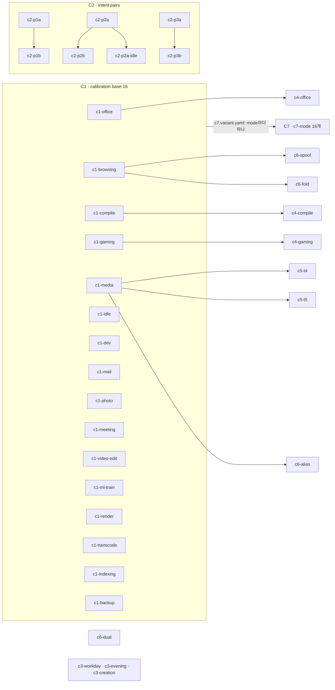

# 4권 · 51개의 coreset: 파일마다 어떤 질문에 답하나

> Status: draft · Created 2026-10-14 · Updated 2026-10-30

**core set의 파일 하나하나는 무슨 상황을 적고, 어떤 label을 달고, 어떤 질문에 답하나.**

---

이 권은 workload dataset 가운데 손으로 쓴 부분, 곧 core set을 파일 단위로 읽습니다. dataset 전체는 세 층으로 쌓여 있습니다. 맨 아래에는 프로그램 한 종류가 CPU 위에서 어떻게 행동하는지를 적은 archetype library(`dataset/archetypes.yaml`)가 있습니다. 그 위에 "어떤 프로그램들이 함께 도는가"를 적은 scenario catalog가 있고, 맨 위에 시간축 위에 상황을 배치한 timeline이 있습니다. core set은 이 맨 위층에서 사람이 직접 쓴 timeline 51개와, 그 timeline을 compile해서 나온 workload 파일 51개입니다. 다른 권들이 archetype이 무엇인지, compile이 timeline을 어떻게 event 목록으로 바꾸는지, 생성된 grid(generated layer)가 무엇을 늘어놓는지를 다룬다면, 이 권은 "그래서 이 51개 파일은 각각 무엇을 묻기 위해 거기 있는가"를 다룹니다.

core set의 조직 원리는 한 문장입니다. building plan(`docs/workload/building-plan.md` §3)은 "Every file exists to make a specific measurement possible; if a file's absence breaks no RQ, it doesn't belong."이라고 적습니다. 파일마다 측정 하나를 가능하게 만들려고 존재하고, 그 파일이 없어도 어떤 연구 질문도 깨지지 않는다면 그 파일은 있을 이유가 없다는 뜻입니다. 그래서 이 권은 파일마다 같은 질문을 던집니다. 이 파일은 어떤 상황을 적는가, 어떤 label을 다는가, 짝이나 base와 무엇이 다른가, compile하면 어떤 모양이 되는가, 그리고 그 모양을 정한 결정은 언제 누가 왜 내렸는가.

웹 개발자의 세계에 빗대면 core set은 snapshot test 모음과 비슷합니다. 각 test는 하나의 동작을 고정된 입력으로 확인하고, test 이름만 봐도 무엇을 지키는지 알 수 있어야 합니다. core set의 파일 이름(`c1-office`, `c7-dev`, `c2-p1b`)도 그렇게 읽히도록 지어졌습니다. 다만 여기서 "기대값"은 scheduler의 출력이 아니라, 파일 안에 적힌 정답 label(`ground_truth`)입니다. recognizer는 그 정답을 보지 못한 채 process 이름만 보고 상황을 맞혀야 하고, scheduler 실험은 그 정답을 그대로 읽는 oracle 조건과 무작위 조건을 비교합니다.

이 권은 2026-10-14의 tree를 기준으로 썼고, 2026-10-17에 그 뒤의 변화(sub-task 9.23이 정한 `c6-fold`·`c6-spoof`의 label과 program 끝의 규칙, sub-task 9.15가 timeline 머리 주석에 더한 생략 문장)에 맞춰 다시 셌습니다. 파일 수, segment 수, compile된 event 수, byte 수, utilization은 모두 tree에서 shell 명령과 짧은 Python으로 직접 세었고, 셀 때마다 어디서 셌는지 적었습니다. 2026-10-14에 Phase 9 재구축 이전의 dataset을 묘사하던 문서들은 9.15가 고쳤습니다(13.8절).

---

## 목차

1. [1장 · 왜 core set인가: recognizer의 menu와 32개의 cell](#1장--왜-core-set인가-recognizer의-menu와-32개의-cell)
2. [2장 · timeline 한 장을 끝까지 읽기](#2장--timeline-한-장을-끝까지-읽기)
3. [3장 · 일곱 그룹 한눈에 보기](#3장--일곱-그룹-한눈에-보기)
4. [4장 · C1 — 열여섯 개의 calibration base](#4장--c1--열여섯-개의-calibration-base)
5. [5장 · C2 — intent pair 세 쌍과 51번째 파일](#5장--c2--intent-pair-세-쌍과-51번째-파일)
6. [6장 · C3 — transition arc 세 개](#6장--c3--transition-arc-세-개)
7. [7장 · C4 — distractor injection 세 개](#7장--c4--distractor-injection-세-개)
8. [8장 · C5 — familiarity ladder 두 개](#8장--c5--familiarity-ladder-두-개)
9. [9장 · C6 — resolution limit 네 개](#9장--c6--resolution-limit-네-개)
10. [10장 · C7 — attribute counterpart 열여섯 개](#10장--c7--attribute-counterpart-열여섯-개)
11. [11장 · 78개의 sensitivity variant](#11장--78개의-sensitivity-variant)
12. [12장 · coverage grid 읽는 법](#12장--coverage-grid-읽는-법)
13. [13장 · 역사: 24개에서 51개까지, 그리고 낡은 문서들](#13장--역사-24개에서-51개까지-그리고-낡은-문서들)
14. [14장 · 용어 정리](#14장--용어-정리)

---

# 1장 · 왜 core set인가: recognizer의 menu와 32개의 cell

## 1.1 이 장이 답하는 질문

이 장은 "왜 하필 이런 파일들을, 이만큼 만들었나"에 답합니다. 이 질문이 생기는 이유는 간단합니다. 실험에 쓸 workload를 만들 때 가장 쉬운 길은 현실의 데스크톱 기록을 가져오는 것인데, 이 프로젝트는 그 길을 택하지 않았습니다. 대신 상황 하나하나를 손으로 설계한 파일을 만들었습니다. 그 선택이 무엇을 위한 것인지 알아야 개별 파일의 모양이 이해됩니다.

답은 세 단계로 이어집니다. 먼저 recognizer가 답해야 하는 것이 정해져 있습니다(16개 mode와 `background_wanted` 하나). 다음으로 그 답 하나하나가 driver table의 row 하나로 이어지고, row는 32개입니다. 마지막으로 실험이 각 row를 실제로 시험하려면 core set 안에 그 row를 정답으로 갖는 segment가 적어도 하나 있어야 합니다. 이 세 단계가 core set의 크기와 모양을 거의 다 결정합니다.

## 1.2 recognizer가 답하는 것: 16개 mode

먼저 용어 두 개를 짚겠습니다.

- **recognizer** — 이 프로젝트의 용어로, 지금 실행 중인 process들의 이름과 개수를 보고 "이 컴퓨터가 지금 무엇에 쓰이고 있나"를 답하는 구성요소입니다. LLM일 수도 있고, 정답을 그대로 읽는 oracle일 수도 있습니다.
- **mode** — recognizer가 답하는 상황의 이름입니다. 닫힌 menu에서 정확히 하나를 고릅니다.

`docs/recognition-vocabulary.md` §1은 menu를 16개로 고정합니다. 표로 옮기면 다음과 같습니다(설명은 그 문서의 한 줄 정의를 옮긴 것입니다).

| mode | 그 segment 동안 컴퓨터가 쓰이는 일 |
|---|---|
| `browsing` | 주된 활동으로서의 웹 browsing |
| `office` | 문서, 스프레드시트, 프레젠테이션 |
| `mail` | 이메일 읽고 쓰기 |
| `dev` | 편집기나 IDE에서 코드 작성 |
| `photo` | 사진 편집 |
| `meeting` | 실시간 영상 통화 |
| `gaming` | foreground에서 게임하기 |
| `media` | 미디어 재생(영상, 음악) |
| `video-edit` | 대화형 영상 편집 |
| `compile` | 소프트웨어 build |
| `ml-train` | 머신러닝 training 실행 |
| `render` | offline render — 3D 장면이나 영상 project를 파일로 render하는 일 |
| `transcode` | 일괄 미디어 변환 |
| `indexing` | 파일 indexing / crawling |
| `backup` | backup 작업 |
| `idle` | 사람이 없음; 유지보수만 |

여기에 menu 밖의 label이 하나 더 있습니다. **`ambiguous`**는 ground truth에만 나오는 label입니다. 똑같이 활발한 foreground가 둘이라서 정답 mode를 하나로 정할 수 없는 segment에 붙습니다. recognizer는 이 label을 고를 수 없고 언제나 16개 중 하나를 골라야 하며, `ambiguous` segment는 정확도 채점에서 빠지고 따로 보고됩니다. core set에서 이 label을 단 segment는 `c6-dual`의 하나뿐입니다.

> **왜 이렇게 정했나.** Phase 9 재구축 뒤 core set의 render segment(`c1-render`, `c7-render`, `c2-p3a`의 60–326 s)가 묶는 일은 모두 Kdenlive의 영상 export(`kdenlive_render`, 9.10 D10 — render 파일들이 관찰된 Kdenlive export를 묶는다는 결정)이고, 3D 장면을 render하는 파일은 없습니다. 그래서 vocabulary §1은 2026-10-17부터 `render`를 "an offline render — a 3D scene or a video project rendered to a file"로 풀이합니다. 그 전의 풀이는 "an offline 3D/graphics render"였고, 바뀐 날짜와 내용은 vocabulary §5의 2026-10-17 기록에 있습니다. 기존 media의 변환인 `transcode`와는 그대로 구별됩니다. label도 파일도 바뀌지 않았습니다.

## 1.3 하나뿐인 graded attribute: `background_wanted`

mode 하나만으로는 scheduler에게 충분하지 않습니다. 같은 "개발 중" 상황이라도, 뒤에서 도는 무거운 작업을 사용자가 직접 시켰는지 아닌지에 따라 좋은 scheduling이 달라지기 때문입니다. 그래서 recognizer는 attribute 하나를 함께 답합니다.

- **attribute** — mode 옆에 붙는 추가 판단입니다. 현재 채점되는(graded) attribute는 `background_wanted` 하나입니다.
- **`background_wanted`** — boolean입니다. vocabulary §1의 정의는 "is the sustained background work something the user asked for?"입니다. 사용자가 일부러 시작했거나 기다리고 있는 작업(다운로드, 직접 돌린 training run, render)이면 `true`이고, 지금 아무도 부탁하지 않은 작업이면 `false`입니다.

정의에는 두 개의 규칙이 덧붙어 있습니다. 둘 다 파일을 읽을 때 계속 등장합니다.

첫째, **vacuous-true convention**입니다. segment에 지속되는 background 작업이 전혀 없으면 `background_wanted`는 `true`입니다. "원치 않는 것이 아무것도 돌고 있지 않다"는 뜻으로 읽습니다. 그래서 `c1-dev`처럼 편집기 하나만 도는 파일도 `background_wanted: true`를 답니다. 이 규칙은 2026-08-28 vocabulary 비준 때 들어갔고(`_dev/archive/2026-08-28-task-2.5-repo-prep-and-contracts.md`, "Vacuous-true convention for segments with no background work"), Phase 3(검증과 protocol 동결 phase, 2026-09-06)에서 `c1-idle`이 이 attribute 없이 `attributes: {}`만 갖고 있던 것을 찾아 `true`로 고쳤습니다.

둘째, **batch mode의 same-job reading**입니다. `compile`, `ml-train`, `render`, `transcode`, `indexing`, `backup` 여섯 mode에서는 batch job 자체가 attribute가 판단하는 background 작업입니다. 그래서 `compile/false`는 "편집기 옆에서 원치 않는 indexer가 하나 더 돈다"가 아니라 "그 build 자체를 아무도 시키지 않았다"는 뜻입니다.

> **왜 이렇게 정했나.** Phase 7(core set의 attribute coverage를 채운 phase)의 spec session(2026-09-09) decision 2가 이 읽기를 정했습니다. archive(`_dev/archive/2026-09-11-phase-7-coreset-attribute-coverage.md`)가 적은 이유는 두 가지입니다. 하나는 기존 파일 `c2-p1b`가 이미 indexer 자체를 unwanted로 읽고 있었다는 선례입니다. 다른 하나는 반대 읽기("wanted build 하나 + unwanted indexer 하나")가 `c2-p1b`와 모순되고 segment의 mode까지 애매하게 만든다는 점입니다. vocabulary §1에 이 clause가 한 문장으로 들어갔습니다.

## 1.4 driver table과 32개의 cell

- **driver table** — recognizer의 답(mode와 `background_wanted`)을 CPU scheduler 설정 하나로 바꾸는 표입니다. row 하나가 (mode, `background_wanted`) 조합 하나이고, 각 row에는 scheduling algorithm(MLFQ, EDF, LOTTERY, FIFO 중 하나), 그 parameter, 그리고 batch class가 lane을 얼마까지 쓸 수 있는지의 상한(`batch_bandwidth_cap`)이 들어 있습니다.
- **row / cell** — 16개 mode × `background_wanted`의 두 값이므로 row는 32개입니다. dataset 쪽에서는 같은 조합을 "cell"이라고 부릅니다. `office/true`, `office/false`처럼 씁니다.

여기 나온 scheduling 용어도 한 줄씩 짚습니다.

- **lane** — 시뮬레이터가 가진 CPU 하나입니다. 이 프로젝트의 시뮬레이터는 CPU를 하나만 갖고(2026-08-26 결정), 모든 task가 그 한 lane을 나눠 씁니다.
- **MLFQ** — multi-level feedback queue. 짧게 깨어나는 task를 위 queue에 두고, CPU를 오래 쓰는 task를 아래 queue로 내리는 scheduler입니다.
- **EDF** — earliest deadline first. 마감이 가장 가까운 일을 먼저 돌리는 scheduler입니다. 이 프로젝트에서는 주기적으로 깨어나는(TIMER) task가 deadline class로 먼저 돌고, 나머지는 남는 시간에 돕니다.
- **LOTTERY** — task마다 표를 나눠 주고 추첨으로 CPU를 주는 비례 배분 scheduler입니다.
- **batch class** — 시뮬레이터가 행동으로 판단하는 "CPU를 꽉 채워 쓰는 task"의 묶음입니다. `batch_bandwidth_cap`은 이 묶음이 lane을 얼마까지 쓸 수 있는지의 상한입니다.

실험이 묻는 것은 "상황을 제대로 읽으면, 그 row의 설정이 더 좋은 결과를 내는가"입니다. 그러려면 각 row가 실제로 시험되어야 합니다. 2026-09-10 memo(`docs/memos/2026-09-10-coreset-before-and-after-phase-7.md` §2.1)가 이렇게 씁니다. "어떤 row를 아무 파일도 안 건드리면, 그 row는 `random` condition이 뽑을 수 있다는 것 말고는 실험에서 아무 역할이 없어요." 여기서 `random` condition은 recognizer 대신 32개 row 중 하나를 무작위로 뽑는 실험 조건입니다.

CI matrix에 빗대면 이해가 쉽습니다. OS 셋, Node 버전 넷으로 matrix를 짜 놓고 어떤 칸에 test job이 하나도 없다면, 그 칸에서 깨지는 버그는 영원히 안 보입니다. core set은 32칸 matrix의 모든 칸에 적어도 하나의 test(segment)를 두어야 합니다. 그것을 "cell을 instance한다(instanced)"고 부릅니다.

## 1.5 32개 cell을 전부 채운다는 결정

이 요구는 처음부터 지켜진 것이 아닙니다. Phase 6(driver table 초안과 scoring spec을 만든 phase)의 pair review가 coverage grid를 다시 읽다가, core set이 32개 cell 중 17개만 담고 있다는 것을 찾았습니다. 특히 `background_wanted: false`인 segment가 둘(`c2-p1b`, `c2-p2b`)뿐이었습니다. 원인은 dataset을 점검하던 표가 mode × familiarity tier만 세고 attribute 축이 없었기 때문입니다. 이 이야기는 13장에서 자세히 다시 합니다.

Phase 7 spec decision 1은 목표를 이렇게 적습니다. "All 32 driver-table cells are instanced in the coreset, each `false` cell as a one-diff pair of a same-mode `true` base." 32개 cell을 모두 채우되, 각 `false` cell은 같은 mode의 `true` base와 한 군데만 다른 pair로 만든다는 뜻입니다.

> **왜 이렇게 정했나.** Phase 7 archive의 decision 1이 이유를 적습니다. 더 좁은 세 가지 안(C1(calibration 그룹) base가 있는 interactive mode 셋만, C1 base 다섯만, interactive mode 아홉만)이 있었고 모두 기각되었습니다. 이유는 세 가지입니다. (1) controlled claim은 절대 generalset(자연스러운 세션을 생성해서 만들 예정인 두 번째 timeline 집합)에 기대지 않으므로, generalset에 미룬 `false` row는 통제된 조건에서 영영 측정되지 않습니다. (2) "새로 설계할 파일이 다섯 개나 된다"는 비용은 과장이었습니다. 모든 mode가 이미 어딘가의 segment에 들어 있어서 그 task set을 들어 올리면 됐습니다. (3) building plan §3의 조직 원리 자체가 driver-table cell이었습니다. 처음 내놓은 "세 파일" 권고는 연구 설계가 아니라 작업량과 TODO 문구에 기댄 것이라 철회되었다고 archive는 적습니다.

"한 군데만 다르다"는 원칙은 어떤 차이의 효과를 그 한 군데에 귀속시키기 위한 것입니다. 웹 쪽의 A/B 실험에서 변경점을 하나로 묶어 두는 것과 같은 이유입니다. 이 원칙이 C2(intent pair 그룹)와 C7(attribute counterpart 그룹)의 모든 파일 모양을 결정합니다. 다만 Phase 9 이후 "한 군데"의 뜻이 조금 넓어졌습니다. counterpart는 base의 앞부분만 잘라 쓰기 때문에 길이와 창(window)이 달라집니다. 이 부분은 10장에서 정확히 짚습니다.

## 1.6 segment와 label: 파일 안의 정답지

- **segment** — timeline 안의 한 시간 구간입니다. 각 segment에는 mode 하나, attribute들, 그리고 그 구간에 등장하는 scenario 목록이 붙습니다.
- **label** — segment에 붙은 정답, 곧 mode와 `background_wanted`입니다. compile하면 workload 파일의 `ground_truth` 목록이 됩니다.
- **`ground_truth`** — compile된 workload의 정답지입니다. 시뮬레이터에도 recognizer에도 전해지지 않고, oracle 조건과 채점기(grader)만 읽습니다.

workload 하나가 segment 여러 개로 나뉘는 생각은 2026-08-23 설계 회의의 Q7에서 나왔습니다(`_dev/archive/2026-08-23-design-meeting-open-questions.md`). 거기 적힌 문장은 "A workload is an ordered list of segments, each segment a cell of the driver table, plus the process-set changes that carry it from one to the next. The path is chosen, not discovered."입니다. workload는 segment들의 순서 있는 목록이고, 각 segment는 driver table의 cell 하나이며, 경로는 발견하는 것이 아니라 고르는 것이라는 뜻입니다.

label이 실제로 쓰이는 순간은 **query point**입니다.

- **telemetry snapshot** — recognizer에게 보이는 것의 한 장면입니다. 살아 있는 process 이름과 개수의 multiset, 그리고 창 focus를 가진 process의 이름으로 이루어집니다(`docs/data-contracts.md` §5).
- **query point** — snapshot이 바뀌는 순간입니다. 바뀔 때마다 recognizer에게 한 번 묻습니다. process가 도착하거나, 고정된 시각에 떠나거나, focus가 옮겨질 때 생깁니다.

한 query point의 답은 그 시각을 덮는 segment의 label로 채점됩니다. 2026-10-14 tree에서 `harness/tools/tests/mocks/daemon.py`의 `snapshots` 함수로 51개 파일의 query point를 직접 세어 보면 모두 147개입니다. 9.17(focus를 telemetry에 넣은 Phase 9 sub-task)의 changelog D4가 기록한 "147 query points over 51 files"와 같습니다. 이 가운데 51개는 파일 끝의 마지막 snapshot이고(정답을 매길 segment가 없습니다), 19개는 `c6-dual`의 `ambiguous` segment 안에 있습니다. 남은 77개(50개 파일)가 채점 대상이고, 그중 9개는 다음 절에서 설명할 pre-committed miss segment 안에 있어 headline 정확도에서 빠집니다. 그래서 headline 정확도는 44개 파일의 68개 query point로 계산됩니다. 9.20(distractor grid와 familiarity ladder를 만든 Phase 9 sub-task)의 changelog D10은 "77 points over 50 files, now seven of them in pre-committed-miss segments … and 70 headline points over 44 files"로 기록했고, 9.23 D1, D2(2026-10-14)가 `c6-fold`의 30 s 점과 `c6-spoof`의 20 s 점을 pre-committed miss로 옮겨 일곱이 아홉, 70이 68이 되었습니다(9.23 D10). 2026-10-17 tree에서 같은 함수로 다시 세어도 같습니다.

## 1.7 ground truth에만 붙는 annotation들

segment의 `attributes`에는 `background_wanted` 말고도 다른 key가 붙을 수 있습니다. vocabulary §1은 이것들을 "ground-truth annotations (never recognizer-facing)"이라고 부릅니다. 채점을 쪼개 보거나 실패를 분석할 때만 쓰이고, recognizer의 답에도 validator(답이 menu 안에 있는지 확인하는 구성요소)의 menu에도 없습니다. core set에 실제로 나오는 것은 다음과 같습니다(2026-10-14 tree의 timeline 51개에서 확인).

| key | 값 | 뜻 | 나오는 곳 |
|---|---|---|---|
| `background` | `download`, `package-upgrade` | background 작업이 무엇인가 | `c2-p2a`(`download`), `c2-p2b`와 interactive C7 열 개(`package-upgrade`) |
| `initiated` | `user`, `scheduled`, `session` | 그 작업을 누가 시작했나 | 사용자가 시작한 batch(`c1-render` 등), 예약 작업(`c1-backup` 등), 로그인 시 세션이 시작한 작업(`c7-indexing`, `c2-p1b`) |
| `dual_active` | `true` | 똑같이 활발한 foreground 둘 | `c6-dual` |
| `spoof` | `true` | 다른 프로그램의 이름을 단 process가 있음 | `c6-spoof`(20 s부터), `c6-alias` |
| `pre_committed_miss` | `true` | 이름과 행동으로는 어떤 recognizer도 닿을 수 없는 label | 아래 절 |

segment에는 `attributes` 밖에 `familiarity`(1–5의 정수)도 붙을 수 있습니다. 이름이 얼마나 알아보기 쉬운지를 적은 annotation이고, core set에서는 `c5-t4`와 `c5-t5` 두 파일에만 붙습니다. 1.9절에서 설명합니다.

세 번째 값 `session`은 9.10 D79(`c7-indexing`의 segment가 "`initiated: session`"이라고 말한다는 결정, 2026-10-03)가 "work the desktop session itself starts, unasked, at login"이라는 뜻으로 만들었습니다. vocabulary §1은 2026-10-16부터 이 값을 `user`, `scheduled`와 함께 적습니다(vocabulary §5의 2026-10-16 기록).

## 1.8 pre-committed miss와 `ambiguous`

- **pre-committed miss** — 미리 약속한 오답입니다. 이름과 행동만 보는 어떤 관찰자도 닿을 수 없는 label을 가진 segment를 일부러 만들어 넣고, 그 segment에서의 recognition은 정확도에서 빼고 따로 보고하겠다고 실험 전에 약속해 두는 것입니다.

왜 맞힐 수 없는 segment를 굳이 만들까요. 답은 32개 cell 요구에 있습니다. 어떤 cell은 base와 counterpart가 **의도만** 다릅니다. 예를 들어 사용자가 직접 돌린 indexer와 로그인할 때 저절로 돈 indexer는 같은 프로그램이고 같은 일을 합니다. recognizer가 보는 것은 이름과 개수(그리고 focus)뿐이므로, 두 상황을 가를 단서가 없습니다.

> **왜 이렇게 정했나.** Phase 7 spec decision 3이 이런 cell을 "pre-committed miss in the C6 sense"로 배송한다고 정했습니다. archive가 적은 이유는 다음과 같습니다. "Scoring them would charge the model for a distinction no observer of names and behaviour could make; leaving them empty would break the all-32 target." 채점하면 어떤 관찰자도 할 수 없는 구분을 모델 탓으로 돌리게 되고, 비워 두면 32개 cell 목표가 깨진다는 뜻입니다. 이렇게 하면 cell은 채워지고, label을 직접 읽는 `oracle` 조건은 그 row의 scheduling 성능을 여전히 잴 수 있습니다. annotation 이름 `pre_committed_miss`는 7.1(grid에 attribute 축을 넣은 Phase 7 sub-task, 2026-09-10)의 chat 결정으로 생겼습니다. 기존 `initiated`로는 표시할 수 없었다고 archive는 적습니다. `c2-p3b`는 `scheduled`인데도 완전히 알아볼 수 있는 파일이었기 때문입니다.

2026-10-17 tree에서 `pre_committed_miss: true`를 단 segment는 정확히 여덟 개입니다(`dataset/coverage-grid.json`의 `per_file`과 `dataset/tools/tests/test_grid.py`의 `MISS_CELLS`).

| 파일 | cell | 왜 닿을 수 없나 |
|---|---|---|
| `c1-indexing` | `indexing/true` | 사용자가 직접 시킨 index와 로그인 때 저절로 돈 index가 같은 이름, 같은 일 |
| `c7-ml-train` | `ml-train/false` | 같은 training job에 label만 `false`로 뒤집음 |
| `c7-render` | `render/false` | 같은 export job에 label만 뒤집음 |
| `c7-transcode` | `transcode/false` | 같은 encode job에 label만 뒤집음 |
| `c7-backup` | `backup/false` | 같은 backup job에 label만 뒤집음 |
| `c6-alias` | `media/true` | player 둘이 indexer의 진짜 이름을 달고 있음 |
| `c6-fold`(30 s부터) | `meeting/true` | 브라우저 안의 통화가 `chrome`을 하나 더할 뿐, snapshot 어디에도 통화라는 단서가 없음 |
| `c6-spoof`(20 s부터) | `browsing/false` | 아무도 시키지 않은 CPU 작업이 신뢰받는 이름 `chrome`으로 와서, snapshot에는 `chrome`이 하나 늘 뿐 |

앞의 다섯은 "의도만 다른 cell"이고, README(`dataset/README.md`)는 이를 "The five cells that differ by intent alone — `c1-indexing` and the four batch counterparts — ship as pre-committed misses"라고 적습니다. 여섯 번째인 `c6-alias`는 이름 충돌(name collision)의 한계를 보여 주는 파일로, 2026-10-12에 C5(familiarity ladder 그룹)에서 C6(resolution limit 그룹)으로 옮겨질 때 annotation을 얻었습니다(8장, 9장). 나머지 둘은 C6의 `c6-fold`와 `c6-spoof`가 파일의 뒤 구간에 갖는 것으로, 9.23 D1, D2(2026-10-14)가 정했습니다(9.3절, 9.5절).

`ambiguous`는 pre-committed miss와 다릅니다. pre-committed miss는 정답 label이 분명히 있지만 recognizer가 닿을 수 없는 경우이고, `ambiguous`는 정답 label 자체를 정할 수 없는 경우입니다. 그래서 `ambiguous` segment는 `background_wanted`도 갖지 않습니다. Phase 3 archive가 이 lint 규칙을 적습니다. "every segment carries a boolean `background_wanted`; on `mode: ambiguous` it must be absent (the label itself is the explicit marker)."

> **왜 이렇게 정했나.** C6(resolution limit 그룹)의 파일 넷은 예전 문서에서 모두 "pre-committed misses"로 불렸지만(building plan §3 C6 제목, README의 C6 행), 2026-10-14까지 annotation을 단 것은 `c6-alias` 하나였습니다. 이 권이 그날 두 파일을 짚었고, sub-task 9.23이 같은 날 정했습니다. **`c6-fold`**(9.23 D1). 9.10 D30 이후 `video-call`의 `chrome` task가 30 s에 도착하므로 snapshot은 `chrome ×5`에서 `chrome ×6`이 됩니다. telemetry 규칙 1(개수만 바뀌어도 snapshot이 생긴다, `docs/data-contracts.md` §5)에 따라 30 s에 query가 생기는데, snapshot 어디에도 통화라는 단서가 없습니다(여섯 번째 `chrome`은 새 탭이 열려도 똑같이 보입니다). 그래서 meeting segment(30–60 s)가 pre-committed miss가 되었고, browsing segment는 0 s의 채점점을 그대로 갖습니다. **`c6-spoof`**(9.23 D2). spoof가 도착하는 20 s에서 파일을 둘로 나누었습니다. 0–20 s는 `browsing`, `background_wanted: true`이고, 20–60 s는 `browsing`, `background_wanted: false`, `spoof: true`, `pre_committed_miss: true`입니다. 20 s부터 spoof는 아무도 시키지 않은 지속적인 CPU 작업이고, snapshot에는 `chrome` 하나가 늘 뿐 다른 단서가 없기 때문입니다. 두 파일은 RQ0 gate spec의 `layer1_exclusions`에 들어갔고, oracle의 채점점은 50개 파일의 77개 그대로이되 그중 pre-committed miss가 일곱에서 아홉으로, headline이 70개에서 44개 파일의 68개로 바뀌었습니다(1.6절).

## 1.9 familiarity tier: 이름이 얼마나 알아보기 쉬운가

- **familiarity tier** — process 이름이 얼마나 알아보기 쉬운지의 등급입니다. 1부터 5까지 있습니다. Phase 5 archive(`_dev/archive/2026-09-07-phase-5-primitive-metrics.md`)는 정의를 "corpus-relative recognisability of a process name, tiers 1–5, a split key at aggregation, never a primitive input"으로 기록합니다. 사람이 아는지가 아니라 말뭉치(언어모델이 배웠을 법한 텍스트)에 비추어 얼마나 알아볼 만한지이고, 결과를 쪼개 볼 때 쓰는 열쇠일 뿐 측정의 입력이 아니라는 뜻입니다.

building plan §3 C5(familiarity ladder 그룹)가 다섯 등급을 정의합니다.

| tier | 이름 | 뜻 | 예 |
|---|---|---|---|
| 1 | transparent | 이름이 곧 프로그램 | `chrome`, `code`, `gimp`, `mpv` |
| 2 | semi-opaque | 알 만한 사람은 아는 이름 | `soffice.bin`, `HandBrakeCLI`, `Troy.exe` |
| 3 | opaque | 프로그램 자신의 실제 이름이지만 뜻을 드러내지 않음 | `cc1`, `tracker-miner-f`, `dxvk-cs` |
| 4 | nonexistent-compositional | 존재하지 않는 이름이지만 단어로 뜻이 추론됨 | `video-playback-` |
| 5 | nonexistent-opaque | 존재하지 않고 아무것도 추론할 수 없음 | `qzvd` |

tier 4와 5는 "말뭉치에서 기억해 내기"와 "단어 조합으로 추론하기"를 갈라내려고 있습니다. building plan은 이름 표로 일하는 두 조건 모두 tier 4–5의 지어낸 이름에 규칙을 갖지 않으며, 그중 가장 강한 이름 표가 거기서 구조적으로 0점이 되는 것이 headline 대비라고 적습니다("the strongest name table's structural zero there is the headline contrast"). 이름 표 조건은 둘입니다.

- **출하된 catalogue 조건**(`shipped_catalogue`) — CachyOS가 ananicy-cpp와 함께 설치하고 켜는 그대로의 rule catalogue(`ananicy-rules`, commit `03ef03fb`)를 재현합니다. 각 process의 `argv[0]` basename(잘리지 않은 이름)으로 맞춥니다. 그 key로는 dataset이 묶는 이름 35개 중 19개만 catalogue에 있고, 파일 50개 중 7개에서만 모든 이름을 덮습니다(9.12 D105, D109). proposal은 이 조건을 넘는 것이 "RQ2's question about what shipping systems do"에 답한다고 적습니다. RQ2 전체는 "Does correct reading produce measurably better scheduling than (a) no situation awareness, and (b) the name-keyed catalogue a shipping Linux distribution enables by default and the strongest name table in its design?"이고, 이름 표 조건 둘은 모두 그 (b)에 들어 있습니다.
- **가장 강한 이름 표 조건**(`strongest_name_table`) — catalogue와 같은 설계의 규칙 목록으로, dataset이 알려진 것으로 내세우는 소프트웨어를 모두 덮습니다. Family 3(등록되지 않은 소프트웨어)이나 tier 4–5의 지어낸 이름에는 규칙이 없습니다. 논문의 주장은 이 조건에 대한 비교가 지고(9.12 D115), C1 파일에서는 완벽하게 맞힐 것으로 기대되며, 이름 밖의 지식이 필요한 곳에서는 구조적으로 실패합니다.

예전 문서들이 "whitelist"(실제 OS들이 쓰는 방식)라고 부르던 하나의 조건이 9.12 D6과 그 수정(D91, D105, D109, D115)으로 이 둘이 되었습니다(조건 id는 `harness/tools/harness/evaluator.py`와 `harness/guards/guard-spec.yaml`).

segment의 tier는 대부분 annotation이 아니라 이름에서 자동으로 나옵니다. `dataset/tools/wlc/grid.py`의 `segment_tier` 함수가 그 segment에 살아 있는 모든 task의 이름(그리고 build orchestrator의 자식 이름, game chain의 member 이름과 `wineserver`)을 `NAME_TIERS` 표에서 찾아 **가장 높은(가장 불투명한)** tier를 고릅니다. 표에 없는 이름은 5가 됩니다. `familiarity` annotation이 있으면 그 값을 그대로 씁니다. 그래서 `c1-office`는 `soffice.bin` 하나 때문에 tier 2이고, `c1-compile`은 `cc1` 때문에 tier 3입니다.

> **왜 이렇게 정했나.** 새 이름에 tier를 매기는 규칙은 9.10 D27(새 이름의 tier는 같은 프로그램이면 원래 tier를 지키고 새 프로그램이면 ladder 정의로 놓는다는 결정, 2026-10-01)이 정했습니다. 기록된 이유는 "no source ranks names; a corpus count would measure recall not transparency"입니다. 이름을 줄 세우는 출처가 없고, 말뭉치에서 이름이 나오는 횟수를 세면 투명성이 아니라 기억 정도를 재게 된다는 뜻입니다. 그래서 tier 배정은 design입니다.

## 1.10 core set이 주장하는 것과 주장하지 않는 것

core set의 파일은 "데스크톱은 보통 이렇게 쓰인다"고 주장하지 않습니다. 이 선을 그은 것이 9.10 D2(core set의 task set은 design이라는 결정, 2026-10-01)입니다. changelog의 문장은 "which programs share a segment of a core-set file is the experiment's composition, chosen for the claim the file makes, and is labelled design … No core-set file presents its task set as how desktops behave."입니다. 어떤 프로그램들이 한 segment를 같이 쓰는지는 그 파일이 하려는 주장을 위해 고른 실험의 구성이고, design으로 표시된다는 뜻입니다.

- **design** — 이 프로젝트의 출처 표시 라벨입니다. 어떤 값이나 구성이 외부 출처나 측정이 아니라 실험 설계자의 선택이라는 뜻입니다. 같은 자리에 `convention`(관례), `arithmetic`(다른 값에서 계산)이라는 라벨도 쓰입니다.

> **왜 이렇게 정했나.** 9.10 D2의 근거는 두 갈래입니다. 하나는 building plan §0, §3이 core set을 "one file per claim"으로 만들고 생태적 타당성은 naturalistic set에 맡긴다는 점입니다. 다른 하나는 9.10의 stage-2 검색이 네 부류(동료 심사·preprint 문헌, 프로젝트와 vendor의 문서와 source code, 공개된 trace와 dataset, CI runner에서 직접 관찰할 수 있는지; Phase 9 spec decision 4)를 다 뒤져도 "Linux 데스크톱에서 어떤 프로그램들이 함께 도는가"를 관찰한 자료를 찾지 못했다는 점입니다. 가장 가까운 후보였던 SWELL-KW는 2012년 Windows 7 실험실 자료였습니다.

그래도 남는 realism claim이 있습니다. 9.10 spec decision 1은 이렇게 정리합니다. 각 프로그램이 파일에 보이는 이름으로 Ubuntu 24.04에 실제로 존재한다는 것, 파일이 "일어나는 일"로 제시하는 상황(원치 않는 upgrade, kernel 업데이트 뒤의 module 재build, 예약된 backup)이 실제로 일어난다는 것, 묶인 archetype이 묘사하는 상태가 파일이 묘사하는 상태와 맞는다는 것, 그리고 개수(renderer 수, build의 object job 수)입니다. 파일 길이, 도착 시각, `lane_share`, injection의 정체 같은 calibration 크기는 모두 design입니다(9.10 D31, 남은 calibration 크기를 각자의 전제와 함께 design으로 기록한 결정).

## 1.11 judging set과 전체 set: RQ0 gate spec의 19개 파일

core set 51개가 모두 같은 무게로 쓰이는 것은 아닙니다. 가장 먼저 돌 실험인 RQ0 gate에서는 19개만 판정에 쓰입니다.

- **RQ0** — 연구 제안서(`docs/research-proposal.md`)의 첫 질문 "Measurability"입니다. 모델을 넣기 전에, scheduler 설정의 선택이 이 workload들에서 결과를 측정할 만큼 바꾸는지를 묻습니다. 완벽한 recognizer(oracle)와 무작위 recognizer(random)를 비교합니다. 둘이 비슷하면 어떤 recognizer도 무언가를 보여 줄 수 없으니, 뒤의 질문들이 모두 무의미해집니다.
- **RQ0 gate spec** — `harness/experiments/rq0-gate.yaml`. RQ0 실행을 실행 전에 데이터로 고정해 둔 사전 등록 문서입니다. 판정 파일, 보고 파일, 기준(K, g, N), 민감도 line, 각 숫자의 이유를 담습니다.
- **judging file** — 판정에 쓰이는 파일입니다. 그 파일에서 oracle과 random의 점수 차(gap)가 g 이상인지를 봅니다.
- **reporting file** — 돌리고 보고하지만 판정에는 쓰지 않는 파일입니다.

2026-10-14 tree의 RQ0 gate spec은 판정 파일 19개, 보고 파일 32개를 둡니다(`rq0-gate.yaml` 55–65행). 기준은 `criterion` 블록의 `k: 10`, `g: 0.5`이고, random 조건의 seed 수는 top-level의 `seed_count: 100`입니다. 판정 파일 19개 가운데 적어도 10개에서 oracle 대비 random의 gap이 0.5 이상이면 통과합니다. random은 seed 100개에 대한 평균입니다.

판정 파일 19개는 다음과 같습니다.

| 묶음 | 파일 |
|---|---|
| C2(intent pair 그룹)의 normal-class 절반 | `c2-p1a`, `c2-p2a`, `c2-p2b`, `c2-p3a` |
| batch C1 base 넷 | `c1-compile`, `c1-ml-train`, `c1-render`, `c1-transcode` |
| C7(attribute counterpart 그룹) 열하나 | `c7-browsing`, `c7-office`, `c7-dev`, `c7-photo`, `c7-meeting`, `c7-gaming`, `c7-video-edit`, `c7-compile`, `c7-ml-train`, `c7-render`, `c7-transcode` |

판정 규칙은 Phase 7의 7.7(RQ0 judging set을 다시 정한 Phase 7 sub-task, 2026-09-10)이 정했고 지금도 그대로입니다. "A file judges when it is one side of a label-varying pair and its scored term registers the rows' difference by design; demand is not a criterion." label이 다른 pair의 한쪽이고, 그 파일의 채점 항(term)이 두 row의 차이를 설계상 감지할 수 있으면 판정 파일이 됩니다. demand(그 파일이 lane을 얼마나 요구하는가)는 기준이 아닙니다.

> **왜 이렇게 정했나.** 7.7의 grill Q1이 이 규칙을 정했습니다. archive는 기각된 두 안을 적습니다. "C2 only"는 interactive row를 하나도 판정하지 않게 되고, "pairs inside the window"는 latency 항에 throughput 기준을 대게 됩니다. archive는 그 예로 office가 lane의 0.0008 차이로 빠지는 경우를 듭니다. demand window는 원래 progress 항을 위해 만들어졌고, Phase 3 자신의 기록도 demand는 latency headroom이 아니라 throughput headroom을 묶는다고 적었다는 것이 이유입니다.

판정 파일 수는 여러 번 바뀌었습니다. Phase 3(2026-09-06)에는 C2(intent pair 그룹)의 6개였고, 7.7(2026-09-10)에서 27개, 8.8(RQ0 gate spec을 처음 commit한 Phase 8 sub-task, 2026-09-12)에서 25개(K = 13), 9.14(재구축된 dataset 위에서 소비자 쪽을 다시 짠 Phase 9 sub-task, 2026-10-09)에서 20개(K = 11)를 거쳐 같은 날 19개(K = 10)가 되었습니다. 9.14가 뺀 파일과 이유는 이렇습니다.

- idle class 작업을 담은 여섯 파일(`c1-indexing`, `c7-indexing`, `c2-p1b`, `c1-backup`, `c7-backup`, `c2-p3b`)은 보고 파일이 되었습니다. 이 파일들의 background 작업(Tracker indexer, Déjà Dup backup)은 스스로 idle scheduling class를 선언하는 프로그램이고, 실행기는 idle task를 다른 task가 하나도 runnable하지 않을 때만 돌립니다. 그래서 어떤 row의 몫이나 상한도 그 작업에 닿지 않습니다(RQ0 gate spec의 statement `idle-class-files`).
- `c7-mail`은 보고 파일이 되었습니다. 이 파일은 `c1-mail`의 앞 26.385 s를 잘라 쓰는데, `c1-mail`의 keystroke 35개가 모두 45.9 s와 53.1 s 사이에 있어 잘린 구간에 keystroke가 하나도 없습니다(9.14 decision 2의 2026-10-09 수정).
- `c7-media`는 보고 파일로 남았습니다. 측정된 player의 최악 cycle이 16.0 ms로 33.3 ms 주기 안에 있고, boot MLFQ가 줄 수 있는 최장 대기를 더해도 32 ms라 headroom이 없습니다(1.3 ms 여유).
- 반대로 `c7-meeting`은 다시 들어왔습니다. 측정된 통화의 10 ms 오디오 cycle이 약 스무 번에 한 번 boot slice를 다 써서, 100 ms boost 구간 열에 넷쯤에서 통화가 강등되므로(산술: 1 − 0.95¹⁰, cycle을 서로 독립으로 보고 boost 구간 하나에 cycle 열) 예전의 동률이 깨졌습니다(9.16 D1, `c7-meeting`을 판정 파일로 두고 9.14의 "약 다섯 번에 한 번"을 이 수치로 다시 적은 결정).

- **idle class** — 프로그램이 스스로 "다른 일이 없을 때만 나를 돌려라"라고 선언하는 Linux의 scheduling policy(`SCHED_IDLE`)입니다. 이 dataset에서는 모든 task 기록에 `declared_class`(`normal` 또는 `idle`)로 실립니다.

보고 파일 32개는 판정 파일이 아닌 core set 파일 전부입니다. RQ0 gate spec의 주석이 목록을 정리합니다. interactive·periodic C1(calibration 그룹) base, 따로 line을 가진 `c1-gaming`, idle pair(`c1-idle`, `c7-idle`), idle class 파일 여섯, `c7-mail`, `c7-media`, C3(transition arc 그룹)·C4(distractor injection 그룹)·C5(familiarity ladder 그룹)·C6(resolution limit 그룹), 그리고 bounding check용 `c2-p2a-idle`입니다. 그 밖에 판정 파일을 변형한 78개의 sensitivity variant가 있습니다. variant는 판정에 쓰이지 않고 민감도 line만 읽습니다(11장).

> **코드로.** `rq0-gate.yaml`의 `layer1_exclusions`는 `[c1-indexing, c6-alias, c6-fold, c6-spoof, c7-backup, c7-ml-train, c7-render, c7-transcode]`입니다. 주석은 이 목록이 compile된 파일의 `pre_committed_miss` annotation에서 나오고 lint가 확인한다고 적습니다(`harness/tools/harness/evaluator.py`가 annotation을 가진 파일의 목록과 비교). 이 여덟 파일은 recognition 정확도(Layer 1)에서 빠집니다. 목록은 파일 단위이지만 채점자(`harness/tools/harness/grader.py`)가 빼는 것은 annotation이 붙은 segment의 query point라서, `c6-fold`와 `c6-spoof`의 0 s 점은 headline에 남습니다. 여덟 가운데 셋(`c7-ml-train`, `c7-render`, `c7-transcode`)은 판정 파일로 남고, 다섯은 보고 파일입니다. 주석의 이유는 "the gate needs labels, not recognizability"입니다. gate에 필요한 것은 label이지 알아볼 수 있음이 아니라는 뜻입니다.

---

# 2장 · timeline 한 장을 끝까지 읽기

## 2.1 이 장이 답하는 질문

뒤의 장들은 51개 파일을 하나씩 설명합니다. 그 설명이 매번 같은 단어(segment, task, bind, input, focus, utilization)를 쓰므로, 먼저 가장 작은 파일 하나를 처음부터 끝까지 손으로 읽어 두겠습니다. 이 장의 질문은 "timeline 파일의 각 줄은 무엇을 뜻하고, compile하면 무엇이 되는가"입니다.

- **timeline** — 사람이 쓰는 authoring 형식입니다. `dataset/timelines/coreset/<id>.timeline.yaml`. 시간축 위에 segment와 label, 그리고 (process 이름, archetype) 묶음을 배치합니다.
- **workload** — compile 결과입니다. `dataset/build/coreset-single/<id>.workload.json`. 시뮬레이터가 읽는 유일한 형식이고, 모든 시각이 정수 마이크로초(µs)입니다.
- **archetype** — 프로그램 한 종류가 CPU 위에서 어떻게 행동하는지를 적은 생성 모형입니다. `dataset/archetypes.yaml`에 29개가 있습니다(2026-10-14 tree). 이름도 개수도 의미도 모릅니다. 이름과 개수는 timeline이 붙입니다.
- **compile** — timeline과 archetype library와 seed를 받아 workload를 만드는 단계입니다. `dataset/tools/compile.py`가 하고, 모든 무작위성을 이 단계에서 해소합니다. 같은 timeline, 같은 library, 같은 seed면 결과는 byte 단위로 같습니다.

## 2.2 worked example: `c1-dev`

`c1-dev.timeline.yaml`은 21줄입니다. 그대로 옮기면 다음과 같습니다.

```yaml
# C1 — single-situation calibration: pure dev (building-plan §3 C1; Phase 7
# spec decision 8). Task set lifted from c2-p1a segment 0 (the editor alone).
# The desktop's session processes are omitted, their active state unobservable on the runner (9.10 D28).
meta:
  id: c1-dev
  seed: 107
  demand: calibration

segments:
  - {from: 0s, to: 60s, mode: dev, attributes: {background_wanted: true},
     scenario: [S11]}

tasks:
  - {id: editor, name: code, archetype: code-editor,
     arrive: 0s, depart: 60s}

input:
  - {from: 2s, to: 58s, task: editor}

focus:
  - {from: 0s, to: 60s, task: editor}
```

위에서부터 읽겠습니다.

**머리 주석.** 이 파일이 C1(calibration 그룹)의 "pure dev" 파일이고, Phase 7 spec decision 8(새 C1 base는 그 mode를 이미 담던 segment에서 task set을 들어 올려 만든다는 결정)에 따라 `c2-p1a`의 첫 segment에서 편집기만 들어 올렸다고 적습니다. 셋째 줄은 desktop의 session process를 이 파일이 싣지 않는다는 것을 적습니다(9.10 D28, 2026-10-16에 더함). 주석은 compile된 사건에는 영향을 주지 않습니다. 그러나 workload의 `meta.derived_from`이 timeline 파일의 git blob hash를 적기 때문에, 주석 한 글자를 바꿔도 artifact의 hash가 바뀝니다. 9.10 D30의 기록은 `c3-creation`의 머리 주석 변경이 그렇게 manifest로 옮겨졌다고 적고, 9.20 D10의 기록은 생성 파일의 머리 주석 문구를 바꿨더니 모든 생성 artifact가 바뀌어 문구를 되돌렸다고 적습니다.

**`meta`.** 세 key가 있습니다.

- `id` — 파일의 이름이자 workload의 id입니다.
- `seed` — 정수입니다. compile 중의 모든 무작위 추첨은 `(seed, key들, index)`를 SHA-256에 넣어 얻습니다(`dataset/tools/wlc/sampling.py`). task id와 parameter 이름이 key에 들어가므로, 한 task를 바꿔도 다른 task의 추첨은 그대로입니다. task-2.3 decision 5(seed를 timeline에 두고 keyed substream으로 추첨한다는 결정, 2026-08-27)는 그 이유를 "so unrelated edits cannot shift another task's draws and C2 byte-identity holds by construction"이라고 적습니다. 상관없는 수정이 다른 task의 추첨을 밀지 못하게 해서, C2(intent pair 그룹) pair의 byte 동일성이 구조적으로 성립하게 한다는 뜻입니다.
- `demand` — `calibration` 또는 `oversubscribed`(기본값)입니다. 2.6절에서 설명합니다.

**`segments`.** segment 하나, 0 s부터 60 s, mode `dev`, `background_wanted: true`(편집기만 있으니 vacuous-true convention), scenario `[S11]`입니다.

- **scenario 태그** — segment에 보이는 프로그램이 scenario catalog의 어느 행에 해당하는지 적은 목록입니다. compile은 이 목록을 무시하고 lint만 읽습니다. 9.10 D168(segment의 scenario 태그는 그 segment가 보여 주는 프로그램의 catalog scenario를 모두 적는다는 결정, 2026-10-07) 이후 규칙은 "보이는 프로그램의 scenario를 전부"입니다. S11은 software development(편집과 compile) scenario입니다.

**`tasks`.** task 하나입니다. `id: editor`는 파일 안에서의 이름표, `name: code`는 recognizer가 보게 될 process 이름, `archetype: code-editor`는 행동을 정하는 library 항목입니다. `arrive: 0s, depart: 60s`는 도착과 떠남의 시각입니다.

- **`name`과 comm** — task의 이름은 Linux kernel의 `comm`입니다. 9.10 D25(task의 이름은 kernel `comm`이라는 결정, 2026-10-01)가 정했고, `comm`은 실행 파일 basename을 15 byte로 자른 것입니다. 그래서 `tracker-miner-fs-3`은 `tracker-miner-f`로, Thunderbird는 `thunderbird-bin`으로 씁니다. 기록된 이유는 "it is what `/proc/<pid>/comm`, `ps`, `top` show"입니다.
- **lifetime** — archetype마다 정해진 수명 종류입니다. `segment-bound`는 고정된 `depart`가 있고(사용자가 창을 닫는 것은 외부에서 정해지는 시각), `finite`는 `depart` 없이 할 일을 다 하면 스스로 끝나며, `spawned`는 다른 task가 낳는 자식입니다. timeline은 `depart`를 segment-bound task에만, 그리고 반드시 적습니다.

**`input`.** keystroke가 떨어지는 창입니다. 편집기에 2 s부터 58 s까지 keystroke가 들어옵니다. keystroke는 SWELL-KW라는 공개 dataset에서 녹화된 타이핑 흐름을 재생한 것입니다(`dataset/stimulus/`). 이 창의 이름은 원래 `focus`였는데 9.17 D1(keystroke 창 track의 이름을 `input`으로 바꾸고 `focus`는 창 focus track이 가져간다는 결정, 2026-10-11)이 바꿨습니다.

**`focus`.** 창 focus를 가진 task와 그 구간입니다. 편집기가 파일 전체에서 focus를 가집니다. 9.17 spec decision 4가 authoring 규칙을 적습니다. "The focus stays on the window the user last brought to the front, does not leave when typing stops, and is none only when no window exists." 사용자가 마지막으로 앞에 띄운 창에 focus가 머물고, 타이핑을 멈춰도 떠나지 않으며, 창이 없을 때만 비어 있다는 뜻입니다. 모든 `input` 창은 같은 task의 `focus` 구간 안에 있어야 합니다(loader의 검사).

> **왜 이렇게 정했나.** input 창의 2 s 여유는 design입니다. 9.10 D31(남은 calibration 크기를 design으로 기록한 결정)이 그 전제를 적습니다. SWELL-KW에서 한 창에 머문 시간의 중앙값이 9.1 s, 90번째 백분위가 55.6 s이므로, 56 s 창은 그 p90 가까이에 놓입니다. 실험이 이 길이를 요구한다는 뜻이 아니라, 이 길이가 관찰된 범위 안에 있다는 근거를 적어 둔 것입니다.

`c1-dev`에는 `operations`가 없습니다. 다른 파일에서는 이 key가 측정된 archetype의 "무거운 동작"(페이지 로드, 메일 전송, unsharp mask, preview render)을 특정 시각에 일으킵니다. 9.10 D20(operation이 있는 application의 focus 창마다 operation을 하나씩, focus 안에서 시작한다는 결정, 2026-10-01)이 배치 규칙을 정했고, 창이 2 s에 열리면 operation은 30 s에 놓입니다.

## 2.3 compile하면 무엇이 되나

2026-10-17의 `build/coreset-single/c1-dev.workload.json`을 열면 top-level key가 넷입니다. `meta`, `ground_truth`, `focus`, `events`.

- `meta`는 `id: c1-dev`, `derived_from`(timeline 경로와 그 git blob hash), `sampled`(seed 107과 library의 blob hash)입니다.
- `ground_truth`는 `{t_start: 0, t_end: 60000000, mode: dev, attributes: {background_wanted: true}}` 하나입니다.
- `focus`는 `{t_start: 0, t_end: 60000000, task: editor}` 하나입니다.
- `events`에는 arrive event 하나와 wake event 6,642개가 있습니다.

arrive event는 `{t: 0, op: arrive, id: editor, name: code, declared_class: normal, depart: 60000000, program: […]}`입니다. `program`은 명령 13,285개짜리 목록이고(wake 하나마다 WAIT과 RUN 한 쌍, 그리고 끝에 마지막 wake의 channel로 `WAIT timer:editor` 하나; 9.23 D16), 처음은 이렇게 시작합니다.

```text
WAIT timer:editor → RUN 119 µs → WAIT timer:editor → RUN 12 µs → WAIT timer:editor → RUN 7 µs → …
```

- **wake** — 잠들어 있던 task가 깨어나 다시 실행 가능해지는 사건입니다. workload에서는 `{t, op: wake, target, channel}` event로 적히고, 시각이 compile 때 고정됩니다.
- **channel** — wake가 어느 경로로 오는지의 이름입니다. `timer:<task id>`는 측정된 application이 스스로 깨어나는 timer component들의 wake이고, `input:<task id>`는 재생된 keystroke입니다.

`c1-dev`의 wake 6,642개는 `timer:editor` 6,456개와 `input:editor` 186개로 나뉩니다(2026-10-14 tree에서 직접 셈). 편집기 그림을 "keystroke 하나 받고 조금 일하고"의 반복으로만 상상하면 틀립니다. 측정된 VS Code는 keystroke보다 훨씬 자주 스스로 깨어납니다. 이 비율(timer wake가 keystroke wake보다 한두 자릿수 많음)은 interactive 파일 모두에서 나타납니다. 예를 들어 `c1-office`는 3,064 대 270, `c1-mail`은 5,371 대 35입니다.

compile은 artifact 옆에 report도 씁니다(`c1-dev.report.json`). `demand_us`는 19,913,142 µs(약 19.9 s), `duration_us`는 60,000,000, `utilization`은 0.3318857, `demand_class`는 `calibration`입니다. 이 값들은 core manifest(`dataset/build.manifest.json`)의 `demand` 절에도 반올림되어 들어갑니다(`c1-dev`: `utilization 0.3319`).

## 2.4 counterpart 하나를 나란히 읽기: `c7-dev`

`c7-dev`는 `c1-dev`의 counterpart(같은 mode의 `false` cell)입니다. timeline을 손으로 쓰지 않고 recipe `c7.variant.yaml`에서 파생했습니다. 파생된 파일의 머리는 이렇습니다.

```text
# GENERATED by dataset/tools/derive.py from c7.variant.yaml — do not hand-edit.
# base: c1-dev.timeline.yaml + ops; seed inherited from the base (byte-discipline).
```

`c1-dev`와 비교하면 다른 점은 이렇습니다.

| | `c1-dev` | `c7-dev` |
|---|---|---|
| 길이 | 60 s | 26.385 s |
| segment | `dev`, `background_wanted: true`, `[S11]` | `dev`, `background_wanted: false`, `background: package-upgrade`, `[S11, S17]` |
| task | `editor`(`code`) 0–60 s | `editor`(`code`) 0–26.385 s, `upgrade`(`unattended-upgr`, `package-upgrade`, `total_work: 26.385s`) 0 s 도착 |
| input | 2–58 s | 2–24.385 s, `slice_of: {from: 2s, to: 58s, index: 0}` |
| focus | `editor` 0–60 s | `editor` 0–26.385 s |
| seed | 107 | 107(상속) |
| demand | `calibration` | `calibration`(recipe의 `patch-meta`) |

여기에는 이 권의 핵심 규칙 셋이 다 들어 있습니다.

첫째, **원치 않는 job 하나를 0 s에 넣는다.** interactive mode의 counterpart는 Ubuntu 24.04에 기본으로 들어 있는 unattended upgrade(무인 보안 업데이트)를 넣습니다. S17(지금은 unattended upgrade)은 scenario catalog에서 원래 "malware scan" 행이었고, 9.10 D33(catalog는 dataset이 실제로 묶는 것을 행마다 존재 근거와 함께 적는다는 결정)이 그 행을 "stock unattended upgrade"로 바꾸기로 했습니다(10장).

둘째, **파일 길이는 그 job의 CPU 총량 C초다.** C = 26.385 s는 측정된 upgrade의 CPU 총량입니다. 한 lane 위에서 CPU를 C초 써야 하는 job은 어떤 policy에서도 적어도 C초 동안 살아 있으므로, 길이 C의 segment에서는 매 순간 "원치 않는 작업이 돌고 있다"는 label이 참입니다. 9.10 D41(interactive counterpart는 job의 CPU 총량만큼 긴 segment 하나이고 job은 0 s부터라는 결정)이 이렇게 정했습니다.

셋째, **keystroke는 base의 것을 잘라 쓴다.** `slice_of`는 "이 창은 base의 2–58 s 창(index 0)의 앞부분"이라는 표시입니다. compiler는 재생할 keystroke 흐름의 시작점을 base 창의 길이로 뽑고 그 앞부분만 씁니다. 그래서 counterpart의 keystroke는 base의 keystroke와 그 구간에서 byte 단위로 같습니다. 2026-10-14 tree에서 세어 보면 `c1-dev`의 keystroke wake 186개(서로 다른 시각 181개) 가운데 26.385 s 이전의 것은 49개(서로 다른 시각 47개)이고, `c7-dev`의 keystroke wake도 49개(서로 다른 시각 47개)이며 시각이 하나하나 같습니다(10.5절). 두 수가 다른 이유는 재생된 흐름에서 keystroke 두 개가 같은 µs에 떨어지는 경우가 있기 때문입니다. `c1-dev`에서는 그런 시각이 다섯 번, 그중 두 번이 앞 26.385 s 안에 있습니다.

compile된 `c7-dev`는 arrive event 둘(`code`, `unattended-upgr`), wake 2,823개(timer 2,774, input 49), utilization 1.2129입니다.

> **코드로.** `dataset/tools/tests/test_coreset.py`의 `test_c7_input_wakes_are_a_subset_of_the_bases_in_the_first_c_seconds`가 counterpart의 keystroke 시각이 base의 앞 C초 keystroke 시각의 부분집합인지 test합니다. 같음이 아니라 부분집합인 이유는 9.18 spec decision 3이 적습니다. compiler가 operation 안에 떨어지는 keystroke를 버리기 때문에, operation 위치가 다른 counterpart(예: `c7-browsing`)는 base보다 keystroke가 몇 개 적을 수 있습니다.

## 2.5 timeline 파일의 나머지 규칙

`c1-dev`에 나오지 않은 key와 규칙을 마저 정리합니다. 뒤의 파일 설명이 이것들을 그대로 씁니다.

**`bind`.** archetype이 "timeline이 정해 줘야 하는 값"으로 선언한 parameter(`binding_params`)에 값을 줍니다. 예를 들어 `cpu-batch`는 `total_work`(CPU 총량)와 `program`(어떤 측정된 프로그램의 표를 쓸지)을, `build-orchestrator`는 `spawn_count`(object job 수), `parallelism_cap`(동시 job 상한, 곧 `-j`), `child_name`(자식 이름)을, `game-task-chain`은 `lane_share`와 `member_names`를 받습니다. `bind`의 key는 archetype의 `binding_params`와 정확히 같아야 하고, 그 밖의 숫자를 timeline에 적으면 lint가 거부합니다(task-2.3 decision 2, 2026-08-27). building plan §1이 이 규칙을 "behaviour parameters live in the archetype library"라고 적습니다.

**`count`.** 같은 task를 여러 개 띄웁니다. `count: 4`면 `renderers.1`부터 `renderers.4`까지 네 개의 arrive event가 생깁니다.

**`source`.** `bind`나 `count`가 있는 task는 같은 key를 가진 `source` map을 가져야 합니다. 값은 출처 태그(`"meas-ci:background:2026-10-03"`), 태그 목록(`[glam, "meas-ci:desktop:2026-10-04"]`), 또는 라벨 하나(`design`, `convention`, `arithmetic`)입니다. 9.10 D32(timeline에 묶인 값은 출처 태그나 design 라벨을 단다는 결정, 2026-10-01)가 내용을 정했고, 9.18 D2(그 field와 lint를 실제로 만든 결정, 2026-10-11)가 구현했습니다. 9.18 이전에는 timeline에 출처 칸 자체가 없었습니다.

- **meas-ci** — 이 프로젝트가 GitHub Actions runner에서 직접 한 측정입니다. `meas-ci:<workflow>:<campaign 날짜>` 꼴의 태그로 인용하고, 원자료는 campaign을 pool할 때 손으로 만든 GitHub release로 공개합니다. campaign마다의 release와 asset의 sha256은 `dataset/meas-releases.yaml`에 있고, lint가 인용된 campaign마다 그 항목을 요구합니다(2026-10-16). 같은 날 두 번째 campaign이면 날짜 뒤에 `b`, `c`가 붙습니다(9.10 D76).

**`demand`.** `meta.demand`는 그 파일이 무엇을 위해 설계되었는지를 적습니다. `oversubscribed`(기본값)는 "contention, 곧 CPU 다툼을 담도록 설계된 파일", `calibration`은 "그렇게 설계되지 않은 파일"입니다. 2026-10-14 tree에서 `oversubscribed`는 11개(C2(intent pair 그룹) 일곱, C3(transition arc 그룹) 셋, `c6-dual` 하나), `calibration`은 40개입니다(`build.manifest.json`의 `demand`에서 셈).

- **utilization** — compile된 파일이 lane을 얼마나 요구하는지의 정적 추정입니다. 파일 안 모든 task의 CPU 요구 합을 파일 길이로 나눈 값이고, 1이면 lane 하나를 꽉 채웁니다. manifest의 `demand` 절에 파일별, segment별로 기록됩니다.

> **왜 이렇게 정했나.** 예전에는 `oversubscribed` 파일의 utilization이 약 100–150 % 안에 들어야 한다는 build gate가 있었습니다(task-2.3 decision 7, 2026-08-27). 9.14 decision 4(demand window를 gate에서 내린 결정, 2026-10-09)가 이를 폐지했습니다. 9.13의 read R5가 `oversubscribed` 파일 10개 중 9개가 창 밖에 있다는 것을 찾았는데, 이유는 `c2-p1a`와 `c2-p2a`가 training run과 download를 짧은 파일 안에 CPU 총량 그대로 묶었기 때문이었습니다. 9.14 spec은 결정을 이렇게 적습니다. "the `oversubscribed` class marks a file designed to hold contention, its demand a measured fact reported, not a window held." class는 설계 의도를 적고, demand는 보고되는 측정 사실일 뿐 지켜야 할 창이 아니라는 뜻입니다. 9.14의 기록은 왜 물러났는지를 적지 않았는데, 2026-10-16에 인지오가 이유를 밝혔습니다. 9.10 D17이 job을 측정한 그대로 통째로 묶은 뒤로는 파일의 demand가 측정에서 따라 나오므로, 창 안에 붙들어 두려면 측정한 길이를 구부려야 했다는 것입니다.

`dataset/README.md`도 2026-10-16부터 이것을 "Demand is reported, not held"라는 규칙으로 적고, Coresets 표는 `coreset-single`을 "each file's demand recorded in the manifest"라고 적습니다.

utilization을 읽을 때 한 가지 주의가 있습니다. 정적 추정은 job의 CPU 총량 **전체**를 파일 안에서 요구된 것으로 셉니다. 그래서 job이 파일보다 오래 사는 두 파일은 숫자가 매우 큽니다. `c2-p1a`는 14.505(두 번째 segment 35.7721), `c2-p2a`와 `c2-p2a-idle`은 9.3829(두 번째 segment 28.5251)입니다. 이 숫자는 "lane을 14배 넘게 쓴다"는 뜻이 아닙니다. 1,389.885 s짜리 training run과 727.170 s짜리 download의 CPU를 39.435 s, 26.385 s 길이의 segment에 몰아 계산했다는 뜻입니다(5장).

## 2.6 batch job의 길이 규칙: "모든 policy에서 끝나는 가장 작은 정수 초"

core set에서 가장 긴 파일들은 모두 batch job이 든 파일입니다. `c6-dual` 12,072 s, `c1-transcode` 4,762 s, `c7-transcode` 2,970.871 s, `c3-creation` 3,212 s, `c1-ml-train` 1,612 s, `c1-compile` 1,594 s. 이 길이들은 두 결정에서 나옵니다.

첫째는 9.10 D17(batch job은 측정된 전체로 돌고 파일 길이가 그 job을 따라간다는 결정, 2026-10-01)입니다. changelog의 문장은 "a batch job in a core-set file runs its measured whole, at the input its decision fixed … A file's and its segments' lengths follow the job. No `total_work` or `spawn_count` describes part of a job."입니다.

> **왜 이렇게 정했나.** 9.10 D17이 적은 근거는 셋입니다. (1) "A slice describes part of a job." 측정된 entry는 job 전체를 묘사하는데, 측정보다 작은 `total_work`는 job의 일부를 묘사하게 되고, 사용자의 job이 얼마나 큰지는 출처가 없습니다. 2026-09-13 검증의 compiled-number 감사는 `c1-backup`의 옛 `borg`가 60 s 파일 안에서 혼자서도 끝나지 못한다는 것(혼자 132.2 s)을 찾았습니다. (2) "File length is the design part." 파일 길이는 원래 design이고, building plan §0은 core set의 segment 길이를 "compressed event-time (long enough to generate query points; realism not required)"이라고 적습니다. 길이를 늘리면 이미 design인 것만 움직입니다. (3) "The inputs keep their grounding." 길이에 맞추려고 입력을 줄이면 실제 파일 집합이나 benchmark 정의 같은 근거 있는 입력이 design으로 바뀝니다.

둘째는 그 길이를 구하는 산술입니다. 9.10 D78(`c1-indexing`이 index를 통째로 묶는다는 결정, 2026-10-03)의 형식에서 "D78's arithmetic"이라는 이름이 붙었습니다. 한 lane 위에서 job이 늦어도 언제까지는 끝나는지를 이렇게 셉니다.

```text
끝나는 상한 = job의 도착 시각 a
            + job 자신의 CPU C (모든 RUN의 합)
            + job 자신의 block 시간 S (모든 SLEEP의 합)
            + job 도착 뒤에 다른 task들이 내놓는 CPU O
```

work-conserving(일이 있으면 lane을 놀리지 않는) policy라면 어떤 순서로 돌리든 이 시각까지는 job이 끝납니다. segment 길이는 이 값을 올림한 가장 작은 정수 초입니다. 그래야 turnaround(job이 끝나기까지 걸린 시간)를 채점하는 항이 항상 "끝난 job"을 읽습니다.

> **코드로.** `dataset/tools/end_bound.py`가 이 산술을 compile된 artifact 위에서 계산합니다. 2026-10-14에 `python3.12 tools/end_bound.py build/coreset-single/c1-ml-train.workload.json hog 1612`를 돌리면 "arrival 2.000 s + CPU 1389.885000 s + blocks 0.012347 s + the other tasks' 219.227319 s after it = 1611.124666 s … margin to 1612 s: 0.875334 s"가 나옵니다. `c1-ml-train`의 머리 주석은 같은 계산을 9.10 D90 당시 값으로 "1,611.161 s"라고 적습니다. 편집기의 CPU가 그 뒤 재build(9.17, 9.18)로 약간 바뀐 차이이고, 어느 쪽이든 1,612 s 안에 끝납니다.

9.10 D162(두 차례 재측정 뒤에도 모든 길이가 유지됨을 확인한 결정, 2026-10-06)는 이 산술을 여섯 파일에서 다시 읽고 여유(margin)를 기록했습니다. `c1-render` 13.961 s, `c1-backup` 0.530 s, `c1-transcode` 0.704 s, `c3-creation` 0.496 s, `c2-p3a` 149.601 s, `c2-p3b` 0.337 s입니다.

한 가지 예외 형식이 있습니다. C2(intent pair 그룹) pair에서 두 파일의 segment 길이는 같아야 하는데, 두 job의 크기가 다릅니다. 이때는 **짧은 쪽 job의 CPU 총량**으로 segment 길이를 정하고, 긴 쪽 job은 파일이 끝나도 계속 도는 채로 둡니다(9.10 D86, D142). 그래서 `c2-p1a`와 `c2-p2a`에는 끝난 job이 없고, 채점도 turnaround 대신 전달된 CPU(progress)를 읽습니다(5장).

## 2.7 이름 규칙과 seed

파일 이름은 `c<그룹 번호>-<slug>`입니다. C1(calibration 그룹) `c1-<mode>`, C2(intent pair 그룹) `c2-p<pair 번호><a|b>`, C3(transition arc 그룹) `c3-<arc 이름>`, C4(distractor injection 그룹) `c4-<base mode>`, C5(familiarity ladder 그룹) `c5-t<tier>`, C6(resolution limit 그룹) `c6-<limit 이름>`, C7(attribute counterpart 그룹) `c7-<mode>`입니다.

새로 설계한(novel) timeline은 저마다 고유한 seed를 가집니다. C1(calibration 그룹)은 101–116, C2(intent pair 그룹) a-파일은 201–203, C3(transition arc 그룹)는 301–303, `c6-dual`은 601입니다. 파생 파일은 base의 seed를 물려받고 바꿀 수 없습니다. task-2.4 decision 4(각 novel base는 고유한 고정 seed를 갖고 variant는 이를 물려받는다는 결정, 2026-08-28)의 이유는 "a changed seed defeats the paired byte-discipline the derivation exists to provide"입니다. seed가 바뀌면 파생이 존재하는 목적인 pair의 byte 규율이 깨진다는 뜻입니다. `dataset/tools/wlc/deriver.py`는 recipe가 seed를 바꾸려 하면 거부합니다.

---

# 3장 · 일곱 그룹 한눈에 보기

## 3.1 이 장이 답하는 질문

51개 파일은 일곱 그룹으로 나뉩니다. 이 장은 각 그룹이 어떤 질문을 맡는지, 그룹들이 서로 어떻게 이어지는지, 그리고 파일을 채점하는 말(term)이 무엇인지를 한 번에 보여 줍니다. 그룹 구분이 중요한 이유는, 같은 파일이라도 어느 그룹에 있느냐에 따라 "무엇을 재려고 있는가"가 달라지기 때문입니다. 예를 들어 `c6-alias`와 `c5-t4`는 둘 다 `c1-media`의 이름만 바꾼 파일이지만, 하나는 이름 충돌의 한계를 보이고 다른 하나는 이름이 낯설어질 때 recognition이 버티는지를 봅니다.

## 3.2 일곱 그룹의 표

파일 수와 segment 수는 2026-10-17 tree에서 셌습니다(`ls dataset/timelines/coreset/*.timeline.yaml | wc -l`은 51, `dataset/coverage-grid.json`의 `per_file`에서 그룹별 segment 합은 67).

| 그룹 | 이름 | 파일 | segment | 맡는 질문 |
|---|---|---|---|---|
| C1 | single-situation calibration | 16 | 16 | 한 파일에 분명한 상황 하나. recognizer가 쉬운 경우를 맞히는가. 모든 것이 넘어야 할 바닥이고, 가장 강한 이름 표(`strongest_name_table`)가 완벽하게 맞힐 것으로 기대되는 곳 |
| C2 | intent pairs | 7 (3쌍 + 1) | 14 | 같은 전경 옆에서 사용자가 원하는 배경 job과 아무도 요청하지 않은 배경 job을 무엇이 가를 수 있는가. 두 번째 파일의 job은 첫 파일의 것과 이름과 행동이 다른, 따로 측정된 job이다(P3은 사용자가 시작한 export 대 예약된 backup으로, `background_wanted`가 아니라 mode와 `initiated`가 다르다). 쌍의 두 파일은 한 segment(그 job과 segment label)만 다르다. + 1은 bounding check 파일 `c2-p2a-idle` |
| C3 | transition arcs | 3 | 10 | 이런 모양, 이런 순서의 전환이 존재한다는 존재 사례 |
| C4 | distractor injection | 3 | 3 | 상황 중간에 상관없는 process가 나타나도 읽기가 뒤집히지 않는가의 존재 사례 |
| C5 | familiarity ladder | 2 | 2 | 이름이 덜 알아볼 만해질수록 recognition이 버티는가(tier 4와 5의 존재 사례) |
| C6 | resolution limits | 4 | 6 | 이름 기반 recognition이 설계상 어디서 깨지는가 |
| C7 | attribute counterparts | 16 | 16 | 배경 작업이 원치 않는 것일 때 읽기가 뒤집히는가. mode마다 `false` cell 하나 |
| 합 | | 51 | 67 | |

segment 67개 가운데 66개가 32개 cell 위에 놓이고, `c6-dual`의 `ambiguous` 하나가 cell 밖에 놓입니다(`coverage-grid.json`의 `segments_total: 67`, `outside` 한 줄). 2026-10-14에는 66개였고, 9.23 D2가 `c6-spoof`를 20 s에서 둘로 나누어 67개가 되었습니다(9.23 D10).

질문 열의 문장은 `dataset/README.md`의 그룹 표를 줄여 옮긴 것입니다.

## 3.3 새로 설계한 파일과 파생한 파일

51개 가운데 23개는 사람이 처음부터 쓴(novel) timeline이고, 28개는 recipe에서 파생한 timeline입니다. 파생 파일은 머리 첫 줄이 `# GENERATED by dataset/tools/derive.py`로 시작하므로 `grep -l GENERATED dataset/timelines/coreset/*.timeline.yaml | wc -l`로 셀 수 있고, 2026-10-14에 28이 나옵니다.

- novel 23개: C1(calibration 그룹) 16개, C2(intent pair 그룹)의 a-파일 3개(`c2-p1a`, `c2-p2a`, `c2-p3a`), C3(transition arc 그룹) 3개, `c6-dual`.
- 파생 28개: C2(intent pair 그룹)의 b-파일 3개와 `c2-p2a-idle`, C4(distractor injection 그룹) 3개, C5(familiarity ladder 그룹) 2개, C6(resolution limit 그룹)의 3개(`c6-alias`, `c6-fold`, `c6-spoof`), C7(attribute counterpart 그룹) 16개.

- **recipe** — 이 프로젝트에서 파생 timeline을 만드는 명세 파일 `*.variant.yaml`입니다. `variants:` 아래에 출력 하나마다 `id`, `from`(base timeline), `ops`(적용할 연산 목록)를 적습니다. recipe는 다섯 개입니다. `c2-pairs.variant.yaml`(72행), `c4.variant.yaml`(53행), `c5.variant.yaml`(26행), `c6.variant.yaml`(62행), `c7.variant.yaml`(317행).

building plan §3 "Counts and reuse"는 이 관계를 "Genuinely novel timeline designs number 23 … the other 28 are scripted derivations from five recipe files … — build the derivation scripts, not the files"라고 적습니다. 2026-10-09에 9.13(Phase 9의 재build sub-task)이 `c2-p2a-idle`을 더해 파생 파일이 27개에서 28개가 되었습니다.

## 3.4 파생 관계 그림

아래 그림은 어떤 파일이 어떤 base에서 나왔는지를 보여 줍니다. 화살표는 "base → 파생"입니다.



이 그림에서 두 가지를 읽을 수 있습니다. 첫째, C1(calibration 그룹)이 거의 모든 것의 뿌리입니다. C4(distractor injection 그룹), C5(familiarity ladder 그룹), C7(attribute counterpart 그룹) 전부와 C6(resolution limit 그룹)의 셋이 C1 파일에서 나옵니다. 그래서 C1의 task set을 바꾸면 파생 파일 수십 개가 함께 바뀝니다. 9.10의 결정들이 C1 하나를 고칠 때마다 "N of 100 artifacts change"를 기록한 이유가 이것입니다. 둘째, C2(intent pair 그룹)와 C3(transition arc 그룹)와 `c6-dual`은 C1과 독립적으로 설계되었습니다. Phase 7 이전에는 거꾸로 C2와 C3의 segment에서 새 C1 base의 task set을 들어 올렸습니다(4장).

## 3.5 "cell"과 "existence case"

C3(transition arc 그룹)와 C4(distractor injection 그룹)와 C5(familiarity ladder 그룹)의 질문 열에 "존재 사례"라는 말이 나옵니다. 이 말은 2026-10-11 이후에 생겼습니다.

- **existence case** — 이 프로젝트의 용어로, "이런 상황이 존재한다"는 것만 보여 주는 손으로 쓴 파일입니다. 비율이나 정확도 같은 통계적 주장을 싣지 않습니다.
- **generated layer** — core set 옆에 서는 생성된 파일 집합입니다. C1(calibration 그룹)의 task set 16개를 규칙대로 조합하거나 이름을 바꿔 다섯 set(1,562개 파일)을 만듭니다. 모든 파일이 design이고, 요인 하나를 빠짐없이 늘어놓는 것이 목적입니다. 생성된 layer를 다루는 권에서 자세히 다룹니다.

> **왜 이렇게 정했나.** 2026-10-10/11의 dataset audit(`_dev/docs/audit/jioh/2026-10-10-dataset-audit-before-9.15.md`)이 core set의 한계를 적었습니다. C3(transition arc 그룹)의 arc 셋은 segment 경계가 모두 합쳐 여덟 개쯤이고 순서 있는 mode 쌍을 많아야 한 번씩 볼 뿐이며, set 전체가 32개 cell 위의 segment 64개라서 전환 recognition(RQ1)이나 cell별 정확도, phase-shift 계열(RQ4)에 대한 통계적 주장을 싣지 못한다는 것입니다. audit의 "Direction taken on the open item"은 "A generated layer is added beside the core set; the core set stays."라고 적었고, 이것이 Phase 9 spec decision 9가 되었습니다. 비율을 주장하는 그룹마다 그 요인을 빠짐없이 늘어놓는 생성 set이 생기고, 손으로 쓴 파일은 존재 사례로 남습니다. 9.19 spec decision 8(C3 arc 셋은 바뀌지 않고 존재 사례가 된다는 결정, 2026-10-11)과 9.20 spec decision 4(C4(distractor injection 그룹) 파일 셋도 존재 사례라는 결정, 2026-10-12)가 그 적용입니다.

- **RQ1** — 연구 제안서의 둘째 질문 "Reading the situation"입니다. 실행 중인 process의 이름(과 대략의 개수)만 보고 LLM이 컴퓨터의 용도를 맞힐 수 있는가를 묻습니다.
- **RQ4** — 연구 제안서의 다섯째 질문 "Timing"입니다. LLM 추론은 수백 ms에서 수 초가 걸리고 scheduling 결정은 µs 단위인데, 상황이 얼마나 오래 지속되어야 semantic scheduling이 자기 지연을 갚는가를 묻습니다.

그러니 C1(calibration 그룹), C2(intent pair 그룹), C6(resolution limit 그룹), C7(attribute counterpart 그룹)의 파일은 여전히 그 자체로 측정에 쓰이는 "cell의 instance"이고, C3(transition arc 그룹), C4(distractor injection 그룹), C5(familiarity ladder 그룹)의 파일은 존재 사례입니다. 다만 존재 사례도 RQ0 gate에서 보고 파일로 돌고 채점됩니다.

## 3.6 파일을 채점하는 말: term

파일마다 무엇을 채점하는지는 scoring spec(`harness/scoring/scoring-spec.yaml`)이 정합니다. 2026-10-14 tree에서 이 파일은 core set 51개 중 49개 파일에 term 75개를 둡니다(`c1-idle`과 `c7-idle`은 성능 지표가 없어서 항목이 없습니다). 뒤의 그룹 장마다 그 그룹의 term을 한 문단으로 적으므로, 여기서 말을 정리해 둡니다.

- **term** — 채점 항목 하나입니다. 어느 task(entity)의 어떤 지표(metric)를 어떤 집계(aggregate)로 볼지, 그리고 가중치(weight)를 적습니다. 파일의 점수는 term들의 정규화된 몫 `(fixed − condition)/(fixed − oracle)`의 가중합입니다. 여기서 `fixed`는 recognition 없이 boot 기본 설정(MLFQ)만 쓰는 조건입니다.
- **`input_latency` P99** — keystroke 하나가 온 순간부터 task가 그 keystroke를 처리하기 시작할 때까지 걸린 시간의 99번째 백분위입니다. keystroke 흐름이 있는 task의 term이고, 파일 안에서 끝내 처리되지 못한 keystroke는 task의 끝(또는 파일 끝)까지의 시간을 하한으로 넣습니다. 뒤의 장에서 "P99(input)"이 이것입니다.
- **`ready_wait` P99** — task가 깨어나 실행 가능해진 뒤 실제로 CPU를 받기까지 기다린 시간의 99번째 백분위입니다. 웹 서비스의 tail latency와 같은 생각입니다. `channel: timer`면 application 스스로의 timer wake만 봅니다.
- **`job` miss rate** — 주기적으로 일하는 task(영상 프레임, 오디오 프레임, 게임 frame chain)가 마감을 놓친 비율입니다.
- **turnaround** — batch job이 도착해서 끝나기까지 걸린 시간입니다. 파일 안에서 job이 끝날 때만 씁니다.
- **progress(`cpu_delivered`)** — 파일 안에서 job이 받은 CPU 양입니다. job이 파일 안에서 끝나지 않을 때 씁니다.

scoring spec 머리 주석에는 core set 설계와 직결되는 규칙이 둘 있습니다. 첫째, "A derived file declares `base` and repeats the base's terms verbatim." 파생 파일은 base의 term을 그대로 되풀이합니다. 둘째, "Unwanted work carries no term." 원치 않는 작업에는 term이 없습니다. counterpart가 base의 label을 `false`로 뒤집으면 base의 term에서 batch term(turnaround, progress)을 뺍니다.

> **왜 이렇게 정했나.** "Unwanted work carries no term"은 Phase 7 spec decision 10입니다. archive decision 13이 이유를 적습니다. 처음 TODO 문구는 counterpart가 "base's terms verbatim"을 갖는다고 했는데, 그러면 batch counterpart에서 원치 않는 job의 progress에 점수를 주게 되어, 그 job을 막으려고 상한을 낮게 건 row(floor-cap row)가 오히려 손해를 봅니다. 그래서 원치 않는 job은 채점하지 않고, 그 row의 상한이 자유롭게 작동하게 했습니다.

---

# 4장 · C1 — 열여섯 개의 calibration base

## 4.1 C1이 답하는 질문

C1(single-situation calibration 그룹)은 core set의 바닥입니다. 한 파일에 상황 하나, mode 하나, segment 하나입니다. building plan §3 C1은 그 역할을 "recognition floor; executor mapping sanity; and the honest baseline — **this is where the strongest name table (`strongest_name_table`) is expected to score perfectly**"라고 적습니다. recognition이 넘어야 할 바닥이고, mode가 scheduler 설정으로 제대로 옮겨지는지 확인하는 곳이며, 가장 강한 이름 표가 완벽하게 맞히는 것이 정상인 곳이라는 뜻입니다(1.9절). 여기서 그 표가 지면 그것은 표의 문제가 아니라 파일의 문제입니다. 같은 문장은 출하된 catalogue(`shipped_catalogue`)는 그렇지 않다고 덧붙입니다. 그 key로는 core 파일 50개 중 7개에서만 묶인 이름을 모두 덮기 때문입니다(9.12 D109).

C1(calibration 그룹)에는 두 번째 역할도 있습니다. C1의 task set 16개는 다른 거의 모든 것의 재료입니다. C4(distractor injection 그룹), C5(familiarity ladder 그룹), C7(attribute counterpart 그룹), C6(resolution limit 그룹)의 셋이 C1 파일에서 파생되고, generated layer의 1,562개 파일도 이 16개 task set만으로 조합됩니다. 그래서 C1 파일 하나의 task 구성은 "이 mode를 하나의 task set으로 대표하면 이렇다"는 dataset 전체의 약속이 됩니다.

## 4.2 열여섯 개가 된 내력

처음 C1(calibration 그룹)은 여섯 개였습니다. office, gaming, compile, media, browsing, idle입니다(seed 101–106). 나머지 열 mode는 C2(intent pair 그룹)와 C3(transition arc 그룹)의 segment 안에만 있었습니다. Phase 7 spec decision 4(C1을 mode마다 하나씩 열여섯으로 늘리고 C7(attribute counterpart 그룹)을 새로 만든다는 결정, 2026-09-09)가 C1을 열여섯으로 늘렸습니다.

> **왜 이렇게 정했나.** Phase 7 archive decision 4는 counterpart를 담을 그룹으로 C2(intent pair 그룹)와 C4(distractor injection 그룹)가 후보였지만 기각되었다고 적습니다. 이유는 "one transform per group"입니다. C2는 한 설계에서 나온 두 segment짜리 pair이고 C4는 label을 바꾸지 않는 injection이라, 그 안에 label을 뒤집는 counterpart를 넣으면 한 그룹에 변환이 둘이 됩니다. 그래서 mode마다 single-segment base를 C1(calibration 그룹)에 두고, counterpart는 새 그룹 C7(attribute counterpart 그룹)에 두었습니다.

새 열 개의 task set은 그 mode를 이미 담던 segment에서 들어 올렸습니다(Phase 7 spec decision 8). 출처는 각 파일 머리에 적혀 있습니다. `dev`와 `ml-train`은 `c2-p1a`에서, `video-edit`와 `render`는 `c2-p3a`에서, `backup`은 `c2-p3b`에서, `photo`와 `transcode`는 `c3-creation`에서, `mail`은 `c3-workday`에서, `indexing`은 `c2-p1b`에서 왔습니다. `meeting`만 들어 올릴 곳이 없어서 새로 설계했습니다. `c6-fold`의 meeting segment는 당시 browser task를 그대로 둔 것이었기 때문입니다.

> **왜 이렇게 정했나.** archive decision 9는 새 base를 `set-segments`로 파생하는 대안을 기각한 이유를 적습니다. 그렇게 하면 C1(calibration 그룹)의 절반이 생성 파일이 되고, 그래도 batch job 크기를 바꾸는 연산이 따로 필요했다는 것입니다. 그래서 새 base는 손으로 쓴 C1 파일로, 출처를 머리에 적는 방식이 되었습니다.

들어 올린 task set이라는 설명은 Phase 9에서 의미가 바뀌었습니다. 9.10 D2(core set의 task set은 design이라는 결정)에 따라 building plan §3 C1(calibration 그룹)은 이제 "Each task set is design, the composition the file's claim needs, with no realism claim on which programs share a segment (9.10 D2); a file header's 'lifted from' names its lineage, not an observed set"라고 적습니다(원문은 'lifted from'을 큰따옴표로 적습니다). 들어 올렸다는 것은 계보일 뿐, 그 구성이 관찰된 데스크톱이라는 주장이 아니라는 뜻입니다.

## 4.3 공통 모양과 길이 규칙

열여섯 파일은 같은 틀을 공유합니다.

- `meta.demand: calibration`. building plan §3 C1(calibration 그룹)의 문장은 "The class says the file is not designed to hold contention, not that its demand is low"입니다. CPU 다툼을 담으려고 설계한 파일이 아니라는 뜻이지 demand가 낮다는 뜻이 아닙니다.
- segment 하나, `background_wanted: true`. C1(calibration 그룹)은 각 mode의 `true` cell입니다.
- foreground가 있으면 focus가 파일 전체, input 창은 시작 2 s 뒤부터 끝 2 s 전까지.
- interactive·periodic 파일은 60 s. batch job이 있는 파일은 그 job이 모든 policy에서 끝나는 가장 작은 정수 초(2.6절). 다만 job이 60 s 안에 끝나면 60 s를 지킵니다(`c1-render`, `c1-indexing`).
- batch job은 2 s에 도착합니다. 9.10 D31(남은 calibration 크기를 design으로 기록한 결정)은 "batch jobs 2 s or 60 s"를 design으로 적습니다.

> **왜 이렇게 정했나.** Phase 7 당시에는 batch job을 60 s segment에 맞게 30 s로 줄였습니다. 2026-09-10 memo §4.1의 이유는 "base는 job의 turnaround를 채점하니까 60 s 안에 끝나야 해요. 어떤 policy든 lane의 절반이면 끝나요"였습니다. 9.10 D17(batch job은 측정된 전체로 돌고 파일 길이가 그 job을 따라간다는 결정, 2026-10-01)이 이 크기 조정을 뒤집었습니다. 측정된 job의 일부만 묶으면 job의 일부를 묘사하게 되고, 사용자의 job이 얼마나 큰지는 출처가 없기 때문입니다. 지금은 job을 통째로 묶고 파일이 길어집니다.

## 4.4 C1의 채점과 RQ0에서의 역할

scoring spec의 C1(calibration 그룹) term은 mode 부류에 따라 정해진 틀을 따릅니다(Phase 7 spec decision 9). interactive-only mode(`browsing`, `office`, `mail`, `dev`, `photo`, `video-edit`)는 foreground task의 P99 하나, weight 1.0입니다. keystroke 흐름이 있는 편집기(`code`, `soffice.bin`, Chrome, Thunderbird)는 `input_latency`, keystroke 흐름이 없는 GIMP와 Kdenlive는 `channel: timer`입니다. periodic mode(`media`, `meeting`)는 소비자 task의 `job` miss rate이고, `media`는 음악 1.0, 영상 0.5의 가중치입니다. `gaming`은 chain head(`game.chain.1`)의 `job` miss rate입니다. batch-beside-editor mode(`compile`, `ml-train`, `render`, `transcode`, `indexing`, `backup`)는 편집기의 P99에 job의 turnaround를 더합니다. 가중치는 compile 1.0, ml-train·render·transcode 0.5, indexing 1.0, backup 0.25입니다. `c1-idle`은 term이 없습니다.

> **왜 이렇게 정했나.** scoring spec 주석은 batch 가중치를 "ml-train/render/transcode 0.5 from the C2 and C3 progress terms, backup 0.25 from c2-p3b"라고 적습니다. 새 base가 그 mode의 기존 instance가 이미 가진 가중치를 물려받아, 기존 `true` row의 상한이 하나도 바뀌지 않게 하려는 것입니다(Phase 7 archive decision 10). `c1-indexing`의 turnaround 1.0은 "a stated assumption — a user waiting on a reindex as c1-compile's user waits on a build"입니다.

RQ0 gate에서 C1(calibration 그룹)은 둘로 갈립니다. 네 batch base(`c1-compile`, `c1-ml-train`, `c1-render`, `c1-transcode`)는 판정 파일입니다. 7.7 grill Q2가 그 이유를 적습니다. "a wanted LOTTERY share is what a random row removes." 원하는 job에 LOTTERY가 주던 몫을 무작위 row가 빼앗을 수 있으니, 그 차이를 이 파일들이 잽니다. 나머지 열두 개는 보고 파일입니다. interactive·periodic base 열 개는 "nothing runs behind the foreground", 곧 foreground 뒤에서 도는 것이 없어서 row 선택이 움직일 것이 없습니다. `c1-indexing`과 `c1-backup`은 9.14에서 idle class 파일이라 보고 파일이 되었습니다. `c1-gaming`은 판정 파일이 아니지만 2026-09-06부터 자기 보고 line을 가집니다.

---

## 4.5 `c1-browsing` — 웹 browsing

**상황.** Chrome 창 하나에 탭 다섯 개가 열려 있고, 사용자는 첫 탭에서 타이핑하며 30 s에 페이지 하나를 새로 엽니다. scenario는 S2(web browsing)입니다.

| task id | name | archetype | 시간 |
|---|---|---|---|
| `browser` | `chrome` | `web-browser` | 0–60 s |
| `renderers` | `chrome` ×4 | `renderer-hidden` | 0–60 s, `count: 4` |

- **`web-browser`** — Chrome 한 창의 process 나무 전체를 runner에서 측정한 archetype입니다. 지금 쓰고 있는 탭의 renderer와 Chrome 자신의 보조 renderer(spare, WebUI)가 여기 들어 있습니다.
- **`renderer-hidden`** — 같은 창의 배경 탭 하나를 보여 주는 page renderer process입니다. 탭 다섯 중 쓰고 있지 않은 네 개가 이것입니다.

segment는 0–60 s `browsing`, `background_wanted: true`, `[S2]`. input은 browser 2–58 s, focus는 browser 0–60 s, operation `page-load`가 30 s입니다. keystroke 흐름은 SWELL-KW의 Internet Explorer 녹화(`swell-ie-c1`)입니다.

**compile된 모양.** arrive event 5개(모두 `chrome`), wake 3,852개(timer 3,729, input 123), artifact 514,175 byte, utilization 0.0164, `calibration`. query point는 0 s와 60 s 둘입니다. 이름이 `chrome ×5` 하나뿐이라 tier는 1입니다.

**짝과 파생.** 이 파일은 C1(calibration 그룹) 가운데 가장 많이 쓰이는 base입니다. `c6-spoof`, `c6-fold`, `c7-browsing`이 이 파일에서 나옵니다.

**정한 결정.**
- 9.10 D15(탭 수는 Firefox Linux telemetry의 중앙값, renderer 수는 runner에서 관찰한다는 결정, 2026-10-01)와 D131(Chrome 파일 열 개가 `renderer-hidden` 넷을 갖는다는 결정, 2026-10-04). 이유: 이전의 renderer 수(이 파일은 11)는 출처가 없었습니다. Mozilla의 GLAM 집계에서 Firefox Linux 사용자의 동시 탭 수 최댓값 중앙값이 4.67이라 탭 다섯으로 잡았고, runner에서 Chrome 154에 그 탭 다섯을 열었더니 다섯 번 모두 쓰는 탭 외에 page renderer 넷과 spare 하나가 떴습니다(`meas-ci:desktop:2026-10-04`). `source`의 `[glam, "meas-ci:desktop:2026-10-04"]`가 이 두 근거입니다. 이 넷은 실제 사이트를 보는 경우의 바닥값입니다. 9.10 D126은 측정한 page에 subframe이 없다고 적고, 실제 page의 cross-site iframe(광고, embed, 로그인 widget)은 site isolation 아래에서 renderer를 따로 띄우므로 이 count가 그것을 빼며, 얼마나 더 되는지는 읽은 출처가 말하지 않는다고 적습니다(D131이 이 문장을 renderer 수를 적는 문서마다 넘겼습니다).
- 9.10 D16(창은 하나뿐이라 `renderer-visible` task가 사라진다는 결정, 2026-10-01). 이유: Firefox Linux telemetry에서 사용자별 동시 창 수 최댓값의 중앙값이 1이었습니다.
- 9.10 D127(spare와 WebUI renderer는 `web-browser` 안에 남고 `renderer-hidden`은 다른 탭의 page renderer만 센다는 결정, 2026-10-04).
- 9.10 D20(operation이 있는 application의 focus 창마다 operation 하나를 focus 안에서 시작한다는 결정)이 30 s의 page load를 정했습니다.

## 4.6 `c1-office` — 문서 작업

**상황.** LibreOffice Writer에서 문서를 쓰는 중이고, 옆에 Chrome(탭 다섯)과 Thunderbird가 열려 있습니다. scenario는 S1(document/office work), S2(web browsing), S4(email)입니다.

| task id | name | archetype | 시간 |
|---|---|---|---|
| `writer` | `soffice.bin` | `office-writer` | 0–60 s |
| `browser` | `chrome` | `web-browser` | 0–60 s |
| `renderers` | `chrome` ×4 | `renderer-hidden` | 0–60 s |
| `mail` | `thunderbird-bin` | `mail-client` | 0–60 s |

- **`office-writer`** — LibreOffice Writer를 runner에서 측정한 archetype입니다. 사용자의 keystroke는 SWELL-KW의 Word 녹화(`swell-word-c1`)에서 key만 재생합니다.
- **`mail-client`** — Thunderbird를 측정한 archetype입니다. 메일 보내기(`send`) operation을 가집니다.

segment 0–60 s `office`, `true`, `[S1, S2, S4]`. input은 writer 2–58 s, focus는 writer 0–60 s. operation은 없습니다.

**compile된 모양.** arrive 7개, wake 3,334개(timer 3,064, input 270), 443,368 byte, utilization 0.0270, `calibration`. query point 0 s와 60 s. `soffice.bin`이 tier 2라 segment는 tier 2입니다.

**짝과 파생.** `c4-office`(7z 압축 injection), `c7-office`(unattended upgrade injection)가 이 파일에서 나옵니다.

**정한 결정.** 원래 여섯 C1(calibration 그룹) 가운데 하나로 2026-08-28의 Phase 2에서 쓰였습니다. 9.10 D15/D131이 renderer 수를 7에서 4로 바꿨고, D16이 `renderer-visible`을 뺐고, D25(task 이름은 kernel `comm`이라는 결정)가 `thunderbird`를 `thunderbird-bin`으로 바꿨습니다(Thunderbird 156의 comm).

## 4.7 `c1-mail` — 메일

**상황.** Thunderbird 하나에서 메일을 읽고 쓰고, 40 s에 첨부 파일이 있는 답장을 보냅니다. scenario는 S4(email)입니다.

| task id | name | archetype | 시간 |
|---|---|---|---|
| `mailer` | `thunderbird-bin` | `mail-client` | 0–60 s |

segment 0–60 s `mail`, `true`, `[S4]`. input 2–58 s(`swell-outlook-c23`, SWELL-KW의 Outlook 녹화), focus 0–60 s, operation `send` 40 s.

**compile된 모양.** arrive 1개, wake 5,406개(timer 5,371, input 35), 703,530 byte, utilization 0.0287. keystroke 35개는 모두 45.9 s와 53.1 s 사이에 몰려 있습니다. RQ0 gate spec이 이 사실을 적는데, 재생 흐름의 offset이 Outlook 녹화의 타이핑 구간 하나에 떨어졌기 때문입니다.

**짝과 파생.** `c7-mail`. 위의 keystroke 위치 때문에 `c7-mail`(앞 26.385 s)에는 keystroke가 하나도 없고, 그래서 `c7-mail`은 보고 파일입니다(10장).

**정한 결정.**
- Phase 7 spec decision 8: `c3-workday`의 마지막 segment에서 들어 올리되, 머리 주석이 적듯 "the mode-defining task only (thunderbird-bin), not the arc's still-open browser and writer"입니다. "pure mail"이기 때문입니다.
- 9.10 D13(메일 전송은 메일 파일마다 `send` operation 하나, focus 안에서라는 결정, 2026-10-01). 이유: 9.7 D3이 send를 operation으로 만들었고, 따로 있던 `thunderbird` send task와 `network-bulk` archetype은 사라졌습니다. 파일마다 하나는 design이고, changelog는 "A single file asserts no rate"라고 적습니다.

## 4.8 `c1-dev` — 코드 작성

**상황.** VS Code 하나에서 코드를 씁니다. scenario는 S11(software development)입니다.

| task id | name | archetype | 시간 |
|---|---|---|---|
| `editor` | `code` | `code-editor` | 0–60 s |

- **`code-editor`** — VS Code를 runner에서 측정한 archetype입니다. SWELL-KW Word 녹화의 key를 재생합니다.

segment 0–60 s `dev`, `true`, `[S11]`. input 2–58 s, focus 0–60 s.

**compile된 모양.** arrive 1개, wake 6,642개(timer 6,456, input 186), 863,958 byte, utilization 0.3319. 2장의 worked example입니다.

**짝과 파생.** `c7-dev`. `c7-dev`는 RQ0의 판정 파일이고 trace-replay variant(11장)의 대상이기도 합니다.

**정한 결정.** Phase 7 spec decision 8, `c2-p1a` segment 0에서 편집기만 들어 올림(2026-09-10, seed 107).

## 4.9 `c1-photo` — 사진 편집

**상황.** GIMP에서 이미지를 편집하고 30 s에 unsharp mask 필터를 적용합니다. scenario는 S6(photo/image editing)입니다.

| task id | name | archetype | 시간 |
|---|---|---|---|
| `photo-editor` | `gimp` | `image-editor` | 0–60 s |

- **`image-editor`** — GIMP를 측정한 archetype입니다. 측정된 driven phase는 마우스로 하는 조작이라 keystroke 흐름이 없고, 그 활동은 application 자신의 timer component로 실립니다.

segment 0–60 s `photo`, `true`, `[S6]`. input 2–58 s가 적혀 있지만 이 archetype은 keystroke를 받지 않으므로 input wake는 0입니다. focus 0–60 s, operation `unsharp-mask` 30 s.

**compile된 모양.** arrive 1개, wake 511개(모두 timer), 76,363 byte, utilization 0.0442.

**채점에서의 결과.** keystroke wake가 없으므로 scoring spec은 이 파일의 term을 `channel: timer`로 둡니다. 9.14 D2(재구축된 파일 위의 scoring spec, 2026-10-09)가 "fourteen of the scored editors have no input-channel wake at all — every file of the video editor … and of the image editor"를 찾고, 이 열네 term을 timer channel로 읽게 했습니다. 이 term이 재는 것은 keystroke의 echo가 아니라 application 자신의 반응성입니다.

**짝과 파생.** `c7-photo`. **정한 결정.** Phase 7 spec decision 8, `c3-creation` segment 0에서 gimp만 들어 올림(seed 109). 9.10 D20이 unsharp mask를 30 s에 두었습니다.

## 4.10 `c1-meeting` — 영상 통화

**상황.** 브라우저 안에서 영상 통화 하나가 진행 중입니다. scenario는 S3(video conferencing)입니다.

| task id | name | archetype | 시간 |
|---|---|---|---|
| `voice` | `chrome` | `video-call` | 0–60 s |

- **`video-call`** — Chrome 안에서 연 WebRTC 통화 하나를 측정한 archetype입니다. 영상과 오디오 thread를 한 task로 묶고, 주기 job은 10 ms마다 오는 오디오 프레임입니다.

segment 0–60 s `meeting`, `true`, `[S3]`. input 없음, focus voice 0–60 s.

**compile된 모양.** arrive 1개, wake 0개, 334,491 byte, utilization 0.2387. wake event가 하나도 없는 이유는 주기 task가 `TIMER`와 `RUN`을 주기마다 펼친 목록(명령 12,001개, 끝은 퇴장 뒤의 tick을 기다리는 `TIMER`)으로 compile되어 시뮬레이터가 스스로 깨우기 때문입니다.

- **TIMER** — 시뮬레이터 primitive 중 하나로, 정해진 주기로 task를 깨웁니다. drift 없이 t₀ + k·주기에 깨웁니다.
- **LOOP** — 명령 목록을 되풀이하는 VM 내부 제어 흐름입니다. 일곱 번째 primitive가 아니라 묶음 표기이고, core set에서는 게임 chain의 구성원만 씁니다(4.11절).

**짝과 파생.** `c7-meeting`(판정 파일).

**정한 결정.**
- Phase 7 spec decision 8: 들어 올릴 곳이 없어서 유일하게 새로 설계한 C1(calibration 그룹)입니다.
- 9.10 D24(task는 관찰된 프로그램의 이름을 보인다는 결정, 2026-10-01)가 `zoom`을 `chrome`으로 바꿨습니다. 이유: Linux에서 Teams는 브라우저 web app이고, Zoom 네이티브 client는 계정이 필요해 측정할 수 없었습니다.
- 9.10 D14(meeting 파일은 통화 하나에 `video-call` task 하나라는 결정, 2026-10-01). 이유: 측정된 통화는 10 ms 오디오 프레임 job 하나를 가진 나무 하나라서, task 둘이면 통화를 두 번 돌리게 됩니다. 이 결정으로 utilization이 0.476에서 0.2387로 내려갔습니다.

## 4.11 `c1-gaming` — 게임

**상황.** Proton으로 도는 Windows 게임 하나를 foreground에서 하고, 옆에 로그아웃 상태의 Steam client가 있습니다. scenario는 S9(gaming)입니다.

| task id | name | archetype | 시간 |
|---|---|---|---|
| `game` | `Troy.exe` | `game-task-chain` | 0–60 s, `lane_share: 0.9`, `member_names` 15개 |
| `steam` | `steam` | `game-client` | 0–60 s |

- **`game-task-chain`** — 게임 한 frame을 만드는 task들의 사슬입니다. 앞 task가 뒤 task를 깨우며 frame 하나를 끝냅니다. library 29개 가운데 유일하게 측정이 아니라 문헌(LAVD 발표 자료, `lavd-ossna24`)에서 온 항목이고, 16개 member와 `wineserver`로 이루어집니다.
- **`lane_share`** — chain이 lane에서 차지하는 몫입니다. 문헌의 값은 다른 기계의 것이라, 한 lane에 맞춰 크기를 정하는 binding parameter입니다.
- **`game-client`** — 로그아웃 상태의 Steam client를 측정한 archetype입니다.

segment 0–60 s `gaming`, `true`, `[S9]`. input 없음(`input: []`), focus game 0–60 s.

**compile된 모양.** arrive 18개, 곧 chain member 16개(이름 `Troy.exe` ×7, `Task worker thr` ×4, `dxvk-cs`, `dxvk-submit`, `winepulse_mainl`, `winepulse_timer`, `FAudio_AudioCli`)와 compiler가 붙이는 `wineserver`, 그리고 `steam`입니다. wake 18,062개(모두 timer), 2,296,348 byte, utilization 0.9153. chain member 이름이 tier 3이라 segment는 tier 3입니다.

**짝과 파생.** `c4-gaming`(chat client injection), `c7-gaming`(unattended upgrade injection).

**정한 결정.**
- 9.10 D19(gaming 파일은 game chain만 갖고 게임의 다른 thread는 생략을 명시한다는 결정, 2026-10-01). 이유: LAVD 자료 slide 12의 "Around 300 tasks are scheduled while running a game", "Top 30-40 most frequently scheduled tasks take 95% of scheduling" 말고는 나머지 thread의 행동을 묘사한 출처가 없습니다. 2026-10-16부터 이 파일의 머리 주석이 그 생략을 적습니다.
- 9.10 D24가 `gamescope`를 뺐습니다. Ubuntu 24.04에 package가 없고 runner에는 화면이 없어 compositor의 일을 관찰할 수 없기 때문입니다.
- 9.10 D26(chain member 이름은 chain 출처의 slide 16 이름을 쓴다는 결정, 2026-10-01). 예전의 `game.exe ×300`을 대체했습니다. `source`의 `"lavd-ossna24:s16"`이 그 locator입니다.
- 9.10 D22(gaming 파일은 로그아웃 상태의 Steam client를 유지하고 그 상태를 명시한다는 결정). 9.8 D6이 Steam 계정 사용을 금지했습니다. 2026-10-16부터 머리 주석이 그 상태(로그아웃, 계정·library 없음, 뒤에서 도는 게임 없음, `gameoverlayui` 없음)를 적습니다.
- `lane_share: 0.9`는 design입니다(9.10 D31, "design: a calibration size").

**RQ0에서.** 판정 파일이 아니지만 자기 보고 line이 있습니다. RQ0 gate spec의 note는 "Not judging: no pair, so no attribute variation, and the file was chosen on its demand after reading demand numbers"라고 적습니다. Phase 3(2026-09-06)에서 demand를 읽은 뒤 이 파일을 판정에 넣으면, gap 크기와 상관된 축을 따라 파일을 고르는 셈이 되기 때문입니다.

## 4.12 `c1-media` — 미디어 재생

**상황.** mpv 두 개가 영상 하나와 음악 하나를 재생합니다. scenario는 S13(media playback)입니다.

| task id | name | archetype | 시간 |
|---|---|---|---|
| `video` | `mpv` | `video-player` | 0–60 s |
| `music` | `mpv` | `audio-player` | 0–60 s |

- **`video-player` / `audio-player`** — mpv로 영상과 음악을 재생하는 주기 task입니다. 매 cycle마다 job 하나를 돌립니다(영상 33.348 ms, 음악 49.635 ms 주기; 9.10 D138의 기록).

segment 0–60 s `media`, `true`, `[S13]`. input 없음, focus video 0–60 s.

**compile된 모양.** arrive 2개, wake 0개(주기 task는 자기 TIMER로 깨어남), 167,969 byte, utilization 0.1280.

**짝과 파생.** C1(calibration 그룹) 가운데 이름 실험의 base입니다. `c5-t4`, `c5-t5`(이름을 tier 4, 5로 바꿈), `c6-alias`(indexer의 진짜 이름을 붙임), `c7-media`(upgrade injection)가 여기서 나옵니다. building plan §1은 그 이유를 "the familiarity ladder (C5) is definable as 'same archetype, different name,' guaranteeing that recognition differences come from the name alone"이라고 적습니다.

**정한 결정.** 9.10 D24가 `spotify`를 `mpv`로 바꿨습니다. `audio-player`가 관찰한 프로그램이 mpv이기 때문입니다.

**채점.** 음악 job miss rate(1.0)와 영상 job miss rate(0.5). scoring spec은 "The audio : video weighting 1.0 : 0.5 on the media files is a stated assumption (an audio dropout is heard at once; a dropped frame at 60 Hz often is not)"이라고 적고, 이 파일을 "no headroom" 목록에 올립니다. 측정된 player는 어떤 row에서도 자기 overrun만큼만 놓칩니다.

## 4.13 `c1-video-edit` — 영상 편집

**상황.** Kdenlive에서 영상을 편집하고 30 s에 preview render를 돌립니다. scenario는 S7(video editing/rendering)입니다.

| task id | name | archetype | 시간 |
|---|---|---|---|
| `editor` | `kdenlive` | `video-editor` | 0–60 s |

- **`video-editor`** — Kdenlive를 측정한 archetype입니다. 마우스로 하는 편집 루프가 driven phase이고, `preview-render` operation을 가집니다.

segment 0–60 s `video-edit`, `true`, `[S7]`. input 2–58 s(keystroke 흐름 없음), focus 0–60 s, operation `preview-render` 30 s.

**compile된 모양.** arrive 1개, wake 17,232개(모두 timer), 2,243,632 byte, utilization 0.4586.

**짝과 파생.** `c7-video-edit`(판정 파일). **정한 결정.** Phase 7 spec decision 8, `c2-p3a` segment 0에서 kdenlive만 들어 올림(seed 108). 9.10 D20의 preview render.

## 4.14 `c1-compile` — 소프트웨어 build

**상황.** VS Code를 연 채로 Linux kernel을 defconfig로 build합니다. cache가 따뜻하고 `-j8`입니다. scenario는 S11(software development)입니다.

| task id | name | archetype | 시간·bind |
|---|---|---|---|
| `editor` | `code` | `code-editor` | 0–1,594 s |
| `build` | `make` | `build-orchestrator` | 2 s 도착, `spawn_count: 2908`, `parallelism_cap: 8`, `child_name: cc1` |

- **`build-orchestrator`** — `make`가 object job을 상한(`parallelism_cap`) 안에서 하나씩 띄우는 spawn 형식의 archetype입니다. object job 하나는 여섯 process의 사슬(`sh`, `gcc`, `cc1`, `as`, `fixdep`, `rm`)이고, 자식은 `compiler-child` archetype입니다.
- **spawn table / `fork_cap`** — compiler가 미리 뽑아 둔 자식 목록과, 동시에 살아 있을 수 있는 자식 수의 상한입니다. 자식이 언제 태어나는지는 시뮬레이션 중에 정해집니다.

segment 0–1,594 s `compile`, `true`, `[S11]`. input 2–1,592 s, focus 0–1,594 s.

**compile된 모양.** arrive 2개, spawn table 항목 17,448개(2,908 × 6), `fork_cap` 48(8 × 6), wake 181,026개(timer 178,482, input 2,544), 30,140,505 byte, utilization 0.9982. query point는 0 s, 2 s(build와 자식 이름들이 한꺼번에 나타남), 1,594 s. snapshot에는 `cc1 ×2908`을 비롯한 자식 이름이 2 s부터 끝까지 보입니다. telemetry 규칙은 "spawn children appear when their parent does"이기 때문입니다.

**짝과 파생.** `c4-compile`(Chrome injection), `c7-compile`(DKMS module build로 교체).

**정한 결정.**
- 9.10 D18(사용자의 build는 측정된 kernel build 전체, object job 2,908개를 cap 8로라는 결정, 2026-10-01). 이유: 측정된 build는 `meas-ci:build:2026-09-18`의 kernel defconfig, warm, `-j8`이고, 그 build에서 object job이 2,908개였습니다. 예전 값 100개는 job 하나가 약 89 ms짜리 process 하나이던 시절의 크기였습니다.
- 9.10 D141(사용자의 build를 통째로 묶어 `c1-compile`은 1,594 s, 2026-10-05). 계산은 2 s + build CPU 1,315.907 s + 편집기 CPU 275.298 s = 1,593.204 s, 올림해서 1,594 s입니다.
- `parallelism_cap: 8`은 convention입니다(`source: convention`). 9.6 D4(compile 조각의 `-j`와 cap 기본값을 정한 결정)가 8 thread 데스크톱에 적용한 `nproc` 규칙으로 정하고 "convention, grounds cited for the choice"라고 이름표를 붙였습니다.

**RQ0에서.** 판정 파일. 편집기 P99(1.0)와 build turnaround(1.0).

## 4.15 `c1-ml-train` — 머신러닝 training

**상황.** VS Code를 연 채로 PyTorch의 기본 MNIST 예제를 CPU에서 training합니다. scenario는 S11(software development)과 S12(ML training)입니다.

| task id | name | archetype | 시간·bind |
|---|---|---|---|
| `editor` | `code` | `code-editor` | 0–1,612 s |
| `hog` | `python` | `cpu-batch` | 2 s 도착, `total_work: 1389.885s`, `program: python3` |

- **`cpu-batch`** — 측정된 batch 프로그램 몇 개의 표를 담은 batch-loop archetype입니다. `program`이 어느 표를 쓸지 고릅니다. 지금 `python3`(MNIST training), `kdenlive_render`(Kdenlive export), `spoof`(설계상 쉬지 않는 RUN 하나)가 있습니다.
- **`total_work`** — job의 CPU 총량입니다. 이만큼의 CPU를 받으면 job이 끝납니다.

segment 0–1,612 s `ml-train`, `true`, `[S11, S12]`. input 2–1,610 s, focus 0–1,612 s.

**compile된 모양.** arrive 2개, wake 184,363개(timer 182,379, input 1,984), 24,230,004 byte, utilization 0.9982.

**짝과 파생.** `c7-ml-train`(같은 job에 label만 뒤집은 pre-committed miss).

**정한 결정.**
- 9.10 D12(training job은 PyTorch의 기본 MNIST 예제를 CPU에서 기본값으로라는 결정, 2026-10-01). 이유: 관찰된 데스크톱 ML training workload를 찾지 못했고, Procyon은 inference만 잽니다. changelog는 "A definition that is not ours"라고 적습니다. 남이 정의한 workload를 쓴다는 뜻입니다. 데스크톱 사용자가 MNIST를 training한다고 주장하지 않습니다.
- 9.10 D85(training run은 `cpu-batch`의 `python3` program을 다시 측정한 것), D90(campaign `meas-ci:background:2026-10-03`이 반복 6회에서 안정, CPU 총량 1,389.885 s ±4.04 %, 2026-10-03). task 이름 `python`은 venv의 `bin/python`이 comm이기 때문입니다(D84).
- segment 1,612 s는 2.6절의 산술(머리 주석: 2 + 1,389.885 + 0.012 + 219.263 = 1,611.161 s)입니다.

**RQ0에서.** 판정 파일. 편집기 P99(1.0)와 job turnaround(0.5).

## 4.16 `c1-render` — 영상 export

**상황.** Kdenlive를 연 채로 그 프로젝트를 export합니다. scenario는 S7(video editing/rendering)입니다.

| task id | name | archetype | 시간·bind |
|---|---|---|---|
| `editor` | `kdenlive` | `video-editor` | 0–60 s |
| `bulk` | `kdenlive_render` | `cpu-batch` | 2 s 도착, `total_work: 16.545s`, `program: kdenlive_render` |

segment 0–60 s `render`, `true`, `initiated: user`, `[S7]`. input 2–58 s, focus 0–60 s, operation `preview-render` 30 s.

**compile된 모양.** arrive 2개, wake 16,296개(모두 timer), 2,124,939 byte, utilization 0.7339. query point 0 s, 2 s, 60 s.

**짝과 파생.** `c7-render`(pre-committed miss).

**정한 결정.**
- 9.10 D10(render 파일은 관찰된 Kdenlive export를 묶는다는 결정, 2026-10-01). 이유: 예전의 `ffmpeg` encode는 출처가 없었고, Kdenlive는 실제로 `kdenlive_render`라는 외부 process로 export합니다.
- 9.10 D101–D107: Kdenlive 23.08.5의 render dialog로 기본 profile(MP4-H264/AAC)을 써서 export하고, task 이름은 나무의 뿌리 process 이름 `kdenlive_render`, tier 1. CPU의 99.6 %는 자식 `melt-7`이 씁니다.
- 9.10 D111(campaign `meas-ci:background:2026-10-03c`가 30회에서 안정, CPU 총량 16.545 s, 2026-10-04). job은 2 + 16.545 + 0.008 + 편집기 27.486 s = 46.039 s까지는 끝나므로 segment는 60 s를 지킵니다. 9.10 D162가 여유 13.961 s를 확인했습니다.

**RQ0에서.** 판정 파일. 편집기 P99(timer, 1.0)와 export turnaround(0.5).

## 4.17 `c1-transcode` — 일괄 영상 변환

**상황.** Kdenlive를 연 채로 HandBrakeCLI가 4K 영상을 1080p H.264로 변환합니다. scenario는 S8(batch transcode)과 S7(video editing/rendering)입니다.

| task id | name | archetype | 시간·bind |
|---|---|---|---|
| `video-editor` | `kdenlive` | `video-editor` | 0–4,762 s |
| `batch` | `HandBrakeCLI` | `video-transcoder` | 2 s 도착, `total_work: 2970.871s` |

- **`video-transcoder`** — HandBrakeCLI의 encode를 측정한 batch-loop archetype입니다.

segment 0–4,762 s `transcode`, `true`, `initiated: user`, `[S8, S7]`. input 2–4,760 s, focus 0–4,762 s, operation `preview-render` 2,381 s.

**compile된 모양.** arrive 2개, wake 1,015,553개(모두 timer), 152,752,546 byte(core set에서 두 번째로 큰 파일), utilization 0.9993.

**짝과 파생.** `c7-transcode`(pre-committed miss). `c3-creation`의 마지막 segment도 같은 job을 묶습니다.

**정한 결정.**
- 9.10 D11(transcode는 CpsMark+ benchmark의 HandBrake workload라는 결정, 2026-10-01)과 D95(codec은 benchmark 자신의 code가 쓰는 H.264라는 수정, 2026-10-03). CpsMark+ 논문은 "H.256"이라고 적었는데 benchmark의 source code를 읽어 보니 H.264 preset이었습니다. 원본은 Big Buck Bunny 4K 30 fps판 전체(D91), "2K"는 DCI 2048×1080 container 안의 1920×1080(D92), 설정은 HandBrake 1.7.2 기본 preset "Fast 1080p30"(D93, D95)입니다.
- 9.10 D100(campaign `meas-ci:background:2026-10-03b`가 5회에서 안정, CPU 총량 2,970.871 s). segment는 2 + 2,970.871 + 0.522 + 편집기 1,787.903 = 4,761.296 s, 올림 4,762 s.
- 9.10 D96(길어진 base는 operation을 focus 창 안에서 같은 비율 위치에 둔다는 결정, 2026-10-03). preview render는 창의 가운데 2,381 s입니다. 기록된 이유는 문자 그대로 30 s에 두면 HandBrakeCLI의 scan 단계(처음 28 s)와 겹친다는 것입니다.
- 9.10 D168이 S7(video editing/rendering)을 더했습니다. 편집기 Kdenlive가 보이기 때문입니다.

**RQ0에서.** 판정 파일. 편집기 P99(timer, 1.0)와 encode turnaround(0.5).

## 4.18 `c1-indexing` — 파일 indexing(사용자가 직접 시킨 쪽)

**상황.** 사용자가 직접 Tracker를 초기화한 뒤 다시 index가 돌고, 사용자는 VS Code에서 계속 일합니다. scenario는 S11(software development)과 S14(file indexing)입니다.

| task id | name | archetype | 시간·bind |
|---|---|---|---|
| `editor` | `code` | `code-editor` | 0–60 s |
| `hog` | `tracker-miner-f` | `file-indexer` | 2 s 도착, `total_work: 39.435s` |

- **`file-indexer`** — GNOME Tracker가 빈 database에서 home 하나를 처음부터 index하는 일을 측정한 batch-loop archetype입니다. `declared_class: idle`입니다. Tracker는 모든 thread에 `SCHED_IDLE`을 겁니다.

segment 0–60 s `indexing`, `background_wanted: true`, `initiated: user`, `pre_committed_miss: true`, `[S11, S14]`. input 2–58 s, focus 0–60 s.

**compile된 모양.** arrive 2개(`code`는 `normal`, `tracker-miner-f`는 `idle`), wake 6,855개(timer 6,808, input 47), 1,749,308 byte, utilization 0.7477. query point 0 s, 2 s, 60 s. `tracker-miner-f`가 tier 3이라 segment는 tier 3.

**왜 pre-committed miss인가.** 이 파일은 `indexing`의 **`true`** cell입니다. 머리 주석은 "The label differs from the unwanted case by intent alone, which names and behaviour cannot show — a pre-committed miss"라고 적습니다. 같은 indexer가 같은 일을 하는데, 사용자가 시켰는지만 다릅니다. Tracker는 기본적으로 사용자가 부탁하지 않은 때에 도는 프로그램이므로, recognizer가 `tracker-miner-f`를 보고 `false`라고 답하는 것은 합리적입니다. 그래서 miss는 counterpart(`c7-indexing`)가 아니라 이쪽 base에 있습니다. 2026-09-10 memo §4.1이 같은 이유를 적습니다.

**짝과 파생.** `c7-indexing`. C2(intent pair 그룹)의 `c2-p1b`도 같은 job을 묶습니다.

**정한 결정.**
- Phase 7 spec decision 3과 8: `indexing/true`는 같은 indexer를 사용자가 직접 돌린 것이고 pre-committed miss로 배송한다.
- 9.10 D5(indexing 파일은 Tracker가 빈 database에서 index하는 모습이라는 결정, 2026-10-01). 이유: Tracker 3.7.1은 기본으로 재검색 일정을 갖지 않습니다(`DEFAULT_CRAWLING_INTERVAL -1`). 그래서 "예약된 rescan"이라는 옛 그림은 사라지고, 원치 않는 쪽은 로그인 때의 첫 index, 원하는 쪽은 사용자의 초기화 뒤 index가 되었습니다. changelog는 "One measured state serves both labels"라고 적습니다.
- 9.10 D66, D67(index 대상은 HippoCamp의 Bei profile, 파일 875개, 40.66 GB). 실제 사람의 home을 측정이 허락되는 조건으로 구할 수 없어서, HippoCamp 저자들이 참가자 파일과 합성 내용을 모아 만든 home 비슷한 파일 집합을 썼습니다.
- 9.10 D78(`c1-indexing`은 index를 통째로 묶고 길이를 지킨다는 결정, 2026-10-03). index는 혼자서 약 44 s(CPU 39.4 s와 자기 block 4.8 s)가 필요하므로 2 s에 도착하면 약 52 s 안에 끝나 60 s를 지킬 수 있습니다.
- 9.10 D81(campaign `meas-ci:background:2026-10-02b`가 18회에서 안정, C = 39.435 s, 2026-10-03).

**RQ0에서.** 보고 파일, `layer1_exclusions`에도 들어 있습니다. 편집기 P99(1.0)와 index turnaround(1.0)의 term이 있지만, idle class라 row가 index에 닿지 않습니다. RQ0 gate spec statement `idle-class-files`는 실제 데스크톱에서 indexer가 `background.slice`에서 편집기 대비 약 23 %의 몫을 받으므로 "the simulated indexer interferes less than the real one and these files understate a desktop's headroom"이라고 적습니다.

## 4.19 `c1-backup` — backup(예약되고 원하는 쪽)

**상황.** Kdenlive로 편집하는 동안 Déjà Dup의 주간 예약 backup이 돕니다. 사용자가 켜 둔 예약 backup이므로 원하는 작업입니다. scenario는 S7(video editing/rendering)과 S15(backup/sync)입니다.

| task id | name | archetype | 시간·bind |
|---|---|---|---|
| `editor` | `kdenlive` | `video-editor` | 0–277 s |
| `bulk` | `deja-dup` | `incremental-backup` | 2 s 도착, `total_work: 165.668s` |

- **`incremental-backup`** — Déjà Dup 45.2가 duplicity로 돌리는 주간 incremental backup을 측정한 batch-loop archetype입니다. `declared_class: idle`입니다. Déjà Dup은 `chrt --idle 0`으로 실행됩니다.

segment 0–277 s `backup`, `true`, `initiated: scheduled`, `[S7, S15]`. input 2–275 s, focus 0–277 s, operation `preview-render` 138.5 s(창의 가운데).

**compile된 모양.** arrive 2개(`deja-dup`은 `idle`), wake 62,851개(모두 timer), 8,256,905 byte, utilization 0.9897. query point 0 s, 2 s, 277 s.

**짝과 파생.** `c7-backup`(pre-committed miss). C2(intent pair 그룹)의 `c2-p3b`도 같은 job을 묶습니다.

**정한 결정.**
- 9.10 D8(예약된 backup은 Déjà Dup의 주기적 incremental이라는 결정, 2026-10-01). 이유: 예전의 `borg` 첫 backup은 어느 Ubuntu 설치 layer에도 없고, Déjà Dup 45.2는 Ubuntu 24.04의 확장 설치에 있으며 duplicity가 기본 도구입니다. 반복 Borg backup은 바뀌지 않은 파일의 내용을 읽지 않는다는 점도 적혀 있습니다.
- 9.10 D115(두 backup 사이의 변경 집합은 Cumulus 논문의 개인 기계 변경률 7일 치), D116(warm start), D117(Déjà Dup 기본 설정, 암호화, 비밀번호 기억).
- 9.10 D125(campaign `meas-ci:background:2026-10-04`가 28회에서 안정, C = 165.668 s, 2026-10-04). segment는 2 + 165.668 + 0.315 + 편집기 108.487 = 276.470 s, 올림 277 s. 9.10 D162가 여유 0.530 s를 확인했습니다.

**RQ0에서.** 보고 파일(idle class). 편집기 P99(timer, 1.0)와 backup turnaround(0.25).

## 4.20 `c1-idle` — 아무도 없는 데스크톱

**상황.** 사용자가 없고 화면이 꺼진 Ubuntu 24.04 데스크톱 세션입니다. scenario는 S18(system baseline)입니다.

| task id | name | archetype |
|---|---|---|
| `shell` | `gnome-shell` | `compositor-shell` |
| `audio-srv` | `pipewire` | `audio-server` |
| `init` | `systemd` | `service-manager` |
| `bus` | `dbus-daemon` | `message-bus` |

- **세션 archetype 넷** — idle Ubuntu 24.04 데스크톱 세션에서 관찰한 GNOME Shell(compositor), PipeWire(오디오 서버), systemd(서비스 관리자), D-Bus(메시지 버스)입니다(9.9의 측정).

모든 task가 0–60 s. segment 0–60 s `idle`, `true`, `[S18]`. `input: []`, `focus: []`. 창이 없으므로 focus가 비어 있는 유일한 C1(calibration 그룹)입니다.

**compile된 모양.** arrive 4개, wake 59개, 8,401 byte, utilization 0.0004. 이름 넷이 모두 tier 2라 segment는 tier 2입니다.

**짝과 파생.** `c7-idle`.

**정한 결정.**
- Phase 3의 3.2(2026-09-06): `attributes: {}`이던 segment를 `background_wanted: true`로 고쳤습니다. vacuous-true convention을 지키지 않았다는 것이 기록된 이유이고, 이 수정으로 ground truth와 artifact hash가 바뀌었습니다.
- 9.10 D28(세션 process는 idle 파일에만 나오고 다른 파일은 생략을 명시한다는 결정, 2026-10-01). 이유: 세션 archetype은 "one idle Ubuntu 24.04 desktop session"에서 관찰된 것이라, 사용 중인 세션은 다른 상태이고 runner에서 관찰할 수 없습니다. 그래서 다른 파일에는 세션 process가 없고, 2026-10-16부터는 `c1-idle`을 뺀 손으로 쓴 core timeline 22개의 머리 주석과 파생 recipe의 주석(`c7-idle` 제외)이 그 생략을 적습니다. catalog의 S18(system baseline) 행에 있던 "present in every segment by construction"도 이 결정으로 철회되었습니다.

**RQ0에서.** 보고 파일이고 scoring 항목이 없습니다(성능 지표 없음).

---

# 5장 · C2 — intent pair 세 쌍과 51번째 파일

## 5.1 C2가 답하는 질문

C2(intent pairs 그룹)는 연구 전체의 핵심 증거를 담으려고 만들어졌습니다. 연구 제안서는 이 계열을 Family 2("Jobs that differ in intent beside the same situation")라고 부르고 "The paper's core evidence"라고 적습니다. 같은 상황 옆에서 올바른 scheduling 정책이 다른 실제 job들의 쌍입니다. 제안서는 그 job들이 측정에서 행동도 다르고, P1(training run 대 indexer 쌍)의 job들은 선언한 class도, P2(게임 다운로드 대 upgrade 쌍)의 프로그램들은 선언한 priority(nice)도 다르다고 적습니다. task model은 nice를 싣지 않으므로 P2의 두 파일은 모두 `normal`을 선언합니다("Pairs of real jobs whose correct policies differ, which also differ in behaviour as measured — P1's jobs in declared class too, P2's programs in declared priority (nice), which the task model does not carry, both P2 files declaring `normal`"). 그중에서도 "training run + 편집기"와 "indexer + 편집기"를 제안서는 "the P1 pair, the load-bearing one"이라고 부릅니다. 둘 다 "CPU를 오래 쓰는 process 하나 + 편집기"인데, 하나는 사용자가 시킨 일이고 하나는 아무도 시키지 않은 일입니다.

C2(intent pair 그룹)의 구조는 2026-08-23 설계 회의의 Q7에서 정해졌습니다. "Family 2 pairs are pairs of segments … two files identical in every segment but one." 두 파일은 한 segment만 빼고 모든 segment가 같습니다. building plan §3 C2는 이것을 "Each pair is a one-segment diff: its files share segment 0, the file's length and every event of the shared tasks, arrivals and wakes, in the compiled files"라고 적습니다. 따로 쓴 두 시나리오를 비교하는 것보다 통제가 단단합니다.

C2(intent pair 그룹)의 세 쌍은 모두 같은 틀입니다. segment 0은 60 s이고 두 파일에서 같습니다. segment 1에 batch job 하나가 60 s에 도착하고, 두 파일은 그 job과 segment 1의 label만 다릅니다. 같은 seed를 쓰므로 두 파일의 편집기·게임은 사건 하나하나까지 같습니다.

## 5.2 "behaviorally identical"이 더 이상 참이 아니게 된 일

building plan §3 C2(intent pair 그룹)는 2026-10-14까지 P1(training run 대 indexer 쌍)을 "behaviorally identical CPU saturation beside an editor"라고 적었습니다. Phase 9 이전에는 이 말이 구조적으로 참이었습니다. `c2-p1b`는 `c2-p1a`의 `python3` 표를 그대로 두고 이름만 `tracker-miner-fs-3`으로 바꾼 파일이었기 때문입니다.

9.10 D6(`c2-p1b`의 indexer는 측정된 indexer 자신의 표를 쓴다는 결정, 2026-10-01)이 이것을 바꿨습니다.

> **왜 이렇게 정했나.** 9.10 D6의 근거는 두 가지입니다. 하나는 recognizer가 읽는 것은 identity(이름)뿐이라는 점입니다(2026-09-20 validity review §1). 그러니 행동을 똑같이 만들 필요가 recognition 쪽에는 없습니다. 다른 하나는 두 프로그램이 실제로 다르다는 측정입니다. 10 ms boot slice를 넘겨 자발적으로 멈추지 않고 CPU를 쓰는 비율이 Tracker 0.530–0.536, `python3` 0.917–0.920이었고, Tracker의 thread는 `SCHED_IDLE` nice 19였습니다(9.6 D21, D17). changelog는 "'Behaviorally identical' held by construction only"라고 적습니다. 행동이 같았던 것은 그렇게 만들었기 때문일 뿐이라는 뜻입니다.

audit(2026-10-10/11)의 "C2 direction"은 C2(intent pair 그룹)의 서술을 이렇게 고쳐 쓰라고 정했습니다. "the unwanted side is a measured job of its own (file-indexer, package-upgrade, incremental-backup), differing in name and in behaviour; P3 flips the mode and `initiated`, not `background_wanted`." 원치 않는 쪽은 저마다 측정된 job이고 이름도 행동도 다르며, P3(export 대 backup 쌍)는 `background_wanted`가 아니라 mode와 `initiated`를 뒤집는다는 뜻입니다. 같은 audit은 "The rate claim on intent runs on the sixteen C1–C7 pairs; no new C2 pairs are generated. The three authored pairs remain, the P1 pair the RQ0 load-bearing one."이라고도 적었습니다. intent에 대한 비율 주장은 C1(calibration 그룹) base와 C7(attribute counterpart 그룹) counterpart의 pair 열여섯 개가 맡고, C2(intent pair 그룹) 세 쌍은 그대로 남되 P1(training run 대 indexer 쌍)이 RQ0의 load-bearing pair라는 것입니다.

building plan §3 C2(intent pair 그룹)는 2026-10-16에 이 방향대로 고쳐졌습니다. 지금은 "In each pair the second file's segment-1 job is a measured job of its own — `file-indexer`, `package-upgrade`, `incremental-backup` — differing from the first's in name and behaviour, and in P1 and P3 in declared class too"라고 적고, P3는 mode(render → backup)와 `initiated`(user → scheduled)를 뒤집는다고 적습니다.

## 5.3 C2의 채점과 RQ0에서의 역할

scoring spec의 C2(intent pair 그룹) term은 두 번째 segment, 곧 60 s부터 파일 끝까지를 window로 갖습니다. 9.14 decision 5(window는 숫자이고 lint가 segment 경계와 맞는지 검사한다는 결정)에 따라 window의 두 끝은 compile된 파일의 ground-truth segment 경계와 일치해야 합니다. latency와 frame term은 그 window 안에서, progress term은 window 없이 셉니다. job이 파일 안에서 끝나지 않으면 turnaround를 셀 수 없으니 progress(받은 CPU)를 셉니다. P3(export 대 backup 쌍)의 두 job, export와 backup은 모든 row에서 파일 안에서 끝나므로 turnaround입니다(9.14 decision 6의 규칙; backup은 9.16 D4, `c2-p3b`의 backup을 turnaround로 채점한다는 결정).

원치 않는 job은 term이 없습니다. 그래서 b-파일의 term은 a-파일의 term에서 batch term을 뺀 것입니다. `c2-p1b`는 편집기 P99 하나, `c2-p2b`는 chain miss rate 하나입니다. 예외는 `c2-p3b`입니다. P3(export 대 backup 쌍)의 b쪽 backup은 원치 않는 일이 아니라(예약된 원하는 backup) turnaround term(0.25; 9.16 D4가 progress에서 바꿈)을 갖습니다.

RQ0 gate에서는 normal-class 절반 넷(`c2-p1a`, `c2-p2a`, `c2-p2b`, `c2-p3a`)이 판정 파일이고, idle class job을 담은 `c2-p1b`, `c2-p3b`와 bounding 파일 `c2-p2a-idle`이 보고 파일입니다. 그 밖에 guard spec(`harness/guards/guard-spec.yaml`)의 `c2_pair` guard가 세 쌍을 따로 봅니다. 9.14 decision 7은 이 guard가 두 파일의 실제 적용된 설정을 다른 segment 위에서 항목별로 비교하고, `oracle`과 recognition 조건에서 두 설정 순서가 같으면 실패로 본다고 정했습니다. 같은 결정은 "a C2 pair is a recipe variant that changes a segment's label, so the idle variant is not one and the list stays at three"라고 적습니다. label을 바꾸지 않는 `c2-p2a-idle`은 C2(intent pair 그룹) pair가 아닙니다.

RQ0 gate spec의 민감도 line 가운데 `seg1-30s`와 `seg1-120s`는 네 판정 C2(intent pair 그룹) 파일의 segment 0을 30 s와 120 s로 바꿔 봅니다. 이유는 "the C2 pairs' first segment, the one authored length a judging file has (60 s, design, 9.10 D31)"입니다. 판정 파일의 길이 가운데 측정된 job의 CPU 총량이 아닌, 손으로 정한 길이는 이것뿐이기 때문입니다(11장).

---

## 5.4 P1 — `c2-p1a`(training run) 대 `c2-p1b`(아무도 시키지 않은 index)

### `c2-p1a` — 개발 중에 직접 돌린 training run

**상황.** VS Code에서 코드를 쓰다가(segment 0), 60 s에 MNIST training을 직접 시작합니다(segment 1). training은 파일이 끝나도 계속 돕니다.

| segment | 시간 | mode | attributes | scenario |
|---|---|---|---|---|
| 0 | 0–60 s | `dev` | `background_wanted: true` | S11(software development) |
| 1 | 60–99.435 s | `ml-train` | `background_wanted: true` | S11, S12(ML training) |

| task id | name | archetype | 시간·bind |
|---|---|---|---|
| `editor` | `code` | `code-editor` | 0–99.435 s |
| `hog` | `python` | `cpu-batch` | 60 s 도착, `total_work: 1389.885s`, `program: python3` |

input은 editor 2–97.435 s, focus는 editor 0–99.435 s. `meta.demand`는 적혀 있지 않아 기본값 `oversubscribed`입니다. seed 201.

**compile된 모양.** arrive 2개, wake 11,344개(timer 10,819, input 525), 1,477,765 byte. utilization은 파일 14.505, segment 0 0.5272, segment 1 35.7721입니다. 2.5절에서 말했듯 segment 1의 숫자는 1,389.885 s짜리 job의 CPU 전체를 39.435 s에 몰아 센 정적 추정이지, 실제로 lane 35개를 쓴다는 뜻이 아닙니다. 9.14 D4는 이 segment의 demand를 "35.77 lanes (second segment)"로 기록합니다. query point는 0 s, 60 s, 99.435 s입니다.

**정한 결정.**
- 9.10 D12와 D85, D90: training은 PyTorch MNIST 예제, CPU 총량 1,389.885 s(4.15절과 같은 job).
- 9.10 D80(P1(training run 대 indexer 쌍)의 segment 1은 두 파일 모두 index의 CPU 총량만큼이라는 결정, 2026-10-03). 이유: 예전의 120 s segment 1에서는 index가 약 110 s까지 끝나서, `c2-p1b`의 `false` label이 원치 않는 작업 없이 약 70 s를 버티게 됩니다. 쌍의 diff는 하나여야 하므로 두 파일의 segment 1 길이는 같아야 하고, 그 길이는 짧은 쪽 job(index, 39.435 s)이 정합니다.
- 9.10 D86(P1(training run 대 indexer 쌍)의 segment 1은 index의 CPU 총량을 지키고 `c2-p1a`는 training 전체를 묶는다는 결정, 2026-10-03). changelog는 이 결정이 9.10 D17의 "no `total_work` describes part of a job"은 지키지만 "lengths follow the job"은 `c2-p1a`에서 지키지 않는다고 명시합니다. training 길이에 맞추면 `c2-p1b`의 `false`가 약 1,335 s 동안 원치 않는 작업 없이 서 있게 되기 때문입니다. 그래서 이 파일에는 끝난 training job이 없고, 9.14는 이 job에 turnaround 대신 progress term을 주었습니다.

**채점.** 편집기 `input_latency` P99(window 60–99.435 s, 1.0)와 training의 progress(0.5). RQ0 판정 파일이고, 민감도 variant가 일곱 개 붙습니다(venue 둘, seg1 둘, corner 둘, replay 하나; 11장). `c2-p2a`와 `c2-p2b`는 chain 둘이 더해져 여덟 개씩입니다.

### `c2-p1b` — 로그인 때 저절로 돈 첫 index

**상황.** 같은 개발 세션인데, 60 s에 시작되는 것이 training이 아니라 Tracker의 첫 index입니다. 세션이 로그인 때 저절로 시작한 일이고 아무도 부탁하지 않았습니다.

recipe `c2-pairs.variant.yaml`의 연산 둘로 만듭니다.

```yaml
- patch-task: {id: hog, name: tracker-miner-f, archetype: file-indexer,
               arrive: 60s, bind: {total_work: 39.435s}, source: {total_work: "meas-ci:background:2026-10-02b"}}
- patch-segment: {index: 1, mode: indexing,
                  attributes: {background_wanted: false, initiated: session},
                  scenario: [S11, S14]}
```

결과로 segment 1은 60–99.435 s `indexing`, `background_wanted: false`, `initiated: session`, `[S11, S14]`(S11은 software development, S14는 file indexing scenario)이 됩니다. 나머지는 `c2-p1a`와 같습니다.

**compile된 모양.** arrive 2개(`code` normal, `tracker-miner-f` idle), wake 11,344개(timer 10,819, input 525 — `c2-p1a`와 같은 수), 2,346,535 byte. utilization은 파일 0.9238, segment 1 1.5272입니다. 편집기의 wake가 `c2-p1a`와 똑같은 이유는 seed가 같고 추첨이 task id로 열쇠가 걸려 있기 때문입니다(2.2절). 두 파일이 다른 곳은 `hog` task와 segment 1의 label뿐입니다.

**정한 결정.**
- 9.10 D6(측정된 indexer 자신의 표, 5.2절).
- 9.10 D5와 D79, D164(`c2-p1b`의 segment 1은 `initiated: session`이고 S14(file indexing)를 보인다는 결정, 2026-10-06). 기록에 따르면 이전 patch에서 S12(ML training)가 새어 들어가 있었고, D164가 이를 `[S11, S14]`로 바로잡았습니다.
- 9.10 D80(segment 1 길이 = index의 CPU 총량 39.435 s): 이 길이면 index가 segment 1의 매 순간 살아 있습니다.

**채점.** 편집기 P99(window 60–99.435 s) 하나. 원치 않는 index에는 term이 없습니다. RQ0에서는 보고 파일입니다(idle class, 1.11절).

> **왜 이렇게 정했나.** "P1이 RQ0의 load-bearing pair"라는 audit의 문장과 9.14 decision 2의 결과(`c2-p1b`는 idle class라서 보고 파일)가 어긋나 보였는데, 9.23 D9(2026-10-14)가 P1을 지금 모습 그대로 load-bearing pair로 적기로 했습니다. P1은 recognition의 주장, 곧 사용자가 원한 training run과 아무도 시키지 않은 indexer를 구별하는 일(이름 표로는 할 수 없음)을 지고, scheduling의 headroom은 `c2-p1a` 쪽에서 집니다. RQ0가 `c2-p1a`를 판정하고 `c2-p1b`를 보고하는 것은 설계대로입니다(9.14 decision 2). 실행기의 엄격한 idle 규칙은 idle class indexer를 모든 row 아래에 두므로 `c2-p1b` 쪽 headroom은 0이고, indexer가 스스로 선언한 class가 그 쪽을 정합니다. audit의 문장은 그날의 기록이라 그대로 둡니다.

## 5.5 P2 — `c2-p2a`(원하는 다운로드) 대 `c2-p2b`(원치 않는 upgrade)

### `c2-p2a` — 게임 중에 직접 시작한 다른 게임 설치

**상황.** 게임을 하다가(segment 0), 60 s에 다른 게임의 설치를 직접 시작합니다(segment 1). Steam은 게임이 시작되면 대기 중인 다운로드를 멈추지만, 게임 중에 사용자가 설치 버튼을 누르면 바로 받기 시작합니다.

| segment | 시간 | mode | attributes | scenario |
|---|---|---|---|---|
| 0 | 0–60 s | `gaming` | `background_wanted: true` | S9(gaming) |
| 1 | 60–86.385 s | `gaming` | `background_wanted: true`, `background: download`, `initiated: user` | S9, S10(game/content download) |

| task id | name | archetype | 시간·bind |
|---|---|---|---|
| `game` | `Troy.exe` | `game-task-chain` | 0–86.385 s, `lane_share: 0.95` |
| `steam` | `steam` | `game-client` | 0–86.385 s |
| `download` | `steam` | `game-download` | 60 s 도착, `total_work: 727.170s` |

- **`game-download`** — SteamCMD로 10.4 GB depot를 새로 설치하는 일을 측정한 archetype입니다(9.7의 측정, `meas-ci:background:2026-09-19`). 화면에는 `steam`이라는 이름으로 보입니다.

`input: []`, focus game 0–86.385 s. 기본값 `oversubscribed`, seed 202.

**compile된 모양.** arrive 19개(chain 17 + `steam` 둘), wake 26,010개(모두 timer), 12,888,039 byte. utilization 파일 9.3829, segment 0 0.9651, segment 1 28.5251(727.170 s의 CPU를 26.385 s에 몰아 센 값). query point 0 s, 60 s(`steam`이 둘이 됨), 86.385 s.

**정한 결정.**
- 9.10 D7(`c2-p2a`의 원하는 다운로드는 게임 중 사용자가 시작한 다른 게임의 설치라는 결정, 2026-10-01). 이유: Valve의 FAQ(`steam-downloads`)는 "Steam automatically pauses your downloads when a game is launched"라고 적고, steam-for-linux 이슈 #8821은 게임 중 Install을 누르면 바로 받기 시작한다고 보고합니다. 그래서 "게임 중 배경 update 다운로드"라는 옛 그림은 기본 동작에 어긋나고, "사용자가 직접 시작한 설치"가 실제로 일어나는 상황입니다. segment 1에 `initiated: user`가 붙은 이유입니다.
- 9.10 D42(P2(게임 다운로드 대 upgrade 쌍)의 segment 1은 두 파일 모두 upgrade의 CPU 총량만큼이라는 결정, 2026-10-01). 이유: 게임이 lane의 0.95를 쥐고 있어서, 60 s segment면 `c2-p2b`의 `false` label이 약 33 s 동안 원치 않는 작업 없이 서 있게 됩니다.
- 9.10 D142(`c2-p2a`의 다운로드는 신규 설치의 CPU 총량 727.170 s를 통째로 묶고 segment 1은 26.385 s를 지킨다는 결정, 2026-10-05). 이유: 9.10 D17(job은 통째로). 예전 값 25 s는 job의 일부였습니다. 그래서 이 파일은 다운로드가 도는 중에 끝납니다.
- 9.10 D24는 다운로드가 `steam`이라는 이름을 지킨다고 적습니다. 측정은 SteamCMD로 했지만(계정 없이 받을 수 있는 경로) 사용자가 보는 이름은 Steam client라는 대체를 명시한 것입니다.
- `lane_share: 0.95`는 design입니다(9.10 D31).

**채점.** chain head의 `job` miss rate(window 60–86.385 s, 1.0)와 다운로드 progress(0.5). scoring spec은 이 progress term을 "no headroom" 목록에 둡니다. 측정된 SteamCMD는 쉬지 않고 돌아 batch class로 분류되지만, EDF 아래에서 deadline class chain이 lane의 0.95를 가져가므로 남는 몫이 어떤 상한보다도 작고, boot MLFQ는 boost slice로 오히려 더 주기 때문에 oracle의 개선이 음수로 나온다는 것입니다. RQ0 판정 파일입니다.

### `c2-p2b` — 게임 중에 저절로 돈 무인 보안 업데이트

**상황.** 같은 게임 세션인데, 60 s에 시작되는 것이 Ubuntu의 무인 보안 업데이트입니다. 아무도 부탁하지 않았습니다.

recipe의 연산 둘:

```yaml
- patch-task: {id: download, name: unattended-upgr, archetype: package-upgrade,
               arrive: 60s, bind: {total_work: 26.385s}, source: {total_work: "meas-ci:background:2026-10-01"}}
- patch-segment: {index: 1,
                  attributes: {background_wanted: false, background: package-upgrade},
                  scenario: [S9, S17]}
```

segment 1은 60–86.385 s `gaming`, `background_wanted: false`, `background: package-upgrade`, `[S9, S17]`이 됩니다. S17(지금은 unattended upgrade)은 catalog의 "malware scan" 행이었고 9.10 D33이 "stock unattended upgrade"로 바꾸기로 한 행입니다. task id는 `download`로 남지만 이름은 `unattended-upgr`입니다.

- **`package-upgrade`** — Ubuntu 24.04의 `apt-daily-upgrade.service`가 하루치 보안 업데이트(2026-07-27의 glibc 업데이트)를 설치하는 단계를 측정한 batch-loop archetype입니다. CPU의 대부분은 `locale-gen`이 돌리는 `localedef` 18번입니다.

**compile된 모양.** arrive 19개, wake 26,010개, 3,396,114 byte, utilization 1.2706(segment 1 1.9651). query point 0 s, 60 s, 86.385 s.

**정한 결정.**
- 9.10 D3(원치 않는 anti-virus scan을 Ubuntu 기본 unattended upgrade로 바꾼 결정, 2026-10-01). 이유: ClamAV 문서는 스스로를 "not a traditional anti-virus or endpoint security suite"라고 부르고, 어떤 ClamAV package도 예약 scan을 싣지 않으며, ClamTk는 "no longer maintained"이고 Debian popcon에서 정기 사용이 0.11 %입니다. 반대로 `unattended-upgrades`는 Ubuntu 24.04 데스크톱 기본 layer에 있고 기본으로 켜져 매일 돕니다. `background_wanted: false`의 정의("work nobody asked for right now")에 맞는 실제 기본 작업입니다.
- 9.10 D36–D40, D45: 2026-07-27 하루치 glibc 보안 업데이트를 영어 기본 설치의 chroot에서 재현하고, `apt.systemd.daily install`을 측정해 9회 반복에서 안정, CPU 총량 26.385 s ±3.78 %(`meas-ci:background:2026-10-01`). task 이름 `unattended-upgr`은 `/usr/bin/unattended-upgrade`의 comm(15 byte)입니다.
- 9.10 D42: segment 1 = 26.385 s.

**채점.** chain miss rate(window 60–86.385 s) 하나. RQ0 판정 파일입니다.

## 5.6 `c2-p2a-idle` — 51번째 파일, bounding check의 idle 쪽

**상황.** `c2-p2a`와 완전히 같습니다. 다른 것은 단 하나, 다운로드 task의 scheduling class입니다.

recipe의 연산 하나:

```yaml
- id: c2-p2a-idle
  from: c2-p2a.timeline.yaml
  ops:
    - patch-task: {id: download, archetype: game-download-idle}
```

- **`game-download-idle`** — `game-download`의 표, 수명, 크기 조정 규칙, 검증 기록을 YAML anchor로 그대로 공유하고, `declared_class: idle`과 짧은 modelling note만 자기 내용으로 가진 library 항목입니다.

**compile된 모양.** arrive 19개(18개 normal, 다운로드 하나 idle), wake 26,010개, 12,888,047 byte(`c2-p2a`보다 8 byte 큼 — id 문자열과 class 문자열의 길이 차), utilization 9.3829. segment, label, attribute, event 시각이 `c2-p2a`와 모두 같습니다. `dataset/tools/tests/test_coreset.py`의 `test_idle_download_variant_differs_in_the_class_alone`가 "두 compile 결과는 다운로드 task의 class만 다르다"를 test합니다.

**왜 이 파일이 있나.** 이 파일은 recognition도 scheduling 이득도 직접 재지 않습니다. RQ0 gate spec의 `bounding_pair` line이 `c2-p2a`와 이 파일을 함께 읽습니다. 그 이유를 이해하려면 nice를 알아야 합니다.

- **nice** — Linux에서 normal class 안의 가중치입니다. nice 0의 가중치는 1,024, nice 10은 110이라, nice 10 작업은 바쁜 nice 0 thread 옆에서 CPU의 약 10분의 1을 받습니다.

> **왜 이렇게 정했나.** 이 기록은 세 결정에 걸쳐 있습니다. 9.11 D6(nice는 싣지 않고 다운로드의 nice-10 작업은 check로 경계를 친다는 결정, 2026-10-07)은 nice를 dataset에 싣지 않기로 했습니다. "Nice is a weight within the normal class, not a class"이고 시뮬레이터의 네 algorithm 가운데 LOTTERY만 가중치를 쓸 수 있어 모든 algorithm에 통하는 규칙이 없기 때문입니다. 그런데 SteamCMD의 CPU 가운데 약 75 %(9.11 D20의 재계산으로 75.33 %)를 nice 10의 content-update thread가 씁니다. 실제 데스크톱이라면 이 일은 게임 옆에서 CPU의 약 10분의 1만 받으므로, dataset처럼 full standing으로 실으면 게임에 대한 간섭이 과장되고 headroom이 가설에 유리하게 부풀려집니다. 그래서 9.11 D6은 두 극단, 곧 측정대로 full standing으로 실은 다운로드(a)와 idle class에 넣은 다운로드(b)로 `c2-p2a`를 채점하고 그 차이를 이 한계의 도달 범위로 보고하라고 넘겼습니다. 실제 데스크톱은 두 극단 사이에 있습니다. 9.11 D21(bounding check의 idle 쪽을 위한 variant entry와 file을 만든다는 결정, 2026-10-08)은 그 방법을 정했습니다. class는 entry의 것이지 task의 것이 아니므로("The class is the entry's, never the task's") `game-download`가 normal인 한 어떤 파일도 그 다운로드를 idle에 넣을 수 없습니다. 그래서 같은 표를 가진 idle entry와 그것을 묶는 파일을 만들었습니다. 기각된 안은 idle 쪽을 버리는 것, 그리고 harness가 한 run에서 task의 class를 덮어쓰는 것("against the class being the entry's, and a knob at run time")이었습니다. 9.13 spec decision 4(2026-10-09)가 이것을 만들었습니다.

**채점과 RQ0.** scoring spec 항목은 `base: c2-p2a`이고 term도 `c2-p2a`와 같습니다. RQ0에서는 판정 파일이 아니라 보고 파일이며, `bounding_pair` line의 b쪽입니다. 그 line의 reason은 "the two files are byte-identical but for the download task's declared class — carried at full standing as measured (a), or in the idle class (b) … The verdict on each is reported and the difference stated as the reach of carrying the nice-10 work at full standing"입니다.

이 파일 때문에 core set은 50개에서 51개가 되었고, segment는 64개에서 66개가 되었습니다(`c2-p2a-idle`의 segment 둘). 2026-10-14에 9.23 D2가 `c6-spoof`를 둘로 나누어 segment는 67개가 되었습니다.

## 5.7 P3 — `c2-p3a`(직접 시작한 export) 대 `c2-p3b`(예약된 backup)

P3(export 대 backup 쌍)는 다른 두 쌍과 성격이 다릅니다. 두 파일 모두 segment 1이 `background_wanted: true`입니다. 다른 것은 mode(`render` 대 `backup`)와 `initiated`(`user` 대 `scheduled`)입니다. building plan §3 C2(intent pair 그룹)는 P3를 "user-initiated export against scheduled backup"이라고 적습니다. 그러니 P3는 attribute가 아니라 mode를 가르는 쌍입니다. 그래도 C2에 있는 이유는 두 상황이 "편집기 + 무거운 bulk 작업"으로 같은 모양이기 때문입니다. Phase 7 archive는 `pre_committed_miss` annotation을 새로 만든 이유로 이 쌍을 듭니다. "the existing `initiated` could not, since P3b is `scheduled` and fully recognizable." `deja-dup`이라는 이름이 backup을 그대로 드러내기 때문입니다.

### `c2-p3a` — 영상 편집 중 직접 시작한 export

**상황.** Kdenlive로 편집하다가(segment 0), 60 s에 export를 직접 시작합니다(segment 1). export는 금방 끝나고, 사용자는 326 s까지 계속 편집합니다.

| segment | 시간 | mode | attributes | scenario |
|---|---|---|---|---|
| 0 | 0–60 s | `video-edit` | `background_wanted: true` | S7(video editing/rendering) |
| 1 | 60–326 s | `render` | `background_wanted: true`, `initiated: user` | S7 |

| task id | name | archetype | 시간·bind |
|---|---|---|---|
| `editor` | `kdenlive` | `video-editor` | 0–326 s |
| `bulk` | `kdenlive_render` | `cpu-batch` | 60 s 도착, `total_work: 16.545s`, `program: kdenlive_render` |

input 2–324 s, focus 0–326 s, operation `preview-render` 30 s. seed 203, 기본값 `oversubscribed`.

**compile된 모양.** arrive 2개, wake 73,890개(모두 timer), 9,708,687 byte, utilization 파일 0.4401(segment 0 0.3893, segment 1 0.4515). query point 0 s, 60 s, 326 s.

**정한 결정.**
- 9.10 D10, D105–D107: export는 Kdenlive 자신의 export(4.16절과 같은 job).
- 9.10 D108(P3(export 대 backup 쌍)의 segment 1은 60 s로 둔다는 결정, 2026-10-03)을 D123(P3의 segment 1은 backup이 그 안에서 끝날 때까지 두 파일 모두 늘린다는 결정, 2026-10-04)이 고쳤습니다. 이유: 쌍의 diff는 하나여야 하므로 두 파일의 길이가 같아야 하고, 두 segment 모두 `true`라서 "매 순간 label" 크기 조정은 필요 없지만, turnaround를 재려면 job이 그 안에서 끝나야 합니다. 기각된 안은 backup이 파일 끝을 넘어 계속 도는 60 s 형식(D86의 형식)과 backup의 CPU 총량만큼의 길이(D42/D80의 형식)였습니다.
- 9.10 D125: segment 1은 60–326 s. 계산은 60 + 165.668 + 0.190 + 편집기 99.805 = 325.663 s, 올림 326 s(`c2-p3b`의 backup 기준).
- 9.10 D162: export는 88.713 s까지 끝납니다. 여유는 149.601 s.

**채점.** 편집기 `ready_wait` P99(timer, window 60–326 s, 1.0)와 export turnaround(0.5). 9.14 decision 6이 이 term을 progress에서 turnaround로 바꿨습니다. 측정된 export는 어떤 row에서도 끝나므로 받은 CPU는 움직일 수 없고, 끝나는 시각은 움직일 수 있기 때문입니다. RQ0 판정 파일입니다.

`c2-p3a.timeline.yaml`의 머리 주석은 "the export ends by about 99.5 s"라고 적습니다. 이 숫자는 9.10 D125가 segment 1을 60–120 s로 읽었을 때의 값이고, 9.10 D162(2026-10-06)가 지금 길이로 다시 읽어 export가 모든 policy에서 88.713 s까지 끝난다는 것을 확인했습니다. 그러니 "about 99.5 s까지"는 여전히 참인 상한이고, 고칠 것도 다시 bless할 것도 없습니다.

### `c2-p3b` — 영상 편집 중 돈 예약 backup

**상황.** 같은 편집 세션인데, 60 s에 시작되는 것이 Déjà Dup의 주간 예약 backup입니다. 사용자가 켜 둔 예약이므로 원하는 일입니다.

recipe의 연산 둘:

```yaml
- patch-task: {id: bulk, name: deja-dup, archetype: incremental-backup,
               arrive: 60s, bind: {total_work: 165.668s}, source: {total_work: "meas-ci:background:2026-10-04"}}
- patch-segment: {index: 1, mode: backup,
                  attributes: {background_wanted: true, initiated: scheduled},
                  scenario: [S7, S15]}
```

segment 1은 60–326 s `backup`, `background_wanted: true`, `initiated: scheduled`, `[S7, S15]`(S7은 video editing, S15는 backup/sync scenario)가 됩니다.

**compile된 모양.** arrive 2개(`deja-dup`은 idle), wake 73,890개, 9,709,347 byte, utilization 0.8975(segment 1 1.0122). query point 0 s, 60 s, 326 s.

**정한 결정.** 9.10 D8, D112–D125: Déjà Dup의 주간 incremental(4.19절과 같은 job). 9.10 D123, D125: segment 1은 backup이 그 안에서 끝나는 가장 작은 정수 초. 9.10 D162가 여유 0.337 s를 확인했습니다.

**채점.** 편집기 P99(timer, window 60–326 s, 1.0)와 backup turnaround(0.25). scoring spec 주석은 "the idle-class backup gets the editor's idle lane only, about 166 s of it against its 165.7 s of CPU and 0.2 s of sleeps, and finishes about 0.3 s before the end under every row"라고 적습니다. idle class라서 편집기가 쉬는 틈에만 돌지만, 혼자 replay하면 편집기가 60–326 s에서 99.8 s를 쓰고 166.2 s의 빈 lane을 남기므로 backup은 파일 끝보다 약 0.3 s 앞에 끝납니다. 모든 row에서 끝나는 job은 turnaround로 채점한다는 header 규칙(9.14 decision 6)에 따라, 9.16 D4(2026-10-17)가 term을 progress에서 `c1-backup`의 것과 같은 `bulk` turnaround로 바꿨습니다. 그 전의 주석("about 162 s of its 165.7 s, and does not finish")은 manifest가 편집기의 CPU를 고르게 펼친 값에서 나왔습니다. RQ0에서는 보고 파일입니다(idle class).

> **왜 이렇게 정했나.** P3(export 대 backup 쌍)의 segment 1 길이는 backup이 "모든 work-conserving policy에서" 끝나도록 정했는데(9.10 D123), idle class가 9.13(2026-10-09)에 들어온 뒤로 backup은 편집기가 쉬는 틈에만 돕니다. 2026-10-16에 인지오가 길이를 그대로 두기로 했습니다. segment 1은 두 파일 모두 60–326 s이고, export는 약 99.5 s까지 끝나며, backup은 편집기가 남긴 빈 lane으로 파일 끝보다 약 0.3 s 앞에 끝납니다(9.16 D4, `c2-p3b`의 backup을 turnaround로 채점한다는 결정).

---

# 6장 · C3 — transition arc 세 개

## 6.1 C3가 답하는 질문

C3(transition arcs 그룹)는 한 파일 안에서 상황이 바뀌는 모습을 보여 줍니다. building plan §3 C3는 이 파일들을 "Multi-segment sequences whose boundaries are real label changes (query points that must flip)"라고 적습니다. segment 경계가 진짜 label 변화이고, 그 경계의 query point에서 recognizer의 답이 바뀌어야 합니다.

처음에는 이 세 파일이 전환 recognition을 재는 도구였습니다. 2026-10-11 이후의 역할은 존재 사례입니다. building plan은 "Role (restated 2026-10-11): existence cases — transitions of these shapes, in these orders, occur."라고 적고, 비율 주장(경계에서의 recognition 지연과 정확도, 방향, 순서 있는 모든 mode 쌍, 낡은 설정의 비용)은 generated layer의 transition grid와 return grid의 몫이라고 덧붙입니다. 이유도 적혀 있습니다. "the three arcs hold seven boundaries in all (`c3-workday` three, `c3-evening` and `c3-creation` two each), each ordered pair at most once, and carry no statistical claim." 세 arc를 합쳐 경계가 일곱 개이고 순서 있는 쌍마다 많아야 한 번이니 통계적 주장을 실을 수 없다는 뜻입니다.

> **왜 이렇게 정했나.** 9.19 spec decision 8(손으로 쓴 arc는 그대로 두고 존재 사례로 삼는다는 결정, 2026-10-11)은 "`c3-workday`, `c3-evening` and `c3-creation` are unchanged, their pins unchanged; their role is existence cases"라고 적습니다. 파일은 바꾸지 않고 역할만 다시 정했기 때문에 hash도 RQ0 gate spec의 pin도 그대로입니다.

arc의 순서는 design입니다. 9.10 D29(arc의 순서는 design이고 benchmark의 순서는 전환의 존재 근거로만 인용한다는 결정, 2026-10-01)가 정했습니다. 기록된 이유는 arc가 경계를 위해 만들어졌다는 것입니다("query points that must flip"). CpsMark+의 CA workflow는 browsing → office → mail의 존재를, SYSmark 30 ACC는 photo 편집 옆의 배경 encode의 존재를 보여 줄 뿐이고, compile에는 CpsMark+ 대응물이 없으며, evening arc에는 후보 출처가 아예 없었습니다.

## 6.2 C3의 공통 기법: 중간에 시작하는 application의 launch phase

C3(transition arc 그룹) 파일은 application을 파일 중간에 띄웁니다. 실제로 프로그램을 켜면 처음 몇 초에서 몇 분 동안 평소보다 훨씬 많이 일합니다(창을 그리고, 설정을 읽고, 캐시를 채웁니다). 측정된 archetype의 값은 이 시작 작업이 끝난 뒤(settle)의 안정된 상태에서 잰 것이므로, 중간에 띄우는 application은 따로 처리가 필요했습니다.

- **launch phase** — application을 실행한 순간부터 그 archetype이 측정되기 시작한 settle의 끝까지의 구간입니다. 9.10 D21(파일 중간에 시작하는 application은 관찰된 launch phase를 먼저 돈다는 결정, 2026-10-01)이 도입했습니다.
- **replay** — launch phase는 분포로 요약하지 않고, 측정된 반복 하나의 wake 순서(시각, run, thread)를 그대로 재생합니다. 9.10 D136(launch phase는 재생한다는 결정, 2026-10-04)이 정했고, 파일의 seed가 어느 반복을 쓸지 뽑습니다. 재생 자료는 `dataset/launch/launch-<entry>.json.gz` 열 개입니다.

> **왜 이렇게 정했나.** 9.10 D136의 기록된 이유는 launch 작업이 하나의 순서라는 것입니다. 예를 들어 LibreOffice는 처음 2 s에 CPU 1.6 s를 쓰는데 그중 887 ms가 427 ms와 459 ms짜리 run 둘입니다. 10 s 조각마다 표를 만드는 대안은 기각되었습니다. 측정은 warm relaunch입니다. 9.10 D132는 한 번 띄웠다가 프로그램 자신의 종료 명령으로 닫은 뒤의 두 번째 실행을 관찰한다고 정했고, 그 이유로 cold start의 대기는 runner 디스크의 것이고(첫 Chrome 실행은 창을 띄우기까지 1.1–43.7 s, 두 번째는 약 0.55 s) 첫 실행 작업(프로필 생성, Steam bootstrap 다운로드, Element 로그인)을 빼기 위함을 적습니다. 그래서 파일들은 "그날의 첫 실행"이 아니라 "다시 켠 실행"을 보여 준다고 명시합니다.

game chain은 launch 자료가 없어서 안정 상태로 바로 도착합니다(9.10 D19, D21).

## 6.3 C3의 채점과 RQ0에서의 역할

scoring spec의 C3(transition arc 그룹) term은 task별입니다. 주석은 "Per-task terms; focus and task lifetimes window them"이라고 적습니다. 각 foreground의 P99, chain과 player의 miss rate, batch job의 progress가 들어갑니다. 세 파일 모두 RQ0의 보고 파일입니다. 7.7 grill Q5가 이유를 적습니다. C3에는 label이 다른 쌍이 없으므로 판정 규칙("one side of a label-varying pair")에 들지 않습니다. 세 파일 모두 `oversubscribed`입니다.

---

## 6.4 `c3-workday` — 하루 일과

**상황.** Chrome에서 자료를 찾고(0–60 s), Writer를 열어 글을 쓰고(60–120 s), kernel build를 걸어 둔 채 기다리고(120–1,485 s), Thunderbird를 열어 메일 한 통을 보냅니다(1,485–1,545 s). 머리 주석은 "chrome research -> +soffice writing -> +make compile -> mail send"라고 요약합니다.

| segment | 시간 | mode | scenario | tier |
|---|---|---|---|---|
| 0 | 0–60 s | `browsing` | S2(web browsing) | 1 |
| 1 | 60–120 s | `office` | S1(office), S2 | 2 |
| 2 | 120–1,485 s | `compile` | S11(software development), S1, S2 | 3 |
| 3 | 1,485–1,545 s | `mail` | S4(email), S1, S2 | 3 |

모든 segment가 `background_wanted: true`입니다.

| task id | name | archetype | 시간·bind |
|---|---|---|---|
| `browser` | `chrome` | `web-browser` | 0–1,545 s |
| `renderers` | `chrome` ×4 | `renderer-hidden` | 0–1,545 s |
| `writer` | `soffice.bin` | `office-writer` | 60–1,545 s |
| `build` | `make` | `build-orchestrator` | 120 s 도착, `spawn_count: 2908`, `parallelism_cap: 8`, `child_name: cc1` |
| `mailer` | `thunderbird-bin` | `mail-client` | 1,485–1,545 s |

input은 browser 2–58 s, writer 62–118 s, mailer 1,487–1,543 s. focus는 browser 0–60 s, writer 60–1,485 s, mailer 1,485–1,545 s. operation은 `page-load` 30 s, `send` 1,525 s입니다. build 동안(120–1,485 s)에는 input 창이 없지만 focus는 writer에 남습니다. 9.17의 authoring 규칙("does not leave when typing stops")이 그대로 적용된 모습입니다.

**compile된 모양.** arrive 8개, spawn table 17,448개, wake 92,827개(timer 92,621, input 206), 18,781,853 byte, utilization 0.888(segment별 0.0031, 0.0053, 0.9597, 1.0251). query point는 0 s, 60 s, 120 s, 1,485 s, 1,545 s의 다섯입니다.

mail segment가 tier 3인 이유는 grid의 규칙 때문입니다. `make`는 `depart`가 없는 finite task라서, grid는 도착 뒤의 모든 segment에 그 이름(과 자식 이름 `cc1`)을 셉니다. build가 실제로는 1,485 s 전에 끝나도 마찬가지입니다. telemetry도 같습니다. 위의 query point 표를 보면 1,485 s snapshot에 `cc1 ×2908`이 그대로 있습니다. 9.21 D2의 기록은 이 관례를 "the segment after a batch mode departs … still counts the finished job's names … The core set's table has the same convention; left as is"라고 적습니다.

**정한 결정.**
- 9.10 D29: 순서는 design, CpsMark+ CA workflow는 존재 근거.
- 9.10 D18과 D141: build는 측정된 kernel build 전체. compile segment는 120 s + build CPU 1,360.020 s + 다른 task의 CPU 4.680 s(Chrome 3.836, renderer 0.044, writer 0.799) = 1,484.700 s, 올림 1,485 s. 예전 값은 4,200개 object job이었습니다.
- 9.10 D141: mail segment는 60 s, Thunderbird는 1,485 s에 도착, keystroke 창 1,487–1,543 s, send 1,525 s. D141의 원문은 이 창을 "focus 1,487–1,543 s"라고 부르는데, 9.17이 이름을 바꾸기 전이라 그때의 `focus`는 지금의 `input`입니다. 지금의 창 focus는 1,485–1,545 s입니다. changelog는 이 segment가 Thunderbird의 408.9 s짜리 launch phase 안에 있다고 적습니다. 파일은 Thunderbird가 launch 작업을 하는 중에 끝납니다.
- 9.10 D21, D132–D140: writer(60 s)와 Thunderbird(1,485 s)는 launch phase를 먼저 재생합니다.
- 9.10 D13: send는 Thunderbird의 operation 하나, focus 안.
- 9.10 D15, D131: renderer 수 7 → 4.
- 9.10 D168: compile과 mail segment에 S1(office), S2(web browsing)를 더함. writer와 Chrome이 계속 보이기 때문입니다.

**채점.** browser, writer, mailer의 `input_latency` P99(각 1.0)와 build progress(0.5).

## 6.5 `c3-evening` — 저녁

**상황.** Chrome을 보다가(0–60 s), 게임을 켜고 chat client를 옆에 띄워 놀고(60–300 s), 영상과 음악을 틀어 둡니다(300–420 s).

| segment | 시간 | mode | scenario | tier |
|---|---|---|---|---|
| 0 | 0–60 s | `browsing` | S2 | 1 |
| 1 | 60–300 s | `gaming` | S9(gaming), S5(chat client) | 3 |
| 2 | 300–420 s | `media` | S13(media playback) | 1 |

모든 segment가 `background_wanted: true`입니다.

| task id | name | archetype | 시간·bind |
|---|---|---|---|
| `browser`, `renderers` ×4 | `chrome` | `web-browser`, `renderer-hidden` | 0–60 s |
| `game` | `Troy.exe` | `game-task-chain` | 60–300 s, `lane_share: 1.45` |
| `chat` | `element-desktop` | `chat-client` | 60–300 s |
| `steam` | `steam` | `game-client` | 60–300 s |
| `video`, `music` | `mpv` | `video-player`, `audio-player` | 300–420 s |

- **`chat-client`** — Element(Matrix 채팅 client) desktop을 측정한 archetype입니다. 메시지가 오지 않는 idle 상태입니다.

input은 browser 2–58 s, focus는 browser 0–60 s, game 60–300 s, video 300–420 s. operation `page-load` 30 s.

**compile된 모양.** arrive 26개(browser 1, renderer 4, chain 17, chat 1, steam 1, player 2), wake 107,145개(timer 107,068, input 77), 13,997,908 byte, utilization 0.9006(segment별 0.0139, 1.5062, 0.1327). query point 0 s, 60 s, 300 s, 420 s.

**정한 결정.**
- 9.10 D29: 순서는 design. 이 arc에는 후보 출처가 없었습니다.
- 9.10 D23(chat client는 idle로 보이고 overlay id는 `chat`이 된다는 결정, 2026-10-01). 이유: Discord의 overlay는 Windows 전용이고, 채팅 메시지 비율에 대한 출처가 없어서 메시지 없는 idle 상태가 프로그램만으로 정해지는 상태입니다.
- 9.10 D24: `discord` → `element-desktop`, `spotify` → `mpv`.
- 9.10 D21, D132–D140: chat client, Steam client, 두 player는 launch phase를 먼저 재생. chain은 안정 상태로 도착(D19).
- `lane_share: 1.45`는 design입니다(9.10 D31). 한 lane의 1.45배이니 chain 혼자서도 frame을 다 맞출 수 없습니다.
- 9.10 D15, D131: renderer 수 9 → 4.

**채점.** browser P99(input), chain miss rate(1.0), 음악 miss rate(1.0), 영상 miss rate(0.5). 9.14 decision 6은 chain term을 채점 대상으로 남기면서 "its 1.45 lane share design (9.10 D31) and its floor of about 0.31 missed under every policy stated"라고 적습니다. 어떤 policy에서도 frame의 약 31 %는 놓치므로, term은 그 바닥 위에서 policy들의 순서만 읽습니다.

## 6.6 `c3-creation` — 창작

**상황.** GIMP로 사진을 편집하고(0–120 s), Kdenlive를 켜서 영상을 편집하고(120–240 s), 240 s에 HandBrakeCLI로 긴 변환을 걸어 둔 채 Kdenlive를 열어 둡니다(240–3,212 s). 머리 주석은 "gimp -> kdenlive -> HandBrakeCLI"라고 요약합니다.

| segment | 시간 | mode | attributes | scenario | tier |
|---|---|---|---|---|---|
| 0 | 0–120 s | `photo` | `background_wanted: true` | S6(photo editing) | 1 |
| 1 | 120–240 s | `video-edit` | `background_wanted: true` | S7(video editing) | 1 |
| 2 | 240–3,212 s | `transcode` | `background_wanted: true`, `initiated: user` | S8(batch transcode), S7 | 2 |

| task id | name | archetype | 시간·bind |
|---|---|---|---|
| `photo-editor` | `gimp` | `image-editor` | 0–120 s |
| `video-editor` | `kdenlive` | `video-editor` | 120–3,212 s |
| `batch` | `HandBrakeCLI` | `video-transcoder` | 240 s 도착, `total_work: 2970.871s` |

input은 gimp 2–118 s, kdenlive 122–238 s. focus는 gimp 0–120 s, kdenlive 120–3,212 s. operation은 `unsharp-mask` 30 s, `preview-render` 150 s.

**compile된 모양.** arrive 3개, wake 35,653개(모두 timer — GIMP와 Kdenlive는 keystroke 흐름이 없습니다), 5,332,574 byte, utilization 0.9417(segment별 0.0151, 0.0169, 1.0165). query point 0 s, 120 s, 240 s, 3,212 s.

**정한 결정.**
- 9.10 D29: 순서는 design. SYSmark 30 ACC가 "photo editing beside a background encode"를 정의하므로 이런 겹침의 존재 근거입니다.
- 9.10 D100(HandBrakeCLI campaign 결과로 transcode 파일 셋을 다시 묶은 결정, 2026-10-03). transcode segment가 240 s에서 3,212 s로 늘었습니다. 계산은 240 + 2,970.871 + 0.416 + 0.228 = 3,211.514 s이고, Kdenlive는 segment 끝까지 열려 있습니다. 9.10 D162가 다시 읽어 3,211.504 s, 여유 0.496 s를 기록했습니다.
- 9.10 D20: operation은 focus 창이 열린 뒤 28 s에. Kdenlive의 창이 122 s에 열리므로 preview render는 150 s입니다.
- 9.10 D146(Kdenlive의 idle phase를 launch 꼬리 뒤에서 다시 재고 launch phase도 새 settle까지 다시 추적한 결정, 2026-10-05). 그 결과 Kdenlive의 launch 재생은 120 s에서 360.6 s까지 이어집니다(D162의 기록). input 창(122–238 s)과 preview render(150 s)는 이 재생 위에 떨어집니다. 9.10 D137은 그렇게 놓이는 것을 허용하고, 그 operation의 창 안에서는 operation이 재생을 대신한다고 정했습니다.
- 9.10 D168: transcode segment에 S7(video editing/rendering) 추가.

**채점.** GIMP와 Kdenlive의 `ready_wait` P99(둘 다 timer, 각 1.0)와 변환 progress(0.5). scoring spec은 이 파일의 변환을 "no headroom" 목록에 둡니다. "uncontended after 240 s but for the editor's idle wakes, so the cap barely bites." 240 s 뒤에는 편집기가 거의 쉬므로 변환과 다툴 것이 없어 상한이 거의 작동하지 않는다는 뜻입니다.

---

# 7장 · C4 — distractor injection 세 개

## 7.1 C4가 답하는 질문

C4(distractor injection 그룹)는 상황과 상관없는 process가 중간에 나타날 때 recognizer의 답이 잘못 뒤집히지 않는지를 봅니다. README의 질문 문장은 "If an irrelevant process appears mid-situation (a chat client, Element, during a game; chrome during a compile; a `7z` archive burst during office work), does the reading wrongly flip?"입니다.

- **distractor** — 이 프로젝트의 용어로, label을 바꾸지 않아야 하는 끼어든 process입니다. 이름이 다른 mode를 떠올리게 하거나 아무 mode에도 속하지 않아서 recognizer를 흔들 수 있습니다.

building plan §3 C4(distractor injection 그룹)는 세 파일을 "Clones of C1 files with a label-invariant process injected mid-segment"라고 적고, 깨끗한 원본과 짝지어 2026-08-23 Q7의 "within-segment distractor-robustness as a **paired measurement**"를 준다고 적습니다. calibration 그룹의 원본과 C4 파일은 끼어든 task 하나만 다르고 label은 같습니다.

세 파일의 역할은 2026-10-12에 존재 사례로 바뀌었습니다. 9.20 spec decision 4(손으로 쓴 distractor injection 파일은 존재 사례라는 결정)는 "their injection at 30 s within one segment is not the cell's shape"라고 이유를 적습니다. generated layer의 distractor grid에서 한 cell은 60 s짜리 segment 둘이고, 끼어드는 set은 60 s에 도착해서 끝까지 머뭅니다. 손으로 쓴 C4 파일은 한 segment 안의 30 s에 끼어드니 그 모양이 아닙니다. 같은 결정은 `c4-compile`을 "the authored precedent of the cell compile ← browsing"으로 기록합니다.

> **왜 이렇게 정했나.** audit(2026-10-10/11)의 "C4 direction"이 distractor를 어떤 축으로 늘어놓을지 정했습니다. "The distractor's Layer 1 axis is the name's relation to the vocabulary, not its CPU behaviour: another mode's foreground program …, a program outside the vocabulary …, an unknown name (C5's axis). CPU behaviour is a Layer 2 axis, read on the same files." recognition(Layer 1)에서 distractor를 가르는 것은 CPU 행동이 아니라 이름이 vocabulary와 맺는 관계라는 뜻입니다. 다른 mode의 foreground 프로그램, vocabulary 밖의 프로그램, 모르는 이름의 셋입니다. 세 C4(distractor injection 그룹) 파일을 이 축에 놓으면 `c4-compile`(Chrome, 다른 mode인 browsing의 프로그램), `c4-gaming`(Element, vocabulary 밖), `c4-office`(7z, vocabulary 밖)입니다.

끼어드는 프로그램의 정체와 30 s라는 시각은 design입니다. 9.10 D31은 "C4 injection identities (chat during gaming, `7z` during office, Chrome during compile)"와 "injections 30 s"를 calibration 크기로 적습니다.

## 7.2 C4의 채점과 RQ0에서의 역할

scoring spec의 C4(distractor injection 그룹) 항목은 base를 선언하고 base의 term을 그대로 되풀이합니다. `c4-office`는 writer P99, `c4-compile`은 편집기 P99와 build turnaround, `c4-gaming`은 chain miss rate입니다. 끼어든 process에는 term이 없습니다.

RQ0에서는 세 파일 모두 보고 파일입니다. 7.7 grill Q5가 이유를 적습니다. C4(distractor injection 그룹)는 "label-invariant pair, read as deltas", 곧 label이 같은 쌍이라 판정 규칙의 "label-varying pair"에 들지 않고, 원본과의 차이(delta)로 읽힙니다. 세 파일 모두 `demand: calibration`을 recipe에 명시합니다(Phase 7 spec decision 7).

recipe `c4.variant.yaml`은 세 파일 모두 같은 연산 셋을 씁니다. `add-task`(끼어드는 task), `patch-segment`(scenario 목록에 끼어든 프로그램의 scenario를 더함, 9.10 D168), `patch-meta: {demand: calibration}`입니다.

---

## 7.3 `c4-compile` — build 중에 열린 Chrome

**상황.** `c1-compile`의 build가 도는 중에, 30 s에 Chrome 창(탭 다섯)이 열렸다가 60 s에 닫힙니다. 사용자는 계속 VS Code에 있습니다.

| task id | name | archetype | 시간 |
|---|---|---|---|
| `editor` | `code` | `code-editor` | 0–1,594 s |
| `build` | `make` | `build-orchestrator` | 2 s 도착(2,908 / 8 / `cc1`) |
| `injected-browser` | `chrome` | `web-browser` | 30–60 s |
| `injected-renderers` | `chrome` ×4 | `renderer-hidden` | 30–60 s |

segment는 하나, 0–1,594 s `compile`, `background_wanted: true`, `[S11, S2]`. input과 focus는 `c1-compile`과 같습니다(editor). seed 103(상속).

**compile된 모양.** arrive 7개, spawn table 17,448개, wake 189,792개(timer 187,248, input 2,544), 31,563,205 byte, utilization 0.9994. query point는 0 s, 2 s, 30 s(`chrome ×5` 등장), 60 s(사라짐), 1,594 s의 다섯입니다. 30 s와 60 s의 두 점이 distractor의 순간입니다. 이때도 정답은 `compile/true`입니다.

**정한 결정.**
- 9.10 D21, D132–D138: 끼어든 browser는 launch phase를 먼저 재생합니다(`meas-ci:desktop:2026-10-04b`). renderer 넷은 9.10 D152(`renderer-hidden`을 page thread가 가라앉은 뒤로 다시 잰 결정, 1,030 s grace-settle)에 맞춰 다시 추적한 launch 흐름을 씁니다(`meas-ci:desktop:2026-10-05b`). 9.10 D140의 기록에서 browser의 launch phase는 420.6 s이므로, 30 s 동안만 있는 이 Chrome은 처음부터 끝까지 launch 작업 중입니다.
- 9.10 D15, D131: renderer 수 5 → 4.
- 9.10 D141: `c1-compile`의 새 길이(1,594 s)를 물려받았고, 끼어든 task는 30–60 s에 머뭅니다. changelog는 이것을 9.14에 "`c4-compile`'s 30 s injection of 1,594 s"로 넘깁니다.
- 9.10 D168: segment에 S2(web browsing)를 더함.
- 9.20 decision 4: 존재 사례, compile ← browsing cell의 손으로 쓴 선례.

## 7.4 `c4-gaming` — 게임 중에 켜진 chat client

**상황.** `c1-gaming`의 게임 중에, 30 s에 Element(chat client)가 켜져 60 s까지 메시지 없이 떠 있습니다.

| task id | name | archetype | 시간 |
|---|---|---|---|
| `game` | `Troy.exe` | `game-task-chain` | 0–60 s, `lane_share: 0.9` |
| `steam` | `steam` | `game-client` | 0–60 s |
| `injected-chat` | `element-desktop` | `chat-client` | 30–60 s |

segment 0–60 s `gaming`, `true`, `[S9, S5]`. input 없음, focus game. seed 102.

**compile된 모양.** arrive 19개, wake 27,177개(모두 timer), 3,671,081 byte, utilization 0.9638. query point 0 s, 30 s, 60 s.

**정한 결정.**
- 9.10 D23: chat client는 메시지 없는 idle 상태, id는 `injected-chat`(예전 `injected-overlay`).
- 9.10 D24: `discord` → `element-desktop`.
- 9.10 D21, D132–D138: launch phase 재생. 9.10 D140의 기록에서 chat client의 launch phase는 53.2–53.7 s이므로, 30 s 동안 있는 Element도 내내 launch 작업 중입니다.
- 9.10 D168: segment에 S5(chat companion)를 더함. S5는 catalog에서 "Voice chat companion (overlay on S9/S2)" 행이고, 9.10 D33이 그 행의 이름을 `element-desktop`으로 정리하기로 했습니다.

## 7.5 `c4-office` — 문서 작업 중의 압축

**상황.** `c1-office`의 문서 작업 중에, 30 s에 7z 압축이 6 s 분량의 CPU를 쓰고 스스로 끝납니다.

| task id | name | archetype | 시간·bind |
|---|---|---|---|
| (c1-office의 넷) | `soffice.bin`, `chrome` ×5, `thunderbird-bin` | | 0–60 s |
| `injected-burst` | `7z` | `file-archiver` | 30 s 도착, `total_work: 6s`, `source: {total_work: design}` |

- **`file-archiver`** — 7z로 큰 파일 집합(Mahoney의 10 GB 압축 benchmark set)을 압축하는 일을 측정한 batch-loop archetype입니다(9.7의 측정).

segment 0–60 s `office`, `true`, `[S1, S2, S4, S16]`(S16(archive burst)은 archive/compression burst scenario). seed 101.

**compile된 모양.** arrive 8개, wake 3,334개(`c1-office`와 같은 수 — 7z는 batch loop라 wake event가 없습니다), 443,509 byte, utilization 0.1270. query point 0 s, 30 s, 60 s. 60 s snapshot에는 `7z ×1`만 남습니다. finite task는 telemetry에서 사라지지 않기 때문입니다(`docs/data-contracts.md` §5: "a finite task that exits never disappears from telemetry").

**정한 결정.**
- 9.10 D161(`c4-office`의 7z는 6 s, design, injection에 대한 9.10 D17의 예외라는 결정, 2026-10-06). 이유: 9.7이 측정한 job은 CPU 4,882–5,283 s입니다. 통째로 돌리면 `c4-office`가 약 5,100 s로 늘어나 `c1-office`와의 짝이 깨지고, 더 작은 입력을 정할 출처는 없습니다. 그래서 injection은 실험자의 개입(phase decision 3: 실험의 개입과 calibration 크기는 design)으로 보고 크기를 design으로 둡니다. recipe 주석은 "part of 9.7's measured archive of the Mahoney set, the set cached"라고 적습니다.
- 9.10 D168: S16(archive burst) 추가.
- 9.10 D25: `7z`라는 이름은 kernel comm 규칙으로 확인했습니다.

---

# 8장 · C5 — familiarity ladder 두 개

## 8.1 C5가 답하는 질문

C5(familiarity ladder 그룹)는 process 이름이 덜 알아볼 만해질 때 recognition이 버티는지를 봅니다. building plan §3 C5의 핵심 문장은 "Same structure and archetypes; only the name tier changes"와 "Because all tiers bind identical archetypes, any recognition difference is attributable to the name alone"입니다. 행동은 그대로이고 이름만 바뀌므로, recognition의 차이는 이름 탓으로만 돌릴 수 있습니다. 1.9절의 다섯 tier가 여기서 쓰입니다.

이 그룹이 연구에서 중요한 이유는 이름 표와의 대비입니다. building plan은 "Neither name-table condition — the shipped catalogue (`shipped_catalogue`) nor the strongest name table (`strongest_name_table`) — carries a rule for the invented names of tiers 4–5; the strongest name table's structural zero there is the headline contrast"라고 적습니다(1.9절). 이름 표는 존재하지 않는 이름을 결코 맞힐 수 없지만, 언어모델은 `video-playback-`처럼 단어가 뜻을 드러내는 이름(tier 4)에서는 추론할 수 있을지 모릅니다. tier 5(`qzvd`)에서는 누구도 이름으로는 알 수 없습니다.

core set에 남은 C5(familiarity ladder 그룹) 파일은 둘, 곧 `c1-media`를 tier 4와 tier 5로 바꾼 것입니다. 2026-10-12 이후 이 둘도 존재 사례입니다. building plan은 "The two authored files, `c1-media` at tiers 4 (`c5-t4`) and 5 (`c5-t5`), are existence cases"라고 적습니다. 비율은 generated layer의 familiarity ladder(66개 파일)가 맡습니다. ladder는 열여섯 mode 모두를 tier 4와 5로 늘어놓고, tier 3은 render와 backup의 두 cell에만 둡니다. 그 두 mode의 job이 측정에서 뜻을 드러내지 않는 자기 자식의 이름(`melt-7`, `duplicity`)으로 돌았기 때문입니다(`dataset/grids.yaml`의 `familiarity-ladder`, 8.2절).

## 8.2 `c5-t3`가 C5를 떠난 이유

2026-10-12 이전에 C5(familiarity ladder 그룹)는 세 파일이었습니다. 세 번째 `c5-t3`는 `c1-media`의 player 둘에 KDE Baloo와 GNOME Tracker의 실제 이름(`baloo_file`, `tracker-miner-f`)을 붙인 tier 3 파일이었습니다.

> **왜 이렇게 정했나.** audit(2026-10-10/11)의 "C5 direction"이 tier 3의 정의를 바로잡았습니다. "Tier 3 is the program's own real name that carries no meaning … The present C5 tier-3 files, a real name of another program standing in (an indexer's name on a player), move to C6 as the name-collision limit." tier 3은 프로그램 **자신의** 실제 이름이 뜻을 드러내지 않는 경우인데, `c5-t3`는 다른 프로그램의 실제 이름을 빌려 붙인 것이라 낯선 이름이 아니라 이름 충돌이라는 뜻입니다. 9.20 spec decision 8(`c5-t3`가 `c6-alias`가 된다는 결정, 2026-10-12)이 이것을 실행했습니다. recipe를 `c5.variant.yaml`에서 `c6.variant.yaml`로 옮기고, segment의 `familiarity: 3`을 빼고 `spoof: true`와 `pre_committed_miss: true`를 더했으며, task와 archetype과 seed(104)는 그대로 두었습니다. 9.20 D8은 core set을 다시 build했을 때 51개 artifact 가운데 50개가 byte 단위로 같았고, `c5-t3`의 artifact가 `c6-alias`의 것으로 바뀌었다고 기록합니다. 9장에서 `c6-alias`를 다룹니다.

tier 3의 진짜 예는 이제 C1(calibration 그룹) 파일과 generated ladder에 있습니다. 9.20 spec decision 6은 compile(`cc1`), indexing(`tracker-miner-f`), gaming(chain member 이름)의 C1 파일이 이미 tier 3의 cell이라고 적고, render(`kdenlive_render` → `melt-7`)와 backup(`deja-dup` → `duplicity`) 두 cell을 생성 ladder에 더했습니다. 측정 기록에서 그 mode의 job이 실제로 그 불투명한 이름의 자식 process로 돌았기 때문입니다(`melt-7`은 render CPU의 99.6 %, `duplicity`는 backup CPU의 57 %).

## 8.3 C5의 채점과 RQ0에서의 역할

scoring spec의 C5(familiarity ladder 그룹) 항목은 `base: c1-media`이고 term도 `c1-media`의 것 그대로입니다(음악 miss rate 1.0, 영상 0.5). 주석은 "c1-media's terms verbatim (a differing number is a bug signal)"이라고 적습니다. 이름만 바꿨으니 scheduling 결과가 다르면 버그라는 뜻입니다. RQ0에서는 보고 파일이고, RQ0 gate spec 주석이 적듯 "C5 and C6, which run and report but are excluded from Layer-2 aggregation"입니다. scheduling 이득을 합산할 때는 빠집니다.

`familiarity` annotation은 compile된 `ground_truth`까지 옮겨집니다. Phase 5 archive(2026-09-07/08)는 "the compiler dropped the annotation, so compiled `ground_truth` had no split key"를 찾고 compiler가 그 값을 segment key로 내보내게 고쳤다고 기록합니다. 그 수정으로 hash가 바뀐 artifact는 당시 C5(familiarity ladder 그룹) 파일 셋뿐이었습니다. 2026-10-14 tree에서 `ground_truth`에 `familiarity`를 가진 core 파일은 `c5-t4`(4)와 `c5-t5`(5) 둘입니다.

---

## 8.4 `c5-t4` — 단어로 뜻이 짐작되는 지어낸 이름

**상황.** `c1-media`와 같습니다. 영상 player의 이름이 `video-playback-`, 음악 player의 이름이 `audio-stream-he`입니다.

recipe의 연산:

```yaml
- patch-task: {id: video, name: video-playback-}
- patch-task: {id: music, name: audio-stream-he}
- patch-segment: {index: 0, familiarity: 4}
- patch-meta: {demand: calibration}
```

segment 0–60 s `media`, `background_wanted: true`, `familiarity: 4`, `[S13]`. focus video. seed 104.

**compile된 모양.** arrive 2개, wake 0개, 168,003 byte, utilization 0.1280(`c1-media`와 같음). query point 0 s, 60 s. 첫 snapshot은 `audio-stream-he ×1, video-playback- ×1`, focus `video-playback-`입니다.

**정한 결정.** 9.10 D25(task 이름은 kernel comm이라는 결정)가 원래 이름 `video-playback-svc`와 `audio-stream-helper`를 15 byte로 잘라 지금의 이름으로 만들었습니다. kernel의 `TASK_COMM_LEN`이 16 byte(마지막 NUL 포함)라서 진짜 Linux에서는 이렇게 잘려 보이기 때문입니다. 잘린 이름도 단어가 남아 있어 tier 4의 성질("inferable from word semantics")을 지킵니다.

## 8.5 `c5-t5` — 아무 뜻도 없는 지어낸 이름

**상황.** `c1-media`와 같습니다. 영상 player는 `qzvd`, 음악 player는 `xkrr`입니다.

recipe의 연산은 `c5-t4`와 같은 꼴에 이름 `qzvd`, `xkrr`, `familiarity: 5`입니다. segment 0–60 s `media`, `true`, `familiarity: 5`, `[S13]`.

**compile된 모양.** arrive 2개, wake 0개, 167,981 byte, utilization 0.1280. query point 0 s, 60 s.

이 파일에서 이름으로 `media`를 맞힐 방법은 없습니다. 그래도 pre-committed miss가 아닌 이유는, 이 파일이 재려는 것이 바로 그 실패의 크기(이름이 아무것도 말해 주지 않을 때 recognizer가 무엇을 하는가)이기 때문입니다. tier별로 정확도를 쪼개 보는 것이 이 그룹의 목적이고, `familiarity`가 그 쪼갬의 열쇠입니다(1.9절).

---

# 9장 · C6 — resolution limit 네 개

## 9.1 C6가 답하는 질문

C6(resolution limits 그룹)는 이름 기반 recognition이 **설계상** 어디서 깨지는지를 보여 줍니다. building plan §3 C6은 "Resolution-limit files (4 files)"이고, 그 가운데 셋이 pre-committed miss를 갖는다고 적습니다("Three carry pre-committed misses, annotated `pre_committed_miss`: `c6-alias` whole, `c6-fold` from the call's arrival at 30 s, `c6-spoof` from the spoof's arrival at 20 s"). 마지막 파일의 설명은 "Shipped as a file so the limit is concrete, not rhetorical"입니다. 한계를 말로만 주장하지 않고, 실제로 측정되는 파일로 내놓는다는 뜻입니다.

연구 제안서의 Family 5("Adversarial and boundary")가 이 그룹의 출발점이고, 제안서의 표는 C6(resolution limit 그룹)의 네 파일을 그대로 적습니다. "A sustained CPU-bound job nobody asked for, named `chrome`, arriving at 20 s beside the browser's five (`c6-spoof`)", "Two media players under two indexers' real names, `baloo_file` and `tracker-miner-f` (`c6-alias`)", "Gaming while actively awaiting a `-j8` kernel build (`c6-dual`)", "A video call opened at 30 s in the running browser, a sixth `chrome` (`c6-fold`)"입니다. 이름 충돌 `c6-alias`는 2026-10-12에 더해졌습니다.

| 파일 | 한계 | annotation |
|---|---|---|
| `c6-spoof` | 신뢰받는 이름(`chrome`)을 단 다른 프로그램 | 20 s부터 `background_wanted: false`, `spoof: true`, `pre_committed_miss: true` |
| `c6-alias` | foreground 전체가 다른 프로그램의 실제 이름을 달고 있음 | `spoof: true`, `pre_committed_miss: true` |
| `c6-fold` | 한 프로그램 안에서 상황이 바뀜(탭이 통화가 됨) | 30 s부터의 meeting segment에 `pre_committed_miss: true` |
| `c6-dual` | 똑같이 활발한 foreground 둘 | `dual_active: true`, mode `ambiguous` |

1.8절에서 보았듯, C6(resolution limit 그룹)의 세 파일이 annotation을 갖습니다. `c6-alias`는 파일 전체, `c6-fold`는 30 s부터, `c6-spoof`는 20 s부터입니다. `c6-dual`은 pre-committed miss가 아니라 `ambiguous`입니다.

## 9.2 C6의 채점과 RQ0에서의 역할

scoring spec에서 `c6-alias`, `c6-spoof`, `c6-fold`는 base를 선언하고 base의 term을 그대로 되풀이합니다(`c6-alias`는 `c1-media`의 둘, `c6-spoof`와 `c6-fold`는 `c1-browsing`의 browser P99). `c6-dual`은 novel 파일이라 자기 term을 가집니다. chain miss rate(1.0)와 편집기 P99(input, 1.0)입니다.

RQ0에서는 네 파일 모두 보고 파일이고 Layer 2 합산에서 빠집니다. `c6-alias`, `c6-fold`, `c6-spoof`는 `layer1_exclusions`에도 들어 있습니다. `c6-dual`은 `guard_exemptions`에 이름이 있습니다. 그 이유는 RQ0 gate spec이 적습니다. "c6-dual's ground truth is `mode: ambiguous` with no `background_wanted`; the vocabulary admits no legal oracle answer inside that segment, so the oracle condition runs it on fallback by construction and the fallback share is 1." `ambiguous` 안에서는 oracle조차 고를 답이 없어서 fallback(boot 기본 설정)으로 돌고, 그래서 fallback 비율을 보는 guard에서 이 파일만 면제됩니다.

C6(resolution limit 그룹) 파일 셋(`c6-alias`, `c6-spoof`, `c6-fold`)은 recipe에 `demand: calibration`을 명시하고(Phase 7 spec decision 7), `c6-dual`은 기본값 `oversubscribed`입니다.

---

## 9.3 `c6-spoof` — `chrome`이라는 이름의 다른 프로그램

**상황.** `c1-browsing`의 browsing 중에, 20 s에 `chrome`이라는 이름을 단 CPU-bound 작업이 나타나 30 s 분량의 CPU를 쓰고 끝납니다. 이름은 브라우저인데 행동은 쉬지 않는 batch입니다.

recipe `c6.variant.yaml`의 연산:

```yaml
- add-task: {id: spoof, name: chrome, archetype: cpu-batch,
             arrive: 20s, bind: {total_work: 30s, program: spoof}, source: {total_work: design, program: design}}
- set-segments:
    - {from: 0s, to: 20s, mode: browsing, attributes: {background_wanted: true},
       scenario: [S2]}
    - {from: 20s, to: 60s, mode: browsing,
       attributes: {background_wanted: false, spoof: true, pre_committed_miss: true},
       scenario: [S2]}
- patch-meta: {demand: calibration}
```

segment는 둘입니다. 0–20 s `browsing`, `background_wanted: true`, `[S2]`, 그리고 20–60 s `browsing`, `background_wanted: false`, `spoof: true`, `pre_committed_miss: true`, `[S2]`. input browser 2–58 s, focus browser, operation `page-load` 30 s. seed 105.

- **`cpu-batch`의 `spoof` program** — 설계상 한 번의 끊기지 않는 RUN입니다. library의 `cpu-batch` 설명은 "The `chrome` spoof is one uninterrupted RUN by construction"이라고 적습니다.

**compile된 모양.** arrive 6개(모두 `chrome`), wake 3,852개(`c1-browsing`과 같은 수), 514,442 byte, utilization 0.5164(segment별 0.0164, 0.7664). query point 0 s, 20 s, 60 s. 20 s의 snapshot은 `chrome ×6`으로, 개수만 하나 늘어납니다. 60 s snapshot에는 `chrome ×1`이 남는데, 끝난 spoof 작업이 telemetry에서 사라지지 않기 때문입니다.

**정한 결정.**
- 이 파일은 2026-08-28의 첫 core set부터 있었습니다. 이름 충돌로만 만든다는 원칙은 scenario catalog의 "names only, no paths" 결정에서 옵니다. catalog는 "Family 5 spoofing is authored as *name collision* (a process simply bearing a trusted name), which is exactly the stated resolution limit; path-mismatch detection is future work"라고 적습니다. 실행 파일 경로를 담으면 출처 없는 값이 생기고 recognition 주장을 오염시키기 때문에 경로는 schema에 없습니다.
- Phase 3의 telemetry 동결(2026-09-06): 규칙 1(개수만 바뀌어도 snapshot)은 이 파일 때문에 중요하다고 기록되었습니다. "under a names-only rule `c6-spoof` would have 1 query point instead of 3 — its spoofing `chrome` arriving among 13 existing ones would never be seen." 지금은 13개가 아니라 5개 사이에 도착합니다(9.10 D131 이후).
- 9.10 D31: 20 s 도착과 `chrome`이라는 이름의 batch job은 design. `bound-values.md`는 30 s와 `program: spoof`를 "design: by construction"으로 적습니다.

> **왜 이렇게 정했나.** 2026-10-14까지 이 파일은 segment 하나(`browsing`, `background_wanted: true`, `spoof: true`)였고, 이름으로 `browsing/true`라고 답하는 recognizer가 "맞힌" 것으로 채점되었습니다. 9.23 D2(2026-10-14)가 spoof가 도착하는 20 s에서 파일을 나누었습니다. 기록된 이유는 20 s부터 spoof가 아무도 시키지 않은 지속적인 CPU 작업이고, snapshot에는 `chrome` 하나가 늘 뿐 다른 단서가 없다는 것입니다. 그래서 oracle은 20 s부터 `browsing/false`를 읽고 그 row(상한 0.05)를 miner에 적용하며, 이 파일은 `layer1_exclusions`에 들어갔습니다. 이름으로 판단하는 recognizer가 고를 `browsing/true` row의 근거(`daemon/driver-table/prior.yaml`, miner를 lane의 절반으로 묶음)는 그대로 둡니다.

## 9.4 `c6-alias` — 남의 이름을 단 foreground 전체

**상황.** `c1-media`와 같은 재생인데, 영상 player의 이름이 `baloo_file`(KDE Baloo indexer), 음악 player의 이름이 `tracker-miner-f`(GNOME Tracker indexer)입니다.

recipe의 연산:

```yaml
- patch-task: {id: video, name: baloo_file}
- patch-task: {id: music, name: tracker-miner-f}
- patch-segment: {index: 0, attributes: {background_wanted: true, spoof: true, pre_committed_miss: true}}
- patch-meta: {demand: calibration}
```

segment 0–60 s `media`, `background_wanted: true`, `spoof: true`, `pre_committed_miss: true`, `[S13]`. focus video. seed 104.

**compile된 모양.** arrive 2개, wake 0개, 168,027 byte, utilization 0.1280. query point 0 s, 60 s. 첫 snapshot은 `baloo_file ×1, tracker-miner-f ×1`, focus `baloo_file`입니다. 이름 둘이 모두 tier 3이라 segment는 tier 3입니다.

**왜 pre-committed miss인가.** recipe 주석은 "Another program's real name on the whole foreground — the limit `c6-spoof` does not show. No recognizer reaches `media` from these names, so the segment is a pre-committed miss"라고 적습니다. `c6-spoof`에서는 진짜 브라우저의 이름이 그대로 보이므로 mode `browsing`까지는 이름으로 닿을 수 있고, 닿을 수 없는 것은 20 s부터의 `false`입니다(9.3절). 이 파일은 보이는 이름 전부가 indexer의 것이라 어떤 recognizer도 mode `media`에조차 닿을 수 없습니다.

**정한 결정.** 9.20 spec decision 8(2026-10-12), 8.2절의 이유. RQ0 gate spec의 보고 목록에서 `c5-t3`가 `c6-alias`로 바뀌었고 `layer1_exclusions`에 들어갔습니다. headline 정확도의 채점점은 9.17 D4가 기록한 71개(45개 파일)에서, 9.20 D10이 기록한 70개(44개 파일)로 줄었습니다. `c6-alias`의 채점점 하나가 pre-committed miss 쪽으로 옮겨 갔기 때문입니다. 9.23 D1, D2가 다시 68개(44개 파일)로 줄였습니다(1.6절).

## 9.5 `c6-fold` — 브라우저 안에서 시작된 통화

**상황.** `c1-browsing`의 browsing이 30 s에 같은 브라우저 안의 영상 통화로 바뀝니다. 통화는 브라우저 자신의 process 안에서 돌기 때문에 새 이름이 나타나지 않습니다.

recipe의 연산:

```yaml
- set-segments:
    - {from: 0s, to: 30s, mode: browsing, attributes: {background_wanted: true}, scenario: [S2]}
    - {from: 30s, to: 60s, mode: meeting, attributes: {background_wanted: true, pre_committed_miss: true}, scenario: [S3, S2]}
- add-task: {id: call, name: chrome, archetype: video-call, arrive: 30s, depart: 60s}
- patch-meta: {demand: calibration}
```

segment는 둘입니다. 0–30 s `browsing`(S2, web browsing), 30–60 s `meeting`(S3 video conferencing과 S2). 둘 다 `background_wanted: true`이고, meeting segment는 `pre_committed_miss: true`입니다. input browser 2–58 s, focus browser 0–60 s, operation `page-load` 30 s. seed 105.

**compile된 모양.** arrive 6개(모두 `chrome`), wake 3,852개, 681,137 byte, utilization 0.3144(segment별 0.0164, 0.6123). segment 1의 utilization이 큰 것은 통화의 launch phase가 처음 수십 초 동안 CPU를 꽉 쓰기 때문입니다(9.10 D140의 기록: 통화의 launch는 약 10–70 s에 포화). query point 0 s, 30 s, 60 s.

**정한 결정.**
- 처음 설계(2026-08-28)는 `c1-browsing`의 task를 그대로 두고 segment만 둘로 나눈 것이었습니다. Phase 3 archive는 이 파일을 "never seen", 곧 30 s에 아무 snapshot도 생기지 않는 파일로 기록합니다.
- 9.10 D30(`c6-fold`의 meeting segment는 그 label대로 통화를 보인다는 결정, 2026-10-01). 이유: 9.10 D24 이후 meeting은 브라우저 안의 통화이고(Linux의 Teams는 web app), Chromium은 통화의 WebRTC와 오디오 thread를 자기 process 안에서 돌립니다. 그래서 브라우저 안에서 시작한 통화는 새 process 이름을 더하지 않습니다. D30 이전에는 meeting segment에 브라우저의 idle과 타이핑만 있었는데, 이제 이름과 행동이 한 관찰에서 옵니다.
- 9.10 D134, D136, D138: 통화는 이미 settle을 지난 Chrome 안에서 열린 통화의 launch phase를 먼저 재생하고, 그 재생을 10 ms cycle 격자에 맞춰 넣습니다.

> **왜 이렇게 정했나.** 9.10 D30은 "the canonical set does not change at the boundary and the file stays the guaranteed miss it was built as"라고 적었지만, 통화 task가 더해진 뒤에는 30 s에 `chrome`의 개수가 5에서 6으로 바뀝니다. telemetry 규칙 1에 따라 이것은 snapshot이고 query point입니다(mock daemon으로 세면 0 s의 `chrome ×5`, 30 s의 `chrome ×6`, 60 s의 빈 집합). 9.23 D1(2026-10-14)이 이것을 받아들였습니다. 30 s에 query가 생기지만 snapshot 어디에도 통화라는 단서가 없으므로(여섯 번째 `chrome`은 새 탭이 열려도 똑같이 보입니다), meeting segment(30–60 s)를 pre-committed miss로 표시해 Layer 1(recognition 정확도)의 headline에서 빼고, 이 파일을 `layer1_exclusions`에 넣었습니다. building plan §3 C6도 "a count-only change, so a query fires at 30 s"라고 적습니다.

## 9.6 `c6-dual` — 똑같이 활발한 foreground 둘

**상황.** 게임을 하면서 동시에 build를 적극적으로 기다리는 사용자입니다. 머리 주석은 "equally-active dual foregrounds — gaming while actively awaiting a compile. The point where even the oracle cannot assign a label"이라고 적습니다. focus는 편집기와 게임을 688 s마다 번갈아 오갑니다.

| task id | name | archetype | 시간·bind |
|---|---|---|---|
| `game` | `Troy.exe` | `game-task-chain` | 0–12,072 s, `lane_share: 0.6` |
| `editor` | `code` | `code-editor` | 0–12,072 s |
| `build` | `make` | `build-orchestrator` | 10 s 도착, `spawn_count: 2908`, `parallelism_cap: 8`, `child_name: cc1` |

segment는 하나, 0–12,072 s `ambiguous`, `attributes: {dual_active: true}`, `[S9, S11]`. `background_wanted`는 없습니다. input 창은 편집기가 focus를 가진 아홉 구간(2–688 s, 1,376–2,064 s, … 11,008–11,696 s)이고, focus는 0 s 편집기에서 시작해 688 s마다 게임과 번갈아 18개 구간입니다. seed 601, 기본값 `oversubscribed`.

**compile된 모양.** core set에서 가장 큰 파일입니다. arrive 19개(chain 17, `code`, `make`), spawn table 17,448개, wake 1,371,292개(timer 1,357,541, input 13,751), 187,601,795 byte, utilization 0.8388. query point 20개, 곧 0 s, 10 s(build 도착), 688 s부터 11,696 s까지 focus가 바뀌는 17번, 12,072 s입니다. 9.17 D1의 기록은 이 17번을 "the core set's only focus-only query points"라고 적습니다. 이름 집합은 그대로이고 focus만 바뀌는 query point가 core set에서 이 파일에만 있다는 뜻입니다.

**정한 결정.**
- 2026-08-26 grill D21(dual-active label 규칙 비준): 진짜 애매한 dual-active 상태는 문서화된 resolution limit이고 "shipped as a third C6 file ('even the oracle cannot assign a label')"입니다.
- Phase 3의 3.2(2026-09-06): oracle은 이 파일 전체에서 fallback으로 돕니다. 위의 guard 면제가 여기서 나왔습니다.
- 9.10 D18과 D141: build는 측정된 kernel build 전체. 파일 길이는 10 s + build CPU 1,363.243 s + 다른 task(chain과 편집기)의 CPU 10,698.551 s = 12,071.794 s, 올림 12,072 s(3시간 21분)입니다. 게임이 lane의 0.6을 쥐고 있어서 build는 lane의 약 0.11만 받으므로 길어졌습니다. 예전 값은 85개 object job이었습니다.
- `lane_share: 0.6`과 이 동시 구성은 design입니다(9.10 D31, "`c6-dual`'s co-occurrence").
- 9.17 D1(`c6-dual`의 focus는 688 s마다 번갈아 오간다는 결정, 2026-10-11). 이유: 688 s는 "the mean continuous segment in a working sphere before switching, 11 min 28 s"로, González와 Mark의 CHI 2004 논문(`gonzalez-chi04`)이 보고한 값입니다. 규칙적인 교대, 편집기 먼저, 2 s의 타이핑 시작 여유는 design입니다.
- 9.10 D143–D145, D154, D158: 9.17 전에는 이 파일이 편집기를 12,068 s 동안 내내 focus에 두었는데, 그것이 측정된 phase(600 s)를 크게 넘으므로 긴 probe로 확인했습니다. 9.17 D1 이후 편집기의 focus는 게임과 688 s마다 번갈아서 가장 긴 연속 구간이 686–688 s이고, probe의 길이와 읽은 값은 그대로입니다. library의 `code-editor` scope가 이것을 "the span `c6-dual` held it focused before its focus alternated with the game every 688 s (9.17 D1)"로 적습니다(9.23 D8). 첫 probe에서는 같은 줄에 글자가 계속 쌓여 VS Code가 느려지다 멈췄고(약 11,400 s), 두 번째 probe(창마다 파일을 원래대로 되돌림)에서는 평균 비율 1.001로 유지되었습니다. 다만 18–19번째 창(10,711–12,050 s)에서 확장 host가 CPU를 104 s, 398 s 쓰는 사건이 있었고, 이 사건은 "stated, not carried", 곧 명시하되 싣지 않았습니다.

**채점.** chain miss rate(1.0)와 편집기 P99(input, 1.0). 정답 mode가 없으니 recognition 정확도에서는 빠지고, Layer 2 합산에서도 빠집니다.

> **열린 자리.** 이 파일은 시뮬레이션 비용이 큽니다. 9.14 D13–D14와 그 handoff는 `c6-dual` 한 run의 records build가 mock trace에서 약 40분(trace 4,200만 줄)이 걸리고, 한 run의 memory 최고점이 1,450만 행이라 여유 memory가 약 8 GB 아래인 기계에서는 swap이 생긴다고 적습니다. `random` 조건의 seed 100개를 이 파일 하나에 돌리면 약 67시간입니다. 2026-10-16에 인지오는 대응을 지금 고르지 않고 Phase 10에서 실제 simulator의 측정된 비용을 보고 정하기로 했습니다. 더 싼 records 경로, RQ0 gate spec의 `n-grounding` statement에 따른 N의 변경(어느 run보다 먼저 harness changelog에 기록), 또는 비용을 그대로 지는 것 가운데 하나입니다(`_dev/TODO.md`의 Phase 10 줄). 이 파일은 보고 파일입니다.

---

# 10장 · C7 — attribute counterpart 열여섯 개

## 10.1 C7이 답하는 질문

C7(attribute counterparts 그룹)은 Phase 7(2026-09-10)에 새로 생긴 그룹입니다. mode마다 counterpart 하나, `c7-<mode>`가 `c1-<mode>`에서 파생됩니다. base는 그 mode의 `true` cell이고 counterpart는 `false` cell입니다. indexing만 반대 방향으로 읽습니다(`c1-indexing`이 사용자가 직접 시킨 `true`이고 그쪽이 pre-committed miss).

building plan §3 C7(attribute counterpart 그룹)은 역할을 두 가지로 적습니다. "the attribute's negative side for recognition accuracy, and the paired base-versus-counterpart headroom under each row of the driver table." recognition 정확도에서 attribute의 `false` 쪽을 담당하고, driver table의 각 row 아래에서 base와 counterpart의 headroom을 짝지어 잰다는 뜻입니다.

- **headroom** — 한 workload에서 얻을 수 있는 개선의 여지입니다. oracle(정답 label을 그대로 읽는 조건)과 비교 조건 사이의 점수 차로 잽니다.

C7(attribute counterpart 그룹)이 없던 때(Phase 7 이전)에는 `false` segment가 두 개(`c2-p1b`, `c2-p2b`)뿐이어서, 항상 `true`라고 답하는 recognizer의 attribute 정확도가 약 95 %였습니다(2026-09-10 memo §1). C7이 생긴 뒤 `false` segment는 열여덟 개가 되었고, 9.23 D2가 `c6-spoof`의 뒤 segment를 더해 지금은 열아홉 개입니다. 2026-10-17 `coverage-grid.json`에서 세면 cell 위 segment 66개 가운데 `false`가 19개이고, 항상 `true`라고 답하면 segment 기준으로 47/66, 약 71 %를 맞힙니다(이 권의 계산). Phase 7 archive가 기록한 값은 63개 중 18개, 약 71 %였습니다. 그 뒤 `c2-p2a-idle`이 `true` segment 둘을, `c6-spoof`의 분할이 `false` segment 하나를 더했습니다. 그래서 7.5(Phase 7의 pair review sub-task)는 attribute 정확도의 headline을 raw accuracy가 아니라 balanced accuracy(true recall과 false recall의 평균)에 confusion matrix를 곁들인 것으로 하자고 정했습니다. 항상 `true`라고 답하면 balanced accuracy는 정확히 50 %가 됩니다.

## 10.2 recipe 문법: 파생이 어떻게 일어나나

C7(attribute counterpart 그룹)의 열여섯 파일은 recipe 하나, `c7.variant.yaml`(317행)에서 나옵니다. recipe가 무엇이고 어떻게 돌아가는지를 먼저 정리합니다. C2(intent pair 그룹), C4(distractor injection 그룹), C5(familiarity ladder 그룹), C6(resolution limit 그룹)의 파생도 같은 장치를 씁니다.

**형식.** recipe는 `variants:` 아래에 출력 하나마다 항목 하나를 둡니다.

```yaml
variants:
  - id: c7-dev                    # 출력 timeline의 meta.id이자 파일 이름
    from: c1-dev.timeline.yaml    # base, recipe 파일 기준의 경로
    ops:                          # base에 차례로 적용할 연산
      - add-task: {...}
      - set-segments: [...]
      - ...
```

building plan §1은 예전에 timeline 형식을 설명하며 "`variants:`/`inherit()`/`inject:` sugar"라는 말을 썼습니다. 처음 설계 때의 이름이고, 지금은 "variant recipes (`*.variant.yaml`) that derive a file from a base through a closed op set"이라고 적습니다. task-2.4 decision 1(파생은 선언적 variant 명세와 범용 deriver 하나로 한다는 결정, 2026-08-28)이 옛 이름과의 대응을 적습니다. "`inherit()` = `from:`, `inject:` = an add-task op, `variants:` = several outputs of one spec." 지금의 recipe 파일에는 `inherit()`나 `inject:`라는 글자가 없고, `from:`과 `add-task`가 그 자리를 합니다.

**연산.** `dataset/tools/wlc/deriver.py`의 `OPS`는 아홉 개로 닫혀 있습니다.

| 연산 | 하는 일 | 쓰는 곳 |
|---|---|---|
| `rename` | process 이름 하나를 다른 이름으로 | 지금 recipe에는 없음 |
| `patch-segment` | segment 하나의 field를 덮어씀 | C2, C4, C5, C6 |
| `patch-task` | task 하나의 field를 덮어씀 | C2, C5, C6, C7 |
| `add-task` | task 하나를 더함 | C4, C6, C7 |
| `set-segments` | segment 목록 전체를 교체 | C6(`c6-spoof`, `c6-fold`), C7 |
| `set-input` | keystroke 창 전체를 교체(base 창의 slice면 `slice_of`를 적음) | C7 |
| `set-focus` | focus track 전체를 교체 | C7 |
| `set-operations` | operation 목록 전체를 교체 | C7 |
| `patch-meta` | `meta`의 key를 덮어씀(seed와 id는 금지) | C4, C5, C6, C7 |

`set-focus`와 `set-operations`는 9.10 D44(잘라 낸 counterpart는 base의 배치를 비율대로 지킨다는 결정, 2026-10-01)가 더했고, `patch-meta`는 Phase 7의 7.3에서 더해졌으며, `set-input`의 `slice_of`는 9.18 D1이 더했습니다.

**결과.** `make dataset`의 첫 단계 `tools/derive.py`가 다섯 recipe를 모두 돌려 파생 timeline을 base 옆에 씁니다. 파생 파일은 commit되고, 머리에 "GENERATED … do not hand-edit"가 붙습니다. `make check`는 `derive.py --check`로 다시 파생해 commit된 파일과 한 byte라도 다르면 실패합니다. lockfile과 같은 원리입니다.

> **왜 이렇게 정했나.** task-2.4 decision 1은 이유를 "The C2/C4/C5 disciplines are structural: a derived file provably differs from its base by exactly its ops"라고 적습니다. 파생 파일이 base와 정확히 그 연산만큼만 다르다는 것을 증명할 수 있게 하려는 것입니다. 손으로 복사해서 고치면 실수로 다른 곳이 달라져도 알 수 없습니다.

## 10.3 "base + 한 가지 차이"의 지금 뜻

Phase 7 spec decision 1은 각 `false` cell을 "a one-diff pair of a same-mode `true` base"로 만들라고 했습니다. Phase 7 당시의 counterpart는 정말로 한 가지만 달랐습니다. base 60 s 파일에 `clamscan` 하나를 0 s부터 60 s 분량으로 넣고 label을 뒤집었습니다. 나머지는 byte 단위로 같았습니다.

Phase 9 이후의 counterpart는 다릅니다. 9.10 D41(interactive counterpart는 job의 CPU 총량만큼 긴 segment 하나라는 결정)로 counterpart는 base의 **앞 C초**가 되었습니다. 그래서 지금 base와 counterpart는 이렇게 다릅니다.

1. 원치 않는 job 하나가 0 s에 있다(interactive는 더해지고, compile은 바뀌고, 나머지 batch 넷과 indexing은 같은 job이 0 s로 당겨짐).
2. segment의 label이 `false`로 뒤집힌다.
3. 파일이 C초에서 끝난다. base의 모든 task가 C에 떠난다.
4. focus와 input 창이 2 s 여유를 지키며 C에 맞춰 줄어든다.
5. operation이 base에서의 비율 위치로 옮겨진다.
6. keystroke는 base의 것을 잘라 쓴다(10.5절).

3–6은 "앞 C초를 잘라 낸다"는 한 가지 결정의 결과입니다. building plan §3 C7은 2026-10-16부터 이것을 "A C7 pair is not a one-diff pair"라고 적습니다. counterpart는 원치 않는 job(또는 module build, 또는 label)에 더해 파일 길이, input 창, operation 시각이 base와 다르고, keystroke는 같은 시각의 base의 것에서 자기 operation 안에 든 것을 뺀 것, 곧 같음이 아니라 부분집합입니다(9.18 D1).

비교할 때는 counterpart를 base 전체가 아니라 base의 앞 C초와 비교합니다. 9.10 D41의 hand-off가 "the pair review and the scoring spec compare each counterpart with its base's first C seconds"라고 적습니다.

## 10.4 interactive counterpart의 원치 않는 job: unattended upgrade

interactive mode 열 개(`browsing`, `office`, `mail`, `dev`, `photo`, `meeting`, `gaming`, `media`, `video-edit`, `idle`)의 counterpart는 base에 같은 job 하나를 넣습니다.

```yaml
- add-task: {id: upgrade, name: unattended-upgr, archetype: package-upgrade,
             arrive: 0s, bind: {total_work: 26.385s}, source: {total_work: "meas-ci:background:2026-10-01"}}
```

segment는 `{background_wanted: false, background: package-upgrade}`이고 scenario에 S17(지금은 unattended upgrade)이 더해집니다. 이 job에는 네 가지 결정이 얽혀 있습니다.

**왜 이 job인가.** Phase 7은 `clamscan`(ClamAV의 바이러스 검사)을 넣었습니다. 9.10 D3(원치 않는 anti-virus scan을 Ubuntu 기본 unattended upgrade로 바꾼 결정, 2026-10-01)이 이를 바꿨습니다. 기록된 이유는 5.5절에서 적은 대로, ClamAV는 스스로 데스크톱 백신이 아니라고 말하고 예약 검사를 싣지 않으며 데스크톱에서 드물게 쓰이는 반면, `unattended-upgrades`는 Ubuntu 24.04 데스크톱의 기본 layer에 있고 기본으로 매일 돈다는 것입니다. 원치 않는 일의 정의("work nobody asked for right now")에 맞는 실제 기본 작업입니다.

**왜 열 개 모두 같은 이름인가.** Phase 7 spec decision 5가 정했고, 9.10은 job을 바꾸면서 이 원칙을 지켰습니다. 기록된 이유는 "One name so the ten `false` cells differ only in mode; tier 1 so no pair changes familiarity tier"입니다. Phase 7 archive decision 5는 기각된 안도 적습니다. mode마다 다른 job을 넣으면 이름과 mode가 뒤섞이고(confound), 이름을 둘로 나누면 tier 3 이름을 tier 1로 잘못 적는 `familiarity` annotation이 필요했다는 것입니다. 9.10 D43(`unattended-upgr`은 familiarity tier 1이라는 결정)이 새 이름을 tier 1로 두었습니다. 기록된 이유는 ladder의 정의와, `unattended-upgrades`가 Debian popcon에서 18.18 %에 설치되어 있다는 사실입니다.

**왜 0 s에 도착하고 파일이 C초인가.** Phase 7 archive decision 7은 0 s 도착의 이유를 "so the label holds at every instant under every policy and the pair is one task apart"라고 적고, 중간 도착은 "leaves thirty seconds mislabelled or breaks same-interval pairing"이라고 적습니다. 9.10 D41은 거기에 길이를 더했습니다. 한 lane 위에서 CPU를 C초 써야 하는 job은 어떤 policy에서도 적어도 C초 살아 있으므로, 길이 C의 segment에서는 매 순간 원치 않는 작업이 돕니다. 60 s 파일이었다면 base의 부하(0.0004부터 0.92까지)에 따라 어떤 policy는 job을 segment 끝보다 13–34 s 일찍 끝내서, 열 파일 중 아홉에서 label이 거짓인 구간이 생겼습니다. C = 26.385 s는 9.10 D45(upgrade campaign이 9회에서 안정)의 CPU 총량입니다. job은 자기 block 시간 때문에 파일보다 약 0.13 s 늦게 끝납니다(D45가 D41의 문장을 바로잡은 기록).

**왜 operation이 그 자리에 있나.** 9.10 D44(잘라 낸 counterpart는 base의 배치를 비율대로 지킨다는 결정)가 정했습니다. focus 창은 2 s부터 C − 2 s, 곧 2–24.385 s이고, operation은 base 창에서의 비율 위치에 둡니다. base에서 30 s는 2–58 s 창의 한가운데이므로 counterpart에서는 2 + 0.5 × 22.385 = 13.1925 s입니다. base에서 40 s(`c1-mail`의 send)는 창의 (40 − 2)/56 = 0.6786 지점이므로 2 + 0.6786 × 22.385 = 17.189821 s입니다. 기록된 이유는 문자 그대로 잘라 내면 C ≈ 26.4 s 안에 30 s나 40 s의 operation이 들어가지 못해 operation 넷이 사라진다는 것입니다. 9.10 D20(operation이 있는 application의 focus 창은 operation 하나를 갖는다)을 지키려는 것입니다.

## 10.5 keystroke slice 규칙: counterpart의 keystroke는 base의 것

counterpart의 편집기가 받는 keystroke는 base의 편집기가 같은 구간에 받는 keystroke와 같아야 합니다. 그래야 두 파일의 차이가 "원치 않는 job 하나"로 남습니다.

이 규칙은 처음부터 지켜진 것이 아닙니다. 2026-10-10 audit의 finding A1이 이것이 깨져 있다는 것을 찾았습니다. "C7 counterparts' keystroke slices are not the base's first 26.385 s." compiler는 재생할 keystroke 흐름의 시작점을 input 창의 길이로 뽑는데, counterpart의 창(22.385 s)과 base의 창(56 s)의 길이가 달라서 같은 seed로도 시작점이 달라졌습니다. audit은 같은 시각의 keystroke가 browsing 29개 중 0개, office 103개 중 0개, dev 78개 중 0개였다고 기록합니다.

9.18 D1(input 창이 자신이 잘라 온 base 창을 `slice_of`로 적고 compiler가 그 base 창으로 시작점을 뽑는다는 결정, 2026-10-11)이 고쳤습니다. 9.18 spec decision 1–3의 문장은 "the compiler draws the stimulus offset for the outer window … so a counterpart's keystrokes are byte-identical to its base's over the slice"입니다. deriver가 `set-input`의 창이 base 창 안에 있으면 자동으로 `slice_of: {from, to, index}`를 적고, compiler는 그 바깥 창의 길이와 index로 시작점을 뽑은 뒤 앞부분만 씁니다.

> **왜 이렇게 정했나.** audit A1은 두 선택지를 놓았고 9.18은 (ii), 곧 시작점을 base 창에서 뽑는 쪽을 골랐습니다. 9.18 spec이 적은 이유는 "it realises the recorded decision and makes the pinned sentences true"입니다. counterpart는 base의 앞 C초라는 이미 기록된 결정을 실제로 이루고, 그렇게 적혀 있는 문장들을 참으로 만든다는 뜻입니다. test가 같음이 아니라 부분집합을 보는 이유도 적혀 있습니다. compiler는 operation 안에 떨어지는 keystroke를 버리므로, operation이 다른 자리에 있는 counterpart는 keystroke가 몇 개 적을 수 있습니다.

2026-10-14 tree에서 직접 세어 본 결과는 다음과 같습니다. 왼쪽은 base의 keystroke wake 가운데 시각이 C보다 작은 것, 오른쪽은 counterpart의 keystroke wake입니다. 괄호 밖은 event 수, 괄호 안은 서로 다른 시각의 수입니다(같은 µs에 keystroke 둘이 떨어지는 경우가 있습니다).

| mode | C | base의 앞 C초 | counterpart | counterpart ⊆ base |
|---|---|---|---|---|
| browsing | 26.385 s | 90 (85) | 84 (79) | 예 |
| office | 26.385 s | 112 (102) | 101 (91) | 예 |
| mail | 26.385 s | 0 (0) | 0 (0) | 예 |
| dev | 26.385 s | 49 (47) | 49 (47) | 예 |
| indexing | 39.435 s | 28 (28) | 27 (27) | 예 |
| compile | 225.458 s | 398 (358) | 398 (358) | 예 |
| ml-train | 1,389.885 s | 1,754 (1,629) | 1,753 (1,628) | 예 |

photo, video-edit, render, transcode, backup은 GIMP와 Kdenlive라 keystroke가 없습니다. 9.18 D6의 기록("browsing 85 → 79 (the six inside the page load), office 102 → 91, dev 47 → 47, mail 0 → 0 …")은 서로 다른 시각의 수로 센 값이고, browsing, office, dev, mail에서 위 표의 괄호 안 숫자와 같습니다. browsing에서 줄어든 여섯 개는 counterpart의 page load(13.1925 s) 안에 떨어진 keystroke입니다.

9.18 D6은 indexing을 "46 → 27", compile을 "2354 → 358", ml-train을 "1844 → 1 628"로 적습니다. counterpart 쪽 수(27, 358, 1,628)는 위 표와 같지만, base 쪽 수는 앞 C초가 아니라 base 파일 전체의 서로 다른 시각의 수입니다. 앞 C초로 세면 위 표의 괄호 안 숫자 28, 358, 1,629입니다. 9.23 D7(2026-10-14)이 이렇게 바로잡고 9.18 D6 옆에 그것을 가리키는 메모를 남겼습니다. subset 관계는 어느 쪽으로 세어도 성립합니다.

## 10.6 interactive counterpart 열 개

열 파일은 같은 틀이므로 표로 먼저 보이고, 파일마다 다른 점만 적습니다. 모든 파일이 `meta.demand: calibration`, 길이 26.385 s, segment 하나 `background_wanted: false`, `background: package-upgrade`입니다. C1(calibration 그룹) base와 seed가 같습니다.

표의 scenario 열에 나오는 코드는 S1 office, S2 web browsing, S3 video conferencing, S4 email, S6 photo editing, S7 video editing, S9 gaming, S11 software development, S13 media playback, S18 system baseline이고, 열 파일 모두에 더해진 S17은 catalog의 옛 malware scan 행으로, 지금은 unattended upgrade를 가리킵니다.

| 파일 | 0 s의 task(모두 26.385 s에 떠남) | input / operation | scenario | arrive | wake(timer/input) | utilization | RQ0 |
|---|---|---|---|---|---|---|---|
| `c7-browsing` | `chrome` ×5 + `unattended-upgr` | 2–24.385 s / `page-load` 13.1925 s | S2, S17 | 6 | 2,168 (2,084/84) | 1.0268 | 판정 |
| `c7-office` | `soffice.bin`, `chrome` ×5, `thunderbird-bin` + upgrade | 2–24.385 s / 없음 | S1, S2, S4, S17 | 8 | 1,400 (1,299/101) | 1.0251 | 판정 |
| `c7-mail` | `thunderbird-bin` + upgrade | 2–24.385 s / `send` 17.189821 s | S4, S17 | 2 | 5,308 (5,308/0) | 1.0545 | 보고 |
| `c7-dev` | `code` + upgrade | 2–24.385 s / 없음 | S11, S17 | 2 | 2,823 (2,774/49) | 1.2129 | 판정 |
| `c7-photo` | `gimp` + upgrade | 2–24.385 s / `unsharp-mask` 13.1925 s | S6, S17 | 2 | 214 (214/0) | 1.0967 | 판정 |
| `c7-meeting` | `chrome`(통화) + upgrade | 없음 | S3, S17 | 2 | 0 | 1.2400 | 판정 |
| `c7-gaming` | chain 17 + `steam` + upgrade | 없음 | S9, S17 | 19 | 7,937 (7,937/0) | 1.9149 | 판정 |
| `c7-media` | `mpv` ×2 + upgrade | 없음 | S13, S17 | 3 | 0 | 1.1267 | 보고 |
| `c7-video-edit` | `kdenlive` + upgrade | 2–24.385 s / `preview-render` 13.1925 s | S7, S17 | 2 | 9,836 (9,836/0) | 1.5618 | 판정 |
| `c7-idle` | 세션 넷 + upgrade | 없음(focus도 없음) | S18, S17 | 5 | 46 (46/0) | 1.0007 | 보고 |

숫자는 2026-10-14의 compile 결과와 `build.manifest.json`에서 셌습니다. 모든 파일의 query point는 0 s와 26.385 s 둘입니다. utilization이 1을 넘는 것은 26.385 s짜리 job이 26.385 s 파일 안에 통째로 있고(그것만으로 1.0) 그 위에 base의 부하가 얹히기 때문입니다. building plan §5a는 이 결과를 "For C7 that puts the interactive counterparts at 1.0007–1.5618 lanes and `c7-gaming` at 1.9149"라고 적습니다.

> **왜 이렇게 정했나.** C7(attribute counterpart 그룹) 파일이 `oversubscribed`가 아니라 `calibration`을 명시하는 이유는 Phase 7 spec decision 7과 7.5 grill (a)가 적습니다. Phase 7 archive decision 8은 "`oversubscribed` cannot hold for a uniform op (gaming's base alone is 1.46)"라고 적고, 7.5 grill은 "a counterpart's demand is its base's plus the injected job by construction; the pair, not the window, is the control"이라고 적습니다. counterpart의 demand는 구성상 base의 demand에 넣은 job을 더한 것이고, 통제 장치는 demand 창이 아니라 짝이라는 뜻입니다.

파일마다 다른 점은 이렇습니다.

**`c7-browsing`.** renderer 넷도 26.385 s에 떠납니다. page load가 13.1925 s로 옮겨졌고, 그 안에 떨어진 keystroke 여섯 개가 빠졌습니다(10.5절). RQ0 판정 파일이고, venue variant 둘, corner variant 둘, trace-replay variant 하나가 붙습니다(11장).

**`c7-office`.** base의 task 넷(writer, browser, renderer ×4, mail)이 모두 26.385 s에 떠납니다. operation이 없습니다. 판정 파일이고 venue 둘, corner 둘의 variant가 붙습니다.

**`c7-mail`.** 이 파일만 keystroke가 하나도 없습니다. `c1-mail`의 keystroke 35개가 모두 45.9–53.1 s에 있기 때문입니다. 그래서 9.14 decision 2의 2026-10-09 수정이 이 파일을 판정에서 뺐습니다. 기록된 이유는 "its only term cannot read keystroke latency; it is reporting-only with its term read on the mailer's own wakes"입니다. scoring spec도 이 파일만 `base`를 선언하지 않고 `channel: timer`의 term을 따로 둡니다("no `base`, the terms differ"). 기각된 안도 적혀 있습니다. 파일을 다시 자르는 것(dataset 변경이고 compiler에 없는 replay offset 연산이 필요)과, 두 파일 모두를 mailer 자신의 wake로 읽는 것입니다. 결과로 mail mode의 attribute 짝은 측정되지 않습니다.

**`c7-dev`.** 2장의 worked example입니다. 판정 파일이고 venue 둘, corner 둘, replay 하나가 붙습니다.

**`c7-photo`.** unsharp mask가 13.1925 s로 옮겨졌습니다. keystroke 흐름이 없으므로 term은 GIMP의 timer channel P99입니다. 판정 파일이고 venue variant 둘이 붙습니다.

**`c7-meeting`.** 통화 task(`voice`, `chrome`)와 upgrade 둘입니다. 9.14 decision 2가 이 파일을 다시 판정에 넣었습니다. 기록된 이유는 "the measured call's cycle runs consume the boot slice in about a fifth of its cycles, so the tie with the boot default that moved it out in 8.8 no longer holds"였습니다. "about a fifth"는 `cycle_run`의 분위 표(p1부터 p99.9까지 열 점)를 십분위로 읽은 값이어서, 9.16 D1(2026-10-17, `c7-meeting`을 판정 파일로 두고 이유를 맞는 수치로 다시 적은 결정)이 이유를 다시 적었습니다. 측정된 통화의 cycle은 약 스무 번에 한 번(측정된 표에서 4.9 %, compile된 파일에서 5.5 %) boot MLFQ의 10 ms slice를 다 쓰고, 그래서 100 ms boost 구간 열에 넷쯤(산술: 1 − 0.95¹⁰, cycle을 독립으로 보고 boost 하나에 cycle 열)에서 통화가 강등되어 다음 boost까지 upgrade의 slice 뒤에서 기다립니다. 그래서 boot 기본 설정과의 동률이 깨졌습니다. 다만 RQ0 gate spec의 note는 "the cap axis is inert and the gap reads EDF against the drawn algorithm"이라고 적습니다. EDF는 deadline class인 통화를 상한과 상관없이 먼저 돌리므로, 이 파일의 gap은 attribute row의 차이(상한)가 아니라 mode recognition(EDF냐 아니냐)을 읽습니다. venue variant 둘과 trace-replay variant 하나가 붙습니다.

**`c7-gaming`.** chain과 Steam client가 26.385 s에 떠납니다. 판정 파일이고, 9.14 decision 2와 RQ0 gate spec note는 `c7-meeting`과 같은 이유로 "the gap reads EDF against the drawn algorithm"이라고 적습니다. venue 둘, chain scale 둘, corner 둘의 variant가 붙습니다(11장).

**`c7-media`.** 판정 파일이 아닙니다. 9.14 decision 2의 이유는 "a 32 ms worst case against a 33.3 ms period, a 1.3 ms margin stated"입니다. 영상 player의 최악 cycle 16.0 ms에 boot MLFQ가 강등 뒤에 줄 수 있는 20 ms Q1 slice 한 번을 더해도 32 ms라 33.3 ms 주기를 넘지 않으므로, 어떤 row에서도 headroom이 없다는 계산입니다.

**`c7-video-edit`.** preview render가 13.1925 s로 옮겨졌습니다. term은 Kdenlive의 timer channel P99입니다. 판정 파일이고 venue variant 둘이 붙습니다.

**`c7-idle`.** 세션 process 넷이 upgrade 옆에 남습니다. focus가 없고 scoring 항목도 없습니다. 이 파일에는 세 결정이 얽혀 있습니다.

> **왜 이렇게 정했나.** 9.10 D165(`c7-idle`은 세션 task 넷을 upgrade 옆에 두고 upgrade가 그들에게 일으키는 일은 명시만 한다는 결정, 2026-10-07)는 세션 task를 지웠을 때와 upgrade 중의 세션을 따로 측정했을 때를 기각하고, 세션 task가 upgrade의 일이 아니라 idle 세션의 상태를 싣는다고 명시하기로 했습니다. 그 크기를 재려고 probe를 한 번 돌렸습니다(D166, D167). 9.10 D171이 그 결과를 기록합니다. 화면이 꺼진 세션 옆에서 systemd를 PID 1로 둔 채 glibc 업데이트를 돌렸더니, 세션은 아무 process도 시작하지 않았고, PID 1이 `packagekitd`와 generator 31개를 띄우며 약 372 ms의 CPU를 더 썼고, system bus가 약 99 ms를 더 썼습니다. 9.10 D173은 이 이름과 크기를 명시하되 아무것도 싣지 않기로 했습니다. 이유는 새 이름들이 9.10 D28이 생략하는 시스템 서비스이고, 실으려면 측정된 entry가 필요하며, 이 파일에는 성능 지표가 없다는 것입니다.

## 10.7 `c7-compile` — 사용자의 build 대신 kernel 업데이트가 부른 module 재build

**상황.** VS Code에서 일하는 동안, kernel 보안 업데이트가 설치되며 DKMS가 NVIDIA의 module을 새 kernel에 맞춰 다시 build합니다. 사용자는 이 build를 부탁하지 않았습니다.

recipe의 연산:

```yaml
- patch-task: {id: build, name: dkms, archetype: module-build-orchestrator, arrive: 0s,
               bind: {parallelism_cap: 8, child_name: cc1},
               source: {parallelism_cap: convention, child_name: "meas-ci:background:2026-10-02"}}
- set-segments: [{from: 0s, to: 225.458s, mode: compile,
                  attributes: {background_wanted: false, initiated: scheduled}, scenario: [S11]}]
- patch-task: {id: editor, depart: 225.458s}
- set-input: [{from: 2s, to: 223.458s, task: editor}]
- set-focus: [{from: 0s, to: 225.458s, task: editor}]
- patch-meta: {demand: calibration}
```

- **DKMS** — Dynamic Kernel Module Support. kernel이 바뀔 때 kernel 밖의 module(그래픽 드라이버 같은)을 새 kernel에 맞춰 자동으로 다시 build하는 장치입니다.
- **`module-build-orchestrator` / `module-compiler-child`** — DKMS가 NVIDIA의 open kernel module(`nvidia-dkms-595-open`)을 build하는 일을 측정한 spawn 형식의 archetype 쌍입니다. object job, kbuild의 probe, NVIDIA의 `conftest` test를 cap 안에서 띄우고, 마지막 직렬 꼬리(strip, zstd, depmod)는 orchestrator 자신의 batch loop로 돕니다.

`spawn_count`가 없는 것에 주의하십시오. 이 archetype의 `binding_params`는 `parallelism_cap`과 `child_name` 둘뿐입니다. job의 순서와 수는 측정된 landing 하나(9.10 D59: landing 23, medoid)에서 옵니다.

**compile된 모양.** arrive 2개(`code`, `dkms`), spawn table 9,980개, `fork_cap` 48, wake 25,391개(timer 24,993, input 398), 7,060,652 byte, utilization 1.1866. query point 0 s와 225.458 s. 첫 snapshot에는 자식 이름이 개수와 함께 다 보입니다. `sh ×2253`, `x86_64-linux-gn ×1557`, `cc1 ×1557`, `as ×1412`, `rm ×1644`, `mkdir ×1125`, `dirname ×232`, `fixdep ×200`입니다(합 9,980). `dkms`와 `cc1`이 tier 3이라 segment는 tier 3이고, 이것은 base `c1-compile`(`cc1` 때문에 tier 3)과 같습니다.

**정한 결정.**
- Phase 7의 7.3(2026-09-10): batch counterpart의 이름 규칙(Phase 7 spec decision 6)에 따라 `compile/false`는 `make` → `dkms`로 이름을 바꿨습니다. 이름 검증 workflow(`meas-ci:names:2`)가 Ubuntu, Fedora, Arch container에서 `dkms`를 runtime 수준으로 확인했고, Fedora는 kernel-install hook과 `dkms.service`까지 싣고 있었다고 archive는 적습니다.
- 9.10 D4(`c7-compile`의 module 재build는 실제 module의 관찰된 DKMS autoinstall이라는 결정, 2026-10-01). 이유: 예전 counterpart는 사용자의 kernel build 값을 그대로 둔 채 이름만 바꾼 것이었습니다. DKMS의 hook은 kernel이나 header를 설치할 때 `dkms autoinstall`을 돌립니다. DKMS는 Ubuntu 24.04의 기본 layer에는 없지만 Debian popcon에서 14.70 %에 설치되어 있습니다.
- 9.10 D46, D47: module은 NVIDIA의 595 branch open module. 이유: Ubuntu의 `ubuntu-drivers`가 open을 먼저 고르고, NVIDIA가 "We recommend the use of open kernel modules on all GPUs that support it"이라고 적으며, Steam의 2026년 8월 Linux 조사에서 NVIDIA 점유율의 87.0 %가 open module을 지원합니다.
- 9.10 D48, D51: 2026-09-23의 보안 kernel(`7.0.0-31` → `7.0.0-34`) 설치가 hook을 부릅니다. 상태는 2026-09-22T17:00Z의 archive입니다. 그래서 segment에 `initiated: scheduled`가 붙습니다. kernel을 설치하는 것은 매일 도는 무인 업데이트입니다.
- 9.10 D50, D52–D55, D57: job은 두 DKMS hook 아래의 모든 process. `-j8`은 `OMP_NUM_THREADS=8`로 전달하고, NVIDIA의 `dkms.conf`와 dkms가 읽는 것이 `nproc`이므로 9.6 D4(compile 조각의 `-j` 결정)의 `nproc` 규칙을 8 thread 데스크톱에 적용한 convention입니다. `fork_cap`은 cap × 6 = 48입니다(object job이 여섯 process이기 때문). `conftest` 단계에서는 동시 job이 8보다 적다는 것을 명시했습니다.
- 9.10 D56(`c7-compile`은 base의 앞 C초이고 module build가 0 s부터 사용자의 build 자리에 온다는 결정, 2026-10-02). 이유: build가 2 s에 오면 처음 2 s가 label 없이 남고, base 길이(약 23분)로 두면 label이 약 19분 동안 원치 않는 일 없이 서 있게 됩니다.
- 9.10 D59(DKMS campaign이 26 landing에서 안정, 2026-10-02). C = 225.458 s는 이 파일의 seed로 compile한 build의 CPU 225.4586 s를 ms 단위로 내림한 값입니다. `meas-ci:background:2026-10-02`.

**채점.** 편집기 P99(input) 하나. 원치 않는 build에는 term이 없습니다. RQ0 판정 파일이고 venue 둘, corner 둘의 variant가 붙습니다. corner variant는 DKMS 꼬리의 block 값(±8.35 %)을 움직입니다.

> **코드로.** 2026-10-10 audit은 시뮬레이터 loader가 spawn table 안의 자식이 다른 자식을 깨우는 WAKE를 거부한다고 적었습니다(`simulator/src/sim.cpp:874-904`). object job의 여섯 process가 부모-자식 순서로 WAIT/WAKE를 주고받기 때문입니다(9.6 D19). 거부되던 파일은 `c1-compile`, `c7-compile`(둘 다 판정 파일), `c3-workday`, `c4-compile`, `c6-dual`이고, compile을 품은 generated 파일도 같은 이유로 거부되었습니다. audit은 `c7-compile`의 자식 대상 WAKE를 25,269개, `c1-compile`의 것을 43,620개로 셉니다. 고치는 쪽은 시뮬레이터이고 데이터는 그대로입니다. 2026-10-15의 9.23 D14가 compile 안의 lint에 spawn된 자식의 WAKE 대상이 풀리는지 확인하는 규칙을 넣었지만, 그 lint는 시뮬레이터의 거부를 바꾸지 않았습니다. 2026-10-17의 Phase 9 최종 memo(`docs/memos/2026-10-17-workload-dataset-rebuild.md`)가 이 거부를 인경민에게 알리고 loader를 고쳐 달라고 부탁했습니다. 인경민이 2026-10-21에 시뮬레이터의 stage W로 고쳤습니다. loader가 spawn table의 자식을 WAKE 대상으로 받고, 자식이 fork되기 전에 온 wake는 보관했다가 태어날 때 넘깁니다(`simulator/memo/memo_261021.md` Part E; RQ0 gate spec의 conformance 항목 (i)).

## 10.8 `c7-indexing` — 로그인 때 저절로 돈 첫 index

**상황.** `c1-indexing`과 같은 Tracker의 첫 index인데, 사용자가 시킨 것이 아니라 로그인할 때 세션이 저절로 시작한 것입니다.

recipe의 연산:

```yaml
- patch-task: {id: hog, arrive: 0s}
- set-segments: [{from: 0s, to: 39.435s, mode: indexing,
                  attributes: {background_wanted: false, initiated: session}, scenario: [S11, S14]}]
- patch-task: {id: editor, depart: 39.435s}
- set-input: [{from: 2s, to: 37.435s, task: editor}]
- set-focus: [{from: 0s, to: 39.435s, task: editor}]
- patch-meta: {demand: calibration}
```

job은 바뀌지 않습니다. 같은 `file-indexer`, 같은 이름 `tracker-miner-f`, 같은 `total_work: 39.435s`를 0 s로 당기고, 파일을 C = 39.435 s에서 자릅니다.

**compile된 모양.** arrive 2개(`tracker-miner-f`는 idle), wake 4,631개(timer 4,604, input 27), 1,459,981 byte, utilization 1.0937. query point 0 s와 39.435 s. tier 3.

**pre-committed miss가 아닌 이유.** 이 파일의 label(`false`)은 Tracker의 기본 성격과 맞습니다. 2026-09-10 memo §4.2는 "S14의 indexer가 기본적으로 unwanted라 recognizer가 맞힐 수 있는 쪽"이라고 적습니다. miss는 반대편 `c1-indexing`에 있습니다.

**정한 결정.**
- 9.10 D5: 원치 않는 쪽은 로그인 때의 첫 index.
- 9.10 D78(`c7-indexing`은 `c1-indexing`의 앞 C초이고 index가 0 s부터라는 결정, 2026-10-03). 이유: label을 뒤집기만 하면 처음 2 s와 끝의 약 8 s 동안 원치 않는 일 없이 `false`가 서 있게 됩니다.
- 9.10 D79(`c7-indexing`의 segment는 `initiated: session`이라는 결정, 2026-10-03). 이유: Tracker는 재검색 일정을 갖지 않고(`crawling-interval` −1), user unit이 `WantedBy=gnome-session.target`이라 세션과 함께 시작합니다. `scheduled`는 timer가 부르는 일로 남겨 둡니다.
- 9.10 D81: C = 39.435 s.

**채점과 RQ0.** 편집기 P99(input) 하나. 보고 파일입니다(idle class, 1.11절).

## 10.9 같은 job에 label만 뒤집은 batch counterpart 넷

`ml-train`, `render`, `transcode`, `backup`의 counterpart는 같은 job, 같은 이름, 같은 archetype에 label만 `false`로 뒤집습니다. 넷 모두 `initiated: scheduled`와 `pre_committed_miss: true`를 답니다. recipe의 연산은 넷이 같은 꼴입니다.

```yaml
- patch-task: {id: <job>, arrive: 0s}
- set-segments: [{from: 0s, to: <C>, mode: <mode>,
                  attributes: {background_wanted: false, initiated: scheduled, pre_committed_miss: true},
                  scenario: [...]}]
- patch-task: {id: <editor>, depart: <C>}
- set-input: [{from: 2s, to: <C − 2s>, task: <editor>}]
- set-operations: [...]        # render, transcode, backup만, 창의 가운데
- set-focus: [{from: 0s, to: <C>, task: <editor>}]
- patch-meta: {demand: calibration}
```

**왜 label만 뒤집나.** Phase 7 spec decision 6은 batch counterpart의 이름 규칙을 정했습니다. 같은 tier의 검증된 원치 않는 이름이 있으면 그것을 쓰고, 다른 tier에만 있으면 그것을 쓰되 불일치를 적고, 믿을 만한 이름이 아예 없으면 decision 3(pre-committed miss)을 적용합니다. 7.3의 이름 검색 결과가 archive에 있습니다. `transcode/false`의 후보였던 Jellyfin은 transcoder를 `usr/lib/jellyfin-ffmpeg/ffmpeg`으로 설치해서 process 이름이 그냥 `ffmpeg`인데, 이것은 당시 render 짝이 쓰던 원하는 쪽 이름이라 "a collision, not a cue"였습니다. `ml-train`, `render`, `backup`은 "no same-mode unwanted orchestrator under a distinct name"이었습니다. 9.10 D163(파일과 library의 설명을 결정에 맞춘 결정, 2026-10-06)이 recipe 머리의 전제를 다시 적었고, 지금의 문장은 "No distro or vendor was found starting an ml-train, render or transcode job unasked (… Jellyfin runs its transcoder as plain `ffmpeg` and Plex as `Plex Transcoder`, neither found converting media on a schedule); backup's one unasked job under its own name is sub-second (9.10 D9)"입니다.

> **왜 이렇게 정했나.** Phase 7 archive decision 6은 이 규칙에서 기각한 안 둘을 적습니다. "tier-matched only"는 알아볼 수 있는 단서를 표를 깔끔하게 하려고 버리는 것이고, "pinning by annotation"은 grader에서 이름을 잘못된 칸에 넣는 것이었습니다.

### `c7-ml-train`

base `c1-ml-train`의 앞 C = 1,389.885 s. training(`python`, `cpu-batch` `python3`)이 0 s에 도착하고 편집기가 1,389.885 s에 떠납니다. segment `ml-train`, `false`, `initiated: scheduled`, `pre_committed_miss: true`, `[S11, S12]`. input 2–1,387.885 s(`slice_of` 2–1,610 s). arrive 2개, wake 158,589개(timer 156,836, input 1,753), 20,825,570 byte, utilization 1.1405. query point 0 s, 1,389.885 s.

C는 9.10 D90의 CPU 총량이고, 길이 형식은 recipe가 적듯 "D78's form"입니다. 편집기 P99(input) 하나로 채점됩니다. RQ0 판정 파일이며 `layer1_exclusions`에 들어 있습니다. venue 둘, corner 둘의 variant가 붙고, corner는 training run의 두 block 값(`python3_run` ±27.3 %, `python3_block` ±10.8 %)을 움직입니다.

### `c7-render`

base `c1-render`의 앞 C = 16.545 s. export(`kdenlive_render`)가 0 s에 도착하고 편집기가 16.545 s에 떠납니다. segment `render`, `false`, `initiated: scheduled`, `pre_committed_miss: true`, `[S7]`. input 2–14.545 s, operation `preview-render` 8.2725 s(창의 가운데). 9.10 D111은 이 preview render가 편집기가 떠나는 순간 잘린다고 기록합니다("cut at the editor's departure, ~8.3 s of it"). arrive 2개, wake 6,619개(모두 timer), 861,757 byte, utilization 1.6189. query point 0 s, 16.545 s.

편집기 P99(timer)로 채점되고, RQ0 판정 파일이며 `layer1_exclusions`에 있습니다. venue variant 둘이 붙습니다.

### `c7-transcode`

base `c1-transcode`의 앞 C = 2,970.871 s. encode(`HandBrakeCLI`)가 0 s에 도착합니다. segment `transcode`, `false`, `initiated: scheduled`, `pre_committed_miss: true`, `[S8, S7]`. input 2–2,968.871 s, operation `preview-render` 1,485.4355 s(창의 가운데, 9.10 D44와 D96). arrive 2개, wake 632,587개(모두 timer), 95,061,365 byte(core set에서 세 번째로 큼), utilization 1.3727. query point 0 s, 2,970.871 s.

편집기 P99(timer)로 채점되고, RQ0 판정 파일이며 `layer1_exclusions`에 있습니다. venue variant 둘이 붙습니다.

### `c7-backup`

base `c1-backup`의 앞 C = 165.668 s. backup(`deja-dup`)이 0 s에 도착합니다. segment `backup`, `false`, `initiated: scheduled`, `pre_committed_miss: true`, `[S7, S15]`. input 2–163.668 s, operation `preview-render` 82.834 s. arrive 2개(`deja-dup`은 idle), wake 39,672개(모두 timer), 5,200,773 byte, utilization 1.4032. query point 0 s, 165.668 s.

> **왜 이렇게 정했나.** 9.10 D9(`c7-backup`은 예약 run의 label flip으로 남고 그 전제를 다시 적는다는 결정, 2026-10-01)가 이유를 적습니다. 자기 이름으로 도는 원치 않는 backup은 있습니다. dpkg의 `dpkg-db-backup.timer`가 매일 돕니다. 그러나 Mint 22.1 데스크톱 하나에서 관찰했을 때 "finished in the second it started"였고, changelog는 "A sub-second job cannot hold a backup segment"라고 적습니다. 1초 안에 끝나는 일로는 backup segment를 채울 수 없으니, 같은 예약 run에 label만 뒤집는 형식을 지킨다는 뜻입니다.

편집기 P99(timer) 하나로 채점됩니다. RQ0에서는 보고 파일이고(idle class) `layer1_exclusions`에 있습니다.

## 10.10 의도만 다른 다섯 cell

C7(attribute counterpart 그룹)이 만든 cell 가운데 "의도만 다른" 것은 다섯입니다. `indexing/true`(`c1-indexing`), `ml-train/false`(`c7-ml-train`), `render/false`(`c7-render`), `transcode/false`(`c7-transcode`), `backup/false`(`c7-backup`)입니다. 2026-09-10 memo §4.3은 이것을 "전부 '같은 이름, 같은 일, 의도만 다름'이에요"라고 요약합니다. 이 다섯이 Phase 7이 배송한 attribute 쪽의 pre-committed miss이고, 2026-10-12에 이름 충돌의 `c6-alias`가, 2026-10-14에 `c6-fold`와 `c6-spoof`의 뒤 segment가 더해져 annotation은 여덟 segment에 있습니다(1.8절).

이 다섯 cell의 row도 RQ0에서 측정은 됩니다. `oracle`은 label을 그대로 읽으므로 그 row의 설정을 적용하고, 그 결과는 scheduling 성능으로 남습니다. recognition 정확도에서만 빠집니다. 그래서 `c7-ml-train`, `c7-render`, `c7-transcode`는 Layer 1에서는 빠지면서도 RQ0의 판정 파일입니다. 7.7 grill Q4의 문장은 "the gate needs labels, not recognizability"입니다.

## 10.11 C7의 채점과 RQ0에서의 역할 정리

scoring spec의 C7(attribute counterpart 그룹) 항목은 base를 선언하고 base의 term에서 batch term을 뺍니다. 주석은 "The injected unattended upgrade (9.10 D3) and the renamed or flipped batch job carry no term, so the false row's floor cap is free to act"라고 적습니다. 원치 않는 job에 term이 없으니, `false` row가 그 job을 낮은 상한으로 묶어도 점수를 잃지 않는다는 뜻입니다. 그래서 interactive counterpart의 term은 base의 것과 같고, batch counterpart의 term은 base의 편집기 term 하나입니다. 예외는 `c7-mail`(자기 timer term)과 `c7-idle`(항목 없음)입니다.

RQ0에서 C7(attribute counterpart 그룹)의 판정 파일은 열하나(browsing, office, dev, photo, meeting, gaming, video-edit, compile, ml-train, render, transcode), 보고 파일은 다섯(mail, media, idle, indexing, backup)입니다. RQ0 gate spec의 statement `prior-table-structure`는 C7 판정 파일 아홉 개에 대해 알려진 성질 하나를 미리 적어 둡니다. prior driver table의 32개 row는 서로 다른 설정 8개만 가지며, MLFQ에 상한 0.05인 row가 열셋(주기형이 아닌 mode의 모든 `false` row)입니다. 그래서 browsing, office, dev, photo, video-edit, compile, ml-train, render, transcode의 counterpart에서는 무작위로 뽑은 row가 13/32, 약 41 %의 확률로 oracle과 같은 설정이 되고, 이 아홉 파일의 gap에는 구조적 천장이 있습니다. statement는 이것이 gate를 보수적으로 만들며, 실패가 이 아홉에 몰리면 실패 절차가 먼저 table을 점검한다고 적습니다.

- **prior driver table** — 측정 전에 scheduling 이론만으로 쓴 driver table입니다. RQ0 gate에만 쓰입니다(`daemon/driver-table/prior.yaml`). 보고되는 결과는 따로 tuning한 calibrated table이 냅니다.

---

# 11장 · 78개의 sensitivity variant

## 11.1 이 장이 답하는 질문

`dataset/build/coreset-single/` 디렉터리에는 workload가 51개가 아니라 129개 있습니다. 나머지 78개가 sensitivity variant입니다. 이 장은 "variant는 무엇이고, 왜 core set 옆에 있으며, 누가 읽는가"에 답합니다.

- **sensitivity variant** — 판정 파일 하나를 한 축에서만 조금 바꿔 다시 만든 workload입니다. 이름은 `<base>@<set>`이고(예: `c7-dev@venue-x1.25`), 판정에는 쓰이지 않고 RQ0 gate spec의 민감도 line만 읽습니다.

variant가 필요한 이유는 dataset의 값 가운데 일부가 불확실하기 때문입니다. 측정한 기계(GitHub runner의 AMD EPYC 7763 한 개)는 데스크톱과 다르고, 어떤 값은 안정성 기준을 통과하지 못한 채 예외로 실렸고, C2(intent pair 그룹)의 첫 segment 길이는 design입니다. 그 불확실성이 RQ0의 결론을 바꾸는지는 실행 전에는 알 수 없습니다. 그래서 RQ0 gate spec은 "이 축을 이만큼 움직였을 때 판정 수가 바뀌면 결론을 그 축 위의 범위로 보고한다"는 규칙을 미리 등록해 두고, 그 축들을 움직인 파일을 미리 만들어 hash로 고정해 둡니다.

> **왜 이렇게 정했나.** 9.14 spec decision 3(결과에 의존하는 check는 모두 사전 등록하고 9.14에서는 하나도 돌리지 않는다는 결정, 2026-10-09)이 이유를 적습니다. "No conforming simulator exists before Phase 10, so each check that asks whether something moves a scheduling outcome becomes a reporting line in the gate spec with its sweep values and reading rule fixed now, run with the RQ0 run." 계약을 따르는 시뮬레이터가 Phase 10 전에는 없으니, scheduling 결과를 움직이는지 묻는 check는 모두 값과 읽는 규칙을 지금 정해 둔 보고 line이 되고 RQ0 run과 함께 돈다는 뜻입니다. 9.14 decision 12(sensitivity variant를 9.14에서 build하고 pin한다는 결정)는 그 파일을 dataset의 compiler가 named transform으로 만들고, 각 variant manifest를 gate spec의 main manifest 옆에 pin하라고 정했습니다.

## 11.2 파일과 도구

| 경로 | 하는 일 |
|---|---|
| `dataset/variants.yaml` | 정의: 판정 파일 19개의 YAML anchor `judging`, set 9개(`sets`), 예외로 실린 값의 표 19개(`carried_values`) |
| `dataset/tools/variants.py` | CLI. set마다, base마다 variant를 만들고 schema와 canonical lint를 돌린 뒤 manifest를 씀 |
| `dataset/tools/wlc/variants.py` | transform 구현 |
| `dataset/build.variants.manifest.json` | lockfile. `inputs` 3개(library, core manifest, `variants.yaml`의 hash)와 `artifacts` 78개 |
| `dataset/replay/*.json.gz` | trace-replay에 쓰는 측정 흐름 6개 |

`make variants`가 `tools/variants.py`를 돌립니다. `make dataset`이 먼저 돌아 있어야 합니다. variant는 base 옆에 `dataset/build/coreset-single/<base>@<set>.workload.json`으로 쓰입니다. variant의 `meta.id`는 `<base>@<set>`이지만 `meta.derived_from`과 `meta.sampled`는 base의 것을 그대로 둡니다. `variants.yaml` 머리 주석의 이유는 "the workload contract has no slot for a transform"이고, 그래서 "the manifest is the provenance"입니다. workload 형식에는 변형을 적을 칸이 없으니, 무엇을 어떻게 바꿨는지는 manifest가 기록합니다. manifest의 각 artifact 항목은 `{base, base_sha256, set, sha256, transform, utilization}`이고, trace-replay variant는 task별로 어느 흐름을 어디서부터 썼는지(`replay`)도 적습니다.

## 11.3 다섯 transform

| transform | 하는 일 | 다시 compile하나 |
|---|---|---|
| `scale-runs` | chain member를 뺀 모든 task의 모든 RUN에 `factor`를 곱하고 µs로 반올림(최소 1) | 아니요, compile된 artifact를 직접 바꿈 |
| `scale-chain` | game chain member(`game.chain.*`와 `game.wineserver`)의 RUN에만 `factor`를 곱함 | 아니요 |
| `segment-length` | timeline의 segment 하나를 `length`로 바꾸고, 그 뒤의 segment·도착·떠남·focus·operation을 차이만큼 밀어 냄 | 예, pin된 library로 |
| `carried-bounds` | `carried_values`의 표를 `low`면 (1 − half_width), `high`면 (1 + half_width)배 한 library 사본 | 예, 그 사본으로 |
| `trace-replay` | 지정된 entry의 compile된 흐름을 측정된 반복 하나의 흐름으로 바꿈. 흐름의 종류는 entry를 따름: 측정 entry는 wake 순서(`wakes`), batch job은 run과 그 뒤의 block(`runs`), 주기 entry는 cycle(`cycles`) | 예, pin된 library와 replay 흐름으로 |

다시 compile하지 않는 두 transform의 variant는 manifest에 `utilization`이 없습니다. compile report가 없기 때문입니다. 2026-10-14 manifest에서 venue와 chain의 44개 항목은 `utilization`이 비어 있고, 나머지 34개는 값이 있습니다.

## 11.4 아홉 set

| set | transform | 값 | 파일 | 수 |
|---|---|---|---|---|
| `venue-x0.8` | `scale-runs` | factor 0.8 | 판정 파일 19개 전부 | 19 |
| `venue-x1.25` | `scale-runs` | factor 1.25 | 판정 파일 19개 전부 | 19 |
| `chain-x1.2` | `scale-chain` | factor 1.2 | `c2-p2a`, `c2-p2b`, `c7-gaming` | 3 |
| `chain-x1.4` | `scale-chain` | factor 1.4 | 같은 셋 | 3 |
| `seg1-30s` | `segment-length` | segment 0을 30 s | `c2-p1a`, `c2-p2a`, `c2-p2b`, `c2-p3a` | 4 |
| `seg1-120s` | `segment-length` | segment 0을 120 s | 같은 넷 | 4 |
| `corner-low` | `carried-bounds` | `low` | `c1-compile`, `c1-ml-train`, `c2-p1a`, `c2-p2a`, `c2-p2b`, `c7-browsing`, `c7-office`, `c7-dev`, `c7-gaming`, `c7-compile`, `c7-ml-train` | 11 |
| `corner-high` | `carried-bounds` | `high` | 같은 열하나 | 11 |
| `replay` | `trace-replay` | 흐름 6개 | `c7-dev`, `c7-browsing`, `c7-meeting`, `c2-p1a` | 4 |
| 합 | | | | 78 |

2026-10-14 manifest에서 set별로 세면 19, 19, 3, 3, 4, 4, 11, 11, 4로 합 78입니다. 9.14 D12의 기록("19 + 19 venue, 3 + 3 chain, 4 + 4 segment-length, 11 + 11 corner, 4 replay")과 같습니다.

각 set의 이유는 `variants.yaml`과 RQ0 gate spec의 `reason`에 적혀 있습니다.

**venue(장비) 축.** game chain의 member를 뺀 모든 task의 RUN에 공통 배율 하나(0.8 또는 1.25)를 곱합니다(`dataset/tools/wlc/variants.py`의 `scale_runs`). 이유: "the venue factor's lower edge, 1/1.25 (9.6 D32; the bracket contains the ×1.144 huge-page ratio of 9.10 D88 and the tracing overhead's ×1.02–1.16)". bracket(×1/1.25부터 ×1.25까지)이 담는 것은 측정된 두 환경 효과입니다. 하나는 9.10 D88(MNIST training이 데스크톱 kernel의 huge page 모드 `madvise`에서 CPU를 ×1.144 더 쓴다는 측정)이고, 다른 하나는 9.5의 untraced control(측정 도구 `perf`가 값에 주는 영향이 ×1.02–1.16)입니다. bracket은 다른 CPU 기종을 나타내지 않습니다. 다른 CPU는 program마다 다른 배율로 빠르기를 바꾸기 때문입니다. 9.6의 build campaign에서 Intel Xeon Platinum 8573C는 `cc1`을 EPYC 7763 시간의 0.72배에, `fixdep`을 0.50배에 돌렸고, 공통 배율 하나로는 그것을 재현하지 못합니다. 2026-10-16에 인지오는 bracket을 그대로 두고 이 한계를 적기로 했습니다(9.15 작업 목록에서 venue 변형의 bracket을 둘지 넓힐지 물은 항목 W-0752). `docs/research-claims.md`의 "What is not claimed"는 scheduling 결과가 다른 CPU나 다른 기계 구성으로 옮겨 간다고 주장하지 않는다는 항목을 갖고, `dataset/README.md`의 Sensitivity variants 절과 `docs/workload/measurement-overview.md` §11도 같은 한계를 적습니다. chain은 자기 축이 따로 있어서 뺍니다.

**chain 축.** game chain은 library에서 유일하게 측정이 아니라 문헌에서 온 archetype입니다. 이유: "the chain's per-schedule runtime read as the per-wake RUN understates a wake by the schedules it is cut into (9.4 D9; lavd-ossna24 s14, about 1.4 on average)". LAVD 자료의 per-schedule runtime을 wake 하나의 RUN으로 읽으면, wake 하나가 여러 schedule로 쪼개지는 만큼(평균 약 1.4배) 일을 과소평가한다는 뜻입니다. 1.4는 slide 14가 적은 값이 아니라, slide 14의 `sched_preempt` 28.78 %에서 9.4 D9가 계산한 1/(1 − 0.2878)입니다. RQ0 gate spec은 1.4배에서 "the chain exceeds the lane in all three files (1.33 and 1.26 lanes), so the expected reading is that the gaming verdicts depend on the literature-grounded archetype's scale — its stated limitation, not a result"라고 미리 적습니다.

**segment 길이 축.** 이유: "the C2 pairs' first segment, the one authored length a judging file has (60 s, design, 9.10 D31), halved (9.10 D169)". 판정 파일의 길이 가운데 측정된 job의 CPU 총량이 아닌 손으로 정한 길이는 C2(intent pair 그룹)의 첫 segment 60 s 하나뿐이라, 그것을 반으로 줄이고 두 배로 늘려 봅니다. 9.10 D169(어느 task도 맡지 않은 남은 일 세 가지에 주인을 정한 결정, 2026-10-07)가 segment 길이 민감도 sweep을 9.14에 넘겼습니다. 120 s 쪽은 "expected unchanged, the terms reading the second segment"입니다. term이 두 번째 segment를 읽으니 바뀌지 않을 것으로 예상한다는 뜻입니다. `segment-length`는 다시 compile하므로 utilization이 바뀝니다. 예를 들어 `c2-p1a@seg1-30s`는 20.5301, `c2-p1a@seg1-120s`는 9.1614입니다(base 14.505). 파일이 짧아지면 같은 training CPU를 더 짧은 길이로 나누기 때문입니다.

**carried 값 축.** 안정성 기준을 통과하지 못하고 예외로 실린 값을 그 95 % 구간의 양 끝으로 옮깁니다. 이유: "every exception-carried value at the lower bound of its stated 95 % interval (statement `re-measurement-contingency` of the RQ0 gate spec)". 이 variant에서 판정 수가 바뀌면 RQ0 gate spec의 `re-measurement-contingency`가 작동해, 해당 entry를 다시 측정한 뒤에야 결과를 보고합니다. 파일 열하나는 그 값을 가진 entry를 담은 판정 파일입니다.

**replay 축.** 이유: "one pooled repeat's measured wake sequence in place of the compiled stream, for the four judging files that cover every term shape (9.14 decision 10; the 2026-09-26 burstiness finding)". compile된 흐름은 각 component의 비율과 분포를 재현하지만 gap의 순서나 component들이 함께 깨어나는 모양은 재현하지 않는다는 것이 2026-09-26의 burstiness finding입니다. 그래서 term 모양마다 판정 파일 하나(편집기 latency `c7-dev`, browser latency `c7-browsing`, 주기 통화 `c7-meeting`, batch progress `c2-p1a`)를 측정된 흐름으로 다시 만들어 판정이 같은 쪽에 떨어지는지 봅니다. 흐름 여섯은 종류가 셋입니다. `code-editor`, `web-browser`, `renderer-hidden`은 wake 순서(`wakes`), `package-upgrade`와 `cpu-batch`의 `python3`는 run과 그 뒤의 block(`runs`), `video-call`은 cycle(`cycles`)입니다(각 흐름 파일의 `kind`; `dataset/variants.yaml`의 `trace-replay` 주석은 2026-10-17부터 이렇게 적습니다). set의 reason은 "wake sequence"라고만 적지만, variants manifest의 `replay` 항목을 보면 네 파일 모두 batch job의 run 흐름(`c7-dev`, `c7-browsing`, `c7-meeting`의 upgrade, `c2-p1a`의 `python3`)도 다시 만들고, `c7-meeting`은 통화의 cycle 흐름도 다시 만듭니다. RQ0 gate spec의 `trace_replay` line은 두 build에서 gap이 g의 같은 쪽에 있고 차이가 0.17보다 작으면 일치로 봅니다.

## 11.5 carried values: 예외로 실린 값의 표 열아홉 개

- **stability rule** — 측정값을 실을 때의 기준입니다. 반복들 사이의 평균에 대한 95 % 구간의 반폭이 평균의 5 % 이하(또는 1 µs 이하)이고 반복이 다섯 번 이상이어야 합니다(`docs/workload/measurement-overview.md` §6).
- **exception-carried value** — 이 기준을 통과하지 못했지만, 퍼짐이 프로그램이 아니라 기계나 세션에서 온다는 이유로 반폭을 명시한 채 실린 값입니다.

`variants.yaml`의 `carried_values`는 이런 값을 표 단위로 열아홉 줄, 반폭과 함께 적습니다. 한 줄이 entry 하나의 component나 program 하나에 딸린 표(gap, run 또는 block의 표) 하나입니다. 2026-10-17에 `renderer-hidden`의 `Compositor`와 `PerfettoTrace`가 gap과 run 표 둘씩 더해져 열다섯 줄에서 열아홉 줄이 되었습니다(9.15 작업 목록에서 `carried_values`가 그 두 thread를 빠뜨렸다고 적은 항목 W-0898). 두 thread의 값은 `meas-ci:desktop:2026-10-05b`부터 session 사이에서 변하는 값으로 실렸지만(9.10 D156), 그 전까지 corner set이 훑지 않았습니다.

| entry | component / 표 | 반폭 | 출처 결정 |
|---|---|---|---|
| `code-editor` | `utility/libuv-worker` gap | 5.63 % | 9.5 D57, D99 |
| `code-editor` | `utility/libuv-worker` run | 2.36 % | 9.5 D57, D99 |
| `renderer-hidden` | residual gap | 20.2 % | 9.8 D27 (9.10 D156) |
| `renderer-hidden` | residual run | 61.3 % | 9.8 D27 (9.10 D156) |
| `renderer-hidden` | `HangWatcher` run | 18.1 % | 9.8 D17 |
| `renderer-hidden` | `chrome` run | 11.4 % | 9.8 D17 |
| `renderer-hidden` | `Chrome_ChildIOT` gap | 6.5 % | 9.8 D21, D24, D26 |
| `renderer-hidden` | `Chrome_ChildIOT` run | 7.5 % | 같음 |
| `renderer-hidden` | `Compositor` gap | 17.6 % | 9.8 D21, D24, D26 (9.10 D156) |
| `renderer-hidden` | `Compositor` run | 12.3 % | 같음 |
| `renderer-hidden` | `PerfettoTrace` gap | 17.6 % | 같음 |
| `renderer-hidden` | `PerfettoTrace` run | 9.3 % | 같음 |
| `game-client` | `steamwebhelper` run | 5.3 % | 9.8 D17, D18 |
| `game-client` | `steam` run | 10.1 % | 같음 |
| `game-client` | `IPC:CSteamEngin` run | 8.8 % | 같음 |
| `game-client` | `VizCompositorTh` run | 5.6 % | 같음 |
| `cpu-batch` (`python3`) | `python3_run` | 27.3 % | 9.10 D87, D88 |
| `cpu-batch` (`python3`) | `python3_block` | 10.8 % | 같음 |
| `module-build-orchestrator` | `tail_block` | 8.35 % | 9.10 D58 |

`variants.yaml` 주석은 이 목록에 없는 예외 값도 적습니다. 세션 daemon의 PID 1과 system bus 값(9.9 D48)은 그 값을 담은 파일이 모두 보고 파일이라 sweep하지 않습니다. 이 주석은 2026-10-16까지 Tracker indexer의 block(9.6 D29)도 그런 값으로 적었지만, 지금의 `file-indexer`는 세 값 모두에서 stability rule을 지키므로(항목의 scope: "the stability rule holds on all three values") 그 구절은 2026-10-17에 주석에서 빠졌습니다.

## 11.6 RQ0 gate spec이 variant를 읽는 방식

RQ0 gate spec의 `files.variants`가 78개를 모두 이름으로 나열하고, `reporting_lines`의 `variant_set` line 여덟 개와 `trace_replay` line 하나가 각 set을 base와 짝지어 읽습니다(예: `files: {c2-p1a: c2-p1a@venue-x0.8, …}`). variant는 primary boot 기본 설정 하나로만 돌고, seed 수는 main run과 같습니다. statement `n-grounding`은 이 때문에 민감도 line들이 "about two and a half times the main judging run in all"이라고 적습니다.

읽는 규칙은 statement `sensitivity-lines`에 있습니다. "A verdict count that moves under any line makes the verdict a range over that axis." 어떤 line에서 통과 파일 수가 바뀌면, RQ0의 결론은 하나의 판정이 아니라 그 축 위의 범위로 보고된다는 뜻입니다.

variant는 base의 term으로 채점됩니다. 9.14 D11(variant 파일은 base의 term으로, 자기 segment 위의 window로 채점된다는 결정, 2026-10-09)이 `scoring.with_variants`를 만들었습니다. 기록된 계기는 "a variant run … would have been aggregated without its windows and never scored — every sensitivity line reading an empty gap"입니다. 이것이 없었다면 variant run은 window 없이 합산되어 채점되지 않았고, 모든 민감도 line이 빈 gap을 읽었을 것이라는 뜻입니다. `segment-length` variant는 segment 경계가 옮겨지므로 window도 variant 자신의 segment를 따라갑니다.

pin은 RQ0 gate spec의 `pins.variants.all`입니다. 2026-10-17의 값은 `8e2948b18812a546375ccd1f67d61604ee06c51d87060b8a1a48f5aa6cd0f1a4`이고(출구 감사 9.16의 re-pin, `harness/CHANGELOG.md`의 2026-10-17 항목 가운데 dataset을 마지막으로 다시 pin한 것), `shasum -a 256 dataset/build.variants.manifest.json`이 같은 값을 냅니다. 이 pin은 9.14 D12(2026-10-09)에 처음 걸렸고 그 뒤 9.17, 9.18, 9.22, 9.20, 9.23(D10, D17), 9.15(2026-10-16의 rebuild, 2026-10-17의 묶은 data rebuild와 같은 날의 두 번째 data rebuild), 9.16(2026-10-17, 출구 감사의 data rebuild)을 거치며 다시 걸렸습니다. core manifest가 바뀌면 variants manifest의 `inputs`도 바뀌기 때문입니다.

---

# 12장 · coverage grid 읽는 법

## 12.1 이 장이 답하는 질문

32개 cell을 모두 채운다는 약속(1.5절)은 누가 지키게 하나요. 사람이 표를 보고 서명하는 방식은 한 번 실패했습니다(13장). 그래서 지금은 표를 timeline에서 자동으로 만들고, 빈 cell이 하나라도 있으면 CI가 실패합니다. 이 장은 그 표, `dataset/coverage-grid.json`이 무엇을 담고, 어떻게 만들어지고, 어떻게 읽는지에 답합니다. building plan §3의 "Balance check"는 이 표를 "The grid ships in the paper as the dataset-design table"이라고 적습니다. 논문의 dataset 설계 표가 바로 이것입니다.

## 12.2 파일의 구성

`coverage-grid.json`의 top-level key는 여섯입니다.

| key | 내용 |
|---|---|
| `cells` | 32개 항목. 각 `{mode, background_wanted, segments, tiers: {t1..t5}, pre_committed_miss}` |
| `empty_cells` | segment가 하나도 없는 cell의 이름 목록. 2026-10-17에 `[]` |
| `outside` | cell 밖의 segment. `[{file: c6-dual, mode: ambiguous, segment: 0, tier: 3}]` |
| `per_file` | 51개 파일 각각의 segment 줄 목록. 줄마다 `{mode, tier, scenario, background_wanted, pre_committed_miss?}` |
| `segments_total` | 67 |
| `generated` | generated layer 다섯 set의 같은 꼴 표(`cells`, `files`, `segments_total`) |

## 12.3 어떻게 만들어지나

`dataset/tools/wlc/grid.py`의 `build_grid`가 `dataset/timelines/` 아래의 모든 `*.timeline.yaml`을 읽어 segment 하나하나를 cell에 넣습니다.

1. segment의 mode가 `ambiguous`면 `outside`에 넣습니다.
2. mode가 menu에 없으면 오류입니다(`GridError`).
3. menu의 mode인데 `background_wanted`가 없으면 오류입니다.
4. 그 밖에는 (mode, `background_wanted`) cell의 segment 수를 하나 늘리고, tier 열에 하나를 더하고, `pre_committed_miss`가 참이면 miss 수를 하나 늘립니다.

tier는 1.9절에서 말한 `segment_tier`가 정합니다. segment에 `familiarity`가 있으면 그 값이고, 없으면 그 segment에 살아 있는 task들의 이름 가운데 가장 높은 tier입니다. "살아 있다"는 도착이 segment 끝보다 이르고, `depart`가 없거나 `depart`가 segment 시작보다 늦은 것입니다. 이름에는 task의 `name`, orchestrator의 `child_name`, chain constructor가 붙이는 `wineserver`, chain의 `member_names`가 다 들어갑니다. 표에 없는 이름은 tier 5가 됩니다.

이 규칙의 결과 두 가지가 표에 그대로 보입니다. 첫째, `depart`가 없는 finite task는 뒤의 모든 segment에 이름이 셉니다. 그래서 `c3-workday`의 mail segment가 `make`와 `cc1` 때문에 tier 3입니다(6.4절). 둘째, gaming segment는 chain member 이름 때문에 언제나 tier 3이고, office segment는 `soffice.bin` 때문에 언제나 tier 2입니다.

`derive.py`가 이 표를 `coverage-grid.json`에 쓰고, generated layer의 표는 `dataset/tools/gen/coverage.py`가 commit된 generated manifest의 `grid` 기록에서 만들어 같은 파일에 넣습니다.

> **코드로.** `gen/coverage.py`의 docstring은 generated 표가 `wlc` 밖에 사는 이유를 적습니다. "the core set's manifest pins `wlc/*.py` by content: the core set's artifacts and manifest do not move when a generated-layer table changes." core manifest는 compiler의 source(`wlc/*.py`)를 내용으로 pin하므로, `wlc` 안의 파일을 고치면 core manifest가 바뀌고, 그것을 통해 variants manifest와 RQ0 gate spec의 dataset pin까지 바뀝니다(9.21 D2). 같은 이유로 `grid.py`의 `NAME_TIERS`를 손보는 일도 pin을 움직입니다(12.6절).

## 12.4 CI가 강제하는 방식

`dataset/Makefile`의 `check` target 첫 줄은 `$(PY) tools/derive.py --check --require-coverage`입니다. `--check`는 파생 timeline과 grid를 다시 만들어 디스크의 파일과 다르면 실패하고(drift 검사), `--require-coverage`는 빈 cell이 하나라도 있으면 실패합니다. 둘째 줄의 `check_build.py`는 2026-10-15부터 파생 timeline과 `coverage-grid.json`을 commit된 byte(`git show HEAD:<path>`)와도 비교합니다(9.23 D12). 그래서 `make dataset`이 다시 만들고 commit하지 않은 grid나 파생 timeline도 실패합니다. 그 전에는 디스크의 파일이 새로 파생한 결과와 같기만 하면 통과했습니다. CI workflow `.github/workflows/dataset.yml`이 `make -C dataset check`를 돌립니다. 테스트 쪽에서는 `dataset/tools/tests/test_grid.py`가 pre-committed miss cell의 집합을 `MISS_CELLS`로 고정해 둡니다. `{("indexing", True), ("ml-train", False), ("render", False), ("transcode", False), ("backup", False), ("media", True), ("meeting", True), ("browsing", False)}`.

> **왜 이렇게 정했나.** Phase 7 spec decision 11(grid는 driver-table cell마다 한 줄, 32줄에 tier 열 다섯이고 빈 cell이면 CI가 실패한다는 결정)의 기록된 이유는 archive decision 11의 한 문장입니다. "Report-only was rejected as the failure mode of August." 보고만 하는 방식은 8월에 실패한 바로 그 방식이라 기각했다는 뜻입니다. 2026-08-28에 사람이 서명한 표는 mode × tier만 보여 주어 attribute의 `false` 쪽이 두 segment뿐이라는 것을 드러내지 못했습니다(13장). 7.1의 기록은 빈 cell 검사를 7.1부터 매번 보고하되 7.3에서 Makefile이 `--require-coverage`를 쓰기 시작할 때부터 치명적으로 만들어, 그 사이(7.2) CI가 초록으로 남게 했다고 적습니다.

## 12.5 표를 읽어 보기

`python3.12 tools/derive.py --check --require-coverage`를 2026-10-17에 돌리면 다음이 찍힙니다(이 명령은 아무것도 쓰지 않습니다. generated set의 표는 생략).

```text
verified — 67 segments on the grid
cell                t1  t2  t3  t4  t5  segs  miss
browsing/true        5   0   0   0   0     5     0
browsing/false       2   0   0   0   0     2     1
office/true          0   3   0   0   0     3     0
office/false         0   1   0   0   0     1     0
mail/true            1   0   1   0   0     2     0
mail/false           1   0   0   0   0     1     0
dev/true             3   0   0   0   0     3     0
dev/false            1   0   0   0   0     1     0
photo/true           2   0   0   0   0     2     0
photo/false          1   0   0   0   0     1     0
meeting/true         2   0   0   0   0     2     1
meeting/false        1   0   0   0   0     1     0
gaming/true          0   0   8   0   0     8     0
gaming/false         0   0   2   0   0     2     0
media/true           2   0   1   1   1     5     1
media/false          1   0   0   0   0     1     0
video-edit/true      4   0   0   0   0     4     0
video-edit/false     1   0   0   0   0     1     0
compile/true         0   0   3   0   0     3     0
compile/false        0   0   1   0   0     1     0
ml-train/true        2   0   0   0   0     2     0
ml-train/false       1   0   0   0   0     1     1
render/true          2   0   0   0   0     2     0
render/false         1   0   0   0   0     1     1
transcode/true       0   2   0   0   0     2     0
transcode/false      0   1   0   0   0     1     1
indexing/true        0   0   1   0   0     1     1
indexing/false       0   0   2   0   0     2     0
backup/true          2   0   0   0   0     2     0
backup/false         1   0   0   0   0     1     1
idle/true            0   1   0   0   0     1     0
idle/false           0   1   0   0   0     1     0
outside the grid: ambiguous ×1 (c6-dual, tier 3)
total segments: 67 (66 on the grid, 1 outside)
empty cells: 0
```

표에서 읽을 수 있는 것을 몇 가지 짚습니다.

**`false` cell은 대부분 하나뿐입니다.** 열여섯 `false` cell 가운데 열셋은 segment가 하나, 곧 그 mode의 C7(attribute counterpart 그룹) counterpart 하나입니다. 셋은 둘입니다. `gaming/false`와 `indexing/false`는 C2(intent pair 그룹) b-파일이 하나씩, `browsing/false`는 `c6-spoof`의 뒤 segment가 더했습니다. generated layer는 `false` cell을 하나도 채우지 않습니다. `gen/coverage.py`의 docstring은 "every C1 task set is the `true` side of its mode, so the generated layer fills the sixteen `true` cells alone"이라고 적습니다. 그러니 attribute의 `false` 쪽은 지금 core set의 19개 segment에만 기대고 있습니다.

> **열린 자리.** 이 사실은 9.20 spec decision 9(원치 않는 job 측정은 backlog에 남고 그 시기를 적는다는 결정, 2026-10-12)와 이어집니다. 지금 interactive counterpart 열 개는 원치 않는 이름 하나(`unattended-upgr`)를 공유합니다. "How many unwanted jobs the attribute claim needs is decided in the RQ1 experiment spec's session; the campaigns run after Phase 10's RQ0 run and before the RQ1 run." 원치 않는 job이 몇 개 필요한지는 RQ1 실험 spec 회의에서 정하고, 측정은 RQ0 run 뒤 RQ1 run 전에 합니다. audit의 backlog는 후보를 우선순위대로 적습니다. `gnome-software`와 `packagekitd`, `snapd` 자동 refresh, `updatedb.plocate`, `update-initramfs`, `mandb`와 `apt-get update`입니다. 9.20 D5는 이것을 "a validity limit for RQ1's attribute accuracy, not for RQ0"이라고 적습니다. 미정.

**tier 4와 5는 `media/true`에만 있습니다.** C5(familiarity ladder 그룹)의 두 파일입니다. 나머지 tier의 분포는 이름이 정합니다. browsing, dev, photo, meeting, video-edit, ml-train, render, backup은 tier 1, office, transcode, idle은 tier 2, gaming, compile, indexing은 tier 3입니다. 생성 ladder가 tier 4와 5를 모든 mode에 늘어놓고, 측정된 job이 뜻을 드러내지 않는 자기 자식의 이름으로 도는 render와 backup에 tier 3 cell을 더한 이유가 이것입니다(8.2절).

**`mail/true`의 tier 3 하나는 `c3-workday`의 mail segment입니다.** 12.3절의 finite task 규칙 때문입니다.

**miss 열.** 여덟 cell에 1이 있습니다. 1.8절의 여덟 segment입니다.

**`ambiguous`는 표 밖에 한 줄로 남습니다.** `c6-dual`입니다.

## 12.6 표 안의 낡은 이름

`grid.py`의 `NAME_TIERS`는 어느 timeline도 묶지 않는 이름을 아직 담고 있습니다. tier 1의 `firefox`, `blender`, `discord`, `thunderbird`, `spotify`, `ffmpeg`, `python3`, `rsync`, `tar`, `xz`, `borg`, `rclone`, `zoom`, `slack`, `vlc`, `game.exe`, `transmission-daemon`, `clamscan`, `evince`, `darktable`, `ollama`, tier 2의 `gamescope`, `steamwebhelper`, `freshclam`, `Xorg`, tier 3의 `updatedb`, `ld`, `cc1plus`입니다. 대부분은 Phase 9 재구축 전의 binding이거나 scenario catalog의 옛 이름입니다. 2026-10-16에 인지오가 이 이름들을 남기기로 했고, `grid.py`의 주석이 이유를 적습니다. 어느 timeline도 묶지 않는 이름은 어떤 segment에도 tier를 주지 않고, tier 5 이름을 뽑을 때 실제 프로그램의 이름과 같으면 다시 뽑게 하는 목록(9.20 decision 7, `gen/cells.py`의 `known_names`)으로 쓰입니다.

---

# 13장 · 역사: 24개에서 51개까지, 그리고 낡은 문서들

## 13.1 이 장이 답하는 질문

지금의 51개 파일은 세 번의 큰 변화를 거쳐 왔습니다. 처음 24개(2026-08-28), Phase 7의 50개(2026-09-10), Phase 9 재구축 뒤의 51개(2026-10-09, 2026-10-12에 하나의 이름이 바뀜)입니다. 이 장은 무엇이 언제 왜 바뀌었는지를 기록된 이유와 함께 정리하고, 그 변화를 따라가지 못한 문서가 어디인지를 적습니다. 낡은 문서를 미리 알아 두어야, 그 문서의 숫자와 이름을 읽고 지금의 tree와 혼동하지 않습니다.

## 13.2 처음의 24개 (2026-08-28)

core set의 뼈대는 2026-08-23 설계 회의와 2026-08-26 grill에서 정해졌습니다. Q7은 workload를 segment의 목록으로 보는 틀을, Q8은 판정 기준을 세웠습니다. Q8의 문장은 "The set is constructed to force rival hypotheses apart. Each family is a probe aimed at one of them."입니다. 집합은 경쟁하는 가설들을 떼어 놓도록 만들어지고, 각 계열은 그중 하나를 겨냥한 탐침이라는 뜻입니다. 같은 기록은 이 dataset의 범위를 이렇게 적습니다. "it demonstrates that the signal carries information that behaviour and whitelists structurally cannot, on situations constructed to separate those hypotheses — it does not estimate average real-world benefit." 평균적인 실제 이득을 추정하는 것이 아니라, 신호가 행동이나 whitelist가 구조적으로 담지 못하는 정보를 담는다는 것을 그 가설들을 떼어 놓도록 만든 상황에서 보인다는 뜻입니다.

task-2.4(core timeline을 처음 쓴 Phase 2 sub-task, 2026-08-28)의 spec은 inventory를 "C1×6, C2 3 pairs, C3×3, C4×3, C5×3, C6×3"으로 적습니다. 24개 파일, novel 13개와 파생 11개, recipe 네 개였습니다. 각 timeline은 두 mode로 compile되어 `coreset-native`와 `coreset-single`, 모두 48개 artifact가 나왔습니다. coverage grid는 mode × familiarity tier를 셌고, 사람이 2026-08-28에 그 표에 서명했습니다(task-2.4 decision 2).

Phase 3(2026-09-06)이 이 집합 위에서 몇 가지를 고정했습니다. 파일별 utilization과 demand class를 manifest에 쓰게 했고(Phase 3 decision 6, "so the paper can cite a committed value"), RQ0 판정 파일을 C2(intent pair 그룹)의 6개로 정했고, `c1-idle`의 빠진 `background_wanted`를 고쳤고, `c6-dual`에서 oracle이 fallback으로 돈다는 것을 확인했고, telemetry의 다섯 snapshot 규칙을 동결했습니다.

## 13.3 Phase 7: 24개에서 50개로 (2026-09-09 → 2026-09-11)

Phase 6의 pair review(driver table의 같은 mode 두 row를 짝지어 점검하는 작업)가 finding 2로 coverage grid가 mode × familiarity만 센다는 것을 찾았습니다. Phase 7 archive는 compile된 ground truth에서 다시 세어 17개 cell만 쓰이고, 빠진 것이 `gaming`과 `indexing`을 뺀 `false` cell 열넷과 `indexing/true`였다고 기록합니다. pair review가 처음 적은 "thirteen `false` + `meeting/true`"는 틀렸습니다. `meeting/true`는 `c6-fold`가 이미 담고 있었습니다.

2026-09-10 memo(`docs/memos/2026-09-10-coreset-before-and-after-phase-7.md`)는 인경민과 박이안에게 이 변화를 설명하며 §2.3에서 원인을 이렇게 적습니다. "building plan은 처음부터 'driver-table cell × familiarity × distractor'의 grid를 조직 원리라고 썼는데, 도구는 cell의 절반(mode)만 셌던 거예요. 표에 안 보이는 구멍은 sign-off에서 못 잡아요." 그리고 §2.4에서 시기를 이렇게 적습니다. "pipeline(harness 상단, simulator 통합, RQ0 실행)이 아직 coreset 위에서 돌기 전이라 지금이 제일 싼 시점이에요."

Phase 7의 결정 열넷 가운데 core set의 모양을 정한 것을 한 줄씩 다시 적으면 이렇습니다(내용은 이 권의 앞 장들에서 자세히 다뤘습니다).

| 결정 | 내용 |
|---|---|
| 1 | 32개 cell 전부, 각 `false` cell은 같은 mode `true` base와의 one-diff pair |
| 2 | batch mode에서 `false`는 그 batch job 자체가 원치 않는 것 |
| 3 | 이름·행동에 단서가 없는 cell은 pre-committed miss로 배송 |
| 4 | C1은 mode마다 하나씩 열여섯, 새 그룹 C7이 counterpart 열여섯 |
| 5 | interactive counterpart는 `clamscan` 하나를 0 s에 넣음 |
| 6 | batch counterpart는 같은 archetype의 원치 않는 이름으로, 없으면 miss |
| 7 | C7과 C1에서 파생한 여덟 파일은 recipe에 `demand: calibration`을 명시 |
| 8 | 새 C1 base는 그 mode를 담던 segment에서 task set을 들어 올리고 batch job은 60 s에 맞춤 |
| 9–10 | base term은 mode 부류별 틀, counterpart는 base term에서 batch term을 뺌 |
| 11 | grid는 32줄 × tier 다섯, 빈 cell이면 CI 실패 |
| 12 | generalset도 32개 cell을 모두 채워야 함 |
| 14 | RQ0 판정 파일 27개(7.7) |

memo §8의 숫자표가 변화를 요약합니다.

| | 전 | 후 |
|---|---|---|
| 파일 | 24 | 50 |
| segment(grid 위) | 37 (+1 ambiguous) | 63 (+1 ambiguous) |
| 채운 cell | 17 / 32 | 32 / 32 |
| `false` segment | 2 | 18 |
| 항상 `true`의 attribute 정확도(segment 기준) | 약 95 % | 약 71 % |
| attribute 쪽 pre-committed miss | 0 | 5 |
| novel / 파생 timeline | 13 / 11 | 23 / 27 |
| recipe | 4 | 5 |
| compile된 artifact | 48 | 100 |
| scoring spec | 23 파일, 44 term | 48 파일, 78 term |

이 시점의 core set은 지금과 이름과 숫자가 많이 다릅니다. memo §4.1의 표에 따르면 새 C1(calibration 그룹) base의 batch job은 모두 30 s로 줄여져 있었고(`c1-ml-train`은 `python3` 30 s, `c1-indexing`은 `tracker-miner-fs-3` 30 s, `c1-backup`은 `borg` 30 s), `c1-meeting`은 `zoom` 셋(video-playback, audio-playback, electron-comms helper)이었습니다. C7(attribute counterpart 그룹)의 interactive counterpart는 모두 `clamscan`을 0 s부터 60 s 분량으로 넣었고 `background: av-scan`을 달았습니다. `c7-compile`은 `make`를 `dkms`로 이름만 바꿨습니다.

memo §6은 이 시점에 찾은 사실 하나를 적습니다. `c7-meeting`과 `c7-media`는 `true` row도 `false` row도 EDF이고, EDF는 주기 task를 deadline class로 먼저 돌리므로 상한이 0.5든 0.05든 tick이 늦지 않아 두 row의 점수가 같다는 것입니다. memo는 이것을 "table의 결함이 아니라 policy space의 성질"이라고 적었습니다. 이 사실은 9.14에서 측정된 통화와 player로 다시 계산되어 `c7-meeting`은 판정 파일로 돌아오고 `c7-media`는 보고 파일로 남았습니다(10.6절).

## 13.4 Phase 9의 계기 (2026-09-13)

2026-09-13의 critical findings memo(`docs/memos/2026-09-13-critical-findings.md`)가 Phase 9를 열었습니다. archetype의 출처를 원문과 대조했더니 여러 값이 출처가 말하지 않는 것이었습니다. 예를 들어 finding A1은 compile archetype의 "kernel build당 2,430 process"라는 값이 사실은 DynamoRio라는 다른 프로젝트의 `make -j8` build였다는 것이고, 실제로 측정한 kernel build는 compiler 계열 process가 중앙값 11,883개였습니다. Phase 9는 dataset을 측정 위에서 다시 짓기로 했고, 그 가운데 timeline과 scenario를 맡은 것이 9.10입니다.

## 13.5 9.10: 모든 stand-in job을 관찰된 job으로 (2026-10-01 → 2026-10-07)

- **stand-in** — 이 권에서 쓰는 말로, 실제 상황을 관찰하지 않고 비슷한 다른 측정값이나 합성 job으로 대신 채운 자리입니다.

9.10은 결정 174개(D1–D174)를 기록했습니다. core set의 모양을 바꾼 것을 "전 → 후"로 정리하면 이렇습니다.

| 자리 | 전(Phase 7 상태) | 후(9.10) | 결정 |
|---|---|---|---|
| interactive counterpart와 `c2-p2b`의 원치 않는 job | `clamscan`(`cpu-batch`, `av-scan`) | Ubuntu 기본 unattended upgrade, `package-upgrade`, C = 26.385 s | D3, D36–D45 |
| `c7-compile`의 원치 않는 build | `make` → `dkms` 이름 바꾸기(kernel build 값 그대로) | NVIDIA open module의 관찰된 DKMS autoinstall, C = 225.458 s | D4, D46–D59 |
| indexing 파일의 indexer | `cpu-batch`의 Tracker 표(kernel 문서 tree를 index) / `c2-p1b`는 `python3` 표에 이름만 | HippoCamp Bei profile을 빈 database에서 index하는 `file-indexer`, 39.435 s | D5, D6, D60–D81 |
| backup | `borg`의 첫 backup(`file-backup`) | Déjà Dup 주간 incremental(`incremental-backup`), 165.668 s | D8, D112–D125 |
| render | 생성한 60 s clip의 `ffmpeg` encode | Kdenlive의 export(`kdenlive_render`), 16.545 s | D10, D101–D111 |
| transcode | "Fast 720p30" 합성 encode | CpsMark+의 HandBrake workload, Big Buck Bunny 4K → 1080p H.264(`video-transcoder`), 2,970.871 s | D11, D91–D100 |
| training | 합성 300-step loop | PyTorch MNIST 예제, 1,389.885 s | D12, D82–D90 |
| 사용자의 build | object job 100개(`c3-workday` 4,200, `c6-dual` 85) | kernel defconfig 2,908개를 cap 8로 | D18, D141 |
| game 다운로드 | `total_work` 25 s | 신규 설치 전체 727.170 s | D7, D142 |
| renderer 수 | 11, 7, 7, 9, 5 | 모두 4 | D15, D126–D131 |
| 보이는 다른 창 | `renderer-visible` task | 없음(창 하나) | D16 |
| 이름 | `zoom`, `spotify`, `discord`, `gamescope`, `game.exe` ×300, `tracker-miner-fs-3`, `thunderbird` | `chrome`, `mpv`, `element-desktop`, (제거), `Troy.exe` chain의 slide 16 이름, `tracker-miner-f`, `thunderbird-bin` | D24, D25, D26 |
| 중간에 시작하는 application | 안정 상태로 도착 | 관찰된 launch phase를 먼저 재생 | D21, D132–D140 |
| 메일 전송 | 따로 있는 `thunderbird` send task(`network-bulk`) | `mail-client`의 `send` operation 하나 | D13 |
| meeting | task 둘 | `video-call` task 하나 | D14 |
| batch job 크기 | segment(60 s)에 맞춤 | 측정된 전체, 파일이 길어짐 | D17 |

이 변화의 공통 원칙은 9.10 D17의 "No `total_work` or `spawn_count` describes part of a job"과, Phase 9 spec의 phase decision 2 "one observation per situation"(상황 하나에 관찰 하나)입니다. 9.10 spec의 invariant는 "Reliability of the dataset comes before development effort, by 인지오's direction at stage 3"이라고 적습니다. dataset의 신뢰성이 개발 노력보다 먼저라는 인지오의 지시입니다.

결과로 파일이 크게 무거워졌습니다. 9.13의 read R4가 그 변화를 기록합니다. 2026-09-26의 single-lane set은 50개 파일에 외부 wake event 531,740개, 84 MB였고, 2026-10-09에는 4,496,190개, 666 MB였으며, 같은 날 bless된 51개 파일 set은 4,522,200개, 681 MB였습니다. R4가 적은 이유는 "the kernel build whole in `c6-dual` …, the transcode whole …, four `renderer-hidden` tasks per Chrome file …, the launch replays …, with every measured wake of every component carried as its own event"입니다. 2026-10-17 tree에서 core 51개 artifact를 직접 합하면 678,172,716 byte, wake event 4,502,685개, arrive event 289개, spawn table 항목 79,772개입니다. bless 뒤의 재build(9.17의 focus track, 9.18의 keystroke slice, 9.23의 program 끝의 WAIT과 TIMER)가 숫자를 조금 바꿨습니다.

## 13.6 9.13: 51번째 파일과 단일 set (2026-10-09)

9.13(dataset을 한 번 다시 build한 sub-task)은 세 가지를 core set에 남겼습니다.

- **native compile mode 폐지.** 9.13 spec decision 5: "The native compile mode leaves the compiler, the lints and the manifest; the lane-scaling pass is the only pass." 이 결정은 9.5 spec decision 14(2026-09-16)에서 시작되었고, 그 이유는 library의 archetype들이 서로 다른 관찰 장소에서 왔고 그 상대적 크기가 서로 보정되어 있지 않다는 것이었습니다. 이제 `coreset-single` 하나만 있습니다.
- **`declared_class`.** 모든 library entry와 모든 task 기록이 scheduling class(`normal` 또는 `idle`)를 가집니다. `file-indexer`와 `incremental-backup`이 `idle`이라서 indexing과 backup 파일 여섯이 9.14에서 보고 파일이 되었습니다.
- **`c2-p2a-idle`.** 5.6절. 파일 51개, segment 66개가 되었습니다(2026-10-14에 9.23 D2가 `c6-spoof`를 나누어 지금은 67개).

## 13.7 9.14 이후 (2026-10-09 → 2026-10-16)

- **9.14**(소비자 쪽 재작업, 2026-10-09/10): demand window를 gate에서 내렸고(decision 4), 판정 파일을 19개, K를 10으로 정했으며(decision 2와 그 수정), 78개 variant를 build해 pin했습니다(decision 12). scoring spec은 49개 파일, term 75개가 되었습니다("78 before" — gaming 셋의 compositor term과 meeting 둘의 video term이 사라지고 `c2-p2a-idle`의 둘이 더해진 결과).
- **9.17**(focus를 telemetry에 넣은 sub-task, 2026-10-11): keystroke 창의 이름이 `input`이 되고, 창 focus를 적는 새 `focus` track과 workload의 넷째 top-level key가 생겼습니다. `c6-dual`의 688 s 교대가 이때 정해졌습니다.
- **9.18**(compiler, schema, build gate, 2026-10-11): counterpart의 keystroke가 base의 것이 되었고(`slice_of`), timeline의 모든 bound 값이 `source` map을 갖게 되었습니다.
- **9.19, 9.20**(generated layer, 2026-10-11/12): C3(transition arc 그룹)와 C4(distractor injection 그룹)와 C5(familiarity ladder 그룹)의 손으로 쓴 파일이 존재 사례가 되었고, `c5-t3`가 `c6-alias`가 되었습니다.
- **9.21**(generated layer의 소비자 쪽, 2026-10-13): generated 파일의 채점 규칙과 coverage 표를 만들었습니다. core set의 파일은 바뀌지 않았습니다.
- **9.23**(이 guidebook이 찾은 어긋남, 2026-10-14/15): `c6-fold`의 meeting segment와 `c6-spoof`의 20 s 뒤 segment를 pre-committed miss로 만들었고(D1, D2. segment 67개), 퇴장 전에 할 일이 바닥나던 segment-bound program의 끝에 WAIT이나 TIMER를 붙여 모두 막힌 채로 퇴장을 맞게 했습니다(D16. 모든 artifact의 byte가 바뀌고 demand는 그대로).
- **9.15**(문서 정정, 2026-10-16): 손으로 쓴 timeline의 머리 주석과 recipe 주석이 파일이 싣지 않는 것(session process, chain 밖의 게임 thread)과 Steam client의 측정된 상태를 적게 되었습니다. task와 label은 바뀌지 않았습니다.

## 13.8 무엇이 어디서 낡았나

2026-10-14에 이 절은 core set을 옛 상태로 묘사하는 문서를 길게 적었습니다(`docs/workload/coreset-guide.md`, `docs/workload/scenario-catalog.md`, `docs/workload/building-plan.md`, `dataset/README.md`, `docs/recognition-vocabulary.md`, `docs/terminology.md`). 9.15(docs, memo, guidebook을 고치는 Phase 9 sub-task)가 2026-10-16–17에 그 문서들을 지금의 tree에 맞게 고쳤습니다. coreset guide는 51개 파일을, scenario catalog는 9.10 D33대로 dataset이 실제로 묶는 이름과 존재 근거를, building plan은 51개 파일·67개 segment와 재구축 뒤의 그룹들을, README는 그룹 표의 unattended upgrade와 "Demand is reported, not held"를, vocabulary는 `initiated`의 `session`과 지금의 `background_wanted` 예, 그리고 2026-10-17부터 Kdenlive의 영상 export까지 담는 `render`의 풀이(1.2절)를, terminology는 판정 파일 19개와 K = 10을 적습니다. 남은 것은 둘입니다.

**`docs/memos/2026-09-10-coreset-before-and-after-phase-7.md`.** memo라서 그 시점의 기록으로 읽으면 됩니다. 이름과 숫자는 재구축 전의 것입니다.

**tree 안의 작은 것 둘.** 둘 다 2026-10-16에 정해졌습니다. `c2-p3a.timeline.yaml`의 "about 99.5 s"는 참인 상한이라 그대로 두고, 머리 주석의 나머지를 지금의 사실로 고쳤습니다(5.7절). `grid.py`의 `NAME_TIERS`에 남은 옛 이름은 tier 5 추첨을 위해 남기고, 그 이유를 주석으로 적었습니다(12.6절).

이 권이 2026-10-14에 새로 찾은 두 가지, 곧 `c6-fold`의 30 s query point(1.8절, 9.5절)와 `c6-spoof`의 label(9.3절)은 9.23 D1, D2가 같은 날 정했습니다.

---

# 14장 · 용어 정리

이 권에서 한 줄 설명을 붙여 쓴 용어를 모았습니다. 앞의 일곱 묶음은 이 프로젝트가 만들었거나 자기 뜻으로 쓰는 말이고, 마지막 묶음은 웹 개발에서 잘 만나지 않는 OS·scheduling 용어입니다.

## 14.1 dataset의 구조

| 용어 | 뜻 |
|---|---|
| core set (coreset) | 손으로 쓴 timeline 51개와 그 compile 결과. 파일 하나가 측정 하나를 가능하게 하도록 설계됨 |
| timeline | 사람이 쓰는 authoring 형식(`*.timeline.yaml`). segment, label, (이름, archetype) 묶음을 시간축에 배치 |
| workload | compile 결과(`*.workload.json`). 시뮬레이터가 읽는 유일한 형식, 시각은 정수 µs. top-level key는 `meta`, `ground_truth`, `focus`, `events` |
| archetype | 프로그램 한 종류의 행동을 적은 생성 모형. 이름·개수·의미를 모름. `dataset/archetypes.yaml`에 29개 |
| compile | timeline + library + seed → workload. 모든 무작위성을 여기서 해소하고, 같은 입력이면 byte 단위로 같은 결과 |
| seed | timeline의 정수. 모든 추첨이 `(seed, key들, index)`의 SHA-256에서 나오므로, 한 task를 바꿔도 다른 task의 추첨은 그대로. 파생 파일은 base의 seed를 물려받음 |
| report | compile이 artifact 옆에 쓰는 요약(`demand_us`, `duration_us`, `utilization`, `per_task` 등) |
| manifest | build의 lockfile. core는 `dataset/build.manifest.json`(`inputs`, `artifacts`, `reports`, `demand`) |
| demand class | `meta.demand`. `oversubscribed`(기본값, CPU 다툼을 담도록 설계)와 `calibration`(그렇게 설계되지 않음). 파일의 실제 demand와는 별개 |
| utilization | 파일이 lane을 얼마나 요구하는지의 정적 추정. job의 CPU 전체를 파일 안에 셈. manifest의 `demand`에 파일별·segment별로 기록 |
| demand window | 예전의 build gate(`oversubscribed` 파일의 utilization이 약 100–150 % 안). 9.14 decision 4가 gate에서 내림 |
| novel / 파생 파일 | 처음부터 쓴 timeline(23개)과 recipe에서 만든 timeline(28개, 머리에 `GENERATED`) |
| 그룹 C1–C7 | C1 single-situation calibration, C2 intent pairs, C3 transition arcs, C4 distractor injection, C5 familiarity ladder, C6 resolution limits, C7 attribute counterparts |
| existence case | 이런 상황이 존재한다는 것만 보이는 손으로 쓴 파일. 통계적 주장을 싣지 않음. C3, C4, C5가 2026-10-11/12부터 이 역할 |
| generated layer | C1 task set 16개를 규칙대로 조합하거나 이름을 바꿔 만든 다섯 set(1,562개 파일). 모두 design. 요인 하나를 빠짐없이 늘어놓음 |
| stand-in | 이 권의 말. 실제 상황을 관찰하지 않고 다른 측정값이나 합성 job으로 대신 채운 자리 |

## 14.2 timeline의 field

| 용어 | 뜻 |
|---|---|
| segment | timeline의 한 시간 구간. mode, attributes, scenario 목록이 붙음 |
| label | segment의 정답, 곧 mode와 `background_wanted` |
| `ground_truth` | compile된 workload의 정답지. 시뮬레이터와 recognizer는 보지 못하고 oracle과 grader만 읽음 |
| scenario 태그 (S1–S18) | segment에 보이는 프로그램의 scenario catalog 행. S1 office, S2 web browsing, S3 video conferencing, S4 email, S5 chat companion, S6 photo editing, S7 video editing/rendering, S8 batch transcode, S9 gaming, S10 game/content download, S11 software development, S12 ML training, S13 media playback, S14 file indexing, S15 backup/sync, S16 archive/compression burst, S17 원래 malware scan, 지금은 unattended upgrade를 가리킴, S18 system baseline |
| task | timeline의 process 하나. `id`(파일 안 이름표), `name`(보이는 이름), `archetype`, `arrive`, `depart` |
| `bind` / `binding_params` | archetype이 timeline에게 받는 값과 그 key 목록. 그 밖의 숫자를 timeline에 쓰면 lint가 거부 |
| `count` | 같은 task를 여러 개 띄움(`renderers.1` … `renderers.4`) |
| `source` | `bind`와 `count`의 출처 map. 태그, 태그 목록, 또는 라벨 하나(`design`, `convention`, `arithmetic`) |
| design / convention / arithmetic | 출처 라벨. 실험 설계자의 선택 / 관례 / 다른 값에서 계산 |
| meas-ci | 이 프로젝트가 GitHub runner에서 한 측정. `meas-ci:<workflow>:<날짜>`로 인용, 원자료는 GitHub release |
| `total_work` | batch job의 CPU 총량. 이만큼 CPU를 받으면 job이 끝남 |
| `lane_share` | game chain이 lane에서 차지하는 몫. design |
| `input` | keystroke 창. 재생된 SWELL-KW 타이핑이 떨어지는 구간(9.17 이전의 이름은 `focus`) |
| `focus` | 창 focus track. 사용자가 마지막으로 앞에 띄운 창이 focus를 가짐 |
| operation | 측정된 archetype의 무거운 동작(`page-load`, `send`, `unsharp-mask`, `preview-render`)을 특정 시각에 일으킴 |
| launch phase | 중간에 시작한 application의 실행 순간부터 settle 끝까지. 측정된 반복 하나의 wake 순서를 재생 |
| replay | 분포로 요약하지 않고 측정된 반복 하나를 그대로 재생하는 것. launch phase는 wake 순서를, trace-replay variant(11.3절)는 entry에 따라 wake 순서, batch job의 run과 그 뒤의 block, 또는 주기 entry의 cycle을 재생 |
| comm | 15 byte로 잘린 kernel의 process 이름. task의 `name`은 comm(9.10 D25) |

## 14.3 recognition과 label

| 용어 | 뜻 |
|---|---|
| recognizer | process 이름과 개수(그리고 focus)를 보고 컴퓨터의 용도를 답하는 구성요소 |
| mode | recognizer가 16개 menu에서 고르는 상황 이름 |
| `ambiguous` | ground truth에만 있는 label. 똑같이 활발한 foreground 둘. 정확도에서 빠짐 |
| attribute | mode 옆의 추가 판단. graded attribute는 `background_wanted` 하나 |
| `background_wanted` | 지속되는 배경 작업을 사용자가 부탁했는가 |
| vacuous-true convention | 배경 작업이 없으면 `background_wanted`는 `true` |
| same-job reading | batch mode에서는 batch job 자체가 attribute가 판단하는 배경 작업 |
| ground-truth annotation | 채점 분석용 key. `background`, `initiated`(`user`, `scheduled`, `session`), `dual_active`, `spoof`, `pre_committed_miss` |
| pre-committed miss | 이름과 행동으로 어떤 recognizer도 닿을 수 없는 label을 가진 segment. 정확도에서 빼고 따로 보고. 지금 여덟 segment |
| familiarity tier | 이름이 얼마나 알아보기 쉬운지의 등급. 1 transparent, 2 semi-opaque, 3 opaque(자기 이름이지만 뜻이 없음), 4 nonexistent-compositional, 5 nonexistent-opaque |
| 이름 표 조건 | 알려진 process 이름을 범주에 대응시켜 둔 표로 답하는 두 조건. `shipped_catalogue`(CachyOS가 출하하는 ananicy-cpp catalogue의 재현)와 `strongest_name_table`(같은 설계로, dataset이 알려진 것으로 내세우는 소프트웨어를 모두 덮는 표). 예전 문서의 "whitelist" |
| distractor | label을 바꾸지 않아야 하는 끼어든 process |
| telemetry snapshot | recognizer에게 보이는 것: 이름·개수의 multiset과 focus 보유자 |
| query point | snapshot이 바뀌는 순간. recognizer에게 한 번 물음. core 51개 파일에 147개 |

## 14.4 실험과 채점

| 용어 | 뜻 |
|---|---|
| driver table | (mode, `background_wanted`) 32개 row를 scheduler 설정으로 바꾸는 표 |
| row / cell | driver table의 한 칸. dataset 쪽에서는 cell(`office/false`) |
| cell을 instance한다 | 그 cell을 정답으로 갖는 segment가 core set에 적어도 하나 있다 |
| prior driver table | 측정 전에 이론으로만 쓴 driver table. RQ0 gate에만 씀 |
| RQ0 | 연구 질문 "Measurability". 설정 선택이 결과를 측정할 만큼 바꾸는가. oracle과 random을 비교 |
| RQ1 | "Reading the situation". 이름만 보고 LLM이 용도를 맞히는가 |
| RQ4 | "Timing". 상황이 얼마나 지속되어야 semantic scheduling이 자기 지연을 갚는가 |
| RQ0 gate spec | `harness/experiments/rq0-gate.yaml`. RQ0 run의 사전 등록 문서 |
| judging / reporting file | RQ0 판정에 쓰는 파일(19개) / 돌리고 보고만 하는 파일(32개) |
| K, g, N | 판정 기준. 판정 파일 19개 중 K = 10개 이상에서 oracle 대비 random의 gap이 g = 0.5 이상, random은 N = 100 seed |
| `fixed` / `oracle` / `random` | recognition 없이 boot 기본 설정 / 정답 label을 그대로 읽음 / 32개 row에서 무작위로 뽑음 |
| Layer 1 / Layer 2 | recognition 정확도 / scheduling 결과의 합산 |
| `layer1_exclusions` | Layer 1에서 빠지는 파일 여덟(pre-committed miss annotation에서 유도). 채점자가 빼는 것은 annotation이 붙은 segment의 query point |
| headroom | 한 workload에서 얻을 수 있는 개선의 여지 |
| term | 채점 항목 하나. entity, metric, aggregate, weight |
| `input_latency` P99 | keystroke가 온 순간부터 그 처리가 시작되기까지 걸린 시간의 99번째 백분위 |
| `ready_wait` P99 | 깨어난 task가 CPU를 받기까지 기다린 시간의 99번째 백분위 |
| `job` miss rate | 주기 task가 마감을 놓친 비율 |
| turnaround / progress | batch job이 끝나기까지 걸린 시간 / 파일 안에서 받은 CPU |
| unwanted work carries no term | 원치 않는 job에는 채점 항목이 없다는 규칙(Phase 7 decision 10) |
| bounding check | `c2-p2a`와 `c2-p2a-idle`을 함께 읽어, 다운로드의 nice-10 작업을 full standing으로 실은 영향의 범위를 보고하는 RQ0 보고 line |

## 14.5 파생, variant, grid

| 용어 | 뜻 |
|---|---|
| recipe | 파생 timeline의 명세 파일 `*.variant.yaml`. `variants:` 아래 출력마다 `id`, `from`, `ops` |
| `inherit()` / `inject:` | 처음 설계 때의 이름. 지금은 `from:`과 `add-task`가 그 자리를 함 |
| op | recipe의 연산. `rename`, `patch-segment`, `patch-task`, `add-task`, `set-segments`, `set-input`, `set-focus`, `set-operations`, `patch-meta` |
| deriver | recipe를 적용해 파생 timeline을 쓰는 도구(`dataset/tools/wlc/deriver.py`, `tools/derive.py`) |
| base / counterpart | 파생의 원본 / C7에서 같은 mode의 `false` cell을 담는 파생 파일 |
| one-diff pair | 한 군데만 다른 두 파일. C7에서는 지금 "앞 C초를 자른다"는 한 결정이 길이·창·operation 시각을 함께 바꿈 |
| C | counterpart의 길이. 원치 않는 job의 CPU 총량(interactive 26.385 s 등) |
| `slice_of` | counterpart의 input 창이 base 창의 앞부분이라는 표시. compiler가 base 창으로 시작점을 뽑아 keystroke가 base와 같게 됨 |
| sensitivity variant | 판정 파일 하나를 한 축에서만 바꾼 workload(`<base>@<set>`). 78개, 민감도 line만 읽음 |
| transform | variant를 만드는 변환. `scale-runs`, `scale-chain`, `segment-length`, `carried-bounds`, `trace-replay` |
| stability rule | 측정값을 실을 때의 기준. 95 % 구간 반폭이 평균의 5 % 이하(또는 1 µs), 반복 5회 이상 |
| exception-carried value | stability rule을 통과하지 못했지만 퍼짐이 기계나 세션에서 온다는 이유로 반폭과 함께 실린 값. `carried_values`에 표 19개 |
| coverage grid | `dataset/coverage-grid.json`. segment를 32개 cell × tier 다섯으로 센 표. 빈 cell이면 CI 실패 |
| `NAME_TIERS` | `grid.py`의 이름 → tier 표. 표에 없는 이름은 tier 5 |
| 모든 policy에서 끝나는 가장 작은 정수 초 | batch 파일의 길이 규칙. 도착 + job CPU + job block + 다른 task의 CPU를 올림(9.10 D78의 산술, `tools/end_bound.py`) |

## 14.6 archetype 이름

| archetype | 무엇을 측정한 것인가 |
|---|---|
| `code-editor` | VS Code(`code`). SWELL-KW Word 녹화의 key를 재생 |
| `office-writer` | LibreOffice Writer(`soffice.bin`). SWELL-KW Word 녹화의 key |
| `mail-client` | Thunderbird(`thunderbird-bin`). SWELL-KW Outlook 녹화의 key, `send` operation |
| `web-browser` | Chrome 한 창의 process 나무(쓰는 탭의 renderer, spare, WebUI 포함). SWELL-KW IE 녹화의 key, `page-load` |
| `renderer-hidden` | 같은 창의 배경 탭 하나의 page renderer |
| `image-editor` | GIMP. 마우스 조작이라 keystroke 없음, `unsharp-mask` |
| `video-editor` | Kdenlive. 마우스 조작이라 keystroke 없음, `preview-render` |
| `video-player` / `audio-player` | mpv의 영상 / 음악 재생. cycle마다 job 하나 |
| `video-call` | Chrome 안의 WebRTC 통화 하나. 10 ms 오디오 프레임마다 job 하나 |
| `game-task-chain` | 게임 frame을 만드는 16 member와 `wineserver`의 사슬. 유일하게 문헌(LAVD 자료)에서 온 항목 |
| `game-client` | 로그아웃 상태의 Steam client |
| `chat-client` | 메시지 없는 Element desktop |
| `compositor-shell`, `audio-server`, `service-manager`, `message-bus` | idle Ubuntu 세션의 GNOME Shell, PipeWire, systemd, D-Bus |
| `cpu-batch` | 측정된 batch 프로그램의 batch loop. program `python3`(MNIST), `kdenlive_render`(Kdenlive export), `spoof`(끊기지 않는 RUN 하나) |
| `build-orchestrator` / `compiler-child` | kernel defconfig build의 `make`와 object job(여섯 process 사슬) |
| `module-build-orchestrator` / `module-compiler-child` | DKMS의 NVIDIA open module build(`dkms`) |
| `file-indexer` | Tracker가 빈 database에서 home을 처음 index(idle class) |
| `video-transcoder` | HandBrakeCLI의 4K → 1080p H.264 encode |
| `incremental-backup` | Déjà Dup의 주간 incremental backup(idle class) |
| `package-upgrade` | Ubuntu의 unattended upgrade install 단계(`unattended-upgr`) |
| `game-download` / `game-download-idle` | SteamCMD의 10.4 GB 신규 설치 / 같은 표에 class만 idle |
| `file-archiver` | 7z로 큰 파일 집합을 압축 |

## 14.7 이 권에 나온 phase와 sub-task

| 이름 | 무엇을 한 단계인가 |
|---|---|
| Phase 2 / task-2.3, task-2.4 | dataset 첫 생성(2026-08-27/28). timeline compiler와 첫 core timeline 24개 |
| Phase 3 | 검증과 protocol 동결(2026-09-06). demand를 manifest에, telemetry 규칙 동결 |
| Phase 5 | 기본 지표와 records(2026-09-07/08). `familiarity`를 `ground_truth`까지 옮김 |
| Phase 6 | driver table 초안과 scoring spec, pair review(2026-09-08/09) |
| Phase 7 / 7.1–7.7 | core set의 attribute coverage(2026-09-09→11). 24 → 50, C7 신설, 판정 파일 27 |
| 8.8 | RQ0 gate spec 첫 commit(2026-09-12). 판정 파일 25, K 13 |
| Phase 9 | 측정 위의 dataset 재구축(2026-09-13 → 2026-10-18) |
| 9.10 | scenario와 timeline(2026-10-01→07). 결정 D1–D174 |
| 9.11 | scheduler 쪽 상수와 근거. declared class, nice |
| 9.13 | 재build(2026-10-09). native 폐지, `declared_class`, `c2-p2a-idle`, bless |
| 9.14 | 소비자 쪽 재작업(2026-10-09/10). demand window 폐지, 판정 19, variant 78 |
| 9.15 | docs·memo·guidebook 수정(2026-10-15부터)과 그 안에서 정한 dataset 수정(머리 주석의 생략 문장) |
| 9.16 | 종료 감사(2026-10-17/18). `c7-meeting`의 판정 이유를 맞는 수치로(D1), `c2-p3b`의 backup을 turnaround로(D4), dataset과 variant의 re-pin |
| 9.17 | focus를 telemetry에(2026-10-11). `input`/`focus` 분리 |
| 9.18 | compiler, schema, build gate(2026-10-11). `slice_of`, `source` |
| 9.19 / 9.20 / 9.21 | generated layer와 그 소비자 쪽(2026-10-11→13). `c5-t3` → `c6-alias` |
| 9.23 | 이 guidebook이 찾은 어긋남(2026-10-14/15). `c6-fold`·`c6-spoof`의 pre-committed miss, segment 67개, program 끝의 WAIT·TIMER |

## 14.8 OS와 scheduling 용어

| 용어 | 뜻 |
|---|---|
| lane | 시뮬레이터의 CPU 하나. 모든 task가 한 lane을 나눠 씀 |
| scheduler | 어느 task에게 언제 CPU를 줄지 정하는 OS 부분 |
| MLFQ | multi-level feedback queue. 짧게 깨는 task는 위 queue, CPU를 오래 쓰는 task는 아래 queue로 |
| EDF | earliest deadline first. 마감이 가까운 일을 먼저. 이 프로젝트에서는 주기 task가 deadline class로 먼저 돔 |
| LOTTERY | 표를 나눠 주고 추첨으로 CPU를 주는 비례 배분 scheduler |
| boot slice / boot 기본 설정 | 시뮬레이터가 recognition 없이 쓰는 기본 MLFQ 설정(top queue slice 10 ms) |
| 강등(demotion) | MLFQ에서 slice를 다 쓴 task가 아래 queue로 내려가는 것 |
| batch class | 시뮬레이터가 행동으로 판단하는 "CPU를 꽉 채워 쓰는 task"의 묶음 |
| `batch_bandwidth_cap` | batch class가 lane을 얼마까지 쓸 수 있는지의 상한 |
| scheduling class / `SCHED_IDLE` | 프로그램이 스스로 정하는 scheduling 정책. idle class는 다른 task가 runnable하지 않을 때만 돎 |
| `declared_class` | dataset의 모든 task 기록에 실리는 scheduling class(`normal`, `idle`) |
| nice | Linux normal class 안의 가중치. nice 10은 nice 0 옆에서 CPU의 약 10분의 1 |
| wake | 잠든 task가 다시 실행 가능해지는 사건 |
| channel | wake가 오는 경로의 이름(`timer:<id>`, `input:<id>`) |
| TIMER | 정해진 주기로 task를 깨우는 primitive(drift 없음) |
| LOOP | 명령 목록을 되풀이하는 VM 내부 제어 흐름 |
| fork / spawn table / `fork_cap` | 자식 process 만들기 / compiler가 미리 뽑아 둔 자식 목록 / 동시에 살아 있을 수 있는 자식 수 상한 |
| lifetime | `segment-bound`(고정된 떠남), `finite`(할 일을 마치면 끝남), `spawned`(다른 task가 낳음) |
| work-conserving | 일이 있으면 lane을 놀리지 않는 policy의 성질 |
| contention | 여러 task가 같은 CPU를 두고 다투는 상태 |
| DKMS | kernel이 바뀔 때 kernel 밖 module을 새 kernel에 맞춰 자동으로 다시 build하는 장치 |
| huge page(`madvise`, `always`) | 큰 memory page를 쓰는 kernel 기능과 그 모드. runner는 `always`, 데스크톱 kernel은 `madvise` |
