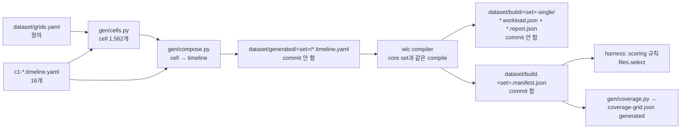

# 5권 · Generated layer: 열여섯 task set으로 만든 1,562개 파일

> Status: draft · Created 2026-10-14 · Updated 2026-10-14

**왜 손으로 쓴 core set 옆에 생성한 층이 있고, 그 파일들은 어떤 규칙으로 만들어지며 어떻게 점수를 받나.**

---

workload dataset은 세 덩어리로 이루어져 있습니다. 사람이 한 파일씩 설계한 core set 51개, 그 가운데 일부를 조금씩 흔든 sensitivity variant 78개, 그리고 이 권이 다루는 generated layer 1,562개입니다. generated layer(생성한 층)는 generator라는 프로그램이 정의 파일 하나와 core set의 C1 파일 열여섯 개를 읽어서 규칙대로 찍어 낸 workload 파일의 모음입니다. 다섯 개의 set으로 나뉘어 있고, 파일 수는 `transition-grid` 480, `return-grid` 720, `flap-stress` 24, `distractor-grid` 272, `familiarity-ladder` 66입니다. 이 다섯 숫자와 합계 1,562는 이 권을 쓰면서 다섯 manifest의 `artifacts` 항목 수를 직접 세어 확인했습니다(`python3.12`로 `dataset/build.<set>.manifest.json`을 읽어 셈).

core set이 "이런 상황이 존재한다"를 한 파일씩 보여 주는 견본이라면, generated layer는 "이 요인을 빠짐없이 다 늘어놓으면 몇 번 맞히는가"라는 비율(rate)의 질문에 답하기 위한 표본입니다. 웹 개발에 비유하면 core set은 손으로 고른 회귀 테스트 몇 개이고, generated layer는 브라우저 × OS × 버전을 모두 곱해 돌리는 CI matrix에 가깝습니다. matrix의 한 칸은 현실에서 그 조합이 얼마나 자주 나오는지와 무관하게 존재합니다. generated layer의 파일도 마찬가지로, desktop에서 그 상황이 얼마나 자주, 어떤 순서로 나오는지에 대해서는 아무것도 주장하지 않습니다. 저장소는 이것을 "design, no realism claim"이라고 부릅니다.

이 권은 generated layer를 처음부터 끝까지 설명합니다. 왜 이 층이 생겼는지(2026-10-10 audit과 2026-10-11의 결정), 재료인 C1 파일 열여섯 개가 무엇인지, 정의 파일 `dataset/grids.yaml`에 무엇이 적혀 있는지, generator의 두 모듈 `gen/cells.py`와 `gen/compose.py`가 cell 하나를 어떻게 timeline 하나로 바꾸는지, 다섯 set 각각이 무엇을 늘어놓고 왜 그 개수인지, set마다 파일 하나를 이름에서 compile된 파일까지 손으로 따라가 보고, manifest의 `grid` 기록과 그것을 읽는 두 소비자(scoring 규칙과 coverage 표), 그리고 왜 생성한 파일은 commit하지 않고 CI가 매번 다시 만드는지까지 다룹니다. archetype 하나하나의 측정값, compiler가 timeline을 event로 바꾸는 내부, C1 파일 각각의 설계 이유는 다른 권(archetype과 측정을 다루는 권, compile을 다루는 권, core set을 다루는 권)이 맡고, 여기서는 generated layer를 읽는 데 필요한 만큼만 짧게 다시 말합니다.

이 권의 결정은 대부분 Phase 9(2026-09-13에 시작한 workload dataset 재구축 단계)의 세 sub-task에서 나왔습니다. 9.19(2026-10-11, generator와 C3 — mode가 바뀌는 arc group — 의 grid들), 9.20(2026-10-12, C4 — 상관없는 process가 끼어드는 group — 와 C5 — 이름의 친숙도 사다리 group — 의 grid들), 9.21(2026-10-13, generated layer의 소비자 쪽 작업)입니다. 각 결정은 그 sub-task의 spec(`_dev/docs/spec/jioh/task-9.19-…`, `task-9.20-…`, `task-9.21-…`)과 changelog(`_dev/research/jioh/task-9.19-…/changelog.md` 등)에 기록되어 있고, 이 권은 기록된 이유를 그대로 옮깁니다. 기록에 이유가 없는 곳은 "기록된 이유는 없습니다"라고 쓰고, 이 권을 쓰면서 tree와 기록이 어긋나는 곳을 발견하면 그 자리에서 밝힙니다.

---

## 목차

1. [1장 · 왜 생성한 층이 있나](#1장--왜-생성한-층이-있나)
2. [2장 · 재료: 열여섯 C1 task set](#2장--재료-열여섯-c1-task-set)
3. [3장 · 정의 파일 `dataset/grids.yaml`](#3장--정의-파일-datasetgridsyaml)
4. [4장 · cell 만들기: `gen/cells.py`](#4장--cell-만들기-gencellspy)
5. [5장 · timeline 조립: `gen/compose.py`와 하나뿐인 re-timing 규칙](#5장--timeline-조립-gencomposepy와-하나뿐인-re-timing-규칙)
6. [6장 · `generate.py`: timeline에서 compile과 manifest까지](#6장--generatepy-timeline에서-compile과-manifest까지)
7. [7장 · `transition-grid`: 480개 파일](#7장--transition-grid-480개-파일)
8. [8장 · `return-grid`: 720개 파일](#8장--return-grid-720개-파일)
9. [9장 · `flap-stress`: 24개 파일과 hold-time 계획](#9장--flap-stress-24개-파일과-hold-time-계획)
10. [10장 · `distractor-grid`: 272개 파일](#10장--distractor-grid-272개-파일)
11. [11장 · `familiarity-ladder`: 66개 파일](#11장--familiarity-ladder-66개-파일)
12. [12장 · manifest `build.<set>.manifest.json` 해부](#12장--manifest-buildsetmanifestjson-해부)
13. [13장 · 생성한 파일은 어떻게 점수를 받나](#13장--생성한-파일은-어떻게-점수를-받나)
14. [14장 · coverage 표: `coverage-grid.json`의 `generated`](#14장--coverage-표-coverage-gridjson의-generated)
15. [15장 · commit하지 않는 파일과 매번 도는 CI](#15장--commit하지-않는-파일과-매번-도는-ci)
16. [16장 · 열린 자리와 어긋난 곳 모음](#16장--열린-자리와-어긋난-곳-모음)
17. [17장 · 용어 정리](#17장--용어-정리)

---

# 1장 · 왜 생성한 층이 있나

이 장은 "core set이 이미 있는데 왜 1,562개 파일을 따로 만들었나"라는 질문에 답합니다. 이 질문이 먼저 오는 이유는, generated layer의 모든 규칙 — 모든 segment가 60초인 것, 모든 파일이 `design`이라고 적히는 것, 쌍(pair)을 빠짐없이 늘어놓는 것, seed를 사람이 고르지 않는 것 — 이 이 층의 목적에서 곧바로 나오기 때문입니다. 목적을 모르고 규칙을 보면 규칙이 임의적으로 보입니다.

## 1.1 먼저 용어 몇 개

이 장에서 쓰는 저장소 용어를 먼저 풉니다.

- `workload` 파일 — simulator(가상의 CPU 하나 위에서 process들을 돌려 보는 프로그램)가 읽는 입력 파일 하나. 어떤 process가 언제 도착하고, 언제 CPU를 얼마나 쓰고, 언제 잠들고 깨는지가 모두 적혀 있습니다. 확장자는 `.workload.json`입니다.
- `timeline` — 사람이 쓰는(또는 generator가 쓰는) workload의 설계도. YAML 파일(`*.timeline.yaml`)이고, compiler가 이것을 workload 파일로 바꿉니다.
- `segment` — timeline을 시간으로 자른 한 구간. 구간마다 정답 label(그 시간에 사용자가 무엇을 하고 있었는지)이 붙습니다.
- `mode` — label의 핵심. 열여섯 가지(`browsing`, `office`, `mail`, `dev`, `photo`, `meeting`, `gaming`, `media`, `video-edit`, `compile`, `ml-train`, `render`, `transcode`, `indexing`, `backup`, `idle`) 중 하나입니다(`docs/recognition-vocabulary.md` §1).
- `background_wanted` — label의 두 번째 칸. 그 시간에 돌고 있는 지속적인 background 작업을 사용자가 원하는가(`true`/`false`). background 작업이 없으면 관례상 `true`입니다(같은 문서 §1).
- driver table cell — mode 16개 × `background_wanted` 2값 = 32칸. 연구가 "상황"을 나누는 단위이고, 데이터셋은 이 32칸을 기준으로 얼마나 덮였는지를 셉니다.
- recognizer — process 이름 목록을 보고 지금의 mode와 attribute를 맞히려는 쪽. LLM, 화이트리스트, 무작위(`random`), 정답을 아는 `oracle` 등이 모두 recognizer의 구현입니다.
- core set — 사람이 설계한 51개 파일. C1부터 C7까지 일곱 group으로 나뉩니다. group은 파일이 시험하는 질문의 종류입니다. C1은 한 파일에 한 mode만 있는 보정용(calibration) 파일 열여섯 개, C2는 의도만 다른 쌍, C3은 mode가 바뀌는 arc(여러 segment가 이어진 흐름), C4는 상관없는 process가 끼어드는 파일(distractor injection), C5는 이름의 친숙도 사다리(familiarity ladder), C6는 이름만으로는 원리적으로 못 맞히는 한계 파일, C7은 C1 각각의 `background_wanted: false` 짝입니다.

## 1.2 존재 사례와 비율 질문

연구가 데이터셋에 던지는 질문은 두 종류로 나뉩니다.

첫째는 **존재(existence)** 의 질문입니다. "게임을 하다가 사용자가 다운로드를 시작하는 상황이 있다", "browser에서 회의로 넘어가는데 process 이름은 그대로인 상황이 있다" 같은 문장입니다. 이런 문장은 그런 파일이 하나 있으면 증명됩니다. core set에서 mode 전환을 담은 C3 group의 arc 세 개(`c3-workday`, `c3-evening`, `c3-creation`)나 끼어드는 process를 담은 C4 group의 세 파일(`c4-compile`, `c4-gaming`, `c4-office`)이 이런 역할을 합니다. 저장소는 이것들을 existence case(존재 사례)라고 부릅니다.

둘째는 **비율(rate)** 의 질문입니다. "mode가 바뀌는 순간에 recognizer가 새 mode를 몇 %나 맞히는가", "상관없는 프로그램이 끼어들었을 때 몇 %가 흔들리지 않는가", "이름이 낯설수록 정답률이 어떻게 떨어지는가" 같은 문장입니다. 이런 문장에는 파일 하나로 답할 수 없습니다. 분모가 필요합니다. 그리고 분모가 "손으로 고른 몇 개"라면, 그 비율은 무엇을 골랐느냐에 따라 달라집니다.

웹 개발의 비유로 말하면, 존재 질문은 "이 버그가 재현되는 입력이 있다"이고 비율 질문은 "이 기능이 지원 브라우저 전체에서 몇 %나 동작하는가"입니다. 앞의 것은 재현 케이스 하나로 충분하고, 뒤의 것은 matrix 전체를 돌려야 합니다. 그리고 matrix의 결과는 "실제 사용자 중 몇 %가 그 브라우저를 쓰는가"와는 다른 질문입니다. generated layer는 matrix를 만들고, 사용자 분포에 대한 주장은 하지 않습니다.

## 1.3 2026-10-10 audit이 찾은 빈자리

generated layer의 출발점은 2026-10-10에 시작한 dataset audit입니다(`_dev/docs/audit/jioh/2026-10-10-dataset-audit-before-9.15.md`, Status: record, Created 2026-10-10, Updated 2026-10-11). 다섯 명의 auditor가 `jioh/dataset-rebuild` branch의 `fe19be86` commit을 각자 다른 관점(소비자 일관성, 출처, build 신뢰성, 현실 충실도, 외부 심사)에서 읽었습니다. 이 audit의 consolidation은 "RQ0 run을 위한 데이터셋 쪽 준비는 되었다"고 답하면서, 현실 충실도 표(fidelity map)에 "co-occurrence / order: DESIGN / UNGROUNDED"라는 행을 남겼습니다. 어떤 process들이 함께 돌고 어떤 순서로 상황이 바뀌는지는 설계일 뿐 근거가 없다는 뜻입니다.

그다음 날인 2026-10-11, 인지오가 같은 기록에 "Open — the core set's coverage of transitions and of generalisation"이라는 항목을 올렸습니다. 기록된 내용을 그대로 옮기면 이렇습니다.

> The core set serves milestones 1–7 (RQ0–RQ4), not RQ0 alone. Its C3 group holds three arcs with about eight segment boundaries in all, each ordered mode pair seen at most once, and the set has 64 segments over 32 driver-table cells. It cannot carry a statistical claim on transition recognition (RQ1), on recognition accuracy per cell, or on the phase-shift family (RQ4: a fixed sequence at 60 s / 10 s / 2 s transitions, whose files do not exist).

한국어로 풀면 이렇습니다. core set은 RQ0만이 아니라 RQ0부터 RQ4까지(연구 질문 0번부터 4번까지) 모두를 받쳐야 합니다. 그런데 C3 group(mode 전환 arc)의 arc 세 개에는 segment 경계가 다 합쳐 여덟 개쯤밖에 없고, 순서가 있는 mode 쌍 하나는 많아야 한 번 나옵니다. core set 전체도 32칸에 segment가 64개뿐입니다. 그래서 core set으로는 전환(transition) 인식에 대한 통계적 주장(RQ1), 칸별 인식 정확도에 대한 주장, 그리고 RQ4의 phase-shift 계열(60 s / 10 s / 2 s 간격으로 상황이 바뀌는 고정된 순서) — 이 계열은 파일 자체가 없었습니다 — 에 대한 주장을 할 수 없습니다.

여기 나온 연구 질문을 짧게 풀어 둡니다(`docs/research-proposal.md`). RQ0는 측정 가능성(설정 선택이 결과를 측정할 만큼 바꾸는가), RQ1은 상황 읽기(process 이름만으로 LLM이 지금 무엇을 하는지 맞히는가), RQ2는 가치(맞게 읽으면 scheduling이 나아지는가), RQ3은 vocabulary가 충분한가, RQ4는 timing(LLM 추론은 수백 ms에서 수 초가 걸리는데, 상황이 얼마나 오래 지속되어야 semantic scheduling이 그 지연을 갚는가)입니다. 기록이 쓴 "64 segments"는 당시의 수이고, 지금 tree의 core set은 66 segment입니다(`dataset/coverage-grid.json`의 `segments_total`). 차이는 2026-10-09에 C2와 C6 파일이 다시 지어지며 생긴 것이고, 이 기록의 논지와는 상관이 없습니다.

같은 기록은 이 항목의 상태를 "open"으로 두고, 인지오가 "core set이 정의된 그대로 맞는 도구인지, naturalistic set이나 generated set이 나은지를 저울질하고 있다"고 적었습니다. naturalistic set은 building plan(`docs/workload/building-plan.md` §4)이 Layer 3b로 계획한, 실제 desktop 사용처럼 보이는 timeline을 자동으로 만들어 내는 집합입니다. 아직 지어지지 않았습니다.

## 1.4 2026-10-11의 방향과 Phase 9 decision 9

같은 날 인지오가 방향을 정했고, 기록의 "Direction taken on the open item (2026-10-11, 인지오)" 아래에 세 줄로 남았습니다.

> - A generated layer is added beside the core set; the core set stays. Each group whose claim is a rate gets a generated set that enumerates the factor in full, with no realism claim (design). The naturalistic set stays in the backlog for the frequency claims.
> - C3: a 2-segment grid over the 240 ordered mode pairs (recognition at a transition, with direction), and a 3-segment return grid A → B → A over the same pairs with the middle segment's length as a variant (RQ4's stale-configuration cost). Longer chains are not enumerated. The three authored arcs remain as existence cases; the building plan's C3 role is restated to that.
> - A small flap-stress set (a few files with fast repeated set changes) is the tuning and test material for the daemon's hold time and hysteresis; the values are tuned on files disjoint from the ones measured.

이 방향은 같은 날 Phase 9 spec에 decision 9로 들어갔습니다(`_dev/docs/spec/jioh/phase-9-workload-dataset-rebuild.md`, "### 9. Generated layer (added 2026-10-11)").

> A generated layer stands beside the core set. Each group whose claim is a rate has a generated set that enumerates the factor in full from the C1 task sets, labelled design with no realism claim; the authored files remain as existence cases. The naturalistic set stays in the backlog.

decision 9의 문장은 네 조각으로 읽힙니다.

1. **"stands beside the core set"** — core set을 대체하지 않습니다. core set의 파일은 하나도 바뀌지 않았고, 그 manifest(파일마다의 hash를 적은 lockfile)와 pin(실험 spec이 그 manifest의 SHA-256을 적어 데이터셋을 못 박는 것)도 generated layer 때문에 움직이지 않습니다(9.19 spec의 invariant: "The core set's and the variants' manifests and pins are unchanged").
2. **"each group whose claim is a rate"** — 모든 group이 아니라, 주장이 비율인 group만 generated set을 받습니다.
3. **"enumerates the factor in full from the C1 task sets"** — 요인(예: mode 쌍)을 빠짐없이 늘어놓되, 재료는 C1 파일들의 task set(그 파일에 등장하는 process 묶음)으로 한정합니다.
4. **"labelled design with no realism claim"** — 현실을 흉내 낸다고 주장하지 않습니다.

> **왜 이렇게 정했나.** 기록이 이 방향을 고른 이유로 남긴 것은 1.3의 open 항목 자체입니다. core set의 C3 group(mode 전환 arc)에는 경계가 여덟 개뿐이고 쌍마다 많아야 한 번이라 비율 주장을 실을 수 없고, RQ4 계열의 파일은 아예 없었다는 것입니다. naturalistic set을 지금 짓지 않은 이유는 backlog 줄에 적혀 있습니다. "its prerequisite is a source for Linux-desktop co-occurrence and transition frequency, which 9.10's search did not find" — Linux desktop에서 어떤 프로그램이 함께 돌고 얼마나 자주 상황이 바뀌는지에 대한 출처가 전제 조건인데, 9.10(timeline을 다룬 연구 sub-task)의 문헌 탐색이 그런 출처를 찾지 못했다는 것입니다(`_dev/TODO.md` backlog; audit 기록 2026-10-11). 출처 없이 "자연스러운" 파일을 만들면 그 자연스러움 자체가 근거 없는 주장이 되므로, 근거가 필요 없는 형태 — 요인을 다 늘어놓고 빈도는 주장하지 않는 형태 — 를 택했다고 읽을 수 있습니다. 다만 이 마지막 문장은 기록의 문장이 아니라 두 기록을 나란히 놓은 이 권의 독해입니다.

## 1.5 "design, no realism claim"이 실제로 뜻하는 것

이 말은 generated layer 곳곳에 문자 그대로 적혀 있습니다. 생성된 timeline 파일의 첫머리 주석은 매번 "Design — the C1 task sets composed; no realism claim."으로 끝나고, `dataset/grids.yaml`의 머리말은 "Every generated file is design: it composes the C1 task sets and claims nothing about how often or in what order desktops see the modes."라고 씁니다. `dataset/README.md`의 "Rules of the tree"에는 이것이 규칙 한 줄로 있습니다. "**The generated layer is design.** A generated file composes or renames the C1 task sets by `grids.yaml`'s rules and claims nothing about real desktops; its only authored numbers and names are the definition's, each number with a source or a label, the tier-4 name table design and the tier-3 names sourced. The values the generator scales (a batch job's work over its span) are `design` in the file's `source` map; the ones it carries unchanged keep the C1's tags."

이 말이 주장하지 않는 것과 주장하는 것을 나눠 보면 이렇습니다.

| 주장하지 않는 것 | 주장하는 것 |
|---|---|
| `compile` 다음에 `office`가 오는 일이 desktop에서 얼마나 흔한지 | `compile` 다음에 `office`가 오는 파일이 있고, 그 파일의 두 segment는 C1의 `compile`과 `office` task set으로 이루어져 있다 |
| 한 상황이 실제로 60초 지속되는지 | segment 길이를 60초로 고정했다(design) |
| batch 작업이 정확히 그만큼의 CPU를 쓰는지 | batch 작업의 CPU 패턴은 측정된 것이고, 총량만 segment 길이에 맞춰 비례로 줄였다(design) |
| 사용자가 2초 만에 상황을 바꾸는 일이 있는지 | 2초짜리 segment를 시험용으로 만들었다 |

즉 generated layer 파일 한 개 안의 process 하나하나의 행동(언제 깨고 얼마나 도는지)은 core set과 똑같이 측정된 archetype에서 나옵니다. 설계인 것은 그 위의 층 — 무엇이 무엇 다음에 오고, 얼마나 오래 있고, batch 작업이 얼마나 큰지 — 입니다. 2026-10-10 audit의 fidelity map이 core set에 대해서도 "task mix: DESIGN", "co-occurrence / order: DESIGN / UNGROUNDED", "durations: DESIGN"이라고 적은 것과 같은 층입니다. generated layer는 이 층이 설계라는 사실을 숨기지 않고, 대신 그 설계를 빠짐없이 늘어놓습니다.

## 1.6 어떤 group이 generated set을 받았나

decision 9는 "주장이 비율인 group"이라고만 말하고 목록은 주지 않습니다. 목록은 2026-10-11의 방향 기록과 그 뒤 두 sub-task(9.19, 9.20)가 정했습니다.

| core set group | generated set | 기록 |
|---|---|---|
| C1 calibration | 없음 — C1은 재료입니다 | Phase 9 decision 9 ("from the C1 task sets") |
| C2 intent pairs | 없음 | audit 기록 "C2 direction, and A1 closed (2026-10-11)": "The rate claim on intent runs on the sixteen C1–C7 pairs; no new C2 pairs are generated." |
| C3 transition arcs | `transition-grid`, `return-grid`, `flap-stress` | 방향 기록 "C3: …"; 9.19 |
| C4 distractor injection | `distractor-grid` | "C4 direction (2026-10-11)"; 9.20 |
| C5 familiarity ladder | `familiarity-ladder` | "C5 direction (2026-10-11)"; 9.20 |
| C6 resolution limits | 없음 | 기록된 이유는 없습니다 |
| C7 attribute counterparts | 없음 | 기록된 이유는 없습니다 |

C2(의도만 다른 쌍 group)에 대해서는 이유가 적혀 있습니다. 의도(intent)에 대한 비율 주장은 C1과 C7의 열여섯 쌍 — 같은 mode에서 `background_wanted`가 `true`인 C1 파일과 `false`인 C7 파일 — 위에서 이미 돌기 때문에 새 C2 쌍을 만들지 않는다는 것입니다. C6와 C7이 generated set을 받지 않은 데 대해서는 기록이 따로 말하지 않습니다. C6는 "원리적으로 못 맞히는 한계"를 보여 주는 파일이라 그 자체가 존재 사례이고, C7은 이미 열여섯 mode 전부에 하나씩 있어 C1과 같은 방식으로 요인을 다 덮는다고 읽을 수는 있지만, 이것은 이 권의 독해이지 기록된 이유가 아닙니다.

방향 기록에는 C2(의도 쌍)와 관련해 한 줄이 더 있습니다. "Widening the set of measured unwanted jobs is a measurement backlog item, not part of the generated layer." 원치 않는 background 작업(`background_wanted: false` 쪽)의 종류를 늘리는 일은 측정 backlog이지 generated layer의 일이 아니라는 것입니다. 지금 C7의 interactive 짝 열 개는 모두 같은 원치 않는 작업 하나(`unattended-upgr`, Ubuntu 자동 업데이트)를 씁니다. 그래서 generated layer의 파일은 모두 `background_wanted: true` 쪽에만 놓입니다(14장).

## 1.7 결정이 내려진 순서

generated layer는 나흘 사이에 만들어졌습니다.

| 날짜 | 무엇이 정해졌나 | 기록 |
|---|---|---|
| 2026-10-10 | audit 시작, fidelity map에 "co-occurrence / order: DESIGN / UNGROUNDED" | audit 기록 |
| 2026-10-11 | open 항목 제기 → 방향(generated layer, C3 전환 arc의 grid 둘, flap-stress), focus를 telemetry에 넣는 결정, C4(끼어드는 process)·C5(이름 친숙도)·C2(의도 쌍) 방향; Phase 9 decision 9·10 추가 | audit 기록; Phase 9 spec |
| 2026-10-11 | 9.19: generator, `grids.yaml`, `transition-grid`, `return-grid`, `flap-stress`, hold-time 계획의 선례 조사(step 3) | 9.19 spec, changelog P·D1–D7 |
| 2026-10-12 | 9.20: `distractor-grid`, `familiarity-ladder`, `c5-t3` → `c6-alias` | 9.20 spec, changelog P·D1–D11 |
| 2026-10-13 | 9.21: manifest의 placement·segment 기록, scoring 규칙, coverage 표, `files.select`, `flip_cost`, CI 전략 | 9.21 spec, changelog D1–D11 |
| 2026-10-13 ~ 14 | 9.21 D12·D13: harness CI의 메모리 문제와 `coreset_wide` marker | 9.21 changelog |

Phase 9의 실행 순서는 `_dev/TODO.md`에 "… → 9.22 → 9.19 → 9.20 → 9.21 → 9.15 → 9.16"으로 적혀 있습니다. 9.15는 문서·memo·guidebook 정리, 9.16은 마지막 audit입니다. 그래서 generated layer를 설명해야 하는 몇몇 문서(research proposal의 Family 4, coreset guide의 C3·C4·C5 서술, daemon guide §9.3 등)는 아직 9.15의 할 일 목록에 있고, 이 권을 쓰는 2026-10-14 현재 고쳐지지 않았습니다(16장).

## 1.8 다섯 set 한눈에

| set | 파일 | segment | 무엇을 늘어놓나 | 주로 받치는 질문 | split |
|---|---|---|---|---|---|
| `transition-grid` | 480 | 960 | 순서 있는 mode 쌍 240개 × 전환 형태 2가지(`departs`, `focus`) | RQ1: 전환 순간의 인식, 방향 포함 | 없음 |
| `return-grid` | 720 | 2,160 | 쌍 240개 × 가운데 segment 길이 3가지(60 s, 10 s, 2 s), A → B → A | RQ4: 낡은 설정의 비용(phase-shift 계열) | 쌍 단위로 tuning 120 / measurement 120 |
| `flap-stress` | 24 | 216 | keyed hash로 뽑은 쌍 3개 × 간격 4가지(2, 5, 10, 30 s) × seed 2개 | hold time과 hysteresis를 정할 재료 | seed 단위로 tuning / measurement |
| `distractor-grid` | 272 | 544 | 다른 mode의 task set이 끼어드는 240칸 + 어떤 mode에도 속하지 않는 프로그램 2개 × 16 mode | RQ1: 끼어드는 이름에 흔들리지 않는가 | 없음 |
| `familiarity-ladder` | 66 | 66 | 16 mode × tier 4·5 × 이름을 바꾸는 범위(focus 쪽만 / 나머지만 / 전부), 겹치는 칸은 합침, tier 3 두 칸 | RQ1: 이름의 친숙도에 따른 정확도 | 없음 |

파일 수는 다섯 manifest에서, segment 수는 `dataset/coverage-grid.json`의 `generated.<set>.segments_total`에서 확인했습니다. segment 합계는 960 + 2,160 + 216 + 544 + 66 = 3,946입니다. 각 숫자가 왜 그 값인지는 7장부터 11장까지 set마다 계산해 보입니다.

전체의 흐름을 그림으로 보면 이렇습니다.



굵게 기억할 것은 하나입니다. **commit되는 것은 정의(`grids.yaml`), generator 코드, 그리고 set마다 manifest 하나뿐입니다.** 1,562개의 timeline과 그 compile 결과는 언제든 다시 만들 수 있는 build 산출물이라 저장소에 들어가지 않습니다. 소비자(harness와 coverage 도구)는 commit된 manifest만 읽고도 일을 할 수 있어야 하고, 그래서 manifest의 `grid` 기록이 생겼습니다(12장).

# 2장 · 재료: 열여섯 C1 task set

generated layer의 모든 파일은 core set의 C1 파일 열여섯 개를 조각내어 다시 붙인 것입니다. 이 장은 "generator가 C1 파일에서 무엇을 가져오는가"라는 질문에 답합니다. C1 파일 각각이 왜 그 모양인지(어떤 측정에서 왔고, 왜 그 길이인지)는 core set 권이 다루므로, 여기서는 generator가 읽는 부분만 정리합니다.

## 2.1 C1 파일이란

C1(single-situation calibration)은 한 파일에 한 mode만 담은 열여섯 개 파일입니다. mode 하나에 파일 하나씩, `c1-<mode>.timeline.yaml`이라는 이름으로 `dataset/timelines/coreset/`에 있습니다. building plan은 C1을 "the easy case — one unmistakable situation per file"이라고 부릅니다. 각 파일은 segment 하나, 그 segment에 붙은 label(mode, `background_wanted: true`, 그리고 몇몇 파일은 `initiated` 같은 부가 annotation), 그 mode를 이루는 task 몇 개, 그리고 세 개의 track(`input`, `focus`, `operations`)으로 이루어집니다. 모든 C1 파일은 `meta.demand: calibration`을 선언하고, seed는 101부터 116까지입니다.

여기서 몇 가지 용어를 풉니다.

- `task` — timeline 안의 process 하나(또는 같은 process 여러 개, `count`). `id`(파일 안에서 유일한 이름표), `name`(recognizer가 보게 될 process 이름), `archetype`(행동 모형의 이름), `arrive`(도착 시각), 그리고 경우에 따라 `depart`(떠나는 시각)와 `bind`(archetype의 parameter 중 timeline이 값을 정해 주는 것)를 가집니다.
- `archetype` — process 한 종류의 행동 모형. "VS Code처럼 깨고 돈다", "kernel build처럼 자식 process를 낳는다" 같은 규칙과 측정된 수치의 묶음입니다. `dataset/archetypes.yaml`에 29개가 있습니다. archetype은 이름을 모릅니다. 이름은 timeline이 붙입니다.
- task set — 한 C1 파일에 있는 task 전부. generated layer에서 "mode의 task set"이라고 하면 `c1-<mode>.timeline.yaml`의 `tasks` 목록을 뜻합니다.
- segment-bound task — `depart`가 정해진 task. 사용자가 창을 닫는 시각은 외부에서 주어지는 사건이라 미리 못 박습니다.
- finite task — `depart`가 없는 task. 자기 일을 다 하면 스스로 끝납니다(build, 학습, 인코딩, 백업처럼). 언제 끝나는지는 scheduler가 CPU를 얼마나 주느냐에 달려 있어 미리 정할 수 없습니다. 이런 task가 batch 작업입니다.
- `input` track — 키 입력이 들어가는 시간 창(window) 목록. 창 안에서 compiler가 공개 데이터셋 SWELL-KW에서 뽑은 실제 타이핑 기록을 재생합니다. 2026-10-11 이전에는 이 track의 이름이 `focus`였고, 9.17(focus를 telemetry에 넣은 sub-task)이 이름을 `input`으로 바꿨습니다.
- `focus` track — 창의 focus(사용자가 맨 앞으로 가져온 창)를 어느 task가 쥐고 있는지의 구간 목록. 2026-10-11에 생겼습니다. recognizer가 보는 telemetry(daemon이 recognizer에게 보여 주는 process 이름 목록; 2.4)에 이 focus holder의 이름이 함께 실립니다.
- `operations` — 측정된 archetype이 가진 무거운 동작(page load, 메일 보내기, 이미지 필터, preview render)을 어느 시각에 시작하는지의 목록.

## 2.2 열여섯 task set

`dataset/timelines/coreset/c1-*.timeline.yaml`을 이 권을 쓰면서 하나씩 읽어 정리한 표입니다. "길이"는 segment의 끝, "batch"는 `depart`가 없는 task와 그 `bind`입니다.

| mode | task (`id`: `name` / archetype) | batch 작업 | 길이 | `input` | `focus` | `operations` |
|---|---|---|---|---|---|---|
| `backup` | `editor`: `kdenlive` / `video-editor` | `bulk`: `deja-dup` / `incremental-backup`, 2 s 도착, `total_work: 165.668s` | 277 s | 2–275 s (`editor`) | `editor` | `preview-render` 138.5 s |
| `browsing` | `browser`: `chrome` / `web-browser`; `renderers`: `chrome` / `renderer-hidden` × 4 | — | 60 s | 2–58 s (`browser`) | `browser` | `page-load` 30 s |
| `compile` | `editor`: `code` / `code-editor` | `build`: `make` / `build-orchestrator`, 2 s, `spawn_count: 2908, parallelism_cap: 8, child_name: cc1` | 1594 s | 2–1592 s | `editor` | — |
| `dev` | `editor`: `code` / `code-editor` | — | 60 s | 2–58 s | `editor` | — |
| `gaming` | `game`: `Troy.exe` / `game-task-chain` (`lane_share: 0.9`, `member_names` 15개); `steam`: `steam` / `game-client` | — | 60 s | 없음 | `game` | — |
| `idle` | `shell`: `gnome-shell`; `audio-srv`: `pipewire`; `init`: `systemd`; `bus`: `dbus-daemon` | — | 60 s | `[]` | `[]` | — |
| `indexing` | `editor`: `code` / `code-editor` | `hog`: `tracker-miner-f` / `file-indexer`, 2 s, `total_work: 39.435s` | 60 s | 2–58 s | `editor` | — |
| `mail` | `mailer`: `thunderbird-bin` / `mail-client` | — | 60 s | 2–58 s | `mailer` | `send` 40 s |
| `media` | `video`: `mpv` / `video-player`; `music`: `mpv` / `audio-player` | — | 60 s | 없음 | `video` | — |
| `meeting` | `voice`: `chrome` / `video-call` | — | 60 s | 없음 | `voice` | — |
| `ml-train` | `editor`: `code` / `code-editor` | `hog`: `python` / `cpu-batch`, 2 s, `total_work: 1389.885s, program: python3` | 1612 s | 2–1610 s | `editor` | — |
| `office` | `writer`: `soffice.bin` / `office-writer`; `browser`: `chrome` / `web-browser`; `renderers`: `chrome` / `renderer-hidden` × 4; `mail`: `thunderbird-bin` / `mail-client` | — | 60 s | 2–58 s (`writer`) | `writer` | — |
| `photo` | `photo-editor`: `gimp` / `image-editor` | — | 60 s | 2–58 s | `photo-editor` | `unsharp-mask` 30 s |
| `render` | `editor`: `kdenlive` / `video-editor` | `bulk`: `kdenlive_render` / `cpu-batch`, 2 s, `total_work: 16.545s, program: kdenlive_render` | 60 s | 2–58 s | `editor` | `preview-render` 30 s |
| `transcode` | `video-editor`: `kdenlive` / `video-editor` | `batch`: `HandBrakeCLI` / `video-transcoder`, 2 s, `total_work: 2970.871s` | 4762 s | 2–4760 s | `video-editor` | `preview-render` 2381 s |
| `video-edit` | `editor`: `kdenlive` / `video-editor` | — | 60 s | 2–58 s | `editor` | `preview-render` 30 s |

`idle`의 네 archetype은 차례로 `compositor-shell`, `audio-server`, `service-manager`, `message-bus`입니다. `gaming`의 `member_names`는 `Task worker thr` × 4, `dxvk-cs`, `dxvk-submit`, `winepulse_mainl`, `winepulse_timer`, `FAudio_AudioCli`, `Troy.exe` × 6입니다. `game-task-chain`은 compiler가 이 이름들로 16단계 chain(순서대로 서로를 깨우는 process 사슬)을 만들고, 거기에 `wineserver`라는 member 하나를 스스로 더합니다. `lane_share: 0.9`는 이 chain이 CPU 하나(이 연구의 말로 `lane`)의 90 %를 차지하도록 크기를 맞춘다는 설계 값입니다(출처 `design`).

`input` 칸에 "없음"이라고 쓴 세 mode(`gaming`, `media`, `meeting`)의 파일에는 `input` 키 자체가 없거나 빈 목록이고, `idle`은 `input: []`, `focus: []`입니다. 키 입력이 없는 상황이기 때문입니다(게임은 이 데이터셋에서 입력 스트림을 재생하지 않고, 재생기와 화상 통화는 사용자가 타이핑하지 않습니다).

## 2.3 generator가 C1에서 읽는 세 가지

generator(`gen/compose.py`)가 C1 파일에서 실제로 꺼내 쓰는 것은 세 덩어리입니다.

**(1) task 목록과 도착 offset.** 각 task의 `arrive`가 segment 시작으로부터 몇 초 뒤인지(C1에서는 대부분 0 s, batch 작업은 2 s)를 그대로 가져갑니다. task의 `id`, `name`, `archetype`, `count`, `bind`, `source`도 그대로 가져갑니다.

**(2) 세 track의 상대 위치.** `input` 창이 segment 시작에서 몇 초 뒤에 열리고 끝에서 몇 초 전에 닫히는지(C1에서는 언제나 2 s와 2 s), `focus`가 누구에게 있는지, operation이 창 안 어느 비율 지점에 있는지를 가져갑니다.

**(3) batch 작업의 크기와 그것이 살아야 했던 시간.** C1에서 batch 작업은 2 s에 도착해 segment 끝(`T`)까지 살아 있어야 했습니다. 그러니 C1의 batch 작업 하나는 "`T − 2` 초 동안 `total_work`(또는 `spawn_count`)만큼"이라는 비율을 가집니다. generator는 이 비율을 보존하며 크기를 새 길이에 맞춥니다(5장).

C1 파일 가운데 네 개(`compile` 1594 s, `ml-train` 1612 s, `transcode` 4762 s, `backup` 277 s)는 60초보다 훨씬 깁니다. 이 길이는 "작업이 어떤 scheduling 정책에서도 끝나는 가장 작은 정수 초"로 정해졌습니다(9.10 D78의 계산; `dataset/tools/end_bound.py`). batch 작업 하나가 끝까지 다 도는 모습을 담아야 turnaround(도착부터 끝날 때까지의 시간)를 잴 수 있기 때문입니다. generated layer는 이 긴 파일을 그대로 쓰지 않습니다. 모든 segment를 60초로 고정하고, batch 작업의 총량을 비례로 줄입니다. 왜 그렇게 했는지는 3장과 5장에서 다룹니다.

## 2.4 focus holder의 이름

generated layer의 두 set(`distractor-grid`, `familiarity-ladder`)은 각 C1 파일에서 focus를 쥔 task의 **process 이름**을 따로 읽습니다(`gen/cells.py`의 `focus_name`). 정리하면 이렇습니다.

| focus holder 이름 | 그 이름이 focus를 쥔 mode |
|---|---|
| `code` | `compile`, `dev`, `indexing`, `ml-train` |
| `kdenlive` | `backup`, `render`, `transcode`, `video-edit` |
| `chrome` | `browsing`, `meeting` |
| `Troy.exe` | `gaming` |
| `mpv` | `media` |
| `thunderbird-bin` | `mail` |
| `soffice.bin` | `office` |
| `gimp` | `photo` |
| 없음 (`null`) | `idle` |

이 표가 중요한 이유는 telemetry의 규칙 6 때문입니다. recognizer가 보는 telemetry는 지금 살아 있는 process 이름과 그 개수의 목록(name → count multiset)에, focus를 쥔 process의 **이름**을 더한 것입니다(`docs/data-contracts.md` §5, rule 6, 2026-10-11). 같은 이름을 가진 두 instance 사이에서 focus가 옮겨 가면 telemetry는 바뀌지 않습니다. 실제 기계에서 `/proc/<pid>/comm`으로 보이는 해상도가 그 정도이기 때문입니다. 그래서 `code`가 focus를 쥔 네 mode끼리, `kdenlive`의 네 mode끼리, `chrome`의 두 mode끼리는 "focus가 다른 프로그램으로 옮겨 갔다"는 신호가 이름으로 드러나지 않습니다. 10장의 26개 pre-committed miss(이름과 행동만으로는 어떤 recognizer도 정답에 닿을 수 없는 segment; 2.5 끝에서 다시 풂)가 바로 여기서 나옵니다.

## 2.5 그대로 가는 것과 가지 않는 것

C1에서 generated 파일로 옮겨 갈 때 그대로 가는 것과 새로 정해지는 것을 구분해 두면 뒤의 장들이 쉽습니다.

| 그대로 가는 것 | 새로 정해지는 것 |
|---|---|
| task의 `name`, `archetype`, `count` | task의 `id` (뒤에 `-s<k>`가 붙음) |
| segment의 `mode`, `attributes`(예: `initiated: user`, `pre_committed_miss: true`), `scenario` 목록 | segment의 시작과 끝 시각 |
| `bind`의 값 가운데 크기와 무관한 것(`parallelism_cap`, `child_name`, `program`, `lane_share`, `member_names`)과 그 `source` 표시 | batch 작업의 `total_work`·`spawn_count` (비례로 줄고 `source`가 `design`이 됨) |
| C1의 `input` 창 여백(2 s)과 operation의 창 안 비율 | 창과 operation의 절대 시각 |
| — | `meta.id`, `meta.seed` (cell id에서 keyed hash로) |

가장 놓치기 쉬운 것은 **seed가 따라가지 않는다**는 점입니다. C1 파일의 seed(101–116)는 generated 파일에 쓰이지 않습니다. 각 generated 파일은 자기 cell id에서 계산한 seed를 가집니다(4장). 그래서 같은 C1 task set이 두 generated 파일에 들어가도, compiler가 뽑는 무작위 값(어느 키 입력 구간을 재생할지, 측정된 분포에서 어떤 값을 뽑을지)은 파일마다 다릅니다. 이 점은 10장에서 `distractor-grid`와 `transition-grid`의 "쌍둥이" 관계를 볼 때 다시 나옵니다.

annotation도 그대로 따라간다는 점이 결과에 드러납니다. `c1-indexing`의 segment에는 `pre_committed_miss: true`가 붙어 있습니다. `indexing/true` 칸, 즉 사용자가 스스로 시작한 색인은 이름과 행동만으로는 원치 않는 색인과 구별할 수 없어서 미리 "못 맞히는 칸"으로 표시해 둔 것입니다(`c1-indexing.timeline.yaml`의 머리 주석: "The label differs from the unwanted case by intent alone, which names and behaviour cannot show — a pre-committed miss."). generator는 이 annotation을 segment와 함께 복사하므로, generated layer에서 `indexing`이 label인 segment는 하나도 빠짐없이 pre-committed miss입니다. `transition-grid`에서 60개, `return-grid`에서 135개입니다(14장).

`pre-committed miss`(미리 약속된 실패)를 한 줄로 풀면, "이름과 행동만으로는 어떤 recognizer도 정답 label에 닿을 수 없는 segment"입니다. 그런 segment는 정확도 계산에서 빠지고 따로 보고됩니다(`docs/recognition-vocabulary.md` §1의 annotation 정의).

# 3장 · 정의 파일 `dataset/grids.yaml`

이 장은 "generated layer가 무엇을 만들지를 어디에 적어 두었나"라는 질문에 답합니다. 답은 137줄짜리 YAML 파일 하나, `dataset/grids.yaml`입니다. 이 파일이 generated layer의 유일한 정의입니다. set을 하나 더하거나 간격 하나를 바꾸려면 이 파일을 고치고, generator가 나머지를 모두 다시 만듭니다. 웹 개발의 비유로는 CI matrix를 정의하는 workflow 파일의 `matrix:` 블록에 해당합니다. 실제 job들은 그 정의에서 펼쳐져 나옵니다.

## 3.1 누가 이 파일을 읽나

| 읽는 쪽 | 무엇을 하려고 |
|---|---|
| `dataset/tools/generate.py` → `gen/cells.py`, `gen/compose.py` | cell을 펼치고 timeline을 조립하려고 |
| `dataset/tools/lint.py` → `gen.lint_grids` | 정의의 모양, 간격의 출처, 이름 길이를 검사하려고 (`make lint`) |
| `dataset/tools/check_build.py` (`manifests(root)`) | `sets`에 이름이 있는 set마다 `dataset/build.<set>.manifest.json`을 gate가 확인할 manifest 목록에 넣으려고 |
| `dataset/tools/derive.py` (`generated_manifests`) | coverage 표를 만들 manifest 목록을 정하려고 |

`check_build.py`의 `manifests(root)`는 "the two fixed ones and one per generated set in grids.yaml"을 돌려줍니다. 그래서 `grids.yaml`에 set 이름을 하나 더하면 gate가 그 set의 manifest를 자동으로 기대합니다. manifest 목록을 따로 관리하는 곳이 없습니다.

## 3.2 최상위 키 세 개

```yaml
segment_length: 60s
no_input_below: 4s
comm_limit: {chars: 15, source: linux-sched-h}
```

**`segment_length: 60s`** — generated layer의 segment 길이. return grid의 가운데 segment와 flap-stress의 교대 segment를 빼면 모든 segment가 60초입니다. 9.19 decision 1이 이유를 한 구절로 적었습니다. "Every grid segment is 60 s, the length of the interactive C1 files." C1 가운데 batch 작업이 없는 interactive 파일들이 60초이니 그 길이에 맞췄다는 것입니다.

**`no_input_below: 4s`** — 이 길이 이하의 segment에는 키 입력 창을 만들지 않습니다. 9.19 decision 3: "A segment of 4 s or less has no input window: the return grid's 2 s middle segment shows B for 2 s with no keystroke." 숫자 4가 어디서 왔는지는 기록이 직접 말하지 않지만, C1의 창 여백이 앞뒤로 2 s씩이므로 길이가 4 s 이하면 `시작 + 2 s`가 `끝 − 2 s`보다 늦거나 같아져 창이 비게 됩니다. 실제로 `gen/compose.py`는 창의 시작이 끝보다 앞서지 않으면 창을 버립니다(5장). 이 값은 그 산수가 이미 정하는 경계를 이름 붙여 적어 둔 것으로 읽을 수 있고, 같은 값이 batch 작업의 도착 시각 규칙(짧은 segment에서는 2 s offset 대신 segment 시작에 도착)에도 쓰입니다.

**`comm_limit: {chars: 15, source: linux-sched-h}`** — 파일이 쓸 수 있는 process 이름의 최대 길이. 여기서 OS 용어 하나를 풉니다.

- `comm` — Linux kernel이 process(정확히는 thread)마다 들고 있는 짧은 이름 칸. `ps`나 `top`에 보이는 이름, `/proc/<pid>/comm`에서 읽히는 이름이 이것입니다. 실행 파일 경로가 아니라 이름만 담습니다. kernel 소스 `include/linux/sched.h`에 `TASK_COMM_LEN = 16`으로 정해져 있고, 마지막 1 byte는 문자열 끝 표시(NUL)라 실제 이름은 최대 15자입니다.

`grids.yaml`의 주석이 그대로 이렇게 설명합니다. "TASK_COMM_LEN is 16 bytes including the terminating NUL (`include/linux/sched.h`), so 15 characters." 출처 `linux-sched-h`는 `docs/references.md`에 deployed-system 항목으로 들어가 있고(2026-10-12, v6.17 tag에서 header를 읽음, status verified), `dataset/sources.yaml`에도 등록되어 있습니다. 이 한계가 generated layer에 특히 중요한 이유는 `familiarity-ladder`가 새 이름을 만들어 내기 때문입니다. 만든 이름이 15자를 넘으면 실제 기계에서는 그 이름으로 보일 수 없습니다. core set의 `c5-t4`에 있는 `video-playback-`, `audio-stream-he` 같은 이름은 더 긴 문자열을 이 한계에서 자른 모양입니다(`linux-sched-h` 항목의 role 줄). generated layer는 반대로 처음부터 15자 안에서 이름을 지어 자르지 않습니다(9.20 decision 7: "each within the 15-character `comm` limit as written, never truncated").

`tracker-miner-f`, `winepulse_mainl`, `FAudio_AudioCli`, `Task worker thr`처럼 C1 파일에 이미 들어 있는 끝이 잘린 듯한 이름들도 이 한계에서 나온 모양입니다. 예를 들어 Tracker의 실행 파일 이름은 `tracker-miner-fs-3`이고, `comm`에는 앞 15자 `tracker-miner-f`만 남습니다. 데이터셋은 측정 기록이나 출처 자료에 찍힌 `comm` 그대로를 씁니다.

## 3.3 `sets` 아래 다섯 항목

`sets:` 아래에 set 이름이 키로, 그 set의 parameter가 값으로 들어 있습니다. 전체를 옮기고 하나씩 풉니다.

```yaml
transition-grid:
  forms: [departs, focus]

return-grid:
  middle_lengths: [60s, 10s, 2s]
  split: {by: pair, tuning: 120}

flap-stress:
  lead_in: 60s
  alternations: 8
  pairs: 3
  intervals:
    - {length: 2s, source: design}
    - {length: 5s, source: feral-gamemode}
    - {length: 10s, source: tuned}
    - {length: 30s, source: systemd-oomd}
  split: {by: seed, names: [tuning, measurement]}

distractor-grid:
  relations: [cross-mode, out-of-vocabulary]
  programs:
    - {name: element-desktop, archetype: chat-client, scenario: S5}
    - {name: 7z, archetype: file-archiver, scenario: S16, total_work: span}

familiarity-ladder:
  tiers: [4, 5]
  carriers: [focus, others, all]
  tier5_letters: 4
  tier3:
    render: {kdenlive_render: {name: melt-7, source: "meas-ci:background:2026-10-03c"}}
    backup: {deja-dup: {name: duplicity, source: "meas-ci:background:2026-10-04"}}
  tier4_names: { … 26 entries … }
```

| set | 키 | 뜻 |
|---|---|---|
| `transition-grid` | `forms` | 전환의 두 형태. `departs`는 경계에서 A의 task가 떠나고 B가 도착, `focus`는 B가 도착하고 focus가 B로 가지만 A는 파일 끝까지 남음 (7장) |
| `return-grid` | `middle_lengths` | A → B → A에서 가운데 B segment의 길이 세 가지 |
| | `split` | `by: pair` — 쌍 단위로 나눔, `tuning: 120` — 앞의 120쌍이 tuning (8장) |
| `flap-stress` | `lead_in` | 처음 A가 머무는 길이 |
| | `alternations` | 그 뒤 B와 A가 번갈아 나오는 segment 수 |
| | `pairs` | keyed hash로 뽑을 쌍의 수 |
| | `intervals` | 교대 segment의 길이 네 가지와 각각의 출처 |
| | `split` | `by: seed` — 같은 파일을 seed 두 개로 만들고 이름을 `tuning`, `measurement`로 붙임 (9장) |
| `distractor-grid` | `relations` | 끼어드는 이름과 vocabulary의 관계 두 가지 |
| | `programs` | `out-of-vocabulary` 관계에서 끼어드는 프로그램 두 개. `total_work: span`은 그 작업의 총량을 60 s 구간에 맞춘다는 표시 (10장) |
| `familiarity-ladder` | `tiers` | 만들 친숙도 tier (4와 5) |
| | `carriers` | 이름을 바꿀 범위 세 가지 |
| | `tier5_letters` | tier 5 이름의 글자 수 |
| | `tier3` | tier 3 칸 두 개와 각 이름의 출처 |
| | `tier4_names` | tier 4 이름표 26개 (11장) |

여기서 `scenario`의 값 `S5`, `S16`은 scenario catalog(`docs/workload/scenario-catalog.md`)의 행 번호입니다. S5는 "voice-chat companion"(게임하면서 켜 두는 음성 채팅 같은 동반 프로그램), S16은 "archive burst"(압축 파일을 만들거나 푸는 짧은 폭주)입니다. segment의 `scenario` 목록은 compiler가 읽지 않는 설명용 꼬리표입니다.

이 권에 나오는 scenario 번호를 한 번에 풀어 둡니다(`docs/workload/scenario-catalog.md`의 행 이름). 각 C1 파일의 segment가 이 꼬리표를 달고 있고, generator는 그것을 그대로 복사합니다.

| 번호 | 행 | 번호 | 행 |
|---|---|---|---|
| S1 | office | S9 | gaming |
| S2 | browsing | S11 | software development |
| S3 | video conferencing | S12 | ML training |
| S4 | email | S13 | media playback |
| S5 | voice-chat companion | S14 | file indexing |
| S6 | photo | S15 | backup/sync |
| S7 | video editing/rendering | S16 | archive burst |
| S8 | batch transcode | S18 | system baseline |

## 3.4 숫자마다 붙은 출처

`grids.yaml`의 숫자 가운데 외부 근거가 있는 것은 출처 꼬리표를 달고 있습니다. 이 저장소의 규칙(9.18, bound value의 출처 규칙)은 timeline이 정하는 값마다 출처를 요구합니다. 출처는 셋 중 하나입니다. `dataset/sources.yaml`에 등록된 꼬리표(예: `feral-gamemode`, `meas-ci:background:2026-10-04`), 그런 꼬리표의 목록, 또는 `design` · `convention` · `arithmetic` 가운데 하나의 label입니다. `design`은 "근거 없이 이렇게 정했다"는 정직한 표시입니다.

| 값 | 출처 | 그 출처가 말하는 것 |
|---|---|---|
| `comm_limit.chars: 15` | `linux-sched-h` | Linux v6.17 `include/linux/sched.h`: `TASK_COMM_LEN = 16`, NUL 포함 |
| flap 간격 2 s | `design` | 선례 범위(5–30 s) 아래의 한 점 |
| flap 간격 5 s | `feral-gamemode` | GameMode 1.8.2의 `example/gamemode.ini`: `reaper_freq=5` — "The reaper thread will check every 5 seconds for exited clients, for config file changes, and for the CPU/iGPU power balance" |
| flap 간격 10 s | `tuned` | tuned v2.28.0의 `tuned-main.conf`: dynamic tuning의 `update_interval = 10` ("Update interval for dynamic tunings (in seconds)"); dynamic tuning 자체는 기본값이 꺼짐(`dynamic_tuning = 0`) |
| flap 간격 30 s | `systemd-oomd` | systemd의 `oomd.conf(5)`: `DefaultMemoryPressureDurationSec=` "Defaults to 30 seconds when unset or 0" |
| tier 3 이름 `melt-7` | `meas-ci:background:2026-10-03c` | Kdenlive export 측정에서 CPU의 99.6 %를 쓴 자식 process의 이름 |
| tier 3 이름 `duplicity` | `meas-ci:background:2026-10-04` | Déjà Dup 백업 측정에서 CPU의 57 %를 쓴 process의 이름 |
| 나머지 (60 s, 4 s, 교대 8번, 쌍 3개, split 120쌍, tier 4 표, 4글자) | 꼬리표 없음 | 교대 수 8("the count eight is design"), split 규칙("the rule is design"), tier 4 표("the table is design")는 spec이 design이라고 명시합니다. 60 s는 "the length of the interactive C1 files"라는 이유가 있고, 4 s·쌍 3개·4글자에는 따로 적힌 이유가 없습니다 |

세 flap 출처 항목 모두 `docs/references.md`에서 "Existence of the value only"라고 역할을 한정합니다. 예를 들어 `feral-gamemode`의 role 줄은 "Existence of a 5 s check interval in a shipped desktop game-mode daemon; never a claim that the value suits any other switch."입니다. 이 값들이 우리 daemon에 맞다는 주장이 아니라, 실제로 출하된 비슷한 daemon들이 이런 간격을 쓴다는 존재 주장만 한다는 뜻입니다. 이 셋이 어떻게 골라졌는지는 9장의 선례 조사에서 자세히 봅니다.

`meas-ci:<workflow>:<campaign>` 모양의 꼬리표는 이 저장소의 측정 campaign 이름입니다. GitHub Actions runner에서 실제 프로그램을 돌려 측정한 묶음을 가리키며, `<campaign>`은 시작 날짜(같은 날 두 번째면 글자 하나가 붙음)입니다(`docs/references.md`의 id 규칙).

## 3.5 tier 4 이름표

`familiarity-ladder`의 tier 4는 "존재하지 않지만 단어의 뜻으로 무슨 일을 하는지 짐작할 수 있는 이름"입니다. 그 이름은 손으로 쓴 표에서 옵니다. C1 파일에 나오는 실제 이름 26개 각각에 하나씩입니다(20개의 task 이름과 chain의 member 이름 6개; 9.20 D7).

| 실제 이름 | tier 4 이름 | | 실제 이름 | tier 4 이름 |
|---|---|---|---|---|
| `code` | `text-editor` | | `kdenlive_render` | `clip-exporter` |
| `soffice.bin` | `doc-writer` | | `HandBrakeCLI` | `video-encoder` |
| `thunderbird-bin` | `mail-reader` | | `deja-dup` | `backup-tool` |
| `chrome` | `web-browser` | | `tracker-miner-f` | `file-indexer` |
| `gimp` | `image-editor` | | `gnome-shell` | `desktop-shell` |
| `kdenlive` | `video-editor` | | `pipewire` | `audio-server` |
| `mpv` | `media-player` | | `systemd` | `service-mgr` |
| `Troy.exe` | `game-engine` | | `dbus-daemon` | `message-bus` |
| `steam` | `game-launcher` | | `Task worker thr` | `game-worker` |
| `make` | `build-runner` | | `dxvk-cs` | `gpu-cmd-stream` |
| `cc1` | `c-compiler` | | `dxvk-submit` | `gpu-submitter` |
| `python` | `model-trainer` | | `winepulse_mainl` | `audio-mainloop` |
| | | | `winepulse_timer` | `audio-timer` |
| | | | `FAudio_AudioCli` | `audio-client` |

가장 긴 이름은 14자(`gpu-cmd-stream`, `audio-mainloop`)입니다. 9.20 D7은 "each at most 14 characters, design"이라고 적었고, 이 권을 쓰면서 표의 값 길이를 세어 확인했습니다.

이 표가 이 set에서 유일하게 사람이 고른 부분입니다. `grids.yaml`의 머리말은 "Every seed and every split is a keyed SHA-256 draw from the cell's id; nothing here is chosen by hand except the tier-4 name table below."라고 적고, 9.20 spec의 invariant도 "nothing is chosen by hand except the tier-4 table"이라고 반복합니다.

> **열린 자리.** 표의 tier 4 이름 가운데 여섯 개(`web-browser`, `video-editor`, `image-editor`, `audio-server`, `message-bus`, `file-indexer`)는 `dataset/archetypes.yaml`의 archetype 이름과 글자가 같습니다. 이 권을 쓰면서 표의 값과 archetype 키를 비교해 찾았습니다. archetype 이름은 recognizer에게 보이지 않으므로(daemon이 받는 visible projection에는 process 이름, 개수, `declared_class`(프로그램이 스스로 정한 scheduling class, `normal` 또는 `idle`), 도착·떠남 시각, focus 구간만 있습니다; `docs/data-contracts.md` §4) 정보가 새는 통로는 아닙니다. 다만 기록은 이 일치를 언급하지 않으며, 의도한 것인지는 확인되지 않습니다. 고칠 필요가 있는지는 인지오가 정할 일입니다.

## 3.6 `lint_grids`가 검사하는 것

`gen/cells.py`의 `lint_grids(path, registry)`는 정의 파일을 compile 전에 검사합니다. `make lint`(`tools/lint.py`)와 `generate.py`가 맨 처음에 부릅니다. 검사 항목은 코드에서 읽으면 다음과 같습니다.

1. `segment_length`와 `no_input_below`가 있고 시간 값으로 읽힌다.
2. `comm_limit.chars`가 양의 정수이고, `comm_limit.source`가 registry(`dataset/sources.yaml`)에 있는 꼬리표다.
3. `sets`의 이름이 다섯 개(`transition-grid`, `return-grid`, `flap-stress`, `distractor-grid`, `familiarity-ladder`) 중 하나다.
4. `intervals`의 각 항목에 `source`가 있고, 그것이 `design` 같은 label이거나 registry의 꼬리표다.
5. `split`이 있으면 `by`가 `pair`나 `seed`다.
6. `distractor-grid`: `relations`가 알려진 두 값 안에 있고, 각 `program`에 `name`, `archetype`, `scenario`가 있고, 이름이 15자 안이며, `total_work`가 있다면 `span`이다.
7. `familiarity-ladder`: `tiers`가 4와 5 안에 있고(tier 3은 `tier3` 표의 몫), `carriers`가 세 값 안에 있고, `tier5_letters`가 양의 정수이면서 15 이하이고, tier 4 이름마다 15자 안이고, tier 4 이름이 실제 이름(표의 키)과 같지 않고, tier 4 이름끼리 겹치지 않으며, `tier3`의 이름마다 15자 안이고 출처 꼬리표가 registry에 있다.

`dataset/tools/tests/test_generated.py`의 `test_the_grid_definition_lint`는 일부러 틀린 정의를 만들어 이 검사가 잡는지 확인합니다. flap 간격의 출처를 없는 이름(`no-such-source`)으로 바꾸거나, 출처를 지우거나, split의 `by`를 `mood`로 바꾸거나, tier 4 이름을 26자로 늘리거나, `make`의 tier 4 이름을 `chrome`(실제 이름)으로 바꾸거나, `7z`의 `total_work`를 `6s`로 바꾸는 식입니다. 각 경우 오류 문장이 나오는지 봅니다.

> **코드로.** `dataset/tools/gen/cells.py`의 `lint_grids`가 위 항목을 검사하고, 출처 꼬리표는 `wlc.linter._check_tag`로 registry와 대조합니다(꼬리표의 위치 정보 모양까지 봅니다). `dataset/tools/lint.py`가 이것을 `make lint`의 한 단계로 부릅니다("9.19: the generated layer's definition and its interval sources"라는 주석이 붙어 있습니다). `generate.py`는 lint에 실패하면 아무것도 쓰지 않고 끝납니다.

# 4장 · cell 만들기: `gen/cells.py`

이 장은 "정의 파일의 몇 줄이 어떻게 1,562개의 cell이 되나"라는 질문에 답합니다. generator는 두 단계로 일합니다. 먼저 `gen/cells.py`가 정의를 펼쳐 cell 목록을 만들고, 그다음 `gen/compose.py`가 cell 하나를 timeline 하나로 조립합니다. 이 장은 첫 단계를 다룹니다. 코드는 366줄이고, 여기서는 말로 풉니다.

## 4.1 cell과 placement

먼저 두 용어를 풉니다.

- `cell` — generated layer의 파일 하나에 해당하는 설계 단위. grid(격자)의 한 칸이라는 뜻에서 cell이라고 부릅니다. cell은 dict 하나이고, `id`(파일 이름이 될 문자열), `set`, `a`, `b`(쌍의 두 mode, ladder에서는 `b`가 없음), `placements`, `grid`(그 칸의 좌표), `seed`, 그리고 set에 따라 `split`, `arrival`, `rename`을 가집니다.
- `placement` — "어느 mode의 C1 task set을, 어느 구간에 label로 놓고, 그 task들을 언제까지 살려 두나"를 적은 네 칸짜리 묶음 `(mode, start_us, end_us, alive_until_us)`입니다. `start`부터 `end`까지가 그 task set이 label을 맡는 segment이고, task들은 `alive_until`까지 살아 있습니다. 경계에서 떠나는 형태라면 `alive_until`은 segment의 끝과 같고, 파일 끝까지 남는 형태(전환 grid의 `focus` 형태, distractor grid의 A)라면 파일의 끝입니다. 시각은 모두 µs 정수입니다.

`cells.py`의 docstring이 이 정의를 그대로 적어 둡니다. "A placement is `(mode, start_us, end_us, alive_until_us)`: the mode's C1 task set labels the segment [start, end) and its tasks live to `alive_until`."

## 4.2 열여섯 mode와 240개 쌍

`modes_of(timelines_dir)`는 `dataset/timelines/coreset/`에서 `c1-*.timeline.yaml` 파일 이름을 모아 정렬하고 `c1-`과 `.timeline.yaml`을 떼어 mode 이름 열여섯 개를 얻습니다. 순서는 알파벳 순서입니다.

```
backup, browsing, compile, dev, gaming, idle, indexing, mail,
media, meeting, ml-train, office, photo, render, transcode, video-edit
```

mode 목록이 어떤 설정 파일이 아니라 C1 파일 이름에서 나온다는 점이 중요합니다. C1 파일이 곧 generated layer의 재료이므로, 재료 목록이 곧 mode 목록입니다.

`ordered_pairs(modes)`는 서로 다른 두 mode의 **순서 있는** 쌍을 모두 만듭니다. A를 바깥 반복, B를 안쪽 반복으로 돌며 A ≠ B인 것만 남깁니다.

```
16개 중 A를 고르는 방법 16가지 × A가 아닌 B를 고르는 방법 15가지 = 240쌍
```

`(compile, office)`와 `(office, compile)`은 다른 쌍입니다. 전환에는 방향이 있기 때문입니다. "컴파일하다가 문서 작업으로 넘어감"과 "문서 작업하다가 컴파일로 넘어감"은 recognizer가 마주하는 telemetry의 순서가 다릅니다. 2026-10-11 방향 기록이 "recognition at a transition, with direction"이라고 적은 이유가 이것입니다.

## 4.3 keyed SHA-256 draw

generated layer에서 "무작위로 고른 것처럼 보이는" 값은 모두 SHA-256 hash에서 나옵니다. 무작위 수 생성기를 쓰지 않습니다. 이것을 저장소는 keyed draw라고 부릅니다. 어떤 문자열(key)을 정해 hash를 내고, 그 hash 값으로 고르거나 순서를 정합니다. key가 같으면 결과도 언제나 같습니다.

`keyed_hex(*parts)`는 인자들을 `|`로 이어 붙인 문자열의 SHA-256 16진수 문자열을 돌려줍니다. 이 함수는 split과 flap 쌍의 순서를 정하는 데 쓰이고, seed와 tier 5 이름은 같은 생각을 `hashlib`으로 직접 구현합니다(seed는 아래, tier 5 이름은 4.6).

**seed.** `seed_of(set_name, cell_id)`는 `seed|<set>|<cell id>`라는 문자열의 SHA-256 digest 앞 4 byte를 big-endian 정수로 읽은 값입니다. 손으로 한 번 해 봅니다. `transition-grid` set의 cell `tr-compile-to-office-departs`라면 문자열은 `seed|transition-grid|tr-compile-to-office-departs`입니다. 이 문자열의 SHA-256은 `6ebab3107656b0eb…`로 시작하고, 앞 4 byte `6e ba b3 10`을 정수로 읽으면 1,857,729,296입니다. 생성된 timeline의 `meta.seed`가 정확히 이 값입니다(`dataset/generated/transition-grid/tr-compile-to-office-departs.timeline.yaml`; compile된 파일의 `meta.sampled.seed`도 같음). 앞 4 byte이므로 seed는 0부터 4,294,967,295 사이입니다.

seed에 set 이름이 들어가는 이유는 같은 이름의 cell이 다른 set에 있을 때도 seed가 갈리게 하려는 것으로 읽히지만, 기록이 이 구성을 따로 설명하지는 않습니다. 실제로 cell id는 set마다 접두사(`tr-`, `rt-`, `flap-`, `dx-`, `fl-`)가 달라 겹치지 않습니다. `test_generated.py`의 `test_seeds_are_keyed_draws_from_the_cell_id_and_distinct`는 1,562개 seed가 모두 서로 다르다는 것을 확인합니다.

> **왜 이렇게 정했나.** 9.19 spec의 invariant 첫 줄이 이것입니다. "Every generated file's seed is a keyed draw from its cell id, as the compiler's draws are keyed; no seed is chosen by hand." compiler 쪽의 keyed draw는 2026-08-27의 task-2.3 decision 5에서 온 규칙입니다. 그 결정은 무작위 값을 `(seed, task id, parameter, draw index)` 같은 key로 뽑게 해서 "unrelated edits cannot shift another task's draws"를 보장했습니다. 하나의 전역 무작위 수열을 쓰면 task 하나를 더하는 순간 그 뒤의 모든 값이 밀립니다. key로 뽑으면 무관한 변경이 다른 값을 건드리지 않습니다. generator도 같은 원리를 따릅니다. 사람이 seed를 고르지 않으니, "좋은 결과가 나오는 seed를 골랐다"는 의심이 생길 자리도 없습니다.

**split과 flap 쌍.** `ranked_pairs(pairs, *key)`는 240개 쌍을 `keyed_hex(*key, "<A>-to-<B>")`의 값 순서로 정렬합니다. 16진수 문자열의 사전순 정렬이니, hash 값이 작은 쌍이 앞에 옵니다. 이 정렬이 두 곳에 쓰입니다.

- `return-grid`의 split: key `split|return-grid|<A>-to-<B>`로 정렬한 앞 120쌍이 `tuning`, 나머지 120쌍이 `measurement`입니다. 예를 들어 `mail-to-idle`의 hash는 `5332dee5…`로 시작하고, 240쌍 가운데 72번째(0부터 세면 71)에 놓여 tuning 쪽입니다. 이 권을 쓰면서 계산해 보니 120번째와 121번째 쌍의 hash는 각각 `7fc24d1a…`(`photo-to-media`)와 `808555bb…`(`idle-to-browsing`)로 시작했습니다. 16진수의 중간값 `8000…` 근처에서 갈린 것은 우연이지만, hash가 고르게 퍼진다는 성질을 눈으로 확인할 수 있습니다.
- `flap-stress`의 쌍: key `pairs|flap-stress|<A>-to-<B>`로 정렬한 앞 3쌍입니다. 1위 `render-to-gaming`(`01777ade…`), 2위 `mail-to-gaming`(`02605d6a…`), 3위 `meeting-to-photo`(`031fcc09…`)입니다. 9.19 D1이 기록한 세 쌍 "mail → gaming, meeting → photo, render → gaming"과 같습니다.

`ranked_pairs`의 docstring은 이 방식의 목적을 한 줄로 말합니다. "The pairs in keyed-hash order: a split or a draw that no one chose."

## 4.4 set마다 cell을 만드는 함수

`cells(defn, modes, sets)`는 정의의 `sets`에 있는 이름마다 해당 함수를 불러 `{set 이름: [cell, …]}`을 돌려줍니다. 다섯 함수가 만드는 cell을 표로 정리합니다. `L`은 60 s, `M`은 return grid의 가운데 길이, `T`는 flap 간격입니다.

| 함수 | cell id | placements | grid 좌표 | split |
|---|---|---|---|---|
| `transition_cells` | `tr-<A>-to-<B>-<form>` | `departs`: `(A, 0, L, L)`, `(B, L, 2L, 2L)`; `focus`: `(A, 0, L, 2L)`, `(B, L, 2L, 2L)` | `a`, `b`, `form` | 없음 |
| `return_cells` | `rt-<A>-to-<B>-<middle>` | `(A, 0, L, L)`, `(B, L, L+M, L+M)`, `(A, L+M, 2L+M, 2L+M)` | `a`, `b`, `middle` | 쌍의 순위로 `tuning` / `measurement` |
| `flap_cells` | `flap-<A>-to-<B>-<interval>-<split>` | `(A, 0, 60s, 60s)` 다음 i = 1…8마다 `(i가 홀수면 B 짝수면 A, 60s+(i−1)T, 60s+iT, 같은 값)` | `a`, `b`, `interval`, `interval_source` | split 이름 두 개마다 cell 하나 |
| `distractor_cells` | `dx-<A>-with-<B>` (B는 mode 또는 프로그램 이름) | `(A, 0, L, 2L)` 하나, 그리고 `arrival` | `relation`, `a`, `b`, `focus_name_shared` | 없음 |
| `ladder_cells` | `fl-<mode>-t<tier>-<carrier>` 또는 `fl-<mode>-t3` | `(mode, 0, L, L)` 하나, 그리고 `rename` | `mode`, `tier`, `carrier`, `carriers`, `renamed`, (tier 3이면) `sources` | 없음 |

distractor cell의 placement가 하나뿐이라는 점에 주의하십시오. A가 label을 맡는 segment는 첫 60 s이고, A의 task들은 파일 끝(120 s)까지 삽니다. B의 task set은 placement가 아니라 `arrival`이라는 별도의 키로 들어가고, compose 단계에서 label 없이 덧붙여집니다(5장, 10장). ladder cell은 이름 바꾸기 표 `rename`을 가집니다.

`distractor_cells`는 `focus_name_shared`를 여기서 계산합니다. A의 focus holder 이름(2.4의 표)이 있고 그것이 B의 focus holder 이름과 같으면 `true`입니다. `out-of-vocabulary` cell은 언제나 `false`입니다.

> **코드로.** `dataset/tools/gen/cells.py`: `ordered_pairs`(240쌍), `seed_of`(seed), `ranked_pairs`(split과 flap 쌍), `transition_cells`, `return_cells`, `flap_cells`, `distractor_cells`, `ladder_cells`(set별 cell), `cells`(정의의 set 이름마다 해당 함수를 부르는 입구). 각 함수는 cell dict의 목록을 돌려줄 뿐 파일을 쓰지 않습니다. 파일 쓰기는 `generate.py`의 몫입니다.

## 4.5 ladder cell의 안쪽

`ladder_cells`는 다섯 함수 가운데 가장 깁니다. 단계별로 따라가 봅니다.

1. mode마다 C1 파일에서 이름 목록을 모읍니다(`names_of`). task의 `name`, orchestrator의 `child_name`(예: `make`의 자식 `cc1`), chain의 `member_names`를 모두 모아 중복을 없애고 정렬합니다. 그다음 compiler가 붙이는 이름(`COMPILER_NAMES = ("wineserver",)`)은 뺍니다.
2. focus holder 이름(`focus_name`)을 구합니다.
3. 세 carrier 형태의 이름 목록을 만듭니다. `all`은 이름 전부, `focus`는 focus holder 이름 하나(holder가 없으면 빈 목록), `others`는 holder를 뺀 나머지입니다.
4. tier마다, carrier를 `CARRIERS = ("all", "focus", "others")` 순서로 돌며 cell을 만듭니다. 이름 목록이 비면 건너뜁니다. 이미 만든 cell과 이름 목록이 같으면 새 cell을 만들지 않고, 먼저 만든 cell(언제나 `all`)의 `carriers` 목록에 이 carrier를 더합니다. 이것이 "겹치는 칸을 합친다(collapse)"는 뜻입니다.
5. tier 4이면 이름마다 표(`tier4_names`)에서 새 이름을 찾고, 표에 없는 이름이 있으면 오류로 멈춥니다. tier 5이면 이름마다 `tier5_name`으로 새 이름을 뽑습니다(4.6).
6. `tier3` 표에 그 mode가 있으면 `fl-<mode>-t3` cell을 따로 만들고, 그 이름이 정말 C1 파일의 이름인지 확인한 뒤 `renamed`, `sources`, 그리고 carrier를 기록합니다. tier 3의 carrier는 `_carrier_of`가 판정합니다. 바뀐 이름이 전부면 `all`, focus holder 하나면 `focus`, 아니면 `others`입니다.

`CARRIERS`의 순서에 붙은 주석이 왜 `all`이 먼저인지 말합니다. "`all` first: the cell the others collapse into when their name sets coincide." 그래서 `dev`처럼 이름이 `code` 하나뿐인 mode에서는 `all`과 `focus`가 같은 목록이 되어 cell `fl-dev-t4-all` 하나만 생기고, 그 `carriers`가 `["all", "focus"]`가 됩니다. `others`는 빈 목록이라 cell이 없습니다. `idle`은 focus holder가 없어 `focus`가 비고, `others`가 `all`과 같아 `fl-idle-t4-all`의 `carriers`가 `["all", "others"]`입니다. 테스트(`test_the_ladder_has_one_cell_per_distinct_name_set_and_two_tier_3_cells`)가 바로 이 두 경우를 확인합니다.

## 4.6 tier 5 이름 뽑기

`tier5_name(cell_id, real, letters, taken)`은 실제 이름 하나에 대한 tier 5 이름을 뽑습니다.

1. 시도 번호 `attempt`를 0부터 올리며, 문자열 `name|familiarity-ladder|<cell id>|<real name>|<attempt>`의 SHA-256 digest를 냅니다.
2. digest의 앞 `letters`(= 4) byte 각각을 26으로 나눈 나머지로 `a`–`z` 중 한 글자를 고릅니다.
3. 그 네 글자가 `taken`에 없으면 그것을 돌려줍니다. 있으면 다음 시도로 갑니다(최대 10,000번).

손으로 해 봅니다. cell `fl-compile-t5-all`의 실제 이름 `code`, 시도 0의 문자열은 `name|familiarity-ladder|fl-compile-t5-all|code|0`입니다. SHA-256의 앞 4 byte는 `aa cc 36 29`, 즉 170, 204, 54, 41입니다. 26으로 나눈 나머지는 14, 22, 2, 15이고, 글자로는 `o`, `w`, `c`, `p`입니다. 그래서 `code`는 `owcp`가 됩니다. 같은 방식으로 `make`는 `lgar`, `cc1`은 `xsfc`가 됩니다. 생성된 timeline의 머리 주석이 정확히 이렇게 적습니다. "compile at familiarity tier 5, every name substituted (cc1 -> xsfc, code -> owcp, make -> lgar)."

`taken`은 처음에 `known_names`로 채워지고, 한 이름을 뽑을 때마다 그 결과가 더해집니다. 그래서 한 파일 안에서 두 실제 이름이 같은 tier 5 이름을 받는 일이 없습니다. `known_names`는 데이터셋이 아는 "실제이거나 이미 쓰인" 이름 전부입니다.

- C1 파일들의 모든 이름(`names_of`의 합집합)
- compiler가 붙이는 `wineserver`
- coverage 도구의 이름 표 `wlc/grid.py`의 `NAME_TIERS`(tier 1–3로 분류된 이름들; `firefox`, `clamscan`, `baloo_file` 같은, 지금 timeline이 쓰지 않는 이름까지 포함)
- tier 4 표의 이름들

> **왜 이렇게 정했나.** 9.20 decision 7: "Tier 5 names are keyed draws from the cell id and the real name, four lowercase letters, redrawn when the draw equals any real process name the dataset knows (every name in the timelines, the coverage tool's name table)." tier 5는 "회상도 추론도 불가능한 이름"이어야 하므로(building plan C5의 tier 정의: "nonexistent-opaque … neither recall nor inference possible") 실제 이름과 우연히 같아지면 안 됩니다. 그래서 아는 이름과 같으면 다시 뽑습니다. 네 글자라는 길이는 core set의 `c5-t5`(`qzvd`, `xkrr`)와 같은 모양이며, 기록은 4라는 값 자체의 이유를 따로 적지 않습니다.

## 4.7 테스트가 확인하는 enumeration

`dataset/tools/tests/test_generated.py`는 generated layer의 펼침(enumeration)이 정의대로인지 확인합니다. 핵심 assertion을 말로 옮기면 이렇습니다.

- mode는 열여섯 개이고, 순서 있는 쌍은 240개이며 모두 다르다.
- set별 cell 수는 `transition-grid` 480, `return-grid` 720, `flap-stress` 24, `distractor-grid` 272, `familiarity-ladder` 66이고, cell id는 모두 합쳐 1,562개다.
- seed는 `seed|<set>|<cell id>`의 keyed draw이고, 1,562개가 모두 다르다.
- return grid의 모든 cell은 A → B → A이고 모든 task set이 자기 경계에서 떠난다. 240쌍이 각각 한쪽 split에만 속하고, tuning 쌍은 정확히 120개이며 그것은 keyed hash 순위의 앞 120개다. 가운데 길이는 `60s`, `10s`, `2s` 세 가지다.
- flap 쌍은 keyed hash 순위의 앞 3개다. 간격과 출처의 짝은 (`2s`, `design`), (`5s`, `feral-gamemode`), (`10s`, `tuned`), (`30s`, `systemd-oomd`)다. placement는 A의 60 s lead-in 다음에 B, A, B, …의 여덟 개다. (쌍, 간격)마다 split 이름이 `tuning`과 `measurement` 둘이고 seed가 서로 다르다.
- 1,562개 cell 모두가 timeline 파일로 써지고, loader(`wlc.Timeline`)의 구조 검사와 bound value 출처 lint를 오류 없이 통과하며, segment 수가 예상대로다(distractor는 2, 나머지는 placement 수).
- distractor의 `out-of-vocabulary` cell은 32개이고 B는 `element-desktop`과 `7z`뿐이며, `focus_name_shared`가 `true`인 cell은 정확히 26개로 2.4의 세 이름 묶음에서 나오는 쌍과 같다.
- ladder는 tier 3이 2개, tier 4가 32개, tier 5가 32개다. tier 4 이름은 표대로, tier 5 이름은 네 글자 소문자이며 아는 이름이 아니고, 한 파일 안에서 실제 이름 하나에 새 이름 하나이며, 모든 이름이 15자 안이고, 바뀐 실제 이름은 파일에서 사라지고, `wineserver`는 timeline에 나타나지 않는다.
- commit된 manifest마다 `inputs`가 generator의 입력을 모두 포함하고 그 hash가 현재 파일과 같으며, `grid`의 기록이 cell에서 다시 계산한 값과 같다.

이 테스트들이 14장에서 말할 "No empty-cell rule applies"의 근거입니다. 각 set이 정의대로 빠짐없이 펼쳐졌다는 것을 coverage 표가 아니라 테스트가 직접 보장합니다.

# 5장 · timeline 조립: `gen/compose.py`와 하나뿐인 re-timing 규칙

이 장은 "cell 하나가 어떻게 timeline 파일 하나가 되나"라는 질문에 답합니다. 이 질문의 중심에는 9.10 D44라는 규칙이 있습니다. 저장소 문서들은 이것을 "the dataset's one re-timing rule"(데이터셋의 하나뿐인 시간 재배치 규칙)이라고 부릅니다. 먼저 이 규칙이 어디서 왔는지 보고, 그다음 `compose.py`가 그것을 어떻게 적용하는지 줄 단위로 따라갑니다.

## 5.1 9.10 D44는 어디서 왔나

9.10 D44(2026-10-01)는 원래 generated layer와 무관한 문제에서 나왔습니다. C7 group(C1 각각의 `background_wanted: false` 짝)의 interactive 짝 파일 열 개는 C1 파일(60 s)에 원치 않는 업데이트 작업을 넣고, 파일을 그 작업의 CPU 총량 C = 26.385 s로 잘라 만듭니다. 그런데 C1 파일을 26.385 s에서 그냥 자르면 30 s나 40 s에 있던 operation(`c1-browsing`의 page load 30 s, `c1-photo`의 unsharp mask 30 s, `c1-video-edit`의 preview render 30 s, `c1-mail`의 send 40 s)이 잘려 나가 버립니다. 9.10 D44의 WHY 줄이 바로 이것입니다. "a literal cut at C ≈ 26.5 s drops the four operations at 30/40 s."

그래서 D44는 이렇게 정했습니다. 자른 파일에서도 키 입력 창(당시 이름으로는 `focus`, 지금은 `input`)을 시작 2 s부터 끝 − 2 s까지로 두고, operation은 원래 창 안에서 차지하던 **비율** 지점에 놓는다. 예를 들어 `c1-mail`의 send는 2–58 s 창에서 40 s, 즉 (40 − 2) / 56 = 0.679 지점에 있으니, 잘린 파일에서도 그 창의 0.679 지점에 둡니다. 2026-10-03의 9.10 D96은 이 규칙을 반대 방향, 즉 길어진 파일에도 적용했습니다(`c1-transcode`를 4762 s로 늘렸을 때 preview render를 30 s가 아니라 창의 가운데에 둠).

9.19 decision 3은 generated layer의 배치 규칙을 이것으로 정했습니다. 제목부터 "Layout of a C1 task set in a segment: 9.10 D44 as written"입니다.

> A segment's tasks are the mode's C1 tasks with their C1 arrive offsets, shifted to the segment's start; the segment's mode, `background_wanted`, `scenario` and familiarity are copied from the C1 segment; the focus holder is the C1's over the whole segment. The input window keeps the 2 s margins (start + 2 s to end − 2 s) and each operation sits at its fraction of the window, as 9.10 D44 places them. A segment of 4 s or less has no input window: the return grid's 2 s middle segment shows B for 2 s with no keystroke.

> **왜 이렇게 정했나.** 9.19 spec은 D44를 고른 이유를 따로 길게 쓰지 않고 "as written"이라고만 합니다. 기록에서 읽을 수 있는 것은 두 가지입니다. 첫째, 데이터셋에 이미 시간을 옮기는 규칙이 하나 있었고(C7 group, 곧 C1의 `background_wanted: false` 짝 파일들), 같은 규칙을 쓰면 데이터셋 전체에 시간 재배치 방식이 하나뿐이게 됩니다. `dataset/README.md`와 building plan §3a가 D44를 "the dataset's one re-timing rule"이라고 부르는 것이 그 뜻입니다. 둘째, 9.19 spec의 invariant가 "The schema, the lints, D44, 9.18's slice rule and the report sidecar are unchanged by this sub-task"라고 적어, generated layer가 기존 규칙을 하나도 바꾸지 않고 그 위에 올라앉도록 했습니다.

## 5.2 `_place`: placement 하나를 track으로

`compose.py`의 중심 함수는 `_place(c1, k, start, end, alive_until, no_input_below, track_end=None, tracks=True)`입니다. C1 파일 하나와 placement 하나를 받아 다섯 가지 — segment 하나, task 목록, `input` 창 목록, `focus` 구간 목록, operation 목록 — 를 돌려줍니다. `k`는 그 placement의 번호(0부터)입니다. 단계별로 따라갑니다. `T`는 C1 segment의 길이입니다(대부분 60 s, `compile`은 1594 s 등).

**(0) 복사.** C1 dict를 통째로 깊은 복사(`copy.deepcopy`)합니다. 주석이 이유를 적어 둡니다. "no shared objects between placements (yaml would write anchors)". 같은 C1 task set을 한 파일에 두 번 넣을 때(return grid의 A처럼) 두 placement가 같은 객체를 가리키면, YAML로 쓸 때 `&id001` 같은 anchor가 생겨 파일 모양이 달라지기 때문입니다.

**(1) 짧은 segment인가.** `short = (end − start) <= no_input_below`. 길이가 4 s 이하이면 짧은 segment입니다.

**(2) task id에 suffix.** 모든 task의 `id`가 `<C1 id>-s<k>`가 됩니다. `editor`는 첫 placement에서 `editor-s0`, 두 번째에서 `editor-s1`입니다. 모듈 docstring의 이유: "ids suffixed `-s<k>` (k the placement's index, so two task sets never collide)". `office`와 `browsing`은 둘 다 `browser`라는 id를 쓰고, A → B → A에서는 같은 C1이 두 번 들어가니, suffix 없이는 id가 겹칩니다. id는 파일 안에서 유일해야 합니다.

**(3) 도착 시각.** `arrive = start + (0 if short else arrive_c1)`. C1의 도착 offset(대부분 0 s, batch 작업은 2 s)을 segment 시작에 더합니다. 짧은 segment에서는 offset을 버리고 segment 시작에 도착시킵니다. 9.19 D2의 이유: "its 2 s offset would fall on the boundary" — 2 s짜리 segment에서 2 s offset을 지키면 도착이 segment의 끝, 곧 경계에 걸려 버립니다.

**(4) 떠나는 시각.** C1 task에 `depart`가 있으면(segment-bound) `depart = alive_until`입니다. 경계에서 떠나는 형태라면 segment 끝, 남는 형태라면 파일 끝입니다.

**(5) batch 작업의 크기.** `depart`가 없는 finite task이고 `bind`에 `total_work`나 `spawn_count`가 있으면 그 값을 비례로 바꿉니다.

```
새 값 = C1 값 × (alive_until − arrive) / (T − arrive_c1)
```

분자는 새 파일에서 이 작업이 살아 있어야 하는 길이, 분모는 C1에서 살아 있어야 했던 길이입니다. `total_work`는 ms 단위로 반올림하고(`round(…/1000)*1000` µs), 소수 셋째 자리까지 초로 씁니다. `spawn_count`는 정수로 반올림하되 최소 1입니다. 값이 실제로 바뀌었을 때만 그 값의 `source` 항목을 `design`으로 바꿉니다. 바뀌지 않았으면 C1의 출처 꼬리표가 그대로 남습니다.

**(6) segment.** C1 segment에서 `from`과 `to`를 뺀 모든 키(`mode`, `attributes`, `scenario`, 있으면 `familiarity`)를 복사하고 `from = start`, `to = end`로 둡니다.

**(7) `input` 창.** C1의 창 하나 `[w.from, w.to]`마다 새 창을 `[start + w.from, track_end − (T − w.to)]`로 만듭니다. `track_end`는 보통 `end`(segment의 끝)이고, distractor의 A처럼 track이 segment를 넘어 이어질 때만 다른 값입니다. C1의 창은 언제나 `[2 s, T − 2 s]`이므로 새 창은 `[start + 2 s, track_end − 2 s]`입니다. 시작이 끝보다 앞서지 않으면(`lo < hi`가 아니면) 창을 버립니다.

**(8) `focus` 구간.** 같은 식으로 `[start + f.from, track_end − (T − f.to)]`입니다. C1의 focus는 `[0, T]`이므로 새 구간은 `[start, track_end]`입니다.

**(9) operation.** 그 operation의 task에 창이 있을 때만 남깁니다. 위치는 C1 창 `[a, b]` 안의 비율을 새 창 `[lo, hi]`에 옮긴 값입니다.

```
at = lo + round((C1의 at − a) × (hi − lo) / (b − a))
```

창이 없으면 operation도 사라집니다(9.19 D2: "dropped with the window").

**`tracks=False`.** distractor grid에서 B의 task set처럼 "사용자가 한 번도 돌아보지 않는 도착"을 넣을 때는 task만 넣고 `input`, `focus`, operation을 만들지 않습니다.

모듈 docstring은 한 가지를 더 명시합니다. "Within the label segment only: a task set that stays past its segment types no more once the focus has moved (decision 2)." 전환 grid의 `focus` 형태에서 A의 task는 파일 끝까지 살아 있지만, A의 키 입력 창과 focus는 A의 segment(0–60 s) 안에서 끝납니다. `track_end`가 `end`이기 때문입니다. 사용자는 B로 넘어갔고, 더 이상 A에 타이핑하지 않습니다.

> **코드로.** `dataset/tools/gen/compose.py`의 `_place`가 위 단계를 한 함수로 합니다. 크기 계산은 `_scaled_value`(`total_work`는 ms 반올림, `spawn_count`는 정수 반올림과 최소 1), 시각을 `60s`, `2.5s` 같은 문자열로 바꾸는 것은 `fmt_s`입니다. 일반 경로의 파일 하나는 `compose_full`이 placement마다 `_place`를 부르고 결과를 이어 붙여 만들며, 그때 placement 기록(`_placement`)도 함께 돌려줍니다.

## 5.3 batch 작업을 왜 비례로 줄이나

9.19 decision 1의 전문입니다.

> Every grid segment is 60 s, the length of the interactive C1 files. A batch mode's job (`total_work` on `cpu-batch` kinds, `spawn_count` on the build orchestrator) is bound by the generator to the span of segments the job must be alive in — the segment alone where the mode's tasks depart at the boundary, the rest of the file where they stay — the value derived from the C1 binding's rate and labelled `source: design`. The job's CPU pattern is the archetype's measured one; only its total is design.

두 문장으로 정리하면 이렇습니다. 작업의 **모양**(언제 얼마나 CPU를 쓰고 언제 쉬는지)은 측정된 archetype 그대로이고, **총량**만 설계입니다. 총량은 C1 binding의 비율 — "C1에서 이 작업은 `T − 2` 초 동안 이만큼 일했다" — 을 새 길이에 적용해 얻습니다.

왜 C1의 긴 파일을 그대로 쓰지 않았는지는 9.20 D9에 기록되어 있습니다(ladder에 대한 기록이지만 같은 이유입니다). "the batch modes' C1 files run to the job's CPU total (compile 1,594 s, transcode 2,971 s) and the grill priced the ladder as 60 s files; it keeps 9.19 decision 1 (every grid segment 60 s) and the layer's one re-timing rule." batch mode의 C1 파일은 작업이 끝날 때까지 이어지느라 수십 분이 되는데, 그것을 240쌍 × 여러 형태로 곱하면 파일이 감당할 수 없이 커집니다. 9.19 spec 세션에서 잰 값으로는 60 s짜리 interactive C1 파일 하나의 compile이 0.10–0.37 s, 4개 segment의 `c3-workday`가 3.7 s였습니다(9.19 decision 9 아래의 "Measured in the spec session").

이 권을 쓰면서 생성된 timeline에서 확인한 값들입니다. 모두 위의 식과 맞습니다.

| 파일 / task | C1 값과 C1 길이 | 새 길이 | 계산 | 결과 | `source` |
|---|---|---|---|---|---|
| `tr-compile-to-office-departs` / `build-s0` | `spawn_count` 2908, 1594 − 2 = 1592 s | 60 − 2 = 58 s | 2908 × 58 / 1592 = 105.9 | 106 | `design` |
| `tr-compile-to-office-focus` / `build-s0` | 같음 | 120 − 2 = 118 s | 2908 × 118 / 1592 = 215.5 | 216 | `design` |
| `tr-ml-train-to-dev-departs` / `hog-s0` | `total_work` 1389.885 s, 1610 s | 58 s | 1389.885 × 58 / 1610 | 50.070 s | `design` |
| `tr-indexing-to-dev-departs` / `hog-s0` | 39.435 s, 58 s | 58 s | 비율 1 | 39.435 s | `meas-ci:background:2026-10-02b` (그대로) |
| `tr-indexing-to-dev-focus` / `hog-s0` | 39.435 s, 58 s | 118 s | 39.435 × 118 / 58 | 80.230 s | `design` |
| `tr-backup-to-dev-departs` / `bulk-s0` | 165.668 s, 275 s | 58 s | 165.668 × 58 / 275 | 34.941 s | `design` |
| `tr-transcode-to-dev-departs` / `batch-s0` | 2970.871 s, 4760 s | 58 s | 2970.871 × 58 / 4760 | 36.200 s | `design` |
| `dx-render-with-mail` / `bulk-s0` | 16.545 s, 58 s | 118 s | 16.545 × 118 / 58 | 33.661 s | `design` |
| `rt-browsing-to-ml-train-2s` / `hog-s1` | 1389.885 s, 1610 s | 62 − 60 = 2 s (짧은 segment라 60 s 도착) | 1389.885 × 2 / 1610 | 1.727 s | `design` |

`render`와 `indexing`의 C1 파일은 60 s이므로 경계에서 떠나는 형태에서는 비율이 정확히 1이 되어 값도 출처도 C1 그대로 남습니다. 테스트 `test_an_unscaled_bound_value_keeps_its_source_tag`가 바로 이것을 확인합니다. 9.19 spec의 invariant가 "Every generated file's `source` map is the C1 files' as they stand, plus `design` on the values decision 1 scales"라고 적은 대로입니다.

`make`의 `spawn_count`는 object job(컴파일러 호출 하나에 해당하는 작업 단위)의 수입니다. compiler는 object job 하나를 여섯 process(셸, gcc driver, `cc1`, assembler 등)의 사슬로 펼칩니다. 그래서 `spawn_count: 106`인 파일의 compile 결과에는 spawn table(미리 뽑아 둔 자식 process 목록) 항목이 106 × 6 = 636개 있고, `fork_cap`(동시에 살아 있을 수 있는 자식 수의 상한)은 `parallelism_cap` 8 × 6 = 48입니다. 이 권을 쓰면서 `build/transition-grid-single/tr-compile-to-office-departs.workload.json`의 `build-s0` 도착 event에서 두 값을 확인했습니다.

> **열린 자리.** 비율로 줄인 batch 작업이 자기 파일 안에서 끝나는지는 기록이 다루지 않습니다. C1의 긴 파일은 "어떤 정책에서도 작업이 끝나는 가장 작은 정수 초"로 길이를 정했지만(9.10 D78), generated layer에는 그런 확인이 없습니다. 이 권을 쓰면서 저장소의 도구 `dataset/tools/end_bound.py`(작업이 한 lane 위에서 모든 work-conserving 정책 — 실행할 task가 있는 동안 CPU를 놀리지 않는 정책 — 아래 늦어도 언제 끝나는지의 상한을 계산. `lane`은 이 연구에서 simulator가 흉내 내는 CPU 하나를 부르는 말)로 몇 파일을 재어 보았습니다. `tr-ml-train-to-dev-departs`의 `hog-s0`은 상한 55.4 s로 파일 끝(120 s)보다 한참 앞섭니다. 그러나 `tr-dev-to-ml-train-departs`의 `hog-s1`(B 쪽, 62 s 도착)은 상한이 134.9 s, `tr-indexing-to-dev-focus`의 `hog-s0`은 140.2 s, `tr-ml-train-to-dev-focus`의 `hog-s0`은 122.3 s로 모두 120 s 파일 끝을 넘습니다. 상한이 파일 끝을 넘는다는 것은 "어떤 정책에서는 파일 안에 끝나지 않을 수 있다"는 뜻이지 "끝나지 않는다"는 뜻은 아닙니다. 원인은 같은 길이 안에 함께 있는 editor의 CPU가 C1 파일 전체의 평균보다 클 수 있다는 데 있어 보입니다(예: `c1-ml-train`의 editor는 1612 s 동안 219 s, 초당 0.14 s인데 `tr-dev-to-ml-train-departs`의 `editor-s1`은 60 s 동안 22.8 s, 초당 0.38 s). 이 사실이 점수 계산에 주는 영향은 13장에서 다시 봅니다. 몇 개 파일을 재어 본 것일 뿐 전체를 센 것은 아니며(일부 파일은 도구가 `SLEEP`을 가진 이웃 task 때문에 계산을 거부합니다), 이것을 고칠지는 인지오가 정할 일입니다.

## 5.4 짧은 segment에서 일어나는 일

`no_input_below` 4 s가 실제로 무엇을 바꾸는지 두 경우를 보면 분명해집니다.

**2 s segment** (return grid의 `2s` 가운데, flap-stress의 `2s` 간격). 창은 `[start + 2, end − 2] = [end, start]`가 되어 시작이 끝보다 늦으므로 버려집니다. operation도 함께 사라집니다. batch 작업은 segment 시작에 도착하고, 총량은 2 s에 맞춰 줄어듭니다. focus 구간은 `[start, end]`로 그대로 남습니다. 사용자는 2초 동안 B 창을 앞에 두었지만 키를 하나도 누르지 않은 셈입니다. 테스트 `test_a_two_second_segment_has_no_input_window_and_its_batch_job_arrives_at_its_start`가 `rt-ml-train-to-browsing-2s`에서 이것을 확인합니다. 가운데 `browsing` segment(60–62 s)에는 창이 없고, 30 s에 있던 page load가 사라졌으며, `browser-s1`은 60 s에 도착해 62 s에 떠나고, focus는 60–62 s 동안 `browser-s1`에 있습니다.

**5 s segment** (flap-stress의 `5s` 간격). 5 > 4이므로 짧지 않습니다. 창은 `[start + 2, end − 2]`, 길이 1 s입니다. batch 작업은 2 s offset을 지켜 `start + 2`에 도착합니다. operation은 그 1 s 창의 비율 지점에 놓입니다. `flap-render-to-gaming-5s-tuning`의 두 번째 `render` segment(65–70 s)에서 창은 67–68 s, preview render는 C1의 비율 (30 − 2) / 56 = 0.5를 적용해 67.5 s, `bulk-s2`는 67 s 도착에 총량 16.545 × (70 − 67) / 58 = 0.856 s입니다.

## 5.5 `meta`: id, seed, 그리고 `calibration`

생성된 timeline의 `meta`는 언제나 세 키입니다(`_meta`).

```yaml
meta:
  id: <cell id>
  seed: <seed_of(set, cell id)>
  demand: calibration
```

`demand`는 파일이 어떤 수요 class로 설계되었는지의 선언입니다. `oversubscribed`는 "경합(CPU를 원하는 일이 CPU보다 많은 상태)을 담도록 설계됨", `calibration`은 "경합을 담도록 설계되지 않음"입니다. 9.19 D2: "`meta.demand: calibration`, as every C1 file declares (the file is not designed to hold contention)." generated 파일은 C1 task set을 이어 붙였을 뿐 경합을 겨냥해 설계한 것이 아니므로 C1과 같은 class를 씁니다.

그렇다고 generated 파일에 경합이 없다는 뜻은 아닙니다. manifest의 `demand` 항목은 compiler가 계산한 정적 사용률(파일 전체 CPU 수요 ÷ 파일 길이; 1을 넘으면 lane 하나가 감당할 수 있는 것보다 많은 일이 있다는 뜻)을 기록합니다. 이 권을 쓰면서 다섯 manifest에서 1을 넘는 파일을 세어 보니 `transition-grid` 480개 중 80개, `return-grid` 720개 중 110개, `flap-stress` 24개 중 2개, `distractor-grid` 272개 중 89개, `familiarity-ladder` 66개 중 22개였습니다. 가장 큰 값은 `dx-compile-with-gaming`의 1.6346입니다. 2026-10-09 이후 수요 class는 gate가 아니라 설계 의도의 표시일 뿐이고(9.14 decision 4: "The demand window retires as a gate"), compiler는 이 값을 기록만 하고 파일을 실패시키지 않습니다. 그래서 `calibration` 파일의 사용률이 1을 넘어도 build는 통과합니다.

## 5.6 머리 주석과 그 byte가 중요한 이유

생성된 timeline은 언제나 세 줄의 주석으로 시작합니다(`HEADER`).

```
# GENERATED by dataset/tools/generate.py from dataset/grids.yaml and the C1 timelines — do not
# hand-edit; not committed (the set's manifest pins the generator and its inputs by content).
# <set>: <desc>. Design — the C1 task sets composed; no realism claim.
```

`<desc>`는 `describe(cell)`가 만드는 한 줄 설명입니다. 예: "compile -> office, form departs (A departs and B arrives)", "mail -> idle -> mail, the middle segment 10s; tuning half", "the user stays in dev while compile's task set arrives at the boundary (cross-mode); the two focus holders share a name, a pre-committed miss".

이 주석은 사람을 위한 것이지만, 그 byte는 compile 결과에 영향을 줍니다. compile된 workload의 `meta.derived_from`은 `<timeline 경로>@<그 파일 내용의 git blob hash>`입니다(예: `dataset/generated/transition-grid/tr-compile-to-office-departs.timeline.yaml@d82db0fe…`). 파일이 commit되지 않아도 내용의 hash는 계산됩니다. 그래서 주석 한 글자를 바꾸면 1,562개 artifact의 hash가 모두 바뀝니다. 9.20 D10이 실제로 이 일을 겪었습니다. "A first run had changed every generated artifact through `meta.derived_from` because the generated files' header comment had been reworded ('composed or renamed'); the wording was restored and the sets regenerated — the header is part of the timeline bytes the artifact pins." 주석의 문구를 "composed or renamed"로 바꿨더니 모든 artifact가 바뀌어서, 문구를 되돌렸다는 기록입니다.

`render_bytes`는 주석 다음에 timeline dict를 `yaml.safe_dump(data, sort_keys=True)`로 씁니다. 키가 정렬되므로 생성된 파일에서는 `focus`, `input`, `meta`, `operations`, `segments`, `tasks` 순으로 나옵니다. 사람이 쓴 C1 파일(`meta`가 맨 위)과 순서가 다른 것은 이 때문입니다.

## 5.7 distractor와 ladder의 조립

두 set은 일반 경로(`compose_full`의 마지막 부분: placement마다 `_place`를 부르고 이어 붙임)와 다른 전용 함수를 씁니다.

**`_compose_distractor`** (9.20 decisions 1–3).
1. A의 C1을 `_place(…, k=0, start=0, end=60s, alive_until=120s, track_end=120s)`로 놓습니다. A의 task는 120 s까지 살고, A의 `input`, `focus`, operation도 120 s까지 이어집니다.
2. `arrival`이 mode이면 B의 C1을 `_place(…, k=1, start=60s, end=120s, alive_until=120s, tracks=False)`로 놓습니다. B의 task만 들어가고 track은 없습니다. B의 scenario 꼬리표를 기억해 둡니다.
3. `arrival`이 프로그램이면 task 하나 `{id: distractor, name, archetype, arrive: 60s}`를 만듭니다. `total_work: span`이면 `bind: {total_work: 60s}`, `source: {total_work: design}`을, 아니면 `depart: 120s`를 줍니다.
4. 두 번째 segment는 A의 segment를 복사해 60–120 s로 두고, scenario 목록에 B(또는 프로그램)의 꼬리표를 덧붙입니다.
5. `focus_name_shared`가 `true`이면 두 번째 segment의 attributes에 `pre_committed_miss: true`를 더합니다.

**`_compose_ladder`** (9.20 decisions 5–7).
1. mode의 C1을 `_place(…, k=0, start=0, end=60s, alive_until=60s)`로 놓습니다. batch 작업은 58 s에 맞춰 줄어듭니다.
2. `rename` 표를 적용합니다. task의 `name`, orchestrator의 `child_name`, chain의 `member_names`가 바뀌고, 바뀐 `child_name`과 `member_names`의 `source` 항목은 `design`이 됩니다.
3. segment에 `familiarity: <tier>`를 붙입니다.

## 5.8 기록이 다루지 않은 한 가지: B의 도착은 launch입니다

> **열린 자리.** compiler에는 9.10 D136(2026-10-04)의 규칙이 있습니다. "a launch phase is replayed: … a task started mid-file replays one." 파일 중간에 도착하는 task는, 그 archetype이 측정된 launch phase(프로그램을 막 띄웠을 때의 무거운 초기화 구간)를 가지고 있으면, 그 구간의 실제 wake 기록을 먼저 재생하고 끝난 뒤에야 평상시의 흐름으로 들어갑니다. 코드에서는 `wlc/compiler.py`의 `_launch_stream`이 `task["arrive"] <= 0`이면 launch를 건너뛰고, 0보다 크면 launch를 붙입니다. launch phase를 가진 archetype은 열 개이고(`dataset/launch/launch-<entry>.json.gz`), 측정된 길이는 `audio-player`·`video-player` 약 30.6 s, `office-writer` 40.8 s, `chat-client` 53.2–53.7 s, `video-call` 210.1 s, `video-editor` 240.6 s, `mail-client` 408.9 s, `web-browser` 420.6 s, `game-client` 905.8–916.7 s, `renderer-hidden` 1,051.2 s입니다(이 권을 쓰면서 각 파일의 `phase_us`를 읽음).
>
> C1 파일에서는 interactive task가 모두 0 s에 도착하므로 launch가 없습니다. generated layer에서는 두 번째 이후 placement(B, return grid의 돌아온 A, flap의 모든 교대 segment)와 distractor의 도착이 모두 파일 중간에 도착하므로 launch를 재생합니다. launch phase가 60 s보다 긴 여섯 entry(`video-call`, `video-editor`, `mail-client`, `web-browser`, `game-client`, `renderer-hidden`)는 그런 segment의 60 s 전부가 launch 구간입니다. 반대로 `code-editor`, `image-editor`, session daemon 넷(`idle`의 task들), batch archetype들은 launch phase가 없어 도착 시각과 무관하게 평상시 흐름으로 시작합니다. 크기를 비교해 보면 차이가 큽니다. `c1-office`(launch 없음)에서 `mail` task는 60 s 동안 timer wake 135번, CPU 80 ms를 씁니다. `tr-compile-to-office-departs`의 `mail-s1`(60 s 도착)은 같은 60 s 동안 timer wake 11,081번, CPU 2.97 s를 씁니다. `browser`는 176 ms 대 1.91 s입니다. 이 권을 쓰면서 두 파일의 compile 결과와 report에서 센 값입니다.
>
> 이것은 규칙대로 compile된 결과이고, 규칙 자체는 의도된 것입니다. core set의 C4 group(끼어드는 process) recipe(`dataset/timelines/coreset/c4.variant.yaml`)는 30 s에 끼어드는 `element-desktop`과 `chrome`에 대해 "it runs its observed launch phase first, replayed"라고 주석으로 밝혀 둡니다. "B가 도착한다"를 "사용자가 B의 프로그램을 연다"로 읽으면 자연스러운 결과이기도 합니다. 그러나 9.19–9.21의 spec과 changelog는 generated layer에서 B 쪽이 C1의 평상시가 아니라 launch 구간이라는 점을 한 번도 언급하지 않습니다. 전환 grid의 `departs`와 `focus` 형태, distractor grid의 cross-mode 칸이 모두 B의 launch를 담는다는 사실이 RQ1과 RQ4의 해석에 어떤 영향을 주는지는 기록되지 않았고, 확인이 필요합니다. 결정한다면 인지오의 몫입니다.

# 6장 · `generate.py`: timeline에서 compile과 manifest까지

이 장은 "`make generated` 한 번이 처음부터 끝까지 무엇을 하나"라는 질문에 답합니다. 4장과 5장이 generator의 두 부품이었다면, 이 장은 그 부품을 엮어 compile과 manifest까지 가는 CLI입니다.

## 6.1 한 번의 실행, 아홉 단계

`dataset/Makefile`의 `generated` target은 `python3 tools/generate.py` 한 줄입니다. `generate.py`의 `main()`이 하는 일을 순서대로 적으면 이렇습니다.

1. `dataset/sources.yaml`을 읽어 출처 registry를 얻습니다.
2. `lint_grids`로 정의를 검사합니다. 오류가 하나라도 있으면 오류를 출력하고 종료 코드 1로 끝납니다. 아무것도 쓰지 않습니다.
3. `load_definition`으로 `grids.yaml`을 읽고, `modes_of`와 `c1_sets`로 열여섯 mode와 C1 파일들을 읽고, `cells(…)`로 set별 cell 목록을 만듭니다.
4. `--sets`가 주어졌으면 그 set만 남깁니다.
5. `write_timelines`: set마다 `dataset/generated/<set>/` 디렉터리를 만들고, cell마다 `compose_full`로 조립한 timeline을 `<cell id>.timeline.yaml`로 씁니다. 이미 같은 byte의 파일이 있으면 다시 쓰지 않습니다. 그 디렉터리에서 이번에 만들지 않은 `.timeline.yaml`은 지웁니다(정의에서 빠진 cell의 찌꺼기 정리). 이때 cell마다 manifest에 넣을 기록(`grid_record`)도 함께 만들어 둡니다.
6. set마다, 써 놓은 timeline 하나하나에 `lint_bound_sources`를 돌립니다. task의 `bind`와 `count`마다 `source`가 있고 그 꼬리표가 registry에 있는지 봅니다.
7. `build_set`: process pool로 timeline을 하나씩 compile합니다(`compile_generated_one`). timeline을 loader(`wlc.Timeline`)로 읽고(여기서 구조 검사), `compile_timeline`으로 canonical workload를 만들고, `lint_canonical`(schema 검사와 canonical lint)을 돌립니다.
8. 오류가 있으면 처음 50개를 출력하고 그 set은 건너뜁니다(종료 코드 1).
9. 오류가 없으면 artifact(`<id>.workload.json`)와 report(`<id>.report.json`)를 `dataset/build/<set>-single/`에 쓰고, manifest `dataset/build.<set>.manifest.json`을 씁니다.

```
grids.yaml ─lint_grids─▶ cells ─write_timelines─▶ generated/<set>/*.timeline.yaml
                                                    │ lint_bound_sources
                                                    ▼
                                    compile_generated_one (process pool)
                                    Timeline() → compile_timeline → lint_canonical
                                                    │
                       build/<set>-single/<id>.workload.json + <id>.report.json
                                                    │
                                    build.<set>.manifest.json (inputs, artifacts,
                                    reports, demand, grid)
```

## 6.2 core compiler를 건드리지 않는 compile

`compile_generated_one`은 core set의 `compile.py`에 있는 `compile_one`을 거의 그대로 흉내 낸 함수입니다. docstring: "One generated timeline in every mode — `compile.compile_one` over the generated root." 같은 library(`archetypes.yaml`), 같은 schema, 같은 `compile_timeline`, 같은 `lint_canonical`을 씁니다. 다른 점은 timeline을 `dataset/timelines/`가 아니라 `dataset/generated/`에서 읽는다는 것뿐입니다.

왜 core의 `compile_one`을 고쳐 쓰지 않고 흉내 냈는지는 `generate.py`의 docstring 마지막 문장이 말합니다. "The compile mirrors `compile.compile_one` over a different root so the core compiler and the core set's manifest stay as they are (spec invariant)." core set의 manifest(`dataset/build.manifest.json`)는 `inputs`에 `dataset/tools/compile.py`와 `dataset/tools/wlc/*.py`를 내용 hash로 못 박습니다. 이 파일들을 한 글자라도 고치면 core manifest가 바뀌고, 그것을 pin하는 variants manifest와 RQ0 gate spec(`harness/experiments/rq0-gate.yaml`, RQ0 run의 판정 기준과 파일 목록을 미리 등록해 둔 실험 spec)의 pin이 줄줄이 따라 움직입니다. generated layer가 그 연쇄를 일으키지 않도록 새 코드는 모두 `generate.py`와 `gen/` 아래에 두었습니다. 9.21에서 같은 이유로 coverage 표 코드도 `wlc/grid.py`가 아니라 `gen/coverage.py`에 들어갔습니다(14장).

"every mode"라는 말은 compile mode를 뜻합니다. 지금 compile mode는 `single` 하나뿐입니다(`wlc.compiler.MODES`; 9.13이 2026-10-09에 `native` mode를 없앴습니다). `single`은 lane 하나(CPU 한 개)에 맞춘 compile입니다. 그래서 출력 디렉터리 이름이 `<set>-single`입니다.

## 6.3 파일 이름은 이렇게 이어집니다

cell id 하나가 거치는 이름들을 `tr-compile-to-office-departs`로 따라가 봅니다.

| 단계 | 경로 | commit 여부 |
|---|---|---|
| cell | `cells()`가 만든 dict, `id = "tr-compile-to-office-departs"` | — (메모리) |
| timeline | `dataset/generated/transition-grid/tr-compile-to-office-departs.timeline.yaml` | 안 함 (`.gitignore`의 `dataset/generated/`) |
| artifact | `dataset/build/transition-grid-single/tr-compile-to-office-departs.workload.json` (4,451,569 byte) | 안 함 (`dataset/build/`) |
| report | `dataset/build/transition-grid-single/tr-compile-to-office-departs.report.json` | 안 함 |
| manifest의 키 | `transition-grid-single/tr-compile-to-office-departs.workload.json` (`artifacts`, `demand`, `grid`), `transition-grid-single/tr-compile-to-office-departs.report.json` (`reports`) | 함 (`dataset/build.transition-grid.manifest.json`) |
| compile된 파일 안 | `meta.id = "tr-compile-to-office-departs"`, `meta.derived_from = "dataset/generated/transition-grid/tr-compile-to-office-departs.timeline.yaml@d82db0fe…"`, `meta.sampled.seed = 1857729296` | — |
| harness가 쓰는 workload id | `tr-compile-to-office-departs` (manifest 키의 파일 이름에서 `.workload.json`을 뗀 것; `harness/tools/harness/manifests.py`의 `workload_id`) | — |

report는 compile이 artifact 옆에 남기는 요약입니다. 파일 길이(`duration_us`), CPU 수요(`demand_us`, `utilization`, `demand_class`), task별 CPU(`per_task`), segment별 수요(`per_segment`), operation 기록(`operations`)을 담습니다. 9.18(2026-10-11)부터 report도 manifest가 hash로 못 박는 blessed artifact입니다.

## 6.4 gate와의 관계

`make check`(dataset의 gate)는 두 명령입니다. `tools/derive.py --check --require-coverage`와 `tools/check_build.py`입니다. 뒤의 것이 generated layer와 직접 관련됩니다. `check_build.py`는 (a) 확인할 manifest 목록 — 고정된 두 개(core, variants)에 `grids.yaml`의 set마다 하나 — 각각이 `git show HEAD:<path>`로 꺼낸 commit된 byte와 같은지 보고, (b) `dataset/build/`의 파일 전체가 그 manifest들의 합집합과 정확히 같은지 봅니다. manifest에 있는 파일은 모두 있고 hash가 맞아야 하며, 어느 manifest에도 없는 파일이 있어서도 안 됩니다.

그래서 generated layer의 재현성은 이렇게 증명됩니다. CI가 깨끗한 checkout에서 `make generated`를 돌려 manifest를 새로 쓰고, `make check`가 그 새 manifest가 commit된 것과 byte 단위로 같은지 봅니다. 같다면, 같은 입력에서 같은 1,562개 파일이 나왔다는 뜻입니다. 9.21 D10은 home machine에서 `check_build.py`가 "3,304 files, 7 manifests verified"를 출력했다고 적습니다. 3,304는 core set의 artifact와 report 51 × 2 = 102, variant 78, generated layer의 artifact와 report 1,562 × 2 = 3,124의 합입니다.

`generate.py --check`는 다른 용도입니다. 정의와 C1에서 모든 것을 메모리 안에서 다시 만들어 commit된 manifest와 비교하고, 디스크에는 아무것도 쓰지 않습니다. docstring은 이것을 "an independent verification"이라고 부르고, gate에는 들어 있지 않다고 밝힙니다("the gate compares the manifest the build wrote with the committed one — check_build.py; 9.22"). 2026-10-11의 9.22가 gate에서 중복 compile을 걷어 내면서 정한 구조입니다. build 단계가 재현성을 증명하고, `check`는 비교만 합니다.

## 6.5 어떤 lint가 언제 도나

generated timeline은 commit되지 않으므로 `make lint`가 읽지 못합니다. 대신 generation 도중에 같은 검사를 받습니다. `dataset/README.md`의 문장: "The generated timelines pass the same lints as the authored ones — the bound values' source lint, the loader's structural checks and the canonical lints inside the compile — at generation (`tools/generate.py`); `make lint` does not read them because they are not committed."

| 검사 | core set의 timeline | generated timeline |
|---|---|---|
| 정의(`grids.yaml`) lint | — | `make lint`와 `generate.py` 시작 시 (`lint_grids`) |
| bound value 출처 lint | `make lint` | `generate.py` 6단계 (`lint_bound_sources`) |
| loader 구조 검사 | `make lint`와 compile | compile 직전 (`wlc.Timeline`) |
| canonical lint (schema 포함) | compile 안 | compile 안 (`lint_canonical`) |
| 1,562개 cell 전부를 loader와 출처 lint에 통과시키는 테스트 | — | `make test` (`test_every_cell_loads_as_a_timeline_with_sourced_bound_values`) |

9.21 decision 4의 끝 문장이 이것을 정리합니다. "The timeline lints already run on every generated file at generation; nothing is added, the fact is stated."

## 6.6 걸리는 시간

| 언제, 어디서 | 무엇을 | 시간 | 기록 |
|---|---|---|---|
| 2026-10-11, home machine (Apple M1 Pro, 10 core) | `make generated`, 세 set 1,224 artifact | 2분 09초 wall (10분 55초 CPU) | 9.19 D5 |
| 같은 날 | `generate.py --check`, 세 set | 2분 15초 | 9.19 D5 |
| 2026-10-11, CI run 38135623993 (4 vCPU runner) | `generated` 단계, 세 set | 7분 53초 (전체 run 20분 24초) | 9.19 D7 |
| 2026-10-12, home machine | `make generated`, 다섯 set 1,562 artifact | 2분 17초 | 9.20 D10 |
| 2026-10-12, CI run 38243554308 | `generated` 단계, 다섯 set | 5분 13초 (전체 12분 04초) | 9.20 D11 |
| 2026-10-13, home machine | `make generated`, 다섯 set | 2분 09초 | 9.21 D10 |
| 2026-10-13, CI run 38390052552 | `generated` 단계 | 5분 06초 (전체 11분 58초) | 9.21 D11 |

9.19 D7은 run 38135623993이 바뀌지 않은 단계들까지 이전 run보다 약 1.9배 느렸다고 적고, 같은 속도의 runner라면 generated 단계가 약 4분이었을 것이라고 추정합니다. CI runner의 속도가 run마다 다르다는 점을 감안하고 읽어야 하는 숫자입니다.

# 7장 · `transition-grid`: 480개 파일

이 장은 "mode가 바뀌는 순간을 recognizer가 맞히는지를 재려면 어떤 파일이 필요한가"라는 질문에 답합니다. 답은 순서 있는 mode 쌍 240개 각각에 대해, 앞 60 s는 A, 뒤 60 s는 B인 두 segment짜리 파일을 두 가지 형태로 만드는 것입니다.

## 7.1 무엇을 재려는가

이 set은 RQ1, 즉 "process 이름만으로 지금의 상황을 읽을 수 있는가"의 한 측면 — **전환 순간의 인식, 방향 포함** — 을 위한 것입니다(audit 방향 기록 2026-10-11; building plan §3a의 role 줄: "Role: recognition at a transition, with direction (RQ1)").

recognizer는 언제 물음을 받을까요. telemetry의 규칙상(`docs/data-contracts.md` §5), daemon은 visible projection(workload에서 recognizer 쪽이 볼 수 있는 부분만 남긴 view: 이름, 개수, 선언된 scheduling class, 고정된 도착·떠남, focus 구간)의 고정된 사건(도착, 고정된 떠남, focus 구간의 경계)을 시간 순서로 걸으며 "살아 있는 process 이름과 개수, 그리고 focus holder의 이름"의 집합을 유지합니다. 그 집합이 바뀔 때마다 snapshot 하나가 나가고, snapshot 하나가 query point(recognizer에게 묻는 순간) 하나입니다. 집합이 그대로이면 아무것도 묻지 않습니다. 그래서 두 segment짜리 파일에서 가장 중요한 query point는 60 s의 경계입니다. 거기서 recognizer가 B를 맞히는지, A에 머무는지, 엉뚱한 답을 내는지가 이 set이 재는 것입니다.

## 7.2 두 가지 형태

9.19 decision 2의 전문입니다.

> Form 1 ("A departs and B arrives"): at 60 s A's tasks depart, B's arrive, the focus moves to B. Form 2 ("A stays and the focus moves to B"): at 60 s B's tasks arrive and the focus moves to B; A's tasks remain to the end of the file. A's input track exists only while A holds the focus; after 60 s the keystrokes go to B. Form 2 and the C4 cross-mode distractor cell of 9.20 ("B arrives, the focus stays on A") then share the multiset sequence and differ in the focus alone.

`grids.yaml`에서 두 형태의 이름은 `departs`와 `focus`입니다. 그림으로 그리면 이렇습니다.

```
form departs                         form focus
 t:   0 ────────── 60 ────────── 120   0 ────────── 60 ────────── 120
 A:   ████████████ |                   ████████████████████████████   (A의 task가 남음)
 B:                | ███████████       |            ████████████████
 label: A          | B                  A           | B
 focus: A ─────────┼ B ──────────       A ──────────┼ B ─────────────
 input: A 2–58     | B 62–118           A 2–58      | B 62–118
```

두 형태 모두 label과 focus와 키 입력은 60 s에 B로 넘어갑니다. 다른 점은 A의 task가 60 s에 떠나느냐(`departs`), 파일 끝까지 남느냐(`focus`)뿐입니다. `focus` 형태는 "사용자가 문서를 열어 둔 채 다른 창으로 넘어간" 상황을, `departs` 형태는 "앞의 프로그램을 닫고 다음 프로그램을 연" 상황을 그립니다.

> **왜 이렇게 정했나.** 두 번째 형태가 생긴 이유는 같은 날(2026-10-11)의 결정 "focus enters the telemetry"에 있습니다. audit 기록의 그 결정 아래 "Consequences" 목록에 이렇게 적혀 있습니다. "The generated layer's ground truth states the focus holder per segment. The transition grid has two forms, 'A departs, B arrives' and 'A stays, the focus moves to B'; the distractor grid is 'B arrives, the focus stays on A'." focus가 telemetry에 들어가자, "앞의 프로그램이 남아 있는 채 focus만 새 프로그램으로 옮겨 가는" 전환이 telemetry에서 구별되는 사건이 되었습니다. 두 번째 형태가 그 경우입니다. 이 형태를 distractor grid의 칸(같은 B의 task가 같은 시각에 더해지지만 focus는 A에 남음)과 짝지으면, 두 파일은 process 집합의 변화가 같고 focus만 다르므로 focus 칸 하나의 값어치를 따로 잴 수 있습니다(10장).

## 7.3 개수와 그 이유

```
순서 있는 쌍 240 × 형태 2 = 480개 파일
파일마다 segment 2개 → 960개 segment
mode 하나가 label인 segment = A로 15쌍 × 2형태 + B로 15쌍 × 2형태 = 60개
```

`coverage-grid.json`의 `generated.transition-grid`에서 16개 `true` 칸이 모두 정확히 60 segment를 가지고, 합계가 960인 것을 확인했습니다. `test_grid.py`의 `test_every_transition_cell_holds_sixty_segments_and_indexing_true_is_always_a_miss`가 이것을 테스트로 고정합니다.

더 긴 사슬(A → B → C …)은 늘어놓지 않습니다. 방향 기록: "Longer chains are not enumerated." 기록된 이유는 없습니다. 240쌍의 모든 3-사슬만 해도 16 × 15 × 15 = 3,600개이니, 다 늘어놓는 방식으로는 금방 감당할 수 없게 된다는 산수만 적어 둡니다.

## 7.4 split이 없는 이유

`grids.yaml`의 주석: "No split: RQ1 tunes nothing on it." 9.19 decision 6도 "The transition grid has no split."이라고만 합니다. split(tuning 반과 measurement 반으로 나누기)은 어떤 값을 한쪽 반에서 고르고 다른 반에서 재야 할 때 필요합니다. RQ1의 인식 정확도에는 이 파일들로 골라야 할 값이 없으므로 나누지 않았습니다.

## 7.5 label과 pre-committed miss

segment의 label은 C1의 것을 그대로 복사합니다(5.2의 6단계). 그래서 `indexing`이 들어간 60개 파일의 `indexing` segment는 모두 `pre_committed_miss: true`를 물려받습니다. 이 권을 쓰면서 manifest를 세어 보니 `transition-grid`에서 `pre_committed_miss`가 `true`인 segment가 정확히 60개, 그것을 가진 파일도 60개였습니다. 테스트도 같은 것을 봅니다. "indexing/true: all 60 pre-committed misses (inherited from `c1-indexing`'s annotation)"(9.21 D2의 표).

## 7.6 손으로 따라가기: `tr-compile-to-office-departs`

이제 파일 하나를 이름에서 compile 결과까지 따라갑니다.

**① 이름을 읽습니다.** `tr-compile-to-office-departs`는 `transition-grid`(접두사 `tr-`)의 cell이고, A = `compile`, B = `office`, 형태 = `departs`입니다.

**② cell을 만듭니다.** `transition_cells`가 쌍 `(compile, office)`와 형태 `departs`에서 만듭니다.

```python
{"id": "tr-compile-to-office-departs", "set": "transition-grid",
 "a": "compile", "b": "office",
 "placements": [("compile", 0, 60_000_000, 60_000_000),
                ("office", 60_000_000, 120_000_000, 120_000_000)],
 "grid": {"a": "compile", "b": "office", "form": "departs"},
 "seed": 1857729296}
```

**③ placement 0을 놓습니다** (`compile`, 0–60 s, task는 60 s까지). C1 `compile`의 task는 둘입니다.

- `editor`(`code`, `code-editor`, 0 s 도착, `depart` 있음) → `editor-s0`, 0 s 도착, 60 s 떠남.
- `build`(`make`, `build-orchestrator`, 2 s 도착, `depart` 없음) → `build-s0`, 2 s 도착. `spawn_count`는 2908 × (60 − 2) / (1594 − 2) = 105.9 → 106, 출처 `design`. `parallelism_cap: 8`은 크기와 무관하니 그대로(출처 `design`도 C1 그대로), `child_name: cc1`도 그대로(출처 `meas-ci:build:2026-09-18`).
- segment: `{from: 0s, to: 60s, mode: compile, attributes: {background_wanted: true}, scenario: [S11]}`.
- `input`: C1 창 2–1592 s → `[0 + 2, 60 − (1594 − 1592)] = [2 s, 58 s]`, task `editor-s0`.
- `focus`: C1 0–1594 s → `[0, 60 − 0] = [0 s, 60 s]`, task `editor-s0`.
- operation: C1 `compile`에는 없습니다.

**④ placement 1을 놓습니다** (`office`, 60–120 s, task는 120 s까지). C1 `office`의 task 넷이 모두 0 s 도착, 60 s 떠남이므로 다음이 됩니다.

- `writer-s1`(`soffice.bin`), `browser-s1`(`chrome`), `renderers-s1`(`chrome` × 4, `count: 4`와 그 출처 `[glam, "meas-ci:desktop:2026-10-04"]` 그대로), `mail-s1`(`thunderbird-bin`), 모두 60 s 도착 120 s 떠남.
- segment: `{from: 60s, to: 120s, mode: office, attributes: {background_wanted: true}, scenario: [S1, S2, S4]}`.
- `input`: `[60 + 2, 120 − 2] = [62 s, 118 s]`, task `writer-s1`.
- `focus`: `[60 s, 120 s]`, task `writer-s1`.

**⑤ timeline 파일.** `dataset/generated/transition-grid/tr-compile-to-office-departs.timeline.yaml`의 실제 내용입니다(키 정렬 때문에 `focus`가 맨 위).

```yaml
# GENERATED by dataset/tools/generate.py from dataset/grids.yaml and the C1 timelines — do not
# hand-edit; not committed (the set's manifest pins the generator and its inputs by content).
# transition-grid: compile -> office, form departs (A departs and B arrives). Design — the C1 task sets composed; no realism claim.
focus:
- {from: 0s, task: editor-s0, to: 60s}
- {from: 60s, task: writer-s1, to: 120s}
input:
- {from: 2s, task: editor-s0, to: 58s}
- {from: 62s, task: writer-s1, to: 118s}
meta: {demand: calibration, id: tr-compile-to-office-departs, seed: 1857729296}
segments:
- {attributes: {background_wanted: true}, from: 0s, mode: compile, scenario: [S11], to: 60s}
- {attributes: {background_wanted: true}, from: 60s, mode: office, scenario: [S1, S2, S4], to: 120s}
tasks:
- {archetype: code-editor, arrive: 0s, depart: 60s, id: editor-s0, name: code}
- {archetype: build-orchestrator, arrive: 2s, id: build-s0, name: make,
   bind: {child_name: cc1, parallelism_cap: 8, spawn_count: 106},
   source: {child_name: "meas-ci:build:2026-09-18", parallelism_cap: design, spawn_count: design}}
- {archetype: office-writer, arrive: 60s, depart: 120s, id: writer-s1, name: soffice.bin}
- {archetype: web-browser, arrive: 60s, depart: 120s, id: browser-s1, name: chrome}
- {archetype: renderer-hidden, arrive: 60s, count: 4, depart: 120s, id: renderers-s1, name: chrome,
   source: {count: [glam, "meas-ci:desktop:2026-10-04"]}}
- {archetype: mail-client, arrive: 60s, depart: 120s, id: mail-s1, name: thunderbird-bin}
```

(실제 파일은 block 형식 YAML이고 키가 알파벳순으로 정렬되어 있습니다. 여기서는 읽기 쉽게 flow 형식으로 줄이고 task 안의 키 순서를 조금 바꿨습니다. 값은 같습니다.)

**⑥ compile 결과.** `dataset/build/transition-grid-single/tr-compile-to-office-departs.workload.json`(4,451,569 byte)을 열어 보면 도착(`arrive`) event가 아홉 개입니다.

| t | id | name | 떠남 | 비고 |
|---|---|---|---|---|
| 0 s | `editor-s0` | `code` | 60 s | |
| 2 s | `build-s0` | `make` | — | spawn table 636개(106 × 6: `sh`, `gcc`, `cc1`, `as`, `fixdep`, `rm` 각 106), `fork_cap` 48 |
| 60 s | `browser-s1` | `chrome` | 120 s | |
| 60 s | `mail-s1` | `thunderbird-bin` | 120 s | |
| 60 s | `renderers-s1.1` … `.4` | `chrome` | 120 s | `count: 4`가 instance 넷으로 펼쳐짐 |
| 60 s | `writer-s1` | `soffice.bin` | 120 s | |

wake event는 30,380개입니다. `timer:<task>` channel 30,271개(task의 측정된 timer 성분이 깨우는 것), `input:<task>` channel 109개(재생된 키 입력: `editor-s0` 45, `writer-s1` 64). `ground_truth`는 두 segment, `focus`는 두 구간입니다. report의 `per_task`로 보면 `build-s0`이 51.14 s의 CPU를 쓰고(58 s 안에), 파일 전체의 정적 사용률은 0.5313입니다.

**⑦ manifest 기록.** `dataset/build.transition-grid.manifest.json`의 `grid` 아래 이 파일의 기록입니다.

```json
{"a": "compile", "b": "office", "form": "departs",
 "placements": [{"mode": "compile", "suffix": 0, "segments": [0], "input": true},
                {"mode": "office",  "suffix": 1, "segments": [1], "input": true}],
 "segments": [{"mode": "compile", "background_wanted": true, "tier": 3, "pre_committed_miss": false},
              {"mode": "office",  "background_wanted": true, "tier": 3, "pre_committed_miss": false}]}
```

`demand` 아래에는 파일 전체 0.5313, segment 0(0–60 s) 0.5121, segment 1(60–120 s) 0.5506이 적혀 있습니다.

**⑧ 점수.** 13장에서 설명할 규칙이 이 기록에서 term 세 개를 만듭니다. `editor-s0`의 키 입력 대기 P99(0–60 s 창), `build-s0`의 turnaround(창 없음), `writer-s1`의 키 입력 대기 P99(60–120 s 창)입니다.

## 7.7 `focus` 쌍둥이와 무엇이 다른가

같은 쌍의 `focus` 형태, `tr-compile-to-office-focus`와 비교합니다.

| | `…-departs` | `…-focus` |
|---|---|---|
| seed | 1,857,729,296 | 130,314,076 |
| `editor-s0`의 떠남 | 60 s | 120 s |
| `build-s0`의 `spawn_count` | 106 (58 s 기준) | 216 (118 s 기준) |
| `input`, `focus`, segment, B의 task | 같음 | 같음 |
| 정적 사용률 (파일 / seg 0 / seg 1) | 0.5313 / 0.5121 / 0.5506 | 1.0104 / 0.9309 / 1.09 |

테스트 `test_focus_form_keeps_a_alive_to_the_end_and_moves_the_input_with_the_focus`가 이 차이를 고정합니다. editor가 120 s까지 남고, A의 batch 작업이 118 s에 맞춰 커지고, `input`과 `focus`와 B 쪽 task는 `departs`와 똑같다는 것입니다.

recognizer가 보는 것으로 옮기면, 60 s 이후의 snapshot에서 `departs`는 `code`가 사라지고 `focus` 형태는 `code`가 남아 있습니다. 두 형태 모두 `make`와 그 자식들은 계속 보입니다. batch 작업은 떠남이 고정되어 있지 않아 telemetry에서 사라지지 않기 때문입니다(`docs/data-contracts.md` §5: "a finite task that exits never disappears from telemetry"). focus holder는 두 형태 모두 60 s에 `code`에서 `soffice.bin`으로 바뀝니다.

## 7.8 tier 칸이 3인 이유

7.6의 manifest 기록에서 `office` segment의 `tier`가 3인 것이 이상해 보일 수 있습니다. `office`의 이름들(`soffice.bin`, `chrome`, `thunderbird-bin`)은 tier 1이나 2입니다. 이 값은 coverage 도구의 규칙에서 나옵니다(`wlc/grid.py`의 `segment_tier`). segment에 `familiarity` annotation이 없으면, "그 segment에 살아 있는 task들의 이름 가운데 가장 불투명한 tier"를 씁니다. 그런데 이 규칙은 `depart`가 없는 task를 파일 끝까지 살아 있다고 봅니다. `build-s0`(`make`, 자식 이름 `cc1`은 tier 3)는 `depart`가 없으니 `office` segment에서도 살아 있는 것으로 셉니다. 그래서 tier 3입니다.

9.21 D2는 이것을 관찰로만 남겼습니다. "Observation, not a change: the tier column follows the coverage tool's convention that a finite task without `depart` is alive to the file's end, so the segment after a batch mode departs (the `departs` form, the return grid) still counts the finished job's names — `office/true` in the transition grid shows 5 t3 segments from compile's, indexing's and gaming's predecessors. The core set's table has the same convention; left as is." 앞의 batch 작업이 실제로는 이미 끝났을 수 있어도 이름 tier는 그 작업을 셉니다. telemetry도 끝난 batch 작업을 지우지 않으므로, recognizer 입장에서도 그 이름은 계속 보입니다.

# 8장 · `return-grid`: 720개 파일

이 장은 "상황이 잠깐 바뀌었다가 돌아올 때, 바뀐 설정이 얼마나 비싼가를 재려면 어떤 파일이 필요한가"라는 질문에 답합니다. 답은 A → B → A의 세 segment짜리 파일을, 가운데 B의 길이를 60 s, 10 s, 2 s로 바꿔 가며 240쌍 모두에 대해 만드는 것입니다.

## 8.1 RQ4와 phase-shift 계열

RQ4는 timing의 질문입니다. research proposal의 문장: "LLM inference takes hundreds of milliseconds to seconds. Scheduling decisions take microseconds. How long must a situation last before semantic scheduling pays for its own latency?" daemon이 B를 알아보고 B에 맞는 설정을 적용하는 데는 시간이 걸립니다. B가 금방 끝나고 A로 돌아오면, 그 설정은 적용되자마자 낡은 것이 됩니다. 이 "낡은 설정의 비용(stale-configuration cost)"이 상황의 길이에 따라 어떻게 변하는지가 RQ4가 묻는 것입니다.

proposal은 이 실험을 Family 4, "Phase shift at varied speed (RQ4)"로 적어 두었습니다. 지금 proposal에 있는 문장은 이렇습니다. "The same scenario sequence repeated with transitions every 60 s / 10 s / 2 s." 그리고 예로 `compile → interactive → compile → media → idle`이라는 고정된 순서를 듭니다. 2026-10-10 audit의 open 항목이 지적했듯 이 계열의 파일은 없었습니다. 2026-10-11의 방향 기록은 이 계열을 return grid로 바꿔 세웠습니다. "a 3-segment return grid A → B → A over the same pairs with the middle segment's length as a variant (RQ4's stale-configuration cost)."

> **열린 자리.** proposal의 Family 4 문장은 아직 고정된 다섯 단계 순서를 말하고 있고, return grid로 고쳐 쓰는 일은 9.15의 할 일 목록에 있습니다(`_dev/TODO.md` 9.15 줄, 9.19에서 넘긴 항목: "the proposal's Family 4 (…) restated to the return grid A → B → A over the 240 pairs"). 이 권을 쓰는 2026-10-14 현재 고쳐지지 않았습니다. 지금은 proposal이 아니라 이 장과 building plan §3a가 현재의 정의입니다.

## 8.2 모양: A → B → A, 언제나 `departs`

9.19 decision 10: "The return grid is form 1 only. A → B → A: A departs and B arrives at 60 s; B departs and A arrives again after the middle length. 240 pairs × three middle lengths = 720 files."

```
middle = M (60 s, 10 s, 2 s)
 t:    0 ──────── 60 ─── 60+M ──────── 120+M
 A:    ███████████ |      |             (A의 task, 60 s에 떠남)
 B:                | ████ |             (B의 task, 60+M에 떠남)
 A':               |      | ███████████ (A의 task가 다시 도착, 새 suffix)
 label: A          | B    | A
 파일 길이: 120 + M = 180 s, 130 s, 122 s
```

세 번째 segment의 A는 첫 segment의 A와 같은 C1 task set이지만 다른 placement입니다. 그래서 id suffix가 `-s2`이고(`editor-s0`과 `editor-s2`), task가 새로 도착합니다. 모든 task set이 자기 경계에서 떠나므로, 어느 순간에도 task set은 하나만 살아 있습니다(batch 작업은 예외로, 떠남이 고정되어 있지 않습니다).

`focus` 형태(A가 남아 있는 채로 focus만 B로 갔다가 돌아오는 것)는 만들지 않았습니다. 9.19 spec의 open item: "A form-2 return grid (A stays, the focus moves to B and back) is not built; if the RQ4 experiment spec's session needs it, the grid is added then." `_dev/TODO.md`의 backlog 줄은 그 비용까지 적어 둡니다. "a form axis on `dataset/grids.yaml`'s return-grid, 720 files more, its own re-bless". form 1만 만든 이유는 기록에 따로 적혀 있지 않습니다. 필요해지면 RQ4 experiment spec을 쓰는 세션에서 더한다는 것만 적혀 있습니다.

## 8.3 개수와 그 이유

```
순서 있는 쌍 240 × 가운데 길이 3 = 720개 파일
파일마다 segment 3개 → 2,160개 segment
mode 하나가 label인 segment = A로 15쌍 × 3길이 × 2segment + B로 15쌍 × 3길이 × 1segment
                            = 90 + 45 = 135개
```

`coverage-grid.json`의 `generated.return-grid`에서 16개 `true` 칸이 모두 135 segment였고 합계 2,160이었습니다. `indexing`이 label인 135개 segment는 모두 pre-committed miss이고(C1에서 물려받음), 그것을 가진 파일은 90개입니다(`indexing`이 A인 45개 파일 + B인 45개 파일). 이 권을 쓰면서 manifest에서 셌습니다.

세 길이 60 s, 10 s, 2 s는 proposal의 Family 4가 처음 적었던 간격 그대로입니다. 60 s는 generated layer의 표준 segment 길이이기도 합니다. 10 s와 2 s의 출처는 따로 적혀 있지 않습니다. 9.19 spec과 `grids.yaml`은 이 값들에 출처 꼬리표를 달지 않았고, 방향 기록이 "RQ4: a fixed sequence at 60 s / 10 s / 2 s transitions"라고 proposal의 값을 그대로 가져온 것이 기록의 전부입니다.

## 8.4 쌍 단위의 split

return grid는 다섯 set 가운데 처음으로 split이 있는 set입니다. 9.19 decision 6: "The return grid's 240 pairs are split 120/120 by keyed-hash rank of the pair id, a pair's three middle-length variants on the same side; the rule is design."

- 240쌍을 key `split|return-grid|<A>-to-<B>`의 SHA-256 값으로 정렬하고, 앞 120쌍을 `tuning`, 뒤 120쌍을 `measurement`로 둡니다(4.3).
- 한 쌍의 세 파일(60 s, 10 s, 2 s)은 언제나 같은 쪽에 갑니다. 그래서 파일 수로는 360 대 360입니다. 이 권을 쓰면서 manifest의 `split` 값을 세어 확인했습니다.
- manifest의 `grid` 기록에 `split: tuning` 또는 `split: measurement`가 들어갑니다. canonical workload의 `meta`는 바뀌지 않습니다("the canonical schema's `meta` is unchanged").

> **왜 이렇게 정했나.** split이 필요한 이유는 hold-time 계획(`_dev/docs/plan/jioh/hold-time-and-hysteresis.md`)에 있습니다. 그 계획의 step 4: "Split tuning from measurement. The flap-stress set and the 3-segment return grid are split by pair or by seed into a tuning half and a measurement half. N and K are chosen on the tuning half only, by a stated criterion (the Layer 2 cost summed over the tuning half, minimised)." daemon의 hold time(N초)과 hysteresis(K번)를 return grid로 고른다면, 고른 파일로 성능을 재면 결과가 좋게 나올 수밖에 없습니다. 그래서 고르는 반과 재는 반을 미리 나눴습니다. audit의 방향 기록도 "the values are tuned on files disjoint from the ones measured"라고 적었습니다. 한 쌍의 세 길이를 같은 쪽에 둔 이유는 기록에 따로 적혀 있지 않지만, 같은 쌍이 양쪽에 걸치면 tuning에서 본 쌍을 measurement에서 다시 보게 되므로 "disjoint"라는 조건과 맞지 않게 됩니다. split 규칙 자체는 "design"이라고 명시되어 있습니다.

## 8.5 2 s 가운데 segment

가운데 길이가 2 s인 240개 파일에서 B는 2초 동안만 나타납니다. 5.4에서 본 대로 이 segment에는 키 입력 창도 operation도 없고, B의 batch 작업은 segment 시작에 도착해 2 s에 맞춘 크기를 받습니다. 이 권을 쓰면서 manifest를 세어 보니 2 s 가운데 placement 240개가 모두 `input: false`였습니다.

이것이 점수에 주는 영향은 9.21 decision 3이 정했습니다(13장). 키 입력 창이 없는 placement는 키 입력 대기 term을 받지 않습니다. 그래서 `idle → (키 입력 term만 있는 mode) → idle`의 2 s 파일 네 개는 점수를 매길 term이 하나도 없습니다. 9.21 D10: "return grid 716 files, 2,865 terms (the 4 without a term: idle → an interactive-only mode for 2 s → idle, whose middle placement has no input window and so no term)". 그 네 파일은 `rt-idle-to-browsing-2s`, `rt-idle-to-dev-2s`, `rt-idle-to-mail-2s`, `rt-idle-to-office-2s`입니다. `idle`은 C1 scoring entry가 없고, 가운데의 네 mode는 C1 entry의 term이 키 입력 대기 하나뿐이기 때문입니다.

## 8.6 손으로 따라가기: `rt-mail-to-idle-10s`

**① 이름.** `rt-`이니 `return-grid`, A = `mail`, B = `idle`, 가운데 10 s입니다.

**② cell.** 쌍 `mail-to-idle`의 split hash는 `5332dee5…`로 시작하고 240쌍 가운데 72번째이므로 `tuning`입니다. seed는 `seed|return-grid|rt-mail-to-idle-10s`의 앞 4 byte, 3,324,846,632입니다. placement는 `(mail, 0, 60s, 60s)`, `(idle, 60s, 70s, 70s)`, `(mail, 70s, 130s, 130s)`입니다.

**③ timeline.** 세 placement를 5.2의 규칙대로 놓으면 다음과 같습니다.

| placement | task | segment | `input` | `focus` | operation |
|---|---|---|---|---|---|
| 0 (`mail`) | `mailer-s0` (`thunderbird-bin`), 0–60 s | 0–60 s, `mail`, `[S4]` | 2–58 s | 0–60 s | `send` 40 s |
| 1 (`idle`) | `shell-s1`, `audio-srv-s1`, `init-s1`, `bus-s1`, 60–70 s | 60–70 s, `idle`, `[S18]` | 없음 (C1이 빈 목록) | 없음 (C1이 빈 목록) | — |
| 2 (`mail`) | `mailer-s2`, 70–130 s | 70–130 s, `mail`, `[S4]` | 72–128 s | 70–130 s | `send` 110 s |

두 번째 `send`가 110 s인 계산: C1의 send는 2–58 s 창의 (40 − 2) / 56 지점입니다. 새 창 72–128 s(길이 56 s)에 같은 비율을 적용하면 72 + 38 = 110 s입니다. 테스트 `test_layout_keeps_d44s_margins_and_operation_fractions`가 바로 이 파일로 40 s와 110 s를 확인합니다.

10 s 동안의 `idle` segment는 focus가 아무에게도 없는 구간입니다. 사용자가 메일 창을 닫고 10초 동안 아무 창도 앞에 두지 않았다가 다시 메일을 연 상황입니다.

**④ compile 결과.** `dataset/build/return-grid-single/rt-mail-to-idle-10s.workload.json`(3,653,894 byte)의 도착 event는 여섯 개입니다. `mailer-s0`(0 s), idle의 네 task(60 s, 70 s에 떠남), `mailer-s2`(70 s). wake는 `timer:mailer-s2` 19,939, `timer:mailer-s0` 6,235, `input:mailer-s0` 43, `input:mailer-s2` 22, `timer:shell-s1` 4, `timer:init-s1` 1입니다. report의 CPU는 `mailer-s0` 2.923 s, `mailer-s2` 5.164 s입니다. 같은 프로그램, 같은 길이인데 두 번째가 훨씬 무거운 것은 5.8에서 말한 launch 재생 때문입니다. `mailer-s2`는 70 s에, 즉 파일 중간에 도착하므로 Thunderbird의 측정된 launch 구간(408.9 s)을 재생합니다. `mailer-s0`은 0 s에 도착해 launch가 없습니다. manifest의 `demand`에서도 segment 0이 0.0487, segment 2가 0.0861로 같은 차이가 보입니다.

**⑤ manifest 기록.**

```json
{"a": "mail", "b": "idle", "middle": "10s", "split": "tuning",
 "placements": [{"mode": "mail", "suffix": 0, "segments": [0], "input": true},
                {"mode": "idle", "suffix": 1, "segments": [1], "input": false},
                {"mode": "mail", "suffix": 2, "segments": [2], "input": true}],
 "segments": [{"mode": "mail", "background_wanted": true, "tier": 1, "pre_committed_miss": false},
              {"mode": "idle", "background_wanted": true, "tier": 2, "pre_committed_miss": false},
              {"mode": "mail", "background_wanted": true, "tier": 1, "pre_committed_miss": false}]}
```

**⑥ 점수.** `mailer-s0`의 키 입력 대기 P99(0–60 s), `mailer-s2`의 키 입력 대기 P99(70–130 s). `idle` placement는 term이 없습니다.

## 8.7 두 번째 예: `rt-ml-train-to-browsing-2s`

batch 작업이 있는 A와 2 s 가운데가 만나는 경우입니다(테스트 `test_a_two_second_segment_has_no_input_window_and_its_batch_job_arrives_at_its_start`가 이 파일을 씁니다).

- segment: `ml-train` 0–60 s, `browsing` 60–62 s, `ml-train` 62–122 s.
- `hog-s0`(`python`): 2 s 도착, `total_work` 50.070 s(58 s 기준), 출처 `design`.
- `browser-s1`, `renderers-s1`: 60 s 도착, 62 s 떠남. focus는 60–62 s 동안 `browser-s1`. 키 입력 창 없음, page load 없음.
- `hog-s2`: 64 s 도착(62 + 2), `total_work` 50.070 s, 출처 `design`.
- `input`: `editor-s0` 2–58 s, `editor-s2` 64–120 s.

점수 규칙이 만드는 term은 넷입니다. `editor-s0`의 키 입력 대기(0–60 s), `hog-s0`의 turnaround, `editor-s2`의 키 입력 대기(62–122 s), `hog-s2`의 turnaround. 가운데 `browsing` placement는 키 입력 창이 없어 term이 없습니다.

`hog-s0`은 첫 segment의 58 s에 맞춰 크기가 정해졌지만, batch 작업은 떠남이 고정되어 있지 않으므로 일이 남았다면 60 s 뒤에도 계속 돕니다. `hog-s2`는 64 s에 도착해 122 s 파일 끝까지 58 s 동안 살아야 하는 크기입니다. 이런 작업이 파일 안에 끝나는지는 5.3의 열린 자리와 13장에서 다룹니다.

# 9장 · `flap-stress`: 24개 파일과 hold-time 계획

이 장은 "process 집합이 짧은 간격으로 계속 바뀔 때 daemon이 설정을 이리저리 뒤집지 않게 하려면, 무엇으로 시험해야 하나"라는 질문에 답합니다. 답은 짧은 간격으로 두 mode를 여덟 번 오가는 파일 24개입니다. 이 set은 다섯 가운데 유일하게 연구 질문 하나가 아니라 **계획 하나**를 위한 재료입니다. 그래서 그 계획부터 설명합니다.

## 9.1 hold-time 계획

계획 파일은 `_dev/docs/plan/jioh/hold-time-and-hysteresis.md`입니다. 목표 문장: "Decide whether the daemon needs flap protection, and if so fix the policy's form and values before the RQ4 run, with the values chosen on files disjoint from the ones measured and the result reported as a sweep over the values." daemon에 flap 방지 장치가 필요한지 정하고, 필요하다면 RQ4 run 전에 그 형태와 값을 정하되, 값은 측정에 쓰지 않을 파일로 고르고, 결과는 한 점이 아니라 값의 범위(sweep)로 보고한다는 것입니다.

계획이 정의하는 용어 네 개입니다.

- **hold time** — 설정을 하나 적용한 뒤 N초 동안은 새 답을 적용하지 않는 것.
- **hysteresis** — 새 답이 K번 연속으로 나와야 적용하는 것.
- **flap** — 일시적이거나 틀린 답 때문에 설정이 적용되었다가 짧은 시간 안에 되돌려지는 것.
- **flap-stress file** — process 집합이 짧은 간격으로 여러 번 바뀌는 generated workload.

웹 개발의 비유로는 검색창 입력의 debounce, 또는 autoscaler의 cooldown입니다. 신호가 흔들릴 때마다 반응하면 비싼 일을 쓸데없이 반복하게 되니, 신호가 잠시 안정되기를 기다립니다. 여기서 **debounce**(OS와 제어 시스템에서 쓰는 말로, 짧은 흔들림을 무시하고 일정 시간 지속된 변화에만 반응하는 것)가 이 장의 핵심 개념입니다.

계획의 단계(Steps)는 여섯 개입니다.

1. **Measure the need with no rule.** flap-stress set과 C4 파일(끼어드는 process가 있는 저작 파일 `c4-*`)을 hold time 0, hysteresis 없이 돌려 (a) 틀린 flip의 수와 (b) 그 Layer 2 비용(scheduling 성능에 준 손해)을 잰다. 비용이 측정 바닥보다 작으면 규칙을 두지 않고 끝낸다.
2. **Fix the policy's form.** hold time N초와 hysteresis K번이라는 형태를 정한다(design).
3. **Search precedent for the values.** 비슷한 스위치를 가진 실제 시스템이 쓰는 debounce 간격을 찾는다.
4. **Split tuning from measurement.** flap-stress set과 return grid를 tuning 반과 measurement 반으로 나누고, N과 K는 tuning 반에서만 고른다.
5. **Freeze.** 고른 N과 K를 RQ4 experiment spec에 미리 등록한다.
6. **Report as a sweep.** 결과를 N(과 K)의 범위에 걸쳐 보고한다.

계획의 "When" 표는 이 단계들이 언제 도는지를 적습니다. step 3은 9.19의 spec 세션에서 했고(아래 9.2), "the need measured with no rule"은 Phase 10의 통합 직후 RQ0 run의 pipeline 안에서, `oracle`과 `random`만으로(LLM 없이) 하며, 나머지 단계는 RQ4 experiment spec 세션에서 합니다. `_dev/TODO.md`의 backlog에 이 두 덩어리가 각각 한 줄씩 있습니다.

> **열린 자리.** 계획 파일 안에서 단계 번호가 어긋납니다. "When" 표는 "need measured with no rule"을 **step 0**이라 부르고 나중 단계를 "1, 2, 4, 5, 6"이라고 적지만, 아래의 "Steps" 목록은 같은 측정을 **1.** 로 번호 매깁니다. 그래서 문서마다 이 측정을 가리키는 번호가 다릅니다. `_dev/TODO.md`의 backlog와 계획의 표는 "step 0", 9.21 spec decision 7과 `harness/experiments/README.md`는 "the hold-time plan's step-1 material/measurement"라고 씁니다. 가리키는 대상(규칙 없이 필요성을 재는 측정)은 같아 보이지만, 번호를 하나로 맞추는 일은 기록에 없습니다. 이 권은 번호 대신 "규칙 없이 필요성을 재는 측정"이라고 부릅니다.

## 9.2 선례 조사: 왜 5, 10, 30초인가

계획의 step 3은 9.19의 spec 세션(2026-10-11)에서 했고, 결과가 9.19 changelog의 첫 항목 "P — the precedent search"에 표로 남았습니다. 모든 값을 그날 원문(문서 페이지나 소스 파일)에서 직접 읽었다고 적혀 있습니다. 표를 요약하면 이렇습니다.

| 시스템 | 장치 | 값 |
|---|---|---|
| Linux cpufreq `schedutil` | `rate_limit_us`: 두 번의 governor 계산 사이 최소 시간 | 전환 지연의 1.5배 또는 1 ms |
| Linux cpufreq `ondemand` | `sampling_rate` | 약 2 ms |
| Linux cpufreq `conservative` | `down_threshold` 20 (hysteresis 띠), `sampling_down_factor` | — |
| Android `interactive` governor | `min_sample_time` (주파수를 내리기 전 최소 체류) | 80 ms |
| Linux scheduler | `sysctl_sched_migration_cost` (task가 cache-hot인지 판단) | 0.5 ms |
| Windows processor power management | `PerfIncreaseTime` / `PerfDecreaseTime` (check 간격의 배수) | 기본값 공개 안 됨 (형태만) |
| tuned (Red Hat) | dynamic tuning `update_interval` | 10 s |
| GameMode (Feral Interactive) | `reaper_freq` | 5 s |
| systemd-oomd | `DefaultMemoryPressureDurationSec` | 30 s |
| Kubernetes HPA | downscale stabilization | 300 s |
| Kubernetes cluster autoscaler | `scale-down-unneeded-time` 등 | 10 min |
| AWS EC2 Auto Scaling | 기본 cooldown | 300 s |
| BGP route flap damping (RFC 2439) | half-life, T-hold | 5–15 min |

여기 나온 OS 용어를 풉니다. **cpufreq governor** — CPU의 동작 주파수를 부하에 따라 올리고 내리는 kernel 안의 정책. **cache-hot** — task가 최근에 돌아서 CPU cache에 그 task의 데이터가 아직 남아 있는 상태. scheduler는 이런 task를 다른 CPU로 옮기기를 꺼립니다.

changelog의 해석(Reading)을 그대로 옮깁니다.

> Three scales: hardware-state governors at 0.5 ms–80 ms (the cpufreq governors, the interactive governor, the migration cost), daemon-level tuning switches at 5–30 s (GameMode, tuned, systemd-oomd), capacity provisioning at 5–15 min (the autoscalers, the AWS cooldown, route flap damping). The daemon is a daemon-level switch — it observes the process set and changes the scheduler's configuration — so the comparable range is 5–30 s, tuned the nearest analogue. The three values in that range are the flap-stress set's 5, 10 and 30 s intervals, each tagged with its source (`feral-gamemode`, `tuned`, `systemd-oomd`: `docs/references.md`, `dataset/sources.yaml`); 2 s is a point below the range, labelled design. Windows contributes the form (a hold in units of a check interval) and no value.

세 규모가 있습니다. hardware 상태를 바꾸는 governor는 0.5–80 ms, daemon 수준의 tuning 스위치는 5–30 s, 자원 증설은 5–15분. 이 연구의 daemon은 process 집합을 보고 scheduler 설정을 바꾸는 daemon 수준의 스위치이므로 비교할 범위는 5–30 s이고, 그 가운데 tuned가 가장 가까운 닮은꼴입니다. 그 범위 안의 세 값이 flap 간격 5, 10, 30 s가 되었고, 2 s는 범위 아래의 한 점으로 `design`입니다.

> **왜 이렇게 정했나.** 9.19 decision 7: "5 s, 10 s and 30 s are the values the precedent search found at the daemon-level switches comparable to ours — GameMode's `reaper_freq` (5 s), tuned's dynamic-tuning `update_interval` (10 s), systemd-oomd's `DefaultMemoryPressureDurationSec` (30 s) — each tagged with its source, each source entered in `docs/references.md` as a deployed-system entry; 2 s is a point below the range, labelled design." 2 s를 왜 넣었는지는 "a point below the range"라는 말이 전부입니다. 범위 안의 값만 시험하면 범위 아래에서 무슨 일이 일어나는지 볼 수 없다는 뜻으로 읽힙니다. 조사 표의 나머지 시스템은 데이터셋 값의 근거가 아니므로 `dataset/sources.yaml`에 들어가지 않았고, 그 좌표는 9.15의 daemon guide §9.3과 RQ4 experiment spec을 위해 changelog 표에만 남았습니다(9.19 D4).

## 9.3 파일의 모양

9.19 decision 7의 나머지: "Each file is a 60 s lead-in on A followed by eight segments of the interval's length alternating A and B in form 1; the count eight is design. Three ordered pairs are drawn from the 240 by keyed hash. Three pairs × four intervals × two seeds: 24 files."

```
interval T, alternations 8
 t:   0 ────── 60 ─ 60+T ─ 60+2T ─ … ─ 60+8T
 seg:   A (lead-in) | B | A | B | A | B | A | B | A
 placement: 0         1   2   3   4   5   6   7   8
 파일 길이: 60 + 8T = 76 s (2 s), 100 s (5 s), 140 s (10 s), 300 s (30 s)
```

모든 경계에서 앞의 task set은 떠나고 다음 것이 도착합니다(form 1, 곧 `departs`). lead-in 60 s는 A가 자리를 잡는 시간이고, 그 뒤 B와 A가 번갈아 네 번씩 나옵니다. 여덟이라는 수는 design이라고 명시되어 있고, 따로 근거를 적지 않았습니다. lead-in이 60 s인 이유도 기록에 따로 없습니다. generated layer의 표준 segment 길이와 같은 값입니다.

## 9.4 개수와 그 이유

```
쌍 3 × 간격 4 × seed 2 = 24개 파일
파일마다 segment 9개 → 216개 segment
```

세 쌍은 keyed hash 순위의 앞 3개, `render → gaming`, `mail → gaming`, `meeting → photo`입니다(4.3). 쌍의 수를 3으로 한 이유는 기록에 없고, 방향 기록이 "a small flap-stress set (a few files …)"이라고 한 것이 전부입니다.

segment를 mode별로 세면 쌍마다 다르게 쌓입니다. 파일 하나에 A가 1 + 4 = 5번, B가 4번 나오고, 쌍 하나에 파일이 4 × 2 = 8개이므로 A는 40 segment, B는 32 segment를 받습니다. `gaming`은 두 쌍의 B이니 64입니다.

| mode | segment | 계산 |
|---|---|---|
| `render` | 40 | `render → gaming`의 A: 8 × 5 |
| `mail` | 40 | `mail → gaming`의 A: 8 × 5 |
| `meeting` | 40 | `meeting → photo`의 A: 8 × 5 |
| `gaming` | 64 | 두 쌍의 B: 2 × 8 × 4 |
| `photo` | 32 | `meeting → photo`의 B: 8 × 4 |
| 합계 | 216 | |

`coverage-grid.json`의 `generated.flap-stress`와 정확히 같습니다(9.21 D2의 표도 "mail 40, photo 32, meeting 40, gaming 64, render 40"). 세 쌍 어디에도 `indexing`이 없으므로 이 set에는 pre-committed miss가 없습니다.

## 9.5 seed 단위의 split

flap-stress의 split은 return grid와 다릅니다. 쌍을 나누지 않고, **같은 파일을 seed 두 개로 두 번 만듭니다.** 9.19 decision 6: "Each flap-stress file is built under two seeds, one tuning and one measurement." `grids.yaml`: `split: {by: seed, names: [tuning, measurement]}`.

`flap_cells`는 (쌍, 간격)마다 같은 placement 목록으로 cell을 두 개 만들고, id 끝에 `-tuning`과 `-measurement`를 붙입니다. seed는 id에서 계산되므로 자연히 다릅니다. 이 권을 쓰면서 `flap-render-to-gaming-5s-tuning`과 `flap-render-to-gaming-5s-measurement`의 timeline을 비교해 보니, 머리 주석의 "tuning seed"/"measurement seed" 한 단어와 `meta.id`, `meta.seed`(4,153,399,252 대 525,205,470)를 빼고 모든 줄이 같았습니다. compile된 결과는 seed가 다르므로 다릅니다. 측정된 분포에서 뽑는 값, 재생할 키 입력 구간, launch 반복 가운데 고를 하나가 모두 seed로 정해지기 때문입니다. 두 파일의 크기는 8,936,106 byte와 8,054,020 byte, 정적 사용률은 0.9918과 0.978입니다.

> **왜 이렇게 정했나.** 기록된 이유는 audit 방향의 한 구절 "the values are tuned on files disjoint from the ones measured"와 계획의 step 4입니다. 왜 return grid는 쌍으로, flap-stress는 seed로 나누는지는 기록에 따로 적혀 있지 않습니다. 쌍이 세 개뿐이라 쌍 단위로는 반으로 나눌 수 없다는 산수만 적어 둡니다. seed로 나눈 두 파일은 구조(mode의 순서와 간격)가 같고 행동의 무작위 값만 다르므로, tuning에서 고른 N과 K가 "같은 구조의 다른 실현"에서도 통하는지를 보는 시험이 됩니다.

## 9.6 손으로 따라가기: `flap-render-to-gaming-5s-tuning`

**① 이름.** `flap-`이니 `flap-stress`, A = `render`, B = `gaming`, 간격 5 s, split `tuning`.

**② cell.** placement 아홉 개: `(render, 0, 60, 60)`, `(gaming, 60, 65, 65)`, `(render, 65, 70, 70)`, `(gaming, 70, 75, 75)`, `(render, 75, 80, 80)`, `(gaming, 80, 85, 85)`, `(render, 85, 90, 90)`, `(gaming, 90, 95, 95)`, `(render, 95, 100, 100)`(초 단위). grid 좌표는 `{a: render, b: gaming, interval: 5s, interval_source: feral-gamemode}`이고 split은 `tuning`입니다. seed는 4,153,399,252입니다.

**③ timeline.** 첫 `render` segment는 C1 그대로입니다. `editor-s0`(`kdenlive`) 0–60 s, `bulk-s0`(`kdenlive_render`) 2 s 도착에 `total_work` 16.545 s(비율 1이라 출처도 C1 그대로 `meas-ci:background:2026-10-03c`), 키 입력 창 2–58 s, preview render 30 s. 그 뒤의 5 s `render` segment들은 5.4에서 계산한 대로입니다. `editor-s2`는 65–70 s, `bulk-s2`는 67 s 도착에 `total_work` 0.856 s(출처 `design`), 키 입력 창 67–68 s, preview render 67.5 s. 5 s `gaming` segment는 `game-s1`(`Troy.exe`, chain)과 `steam-s1`이 60–65 s에 살고, focus는 `game-s1`에 있으며, 키 입력 창은 없습니다(C1 `gaming`에 없으므로).

**④ compile 결과.** `dataset/build/flap-stress-single/flap-render-to-gaming-5s-tuning.workload.json`(8,936,106 byte)의 도착 event는 82개입니다. `render` placement 다섯 개 × task 2 = 10, `gaming` placement 네 개 × (chain member 16 + `wineserver` + `steam`) = 72입니다. `ground_truth`는 segment 9개, `focus`는 구간 9개입니다.

**⑤ manifest 기록.** `placements`는 아홉 개이고 `render` 쪽은 모두 `input: true`, `gaming` 쪽은 모두 `input: false`입니다. segment label의 tier는 `render`가 1, `gaming`이 3입니다(`gaming`의 chain member 이름 `dxvk-cs` 등이 tier 3).

**⑥ 점수.** `render` placement마다 editor의 timer-channel 대기 P99와 export의 turnaround, `gaming` placement마다 chain 첫 member(`game-s<k>.chain.1`)의 frame 놓침 비율이 각 segment 창으로 붙습니다. 이 set 전체로는 24 파일, 248 term입니다(9.21 D10, 이 권을 쓰면서 규칙을 다시 돌려 같은 수를 얻었습니다).

2 s 간격 파일에서는 `render`의 교대 segment도 2 s라 키 입력 창이 없지만, `render`의 C1 term은 키 입력이 아니라 timer channel이므로(13.6) 떨어지지 않습니다. `mail → gaming`의 2 s 파일에서는 `mail`의 교대 segment가 키 입력 term만 가지므로 그 term이 떨어집니다. 테스트 `test_a_placement_record_names_the_mode_the_suffix_the_labelled_segments_and_the_input_window`가 `flap-mail-to-gaming-2s`에서 첫 placement만 `input: true`이고 나머지 여덟 개가 모두 `false`임을 확인합니다.

## 9.7 이 set을 누가, 언제 쓰나

| 쓰임 | 언제 | 무엇이 준비되어 있나 |
|---|---|---|
| 규칙 없이 필요성 재기 | Phase 10 통합 직후, RQ0 run의 pipeline 안 | flap-stress set(9.19), C4 파일(저작된 `c4-*`), 그리고 9.21이 만든 `flip_cost` 보고 줄 |
| N, K를 tuning 반에서 고르기 | RQ4 experiment spec 세션 | flap-stress의 `split: tuning`, return grid의 `split: tuning` |
| 고른 값을 measurement 반에서 재고 sweep으로 보고 | RQ4 run | `split: measurement` 쪽 |

9.21 decision 7이 첫 줄의 재료를 마저 채웠습니다. "The flip count and its cost are one reporting line over the rows that exist." `flip_cost`라는 보고 줄이 파일과 condition마다 세 숫자와 점수를 찍습니다. daemon이 적용한 설정 변경의 수, 그 가운데 grader가 `config_correct`를 거짓으로 매긴 물음에서 나온 것의 수, 그리고 그 틀린 변경 가운데 MLFQ로 바뀐 경우들의 per-switch excess(바뀐 직후 짧은 창에서 상호작용 task의 대기가 평소보다 얼마나 늘었는지) 합입니다. 새 primitive나 records column은 만들지 않았습니다. 이 줄은 13장에서 다시 봅니다.

9.21 spec은 이 sub-task가 "The hold-time plan's step-1 material — the flap-stress set split by seed, the return grid split by pair — is confirmed present"라고 적었고, 계획 파일의 "Dataset prerequisites"에도 두 set이 "confirmed present in 9.21"로 적혀 있습니다. 데이터셋 쪽 준비는 끝났고, 실제 측정은 Phase 10 이후의 일입니다.

# 10장 · `distractor-grid`: 272개 파일

이 장은 "사용자가 하던 일을 계속하는데 다른 이름들이 화면 뒤에 나타나면, recognizer가 흔들리지 않는지를 어떻게 재나"라는 질문에 답합니다. 답은 A를 계속하는 사용자 옆에 60 s 시점에 다른 process 묶음이 도착해 끝까지 머무는 두 segment짜리 파일입니다. 도착하는 것이 다른 mode의 task set 전체인 칸 240개와, 어떤 mode에도 속하지 않는 측정된 프로그램 하나인 칸 32개를 합쳐 272개입니다.

## 10.1 C4(distractor injection) 방향: 이름과 vocabulary의 관계

core set의 C4 group(distractor injection)은 C1 파일에 label을 바꾸지 않는 process 하나를 끼워 넣은 세 파일입니다(`c4-gaming`: 게임 중 30 s에 `element-desktop`; `c4-office`: 문서 작업 중 30 s에 `7z` 6 s 분량; `c4-compile`: 컴파일 중 30 s에 `chrome`과 renderer 넷). 2026-10-11, 인지오가 audit 기록에 "C4 direction"을 남겼습니다.

> The distractor's Layer 1 axis is the name's relation to the vocabulary, not its CPU behaviour: another mode's foreground program (the 240 cross-mode cells, the focus staying on the running mode), a program outside the vocabulary (the library's measured ones), an unknown name (C5's axis). CPU behaviour is a Layer 2 axis, read on the same files. The three authored C4 files remain as cells of the grid.

Layer 1은 인식 정확도(recognizer의 답을 정답 label과 비교하는 층, simulator 없이 계산), Layer 2는 scheduling 성능(trace에서 계산한 지표)입니다(`docs/terminology.md`). 이 방향은 distractor를 나누는 축을 "끼어드는 이름이 vocabulary와 어떤 관계인가"로 정했습니다. 세 가지입니다. (1) 다른 mode의 전경 프로그램 — vocabulary 안의 이름이지만 지금 label과는 다른 mode를 가리킴. (2) vocabulary 밖의 프로그램 — 어떤 mode의 task set에도 없는 측정된 프로그램. (3) 모르는 이름 — 이것은 C5(familiarity ladder)의 축으로 넘겼습니다. CPU를 얼마나 쓰는지는 Layer 2의 축이고 같은 파일에서 읽습니다.

방향의 마지막 문장 "The three authored C4 files remain as cells of the grid"는 다음 날 9.20 decision 4가 바꿨습니다. 저작된 C4 파일(`c4-*`)은 grid의 칸이 아니라 존재 사례가 되었습니다(10.9).

## 10.2 칸의 모양

9.20 decision 1:

> A C4 cell is two 60 s segments. A's C1 task set runs from the start; at 60 s B's set arrives by the generator's composition rules (9.19 decisions 1–3); the focus stays on A's holder to the file's end, A's input window runs to the file's end, and both segments are labelled A — the second segment's scenario list is A's with B's added, its `background_wanted` A's. The cell therefore has the same open programs as the transition grid's `focus` form for the same (A, B) and differs from it in the focus track, the input track and the labels alone. The TODO line's 30 s arrival is superseded by this shape.

```
dx-<A>-with-<B> (cross-mode)
 t:   0 ────────── 60 ────────── 120
 A:   ████████████████████████████    (A의 task, 끝까지)
 B:               |████████████████    (B의 task, label도 focus도 없음)
 label: A         | A (scenario에 B의 꼬리표 추가)
 focus: A ──────────────────────────
 input: A 2 ──────────────────── 118
```

> **왜 이렇게 정했나.** 원래 `_dev/TODO.md`의 9.20 줄은 "B's foreground program arriving at 30 s"를 적고 있었습니다. 9.20 D1은 grill Q1에서 option (A)를 골랐다고 적고 이유를 남겼습니다. "the transition grid's `focus` form and this cell then have the same open programs and differ in the focus track alone, so every condition run on the pair under the `focus` and `names` telemetry shapes isolates the field's worth." 전환 grid의 `focus` 형태(B가 오고 focus가 B로 감)와 이 칸(B가 오고 focus가 A에 남음)은 열려 있는 프로그램이 같고 focus만 다릅니다. 그래서 같은 recognizer를 focus 칸이 있는 telemetry(`focus` shape)와 없는 telemetry(`names` shape)로 이 쌍에 돌리면 focus 칸의 값어치가 따로 드러납니다. `names` shape에서는 두 파일의 snapshot이 똑같은데 정답은 다르므로(하나는 B, 하나는 A), 이름만 보는 recognizer는 둘 중 하나를 반드시 틀립니다. `focus` shape에서는 focus holder가 갈라 줍니다.

여기서 **telemetry shape**를 한 줄로 풉니다. daemon이 recognizer에게 snapshot을 보여 주는 두 방식으로, `focus`는 focus holder 이름을 포함하고 `names`는 뺍니다. query point는 두 shape에서 같습니다(`docs/data-contracts.md` §5 rule 6). 모든 condition은 두 shape 모두로 같은 파일에 돌고, 그 차이가 focus 칸의 측정된 값어치입니다.

## 10.3 두 관계와 프로그램 두 개

9.20 decision 2:

> The C4 grid is one set, `distractor-grid`, 272 files. Cross-mode: the 240 ordered mode pairs, B's whole C1 task set arriving. Out-of-vocabulary: `element-desktop` (chat client, present to the file's end) and `7z` (file archiver, its `total_work` bound to the 60 s span, labelled design), each over the sixteen modes A, carrying the scenario tags the authored C4 files gave them. These two are the library's measured programs that belong to no mode's task set and leave the label unchanged; the library offers no third, and widening the list is a measurement backlog item, not this sub-task's. The set has no split: RQ1 tunes nothing on it.

> **왜 이렇게 정했나.** 왜 이 두 프로그램인지는 9.20 D3이 적습니다. library의 측정된 프로그램 28개를 분류했더니, 어떤 C1 task set에도 없으면서 label을 바꾸지 않는 것은 `element-desktop`(chat client)과 `7z`(file archiver) 둘뿐이었습니다. 나머지 mode 밖의 프로그램은 모두 C7의 원치 않는 작업이라 `background_wanted`를 뒤집거나(`unattended-upgr`, `dkms`, 예약된 색인과 백업), `steam`의 다운로드처럼 gaming의 이름을 달고 있었습니다. grill은 원치 않는 작업을 세 번째 프로그램으로 넣는 안도 검토했으나 접었습니다. 이유: "that is C7's axis and the measurement backlog's." 원치 않는 작업은 attribute를 뒤집으므로 C7의 축이고, 종류를 늘리는 것은 측정 backlog의 일이라는 것입니다.

두 프로그램이 들어가는 방식은 다릅니다. `element-desktop`은 segment-bound라 60 s에 도착해 120 s에 떠납니다. `7z`는 batch 작업이라 `total_work`를 60 s 구간에 맞춰 60 s로 두고 출처를 `design`으로 둡니다(`grids.yaml`의 `total_work: span`). 9.20 D3: "as every generated batch job fills its span". scenario 꼬리표는 저작된 C4 파일이 준 것을 씁니다. `element-desktop`은 S5(voice-chat companion), `7z`는 S16(archive burst)입니다. 프로그램 도착 task의 id는 suffix 없이 `distractor`입니다.

## 10.4 개수와 그 이유

```
cross-mode       : 순서 있는 쌍 240                = 240
out-of-vocabulary: mode 16 × 프로그램 2              =  32
                                                    ─────
                                                      272개 파일
파일마다 segment 2개 (둘 다 A) → 544개 segment
mode 하나가 label인 segment = (A로서 cross-mode 15 + oov 2) × 2 = 34개
```

B는 어디에서도 label을 받지 않으므로, 각 mode의 segment 수는 그 mode가 A인 파일 수의 두 배입니다. `coverage-grid.json`의 `generated.distractor-grid`에서 16개 `true` 칸이 모두 34 segment, 합계 544임을 확인했습니다.

## 10.5 focus holder의 이름이 같은 26칸

9.20 decision 3:

> Where A's and B's focus holders carry the same process name — `code` over dev, compile, ml-train and indexing; `kdenlive` over video-edit, render, transcode and backup; `chrome` over browsing and meeting — the C4 cell and the `focus` form produce the same telemetry (the focus holder is carried by name, telemetry rule 6), so the C4 label is unreachable. These 26 cells are built, their second segment annotated `pre_committed_miss: true`, and the manifest records the shared focus name per file.

2.4의 표로 돌아가면 이해가 쉽습니다. `dx-dev-with-compile`에서 A = `dev`의 focus holder는 `code`이고, B = `compile`의 focus holder도 `code`입니다. 그 쌍둥이인 `tr-dev-to-compile-focus`에서는 60 s에 focus가 `editor-s0`(`code`)에서 `editor-s1`(`code`)으로 옮겨 가지만, telemetry는 이름만 실으므로 "focus: `code`"가 그대로입니다. 규칙 6: "a move between two instances of one name changes nothing". 그러니 두 파일의 telemetry는 `focus` shape에서도 똑같습니다. 그런데 정답은 하나는 `compile`, 하나는 `dev`입니다. 어떤 recognizer도 둘 다 맞힐 수 없으니, distractor 쪽 두 번째 segment를 pre-committed miss로 표시했습니다.

개수는 이렇습니다.

```
code     : {compile, dev, indexing, ml-train}       4 × 3 = 12 순서 있는 쌍
kdenlive : {backup, render, transcode, video-edit}  4 × 3 = 12
chrome   : {browsing, meeting}                      2 × 1 =  2
                                                           ───
                                                            26
```

`test_the_26_cells_whose_focus_holders_share_a_name_are_pre_committed_misses`가 이 26개 집합을 정확히 확인합니다.

> **왜 이렇게 정했나.** 9.20 D2: 이 26칸은 grill 중에 telemetry 규칙 6에서 발견되었고, Q1b에서 option (i) — 만들되 표시한다 — 를 골랐습니다. 이유로 적힌 것은 vocabulary의 annotation 정의가 이 경우에 맞는다는 것입니다. "the vocabulary's annotation definition ('a segment whose label no recognizer can reach from names and behaviour') fits." 칸을 빼 버리는 대신 만들어 두고 정확도 계산에서 제외하면, 표가 "이 칸은 있지만 인식이 원리적으로 막혀 있다"는 사실을 보여 줍니다.

이 권을 쓰면서 manifest에서 pre-committed miss segment를 세어 보니 57개, 그것을 가진 파일이 40개였습니다. 계산은 이렇습니다. `indexing`이 A인 파일 17개(cross-mode 15 + oov 2)는 C1에서 물려받은 annotation 때문에 두 segment 모두 miss입니다(34 segment). 26칸은 두 번째 segment가 miss입니다(26 segment). 그런데 26칸 가운데 A가 `indexing`인 세 칸(`dx-indexing-with-compile`, `-with-dev`, `-with-ml-train`)은 이미 앞에서 셌습니다. 그래서 34 + 26 − 3 = 57 segment, 17 + 26 − 3 = 40 파일입니다. 9.21 D2의 표가 적은 칸별 miss 수 — `indexing` 34, `code`의 다른 세 mode 각 3, `kdenlive`의 네 mode 각 3, `chrome`의 두 mode 각 1 — 와도 맞습니다.

## 10.6 쌍둥이: `dx-<A>-with-<B>`와 `tr-<A>-to-<B>-focus`

9.20 decision 1이 "same open programs"라고 부른 관계를 이 권을 쓰면서 확인했습니다. 테스트 `test_a_cross_mode_cell_is_the_focus_form_with_the_focus_kept_on_a`는 `dx-office-with-compile`과 `tr-office-to-compile-focus`의 task 목록이 **완전히 같다**는 것을 assert합니다(`cell["tasks"] == twin["tasks"]`). 같은 id, 같은 이름, 같은 도착과 떠남, 같은 `spawn_count`(106)입니다.

다른 것은 세 track과 label, 그리고 seed입니다.

| | `tr-dev-to-compile-focus` | `dx-dev-with-compile` |
|---|---|---|
| task | `editor-s0`(0–120 s), `editor-s1`(60–120 s), `build-s1`(62 s~) | 같음 |
| focus | `editor-s0` 0–60 s, `editor-s1` 60–120 s | `editor-s0` 0–120 s |
| input | `editor-s0` 2–58 s, `editor-s1` 62–118 s | `editor-s0` 2–118 s |
| label | `dev`, `compile` | `dev`, `dev` (두 번째에 `pre_committed_miss`) |
| seed | 3,606,804,492 (`seed\|transition-grid\|tr-dev-to-compile-focus`에서) | 4,030,293,781 (`seed\|distractor-grid\|dx-dev-with-compile`에서) |
| segment 1의 정적 사용률 | 0.9384 | 1.2138 |

recognizer가 보는 것(telemetry)은 task 목록과 focus holder 이름에서 나오므로, 두 파일은 `names` shape에서 같은 snapshot 순서를 냅니다. 그 점에서 "focus만 다르다"는 기록의 말은 정확합니다.

> **열린 자리.** 두 파일은 seed가 다릅니다. 각 cell의 seed는 자기 set 이름과 id에서 나오기 때문입니다(4.3). 그래서 compile된 행동 — 측정된 분포에서 뽑은 값, 재생되는 키 입력 구간, launch 반복의 선택 — 은 두 파일에서 다르고, 키 입력이 가는 task도 다릅니다(위 표의 사용률 차이가 그 결과입니다). Layer 1(인식)의 비교에는 영향이 없지만, 두 파일을 Layer 2(scheduling 성능)에서 짝지어 비교한다면 그 차이에는 focus 말고도 무작위 값의 차이가 섞입니다. 9.20의 기록은 이 쌍을 telemetry shape의 비교("isolates the field's worth")에 쓴다고만 적고, 두 파일의 seed가 다르다는 점은 언급하지 않습니다. 확인이 필요하며, 쌍을 Layer 2에서도 쓸지는 인지오가 정할 일입니다.

## 10.7 손으로 따라가기: `dx-dev-with-compile`

**① 이름.** `dx-`이니 `distractor-grid`, A = `dev`, B = `compile`. B가 mode 이름이므로 관계는 `cross-mode`입니다.

**② cell.** placement 하나 `(dev, 0, 60s, 120s)`. `arrival: {mode: compile}`. grid 좌표 `{relation: cross-mode, a: dev, b: compile, focus_name_shared: true}` — 둘 다 focus holder가 `code`이므로.

**③ timeline.** `_compose_distractor`(5.7)를 따라갑니다.
- A: `editor-s0`(`code`) 0–120 s. 키 입력 창 `[0 + 2, 120 − 2] = [2 s, 118 s]`, focus `[0, 120 s]`(`track_end`가 120 s이므로).
- B: C1 `compile`을 `k = 1`, 60–120 s, `tracks=False`로 놓습니다. `editor-s1`(`code`) 60–120 s, `build-s1`(`make`) 62 s 도착(60 + 2), `spawn_count` 2908 × (120 − 62) / 1592 = 105.9 → 106, 출처 `design`.
- segment 0: `dev`, 0–60 s, `[S11]`. segment 1: `dev`, 60–120 s, scenario `[S11]`에 `compile`의 `S11`을 더하려 하지만 이미 있어 그대로 `[S11]`, attributes에 `pre_committed_miss: true`.
- 머리 주석: "distractor-grid: the user stays in dev while compile's task set arrives at the boundary (cross-mode); the two focus holders share a name, a pre-committed miss."

**④ compile 결과.** `dataset/build/distractor-grid-single/dx-dev-with-compile.workload.json`(3,158,820 byte). 도착 event 셋: `editor-s0` 0 s, `editor-s1` 60 s, `build-s1` 62 s(spawn table 636). focus 구간은 하나(`editor-s0`, 0–120 s). wake는 `timer:editor-s0` 13,602, `timer:editor-s1` 6,982, `input:editor-s0` 390입니다. `editor-s1`에는 키 입력이 하나도 없습니다. 사용자가 그 창을 한 번도 앞으로 가져오지 않았기 때문입니다. `ground_truth`의 두 번째 segment에 `pre_committed_miss: true`가 실려 있습니다.

**⑤ manifest 기록.**

```json
{"relation": "cross-mode", "a": "dev", "b": "compile", "focus_name_shared": true,
 "placements": [{"mode": "dev", "suffix": 0, "segments": [0, 1], "input": true},
                {"mode": "compile", "suffix": 1, "segments": [], "input": false}],
 "segments": [{"mode": "dev", "background_wanted": true, "tier": 1, "pre_committed_miss": false},
              {"mode": "dev", "background_wanted": true, "tier": 3, "pre_committed_miss": true}]}
```

B의 placement가 `segments: []`(어느 segment에도 label이 없음)로 기록되는 것이 핵심입니다. 13장의 점수 규칙이 이 빈 목록을 보고 B에 term을 주지 않습니다. 두 번째 segment의 tier가 3인 것은 `build-s1`의 자식 이름 `cc1`(tier 3) 때문입니다.

**⑥ 점수.** term은 하나, `editor-s0`의 키 입력 대기 P99이고 창이 없습니다(A가 두 segment 모두에 label을 가져 파일 전체를 덮으므로, 규칙은 창을 생략합니다).

## 10.8 두 번째 예: `dx-compile-with-7z`

`out-of-vocabulary` 칸입니다.

- placement `(compile, 0, 60s, 120s)`, `arrival: {program: {name: 7z, archetype: file-archiver, scenario: S16, total_work: span}}`.
- `editor-s0`(`code`) 0–120 s, 키 입력 2–118 s, focus 0–120 s.
- `build-s0`(`make`) 2 s 도착, `spawn_count` 2908 × (120 − 2) / 1592 = 215.5 → 216(A가 파일 끝까지 살기 때문에 118 s 기준).
- `distractor`(`7z`, `file-archiver`) 60 s 도착, `bind: {total_work: 60s}`, `source: {total_work: design}`.
- segment 1의 scenario: `[S11, S16]`.
- manifest의 placement는 하나(`compile`, suffix 0, segments `[0, 1]`)뿐입니다. 프로그램 도착은 placement가 아니라 task 하나이기 때문입니다(9.21 D1: "a program arrival (`element-desktop`, `7z`) is one task, not a placement").

## 10.9 점수와 저작된 C4 파일(`c4-*`)

**B는 term을 받지 않습니다.** 9.21 decision 2: "In the distractor grid both segments are labelled A; B's task set arrives under its own suffix and holds no label. B's tasks carry no term: the score reads the labelled situation, and B's effect on the user is in A's terms. The same reading as Phase 7 spec decision 10 (unwanted work carries no term)." 점수는 label이 붙은 상황, 곧 A를 읽습니다. B가 사용자에게 주는 영향은 A의 term(예: A의 editor가 키 입력에 얼마나 늦게 반응하는지)에 이미 들어 있습니다. Phase 7 decision 10은 core set에서 같은 원칙 — 원치 않는 작업에는 term을 주지 않는다 — 을 정한 결정입니다. 그래서 A가 `idle`인 17개 파일은 term이 하나도 없고(`c1-idle`에 entry가 없으므로), 이 set에서 term을 가진 파일은 255개, term은 374개입니다(9.21 D10; 이 권을 쓰면서 규칙을 돌려 같은 수를 얻음).

**저작된 C4 파일은 존재 사례입니다.** 9.20 decision 4: "`c4-compile`, `c4-gaming` and `c4-office` are unchanged, their pins unchanged; their role is existence cases, as the C3 arcs are, not cells of the grid (their injection at 30 s within one segment is not the cell's shape). `c4-compile` is recorded as the authored precedent of the cell compile ← browsing." 저작된 세 파일은 한 segment 안의 30 s에 끼어드는 모양이라 grid 칸의 모양(60 s 경계, 두 segment)과 다릅니다. 그래서 칸으로 세지 않고 존재 사례로 둡니다. `c4-compile`(컴파일 중 `chrome`과 renderer가 끼어듦)은 grid의 `dx-compile-with-browsing` 칸에 해당하는 저작된 선례로 기록되었습니다. building plan의 C4 줄도 2026-10-12부터 "Role since 2026-10-12: existence cases"라고 적습니다.

# 11장 · `familiarity-ladder`: 66개 파일

이 장은 "recognizer가 process 이름을 알아서 맞히는 것인지, 이름의 뜻을 읽어서 맞히는 것인지를 어떻게 가르나"라는 질문에 답합니다. 답은 C1 파일의 task set은 그대로 두고 **이름만** 바꾼 파일들입니다. 행동은 같고 이름만 다르니, 정답률의 차이는 이름 때문이라고 말할 수 있습니다.

## 11.1 친숙도 tier 다섯 단계

building plan의 C5(familiarity ladder group) 정의(`docs/workload/building-plan.md` §3 C5)는 process 이름을 다섯 tier로 나눕니다.

| tier | 이름 | 뜻 | 예 |
|---|---|---|---|
| 1 | transparent | 이름이 곧 프로그램 | `firefox`, `chrome`, `code` |
| 2 | semi-opaque | 알 만한 사람은 아는 이름 | `soffice.bin`, `gnome-shell` |
| 3 | opaque | 프로그램 자신의 진짜 이름이지만 뜻이 드러나지 않음 | `cc1`, `tracker-miner-f`, `baloo_file` |
| 4 | nonexistent-compositional | 존재하지 않지만 단어의 뜻으로 짐작 가능 | `video-encoder-pro` |
| 5 | nonexistent-opaque | 존재하지 않고 짐작도 불가능 | `qzvd` |

같은 절의 문장: "Tiers 4–5 separate **corpus-recall from name-composition inference** — familiarity is defined corpus-relative, not human-relative. The whitelist scores structurally zero on tiers 4–5; that contrast is a headline result. Because all tiers bind identical archetypes, any recognition difference is attributable to the name alone." tier 4와 5는 "학습 데이터에서 본 이름을 기억해 내는 것"과 "이름을 이루는 단어로 추론하는 것"을 갈라 줍니다. 친숙도는 사람이 아니라 학습 corpus 기준입니다. 화이트리스트(이름 목록을 미리 적어 둔 규칙)는 tier 4와 5에서 구조적으로 0점이고, 그 대비가 핵심 결과의 하나입니다.

core set의 C5 group(familiarity ladder)에는 `c1-media`를 tier 4와 5로 바꾼 두 파일(`c5-t4`, `c5-t5`)만 있습니다. 한 mode, 두 tier뿐이니 "tier가 올라갈수록 정확도가 어떻게 떨어지는가"라는 비율 질문에는 답할 수 없습니다.

## 11.2 C5(familiarity ladder)의 방향 (2026-10-11)

audit 기록의 "C5 direction (2026-10-11, 인지오)"입니다.

> - The ladder is generated over the sixteen modes: each C1 file with its names substituted per tier, tiers 3–5 (tiers 1–2 are the C1 files). Tier 4 names are compositional (`<function>-<role>`), tier 5 names opaque strings; every name within the 15-character `comm` limit.
> - Tier 3 is the program's own real name that carries no meaning; it exists only for the modes whose C1 names supply one, and those are its cells. The present C5 tier-3 files, a real name of another program standing in (an indexer's name on a player), move to C6 as the name-collision limit.
> - With the focus in the telemetry, which processes carry the substituted name is an axis: the focus holder only, the background only, or all. Whether every cell is built is a cost decision.

tier 1과 2는 C1 파일 자체가 이미 그 사례이므로 만들지 않습니다. tier 3은 "그 프로그램 자신의" 뜻 없는 진짜 이름이어야 하고, 남의 진짜 이름을 빌려 붙인 것은 tier 3이 아니라 이름 충돌, 곧 C6 group(이름만으로는 원리적으로 못 맞히는 한계 파일)의 몫입니다. 그리고 focus가 telemetry에 들어갔으니, 이름을 바꾸는 범위 — focus holder만, 나머지만, 전부 — 가 새 축이 됩니다.

## 11.3 tier 4와 5, 그리고 carrier

9.20 decision 5:

> Each C1 file is generated with its names substituted at tier 4 (a nonexistent name whose words say what the program does) and tier 5 (a nonexistent name saying nothing), in three carrier forms — the focus holder's name alone, the other names alone, every name — with cells whose substituted name set coincides collapsed to one (a mode with a single program has one cell per tier; idle, with no focus holder, has one). The segment carries `familiarity: 4` or `5`; every file is `demand: calibration`. The set, `familiarity-ladder`, has no split; the manifest records each file's tier and carrier.

`carrier`는 "바뀐 이름을 지고 가는 쪽"이라는 뜻의 이 저장소 용어입니다. 값은 셋입니다.

- `focus` — focus holder의 이름만 바꿈. 사용자가 보고 있는 창의 프로그램만 낯선 이름.
- `others` — focus holder를 뺀 나머지 이름만 바꿈. 사용자가 보는 프로그램은 익숙하고 뒤에서 도는 것들이 낯선 이름.
- `all` — 모든 이름을 바꿈.

이 축이 묻는 것은 building plan §3a의 role 줄에 있습니다. "whether an unknown name in the focus and an unknown name beside it read differently." 낯선 이름이 focus에 있을 때와 그 옆에 있을 때 recognizer가 다르게 반응하는가입니다.

> **왜 이렇게 정했나.** 9.20 D6: grill Q5에서 option (a) — carrier 축을 빠짐없이, 겹치는 칸은 합쳐서 — 를 골랐습니다. 방향 기록은 "Whether every cell is built is a cost decision"이라고 비용 문제로 열어 두었는데, 겹치는 칸을 합치고 나면 tier마다 32칸이라 모두 만들었습니다. "a form renaming nothing has no cell, forms renaming the same set collapse into the `all` cell, whose record lists the carriers it stands for."

mode마다 carrier 칸이 몇 개인지는 C1 파일에 서로 다른 이름이 몇 개 있고 focus holder가 누구인지로 정해집니다(4.5의 알고리즘).

| mode | 이름 (`wineserver` 제외) | focus holder | tier마다 칸 | 합쳐진 carrier |
|---|---|---|---|---|
| `browsing` | `chrome` | `chrome` | 1 (`all`) | `all` = `focus` |
| `dev` | `code` | `code` | 1 | `all` = `focus` |
| `mail` | `thunderbird-bin` | `thunderbird-bin` | 1 | `all` = `focus` |
| `media` | `mpv` | `mpv` | 1 | `all` = `focus` |
| `meeting` | `chrome` | `chrome` | 1 | `all` = `focus` |
| `photo` | `gimp` | `gimp` | 1 | `all` = `focus` |
| `video-edit` | `kdenlive` | `kdenlive` | 1 | `all` = `focus` |
| `idle` | `dbus-daemon`, `gnome-shell`, `pipewire`, `systemd` | 없음 | 1 | `all` = `others` |
| `backup` | `deja-dup`, `kdenlive` | `kdenlive` | 3 | — |
| `compile` | `cc1`, `code`, `make` | `code` | 3 | — |
| `gaming` | `FAudio_AudioCli`, `Task worker thr`, `Troy.exe`, `dxvk-cs`, `dxvk-submit`, `steam`, `winepulse_mainl`, `winepulse_timer` | `Troy.exe` | 3 | — |
| `indexing` | `code`, `tracker-miner-f` | `code` | 3 | — |
| `ml-train` | `code`, `python` | `code` | 3 | — |
| `office` | `chrome`, `soffice.bin`, `thunderbird-bin` | `soffice.bin` | 3 | — |
| `render` | `kdenlive`, `kdenlive_render` | `kdenlive` | 3 | — |
| `transcode` | `HandBrakeCLI`, `kdenlive` | `kdenlive` | 3 | — |

`browsing`과 `media`는 task가 여럿이지만(`chrome` × 5, `mpv` × 2) 이름이 하나뿐이라 한 칸입니다. 9.20 D6이 바로 이 경우들을 짚었습니다. "eight modes with one program (or every name the same, browsing, meeting; or no focus holder, idle) give one cell per tier, eight give three — 32 per tier".

## 11.4 tier 3: 측정 기록에서 찾은 두 이름

9.20 decision 6:

> Tier 3 is the program's own real name that carries no meaning. The C1 files of compile (`cc1`), indexing (`tracker-miner-f`) and gaming (the chain's member names) already hold such names and are tier 3's cells as they stand. Two cells are generated where the campaign record shows the mode's job running under an opaque name of its own tree: render, `kdenlive_render` → `melt-7` (the child holding 99.6 % of the render's CPU), and backup, `deja-dup` → `duplicity` (57 % of the backup's CPU). Each name carries a source tag naming the campaign record. Helper processes that do not do the job's work (`oosplash`, `script-fu`, `RDD Process`, the session daemons' helpers) do not qualify.

tier 3 칸은 만들어 낼 수 없습니다. "자기 자신의 진짜 이름"이어야 하니, 측정 기록에 실제로 찍혀 있어야 합니다. 9.20은 이것을 찾으려고 process 이름 조사(census)를 했고, 결과가 9.20 changelog의 첫 항목 "P — the process-name census behind tier 3"에 표로 남았습니다. 모든 측정 campaign의 기록에서, 각 측정된 프로그램의 process tree에 timeline이 쓰는 이름 말고 어떤 `comm`이 찍혔는지를 찾았습니다(thread의 이름은 process 이름이 아니므로 뺐습니다). 결과의 요지입니다.

| 프로그램 | tree에 있던 다른 이름 | tier 3 칸? |
|---|---|---|
| `code` | 없음 (main, renderer, GPU, utility process 모두 `code`) | 없음 |
| `soffice.bin` | `oosplash`(launcher), `soffice`(셸 wrapper) | 없음 — 일을 하는 프로세스가 아닌 helper |
| `thunderbird-bin` | `WebExtensions`, `RDD Process` | 없음 — helper |
| `gimp` | `script-fu`(plug-in) | 없음 — helper |
| `kdenlive_render` | **`melt-7`** — CPU의 0.9960–0.9963을 가진 자식 | **render** |
| `deja-dup` | **`duplicity`** 0.569–0.576, `gpg` 0.134–0.140, `deja-dup-monito` | **backup** |
| `make` + `cc1` | kbuild의 `sh`, `gcc`, `as`, `fixdep`, `ld` 등 | C1이 이미 `cc1`을 가짐 |
| `tracker-miner-f` | `tracker-extract`(CPU 96 %), `gst-plugin-scan` | C1이 이미 `tracker-miner-f`를 가짐 |
| `Troy.exe` (chain) | LAVD 발표 자료의 member 이름들, 이미 tier 3 | C1이 이미 가짐 |
| `python`, `HandBrakeCLI`, `mpv`, `7z`, `element-desktop` | 없음 | 없음 |

결론 문장: "two modes' jobs ran under an opaque name of their own tree — render (`melt-7`) and backup (`duplicity`); three C1 files already carry tier-3 names (compile, indexing, gaming). The rest have no real opaque name to give."

> **왜 이렇게 정했나.** 9.20 D4: grill Q3에서 option (b)를 골랐습니다. render의 export를 `melt-7`로, backup의 작업을 `duplicity`로 바꾸고, 각각 그 이름이 찍힌 campaign의 꼬리표 `meas-ci:background:2026-10-03c`, `meas-ci:background:2026-10-04`를 붙였습니다. 이유는 그 이름들이 "the names of the processes that did the work in the campaigns"라는 것입니다. 실제로 일을 한 process의 이름이라는 뜻입니다. `oosplash`, `script-fu`, `RDD Process`, session의 `gjs`, `wireplumber`, `(sd-pam)` 같은 helper는 "they are not the program's own name on the work"라서 자격이 없습니다.

## 11.5 이름을 만드는 규칙

9.20 decision 7을 항목으로 나눠 봅니다.

**tier 4는 표에서.** 3.5의 26개 항목 표입니다. "one name per real process name the C1 files use (the chain's member names included), each within the 15-character `comm` limit as written, never truncated; the table is design." 방향 기록이 tier 4 이름의 형식을 "`<function>-<role>`"로 정했고, 표의 이름들(`text-editor`, `build-runner`, `audio-mainloop` …)이 그 형식을 따릅니다.

**tier 5는 keyed draw로.** cell id와 실제 이름에서 네 글자 소문자를 뽑고, 아는 이름과 같으면 다시 뽑습니다(4.6).

**한 파일 안에서 한 이름은 한 이름으로.** "Within a file one real name maps to one substitute, so name counts are preserved (`chrome × 5` stays × 5)." `browsing`의 `chrome` 다섯은 tier 5에서 같은 네 글자 이름 다섯이 됩니다. 테스트가 `fl-browsing-t5-all`에서 task 이름의 종류가 하나이고 instance 합이 5임을 확인합니다. telemetry에서 개수는 신호이므로(5개의 같은 이름은 탭이 여러 개인 브라우저처럼 읽힙니다) 개수를 지킵니다. 9.20 D7은 core set과의 차이도 짚습니다. "the two `mpv` share one name, unlike the authored `c5-t4`." 저작된 `c5-t4`는 두 `mpv`에 서로 다른 이름(`video-playback-`, `audio-stream-he`)을 줬지만, generated ladder는 둘 다 `media-player`입니다. 이 권을 쓰면서 `fl-media-t4-all`에서 `video-s0`과 `music-s0`이 모두 `media-player`인 것을 확인했습니다.

**자식 이름과 chain member 이름도.** "A child name bound through the orchestrator's `child_name` is substituted by the same table and its `source` entry becomes `design`." `make`의 `child_name: cc1`, chain의 `member_names`도 같은 표로 바뀌고 그 출처는 `design`이 됩니다. 원래 출처(`meas-ci:build:2026-09-18`, `lavd-ossna24:s16`)는 진짜 이름에 대한 것이니, 지어낸 이름에는 맞지 않기 때문입니다.

**`wineserver`는 바꾸지 않습니다.** "Stated limit: the chain's `wineserver` member is named by the compiler, not the timeline, and keeps its real name in gaming's cells." 9.20 D7이 이유를 적습니다. "The chain's `wineserver` is the compiler's constant (`wlc/compiler.py:846`) and keeps its name — renaming it would change the compiler, a pinned input of the core set's manifest." `wineserver`라는 이름은 timeline이 아니라 compiler 코드 안의 상수가 붙입니다. 이것을 바꾸려면 compiler를 고쳐야 하고, compiler는 core set의 manifest가 내용으로 못 박은 입력이라 core set 전체와 RQ0 gate spec의 pin까지 움직이게 됩니다. 그래서 바꾸지 않고, 그 사실을 "stated limit"(밝혀 둔 한계)로 남겼습니다. 그 결과 `gaming`의 tier 5 `all` 칸에서도 `wineserver`만은 진짜 이름으로 보입니다.

**`program`은 이름이 아닙니다.** `cpu-batch` archetype의 `bind`에는 `program`이라는 값이 있습니다(`render`의 `program: kdenlive_render`, `ml-train`의 `program: python3`). 이것은 process 이름이 아니라 "어느 측정된 프로그램의 값을 쓸지" 고르는 parameter입니다. ladder는 이것을 바꾸지 않습니다. `fl-render-t3`에서 task 이름은 `melt-7`이 되지만 `bind.program`은 `kdenlive_render` 그대로입니다. 행동은 측정된 Kdenlive export의 것 그대로이고, recognizer에게 보이는 이름만 바뀝니다.

## 11.6 왜 60 s짜리인가

9.20 spec은 "each C1 file with its names substituted"라고 썼지만, 실제 ladder 파일은 C1 파일을 그 길이 그대로 쓰지 않고 60 s segment 하나로 조립한 뒤 이름을 바꿉니다. 9.20 D9가 이 구현 선택을 기록합니다. "The ladder cell is the mode's C1 task set in one 60 s segment by the composition rules (a batch job scaled to the span, design), then renamed — not the C1 file at its authored length. The spec's 'each C1 file with its names substituted' is realised this way because the batch modes' C1 files run to the job's CPU total (compile 1,594 s, transcode 2,971 s) and the grill priced the ladder as 60 s files; it keeps 9.19 decision 1 (every grid segment 60 s) and the layer's one re-timing rule."

그래서 `fl-compile-*`의 `make`는 `spawn_count` 106(58 s 기준), `fl-transcode-*`의 `HandBrakeCLI`는 36.200 s(58 s 기준)입니다. 60 s인 C1 파일(`render`, `indexing` 등)은 비율이 1이라 값이 C1과 같습니다.

(9.20 D9가 적은 "transcode 2,971 s"는 C1 `transcode` 작업의 CPU 총량 2,970.871 s를 반올림한 값이고, 파일 길이는 4,762 s입니다. `compile`의 1,594 s는 파일 길이입니다. 같은 문장 안에서 한쪽은 길이, 한쪽은 CPU 총량을 쓴 것으로 보이지만, "batch mode의 C1 파일이 길다"는 논지에는 차이가 없습니다.)

## 11.7 개수와 그 이유

```
tier 4: 세 칸 mode 8 × 3 + 한 칸 mode 8 × 1 = 32
tier 5: 같은 계산                             = 32
tier 3: render, backup                         =  2
                                               ────
                                                66개 파일, 파일마다 segment 1개 → 66 segment
```

9.20 D6의 문장 그대로입니다. "32 per tier, 64 over tiers 4 and 5, plus the two tier-3 cells: 66." `coverage-grid.json`의 `generated.familiarity-ladder`에서 mode마다 t4 칸 수와 t5 칸 수가 같고(1 또는 3), t3은 `render`와 `backup`에만 1씩 있는 것을 확인했습니다. 테스트 `test_the_ladder_fills_tiers_4_and_5_for_every_mode_and_tier_3_where_the_definition_names_one`이 이것을 고정합니다. `indexing`의 여섯 칸은 C1에서 물려받은 `pre_committed_miss` 때문에 모두 miss입니다.

split은 없습니다. 9.20 decision 5가 "The set … has no split"이라고 적었고, 따로 이유를 쓰지는 않았습니다. distractor grid와 마찬가지로 RQ1의 인식 정확도에는 이 파일들로 고를 값이 없다는 것이 같은 날 `grids.yaml`의 distractor 주석에 적힌 이유("No split: RQ1 tunes nothing on it")입니다.

## 11.8 손으로 따라가기

**`fl-compile-t5-all`.**
1. 이름: `familiarity-ladder`, mode `compile`, tier 5, carrier `all`.
2. 이름 목록: `names_of(c1-compile)` = `cc1`, `code`, `make`. focus holder `code`. `all` = 세 이름 전부. `focus` = `[code]`, `others` = `[cc1, make]`로 셋 다 다르므로 `compile`은 세 칸 mode입니다.
3. tier 5 이름: 4.6에서 손으로 계산한 대로 `code` → `owcp`, `make` → `lgar`, `cc1` → `xsfc`. 셋 다 첫 시도에서 아는 이름과 겹치지 않았습니다.
4. timeline: `editor-s0`이 `owcp`, `build-s0`이 `lgar`이고 그 `child_name`이 `xsfc`, `spawn_count` 106. `build-s0`의 출처는 `child_name: design`, `parallelism_cap: design`, `spawn_count: design`. segment에 `familiarity: 5`. seed 3,475,926,447.
5. 머리 주석: "familiarity-ladder: compile at familiarity tier 5, every name substituted (cc1 -> xsfc, code -> owcp, make -> lgar)."
6. compile하면 `ground_truth`의 segment에 `familiarity: 5`가 실립니다. compiler는 저작된 `familiarity` annotation을 그대로 옮깁니다(2026-09-08부터의 규칙).

**`fl-render-t3`.** 이름 바꾸기는 하나, `kdenlive_render` → `melt-7`. carrier는 `_carrier_of`가 판정해 `others`입니다(focus holder `kdenlive`가 아닌 이름 하나). manifest 기록:

```json
{"mode": "render", "tier": 3, "carrier": "others", "carriers": ["others"],
 "renamed": {"kdenlive_render": "melt-7"},
 "sources": {"kdenlive_render": "meas-ci:background:2026-10-03c"}, …}
```

`bulk-s0`의 `total_work`는 16.545 s 그대로이고 출처도 C1 그대로입니다(60 s C1 파일, 비율 1). 이 칸의 id에는 carrier가 붙지 않습니다(`fl-render-t3`).

**`fl-office-t4-focus`와 `fl-office-t4-others`.** 앞의 것은 `soffice.bin` → `doc-writer` 하나만 바꾸고, 뒤의 것은 `chrome` → `web-browser`, `thunderbird-bin` → `mail-reader`를 바꿉니다. 사용자가 보는 문서 프로그램이 낯선 이름일 때와, 그 뒤의 브라우저와 메일이 낯선 이름일 때를 비교하는 쌍입니다. `fl-office-t4-all`은 셋 다 바꿉니다.

**`fl-gaming-t4-focus`.** focus holder `Troy.exe`만 `game-engine`으로 바꿉니다. task 이름이 바뀌고, `member_names` 안의 `Troy.exe` 여섯 개도 바뀌며, `member_names`의 출처가 `design`이 됩니다. compile하면 `game-engine`이라는 이름의 process가 일곱 개(chain의 머리 하나 + member 여섯), 나머지 member 이름들과 `wineserver`, `steam`은 그대로 보입니다.

## 11.9 `c5-t3`가 `c6-alias`가 된 이유

9.20 decision 8: "The recipe moves from the C5 recipe file to the C6 one under the id `c6-alias` — two players wearing indexers' names, the name-collision limit beside `c6-spoof`. Its segment drops `familiarity: 3` and gains `spoof: true` and `pre_committed_miss: true`; tasks, archetypes and seed are unchanged."

이전의 core set에는 `c1-media`의 두 재생기에 색인기의 진짜 이름(`baloo_file`, `tracker-miner-f`)을 붙인 `c5-t3`가 있었습니다. 11.2의 방향이 tier 3을 "그 프로그램 자신의" 이름으로 정의하자, 남의 이름을 붙인 이 파일은 tier 3이 아니라 이름 충돌이 되었습니다. 그래서 이름 충돌의 한계를 보여 주는 C6 group(원리적 한계 파일)으로 옮기고, 어떤 recognizer도 그 이름들에서 `media`에 닿을 수 없으므로 pre-committed miss로 표시했습니다. task, archetype, seed는 바뀌지 않았고, core set은 다시 build되어(51개 artifact 가운데 50개는 byte가 같음) RQ0 gate spec의 reporting 목록과 pin이 따라 바뀌었습니다(9.20 D8). `c5-t4`와 `c5-t5`는 그대로 tier 4와 5의 존재 사례로 남았습니다.

## 11.10 점수와 coverage

이름을 바꿔도 점수 term은 바뀌지 않습니다. term의 entity는 process 이름이 아니라 task **id**이기 때문입니다. `fl-compile-t5-all`의 term은 `editor-s0`의 키 입력 대기 P99와 `build-s0`의 turnaround로, `tr-…`의 `compile` placement와 같은 모양입니다. `idle`의 두 칸은 term이 없어 이 set에서 term을 가진 파일은 64개, term은 104개입니다(9.21 D10).

coverage 표에서 ladder는 다른 set과 달리 tier 칸을 `familiarity` annotation으로 채웁니다(`segment_tier`가 annotation을 먼저 봄). 그래서 ladder의 segment는 tier 4와 5(그리고 두 개의 tier 3) 칸에만 들어갑니다. `dataset/README.md`: "the ladder's tier-4 and tier-5 columns are where the C5 question's cells live, the core set holding only `c5-t4` and `c5-t5`."

# 12장 · manifest `build.<set>.manifest.json` 해부

이 장은 "생성한 파일은 commit하지 않는데, 그러면 무엇이 그 파일들을 대표하나"라는 질문에 답합니다. 답은 set마다 하나씩 commit되는 manifest입니다. manifest는 generated layer에서 저장소에 남는 유일한 결과물이고, 소비자 둘(harness와 coverage 도구)은 이것만 읽습니다.

## 12.1 manifest는 lockfile입니다

웹 개발의 `package-lock.json`을 떠올리면 됩니다. lockfile은 `node_modules`를 commit하지 않는 대신, 무엇을 어떤 hash로 설치했는지를 commit합니다. 누구든 lockfile로 같은 `node_modules`를 다시 만들 수 있고, 다르면 바로 알 수 있습니다. 이 저장소는 2026-08-27의 task-2.3 decision 6부터 같은 방식을 씁니다. "Build outputs: lockfile pattern. `dataset/build/` is gitignored; a committed hash manifest … is regenerated by `make dataset` and verified by CI recompilation." generated layer의 manifest도 이 패턴을 그대로 따릅니다. 다만 core set보다 한 걸음 더 갑니다. 입력인 timeline까지 commit하지 않으므로, 그 timeline에서만 알 수 있던 정보 일부(어느 placement가 어느 segment를 맡는지, segment의 label)를 manifest에 따로 적어 둡니다. 그것이 `grid` section입니다.

9.19 decision 5: "One manifest per generated set … The manifest is the set's pin; no experiment spec pins it yet (the RQ1 and RQ4 experiment specs will, as the RQ0 gate spec pins the core set's and the variants' manifests)." set마다 manifest가 따로인 이유는 그 문장 안에 있습니다. 실험 spec이 set 하나를 통째로 pin(SHA-256으로 못 박기)할 수 있게 하려는 것입니다.

## 12.2 다섯 section

manifest는 JSON 파일이고, `generate.py`의 `manifest_bytes`가 키를 정렬하고 들여쓰기 2칸으로 씁니다. 최상위 키는 정확히 다섯 개입니다. 테스트가 이것을 assert합니다(`set(manifest) == {"inputs", "artifacts", "demand", "reports", "grid"}`).

| section | 무엇 | 항목 수 (예: `transition-grid`) |
|---|---|---|
| `inputs` | build가 읽은 입력 파일 → SHA-256 | 45 |
| `artifacts` | `<set>-single/<id>.workload.json` → SHA-256 | 480 |
| `reports` | `<set>-single/<id>.report.json` → SHA-256 | 480 |
| `demand` | artifact마다 정적 CPU 수요 기록 | 480 |
| `grid` | artifact마다 좌표, split, placement, segment label | 480 |

지금 tree의 다섯 manifest 크기는 `transition-grid` 733,513 byte, `return-grid` 1,408,337 byte, `flap-stress` 116,191 byte, `distractor-grid` 417,964 byte, `familiarity-ladder` 84,222 byte입니다. 9.19 D5가 처음 적은 크기(424 KB, 734 KB, 52 KB)보다 큰 것은 9.21이 `grid`에 placement와 segment 기록을 더했기 때문입니다.

## 12.3 `inputs`: 45개 파일

이 권을 쓰면서 `build.flap-stress.manifest.json`의 `inputs`를 펼쳐 보았습니다. 45개이고 다섯 manifest가 같은 목록을 가집니다.

| 묶음 | 파일 | 수 |
|---|---|---|
| compile의 입력 (core manifest와 같음) | `dataset/archetypes.yaml`, `dataset/schema/workload.schema.json`, `dataset/tools/compile.py`, `dataset/tools/wlc/*.py` 11개, `dataset/stimulus/*.jsonl` 3개, `dataset/replay/*.json.gz` 6개 | 23 |
| generator의 입력 | `dataset/grids.yaml`, `dataset/tools/generate.py`, `dataset/tools/gen/*.py` 4개(`__init__.py`, `cells.py`, `compose.py`, `coverage.py`), `dataset/timelines/coreset/c1-*.timeline.yaml` 16개 | 22 |

9.19 decision 4가 이 목록의 원칙을 적었습니다. "Each manifest's `inputs` pin by content the generator's sources, the sixteen C1 timelines, the library, the schema, the compiler and the streams, in 9.18's form". 앞의 23개를 고르는 함수는 core set과 같은 `compile.input_files`이고, 뒤의 22개는 `generate.generator_inputs`입니다. 9.19 D3은 처음에 "44 paths"였다고 적었는데, 9.21이 `gen/coverage.py`를 더해 지금은 45개입니다.

이 목록의 효과는 이렇습니다. 위의 파일 가운데 하나라도 바뀌면 그 hash가 manifest에서 바뀌고, `make check`가 commit된 manifest와 달라졌다고 실패합니다. 그래서 C1 파일 하나를 고치면 core manifest뿐 아니라 다섯 generated manifest를 모두 다시 만들어 commit해야 합니다. `dataset/README.md`가 이 규칙을 적어 둡니다. "if you edit `grids.yaml`, the generator or a C1 timeline, `make generated` and the generated manifests, one per set — otherwise `check` fails."

> **열린 자리.** compiler는 `dataset/launch/`의 launch 기록 10개도 읽습니다(5.8; `wlc/compiler.py`의 `_launch_stream`). 그런데 이 파일들은 core manifest에도, 다섯 generated manifest에도 `inputs`로 들어 있지 않습니다. 이 권을 쓰면서 `compile.input_files`를 읽어 보니 docstring이 "the library, the schema, the compiler's sources, the stimulus and replay streams"라고 적고, 실제로 그 다섯 묶음만 모읍니다. launch 기록이 바뀌면 그것을 쓰는 artifact의 hash가 바뀌므로 `check`는 여전히 실패하지만, 왜 바뀌었는지가 `inputs`에 드러나지 않습니다. 2026-10-10 audit의 A4가 "streams and compiler unpinned (drift detected via artifact hashes, not attributed)"를 지적해 9.18이 stimulus와 replay를 더했는데, launch 기록은 그 목록에 없었습니다. 기록에서 이 누락을 다룬 곳을 찾지 못했습니다. 확인이 필요하고, 더할지는 인지오가 정할 일입니다. 더하면 core manifest가 움직이므로 variants manifest와 RQ0 gate spec의 pin도 함께 움직입니다.

## 12.4 `artifacts`와 `reports`

두 section은 단순합니다. 키는 `dataset/build/` 아래의 상대 경로이고 값은 그 파일 byte의 SHA-256입니다. `artifacts`의 키는 `transition-grid-single/tr-compile-to-office-departs.workload.json` 같은 모양, `reports`의 키는 `….report.json`입니다. `check_build.py`는 이 두 section의 합집합이 `dataset/build/<set>-single/`의 파일 목록과 정확히 같은지, 그리고 hash가 맞는지 봅니다(6.4).

`reports`가 따로 section을 가진 데는 사연이 있습니다. 9.18 D6이 기록한 결함입니다. 처음에는 `compile.py`가 report의 hash를 artifact의 경로로 key를 삼아서, `check_build`가 합집합을 만들 때 report hash가 artifact hash를 덮어썼습니다. `report_path(rel)`을 key로 쓰도록 고쳤고, `generate.py`도 같은 함수를 씁니다.

## 12.5 `demand`: 정적 CPU 수요

artifact마다 다음 모양의 기록이 있습니다.

```json
"transition-grid-single/tr-compile-to-office-departs.workload.json": {
  "demand_class": "calibration",
  "utilization": 0.5313,
  "segments": [
    {"index": 0, "t_start_us": 0,        "t_end_us": 60000000,  "utilization": 0.5121},
    {"index": 1, "t_start_us": 60000000, "t_end_us": 120000000, "utilization": 0.5506}
  ]
}
```

`utilization`은 파일 전체의 CPU 수요를 파일 길이로 나눈 값, 곧 lane 하나에 대한 비율입니다. `segments`는 segment마다의 같은 값입니다. 이 기록은 9.14 decision 4(2026-10-09)가 정한 것입니다. "The compiler records demand per file, as now, and per segment, newly, in the manifest, and never fails on it." 이 기록은 두 가지 용도를 가집니다. 사람이 파일의 무게를 보는 것, 그리고 13장의 점수 규칙이 segment의 시작과 끝 시각을 얻는 것입니다. 점수 규칙은 compile된 파일을 열지 않고 이 `segments`의 `t_start_us`, `t_end_us`로 term의 창을 만듭니다(9.21 D3: "Windows come from the manifest's `demand[rel].segments` …, so the rule reads no compiled file").

segment별 값을 읽을 때 주의할 점이 있습니다. `wlc/estimate.py`의 `per_segment`는 각 task의 CPU 수요를 "그 task의 수명 — 도착부터 고정된 떠남, 떠남이 없으면 파일 끝까지 — 에 고르게 펼쳐" 나눕니다. batch 작업은 떠남이 없으니 파일 끝까지 펼쳐집니다. 그래서 `tr-compile-to-office-departs`에서 58 s 안에 끝나도록 크기를 맞춘 `build-s0`(CPU 51.14 s)이 2–120 s의 118 s에 고르게 펼쳐져, `office` segment(60–120 s)에도 약 26 s의 수요가 잡힙니다. segment 1의 0.5506 가운데 대부분이 이 몫입니다. 실제 run에서 build가 어디에 몰리는지는 scheduler가 정하므로, 이 값은 "정적 추정"으로만 읽어야 합니다. 같은 성질이 core set의 `c2-p1a` 등에서도 지적되었습니다(Phase 9 audit의 docs-staleness 추가 목록: "manifest `demand` for jobs outliving their file").

## 12.6 `grid`: 파일 하나의 좌표와 기록

`grid`는 generated manifest에만 있는 section입니다. artifact마다 dict 하나이고, 세 부분으로 이루어집니다.

**(1) 좌표.** cell의 `grid` dict 그대로입니다. set마다 키가 다릅니다.

| set | 좌표 키 | 값의 예 |
|---|---|---|
| `transition-grid` | `a`, `b`, `form` | `compile`, `office`, `departs` |
| `return-grid` | `a`, `b`, `middle` | `mail`, `idle`, `10s` |
| `flap-stress` | `a`, `b`, `interval`, `interval_source` | `render`, `gaming`, `5s`, `feral-gamemode` |
| `distractor-grid` | `relation`, `a`, `b`, `focus_name_shared` | `cross-mode`, `dev`, `compile`, `true` |
| `familiarity-ladder` | `mode`, `tier`, `carrier`, `carriers`, `renamed`, (tier 3이면) `sources` | `office`, `4`, `focus`, `["focus"]`, `{"soffice.bin": "doc-writer"}` |

**(2) split.** split이 있는 set(`return-grid`, `flap-stress`)에서만 `split: tuning | measurement`가 붙습니다.

**(3) 9.21의 기록.** `placements`와 `segments`입니다.

- `placements` — placement마다 `{mode, suffix, segments, input}`. `mode`는 그 C1 task set의 mode, `suffix`는 task id에 붙은 `-s<k>`의 k, `segments`는 이 placement가 label을 맡는 segment의 번호 목록, `input`은 generator가 이 placement에 키 입력 창을 줬는지(`true`/`false`)입니다.
- `segments` — segment마다 `{mode, background_wanted, tier, pre_committed_miss}`. 정답 label과 이름 tier입니다.

`gen/compose.py`의 `_placement`와 `grid_record`가 이 두 목록을 만들고, `generate.py`의 `build_set`이 좌표·split 옆에 붙입니다(`coords.update(record)`, 주석 "9.21: the placements and the segments' labels").

> **코드로.** `grid_record(data, placements)`는 조립된 timeline dict에서 segment마다 `mode`, `background_wanted`, `tier`(`wlc.grid.segment_tier`: `familiarity` annotation이 있으면 그 값, 없으면 살아 있는 task 이름 가운데 가장 높은 tier), `pre_committed_miss`를 읽어 목록을 만듭니다. `build_set`은 cell의 `grid` dict를 복사하고, split이 있으면 넣고, 이 기록을 덧붙여 manifest의 `grid[<artifact 경로>]`에 둡니다. manifest 전체는 `manifest_bytes`가 `json.dumps(…, indent=2, sort_keys=True)`로 씁니다.

placement 기록의 모양은 set마다 이렇게 다릅니다(9.21 D1의 "Shapes recorded").

| set | placement 기록 |
|---|---|
| 일반 경로 (`transition-grid`, `return-grid`, `flap-stress`) | k번째 placement가 k번째 segment를 맡음: `segments: [k]` |
| `distractor-grid` | A는 두 segment 모두: `{suffix: 0, segments: [0, 1]}`; cross-mode의 B는 아무 segment도: `{suffix: 1, segments: [], input: false}`; 프로그램 도착은 placement가 아님 |
| `familiarity-ladder` | placement 하나가 segment 하나: `segments: [0]` |

## 12.7 이 기록은 왜 생겼나

9.21 spec의 세 decision이 이 기록의 존재 이유를 나눠 적습니다.

**decision 1 (점수).** "The generator records each file's placements — the mode, the suffix, the labelled segments, whether the placement has an input window — in the manifest's grid record, the harness's one source for them". harness가 generated 파일의 점수 term을 만들려면 "어느 C1 task set이 어느 suffix로 들어갔고 어느 segment에 label을 가지는가"를 알아야 합니다.

**decision 4 (coverage).** "The generator records each file's segment labels — mode, `background_wanted`, tier, `pre_committed_miss` — in the manifest's grid record, and the coverage tool derives a generated-layer table per set from the committed manifests alone". coverage 표를 만들려면 segment마다의 label이 필요합니다.

**decision 5 (실험의 축).** "The file-level axes reach the harness by a manifest join; the records are unchanged". 실험 결과를 "형태별로", "가운데 길이별로", "tier별로" 묶어 보고하려면 파일마다의 좌표가 필요합니다. 이것을 harness의 records(trace에서 계산한 행 단위 결과 표) column으로 넣지 않고, 필요할 때 `workload_id`로 manifest와 join합니다.

왜 이 정보를 compile된 artifact에서 읽지 않는지는 9.21 D1이 적습니다. "Neither is in the compiled artifact in that form (the distractor grid's two segments are both A while B's tasks carry `-s1`), and the generated timelines are not committed." artifact의 `ground_truth`에는 label이 있지만 "어느 task set이 어느 label을 맡는가"는 없습니다. distractor 파일에서는 두 segment가 모두 A인데 B의 task들도 `-s1` suffix를 달고 있어, artifact만 보고는 B가 label이 없다는 것을 알 수 없습니다. 그리고 그 정보가 분명히 들어 있는 timeline은 commit되지 않습니다. 그래서 generator가 timeline을 만드는 순간 알고 있는 것을 manifest에 적어 두기로 했습니다. 이렇게 하면 harness와 coverage 도구는 1,562개 파일을 build하지 않고도 commit된 manifest만으로 일할 수 있습니다(scoring의 lint처럼 compile된 파일 자체를 확인해야 하는 일은 예외입니다; 13장).

## 12.8 다시 bless하기와 pin의 역사

"bless"는 이 저장소에서 "build를 다시 해서 나온 manifest를 commit해 공식 기준으로 삼는다"는 뜻입니다. generated manifest는 나흘 동안 세 번 bless되었습니다. hash 앞 8자리로 적습니다.

| 시점 | `transition-grid` | `return-grid` | `flap-stress` | `distractor-grid` | `familiarity-ladder` | 무엇이 바뀌었나 |
|---|---|---|---|---|---|---|
| 9.19 D5 (2026-10-11) | `899efa53` | `7a758f6e` | `8c4c6fce` | — | — | 처음 만듦 |
| 9.20 D10 (2026-10-12) | `593dc23a` | `183deedb` | `d2686e73` | `7236f4b2` | `0b8b76ce` | 두 set 추가. 앞의 세 set은 artifact가 byte 단위로 같고 `inputs`만 바뀜(`grids.yaml`, `gen/cells.py`, `gen/compose.py`, `generate.py`) |
| 9.21 D1 (2026-10-13) | `e26aa8e6` | `21826be3` | `a8c271dd` | `6d9192db` | `2cb56e69` | `grid`에 `placements`, `segments` 추가, `inputs`에 `gen/coverage.py`. `artifacts`, `demand`, `reports`는 byte 단위로 같음 |

9.21 D1은 "checked section by section against `HEAD`"라고 적습니다. 다시 bless할 때 artifact가 바뀌지 않았다는 것을 section마다 확인했다는 뜻입니다. 9.20 spec의 invariant도 같은 원칙입니다. "The 9.19 sets' artifacts are unchanged; their manifests move only where they pin the generator and the grid definition by content." 이 hash들은 마지막 audit(9.16)이 재현할 목록으로 넘겨졌습니다(`_dev/TODO.md` 9.16 줄). 이 권을 쓰면서 지금 tree의 다섯 manifest의 SHA-256을 계산해 보니 9.21 D1 줄의 값과 모두 같았습니다.

# 13장 · 생성한 파일은 어떻게 점수를 받나

이 장은 "1,562개 파일 각각에 점수 항목을 손으로 쓰지 않고 어떻게 점수를 매기나"라는 질문에 답합니다. 답은 C1 파일 열여섯 개의 점수 항목을 manifest의 placement 기록에 따라 규칙으로 펼치는 것입니다. 점수를 실제로 계산하는 쪽은 harness이고 그 내부는 harness를 다루는 다른 문서의 몫이므로, 여기서는 데이터셋을 읽는 사람이 알아야 할 만큼만 설명합니다.

## 13.1 term 하나, 파일 하나의 점수

점수는 `harness/scoring/scoring-spec.yaml`이 정의합니다. 이 파일은 `files:` 아래에 파일 id마다 `terms` 목록을 가집니다. term(점수 항목) 하나의 필드를 header 주석에서 옮기면 이렇습니다.

| 필드 | 뜻 |
|---|---|
| `entity` | 점수를 매길 대상. compile된 workload의 task id(예: `editor`, `game.chain.1`), 또는 lane/schedule |
| `metric` | 어떤 관측값(primitive)을 쓰나. `ready_wait`(깨어난 뒤 실제로 CPU를 받기까지 기다린 시간), `job`(주기적 작업 한 번), `turnaround`(도착부터 끝까지), `cpu_delivered`(받은 CPU 양) 등 |
| `cause` | `ready_wait`의 원인 필터. `wake`이면 잠에서 깨어난 뒤의 대기 |
| `channel` | 그 wake가 끝낸 WAIT의 종류. `input`(키 입력)이나 `timer`(task 자신의 timer 성분) |
| `window` | 시간 필터. 없으면 파일 전체, 있으면 ground truth의 segment 하나여야 함(lint가 확인) |
| `aggregate` | 값을 하나로 줄이는 법. `p99`(99번째 percentile), `miss_rate`(주기 작업이 마감을 놓친 비율), `turnaround` 등 |
| `direction` | 낮을수록 좋은지(`lower`), 높을수록 좋은지 |
| `weight` | 가중치 |

파일 하나의 점수는 term들의 정규화된 몫의 가중합입니다. 몫은 `(fixed − condition) / (fixed − oracle)`입니다. `fixed`는 상황을 전혀 읽지 않고 기본 설정을 쓰는 조건, `oracle`은 정답 label을 알고 그에 맞는 설정을 쓰는 조건, `condition`은 시험하는 recognizer입니다. 몫이 1이면 oracle만큼 잘한 것, 0이면 아무것도 안 한 것과 같은 것입니다.

C1의 열여섯 entry 가운데 이 장에서 쓰는 것들을 미리 적어 둡니다(`scoring-spec.yaml` 94–155행).

| C1 entry | terms |
|---|---|
| `c1-office`, `c1-browsing`, `c1-dev`, `c1-mail` | 전경 task의 `ready_wait`, `channel: input`, P99, weight 1.0 |
| `c1-video-edit`, `c1-photo` | 편집기의 `ready_wait`, `channel: timer`, P99, 1.0 |
| `c1-compile` | `editor` `input` P99 1.0 + `build` turnaround 1.0 |
| `c1-ml-train` | `editor` `input` P99 1.0 + `hog` turnaround 0.5 |
| `c1-indexing` | `editor` `input` P99 1.0 + `hog` turnaround 1.0 |
| `c1-render` | `editor` `timer` P99 1.0 + `bulk` turnaround 0.5 |
| `c1-transcode` | `video-editor` `timer` P99 1.0 + `batch` turnaround 0.5 |
| `c1-backup` | `editor` `timer` P99 1.0 + `bulk` turnaround 0.25 |
| `c1-gaming` | `game.chain.1`의 `job` miss rate 1.0 |
| `c1-media` | `music` miss rate 1.0 + `video` miss rate 0.5 |
| `c1-meeting` | `voice` miss rate 1.0 |
| `c1-idle` | entry 없음 ("no performance metric") |

`kdenlive`와 GIMP 편집기의 term이 `channel: timer`인 이유도 header에 있습니다. 두 프로그램의 측정된 작업 구간은 마우스로 하는 동작이라 키 입력 스트림이 없고, 그래서 그 프로그램 자신의 timer 성분의 대기를 읽습니다.

## 13.2 왜 entry가 아니라 규칙인가

9.21 decision 1:

> No generated file has an entry in the scoring spec. Its terms are derived when the harness runs, the way `with_variants` derives a variant's from its base's (9.14 decision 12): for each placement in the file — a mode's C1 task set under one id suffix — the `c1-<mode>` entry's terms, their entities carrying the placement's suffix, their latency and periodic terms windowed to the segments the placement is labelled in, their batch terms unwindowed. The rule's statement lives in the scoring spec's text, so it is pinned with the spec.

1,562개 entry를 손으로 쓰거나 기계로 써서 scoring spec에 넣을 수도 있었습니다. 그 대신 규칙을 택한 근거로 기록이 드는 것은 선례입니다. 9.14 decision 12(2026-10-09)가 sensitivity variant 78개에 같은 방식을 썼습니다. variant는 entry 없이 base 파일의 term을 실행 시점에 물려받습니다(`with_variants`). generated 파일도 C1 entry를 실행 시점에 물려받습니다(`with_generated`). 규칙의 문장은 scoring spec의 header 주석에 있으므로, scoring spec을 pin하면 규칙도 함께 pin됩니다. 실제로 9.21은 이 header 문장을 고쳤고, 그래서 scoring spec이 다시 frozen되어 hash `0ff71b1f…`가 되었고, RQ0 gate spec의 scoring-spec pin이 그 값으로 따라 움직였습니다(9.21 D6).

## 13.3 규칙 전문과 단계

`scoring-spec.yaml` header의 해당 단락입니다(73–89행).

> The generated layer (9.21, decisions 1–3) has no entries here. A generated file's terms are derived when the harness runs, by one rule over the C1 entries below (harness/tools/harness/scoring.py, `with_generated`), as a variant's are derived from its base's: for each placement the set's manifest records — a mode's C1 task set under one id suffix (`-s0`, `-s1`, …) — the `c1-<mode>` entry's terms, the entity's task id carrying the suffix (the chain head `game.chain.1` becomes `game-s0.chain.1`, the compiler forming a member's id from its task's), the latency and periodic terms windowed to the segments the placement is labelled in (no window when they span the file), the batch terms unwindowed. A placement labelled in no segment carries no term (the distractor grid's arriving set: the score reads the labelled situation, the arrival's effect on it is in the labelled set's terms); a placement the generator gave no input window (a segment of 4 s or less) drops its `channel: input` terms alone, since they would read no row; an idle placement carries none, as c1-idle has no entry. The rule's expansion is linted against the compiled generated files (scoring_lint, `lint_generated`) as these entries are against the core set.

`harness/tools/harness/scoring.py`의 `generated_entries(spec, manifest, only=None)`가 이것을 구현합니다. 파일 하나에 대해 하는 일을 단계로 적으면 이렇습니다.

1. manifest의 `grid`에서 그 파일의 기록을 꺼냅니다. `placements`가 없으면(9.21 이전의 manifest) 오류입니다.
2. `demand[artifact].segments`에서 segment 번호마다 `(t_start_us, t_end_us)`를 얻고, 그 가운데 가장 큰 끝을 파일 끝(`t_end`)으로 둡니다.
3. placement마다:
   - `c1-<mode>` entry가 없거나(`idle`) label을 맡은 segment가 없으면(distractor의 B) 건너뜁니다.
   - label segment 목록이 연속인지 확인합니다(규칙은 창 하나만 만들기 때문).
   - 창 = 첫 label segment의 시작부터 마지막 label segment의 끝까지. 그것이 0부터 파일 끝까지라면 "whole"입니다.
   - C1 entry의 term마다: `metric`이 `ready_wait`이고 `channel`이 `input`인데 placement의 `input`이 `false`이면 건너뜁니다. 아니면 term을 복사하고, `entity`에 suffix를 붙이고(`suffixed`), batch metric(`turnaround`, `cpu_delivered`)이 아니고 whole도 아니면 `window`를 붙입니다.
4. term이 하나라도 있으면 그 파일의 entry가 됩니다. 없으면 entry가 없고, 점수 계산에서 빠집니다(9.21 spec의 invariant: "a file whose placements all carry none has no scoring entry and the scorer skips it").

`with_generated`는 이 entry들을 scoring spec 사본에 더합니다. 이미 entry가 있는 generated 파일이 있으면 오류입니다("a generated file is scored by the rule and cannot also have an entry").

> **코드로.** `harness/tools/harness/scoring.py`: `generated_entries`(규칙), `suffixed`(suffix 붙이기), `with_generated`(spec 사본에 더하기), `lint_generated`(compile된 파일과 대조), `BATCH_METRICS = {"turnaround", "cpu_delivered"}`(창을 붙이지 않는 metric). manifest를 읽는 쪽은 `harness/tools/harness/manifests.py`의 `records`입니다.

## 13.4 suffix와 chain의 머리

`suffixed(entity, k)`는 대부분 entity 뒤에 `-s<k>`를 붙입니다(`editor` → `editor-s0`). 예외가 chain입니다. 9.21 D3이 그 사연을 기록합니다.

> the first lint over the five sets returned 282 errors, every one a gaming placement — `game.chain.1-s0: no task with that id`. The compiler forms a chain member's id from its task's id (`game-s0` → `game-s0.chain.1`), so the suffix belongs on the task id, before `.chain.<n>`; `scoring.suffixed` does that and the spec's text says so.

`c1-gaming`의 term entity는 `game.chain.1`, 곧 task `game`이 펼쳐진 chain의 첫 member입니다. generated 파일에서 task id가 `game-s0`이 되면, compiler는 member id를 `game-s0.chain.1`, `game-s0.chain.2`, …로 만듭니다. 이 권을 쓰면서 `tr-gaming-to-media-focus`의 도착 event에서 `game-s0.chain.1`부터 `game-s0.chain.16`과 `game-s0.wineserver`를 확인했습니다. 그러니 suffix는 `.chain.` 앞에 들어가야 합니다. 처음 구현은 뒤에 붙여 282개 오류가 났고, 고친 뒤 lint가 깨끗해졌습니다.

## 13.5 label이 없는 placement는 term이 없습니다

9.21 decision 2(10.9에서 인용)입니다. distractor grid의 B는 `segments: []`로 기록되고, 규칙은 아무것도 만들지 않습니다. 9.21 D4: "The score of a distractor file is A's C1 terms over the whole file (both segments are A, so the window spans the file and is omitted)." A가 파일 전체에 label을 가지므로 A의 term에는 창이 붙지 않습니다.

## 13.6 키 입력 창이 없으면 키 입력 term이 없습니다

9.21 decision 3:

> Where the generator placed no input window (a segment of `no_input_below` or less, 9.19 decision 3), the placement's `channel: input` terms are dropped, since they would read no row; its timer-channel terms and its periodic job terms stay. The rule adds no judgement of its own — it follows the fact the generator already decided.

키 입력이 없는 구간에서 키 입력 대기의 P99를 구하면 읽을 행이 없습니다. harness는 "filter가 행을 하나도 고르지 못하면" 점수 계산을 멈추게 되어 있으므로(`docs/harness/metrics.md` §9: "A term whose filter selects no rows stops the scorer"), 그런 term은 미리 빼야 합니다. 규칙은 generator가 이미 내린 사실(`input: false`)을 따를 뿐 새로운 판단을 더하지 않는다고 decision이 스스로 말합니다.

9.21 D5가 실제 set에서의 결과를 적습니다. "the return grid's 2 s middle and the flap-stress set's 2 s alternations carry no keystroke term for an interactive B; modes without a keystroke stream (D1's list) never carry one, as their C1 entries never did". `kdenlive`·GIMP 계열(`video-edit`, `photo`, `render`, `transcode`, `backup`)의 편집기 term은 `channel: timer`이므로 키 입력 창이 없어도 남습니다.

> **열린 자리.** 9.21 D1은 manifest의 `input` 값을 설명하면서 "false for a segment of `no_input_below` (4 s) or less … and for a mode whose C1 file has no keystroke stream (media, meeting, gaming, idle, video-edit, photo, render, transcode, backup)"라고 적습니다. 그러나 이 권을 쓰면서 `transition-grid` manifest를 세어 보니 `input: false`인 placement의 mode는 `gaming`, `idle`, `media`, `meeting` 넷뿐이었고, `video-edit`, `photo`, `render`, `transcode`, `backup`의 placement는 모두 `input: true`였습니다. 이 다섯 mode의 C1 파일은 `input` 창(2–58 s 등)을 가지고 있고, `input`의 값은 "generator가 창을 줬는가"(`bool(windows)`)이기 때문입니다. 그 archetype(`video-editor`, `image-editor`)에 재생할 키 입력 스트림이 없다는 것과, timeline에 `input` 창이 있다는 것은 다른 사실입니다. 점수에는 영향이 없습니다. 이 다섯 mode의 C1 term은 `channel: timer`라서 `input` 값과 무관하게 남기 때문입니다. 기록의 그 문장 하나가 tree와 다를 뿐입니다.

## 13.7 term이 없는 파일과 set별 개수

9.21 D10이 lint 결과로 set별 개수를 적었고, 이 권을 쓰면서 `generated_entries`를 다섯 manifest에 직접 돌려 같은 숫자를 얻었습니다.

| set | 파일 | term이 있는 파일 | term | term이 없는 파일 |
|---|---|---|---|---|
| `transition-grid` | 480 | 480 | 1,320 | 없음 |
| `return-grid` | 720 | 716 | 2,865 | `rt-idle-to-{browsing,dev,mail,office}-2s` |
| `flap-stress` | 24 | 24 | 248 | 없음 |
| `distractor-grid` | 272 | 255 | 374 | A가 `idle`인 17개 |
| `familiarity-ladder` | 66 | 64 | 104 | `fl-idle-t4-all`, `fl-idle-t5-all` |

`transition-grid`의 1,320은 손으로도 셀 수 있습니다. 먼저 C1 entry의 term 수를 더합니다(13.1의 표). term이 하나인 mode가 `office`, `browsing`, `dev`, `mail`, `video-edit`, `photo`, `gaming`, `meeting`의 여덟 개, 둘인 mode가 batch가 있는 여섯 개(`compile`, `ml-train`, `indexing`, `render`, `transcode`, `backup`)와 `media`의 일곱 개, 없는 mode가 `idle` 하나입니다. 8 × 1 + 7 × 2 = 22입니다. 이 set에서는 모든 segment가 60 s라 term이 빠지는 일이 없고, 각 mode가 형태 하나에서 A로 15번, B로 15번 나오므로 2 형태 × 30 × 22 = 1,320입니다.

## 13.8 펼쳐 본 예

이 권을 쓰면서 `generated_entries`를 몇 파일에 돌린 결과입니다(필드는 줄였습니다).

**`tr-compile-to-office-departs`** — term 셋.
- `editor-s0`, `ready_wait`, `channel: input`, P99, 1.0, 창 0–60 s
- `build-s0`, `turnaround`, 1.0, 창 없음
- `writer-s1`, `ready_wait`, `channel: input`, P99, 1.0, 창 60–120 s

**`tr-gaming-to-media-focus`** — term 셋.
- `game-s0.chain.1`, `job`, `miss_rate`, 1.0, 창 0–60 s (A는 120 s까지 살지만 label은 첫 segment뿐이라 창도 거기까지)
- `music-s1`, `miss_rate`, 1.0, 창 60–120 s
- `video-s1`, `miss_rate`, 0.5, 창 60–120 s

**`dx-dev-with-compile`** — term 하나.
- `editor-s0`, `ready_wait`, `channel: input`, P99, 1.0, 창 없음 (A가 파일 전체)

**`rt-ml-train-to-browsing-2s`** — term 넷.
- `editor-s0` P99 창 0–60 s, `hog-s0` turnaround, `editor-s2` P99 창 62–122 s, `hog-s2` turnaround. 가운데 `browser-s1`의 키 입력 term은 빠짐.

## 13.9 lint: 규칙이 만든 term이 실제 파일과 맞는가

규칙은 manifest만 읽고 term을 만들지만, 그 term이 가리키는 task가 compile된 파일에 정말 있는지, 창이 segment 경계에 맞는지는 compile된 파일을 봐야 확인됩니다. `scoring.lint_generated(spec, manifest_path)`가 그 일을 합니다. 규칙이 만든 term 하나하나를 core set entry와 같은 검사(`lint_terms`)에 통과시킵니다. 9.21 D3: "`lint_generated` then checks every derived term against the compiled file as `lint_terms` … checks an authored one."

이 lint는 `make -C harness lint`의 일부(`scoring_lint.py`)이고, generated build가 있어야 돕니다. build가 없으면 "no manifest (run `make -C dataset generated`)" 같은 오류를 냅니다. `--no-generated`로 건너뛸 수 있습니다. 걸리는 시간은 home machine에서 1,562개 파일을 읽어 약 2분 50초(9.21 D3), Linux runner에서는 `make -C harness lint` 전체가 5분 03초(harness CI run 38387289484)였습니다. 9.21 D10: "Every derived entity exists in its compiled file and every window lies on its segment boundaries."

## 13.10 실험 spec에서 generated 파일 고르기

9.21 decision 6:

> The experiment spec's file list accepts a selection — a manifest and a condition on its grid keys, such as the return grid's `split: measurement` — expanded to ids before anything else runs and linted against the pinned manifest. The RQ0 gate spec keeps its explicit lists. Not deferred to the RQ1 or RQ4 experiment spec sessions.

실험 spec(`harness/experiments/*.yaml`)은 어떤 파일을 judging(판정)과 reporting(보고)에 쓸지 목록으로 적습니다. 1,562개를 목록으로 적을 수는 없으니, manifest의 `grid` 키로 조건을 거는 선택(`files.select`)을 쓸 수 있게 했습니다. `harness/experiments/README.md`의 schema 예입니다.

```yaml
files:
  select: [{manifest: return-grid, where: {split: measurement}}]
pins:
  generated: {return-grid: {path: dataset/build.return-grid.manifest.json, sha256: …}}
```

`harness/tools/harness/manifests.py`가 이것을 처리합니다.

- `records(manifest)` — workload id → grid 기록.
- `keys(manifest)` — 모든 파일의 기록이 공통으로 가진 키. 선택 조건은 이 키만 쓸 수 있습니다. 예를 들어 ladder의 `sources`는 tier 3 파일에만 있으므로 조건에 쓸 수 없습니다.
- `select(manifest, where)` — 조건의 모든 키가 같은 값인 파일 id를 정렬해 돌려줍니다. 없는 키를 쓰면 오류입니다.
- `expand(spec, root)` — spec의 `files.select`를 id로 펼쳐 `reporting` 목록에 더하고(generated 파일은 언제나 reporting 재료), 선택된 파일의 compile 경로(`dataset/build/<rel>`)와 좌표를 함께 돌려줍니다. pin되지 않은 manifest를 고르거나, 조건에 맞는 파일이 없거나, 이미 judging이나 variant로 적힌 파일을 고르면 오류입니다.

runner, evaluator, lint 모두 다른 일을 하기 전에 먼저 펼칩니다. lint는 pin된 manifest의 byte가 pin과 같은지, 조건의 키가 있는지 확인하고, Layer 1 제외 lint(pre-committed miss segment를 정확도에서 빼는 목록을 annotation에서 끌어내는 검사)를 펼쳐진 목록 전체에 돌립니다(9.21 spec invariant: "a selection that brings in the 26 distractor files with `pre_committed_miss` is checked as the core set's are"). records의 column은 바뀌지 않았고, 보고 줄이 파일의 좌표가 필요하면 `workload_id`로 manifest와 join합니다(`ctx["axes"]`).

RQ0 gate spec(`harness/experiments/rq0-gate.yaml`, 19개 judging 파일과 32개 reporting 파일)은 이 기능을 쓰지 않고 명시적 목록을 유지합니다. 이 권을 쓰는 2026-10-14 현재 `harness/experiments/`에는 `rq0-gate.yaml`만 있고, generated manifest를 pin하거나 선택하는 실험 spec은 아직 없습니다. 9.19 decision 5가 예고한 대로 RQ1과 RQ4의 experiment spec이 첫 사용자가 될 것입니다.

## 13.11 `flip_cost` 보고 줄

9.21 decision 7(9.7에서 요약)은 hold-time 계획을 위해 보고 줄 하나를 더했습니다. 9.21 D7이 구현을 적습니다. `aggregates.flip_aggregates`가 recognizer를 쓰는 run마다 `config_interval` aggregate 셋을 냅니다.

- `change_count` — 적용된 설정 schedule에서 바로 앞 entry와 algorithm, parameter, cap 중 하나라도 다른 entry의 수.
- `wrong_change_count` — 그 가운데 grader가 `config_correct`를 0으로 매긴 물음에서 나온 것의 수. 물음 하나가 schedule entry 하나를 낳는다는 규칙(contract 7)으로 entry k를 물음 k − 1에 대응시킵니다. 채점되지 않은 물음은 틀린 것으로 세지 않습니다.
- `wrong_switch_excess_sum` — 틀린 변경 가운데 MLFQ로 바뀐 것들의 per-switch excess 합. MLFQ(multi-level feedback queue)는 task를 우선순위가 다른 여러 줄에 세우고 행동에 따라 줄을 옮기는 scheduling 방식입니다. per-switch excess는 MLFQ로 바뀐 직후의 짧은 창에서 상호작용 task의 대기가 그 설정 구간의 나머지보다 얼마나 늘었는지(µs)입니다(`docs/harness/metrics.md` §8).

evaluator의 `flip_cost` 줄이 run마다 이 셋과 파일의 점수를 찍습니다. `mock-switch` fixture로 손으로 계산한 검증이 있습니다. schedule이 boot MLFQ → slice가 짧은 MLFQ → FIFO → 다시 MLFQ이고, 물음 셋이 맞음·틀림·틀림으로 채점되었을 때 "3 changes, 2 wrong, excess 100 µs"입니다(틀린 FIFO 변경은 MLFQ로의 전환이 아니라 excess가 없음). decision 7은 범위를 분명히 합니다. "No new primitive, metric or records column; defining a flip's cost beyond this is the RQ4 experiment spec session's, on real traces."

## 13.12 비례로 줄인 batch 작업과 turnaround

> **열린 자리.** 5.3의 열린 자리에서, 비례로 줄인 batch 작업 가운데 일부는 `end_bound.py`의 상한이 파일 끝을 넘는다는 것을 보았습니다(`tr-dev-to-ml-train-departs`의 `hog-s1` 134.9 s, `tr-indexing-to-dev-focus`의 `hog-s0` 140.2 s, `tr-ml-train-to-dev-focus`의 `hog-s0` 122.3 s, 모두 파일 끝 120 s). 규칙은 이런 작업에도 C1 entry의 `turnaround` term을 그대로 줍니다. harness에는 이 경우를 위한 규칙이 이미 있습니다. `docs/harness/metrics.md` §9: "A `turnaround` term whose task did not complete inside the window has no `turnaround` row (§6.6); it is scored on the censored lower bound `T_end − arrival`, the row marked *censored*, so not finishing is worse than every finishing value." 끝나지 않으면 "파일 끝 − 도착"을 하한으로 써서 점수를 매기므로 계산은 정의됩니다. 그러나 core set에서는 9.14 decision 6이 다른 길을 택했습니다. scoring spec header: "A term reads a task that moves under some row: a job that finishes under every row scores its turnaround, one that cannot finish inside its file scores its delivered CPU (9.14 decision 6)." 파일 안에 끝날 수 없는 작업에는 turnaround 대신 받은 CPU(`cpu_delivered`, progress)를 매깁니다. generated layer의 규칙은 C1 entry를 그대로 복사하므로 이 구분을 하지 않습니다. 9.21의 기록은 이 차이를 다루지 않습니다. 몇 파일에서, 어느 정책 아래에서 실제로 작업이 끝나지 않는지는 run을 해 봐야 알며(미실행), 규칙을 바꿀지는 인지오가 정할 일입니다.

# 14장 · coverage 표: `coverage-grid.json`의 `generated`

이 장은 "generated layer가 32개 칸을 어떻게 덮는지를 어디서 보나, 그리고 왜 core set처럼 빈 칸 검사를 하지 않나"라는 질문에 답합니다.

## 14.1 core set의 coverage 표

먼저 core set 쪽을 짧게 정리합니다(자세한 것은 core set 권의 몫입니다). `dataset/coverage-grid.json`은 commit되는 파일이고, `tools/derive.py`가 timeline들에서 만들어 냅니다. 핵심 키는 다음과 같습니다.

- `cells` — 32칸(16 mode × `background_wanted` 2값). 칸마다 `segments`(그 칸에 떨어진 segment 수), `tiers`(`t1`–`t5` 각 tier의 segment 수), `pre_committed_miss`(그 가운데 miss 표시된 수).
- `empty_cells` — segment가 하나도 없는 칸의 목록. 지금은 `[]`.
- `outside` — 32칸 밖에 놓인 segment. `ambiguous` mode인 `c6-dual`의 segment 하나.
- `per_file`, `segments_total`(66).

segment의 tier는 `wlc/grid.py`의 `segment_tier`가 정합니다. segment에 `familiarity` annotation이 있으면 그 값, 없으면 그 segment에 살아 있는 task의 이름(자식 이름, chain member 이름, compiler가 붙이는 `wineserver` 포함) 가운데 가장 불투명한 tier입니다. 이름의 tier는 같은 파일의 `NAME_TIERS` 표에서 찾고, 표에 없는 이름은 5로 봅니다.

core set에는 **빈 칸 규칙**이 있습니다. Phase 7 decision 11(2026-09-09)이 정했고, `make check`의 `derive.py --require-coverage`가 지킵니다. 32칸 가운데 하나라도 segment가 없으면 gate가 실패합니다. building plan의 "Balance check": "every one of the 32 cells has at least one segment".

## 14.2 generated 표는 manifest에서 만듭니다

9.21 decision 4:

> The generator records each file's segment labels — mode, `background_wanted`, tier, `pre_committed_miss` — in the manifest's grid record, and the coverage tool derives a generated-layer table per set from the committed manifests alone, written beside the core set's table in the same artifact and drift-checked by the gate. No empty-cell rule applies to it: the sets' full enumeration is asserted by the generator's tests, and the ladder fills one cell per mode by design. The timeline lints already run on every generated file at generation; nothing is added, the fact is stated.

core set의 표는 timeline을 읽어 만들지만, generated timeline은 commit되지 않습니다. 그래서 `gen/coverage.py`의 `build_generated_grid`는 다섯 manifest의 `grid` 기록 안 `segments` 목록만 읽어 표를 만듭니다. 파일마다 segment label을 꺼내 `(mode, background_wanted)` 칸에 더하고, `tier`에 맞는 tier 칸을 하나 올리고, miss이면 miss 수를 올립니다. 결과는 `coverage-grid.json`의 `generated` 키 아래 set 이름마다 `{files, segments_total, cells}`로 들어갑니다. manifest가 없거나 9.21 이전의 manifest라 `segments`가 없으면 "run `make generated`"라는 오류를 냅니다.

이 방식 덕분에 표는 build 없이 만들어집니다. 모듈 docstring: "the tables need no build and read the same in every CI step."

> **코드로.** `dataset/tools/gen/coverage.py`: `build_generated_grid(manifest_paths)`가 set별 표를, `build(timelines_dir, manifest_paths)`가 core 표(`wlc.grid.build_grid`)에 `generated`를 붙인 전체를, `write(…, check=False)`가 파일 쓰기나 drift 비교를 합니다. `dataset/tools/derive.py`의 `generated_manifests(root)`가 `grids.yaml`의 set 이름에서 manifest 경로를 만들어 넘깁니다.

> **왜 이렇게 정했나.** 표를 만드는 코드가 `wlc/`가 아니라 `gen/`에 있는 이유는 9.21 D2에 기록되어 있습니다. 처음 구현은 `wlc/grid.py`에 넣었는데 dataset test suite가 `test_manifest_pins_the_compile_inputs_by_content`에서 실패했습니다. "because the core set's manifest pins `wlc/*.py` by content (9.18 decision 5) — any edit there moves the core manifest and, through it, the variants manifest and the RQ0 gate spec's dataset pin, against the spec's invariant." 그래서 표 코드를 `gen/coverage.py`로 옮겼고, `wlc/grid.py`는 9.20 때와 byte 단위로 같게 남았습니다. `gen/*.py`는 generated manifest만 pin하므로, 이 코드를 고쳐도 core set은 움직이지 않습니다.

## 14.3 다섯 표

표는 32칸을 모두 가지지만, generated layer의 segment는 16개 `true` 칸에만 떨어집니다. C1 파일이 모두 `background_wanted: true`이기 때문입니다. `false` 칸 16개는 다섯 표 모두에서 0입니다(테스트 `test_generated_tables_one_per_set_over_the_true_cells_alone`가 확인). 이 권을 쓰면서 `coverage-grid.json`에서 읽은 `true` 칸의 segment 수입니다.

| mode | `transition-grid` | `return-grid` | `flap-stress` | `distractor-grid` | `familiarity-ladder` |
|---|---|---|---|---|---|
| `backup` | 60 | 135 | — | 34 | 7 |
| `browsing` | 60 | 135 | — | 34 | 2 |
| `compile` | 60 | 135 | — | 34 | 6 |
| `dev` | 60 | 135 | — | 34 | 2 |
| `gaming` | 60 | 135 | 64 | 34 | 6 |
| `idle` | 60 | 135 | — | 34 | 2 |
| `indexing` | 60 (miss 60) | 135 (miss 135) | — | 34 (miss 34) | 6 (miss 6) |
| `mail` | 60 | 135 | 40 | 34 | 2 |
| `media` | 60 | 135 | — | 34 | 2 |
| `meeting` | 60 | 135 | 40 | 34 (miss 1) | 2 |
| `ml-train` | 60 | 135 | — | 34 (miss 3) | 6 |
| `office` | 60 | 135 | — | 34 | 6 |
| `photo` | 60 | 135 | 32 | 34 | 2 |
| `render` | 60 | 135 | 40 | 34 (miss 3) | 7 |
| `transcode` | 60 | 135 | — | 34 (miss 3) | 6 |
| `video-edit` | 60 | 135 | — | 34 (miss 3) | 2 |
| 합계 | 960 | 2,160 | 216 | 544 | 66 |

`distractor-grid`의 miss 열에서 표에 적지 않은 칸도 있습니다. `browsing` 1, `dev` 3, `compile` 3, `backup` 3입니다(10.5의 26칸). 공간 때문에 위 표에서는 일부만 괄호로 적었고, 칸별 전체는 `coverage-grid.json`에 있습니다.

`transition-grid`의 tier 분포를 하나만 예로 봅니다.

| mode | t1 | t2 | t3 |
|---|---|---|---|
| `browsing`, `mail`, `dev`, `photo`, `meeting`, `media`, `video-edit`, `ml-train`, `render`, `backup` | 51 | 4 | 5 |
| `office`, `transcode`, `idle` | 0 | 55 | 5 |
| `gaming`, `compile`, `indexing` | 0 | 0 | 60 |

`gaming`, `compile`, `indexing`이 언제나 t3인 것은 그 C1 이름에 tier 3 이름(`dxvk-cs` 등, `cc1`, `tracker-miner-f`)이 있기 때문입니다. `office`, `transcode`, `idle`이 t2부터 시작하는 것은 `soffice.bin`, `HandBrakeCLI`, `gnome-shell` 등이 tier 2이기 때문입니다. tier 1 mode의 segment 가운데 일부가 t2나 t3로 올라가는 것은 7.8에서 본 규칙 때문입니다. B로 나올 때, 앞의 A의 task가 살아 있다고 세어지면(`focus` 형태의 A 전부, 그리고 `departs` 형태에서도 떠남이 없는 batch 작업) 그 이름의 tier가 섞입니다. 예를 들어 `browsing`이 B인 30개 segment 가운데 t3이 5개(A가 `compile`인 두 형태, `indexing`인 두 형태, `gaming`의 `focus` 형태), t2가 4개(A가 `office`인 `focus` 형태, `transcode`인 두 형태, `idle`의 `focus` 형태)입니다. 9.21 D2는 이것을 "Observation, not a change"로 남겼습니다(7.8).

## 14.4 왜 빈 칸 규칙이 없나

`dataset/README.md`와 `gen/coverage.py`의 docstring이 같은 이유를 적습니다. README의 문장: "No empty-cell rule applies to these tables — each set's enumeration is asserted by the generator's tests (`tools/tests/test_generated.py`), and every C1 task set is the `true` side of its mode, so the generated layer fills the sixteen `true` cells alone".

세 가지로 풀 수 있습니다.

1. **빈 칸 규칙이 막으려던 일이 여기서는 일어나지 않습니다.** core set의 빈 칸 규칙은 사람이 파일을 고르다가 어떤 칸을 빠뜨리는 것을 막습니다. generated layer는 사람이 고르지 않고 정의를 빠짐없이 펼칩니다. 빠짐없음은 4.7의 테스트들이 개수와 집합으로 직접 확인합니다.
2. **`false` 칸 16개는 언제나 비어 있고, 그것은 설계입니다.** 재료인 C1이 모두 `true` 쪽이니 generated layer의 어떤 파일도 `false` 칸에 떨어지지 않습니다. 빈 칸 규칙을 그대로 적용하면 다섯 표 모두가 영원히 실패합니다. `false` 쪽의 재료를 늘리는 일은 측정 backlog(원치 않는 작업의 측정, 1.6)입니다.
3. **ladder는 mode마다 몇 칸만 채우도록 설계되었습니다.** decision 4의 말로 "the ladder fills one cell per mode by design". ladder는 mode마다 tier 4와 5(그리고 두 mode에서 tier 3)만 채우고 tier 1과 2 칸은 일부러 비웁니다. tier 1과 2는 C1 파일 자체가 그 사례입니다.

`make check`의 `--require-coverage`는 그래서 core set의 표에만 적용됩니다. `derive.py`의 코드는 `--require-coverage`일 때 `grid.coverage_errors(grid.build_grid(timelines))`를 부르고, 이 함수는 timeline에서 만든 core 표만 봅니다.

## 14.5 drift 검사

`coverage-grid.json`은 commit되는 파일이므로, 실제 timeline과 manifest에서 다시 만든 것과 다르면 안 됩니다. `make check`의 첫 명령 `derive.py --check`가 core 표와 generated 표를 모두 다시 만들어 commit된 byte와 비교하고, 다르면 "coverage-grid.json differs from the timelines and the generated manifests (grid drift)"로 실패합니다. 그래서 generated manifest를 다시 bless하면 `make dataset`(그 안의 `derive.py`)도 다시 돌려 `coverage-grid.json`을 함께 commit해야 합니다. `derive.py`를 옵션 없이 돌리면 core 표 뒤에 set마다 "generated <set>: <files> files, <segments> segments"로 시작하는 표를 출력합니다(`render_generated`).

# 15장 · commit하지 않는 파일과 매번 도는 CI

이 장은 "1,562개 파일과 그 build를 왜 저장소에 넣지 않고, 대신 무엇으로 그것이 맞다는 것을 보증하나"라는 질문에 답합니다.

## 15.1 무엇이 commit되고 무엇이 안 되나

| 경로 | 무엇 | commit | 크기 (2026-10-14 tree) |
|---|---|---|---|
| `dataset/grids.yaml` | 정의 | 함 | 137줄 |
| `dataset/tools/generate.py`, `dataset/tools/gen/*.py` | generator | 함 | `gen/` 736줄 |
| `dataset/build.<set>.manifest.json` × 5 | lockfile | 함 | 84 KB–1.4 MB |
| `dataset/coverage-grid.json` | coverage 표 (core + generated) | 함 | 65 KB |
| `dataset/generated/<set>/*.timeline.yaml` | 1,562개 timeline | **안 함** (`.gitignore`) | 6.2 MB |
| `dataset/build/<set>-single/` | 1,562개 artifact + 1,562개 report | **안 함** (`.gitignore`) | `transition-grid` 1.5 GB, `return-grid` 2.6 GB, `flap-stress` 209 MB, `distractor-grid` 844 MB, `familiarity-ladder` 96 MB |

크기는 이 권을 쓰면서 `du -sh`로 잰 값입니다. `dataset/build/` 전체(core set과 variant 포함)는 6.8 GB입니다. 가장 큰 generated artifact는 9.5 MB(`dx-transcode-with-gaming`, 9.20 D10), 그다음이 8.1 MB(`tr-gaming-to-office-focus`, 9.19 D5)입니다.

## 15.2 왜 commit하지 않나

9.19 decision 4:

> The generator emits ordinary timeline YAML that the existing compiler compiles — no canonical artifact is produced directly. The timelines and their artifacts are build products, not committed; committed are the generator, its grid definition and each set's manifest. The generator is pure: its inputs are committed files only, its draws keyed, its output ordered. Each manifest's `inputs` pin by content the generator's sources, the sixteen C1 timelines, the library, the schema, the compiler and the streams, in 9.18's form; the gate regenerates, recompiles and compares with the committed manifests.

이 decision이 적은 이유는 "build products"라는 분류와 generator의 **순수성(purity)** 입니다. generator는 commit된 파일만 입력으로 읽고, 무작위 값은 모두 keyed draw이며, 출력 순서도 정해져 있습니다. 그러니 같은 commit에서는 언제나 같은 1,562개 timeline이 나오고, 같은 compiler가 같은 artifact를 냅니다. 언제든 똑같이 다시 만들 수 있는 것은 저장하지 않고, 대신 그것이 무엇이어야 하는지(hash)를 저장합니다. 이것이 12.1의 lockfile 패턴이고, `dataset/build/`는 2026-08-27의 task-2.3 decision 6부터 이 방식이었습니다. generated layer는 같은 원칙을 timeline에까지 넓혔습니다.

generator가 canonical artifact를 직접 쓰지 않고 "ordinary timeline YAML"을 내는 데도 선례가 있습니다. 2026-08-26 workload-generation grill의 D9가 "Core timelines are hand-authored; the naturalistic generator emits timelines too — one compile path, so linter/invariants/provenance apply uniformly"라고 정했습니다. 생성된 것이든 손으로 쓴 것이든 같은 compile 경로를 지나야 같은 lint와 같은 출처 규칙이 적용됩니다. generated layer는 그 원칙을 따른 첫 generator입니다.

9.19 decision 4에는 크기에 대한 말이 없습니다. 6.2 MB의 timeline이나 6 GB가 넘는 build를 저장소에 넣지 않는 것이 실용적으로 자연스럽긴 하지만, 기록된 이유는 순수성과 build 산출물이라는 분류입니다.

## 15.3 commit하지 않은 것이 맞다는 보증

보증은 세 겹입니다.

1. **CI가 매번 처음부터 만듭니다.** `.github/workflows/dataset.yml`은 `lint`, `dataset`, `variants`, `generated`, `test`, `check`를 이 순서로 돌립니다. `generated` 단계가 깨끗한 checkout에서 1,562개를 다시 만들고 다섯 manifest를 다시 씁니다.
2. **gate가 byte 단위로 비교합니다.** `check` 단계의 `check_build.py`가 새로 쓴 manifest가 commit된 것과 같은지, `build/`가 manifest들의 합집합과 같은지 봅니다(6.4).
3. **다른 기계에서도 같습니다.** 9.19 D7: "the five manifests reproduced byte for byte on Linux". home machine(Apple M1 Pro, macOS)에서 만든 manifest를 Linux runner가 byte 단위로 재현했습니다. 9.20 D11과 9.21 D11도 각각 "The seven manifests … reproduce on Linux"라고 적습니다(core, variants, generated 다섯).

## 15.4 매 CI run마다 build합니다

9.21 decision 8:

> The three workflows keep building the five sets on every run (5 min 13 s of a 12 min 04 s run on the 4-vCPU runner; 1,562 artifacts, `build/` 6.8 GB; 9.20 D10, CI run 38243554308). The dataset README states the strategy with the measurements and the criterion for revisiting it — the generated step's time and the build's size against the runner's disk, the next set added being the occasion. On-demand builds and pinned subsets are not taken: both put an exception into the gate's rule that `build/` equals the union of every manifest.

9.21의 할 일 목록은 세 안을 저울질하라고 했습니다. "the CI build strategy for several hundred files (built in CI, on demand, or a pinned subset) with the size and time measured". 세 안을 정리하면 이렇습니다.

| 안 | 뜻 | 결정 |
|---|---|---|
| 매 run마다 build | 모든 CI run이 다섯 set을 다 만든다 | **채택** |
| on-demand | 필요한 run에서만 만든다 | 기각 |
| pinned subset | 일부 파일만 만든다 | 기각 |

> **왜 이렇게 정했나.** 기각한 두 안에 대해 기록된 이유는 하나입니다. "both put an exception into the gate's rule that `build/` equals the union of every manifest." gate의 규칙은 예외가 없습니다. `build/`에 있는 파일은 정확히 manifest들의 합집합이어야 합니다. on-demand나 부분 build를 하면 "이 run에서는 generated manifest의 파일이 없어도 된다"는 예외를 넣어야 합니다. 채택한 안의 근거는 측정입니다. 다섯 set이 4 vCPU runner에서 5분 13초, 전체 run 12분 04초의 일부이고, `build/`는 6.8 GB로 runner의 저장 공간 14 GB 안에 들어갑니다. runner의 사양은 9.21 D8이 새 deployed-system reference로 등록했습니다. `gh-hosted-runners`(GitHub Docs, "GitHub-hosted runners reference", 2026-10-13에 읽음): 공개 저장소의 표준 Linux runner는 "4 vCPU, 16 GB RAM and 14 GB SSD". 이 항목은 `docs/references.md`에만 있고 `dataset/sources.yaml`에는 없습니다. 데이터셋이 이 값에서 아무 값도 끌어내지 않기 때문입니다.

언제 다시 볼지도 적혀 있습니다. `dataset/README.md`: "The strategy is revisited when a set is added — the naturalistic set on the backlog would be the occasion — or when the generated step's time or the build's size against the runner's storage moves the whole run past what a push can wait for; an on-demand build or a pinned subset would then be weighed, each at the cost of an exception to `check`'s rule that `build/` equals the union of every manifest." set이 하나 더 생길 때(backlog의 naturalistic set이 그 계기가 될 것), 또는 generated 단계의 시간이나 build 크기가 push 한 번이 기다릴 수 있는 수준을 넘을 때 다시 저울질합니다.

"three workflows"는 `dataset.yml`, `harness.yml`, `harness-smoke.yml`입니다. 9.19 D3이 세 workflow 모두에 `make -C dataset generated` 단계를 넣었습니다. harness workflow에도 넣은 이유는 harness의 lint(13.9)와 test가 compile된 generated 파일을 읽기 때문입니다.

## 15.5 CI run의 기록

generated layer가 생긴 뒤의 CI run을 순서대로 적습니다. 모두 `jioh/dataset-rebuild` branch에서 `workflow_dispatch`(손으로 실행)로 돌았습니다. workflow들은 `main`으로의 push와 pull request에서 자동으로 돌고(`.github/workflows/dataset.yml`, `harness.yml`의 `on:`), 작업 branch에서는 손으로 실행해야 하기 때문입니다. `dataset.yml`의 `workflow_dispatch`는 9.18이, `harness.yml`의 것은 9.21이 더했습니다.

| run | 날짜, commit | workflow | 결과 | generated 단계 / 전체 | 기록 |
|---|---|---|---|---|---|
| 38135623993 | 2026-10-11, `4394dbb5` | dataset | 성공 | 7분 53초 / 20분 24초 (세 set) | 9.19 D7 |
| 38243554308 | 2026-10-12, `ab96cfd6` | dataset | 성공 | 5분 13초 / 12분 04초 (다섯 set) | 9.20 D11 |
| 38387283407 | 2026-10-13, `4872a585` | dataset | `test` 실패 | 10분 02초 / — | 9.21 D11 |
| 38387289484 | 2026-10-13, `4872a585` | harness | `test`가 runner에 의해 kill됨 | — | 9.21 D11 |
| 38390052552 | 2026-10-13, `c879f96d` | dataset | 성공 | 5분 06초 / 11분 58초 | 9.21 D11 |
| 38396745220 | 2026-10-13, `724828c9` | harness | `test`가 다시 kill됨 | — | 9.21 D11 |
| 38547043521 | 2026-10-14, `2e0a887c` | harness | 성공 (전체 1시간 01분 28초; lint 5분 11초, test 37분 29초, 296 passed, 2 deselected) | 9분 58초 / — | 9.21 D11 (2026-10-14 wrap-up commit `5709a079`에서 추가) |

두 실패는 모두 generated layer 자체의 문제가 아니었지만, 9.21 기간에 드러났으므로 적어 둡니다.

- **run 38387283407의 `test` 실패.** 9.21이 만든 coverage 모듈을 `test_grid.py`가 `coverage`라는 이름으로 import했는데, 같은 파일에 `coverage`라는 이름의 pytest fixture가 있었습니다. runner의 pytest 9.1.1은 fixture를 `FixtureFunctionDefinition`으로 감싸서 이름이 겹치면 깨지고, home machine의 8.3.4는 통과시켰습니다. module을 자기 이름(`gen_coverage`)으로 import하도록 고쳤습니다(`c879f96d`).
- **harness run 두 번의 kill.** harness의 test 가운데 core set 51개 파일 전체를 읽는 두 mock test가 메모리를 너무 많이 써서 16 GB runner에서 죽었습니다(`c6-dual` 하나가 179 MB JSON, 기록 행 1,400만 개). 9.21 D12는 test가 파일 하나의 객체만 들고 있도록 고쳤지만 부족했고, D13(2026-10-14)은 두 test에 `coreset_wide` marker를 붙여 CI의 `make -C harness test`에서 빼고(298개 중 296개를 돌림), 집에서 `make -C harness test-full`로 전체를 돌리기로 했습니다. 이 두 test는 generated 파일이 아니라 core set을 읽습니다. 이 harness run들에서도 `make -C harness lint`(generated layer의 점수 규칙 lint 포함)는 약 5분에 통과했습니다.

## 15.6 무엇을 고치면 무엇을 다시 돌려야 하나

`dataset/README.md`의 Commands 절에 있는 규칙을 generated layer 쪽으로 정리합니다.

| 고친 것 | 다시 돌릴 것 | 다시 commit할 것 |
|---|---|---|
| `grids.yaml`, `generate.py`, `gen/*.py` | `make generated`, `make dataset`(coverage 표), `make check` | 다섯 generated manifest, `coverage-grid.json` |
| C1 timeline 하나 | `make dataset variants generated`, `make check` | core manifest, variants manifest, 다섯 generated manifest, `coverage-grid.json`, (pin이 움직이면) RQ0 gate spec |
| `archetypes.yaml`, stream, compiler(`compile.py`, `wlc/*.py`) | `make dataset variants generated`, `make check` | 모든 manifest |
| `harness/scoring/scoring-spec.yaml`의 C1 entry | harness의 lint | scoring spec (다시 frozen), 그것을 pin하는 실험 spec |

README의 문장: "If you edit any timeline, variant file, `archetypes.yaml`, a stream or the compiler, run `make dataset variants generated` and commit every manifest with it; if you edit `grids.yaml`, the generator or a C1 timeline, `make generated` and the generated manifests, one per set — otherwise `check` fails." C1 파일은 core set의 일부이면서 generated layer의 입력이라 두 줄 모두에 해당합니다. scoring spec의 C1 entry를 고치면 generated 파일 1,562개의 term이 함께 바뀐다는 점도 기억해 둘 만합니다. 규칙이 C1 entry를 그대로 펼치기 때문입니다.

# 16장 · 열린 자리와 어긋난 곳 모음

이 장은 "generated layer에서 아직 정해지지 않았거나, 기록과 tree가 어긋나는 곳이 어디인가"라는 질문에 답합니다. 앞의 장들에 흩어진 열린 자리를 한곳에 모으고, 각각 누가 무엇을 정해야 하는지 적습니다. 표시는 guidebook의 관례를 따릅니다. **확인 필요**는 이 권을 쓰면서 발견했고 기록이 다루지 않은 사실, **미정**은 기록이 열어 둔 결정, **미실행**은 계획되었지만 아직 돌지 않은 일입니다.

## 16.1 이 권을 쓰면서 발견한 것 (확인 필요)

| # | 무엇 | 어디서 | 사실 | 정할 사람 |
|---|---|---|---|---|
| 1 | B의 도착은 launch 구간 | 5.8 | 파일 중간에 도착하는 task는 측정된 launch phase(30.6–1,051.2 s)를 재생하므로, generated 파일의 B 쪽 segment(그리고 return grid의 돌아온 A, flap의 교대 segment, distractor의 도착)는 C1의 평상시가 아니라 launch 구간입니다. 예: `tr-compile-to-office-departs`의 `mail-s1` CPU 2.97 s 대 `c1-office`의 `mail` 80 ms. 규칙(9.10 D136)은 의도된 것이지만 9.19–9.21의 기록은 이것이 RQ1·RQ4 해석에 주는 영향을 다루지 않습니다. | 인지오 |
| 2 | 비례로 줄인 batch 작업이 파일 안에 끝나는가 | 5.3, 13.12 | `end_bound.py`의 상한이 파일 끝을 넘는 파일이 있습니다(`tr-dev-to-ml-train-departs` 134.9 s, `tr-indexing-to-dev-focus` 140.2 s, `tr-ml-train-to-dev-focus` 122.3 s; 모두 끝 120 s). 규칙은 이 작업들에도 C1의 `turnaround` term을 주고, 끝나지 않으면 harness가 censored 하한으로 매깁니다. core set은 이런 경우 9.14 decision 6에 따라 `cpu_delivered`를 씁니다. 전체 파일을 센 것은 아닙니다. | 인지오 |
| 3 | 쌍둥이의 seed가 다름 | 10.6 | `dx-<A>-with-<B>`와 `tr-<A>-to-<B>-focus`는 task 목록이 같지만 seed가 달라 compile된 행동이 다릅니다. Layer 1 비교에는 영향이 없고, Layer 2에서 짝지어 쓰면 무작위 차이가 섞입니다. | 인지오 |
| 4 | launch 기록이 manifest `inputs`에 없음 | 12.3 | `dataset/launch/*.json.gz` 10개는 compiler가 읽지만 core와 generated manifest 어느 쪽의 `inputs`에도 없습니다(`compile.input_files`). 바뀌면 artifact hash로는 잡히지만 원인이 `inputs`에 드러나지 않습니다. 더하면 core manifest와 그 pin들이 움직입니다. | 인지오 |
| 5 | tier 4 이름 여섯 개가 archetype 이름과 같음 | 3.5 | `web-browser`, `video-editor`, `image-editor`, `audio-server`, `message-bus`, `file-indexer`. recognizer에게 archetype 이름은 보이지 않으므로 정보 누출은 아닙니다. 의도 여부는 기록에 없습니다. | 인지오 |

## 16.2 기록과 tree가 어긋나는 곳

| # | 기록 | tree | 영향 |
|---|---|---|---|
| 1 | 9.21 D1: `input`이 "for a mode whose C1 file has no keystroke stream (media, meeting, gaming, idle, video-edit, photo, render, transcode, backup)"에서 `false` | `video-edit`, `photo`, `render`, `transcode`, `backup`의 placement는 `input: true`(C1에 `input` 창이 있으므로). `false`인 mode는 `gaming`, `idle`, `media`, `meeting`과 4 s 이하 segment뿐 | 점수에는 영향 없음(그 다섯 mode의 term은 `channel: timer`) (13.6) |
| 2 | hold-time 계획: "When" 표는 규칙 없는 측정을 step 0, "Steps" 목록은 1. 9.21 spec과 `harness/experiments/README.md`는 "step-1" | — | 같은 일을 다른 번호로 부름 (9.1) |
| 3 | 9.20 D9: "the batch modes' C1 files run to the job's CPU total (compile 1,594 s, transcode 2,971 s)" | 1,594 s는 `c1-compile`의 파일 길이(build CPU는 1,315.9 s), 2,971 s는 `c1-transcode` 작업의 CPU 총량(파일 길이는 4,762 s) | 논지에는 영향 없음 (11.6) |
| 4 | 9.19 D3: 각 manifest의 `inputs`가 "44 paths" | 지금은 45 | 9.21이 `gen/coverage.py`를 더한 결과. 어긋남이 아니라 시간 차 (12.3) |
| 5 | `dataset/tools/gen/__init__.py`의 docstring이 `cells.py`와 `compose.py`만 나열 | `gen/`에는 `coverage.py`도 있음(9.21) | 설명 누락뿐 |
| 6 | audit 기록의 open 항목 "the set has 64 segments over 32 driver-table cells" | core set은 66 segment | 2026-10-09 이후의 변화. 이 기록의 논지와 무관 (1.3) |

## 16.3 기록이 열어 둔 결정 (미정)

| 무엇 | 기록 | 결정할 자리 |
|---|---|---|
| form 2 return grid(A가 남은 채 focus만 B로 갔다 돌아옴) | 9.19 spec open item; `_dev/TODO.md` backlog: "a form axis on `dataset/grids.yaml`'s return-grid, 720 files more, its own re-bless" | RQ4 experiment spec 세션 |
| hold time N과 hysteresis K의 형태와 값 | hold-time 계획 steps 2, 4, 5, 6 | RQ4 experiment spec 세션 |
| flip의 비용을 per-switch excess 너머로 정의하기 | 9.21 decision 7: "defining a flip's cost beyond this is the RQ4 experiment spec session's, on real traces" | RQ4 experiment spec 세션 |
| 원치 않는 작업을 몇 개나 측정할지 (generated layer가 `false` 칸을 갖게 될 재료) | 9.20 decision 9; `_dev/TODO.md` backlog | RQ1 experiment spec 세션 |
| naturalistic set | Phase 9 decision 9; backlog: 전제는 Linux desktop의 동시 실행·전환 빈도 출처 | 출처가 생긴 뒤 |
| generated manifest를 pin하는 첫 실험 spec | 9.19 decision 5: "the RQ1 and RQ4 experiment specs will" | RQ1, RQ4 experiment spec 세션 |
| CI 전략을 다시 볼 때 | 9.21 decision 8의 기준: set 추가, 또는 시간·크기가 push가 기다릴 수 있는 범위를 넘을 때 | 그 계기가 올 때 |

## 16.4 아직 돌지 않은 일 (미실행)

| 무엇 | 언제 | 기록 |
|---|---|---|
| 규칙 없이 flap의 필요성 재기 (flap-stress set과 저작된 C4 파일 `c4-*`, `oracle`과 `random`) | Phase 10 통합 직후 | hold-time 계획; backlog |
| generated 파일을 쓰는 첫 run | RQ1·RQ4 run | — |
| generated layer를 설명해야 하는 문서들의 고쳐 쓰기: research proposal의 Family 4, coreset guide의 C3(전환 arc)·C4(distractor)·C5(친숙도 사다리)·C6(한계 파일) 서술과 `c5-t3`를 쓰는 표, research-claims chain의 C3 줄(그 문서의 주장 사슬에서 "상황이 process 이름에 드러난다"는 세 번째 고리; group C3과는 다른 label), daemon guide §9.3(선례 범위 5–30 s), harness guide | 9.15 | `_dev/TODO.md` 9.15 줄의 9.19·9.20·9.21 hand-off |
| 다섯 generated manifest의 hash와 CI run의 재현 확인 | 9.16 | `_dev/TODO.md` 9.16 줄 |

# 17장 · 용어 정리

이 권에서 처음 나올 때 풀어 둔 용어를 모읍니다. 앞의 표는 이 저장소가 만들었거나 자기 뜻으로 쓰는 용어, 뒤의 표는 웹 개발에서는 잘 만나지 않는 OS·scheduling 용어입니다. 처음 풀어 둔 장을 괄호에 적습니다.

## 17.1 저장소 용어

| 용어 | 뜻 |
|---|---|
| generated layer | generator가 정의 파일과 C1 파일 열여섯 개에서 규칙으로 만들어 낸 workload 파일 1,562개. 다섯 set으로 나뉨 (서문, 1장) |
| core set | 사람이 한 파일씩 설계한 51개 파일. C1–C7의 일곱 group (1.1) |
| group (C1–C7) | core set의 파일을 시험하는 질문의 종류로 나눈 것. C1 calibration, C2 intent pairs, C3 transition arcs, C4 distractor injection, C5 familiarity ladder, C6 resolution limits, C7 attribute counterparts (1.1) |
| C1 파일 | 한 파일에 한 mode만 담은 calibration 파일 열여섯 개. generated layer의 재료 (2.1) |
| existence case (존재 사례) | "이런 상황이 있다"를 보여 주는 파일. 저작된 C3 arc, C4 파일, C5 파일이 지금 이 역할 (1.2) |
| rate claim (비율 주장) | "몇 %나 맞히는가"처럼 분모가 필요한 주장. generated layer가 받침 (1.2) |
| design (label) | 근거 없이 설계로 정한 값이라는 정직한 표시. generated layer의 모든 파일과 비례로 줄인 batch 값에 붙음 (1.5, 3.4) |
| no realism claim | 그 상황이 desktop에서 얼마나 자주, 어떤 순서로 나오는지 주장하지 않는다는 뜻 (1.5) |
| naturalistic set | 실제 사용처럼 보이는 timeline을 자동으로 만드는 계획된 집합(Layer 3b). backlog (1.3) |
| workload 파일 | simulator가 읽는 `.workload.json`. compile 결과 (1.1) |
| timeline | workload의 설계도 YAML(`*.timeline.yaml`) (1.1) |
| segment | timeline을 시간으로 자른 구간. 구간마다 정답 label (1.1) |
| mode | label의 핵심, 열여섯 가지 중 하나 (1.1) |
| `background_wanted` | 지속적인 background 작업을 사용자가 원하는가. 작업이 없으면 관례상 `true` (1.1) |
| driver table cell | mode 16 × `background_wanted` 2 = 32칸 (1.1) |
| recognizer | process 이름 목록에서 mode와 attribute를 맞히려는 쪽 (1.1) |
| RQ0–RQ4 | 연구 질문. 측정 가능성, 상황 읽기, 가치, vocabulary 충분성, timing (1.3) |
| task | timeline 안의 process 하나(또는 `count`개). `id`, `name`, `archetype`, `arrive`, `depart`, `bind`를 가짐 (2.1) |
| archetype | process 한 종류의 행동 모형. 이름을 모름. `dataset/archetypes.yaml`에 29개 (2.1) |
| task set | 한 C1 파일의 task 전부 (2.1) |
| segment-bound task | `depart`가 고정된 task (2.1) |
| finite task / batch 작업 | `depart` 없이 자기 일을 다 하면 끝나는 task (2.1) |
| `input` track | 재생된 키 입력이 들어가는 시간 창 목록 (2.1) |
| `focus` track | 창의 focus를 쥔 task의 구간 목록 (2.1) |
| `operations` | 측정된 무거운 동작(page load, send, unsharp mask, preview render)을 시작하는 시각 목록 (2.1) |
| focus holder | focus를 쥔 process의 이름. 없으면 `null` (2.4) |
| telemetry | recognizer가 보는 것. 살아 있는 process 이름과 개수의 multiset, 그리고 focus holder 이름 (2.4) |
| telemetry rule 6 | focus holder를 이름으로 싣고, 같은 이름의 두 instance 사이의 focus 이동은 변화가 아니라는 규칙 (2.4) |
| snapshot, query point | telemetry 집합이 바뀔 때 나가는 메시지 하나, 그리고 recognizer에게 묻는 순간 하나 (7.1) |
| telemetry shape | `focus`(focus holder 포함)와 `names`(제외) 두 보여 주기 방식 (10.2) |
| pre-committed miss | 이름과 행동만으로는 어떤 recognizer도 정답에 닿을 수 없는 segment. `pre_committed_miss: true`. 정확도에서 빠짐 (2.5) |
| scenario (S1–S18) | scenario catalog의 행 번호. segment의 설명용 꼬리표, compiler는 읽지 않음 (3.3) |
| 출처 꼬리표, `meas-ci:<workflow>:<campaign>` | 값의 근거. registry에 등록된 id, 측정 campaign 이름, 또는 `design`·`convention`·`arithmetic` label (3.4) |
| `lane_share` | game chain이 lane의 몇 할을 차지하도록 크기를 맞추는 설계 값 (2.2) |
| `grids.yaml` | generated layer의 유일한 정의 파일 (3장) |
| `segment_length`, `no_input_below`, `comm_limit` | 60 s, 4 s, 15자. 정의 파일의 최상위 키 (3.2) |
| tier 4 이름표 | `tier4_names`. 실제 이름 26개에 하나씩 붙인 뜻 있는 가짜 이름. 이 layer에서 유일하게 사람이 고른 부분 (3.5) |
| `lint_grids` | 정의 파일의 모양, 출처, 이름 길이 검사 (3.6) |
| cell | generated layer의 파일 하나에 해당하는 설계 단위 (4.1) |
| placement | `(mode, start, end, alive_until)`. 어느 task set이 어느 구간에 label을 맡고 언제까지 사는지 (4.1) |
| grid 좌표 | cell이 격자에서 차지하는 자리(`a`, `b`, `form`, `middle`, …) (4.1, 12.6) |
| 순서 있는 쌍 | `(A, B)`와 `(B, A)`를 다르게 세는 mode 쌍. 16 × 15 = 240 (4.2) |
| keyed draw | 정해진 문자열의 SHA-256으로 값을 고르는 방식. 무작위 수 생성기 대신 씀 (4.3) |
| seed (generated) | `seed\|<set>\|<cell id>`의 SHA-256 앞 4 byte (4.3) |
| split, tuning, measurement | 값을 고르는 반과 재는 반으로 나누기. return grid는 쌍으로, flap-stress는 seed로 (4.3, 8.4, 9.5) |
| carrier | ladder에서 바뀐 이름을 지는 쪽. `focus`, `others`, `all` (4.5, 11.3) |
| collapse | 바뀌는 이름 집합이 같은 carrier 칸을 `all` 칸 하나로 합치기 (4.5) |
| known names | tier 5 draw가 피해야 하는 이름 전부(C1 이름, `wineserver`, `NAME_TIERS`, tier 4 표) (4.6) |
| familiarity tier | 이름의 친숙도 1–5. transparent, semi-opaque, opaque, nonexistent-compositional, nonexistent-opaque (11.1) |
| 9.10 D44 (하나뿐인 re-timing 규칙) | task set을 다른 길이의 구간에 놓을 때, 도착 offset을 지키고 키 입력 창을 앞뒤 2 s 여백으로 두고 operation을 창 안의 비율 지점에 두는 규칙 (5.1) |
| `-s<k>` suffix | k번째 placement의 task id 뒤에 붙는 꼬리. id 충돌을 막음 (5.2) |
| `total_work`, `spawn_count` | batch 작업의 CPU 총량, build의 object job 수. generator가 비례로 줄이는 두 값 (5.2) |
| object job, spawn table, `fork_cap` | 컴파일러 호출 하나에 해당하는 작업(여섯 process의 사슬), 미리 뽑아 둔 자식 process 목록, 동시에 살 수 있는 자식 수의 상한 (5.3) |
| demand class (`calibration`, `oversubscribed`) | 파일이 경합을 담도록 설계되었는지의 선언. generated 파일은 모두 `calibration` (5.5) |
| utilization (정적 사용률) | 파일(또는 segment)의 CPU 수요 ÷ 길이. 1을 넘으면 lane 하나보다 많은 일 (5.5, 12.5) |
| launch phase | 프로그램을 막 띄웠을 때의 측정된 초기화 구간. 파일 중간에 도착한 task가 재생함 (5.8) |
| manifest | set마다 commit되는 lockfile. `inputs`, `artifacts`, `reports`, `demand`, `grid` (12장) |
| report | compile이 artifact 옆에 남기는 요약(`.report.json`) (6.3) |
| gate (`make check`) | 모든 manifest가 commit된 byte와 같고 `build/`가 그 합집합과 같은지 보는 검사 (6.4) |
| lockfile 패턴 | build 결과 대신 그 hash를 commit하는 방식(task-2.3 decision 6) (12.1) |
| bless | build를 다시 해서 나온 manifest를 commit해 기준으로 삼기 (12.8) |
| pin | 실험 spec이 manifest를 SHA-256으로 못 박기 (12.1) |
| placement 기록, segment label 기록 | manifest `grid`의 `placements`(mode, suffix, segments, input)와 `segments`(mode, background_wanted, tier, pre_committed_miss) (12.6) |
| records | harness가 trace에서 계산한 행 단위 결과 표 (12.7) |
| term | 점수 항목 하나. `entity`, `metric`, `cause`, `channel`, `window`, `aggregate`, `direction`, `weight` (13.1) |
| `fixed`, `oracle`, condition | 상황을 읽지 않는 기준, 정답을 아는 기준, 시험하는 recognizer (13.1) |
| Layer 1, Layer 2 | 인식 정확도, scheduling 성능 (10.1) |
| `with_variants`, `with_generated` | variant와 generated 파일의 term을 실행 시점에 base·C1 entry에서 펼치는 harness 함수 (13.2) |
| chain head | game chain의 첫 member(`game.chain.1`). generated에서는 `game-s0.chain.1` (13.4) |
| `lint_generated` | 규칙이 만든 term이 compile된 파일과 맞는지 보는 harness lint (13.9) |
| `files.select`, `pins.generated` | 실험 spec에서 manifest의 grid 키로 파일을 고르기, 그 manifest를 pin하기 (13.10) |
| `flip_cost` | 설정 변경 수, 틀린 변경 수, 틀린 MLFQ 전환의 per-switch excess 합, 점수를 찍는 보고 줄 (13.11) |
| per-switch excess | MLFQ로 바뀐 직후 짧은 창에서 상호작용 task의 대기가 평소보다 늘어난 양(µs) (13.11) |
| censored turnaround | 파일 안에 끝나지 않은 작업의 turnaround를 "파일 끝 − 도착"으로 매기는 harness 규칙 (13.12) |
| hold time, hysteresis, flap | 설정 적용 뒤 N초 동안 새 답을 무시하기, 같은 답이 K번 연속 나와야 적용하기, 설정이 잘못 적용되었다 금방 되돌려지기 (9.1) |
| flap-stress file | process 집합이 짧은 간격으로 여러 번 바뀌는 generated workload (9.1) |
| coverage 표, tier 칸 | 32칸별 segment 수를 tier 1–5로 나눠 센 표(`coverage-grid.json`) (14.1) |
| 빈 칸 규칙 | core set에서 32칸 모두 segment가 있어야 한다는 gate 규칙. generated 표에는 없음 (14.1, 14.4) |
| `wineserver` | compiler가 game chain에 스스로 더하는 member. 이름이 compiler 상수라 ladder에서도 바뀌지 않음 (2.2, 11.5) |
| `end_bound.py` | batch 작업이 모든 work-conserving 정책에서 늦어도 언제 끝나는지의 상한을 계산하는 도구 (5.3) |

## 17.2 OS·scheduling 용어

| 용어 | 뜻 |
|---|---|
| `comm` | kernel이 process마다 들고 있는 짧은 이름 칸. `ps`, `/proc/<pid>/comm`에 보이는 이름 (3.2) |
| `TASK_COMM_LEN` | `comm` 칸의 크기 16 byte. 끝의 NUL 1 byte를 빼면 이름은 최대 15자 (3.2) |
| lane | 이 연구에서 simulator가 흉내 내는 CPU 하나 (2.2, 5.3) |
| work-conserving 정책 | 실행할 task가 있는 동안 CPU를 놀리지 않는 scheduling 정책 (5.3) |
| contention (경합) | CPU를 원하는 일이 CPU보다 많은 상태 (5.5) |
| debounce | 짧은 흔들림을 무시하고 일정 시간 지속된 변화에만 반응하기 (9.1) |
| cpufreq governor | CPU 동작 주파수를 부하에 따라 바꾸는 kernel 정책 (9.2) |
| cache-hot | 최근에 돌아서 CPU cache에 그 task의 데이터가 남아 있는 상태 (9.2) |
| MLFQ (multi-level feedback queue) | task를 우선순위가 다른 여러 줄에 세우고 행동에 따라 줄을 옮기는 scheduling 방식 (13.11) |
| `ready_wait` | task가 깨어나 실행 준비가 된 뒤 실제로 CPU를 받기까지 기다린 시간 (13.1) |
| turnaround | 작업이 도착해서 끝날 때까지 걸린 시간 (2.3, 13.1) |
| miss rate | 주기적 작업이 마감 안에 끝나지 못한 비율 (13.1) |
| wake, WAIT channel | 잠든 task를 깨우는 사건, 그리고 task가 무엇을 기다리며 잠드는지의 이름(`input:<task>`, `timer:<task>`) (7.6, 13.1) |
